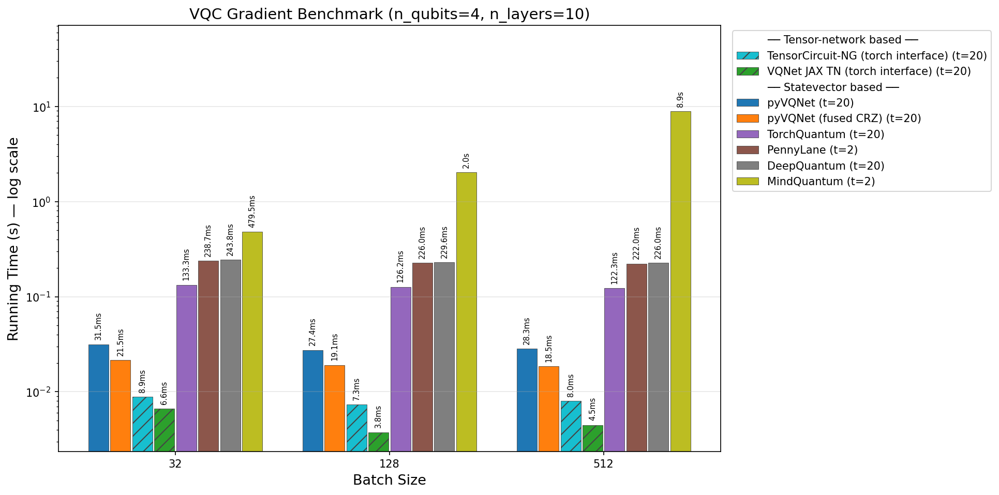
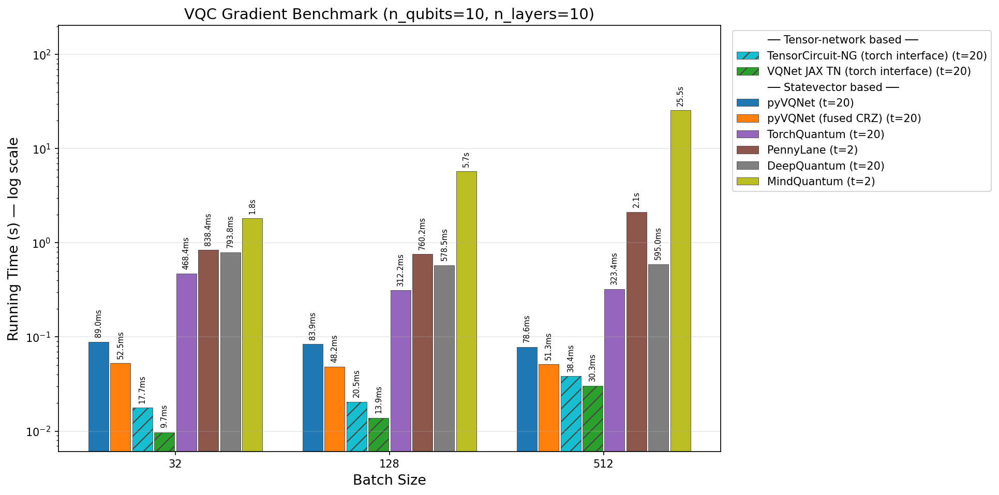

.. _torch_api:

============================================
VQNet Uses torch for Low-Level Computation
============================================

    .. important::

        **To use the following features, install torch 2.11.0 yourself.**
        **If you install the GPU version of torch, use a torch build compatible with CUDA 12.6. Otherwise, NVIDIA CUDA runtime library issues may prevent your torch from working.**
        **This software does not install torch automatically during installation.**

    .. note::

        The variational quantum computation interfaces on the torch backend, such as ``rx``, ``ry``, ``rz``, and ``cnot``, have high-performance CUDA kernels compiled for torch 2.11.0 + CUDA 12.6. When a matching torch and CUDA version pair is detected, this implementation is enabled automatically. If the versions do not match, it falls back to the native torch implementation.

Since version 2.15.0, this software has supported `pytorch` as the computational backend for low-level operations, allowing secondary development with PyTorch-based models, code, and third-party libraries.

    .. important::

        The variational quantum computation functions in :ref:`vqc_api` (lowercase names such as `rx`, `ry`, and `rz`), the basic QTensor computation functions in :ref:`qtensor_api`, and the classical and quantum neural network modules can accept ``QTensor`` input after ``pyvqnet.backends.set_backend("torch")``. Their `data` member changes from pyvqnet's ``_core.Tensor`` to ``torch.Tensor`` for computation.

        Use ``to_tensor`` to wrap a ``torch.Tensor`` as a ``QTensor``.

        When using a backend such as ``pytorch``, the neural network modules and pyqpanda quantum neural network modules must inherit from ``pyvqnet.nn.torch.TorchModule``, and automatic-differentiation variational quantum modules must inherit from ``pyvqnet.qnn.vqc.sv.torch.QModule``. Otherwise, their parameters cannot be trained by automatic differentiation or saved.

        In ``pyvqnet.nn.torch.TorchModule`` and ``pyvqnet.qnn.vqc.sv.torch.QModule``, the data in ``_buffers`` has type ``torch.Tensor``, and the data in ``_parmeters`` has type ``torch.nn.Parameter``; the QTensor interfaces cannot be used.

        Note: ``pyvqnet.backends.set_backend("torch")`` and ``pyvqnet.backends.set_backend("pyvqnet")`` modify the global runtime backend.
        ``QTensor`` objects created under different backend configurations use different underlying data structures and cannot be used together in computations.

Basic Backend Configuration
===========================

set_backend
------------------------------------------------

.. py:function:: pyvqnet.backends.set_backend(backend_name)

    This function switches the computation and data storage backend. You can choose pyvqnet native computation, C++ automatic differentiation, or the PyTorch-based backend, allowing flexible switching between different performance and compatibility requirements. The default is "pyvqnet-ad"; it can be set to "torch" (``torch-native`` and ``torch`` have been merged and have the same effect).

    After ``pyvqnet.backends.set_backend("pyvqnet")``, all ``data`` member variables of VQNet ``QTensor`` use ``pyvqnet._core.Tensor`` to store data, computation uses the pyvqnet C++ library, and automatic differentiation is completed in C++.

    ``pyvqnet.backends.set_backend("pyvqnet-ad")`` has the same effect as ``pyvqnet.backends.set_backend("pyvqnet")``.

    After ``pyvqnet.backends.set_backend("torch")``, the interfaces remain unchanged, and all ``data`` member variables of VQNet ``QTensor`` use ``torch.Tensor`` to store data.
    The interfaces in :ref:`qtensor_api`, :ref:`vqc_api`, and `pyvqnet.nn.torch` accept ``QTensor`` or ``torch.Tensor`` input and return ``torch.Tensor``.

    ``pyvqnet.backends.set_backend("torch-native")`` has the same effect as ``pyvqnet.backends.set_backend("torch")``.

    .. warning::

        This function modifies the current computation backend. ``QTensor`` objects obtained under different backends cannot be used together in computations.

    :param backend_name: backend name

    Example::

        import pyvqnet
        pyvqnet.backends.set_backend("torch")

get_backend
-------------------------------

.. py:function:: pyvqnet.backends.get_backend(t=None)

    If `t` is None, gets the current computation backend.
    If `t` is a QTensor, returns the computation backend used when the QTensor was created, based on its ``data`` attribute.
    If the backend in use is "torch", returns the pyvqnet torch API backend.
    If the backend in use is "pyvqnet", simply returns "pyvqnet".

    :param t: Current tensor. Default: None.
    :return: Backend. Returns "pyvqnet" by default.

    Example::

        import pyvqnet
        pyvqnet.backends.set_backend("torch")
        pyvqnet.backends.get_backend()

QTensor Functions
===================

After setting the ``torch`` computation backend:

.. code-block::

    import pyvqnet
    pyvqnet.backends.set_backend("torch")

All member functions, creation functions, mathematical functions, logical functions, matrix transformations, and so on under :ref:`qtensor_api` use torch for computation. Use ``QTensor.data`` to get the torch data.

Use ``to_tensor`` to wrap a ``torch.Tensor`` as a ``QTensor``.

Classical Neural Network Modules
============================================

Base Class
------------------------------------------------

TorchModule
^^^^^^^^^^^^^^^^^^^^^^^^^^^^^^^^^

.. py:class:: pyvqnet.nn.torch.TorchModule(*args, **kwargs)

    Base class that models should inherit from when using the `torch` backend.

    .. warning::

        This class inherits from ``pyvqnet.nn.torch.TorchModule``.
        This class can be added as a submodule of ``torch.nn.Module`` to a torch model.
        When using the torch backend, all modules should inherit from this class.

    .. warning::

        This class and its derived classes are only applicable to ``pyvqnet.backends.set_backend("torch")``. Do not mix them with ``Module`` under the default ``pyvqnet.nn``.

        The data in ``_buffers`` of this class has type ``torch.Tensor``.
        The data in ``_parmeters`` of this class has type ``torch.nn.Parameter``.

    .. py:method:: pyvqnet.nn.torch.TorchModule.forward(x, *args, **kwargs)

        Abstract forward computation function of the TorchModule class.

        :param x: Input QTensor.
        :param \*args: Non-keyword variable arguments.
        :param \*\*kwargs: Keyword variable arguments.

        :return: Output QTensor whose internal data is ``torch.Tensor``.

        Example::

            import numpy as np
            from pyvqnet.tensor import QTensor
            import pyvqnet
            pyvqnet.backends.set_backend("torch")
            from pyvqnet.nn.torch import Conv2D
            b = 2
            ic = 3
            oc = 2
            test_conv = Conv2D(ic, oc, (3, 3), (2, 2), "valid")
            x0 = QTensor(np.arange(1, b * ic * 5 * 5 + 1).reshape([b, ic, 5, 5]),
                        requires_grad=True,
                        dtype=pyvqnet.kfloat32)
            x = test_conv.forward(x0)
            print(x)

    .. py:method:: pyvqnet.nn.torch.TorchModule.state_dict(destination=None, prefix='')

        Returns a dictionary containing the entire state of the module, including parameters and buffer values.
        The keys are the names of the corresponding parameters and buffer values.

        :param destination: Dictionary used to save the internal module parameters.
        :param prefix: Naming prefix for the parameters and buffer values used.

        :return: Dictionary containing the entire state of the module.

        Example::

            from pyvqnet.nn.torch import Conv2D
            import pyvqnet
            pyvqnet.backends.set_backend("torch")
            test_conv = Conv2D(2,3,(3,3),(2,2),"same")
            print(test_conv.state_dict().keys())

    .. py:method:: pyvqnet.nn.torch.TorchModule.load_state_dict(state_dict,strict=True)

        Copies parameters and buffers from :attr:`state_dict` into this module and its submodules.

        :param state_dic: Dictionary containing parameters and persistent buffers.
        :param strict: Whether to strictly enforce that the keys in state_dict match the model's `state_dict()`. Default: True.

        :return: Error message if an error occurs.

        Example::

            from pyvqnet.nn.torch import TorchModule,Conv2D
            import pyvqnet

            import pyvqnet.utils
            pyvqnet.backends.set_backend("torch")
            class Net(TorchModule):
                def __init__(self):
                    super(Net, self).__init__()
                    self.conv1 = Conv2D(input_channels=1, output_channels=6, kernel_size=(5, 5),
                        stride=(1, 1), padding="valid")

                def forward(self, x):
                    return super().forward(x)

            model = Net()
            pyvqnet.utils.storage.save_parameters(model.state_dict(), "tmp.model")
            model_param = pyvqnet.utils.storage.load_parameters("tmp.model")
            model.load_state_dict(model_param)

    .. py:method:: pyvqnet.nn.torch.TorchModule.toGPU(device: int = DEV_GPU_0)

        Moves the parameters and buffer data of the module and its submodules to the specified GPU device.

        device specifies the device where the internal data is stored. When device >= DEV_GPU_0, data is stored on the GPU. If your computer has multiple GPUs, you can specify different devices to store data. For example, device = DEV_GPU_1, DEV_GPU_2, DEV_GPU_3, ... means data is stored on GPUs with different indices.

        .. warning::

            Modules cannot perform computations across different GPUs.
            If you try to create a QTensor on a GPU whose ID exceeds the maximum number of validated GPUs, a Cuda error is raised.

        :param device: Device on which the QTensor is currently stored. Default: DEV_GPU_0. device = pyvqnet.DEV_GPU_0 stores data on the first GPU, device = DEV_GPU_1 stores data on the second GPU, and so on.
        :return: The Module moved to the GPU device.

        Example::

            from pyvqnet.nn.torch import ConvT2D
            import pyvqnet
            pyvqnet.backends.set_backend("torch")
            test_conv = ConvT2D(3, 2, [4,4], [2, 2], (0,0))
            test_conv = test_conv.toGPU()
            print(test_conv.backend)
            #1000

    .. py:method:: pyvqnet.torch.TorchModule.toCPU()

        Moves the parameters and buffer data of the module and its submodules to the specified CPU device.

        :return: The Module moved to the CPU device.

        Example::

            from pyvqnet.nn.torch import ConvT2D
            import pyvqnet
            pyvqnet.backends.set_backend("torch")
            test_conv = ConvT2D(3, 2, [4,4], [2, 2], (0,0))
            test_conv = test_conv.toCPU()
            print(test_conv.backend)
            #0

TorchModuleList
^^^^^^^^^^^^^^^^^^^^^^^^^^^^^^^^

.. py:class:: pyvqnet.nn.torch.TorchModuleList(modules = None)

    This module is used to store sub-``TorchModule`` objects in a list. TorchModuleList can be indexed like a normal Python list, and the internal parameters it contains can be saved.

    .. warning::

        This class inherits from ``pyvqnet.nn.torch.TorchModule`` and ``pyvqnet.nn.ModuleList``, and can be added as a submodule of ``torch.nn.Module`` to a torch model.

    :param modules: List of ``pyvqnet.nn.torch.TorchModule``

    :return: A TorchModuleList class

    Example::

        from pyvqnet.tensor import *
        from pyvqnet.nn.torch import TorchModule,Linear,TorchModuleList

        import pyvqnet
        pyvqnet.backends.set_backend("torch")

        class M(TorchModule):
            def __init__(self):
                super(M, self).__init__()
                self.pqc2 = TorchModuleList([Linear(4,1), Linear(4,1)
                ])

            def forward(self, x):
                y = self.pqc2[0](x)  + self.pqc2[1](x)
                return y

        mm = M()

TorchParameterList
^^^^^^^^^^^^^^^^^^^^^^^^^^^^^^^^

.. py:class:: pyvqnet.nn.torch.TorchParameterList(values=None)

    This module is used to store sub-``pyvqnet.nn.Parameter`` objects in a list. TorchParameterList can be indexed like a normal Python list, and the internal parameters of the contained Parameters can be saved.

    .. warning::

        This class inherits from ``pyvqnet.nn.torch.TorchModule`` and ``pyvqnet.nn.ParameterList``, and can be added as a submodule of ``torch.nn.Module`` to a torch model.

    :param values: List of nn.Parameter

    :return: A TorchParameterList class

    Example::

        from pyvqnet.tensor import *
        from pyvqnet.nn.torch import TorchModule,Linear,TorchParameterList
        import pyvqnet.nn as nn
        import pyvqnet
        pyvqnet.backends.set_backend("torch")
        class MyModule(TorchModule):
            def __init__(self):
                super().__init__()
                self.params = TorchParameterList([nn.Parameter((10, 10)) for i in range(10)])
            def forward(self, x):

                # ParameterList can act as an iterable, or be indexed using ints
                for i, p in enumerate(self.params):
                    x = self.params[i // 2] * x + p * x
                return x

        model = MyModule()
        print(model.state_dict().keys())

TorchSequential
^^^^^^^^^^^^^^^^^^^^^^^^^^^^^^^^

.. py:class:: pyvqnet.nn.torch.TorchSequential(*args)

    Modules are added in the order they are passed. Alternatively, an ``OrderedDict`` of modules can be passed. The ``forward()`` method of ``Sequential`` accepts any input and forwards it to its first module.
    It then chains the output to the input of each subsequent module in order and returns the output of the last module.

    .. warning::

        This class inherits from ``pyvqnet.nn.torch.TorchModule`` and ``pyvqnet.nn.Sequential``, and can be added as a submodule of ``torch.nn.Module`` to a torch model.

    :param args: Modules to add

    :return: A TorchSequential class

    Example::

        import pyvqnet
        from collections import OrderedDict
        from pyvqnet.tensor import *
        from pyvqnet.nn.torch import TorchModule,Conv2D,ReLu,\
            TorchSequential
        pyvqnet.backends.set_backend("torch")
        model = TorchSequential(
                    Conv2D(1,20,(5, 5)),
                    ReLu(),
                    Conv2D(20,64,(5, 5)),
                    ReLu()
                )
        print(model.state_dict().keys())

        model = TorchSequential(OrderedDict([
                    ('conv1', Conv2D(1,20,(5, 5))),
                    ('relu1', ReLu()),
                    ('conv2', Conv2D(20,64,(5, 5))),
                    ('relu2', ReLu())
                ]))
        print(model.state_dict().keys())

Saving and Loading Model Parameters
--------------------------------------------

Use ``save_parameters`` and ``load_parameters`` in :ref:`save_parameters` to save ``TorchModule`` model parameters to a file as a dictionary, with values stored as `numpy.ndarray`, or to read a parameter file. Note that the file does not store the model structure; you need to build the model structure manually.
You can also use ``torch.save`` and ``torch.load`` directly to read ``torch`` model parameters, because the parameters of ``TorchModule`` are stored as ``torch.Tensor``.

Classical Neural Network Modules
--------------------------------------------

The following classical neural network modules inherit from ``pyvqnet.nn.Module`` and ``torch.nn.Module``, and can be added as submodules of ``torch.nn.Module`` to a torch model.

Linear
^^^^^^^^^^^^^^^^^^^^^^^^

.. py:class:: pyvqnet.nn.torch.Linear(input_channels, output_channels, weight_initializer=None, bias_initializer=None,use_bias=True, dtype=None, name: str = "")

    Linear module (fully connected layer).
    :math:`y = x@A.T + b`

    .. warning::

        This class inherits from ``pyvqnet.nn.torch.TorchModule``, and can be added as a submodule of ``torch.nn.Module`` to a torch model.

    The data in ``_buffers`` of this class has type ``torch.Tensor``.
    The data in ``_parmeters`` of this class has type ``torch.nn.Parameter``.

    :param input_channels: `int` - Number of input data channels.
    :param output_channels: `int` - Number of output data channels.
    :param weight_initializer: `callable` - Weight initialization function. Default is empty, which uses he_uniform.
    :param bias_initializer: `callable` - Bias initialization parameter. Default is empty, which uses he_uniform.
    :param use_bias: `bool` - Whether to use a bias term. Enabled by default.
    :param dtype: Data type of the parameters. Default: None, which uses the default data type kfloat32, representing 32-bit floating point numbers.
    :param name: Name of the linear layer. Default: "".

    :return: Linear layer instance.

    Example::

        import numpy as np
        import pyvqnet
        from pyvqnet.tensor import QTensor
        from pyvqnet.nn.torch import Linear
        pyvqnet.backends.set_backend("torch")
        c1 =2
        c2 = 3
        cin = 7
        cout = 5
        n = Linear(cin,cout)
        input = QTensor(np.arange(1,c1*c2*cin+1).reshape((c1,c2,cin)),requires_grad=True,dtype=pyvqnet.kfloat32)
        y = n.forward(input)
        print(y)

Conv1D
^^^^^^^^^^^^^^^^^^^^^^^^

.. py:class:: pyvqnet.nn.torch.Conv1D(input_channels:int,output_channels:int,kernel_size:int ,stride:int= 1,padding = "valid",use_bias:bool = True,kernel_initializer = None,bias_initializer =None, dilation_rate: int = 1, group: int = 1, dtype = None, name = "")

    Performs a one-dimensional convolution on the input. The input of the Conv1D module has shape (batch_size, input_channels, in_height).

    .. warning::

        This class inherits from ``pyvqnet.nn.torch.TorchModule``, and can be added as a submodule of ``torch.nn.Module`` to a torch model.

        The data in ``_buffers`` of this class has type ``torch.Tensor``.
        The data in ``_parmeters`` of this class has type ``torch.nn.Parameter``.

    :param input_channels: `int` - Number of input data channels.
    :param output_channels: `int` - Number of output data channels.
    :param kernel_size: `int` - Size of the convolution kernel. Kernel shape = [output_channels,input_channels/group,kernel_size,1].
    :param stride: `int` - Stride. Default: 1.
    :param padding: `str|int` - Padding option. It can be a string {'valid', 'same'} or an integer giving the amount of padding applied to the input. Default "valid".
    :param use_bias: `bool` - Whether to use a bias term. Enabled by default.
    :param kernel_initializer: `callable` - Kernel initialization method. Default is empty, which uses kaiming_uniform.
    :param bias_initializer: `callable` - Bias initialization method. Default is empty, which uses kaiming_uniform.
    :param dilation_rate: `int` - Dilation size. Default:  1.
    :param group: `int` -  Number of groups for grouped convolution. Default: 1.
    :param dtype: Data type of the parameters. Default: None, which uses the default data type kfloat32, representing 32-bit floating point numbers.
    :param name: Module name. Default: "".

    :return: One-dimensional convolution instance.

    .. warning::

        ``padding='valid'`` performs no padding.

        ``padding='same'`` pads the input with zeros; the output out_height = ceil(in_height / stride). stride>1 is not supported.

    Example::

        import numpy as np
        import pyvqnet
        from pyvqnet.tensor import QTensor
        from pyvqnet.nn.torch import Conv1D
        pyvqnet.backends.set_backend("torch")
        b= 2
        ic =3
        oc = 2
        test_conv = Conv1D(ic,oc,3,2)
        x0 = QTensor(np.arange(1,b*ic*5*5 +1).reshape([b,ic,25]),requires_grad=True,dtype=pyvqnet.kfloat32)
        x = test_conv.forward(x0)
        print(x)

Conv2D
^^^^^^^^^^^^^^^^^^^^^^^^

.. py:class:: pyvqnet.nn.torch.Conv2D(input_channels:int,output_channels:int,kernel_size:tuple,stride:tuple=(1, 1),padding="valid",use_bias = True,kernel_initializer=None,bias_initializer=None, dilation_rate: int = 1, group: int = 1, dtype = None, name = "")

    Performs a two-dimensional convolution on the input. The input of the Conv2D module has shape (batch_size, input_channels, height, width).

    .. warning::

        This class inherits from ``pyvqnet.nn.torch.TorchModule``, and can be added as a submodule of ``torch.nn.Module`` to a torch model.

        The data in ``_buffers`` of this class has type ``torch.Tensor``.
        The data in ``_parmeters`` of this class has type ``torch.nn.Parameter``.

    :param input_channels: `int` - Number of input data channels.
    :param output_channels: `int` - Number of output data channels.
    :param kernel_size: `tuple|list` - Size of the convolution kernel. Kernel shape = [output_channels,input_channels/group,kernel_size,kernel_size].
    :param stride: `tuple|list` - Stride. Default: (1, 1)|[1,1].
    :param padding: `str|tuple` - Padding option. It can be a string {'valid', 'same'} or a tuple of integers giving the implicit padding applied on both sides. Default "valid".
    :param use_bias: `bool` - Whether to use a bias term. Enabled by default.
    :param kernel_initializer: `callable` - Kernel initialization method. Default is empty, which uses kaiming_uniform.
    :param bias_initializer: `callable` - Bias initialization method. Default is empty, which uses kaiming_uniform.
    :param dilation_rate: `int` - Dilation size. Default:  1.
    :param group: `int` -  Number of groups for grouped convolution. Default: 1.
    :param dtype: Data type of the parameters. Default: None, which uses the default data type kfloat32, representing 32-bit floating point numbers.
    :param name: Module name. Default: "".

    :return: Two-dimensional convolution instance.

    .. note::

        ``padding='valid'`` performs no padding.
        ``padding='same'`` pads the input with zeros; the output out_height = ceil(in_height / stride). stride>1 is not supported.

    Example::

        import numpy as np
        import pyvqnet
        from pyvqnet.tensor import QTensor
        from pyvqnet.nn.torch import Conv2D
        pyvqnet.backends.set_backend("torch")
        b= 2
        ic =3
        oc = 2
        test_conv = Conv2D(ic,oc,(3,3),(2,2))
        x0 = QTensor(np.arange(1,b*ic*5*5+1).reshape([b,ic,5,5]),requires_grad=True,dtype=pyvqnet.kfloat32)
        x = test_conv.forward(x0)
        print(x)

ConvT2D
^^^^^^^^^^^^^^^^^^^^^^^^

.. py:class:: pyvqnet.nn.torch.ConvT2D(input_channels,output_channels,kernel_size,stride=[1, 1],padding=(0,0),use_bias="True", kernel_initializer=None,bias_initializer=None, dilation_rate: int = 1, out_padding = (0,0), group: int = 1, dtype = None, name = "")

    Performs a two-dimensional transposed convolution on the input. The input of the Conv2D module has shape (batch_size, input_channels, height, width).

    .. warning::

        This class inherits from ``pyvqnet.nn.torch.TorchModule``, and can be added as a submodule of ``torch.nn.Module`` to a torch model.

        The data in ``_buffers`` of this class has type ``torch.Tensor``.
        The data in ``_parmeters`` of this class has type ``torch.nn.Parameter``.

    :param input_channels: `int` - Number of input data channels.
    :param output_channels: `int` - Number of output data channels.
    :param kernel_size: `tuple|list` - Size of the convolution kernel. Kernel shape = [input_channels,output_channels/group,kernel_size,kernel_size].
    :param stride: `tuple|list` - Stride. Default: (1, 1)|[1,1].
    :param padding: `tuple` - Padding option, a tuple of integers giving the implicit padding applied on both sides. Default (0,0).
    :param use_bias: `bool` - Whether to use a bias term. Enabled by default.
    :param kernel_initializer: `callable` - Kernel initialization method. Default is empty, which uses kaiming_uniform.
    :param bias_initializer: `callable` - Bias initialization method. Default is empty, which uses kaiming_uniform.
    :param dilation_rate: `int` - Dilation size. Default:  1.
    :param out_padding: Extra size added on one side of each dimension in the output shape. Default: (0,0).
    :param group: `int` -  Number of groups for grouped convolution. Default: 1.
    :param dtype: Data type of the parameters. Default: None, which uses the default data type kfloat32, representing 32-bit floating point numbers.
    :param name: Module name. Default: "".

    :return: Two-dimensional transposed convolution instance.

    .. note::

        The torch backend accepts only integer tuples for ``padding``. The strings ``'valid'`` and
        ``'same'`` are not supported.

    Example::

        import numpy as np
        import pyvqnet
        from pyvqnet.tensor import QTensor
        from pyvqnet.nn.torch import ConvT2D
        pyvqnet.backends.set_backend("torch")
        test_conv = ConvT2D(3, 2, (3, 3), (1, 1))
        x = QTensor(np.arange(1, 1 * 3 * 5 * 5+1).reshape([1, 3, 5, 5]), requires_grad=True,dtype=pyvqnet.kfloat32)
        y = test_conv.forward(x)
        print(y)

AvgPool1D
^^^^^^^^^^^^^^^^^^^^^^^^

.. py:class:: pyvqnet.nn.torch.AvgPool1D(kernel, stride, padding=0, dtype=None, name="")

    Applies average pooling to one-dimensional input. The input has shape (batch_size, input_channels, in_height).

    .. warning::

        This class inherits from ``pyvqnet.nn.torch.TorchModule``, and can be added as a submodule of ``torch.nn.Module`` to a torch model.

        The data in ``_buffers`` of this class has type ``torch.Tensor``.
        The data in ``_parmeters`` of this class has type ``torch.nn.Parameter``.

    :param kernel: Window size for average pooling.
    :param stride: Stride for moving the window.
    :param padding: Padding option. An integer specifies the padding length. Default 0.
    :param name: Module name. Default: "".

    :return: One-dimensional average pooling layer instance.

    Example::

        import numpy as np
        import pyvqnet
        from pyvqnet.tensor import QTensor
        from pyvqnet.nn.torch import AvgPool1D
        pyvqnet.backends.set_backend("torch")
        test_mp = AvgPool1D([3],[2],0)
        x= QTensor(np.array([0, 1, 0, 4, 5,
                                    2, 3, 2, 1, 3,
                                    4, 4, 0, 4, 3,
                                    2, 5, 2, 6, 4,
                                    1, 0, 0, 5, 7],dtype=float).reshape([1,5,5]),requires_grad=True)

        y= test_mp.forward(x)
        print(y)

MaxPool1D
^^^^^^^^^^^^^^^^^^^^^^^^

.. py:class:: pyvqnet.nn.torch.MaxPool1D(kernel, stride, padding=0, dtype=None, name="")

    Applies max pooling to one-dimensional input. The input has shape (batch_size, input_channels, in_height).

    .. warning::

        This class inherits from ``pyvqnet.nn.torch.TorchModule``, and can be added as a submodule of ``torch.nn.Module`` to a torch model.

        The data in ``_buffers`` of this class has type ``torch.Tensor``.
        The data in ``_parmeters`` of this class has type ``torch.nn.Parameter``.

    :param kernel: Window size for max pooling.
    :param stride: Stride for moving the window.
    :param padding: Padding option. An integer specifies the padding length. Default 0.
    :param name: Name. Default: "".

    :return: One-dimensional max pooling layer instance.

    Example::

        import numpy as np
        import pyvqnet
        from pyvqnet.tensor import QTensor
        from pyvqnet.nn.torch import MaxPool1D
        pyvqnet.backends.set_backend("torch")
        test_mp = MaxPool1D([3],[2],0)
        x= QTensor(np.array([0, 1, 0, 4, 5,
                                    2, 3, 2, 1, 3,
                                    4, 4, 0, 4, 3,
                                    2, 5, 2, 6, 4,
                                    1, 0, 0, 5, 7],dtype=float).reshape([1,5,5]),requires_grad=True)

        y= test_mp.forward(x)
        print(y)

AvgPool2D
^^^^^^^^^^^^^^^^^^^^^^^^

.. py:class:: pyvqnet.nn.torch.AvgPool2D(kernel, stride, padding=(0,0), dtype=None, name="")

    Applies average pooling to two-dimensional input. The input has shape (batch_size, input_channels, height, width).

    .. warning::

        This class inherits from ``pyvqnet.nn.torch.TorchModule``, and can be added as a submodule of ``torch.nn.Module`` to a torch model.

        The data in ``_buffers`` of this class has type ``torch.Tensor``.
        The data in ``_parmeters`` of this class has type ``torch.nn.Parameter``.

    :param kernel: Window size for average pooling.
    :param stride: Stride for moving the window.
    :param padding: Padding option, a tuple containing 2 integers that specify the padding length in the two dimensions. Default: (0,0).
    :param name: Name. Default: "".

    :return: Two-dimensional average pooling layer instance.

    Example::

        import numpy as np
        import pyvqnet
        from pyvqnet.tensor import QTensor
        from pyvqnet.nn.torch import AvgPool2D
        pyvqnet.backends.set_backend("torch")
        test_mp = AvgPool2D([2,2],[2,2],1)
        x= QTensor(np.array([0, 1, 0, 4, 5,
                                    2, 3, 2, 1, 3,
                                    4, 4, 0, 4, 3,
                                    2, 5, 2, 6, 4,
                                    1, 0, 0, 5, 7],dtype=float).reshape([1,1,5,5]),requires_grad=True)

        y= test_mp.forward(x)
        print(y)

MaxPool2D
^^^^^^^^^^^^^^^^^^^^^^^^

.. py:class:: pyvqnet.nn.torch.MaxPool2D(kernel, stride, padding=(0,0), dtype=None, name="")

    Applies max pooling to two-dimensional input. The input has shape (batch_size, input_channels, height, width).

    .. warning::

        This class inherits from ``pyvqnet.nn.torch.TorchModule``, and can be added as a submodule of ``torch.nn.Module`` to a torch model.

        The data in ``_buffers`` of this class has type ``torch.Tensor``.
        The data in ``_parmeters`` of this class has type ``torch.nn.Parameter``.

    :param kernel: Window size for max pooling.
    :param stride: Stride for moving the window.
    :param padding: Padding option, a tuple containing 2 integers that specify the padding length in the two dimensions. Default: (0,0).
    :param name: Name. Default: "".

    :return: Two-dimensional max pooling layer instance.

    Example::

        import numpy as np
        import pyvqnet
        from pyvqnet.tensor import QTensor
        from pyvqnet.nn.torch import MaxPool2D
        pyvqnet.backends.set_backend("torch")
        test_mp = MaxPool2D([2,2],[2,2],(0,0))
        x= QTensor(np.array([0, 1, 0, 4, 5,
                                    2, 3, 2, 1, 3,
                                    4, 4, 0, 4, 3,
                                    2, 5, 2, 6, 4,
                                    1, 0, 0, 5, 7],dtype=float).reshape([1,1,5,5]),requires_grad=True)

        y= test_mp.forward(x)
        print(y)

Embedding
^^^^^^^^^^^^^^^^^^^^^^^^

.. py:class:: pyvqnet.nn.torch.Embedding(num_embeddings, embedding_dim, weight_initializer=xavier_normal, dtype=None, name: str = "")

    This module is typically used to store word embeddings and retrieve them by index. The input to the module is a list of indices, and the output is the corresponding word embeddings.
    The input to this layer should be kint64.

    .. warning::

        This class inherits from ``pyvqnet.nn.torch.TorchModule``, and can be added as a submodule of ``torch.nn.Module`` to a torch model.

        The data in ``_buffers`` of this class has type ``torch.Tensor``.
        The data in ``_parmeters`` of this class has type ``torch.nn.Parameter``.

    :param num_embeddings: `int` - Size of the embedding dictionary.
    :param embedding_dim: `int` - Size of each embedding vector
    :param weight_initializer: `callable` - Parameter initialization method. Default: normal distribution.
    :param dtype: Data type of the parameters. Default: None, which uses the default data type kfloat32, representing 32-bit floating point numbers.
    :param name: Name of the embedding layer. Default: "".

    :return: a Embedding instance.

    Example::

        import numpy as np
        import pyvqnet
        from pyvqnet.tensor import QTensor
        from pyvqnet.nn.torch import Embedding
        pyvqnet.backends.set_backend("torch")
        vlayer = Embedding(30,3)
        x = QTensor(np.arange(1,25).reshape([2,3,2,2]),dtype= pyvqnet.kint64)
        y = vlayer(x)
        print(y)

BatchNorm2d
^^^^^^^^^^^^^^^^^^^^^^^^

.. py:class:: pyvqnet.nn.torch.BatchNorm2d(channel_num:int, momentum:float=0.1, epsilon:float = 1e-5,affine = True, beta_initializer=zeros, gamma_initializer=ones, dtype=None, name="")

    Applies batch normalization on 4D input (B, C, H, W). See the paper
    `Batch Normalization: Accelerating Deep Network Training by Reducing
    Internal Covariate Shift <https://arxiv.org/abs/1502.03167>`__.

    .. warning::

        This class inherits from ``pyvqnet.nn.torch.TorchModule``, and can be added as a submodule of ``torch.nn.Module`` to a torch model.

        The data in ``_buffers`` of this class has type ``torch.Tensor``.
        The data in ``_parmeters`` of this class has type ``torch.nn.Parameter``.

    .. math::

        y = \frac{x - \mathrm{E}[x]}{\sqrt{\mathrm{Var}[x] + \epsilon}} * \gamma + \beta

    Here :math:`\gamma` and :math:`\beta` are trainable parameters. In addition, by default, during training this layer keeps running estimates of the mean and variance it computes, which are then used for normalization during evaluation. The running averages use the default momentum 0.1.

    :param channel_num: `int` - Number of input channels.
    :param momentum: `float` - Momentum used when computing the exponentially weighted average. Default: 0.1.
    :param epsilon: `float` - Numerical stability parameter. Default: 1e-5.
    :param affine: `bool` - A boolean value. When set to ``True``, this module has learnable per-channel affine parameters initialized to 1 (for weights) and 0 (for biases). Default: ``True``.
    :param beta_initializer: `callable` - Initialization method for beta. Default: all-zero initialization.
    :param gamma_initializer: `callable` - Initialization method for gamma. Default: all-one initialization.
    :param dtype: Data type of the parameters. Default: None, which uses the default data type kfloat32, representing 32-bit floating point numbers.
    :param name: Name of the batch normalization layer. Default: "".

    :return: Two-dimensional batch normalization layer instance.

    Example::

        import numpy as np
        import pyvqnet
        from pyvqnet.tensor import QTensor
        from pyvqnet.nn.torch import BatchNorm2d
        pyvqnet.backends.set_backend("torch")
        b = 2
        ic = 2
        test_conv = BatchNorm2d(ic)

        x = QTensor(np.arange(1, 17).reshape([b, ic, 4, 1]),
                    requires_grad=True,
                    dtype=pyvqnet.kfloat32)
        y = test_conv.forward(x)
        print(y)

BatchNorm1d
^^^^^^^^^^^^^^^^^^^^^^^^

.. py:class:: pyvqnet.nn.torch.BatchNorm1d(channel_num:int, momentum:float=0.1, epsilon:float = 1e-5, affine = True, beta_initializer=zeros, gamma_initializer=ones, dtype=None, name="")

    Applies batch normalization on 2D input (B,C). See the paper
    `Batch Normalization: Accelerating Deep Network Training by Reducing
    Internal Covariate Shift <https://arxiv.org/abs/1502.03167>`__.

    .. math::

        y = \frac{x - \mathrm{E}[x]}{\sqrt{\mathrm{Var}[x] + \epsilon}} * \gamma + \beta

    Here :math:`\gamma` and :math:`\beta` are trainable parameters. In addition, by default, during training this layer keeps running estimates of the mean and variance it computes, which are then used for normalization during evaluation. The running averages use the default momentum 0.1.

    .. warning::

        This class inherits from ``pyvqnet.nn.torch.TorchModule``, and can be added as a submodule of ``torch.nn.Module`` to a torch model.

        The data in ``_buffers`` of this class has type ``torch.Tensor``.
        The data in ``_parmeters`` of this class has type ``torch.nn.Parameter``.

    :param channel_num: `int` - Number of input channels.
    :param momentum: `float` - Momentum used when computing the exponentially weighted average. Default: 0.1.
    :param epsilon: `float` - Numerical stability constant. Default: 1e-5.
    :param affine: `bool` - A boolean value. When set to ``True``, this module has learnable per-channel affine parameters initialized to 1 (for weights) and 0 (for biases). Default: ``True``.
    :param beta_initializer: `callable` - Initialization method for beta. Default: all-zero initialization.
    :param gamma_initializer: `callable` - Initialization method for gamma. Default: all-one initialization.
    :param dtype: Data type of the parameters. Default: None, which uses the default data type kfloat32, representing 32-bit floating point numbers.
    :param name: Name of the batch normalization layer. Default: "".

    :return: One-dimensional batch normalization layer instance.

    Example::

        import numpy as np
        import pyvqnet
        from pyvqnet.tensor import QTensor
        from pyvqnet.nn.torch import BatchNorm1d
        pyvqnet.backends.set_backend("torch")
        test_conv = BatchNorm1d(4)

        x = QTensor(np.arange(1, 17).reshape([4, 4]),
                    requires_grad=True,
                    dtype=pyvqnet.kfloat32)
        y = test_conv.forward(x)
        print(y)

LayerNormNd
^^^^^^^^^^^^^^^^^^^^^^^^

.. py:class:: pyvqnet.nn.torch.LayerNormNd(normalized_shape: list, epsilon: float = 1e-5,affine=True, dtype=None, name="")

    Applies layer normalization over the last D dimensions of an arbitrary input. The specific method is described in the paper:
    `Layer Normalization <https://arxiv.org/abs/1607.06450>`__.

    .. math::
        y = \frac{x - \mathrm{E}[x]}{ \sqrt{\mathrm{Var}[x] + \epsilon}} * \gamma + \beta

    For an input such as (B,C,H,W,D), ``norm_shape`` can be [C,H,W,D], [H,W,D], [W,D], or [D].

    .. warning::

        This class inherits from ``pyvqnet.nn.torch.TorchModule``, and can be added as a submodule of ``torch.nn.Module`` to a torch model.

        The data in ``_buffers`` of this class has type ``torch.Tensor``.
        The data in ``_parmeters`` of this class has type ``torch.nn.Parameter``.

    :param norm_shape: `float` - Normalized shape.
    :param epsilon: `float` - Numerical stability constant. Default: 1e-5.
    :param affine: `bool` - A boolean value. When set to ``True``, this module has learnable per-channel affine parameters initialized to 1 (for weights) and 0 (for biases). Default: ``True``.
    :param dtype: Data type of the parameters. Default: None, which uses the default data type kfloat32, representing 32-bit floating point numbers.
    :param name: Name of this module. Default: "".

    :return: A LayerNormNd class

    Example::

        import numpy as np
        from pyvqnet.tensor import QTensor
        from pyvqnet import kfloat32
        from pyvqnet.nn.torch import LayerNormNd
        import pyvqnet
        pyvqnet.backends.set_backend("torch")
        ic = 4
        test_conv = LayerNormNd([2,2])
        x = QTensor(np.arange(1,17).reshape([2,2,2,2]),requires_grad=True,dtype=kfloat32)
        y = test_conv.forward(x)
        print(y)

LayerNorm2d
^^^^^^^^^^^^^^^^^^^^^^^^

.. py:class:: pyvqnet.nn.torch.LayerNorm2d(normalized_shape: Union[int, List[int], Tuple[int, ...]], epsilon:float=1e-5, affine=True, dtype=None, name="")

    Applies layer normalization on 4D input. The specific method is described in the paper:
    `Layer Normalization <https://arxiv.org/abs/1607.06450>`__.

    .. math::
        y = \frac{x - \mathrm{E}[x]}{ \sqrt{\mathrm{Var}[x] + \epsilon}} * \gamma + \beta

    The mean and standard deviation are computed over the remaining dimensions except the first. For an input such as (B,C,H,W), ``normalized_shape`` should equal C * H * W.

    .. warning::

        This class inherits from ``pyvqnet.nn.torch.TorchModule``, and can be added as a submodule of ``torch.nn.Module`` to a torch model.

        The data in ``_buffers`` of this class has type ``torch.Tensor``.
        The data in ``_parmeters`` of this class has type ``torch.nn.Parameter``.

    :param normalized_shape: `Union[int, List[int], Tuple[int, ...]]` - Normalized size, which should equal C * H * W.
    :param epsilon: `float` - Numerical stability constant. Default: 1e-5.
    :param affine: `bool` - A boolean value. When set to ``True``, this module has learnable per-channel affine parameters initialized to 1 (for weights) and 0 (for biases). Default: ``True``.
    :param dtype: Data type of the parameters. Default: None, which uses the default data type kfloat32, representing 32-bit floating point numbers.
    :param name: Name of this module. Default: "".

    :return: Two-dimensional layer normalization instance.

    Example::

        import numpy as np
        import pyvqnet
        from pyvqnet.tensor import QTensor
        from pyvqnet.nn.torch import LayerNorm2d
        import pyvqnet
        pyvqnet.backends.set_backend("torch")
        ic = 4
        test_conv = LayerNorm2d(8)
        x = QTensor(np.arange(1,17).reshape([2,2,4,1]),requires_grad=True,dtype=pyvqnet.kfloat32)
        y = test_conv.forward(x)
        print(y)

LayerNorm1d
^^^^^^^^^^^^^^^^^^^^^^^^

.. py:class:: pyvqnet.nn.torch.LayerNorm1d(normalized_shape: Union[int, List[int], Tuple[int, ...]], epsilon:float=1e-5, affine=True, dtype=None, name="")

    Applies layer normalization on 2D input. The specific method is described in the paper:
    `Layer Normalization <https://arxiv.org/abs/1607.06450>`__.

    .. math::
        y = \frac{x - \mathrm{E}[x]}{ \sqrt{\mathrm{Var}[x] + \epsilon}} * \gamma + \beta

    The mean and standard deviation are computed over the last dimension, where ``normalized_shape`` is the normalized size.

    .. warning::

        This class inherits from ``pyvqnet.nn.torch.TorchModule``, and can be added as a submodule of ``torch.nn.Module`` to a torch model.

        The data in ``_buffers`` of this class has type ``torch.Tensor``.
        The data in ``_parmeters`` of this class has type ``torch.nn.Parameter``.

    :param normalized_shape: `Union[int, List[int], Tuple[int, ...]]` - Normalized size, which should equal the size of the last dimension.
    :param epsilon: `float` - Numerical stability constant. Default: 1e-5.
    :param affine: `bool` - A boolean value. When set to ``True``, this module has learnable per-channel affine parameters initialized to 1 (for weights) and 0 (for biases). Default: ``True``.
    :param dtype: Data type of the parameters. Default: None, which uses the default data type kfloat32, representing 32-bit floating point numbers.
    :param name: Name of this module. Default: "".

    :return: One-dimensional layer normalization instance.

    Example::

        import numpy as np
        from pyvqnet.tensor import QTensor
        from pyvqnet.nn.torch import LayerNorm1d
        import pyvqnet
        pyvqnet.backends.set_backend("torch")
        test_conv = LayerNorm1d(4)
        x = QTensor(np.arange(1,17).reshape([4,4]),requires_grad=True,dtype=pyvqnet.kfloat32)
        y = test_conv.forward(x)
        print(y)

GroupNorm
^^^^^^^^^^^^^^^^^^^^^^^^

.. py:class:: pyvqnet.nn.torch.GroupNorm(num_groups: int, num_channels: int, epsilon = 1e-5, affine = True, dtype = None, name = "")

    Applies group normalization to mini-batch input. Input: :math:`(N, C, *)` where :math:`C=\mathrm{num\_channels}`, output: :math:`(N, C, *)`.

    This layer implements the operation described in the paper `Group Normalization <https://arxiv.org/abs/1803.08494>`__.

    .. math::

        y = \frac{x - \mathrm{E}[x]}{ \sqrt{\mathrm{Var}[x] + \epsilon}} * \gamma + \beta

    The input channels are divided into :attr:`num_groups` groups, each containing ``num_channels / num_groups`` channels. :attr:`num_channels` must be divisible by :attr:`num_groups`. The mean and standard deviation are computed separately within each group. If :attr:`affine` is ``True``, then :math:`\gamma` and :math:`\beta` are learnable. The per-channel affine transformation parameter vector has size :attr:`num_channels`.

    .. warning::

        This class inherits from ``pyvqnet.nn.torch.TorchModule``, and can be added as a submodule of ``torch.nn.Module`` to a torch model.

        The data in ``_buffers`` of this class has type ``torch.Tensor``.
        The data in ``_parmeters`` of this class has type ``torch.nn.Parameter``.

    :param num_groups (int): Number of groups into which the channels are divided
    :param num_channels (int): Number of expected channels in the input
    :param eps: Value added to the denominator for numerical stability. Default: 1e-5
    :param affine: A boolean value. When set to ``True``, this module has learnable per-channel affine parameters initialized to 1 (for weights) and 0 (for biases). Default: ``True``.
    :param dtype: Data type of the parameters. Default: None, which uses the default data type kfloat32, representing 32-bit floating point numbers.
    :param name: Name of this module. Default: "".

    :return: GroupNorm class object

    Example::

        import numpy as np
        from pyvqnet.tensor import QTensor,kfloat32
        from pyvqnet.nn.torch import GroupNorm
        import pyvqnet
        pyvqnet.backends.set_backend("torch")
        test_conv = GroupNorm(2,10)
        x = QTensor(np.arange(0,60*2*5).reshape([2,10,3,2,5]),requires_grad=True,dtype=kfloat32)
        y = test_conv.forward(x)
        print(y)

Dropout
^^^^^^^^^^^^^^^^^^^^^^^^

.. py:class:: pyvqnet.nn.torch.Dropout(dropout_rate: float = 0.5, name: str = "")

    Dropout module. The dropout module randomly sets the output of some units to zero while scaling up other units according to the given dropout_rate probability.

    .. warning::

        This class inherits from ``pyvqnet.nn.torch.TorchModule``, and can be added as a submodule of ``torch.nn.Module`` to a torch model.

    :param dropout_rate: `float` - Probability that a neuron is set to zero.
    :param name: Name of this module. Default: "".

    :return: Dropout instance.

    Example::

        import numpy as np
        from pyvqnet.nn.torch import Dropout
        from pyvqnet.tensor import arange
        import pyvqnet
        pyvqnet.backends.set_backend("torch")
        b = 2
        ic = 2
        x = arange(-1 * ic * 2 * 2.0,
                            (b - 1) * ic * 2 * 2).reshape([b, ic, 2, 2])
        droplayer = Dropout(0.5)
        droplayer.train()
        y = droplayer(x)
        print(y)

DropPath
^^^^^^^^^^^^^^^^^^^^^^^^

.. py:class:: pyvqnet.nn.torch.DropPath(dropout_rate = 0.5,name="")

    The DropPath module applies per-sample path dropout (stochastic depth).

    .. warning::

        This class inherits from ``pyvqnet.nn.torch.TorchModule``, and can be added as a submodule of ``torch.nn.Module`` to a torch model.

    :param dropout_rate: `float` - Probability that a neuron is set to zero.
    :param name: Name of this module. Default: "".

    :return: DropPath instance.

    Example::

        import pyvqnet.nn.torch as nn
        import pyvqnet.tensor as tensor
        import pyvqnet
        pyvqnet.backends.set_backend("torch")
        x = tensor.randu([4])
        y = nn.DropPath()(x)
        print(y)
        #[0.2008128,0.3908308,0.7102265,0.3784221]

Pixel_Shuffle
^^^^^^^^^^^^^^^^^^^^^^^^

.. py:class:: pyvqnet.nn.torch.Pixel_Shuffle(upscale_factors, name="")

    Rearranges a tensor of shape (*, C * r^2, H, W)
    to shape (*, C, H * r, W * r), where r is the upscale factor.

    .. warning::

        This class inherits from ``pyvqnet.nn.torch.TorchModule``, and can be added as a submodule of ``torch.nn.Module`` to a torch model.

    :param upscale_factors: Factor for the upscale transformation
    :param name: Name of this module. Default: "".

    :return:
            Pixel_Shuffle module

    Example::

        from pyvqnet.nn.torch import Pixel_Shuffle
        from pyvqnet.tensor import tensor
        import pyvqnet
        pyvqnet.backends.set_backend("torch")
        ps = Pixel_Shuffle(3)
        inx = tensor.ones([5,2,3,18,4,4])
        inx.requires_grad = True
        y = ps(inx)

Pixel_Unshuffle
^^^^^^^^^^^^^^^^^^^^^^^^

.. py:class:: pyvqnet.nn.torch.Pixel_Unshuffle(downscale_factors, name="")

    Reverses the Pixel_Shuffle operation by rearranging elements. Changes a tensor of shape (*, C, H * r, W * r) to (*, C * r^2, H, W), where r is the downscale factor.

    .. warning::

        This class inherits from ``pyvqnet.nn.torch.TorchModule``, and can be added as a submodule of ``torch.nn.Module`` to a torch model.

    :param downscale_factors: Factor for the downscale transformation
    :param name: Name of this module. Default: "".

    :return:
            Pixel_Unshuffle module

    Example::

        from pyvqnet.nn.torch import Pixel_Unshuffle
        from pyvqnet.tensor import tensor
        import pyvqnet
        pyvqnet.backends.set_backend("torch")
        ps = Pixel_Unshuffle(3)
        inx = tensor.ones([5, 2, 3, 2, 12, 12])
        inx.requires_grad = True
        y = ps(inx)

GRU
^^^^^^^^^^^^^^^^^^^^^^^^

.. py:class:: pyvqnet.nn.torch.GRU(input_size, hidden_size, num_layers=1, batch_first=True, use_bias=True, bidirectional=False, dtype=None, name: str = "")

    Gated recurrent unit (GRU) module. Supports multi-layer stacking and bidirectional configurations. The computation for a single-layer unidirectional GRU is as follows:

    .. math::
        \begin{array}{ll}
            r_t = \sigma(W_{ir} x_t + b_{ir} + W_{hr} h_{(t-1)} + b_{hr}) \\
            z_t = \sigma(W_{iz} x_t + b_{iz} + W_{hz} h_{(t-1)} + b_{hz}) \\
            n_t = \tanh(W_{in} x_t + b_{in} + r_t * (W_{hn} h_{(t-1)}+ b_{hn})) \\
            h_t = (1 - z_t) * n_t + z_t * h_{(t-1)}
        \end{array}

    .. warning::

        This class inherits from ``pyvqnet.nn.torch.TorchModule``, and can be added as a submodule of ``torch.nn.Module`` to a torch model.

        The data in ``_buffers`` of this class has type ``torch.Tensor``.
        The data in ``_parmeters`` of this class has type ``torch.nn.Parameter``.

    :param input_size: Input feature dimension.
    :param hidden_size:  Hidden feature dimension.
    :param num_layers: Number of stacked GRU layers. Default: 1.
    :param batch_first: If True, the input shape is [batch_size,seq_len,feature_dim]; if False, the input shape is [seq_len,batch_size,feature_dim]. Default: True.
    :param use_bias: If False, the module does not use a bias term. Default: True.
    :param bidirectional: If True, becomes a bidirectional GRU. Default: False.
    :param dtype: Data type of the parameters. Default: None, which uses the default data type kfloat32, representing 32-bit floating point numbers.
    :param name: Name of this module. Default: "".

    :return: GRU instance

    Example::

        import pyvqnet
        pyvqnet.backends.set_backend("torch")
        from pyvqnet.nn.torch import GRU
        from pyvqnet.tensor import tensor

        rnn2 = GRU(4, 6, 2, batch_first=False, bidirectional=True)

        input = tensor.ones([5, 3, 4])
        h0 = tensor.ones([4, 3, 6])

        output, hn = rnn2(input, h0)

RNN
^^^^^^^^^^^^^^^^^^^^^^^^

.. py:class:: pyvqnet.nn.torch.RNN(input_size, hidden_size, num_layers=1, nonlinearity='tanh', batch_first=True, use_bias=True, bidirectional=False, dtype=None, name: str = "")

    Recurrent neural network (RNN) module using :math:`\tanh` or :math:`\text{ReLU}` as the activation function. Supports bidirectional and multi-layer configurations.
    The computation for a single-layer unidirectional RNN is as follows:

    .. math::
        h_t = \tanh(W_{ih} x_t + b_{ih} + W_{hh} h_{(t-1)} + b_{hh})

    If :attr:`nonlinearity` is ``'relu'``, then :math:`\text{ReLU}` replaces :math:`\tanh`.

    .. warning::

        This class inherits from ``pyvqnet.nn.torch.TorchModule``, and can be added as a submodule of ``torch.nn.Module`` to a torch model.

        The data in ``_buffers`` of this class has type ``torch.Tensor``.
        The data in ``_parmeters`` of this class has type ``torch.nn.Parameter``.

    :param input_size: Input feature dimension.
    :param hidden_size:  Hidden feature dimension.
    :param num_layers: Number of stacked RNN layers. Default: 1.
    :param nonlinearity: Nonlinear activation function. Default: ``'tanh'``.
    :param batch_first: If True, the input shape is [batch_size,seq_len,feature_dim]; if False, the input shape is [seq_len,batch_size,feature_dim]. Default: True.
    :param use_bias: If False, the module does not use a bias term. Default: True.
    :param bidirectional: If True, becomes a bidirectional RNN. Default: False.
    :param dtype: Data type of the parameters. Default: None, which uses the default data type kfloat32, representing 32-bit floating point numbers.
    :param name: Name of this module. Default: "".

    :return: RNN instance

    Example::

        import pyvqnet
        pyvqnet.backends.set_backend("torch")
        from pyvqnet.nn.torch import RNN
        from pyvqnet.tensor import tensor

        rnn2 = RNN(4, 6, 2, batch_first=False, bidirectional = True)

        input = tensor.ones([5, 3, 4])
        h0 = tensor.ones([4, 3, 6])
        output, hn = rnn2(input, h0)

LSTM
^^^^^^^^^^^^^^^^^^^^^^^^

.. py:class:: pyvqnet.nn.torch.LSTM(input_size, hidden_size, num_layers=1, batch_first=True, use_bias=True, bidirectional=False, dtype=None, name: str = "")

    Long short-term memory (LSTM) module. Supports configurations such as bidirectional LSTM and stacked multi-layer LSTM. The computation for a single-layer unidirectional LSTM is as follows:

    .. math::
        \begin{array}{ll} \\
            i_t = \sigma(W_{ii} x_t + b_{ii} + W_{hi} h_{t-1} + b_{hi}) \\
            f_t = \sigma(W_{if} x_t + b_{if} + W_{hf} h_{t-1} + b_{hf}) \\
            g_t = \tanh(W_{ig} x_t + b_{ig} + W_{hg} h_{t-1} + b_{hg}) \\
            o_t = \sigma(W_{io} x_t + b_{io} + W_{ho} h_{t-1} + b_{ho}) \\
            c_t = f_t \odot c_{t-1} + i_t \odot g_t \\
            h_t = o_t \odot \tanh(c_t) \\
        \end{array}

    .. warning::

        This class inherits from ``pyvqnet.nn.torch.TorchModule``, and can be added as a submodule of ``torch.nn.Module`` to a torch model.

        The data in ``_buffers`` of this class has type ``torch.Tensor``.
        The data in ``_parmeters`` of this class has type ``torch.nn.Parameter``.

    :param input_size: Input feature dimension.
    :param hidden_size:  Hidden feature dimension.
    :param num_layers: Number of stacked LSTM layers. Default: 1.
    :param batch_first: If True, the input shape is [batch_size,seq_len,feature_dim]; if False, the input shape is [seq_len,batch_size,feature_dim]. Default: True.
    :param use_bias: If False, the module does not use a bias term. Default: True.
    :param bidirectional: If True, becomes a bidirectional LSTM. Default: False.
    :param dtype: Data type of the parameters. Default: None, which uses the default data type kfloat32, representing 32-bit floating point numbers.
    :param name: Name of this module. Default: "".

    :return: LSTM instance

    Example::

        import pyvqnet
        pyvqnet.backends.set_backend("torch")
        from pyvqnet.nn.torch import LSTM
        from pyvqnet.tensor import tensor

        rnn2 = LSTM(4, 6, 2, batch_first=False, bidirectional = True)

        input = tensor.ones([5, 3, 4])
        h0 = tensor.ones([4, 3, 6])
        c0 = tensor.ones([4, 3, 6])
        output, (hn, cn) = rnn2(input, (h0, c0))

Dynamic_GRU
^^^^^^^^^^^^^^^^^^^^^^^^

.. py:class:: pyvqnet.nn.torch.Dynamic_GRU(input_size,hidden_size, num_layers=1, batch_first=True, use_bias=True, bidirectional=False, dtype=None, name: str = "")

    Applies a multi-layer gated recurrent unit (GRU) RNN to dynamically sized input sequences.

    The first input should be a batched sequence input defining variable lengths
    through the ``tensor.PackedSequence`` class.
    The ``tensor.PackedSequence`` class can be constructed by
    calling the following functions in succession: ``pad_sequence`` and ``pack_pad_sequence``.

    The first output of Dynamic_GRU is also a ``tensor.PackedSequence`` class,
    which can be unpacked into a regular QTensor using ``tensor.pad_pack_sequence``.

    For each element in the input sequence, each layer computes the following:

    .. math::
        \begin{array}{ll}
            r_t = \sigma(W_{ir} x_t + b_{ir} + W_{hr} h_{(t-1)} + b_{hr}) \\
            z_t = \sigma(W_{iz} x_t + b_{iz} + W_{hz} h_{(t-1)} + b_{hz}) \\
            n_t = \tanh(W_{in} x_t + b_{in} + r_t * (W_{hn} h_{(t-1)}+ b_{hn})) \\
            h_t = (1 - z_t) * n_t + z_t * h_{(t-1)}
        \end{array}

    .. warning::

        This class inherits from ``pyvqnet.nn.torch.TorchModule``, and can be added as a submodule of ``torch.nn.Module`` to a torch model.

        The data in ``_buffers`` of this class has type ``torch.Tensor``.
        The data in ``_parmeters`` of this class has type ``torch.nn.Parameter``.

    :param input_size: Input feature dimension.
    :param hidden_size: Hidden feature dimension.
    :param num_layers: Number of recurrent layers. Default: 1
    :param batch_first: If True, the input shape is provided as [batch size, sequence length, feature dimension]. If False, the input shape is provided as [sequence length, batch size, feature dimension]. Default: True.
    :param use_bias: If False, this layer does not use the bias weights b_ih and b_hh. Default: True.
    :param bidirectional: If true, becomes a bidirectional GRU. Default: False.
    :param dtype: Data type of the parameters. Default: None, which uses the default data type kfloat32, representing 32-bit floating point numbers.
    :param name: Name of this module. Default: "".

    :return: A Dynamic_GRU class

    Example::

        import pyvqnet
        pyvqnet.backends.set_backend("torch")
        from pyvqnet.nn.torch import Dynamic_GRU
        from pyvqnet.tensor import tensor
        seq_len = [4,1,2]
        input_size = 4
        batch_size =3
        hidden_size = 2
        ml = 2
        rnn2 = Dynamic_GRU(input_size,
                        hidden_size=2,
                        num_layers=2,
                        batch_first=False,
                        bidirectional=True)

        a = tensor.arange(1, seq_len[0] * input_size + 1).reshape(
            [seq_len[0], input_size])
        b = tensor.arange(1, seq_len[1] * input_size + 1).reshape(
            [seq_len[1], input_size])
        c = tensor.arange(1, seq_len[2] * input_size + 1).reshape(
            [seq_len[2], input_size])

        y = tensor.pad_sequence([a, b, c], False)

        input = tensor.pack_pad_sequence(y,
                                        seq_len,
                                        batch_first=False,
                                        enforce_sorted=False)

        h0 = tensor.ones([ml * 2, batch_size, hidden_size])

        output, hn = rnn2(input, h0)

        seq_unpacked, lens_unpacked = \
        tensor.pad_packed_sequence(output, batch_first=False)

Dynamic_RNN
^^^^^^^^^^^^^^^^^^^^^^^^

.. py:class:: pyvqnet.nn.torch.Dynamic_RNN(input_size, hidden_size, num_layers=1, nonlinearity='tanh', batch_first=True, use_bias=True, bidirectional=False, dtype=None, name: str = "")

    Applies a recurrent neural network RNN to dynamically sized input sequences.

    The first input should be a batched sequence input defining variable lengths
    through the ``tensor.PackedSequence`` class.
    The ``tensor.PackedSequence`` class can be constructed by
    calling the following functions in succession: ``pad_sequence`` and ``pack_pad_sequence``.

    The first output of Dynamic_RNN is also a ``tensor.PackedSequence`` class,
    which can be unpacked into a regular QTensor using ``tensor.pad_pack_sequence``.

    Recurrent neural network (RNN) module using :math:`\tanh` or :math:`\text{ReLU}` as the activation function. Supports bidirectional and multi-layer configurations.
    The computation for a single-layer unidirectional RNN is as follows:

    .. math::
        h_t = \tanh(W_{ih} x_t + b_{ih} + W_{hh} h_{(t-1)} + b_{hh})

    If :attr:`nonlinearity` is ``'relu'``, then :math:`\text{ReLU}` replaces :math:`\tanh`.

    .. warning::

        This class inherits from ``pyvqnet.nn.torch.TorchModule``, and can be added as a submodule of ``torch.nn.Module`` to a torch model.

        The data in ``_buffers`` of this class has type ``torch.Tensor``.
        The data in ``_parmeters`` of this class has type ``torch.nn.Parameter``.

    :param input_size: Input feature dimension.
    :param hidden_size:  Hidden feature dimension.
    :param num_layers: Number of stacked RNN layers. Default: 1.
    :param nonlinearity: Nonlinear activation function. Default: ``'tanh'``.
    :param batch_first: If True, the input shape is [batch size, sequence length, feature dimension]; if False, the input shape is [sequence length, batch size, feature dimension]. Default: True.
    :param use_bias: If False, the module does not use a bias term. Default: True.
    :param bidirectional: If True, becomes a bidirectional RNN. Default: False.
    :param dtype: Data type of the parameters. Default: None, which uses the default data type kfloat32, representing 32-bit floating point numbers.
    :param name: Name of this module. Default: "".

    :return: Dynamic_RNN instance

    Example::

        import pyvqnet
        pyvqnet.backends.set_backend("torch")
        from pyvqnet.nn.torch import Dynamic_RNN
        from pyvqnet.tensor import tensor
        seq_len = [4,1,2]
        input_size = 4
        batch_size =3
        hidden_size = 2
        ml = 2
        rnn2 = Dynamic_RNN(input_size,
                        hidden_size=2,
                        num_layers=2,
                        batch_first=False,
                        bidirectional=True,
                        nonlinearity='relu')

        a = tensor.arange(1, seq_len[0] * input_size + 1).reshape(
            [seq_len[0], input_size])
        b = tensor.arange(1, seq_len[1] * input_size + 1).reshape(
            [seq_len[1], input_size])
        c = tensor.arange(1, seq_len[2] * input_size + 1).reshape(
            [seq_len[2], input_size])

        y = tensor.pad_sequence([a, b, c], False)

        input = tensor.pack_pad_sequence(y,
                                        seq_len,
                                        batch_first=False,
                                        enforce_sorted=False)

        h0 = tensor.ones([ml * 2, batch_size, hidden_size])

        output, hn = rnn2(input, h0)

        seq_unpacked, lens_unpacked = \
        tensor.pad_packed_sequence(output, batch_first=False)

Dynamic_LSTM
^^^^^^^^^^^^^^^^^^^^^^^^

.. py:class:: pyvqnet.nn.torch.Dynamic_LSTM(input_size, hidden_size, num_layers=1, batch_first=True, use_bias=True, bidirectional=False, dtype=None, name: str = "")

    Applies a long short-term memory (LSTM) RNN to dynamically sized input sequences.

    The first input should be a batched sequence input defining variable lengths
    through the ``tensor.PackedSequence`` class.
    The ``tensor.PackedSequence`` class can be constructed by
    calling the following functions in succession: ``pad_sequence`` and ``pack_pad_sequence``.

    The first output of Dynamic_LSTM is also a ``tensor.PackedSequence`` class,
    which can be unpacked into a regular QTensor using ``tensor.pad_pack_sequence``.

    Recurrent neural network (RNN) module using :math:`\tanh` or :math:`\text{ReLU}` as the activation function. Supports bidirectional and multi-layer configurations.
    The computation for a single-layer unidirectional RNN is as follows:

    .. math::
        \begin{array}{ll} \\
            i_t = \sigma(W_{ii} x_t + b_{ii} + W_{hi} h_{t-1} + b_{hi}) \\
            f_t = \sigma(W_{if} x_t + b_{if} + W_{hf} h_{t-1} + b_{hf}) \\
            g_t = \tanh(W_{ig} x_t + b_{ig} + W_{hg} h_{t-1} + b_{hg}) \\
            o_t = \sigma(W_{io} x_t + b_{io} + W_{ho} h_{t-1} + b_{ho}) \\
            c_t = f_t \odot c_{t-1} + i_t \odot g_t \\
            h_t = o_t \odot \tanh(c_t) \\
        \end{array}

    .. warning::

        This class inherits from ``pyvqnet.nn.torch.TorchModule``, and can be added as a submodule of ``torch.nn.Module`` to a torch model.

        The data in ``_buffers`` of this class has type ``torch.Tensor``.
        The data in ``_parmeters`` of this class has type ``torch.nn.Parameter``.

    :param input_size: Input feature dimension.
    :param hidden_size:  Hidden feature dimension.
    :param num_layers: Number of stacked LSTM layers. Default: 1.
    :param batch_first: If True, the input shape is [batch size, sequence length, feature dimension]; if False, the input shape is [sequence length, batch size, feature dimension]. Default: True.
    :param use_bias: If False, the module does not use a bias term. Default: True.
    :param bidirectional: If True, becomes a bidirectional LSTM. Default: False.
    :param dtype: Data type of the parameters. Default: None, which uses the default data type kfloat32, representing 32-bit floating point numbers.
    :param name: Name of this module. Default: "".

    :return: Dynamic_LSTM instance

    Example::

        import pyvqnet
        pyvqnet.backends.set_backend("torch")
        from pyvqnet.nn.torch import Dynamic_LSTM
        from pyvqnet.tensor import tensor

        input_size = 2
        hidden_size = 2
        ml = 2
        seq_len = [3, 4, 1]
        batch_size = 3
        rnn2 = Dynamic_LSTM(input_size,
                            hidden_size=hidden_size,
                            num_layers=ml,
                            batch_first=False,
                            bidirectional=True)

        a = tensor.arange(1, seq_len[0] * input_size + 1).reshape(
            [seq_len[0], input_size])
        b = tensor.arange(1, seq_len[1] * input_size + 1).reshape(
            [seq_len[1], input_size])
        c = tensor.arange(1, seq_len[2] * input_size + 1).reshape(
            [seq_len[2], input_size])
        a.requires_grad = True
        b.requires_grad = True
        c.requires_grad = True
        y = tensor.pad_sequence([a, b, c], False)

        input = tensor.pack_pad_sequence(y,
                                        seq_len,
                                        batch_first=False,
                                        enforce_sorted=False)

        h0 = tensor.ones([ml * 2, batch_size, hidden_size])
        c0 = tensor.ones([ml * 2, batch_size, hidden_size])

        output, (hn, cn) = rnn2(input, (h0, c0))

        seq_unpacked, lens_unpacked = \
        tensor.pad_packed_sequence(output, batch_first=False)

Interpolate
^^^^^^^^^^^^^^^^^^^^^^^^

.. py:class:: pyvqnet.nn.torch.Interpolate(size = None, scale_factor = None, mode = "nearest", align_corners = None,  recompute_scale_factor = None, name = "")

    Downsamples or upsamples the input.

    Currently only 4D input data is supported.

    The input dimensions are interpreted as `B x C x H x W`.

    The available `mode` values are ``nearest``, ``bilinear``, and ``bicubic``.

    .. warning::

        This class inherits from ``pyvqnet.nn.torch.TorchModule``, and can be added as a submodule of ``torch.nn.Module`` to a torch model.

    :param size: Output size. Default: None.
    :param scale_factor: Scale factor. Default: None.
    :param mode: Algorithm used for upsampling: ``nearest`` | ``bilinear`` | ``bicubic``.
    :param align_corners:  From a geometric point of view, we treat the pixels of the input and output as squares rather than points.
            If set to `true`, the input and output tensors are aligned by the center points of their corner pixels, preserving the values of the corner pixels.
            If set to `false`, the input and output tensors are aligned by the corner points of their corner pixels, and the interpolation uses edge value padding
            for out-of-boundary values, making this operation independent of the input size
            when ``scale_factor`` is kept the same. This only works when ``mode`` is ``bilinear``.
    :param recompute_scale_factor: Recompute the scale factor for use in the interpolation calculation. When ``scale_factor`` is passed as an argument, it is used to compute the output size.
    :param name: Module name.

    Example::

        from pyvqnet.nn.torch import Interpolate
        from pyvqnet.tensor import tensor
        import pyvqnet
        pyvqnet.backends.set_backend("torch")
        pyvqnet.utils.set_random_seed(1)

        mode_ = "bilinear"
        size_ = 3

        model = Interpolate(size=size_, mode=mode_)
        input_vqnet = tensor.randu((1, 1, 6, 6),
                                dtype=pyvqnet.kfloat32,
                                requires_grad=True)
        output_vqnet = model(input_vqnet)

SDPA
^^^^^^^^^^^^^^^^^^^^^^^^

.. py:class:: pyvqnet.nn.torch.SDPA(attn_mask=None,dropout_p=0.,scale=None,is_causal=False)

    Class for computing scaled dot-product attention over query, key, and value tensors.

    .. warning::

        This class inherits from ``pyvqnet.nn.torch.TorchModule``, and can be added as a submodule of ``torch.nn.Module`` to a torch model.

    :param attn_mask: Attention mask. Default: None. Its shape must be broadcastable to the shape of the attention weights.
    :param dropout_p: Dropout probability. Default: 0. If greater than 0.0, dropout is applied.
    :param scale: Scaling factor applied before softmax. Default: None.
    :param is_causal: Default: False. If set to true, when the mask is a square matrix, the attention mask is a lower triangular matrix. Setting both attn_mask and is_causal raises an error.
    :return: An SDPA class

    Example::

        from pyvqnet.nn.torch import SDPA
        from pyvqnet import tensor
        import pyvqnet
        pyvqnet.backends.set_backend("torch")
        model = SDPA(tensor.QTensor([1.]))

    .. py:method:: forward(query,key,value)

        Performs forward computation

        :param query: Query input QTensor.
        :param key: Key input QTensor.
        :param value: Value input QTensor.
        :return: QTensor returned by the SDPA computation.

        Example::

            from pyvqnet.nn.torch import SDPA
            from pyvqnet import tensor
            import pyvqnet
            pyvqnet.backends.set_backend("torch")

            import numpy as np

            model = SDPA(tensor.QTensor([1.]))

            query_np = np.random.randn(3, 3, 3, 5).astype(np.float32)
            key_np = np.random.randn(3, 3, 3, 5).astype(np.float32)
            value_np = np.random.randn(3, 3, 3, 5).astype(np.float32)

            query_p = tensor.QTensor(query_np, dtype=pyvqnet.kfloat32, requires_grad=True)
            key_p = tensor.QTensor(key_np, dtype=pyvqnet.kfloat32, requires_grad=True)
            value_p = tensor.QTensor(value_np, dtype=pyvqnet.kfloat32, requires_grad=True)

            out_sdpa = model(query_p, key_p, value_p)

            out_sdpa.backward(pyvqnet.tensor.ones_like(out_sdpa))

Loss Function Interfaces
------------------------

MeanSquaredError
^^^^^^^^^^^^^^^^^^^^^^^^

.. py:class:: pyvqnet.nn.torch.MeanSquaredError(name="")

    Computes the mean squared error between the input :math:`x` and the target value :math:`y`.

    The squared error can be described by the following function:

    .. math::
        \ell(x, y) = L = \{l_1,\dots,l_N\}^\top, \quad
        l_n = \left( x_n - y_n \right)^2,

    :math:`x` and :math:`y` are QTensors of arbitrary shape. The mean squared error over the :math:`n` elements is computed as follows.

    .. math::
        \ell(x, y) =
            \operatorname{mean}(L)

    .. warning::

        This class inherits from ``pyvqnet.nn.torch.TorchModule``, and can be added as a submodule of ``torch.nn.Module`` to a torch model.

    :param name: Name of this module. Default: "".
    :return: A mean squared error instance.

    Required parameters for the forward computation function of mean squared error:

        x: :math:`(N, *)` predicted values, where :math:`*` denotes any dimension.

        y: :math:`(N, *)` target values, a QTensor with the same dimensions as the input.

    .. note::

            Note that, unlike frameworks such as PyTorch, in the forward function of the following MeanSquaredError function, the first parameter is the target value and the second parameter is the predicted value.

    Example::

        from pyvqnet.tensor import QTensor
        from pyvqnet import kfloat64
        from pyvqnet.nn.torch import MeanSquaredError
        import pyvqnet
        pyvqnet.backends.set_backend("torch")
        y = QTensor([[0, 0, 1, 0, 0, 0, 0, 0, 0, 0]],
                    requires_grad=False,
                    dtype=kfloat64)
        x = QTensor([[0.1, 0.05, 0.7, 0, 0.05, 0.1, 0, 0, 0, 0]],
                    requires_grad=True,
                    dtype=kfloat64)

        loss_result = MeanSquaredError()
        result = loss_result(y, x)
        print(result)

BinaryCrossEntropy
^^^^^^^^^^^^^^^^^^^^^^^^

.. py:class:: pyvqnet.nn.torch.BinaryCrossEntropy(name="")

    Measures the average binary cross-entropy loss between the target and the input.

    The binary cross-entropy without averaging is as follows:

    .. math::
        \ell(x, y) = L = \{l_1,\dots,l_N\}^\top, \quad
        l_n = - w_n \left[ y_n \cdot \log x_n + (1 - y_n) \cdot \log (1 - x_n) \right],

    If :math:`N` is the batch size, the average binary cross-entropy is:

    .. math::
        \ell(x, y) = \operatorname{mean}(L)

    .. warning::

        This class inherits from ``pyvqnet.nn.torch.TorchModule``, and can be added as a submodule of ``torch.nn.Module`` to a torch model.

    :param name: Name of this module. Default: "".
    :return: An average binary cross-entropy instance.

    Required parameters for the forward computation function of average binary cross-entropy error:

        x: :math:`(N, *)` predicted values, where :math:`*` denotes any dimension.

        y: :math:`(N, *)` target values, a QTensor with the same dimensions as the input.

    .. note::

            Note that, unlike frameworks such as PyTorch, in the forward function of the BinaryCrossEntropy function, the first parameter is the target value and the second parameter is the predicted value.

    Example::

        from pyvqnet.tensor import QTensor
        from pyvqnet.nn.torch import BinaryCrossEntropy
        import pyvqnet
        pyvqnet.backends.set_backend("torch")
        x = QTensor([[0.3, 0.7, 0.2], [0.2, 0.3, 0.1]], requires_grad=True)
        y = QTensor([[0.0, 1.0, 0], [0.0, 0, 1]], requires_grad=False)

        loss_result = BinaryCrossEntropy()
        result = loss_result(y, x)
        result.backward(pyvqnet.tensor.ones_like(result))
        print(result)

CategoricalCrossEntropy
^^^^^^^^^^^^^^^^^^^^^^^^^^^^^^^^^^^^^^^^^

.. py:class:: pyvqnet.nn.torch.CategoricalCrossEntropy(name="")

    This loss function computes the average categorical cross-entropy with LogSoftmax and NLLLoss together.

    The loss function is computed as follows, where class is the class label corresponding to the target value:

    .. math::
        \text{loss}(x, y) = -\log\left(\frac{\exp(x[class])}{\sum_j \exp(x[j])}\right)
                       = -x[class] + \log\left(\sum_j \exp(x[j])\right)

    :param name: Name of this module. Default: "".
    :return: Average categorical cross-entropy instance.

    Required parameters for the error forward computation function:

        x: :math:`(N, *)` predicted values, where :math:`*` denotes any dimension.

        y: :math:`(N, *)` target values, a QTensor with the same dimensions as the input. Must be 64-bit integers, kint64.

    .. note::

            Note that, unlike frameworks such as PyTorch, in the forward function of the CategoricalCrossEntropy function, the first parameter is the target value and the second parameter is the predicted value.

    .. warning::

        This class inherits from ``pyvqnet.nn.torch.TorchModule``, and can be added as a submodule of ``torch.nn.Module`` to a torch model.

    Example::

        from pyvqnet.tensor import QTensor
        from pyvqnet import kfloat32,kint64
        from pyvqnet.nn.torch import CategoricalCrossEntropy
        import pyvqnet
        pyvqnet.backends.set_backend("torch")
        x = QTensor([[1, 2, 3, 4, 5],
        [1, 2, 3, 4, 5],
        [1, 2, 3, 4, 5]], requires_grad=True,dtype=kfloat32)
        y = QTensor([[0, 1, 0, 0, 0], [0, 1, 0, 0, 0], [1, 0, 0, 0, 0]], requires_grad=False,dtype=kint64)
        loss_result = CategoricalCrossEntropy()
        result = loss_result(y, x)
        print(result)

SoftmaxCrossEntropy
^^^^^^^^^^^^^^^^^^^^^^^^

.. py:class:: pyvqnet.nn.torch.SoftmaxCrossEntropy(name="")

    This loss function computes the average categorical cross-entropy with LogSoftmax and NLLLoss together, with higher numerical stability.

    The loss function is computed as follows, where class is the class label corresponding to the target value:

    .. math::
        \text{loss}(x, y) = -\log\left(\frac{\exp(x[class])}{\sum_j \exp(x[j])}\right)
                       = -x[class] + \log\left(\sum_j \exp(x[j])\right)

    :param name: Name of this module. Default: "".
    :return: A Softmax cross-entropy loss function instance

    Required parameters for the error forward computation function:

        x: :math:`(N, *)` predicted values, where :math:`*` denotes any dimension.

        y: :math:`(N, *)` target values, a QTensor with the same dimensions as the input. Must be 64-bit integers, kint64.

    .. note::

            Note that, unlike frameworks such as PyTorch, in the forward function of the SoftmaxCrossEntropy function, the first parameter is the target value and the second parameter is the predicted value.

    .. warning::

        This class inherits from ``pyvqnet.nn.torch.TorchModule``, and can be added as a submodule of ``torch.nn.Module`` to a torch model.

    Example::

        from pyvqnet.tensor import QTensor
        from pyvqnet import kfloat32, kint64
        from pyvqnet.nn.torch import SoftmaxCrossEntropy
        import pyvqnet
        pyvqnet.backends.set_backend("torch")
        x = QTensor([[1, 2, 3, 4, 5], [1, 2, 3, 4, 5], [1, 2, 3, 4, 5]],
                    requires_grad=True,
                    dtype=kfloat32)
        y = QTensor([[0, 1, 0, 0, 0], [0, 1, 0, 0, 0], [1, 0, 0, 0, 0]],
                    requires_grad=False,
                    dtype=kint64)
        loss_result = SoftmaxCrossEntropy()
        result = loss_result(y, x)
        result.backward(pyvqnet.tensor.ones_like(result))
        print(result)

NLL_Loss
^^^^^^^^^^^^^^^^^^^^^^^^

.. py:class:: pyvqnet.nn.torch.NLL_Loss(name="")

    Average negative log-likelihood loss. Useful for classification problems with C classes.

    `x` is the likelihood in probability form produced by the model. Its size can be :math:`(N, C)` or :math:`(N, C, d_1, d_2, ..., d_K)`. `y` is the ground truth expected by the loss function, containing class indices in :math:`[0, C-1]`.

    .. math::

        \ell(x, y) = L = \{l_1,\dots,l_N\}^\top, \quad
        l_n = -
            \sum_{n=1}^N \frac{1}{N}x_{n,y_n} \quad

    :param name: Name of this module. Default: "".
    :return: An NLL_Loss loss function instance

    Required parameters for the error forward computation function:

        x: :math:`(N, *)`, the output predicted values of the loss function, which can be multi-dimensional variables.

        y: :math:`(N, *)`, the target values of the loss function. Must be 64-bit integers, kint64.

    .. note::

        Note that, unlike frameworks such as PyTorch, in the forward function of the NLL_Loss function, the first parameter is the target value and the second parameter is the predicted value.

    .. warning::

        This class inherits from ``pyvqnet.nn.torch.TorchModule``, and can be added as a submodule of ``torch.nn.Module`` to a torch model.

    Example::

        from pyvqnet.tensor import QTensor
        from pyvqnet import kint64
        from pyvqnet.nn.torch import NLL_Loss
        import pyvqnet
        pyvqnet.backends.set_backend("torch")
        x = QTensor([
            0.9476322568516703, 0.226547421131723, 0.5944201443911326,
            0.42830868492969476, 0.76414068655387, 0.00286059168094277,
            0.3574236812873617, 0.9096948856639084, 0.4560809854582528,
            0.9818027091583286, 0.8673569904602182, 0.9860275114020933,
            0.9232667066664217, 0.303693313961628, 0.8461034903175555
        ])
        x=x.reshape([1, 3, 1, 5])
        x.requires_grad = True
        y = QTensor([[[2, 1, 0, 0, 2]]], dtype=kint64)

        loss_result = NLL_Loss()
        result = loss_result(y, x)
        print(result)

CrossEntropyLoss
^^^^^^^^^^^^^^^^^^^^^^^^

.. py:class:: pyvqnet.nn.torch.CrossEntropyLoss(name="")

    This function computes the loss of LogSoftmax and NLL_Loss together.

    `x` contains unnormalized outputs. Its size can be :math:`(C)`, two-dimensional :math:`(N, C)`, or multi-dimensional :math:`(N, C, d_1, d_2, ..., d_K)`.

    The loss function formula is as follows, where class is the class label corresponding to the target value:

    .. math::
        \text{loss}(x, y) = -\log\left(\frac{\exp(x[class])}{\sum_j \exp(x[j])}\right)
                       = -x[class] + \log\left(\sum_j \exp(x[j])\right)

    :param name: Name of this module. Default: "".
    :return: A CrossEntropyLoss loss function instance

    Required parameters for the error forward computation function:

        x: :math:`(N, *)`, the output of the loss function, which can be a multi-dimensional variable.

        y: :math:`(N, *)`, the ground truth expected by the loss function. Must be 64-bit integers, kint64.

    .. note::

            Note that, unlike frameworks such as PyTorch, in the forward function of the CrossEntropyLoss function, the first parameter is the target value and the second parameter is the predicted value.

    .. warning::

        This class inherits from ``pyvqnet.nn.torch.TorchModule``, and can be added as a submodule of ``torch.nn.Module`` to a torch model.

    Example::

        from pyvqnet.tensor import QTensor
        from pyvqnet import kint64
        from pyvqnet.nn.torch import CrossEntropyLoss
        import pyvqnet
        pyvqnet.backends.set_backend("torch")
        x = QTensor([
            0.9476322568516703, 0.226547421131723, 0.5944201443911326,
            0.42830868492969476, 0.76414068655387, 0.00286059168094277,
            0.3574236812873617, 0.9096948856639084, 0.4560809854582528,
            0.9818027091583286, 0.8673569904602182, 0.9860275114020933,
            0.9232667066664217, 0.303693313961628, 0.8461034903175555
        ])
        x=x.reshape([1, 3, 1, 5])
        x.requires_grad = True
        y = QTensor([[[2, 1, 0, 0, 2]]], dtype=kint64)

        loss_result = CrossEntropyLoss()
        result = loss_result(y, x)
        print(result)

Activation Functions
---------------------

Sigmoid
^^^^^^^^^^^^^^^^^^^^^^^^

.. py:class:: pyvqnet.nn.torch.Sigmoid(name:str="")

    Sigmoid activation function layer.

    .. math::
        \text{Sigmoid}(x) = \frac{1}{1 + \exp(-x)}

    .. warning::

        This class inherits from ``pyvqnet.nn.torch.TorchModule``, and can be added as a submodule of ``torch.nn.Module`` to a torch model.

    :param name: Name of the activation function layer. Default: "".

    :return: A Sigmoid activation function layer instance.

    Example::

        from pyvqnet.nn.torch import Sigmoid
        from pyvqnet.tensor import QTensor
        import pyvqnet
        pyvqnet.backends.set_backend("torch")
        layer = Sigmoid()
        y = layer(QTensor([1.0, 2.0, 3.0, 4.0]))
        print(y)

Softplus
^^^^^^^^^^^^^^^^^^^^^^^^

.. py:class:: pyvqnet.nn.torch.Softplus(name:str="")

    Softplus activation function layer.

    .. math::
        \text{Softplus}(x) = \log(1 + \exp(x))

    .. warning::

        This class inherits from ``pyvqnet.nn.torch.TorchModule``, and can be added as a submodule of ``torch.nn.Module`` to a torch model.

    :param name: Name of the activation function layer. Default: "".

    :return: A Softplus activation function layer instance.

    Example::

        from pyvqnet.nn.torch import Softplus
        from pyvqnet.tensor import QTensor
        import pyvqnet
        pyvqnet.backends.set_backend("torch")
        layer = Softplus()
        y = layer(QTensor([1.0, 2.0, 3.0, 4.0]))

Softsign
^^^^^^^^^^^^^^^^^^^^^^^^

.. py:class:: pyvqnet.nn.torch.Softsign(name:str="")

    Softsign activation function layer.

    .. math::
        \text{SoftSign}(x) = \frac{x}{ 1 + |x|}

    .. warning::

        This class inherits from ``pyvqnet.nn.torch.TorchModule``, and can be added as a submodule of ``torch.nn.Module`` to a torch model.

    :param name: Name of the activation function layer. Default: "".

    :return: A Softsign activation function layer instance.

    Example::

        from pyvqnet.nn.torch import Softsign
        from pyvqnet.tensor import QTensor
        import pyvqnet
        pyvqnet.backends.set_backend("torch")
        layer = Softsign()
        y = layer(QTensor([1.0, 2.0, 3.0, 4.0]))

Softmax
^^^^^^^^^^^^^^^^^^^^^^^^

.. py:class:: pyvqnet.nn.torch.Softmax(dim:int = -1,name:str="")

    Softmax activation function layer.

    .. math::
        \text{Softmax}(x_{i}) = \frac{\exp(x_i)}{\sum_j \exp(x_j)}

    .. warning::

        This class inherits from ``pyvqnet.nn.torch.TorchModule``, and can be added as a submodule of ``torch.nn.Module`` to a torch model.

    :param dim: Dimension for computation (the last axis is -1). Default = -1.
    :param name: Name of the activation function layer. Default: "".

    :return: A Softmax activation function layer instance.

    Example::

        from pyvqnet.nn.torch import Softmax
        from pyvqnet.tensor import QTensor
        import pyvqnet
        pyvqnet.backends.set_backend("torch")
        layer = Softmax()
        y = layer(QTensor([1.0, 2.0, 3.0, 4.0]))

HardSigmoid
^^^^^^^^^^^^^^^^^^^^^^^^

.. py:class:: pyvqnet.nn.torch.HardSigmoid(name:str="")

    HardSigmoid activation function layer.

    .. math::
        \text{Hardsigmoid}(x) = \begin{cases}
            0 & \text{ if } x \le -3, \\
            1 & \text{ if } x \ge +3, \\
            x / 6 + 1 / 2 & \text{otherwise}
        \end{cases}

    .. warning::

        This class inherits from ``pyvqnet.nn.torch.TorchModule``, and can be added as a submodule of ``torch.nn.Module`` to a torch model.

    :param name: Name of the activation function layer. Default: "".

    :return: A HardSigmoid activation function layer instance.

    Example::

        from pyvqnet.nn.torch import HardSigmoid
        from pyvqnet.tensor import QTensor
        import pyvqnet
        pyvqnet.backends.set_backend("torch")
        layer = HardSigmoid()
        y = layer(QTensor([1.0, 2.0, 3.0, 4.0]))

ReLu
^^^^^^^^^^^^^^^^^^^^^^^^

.. py:class:: pyvqnet.nn.torch.ReLu(name:str="")

    ReLu rectified linear unit activation function layer.

    .. math::
        \text{ReLu}(x) = \begin{cases}
        x, & \text{ if } x > 0\\
        0, & \text{ if } x \leq 0
        \end{cases}

    .. warning::

        This class inherits from ``pyvqnet.nn.torch.TorchModule``, and can be added as a submodule of ``torch.nn.Module`` to a torch model.

    :param name: Name of the activation function layer. Default: "".

    :return: A ReLu activation function layer instance.

    Example::

        from pyvqnet.nn.torch import ReLu
        from pyvqnet.tensor import QTensor
        import pyvqnet
        pyvqnet.backends.set_backend("torch")
        layer = ReLu()
        y = layer(QTensor([-1, 2.0, -3, 4.0]))

LeakyReLu
^^^^^^^^^^^^^^^^^^^^^^^^

.. py:class:: pyvqnet.nn.torch.LeakyReLu(alpha:float=0.01,name:str="")

    LeakyReLu leaky rectified linear unit activation function layer.

    .. math::
        \text{LeakyRelu}(x) =
        \begin{cases}
        x, & \text{ if } x \geq 0 \\
        \alpha * x, & \text{ otherwise }
        \end{cases}

    .. warning::

        This class inherits from ``pyvqnet.nn.torch.TorchModule``, and can be added as a submodule of ``torch.nn.Module`` to a torch model.

    :param alpha: LeakyRelu coefficient. Default: 0.01.
    :param name: Name of the activation function layer. Default: "".

    :return: A LeakyReLu activation function layer instance.

    Example::

        from pyvqnet.nn.torch import LeakyReLu
        from pyvqnet.tensor import QTensor
        import pyvqnet
        pyvqnet.backends.set_backend("torch")
        layer = LeakyReLu()
        y = layer(QTensor([-1, 2.0, -3, 4.0]))

Gelu
^^^^^^^^^^^^^^^^^^^^^^^^

.. py:class:: pyvqnet.nn.torch.Gelu(approximate="tanh", name="")

    Applies the Gaussian error linear unit function:

    .. math:: \text{GELU}(x) = x * \Phi(x)

    When the approximation parameter is 'tanh', GELU is estimated as follows:

    .. math:: \text{GELU}(x) = 0.5 * x * (1 + \text{Tanh}(\sqrt{2 / \pi} * (x + 0.044715 * x^3)))

    .. warning::

        This class inherits from ``pyvqnet.nn.torch.TorchModule``, and can be added as a submodule of ``torch.nn.Module`` to a torch model.

    :param approximate: Approximation method. Default: "tanh".
    :param name: Name of the activation function layer. Default: "".

    :return: Gelu activation function layer instance.

    Example::

        from pyvqnet.tensor import randu, ones_like
        from pyvqnet.nn.torch import Gelu
        import pyvqnet
        pyvqnet.backends.set_backend("torch")
        qa = randu([5,4])
        qb = Gelu()(qa)

ELU
^^^^^^^^^^^^^^^^^^^^^^^^

.. py:class:: pyvqnet.nn.torch.ELU(alpha:float=1,name:str="")

    ELU exponential linear unit activation function layer.

    .. math::
        \text{ELU}(x) = \begin{cases}
        x, & \text{ if } x > 0\\
        \alpha * (\exp(x) - 1), & \text{ if } x \leq 0
        \end{cases}

    .. warning::

        This class inherits from ``pyvqnet.nn.torch.TorchModule``, and can be added as a submodule of ``torch.nn.Module`` to a torch model.

    :param alpha: ELU coefficient. Default: 1.
    :param name: Name of the activation function layer. Default: "".

    :return: ELU activation function layer instance.

    Example::

        from pyvqnet.nn.torch import ELU
        from pyvqnet.tensor import QTensor
        import pyvqnet
        pyvqnet.backends.set_backend("torch")
        layer = ELU()
        y = layer(QTensor([-1, 2.0, -3, 4.0]))

Tanh
^^^^^^^^^^^^^^^^^^^^^^^^

.. py:class:: pyvqnet.nn.torch.Tanh(name:str="")

    Tanh hyperbolic tangent activation function.

    .. math::
        \text{Tanh}(x) = \frac{\exp(x) - \exp(-x)} {\exp(x) + \exp(-x)}

    .. warning::

        This class inherits from ``pyvqnet.nn.torch.TorchModule``, and can be added as a submodule of ``torch.nn.Module`` to a torch model.

    :param name: Name of the activation function layer. Default: "".

    :return: Tanh activation function layer instance.

    Example::

        from pyvqnet.nn.torch import Tanh
        from pyvqnet.tensor import QTensor
        import pyvqnet
        pyvqnet.backends.set_backend("torch")
        layer = Tanh()
        y = layer(QTensor([-1, 2.0, -3, 4.0]))

The following loss functions are used for large-model fine-tuning based on reinforcement learning or preferences (RLHF/DPO/PPO/GRPO/SFT).

sft_loss
-----------------------------

.. py:function:: pyvqnet.torch.trl.sft_loss(model, input_ids, labels, ignore_index=-100)

    Supervised fine-tuning (SFT) cross-entropy loss.

    :param model: Neural network module whose forward pass returns logits (B, L, V).
    :param input_ids: Input token ID sequence (B, L).
    :param labels: Target token ID labels (B, L).
    :param ignore_index: Label index to ignore. Default: -100.
    :return: SFT loss value.

    Example::

        import torch
        torch.manual_seed(42)
        import torch.nn as nn
        from pyvqnet.torch.trl import sft_loss

        class TinyLM(nn.Module):
            def __init__(self):
                super().__init__()
                self.embed = nn.Embedding(8, 8)
                self.head = nn.Linear(8, 8)
            def forward(self, x):
                return self.head(self.embed(x))

        loss = sft_loss(TinyLM(), torch.tensor([[1,2,3,4]]), torch.tensor([[2,3,4,5]]))
        print(loss.item())
        # 2.1718

dpo_loss
-----------------------------

.. py:function:: pyvqnet.torch.trl.dpo_loss(policy_model, ref_model, chosen_ids, rejected_ids, chosen_mask, rejected_mask, beta=0.1)

    DPO (Direct Preference Optimization) standard sigmoid preference loss. Optimizes by maximizing the implicit reward difference between preferred and dispreferred sequences.

    :param policy_model: Policy network whose forward pass returns logits (B, L, V).
    :param ref_model: Reference network whose forward pass returns logits (B, L, V).
    :param chosen_ids: Token IDs of the preferred sequence (B, L_chosen).
    :param rejected_ids: Token IDs of the dispreferred sequence (B, L_rejected).
    :param chosen_mask: Attention mask of the preferred sequence.
    :param rejected_mask: Attention mask of the dispreferred sequence.
    :param beta: KL regularization coefficient. Default: 0.1.
    :return: DPO loss value.

    Example::

        import torch
        torch.manual_seed(42)
        import torch.nn as nn
        from pyvqnet.torch.trl import dpo_loss

        class TinyLM(nn.Module):
            def __init__(self):
                super().__init__()
                self.embed = nn.Embedding(8, 8)
                self.head = nn.Linear(8, 8)
            def forward(self, x):
                return self.head(self.embed(x))

        policy, ref = TinyLM(), TinyLM()
        loss = dpo_loss(policy, ref,
            torch.tensor([[0,1,2,3,4,5]]), torch.tensor([[5,4,3,2,1,0]]),
            torch.tensor([[1,1,1,1,1,1]]), torch.tensor([[1,1,1,1,1,1]]),
            beta=0.1)
        print(loss.item())
        # 0.7008

ppo_loss
-----------------------------

.. py:function:: pyvqnet.torch.trl.ppo_loss(policy_model, value_model, ref_model, query_responses, context_length, response_mask, old_logprobs, old_values, advantages, returns, cliprange=0.2, cliprange_value=0.2, vf_coef=1.0, temperature=1.0)

    PPO (Proximal Policy Optimization) joint policy and value function loss. Includes clipped surrogate policy loss and value function loss.

    :param policy_model: Policy network whose forward pass returns logits.
    :param value_model: Value network whose forward pass returns scalar values.
    :param ref_model: Reference network used for the KL penalty.
    :param query_responses: Token ID sequence of concatenated queries and responses (B, L).
    :param context_length: Length of the query part, used to distinguish queries from responses.
    :param response_mask: Mask for the response part (B, L), 1=response token.
    :param old_logprobs: Log probabilities under the old policy.
    :param old_values: Estimates from the old value network.
    :param advantages: Advantage function estimates.
    :param returns: Discounted returns.
    :param cliprange: Policy clipping range. Default: 0.2.
    :param cliprange_value: Value function clipping range. Default: 0.2.
    :param vf_coef: Value function loss coefficient. Default: 1.0.
    :param temperature: Sampling temperature. Default: 1.0.
    :return: PPO loss value.

    Example::

        import torch
        torch.manual_seed(42)
        import torch.nn as nn
        from pyvqnet.torch.trl import ppo_loss

        class TinyLM(nn.Module):
            def __init__(self):
                super().__init__()
                self.embed = nn.Embedding(8, 8)
                self.head = nn.Linear(8, 8)
            def forward(self, x):
                return self.head(self.embed(x))

        class TinyValue(nn.Module):
            def __init__(self):
                super().__init__()
                self.embed = nn.Embedding(8, 8)
                self.head = nn.Linear(8, 1)
            def forward(self, x):
                return self.head(self.embed(x)).squeeze(-1)

        loss = ppo_loss(TinyLM(), TinyValue(), TinyLM(),
            torch.tensor([[0,1,2,3,4,5,6,7]]), 2,
            torch.ones(1,6), torch.zeros(1,6), torch.zeros(1,6),
            torch.ones(1,6), torch.ones(1,6))
        print(loss.item())
        # 1.3638

grpo_loss
-----------------------------

.. py:function:: pyvqnet.torch.trl.grpo_loss(policy_model, ref_model, input_ids, completion_mask, old_per_token_logps, advantages, beta=0.0, epsilon=0.2, epsilon_low=None, epsilon_high=None)

    GRPO (Group Relative Policy Optimization) clipped surrogate loss. Advantages are computed by grouping multiple completions.

    :param policy_model: Policy network whose forward pass returns logits.
    :param ref_model: Reference network or None.
    :param input_ids: Token ID sequence of concatenated prompts and completions (B*G, L), where G is the group size.
    :param completion_mask: Mask for the completion part (B*G, L), 1=completion token, 0=prompt/padding.
    :param old_per_token_logps: Per-token log probabilities under the old policy (B*G, T).
    :param advantages: Advantage function estimates within the group.
    :param beta: KL penalty coefficient. Default: 0.0.
    :param epsilon: PPO clipping range. Default: 0.2.
    :param epsilon_low: Lower clipping bound. Default: None (uses epsilon).
    :param epsilon_high: Upper clipping bound. Default: None (uses epsilon).
    :return: GRPO loss value.

    Example::

        import torch
        torch.manual_seed(42)
        import torch.nn as nn
        from pyvqnet.torch.trl import grpo_loss

        class TinyLM(nn.Module):
            def __init__(self):
                super().__init__()
                self.embed = nn.Embedding(8, 8)
                self.head = nn.Linear(8, 8)
            def forward(self, x):
                return self.head(self.embed(x))

        loss = grpo_loss(TinyLM(), TinyLM(),
            torch.tensor([[0,1,2,3,4],[5,6,7,0,1]]),
            torch.tensor([[0,0,1,1,1],[0,1,1,1,1]]),
            torch.zeros(2,3), torch.tensor([1.0, -0.5]),
            beta=0.0, epsilon=0.2)
        print(loss.item())
        # 0.1405

reward_loss
-----------------------------

.. py:function:: pyvqnet.torch.trl.reward_loss(model, chosen_ids, rejected_ids, margin=None, center_coef=None)

    Reward model contrastive loss. Trains the reward model by maximizing the reward difference between preferred and dispreferred sequences.

    :param model: Reward model whose forward pass returns scalar reward values.
    :param chosen_ids: Token IDs of the preferred sequence.
    :param rejected_ids: Token IDs of the dispreferred sequence.
    :param margin: Contrastive margin. Default: None.
    :param center_coef: Reward centering coefficient. Default: None.
    :return: Reward model loss value.

    Example::

        import torch
        torch.manual_seed(42)
        import torch.nn as nn
        from pyvqnet.torch.trl import reward_loss

        class TinyLM(nn.Module):
            def __init__(self):
                super().__init__()
                self.embed = nn.Embedding(8, 8)
                self.head = nn.Linear(8, 8)
            def forward(self, x):
                return self.head(self.embed(x))

        loss = reward_loss(TinyLM(), torch.tensor([[1,2,3]]), torch.tensor([[3,2,1]]))
        print(loss.item())
        # 0.7172

Optimizer Module
---------------------------------------------

For VQNet classical and quantum circuit modules that inherit from `TorchModule`, the parameters `model.paramters()` can still be optimized with VQNet optimizers under :ref:`Optimizer` other than `Rotosolve`.

For VQNet classical and quantum circuit modules that inherit from `TorchModule`, the parameters can also be obtained by `torch.nn.Module.parameters()`, and torch optimizers can likewise be used for optimization.

Quantum Variational Circuit Training Functions Using pyqpanda3
==============================================================

The following are variational quantum circuit training interfaces that use pyqpanda3 for circuit computation.

.. warning::

    The quantum computation parts of the following TorchQcloud3QuantumLayer and TorchQpanda3QuantumLayer interfaces use pyqpanda3 https://qcloud.originqc.com.cn/document/qpanda-3/index.html.

TorchVQCLayer
---------------------------------------------

.. py:class:: pyvqnet.qnn.pq3.torch.torchvqclayer.TorchVQCLayer(vqc_module, qcloud_token=None, shots=1000, diff_method="parameter_shift", submit_kwargs=None, query_kwargs=None, name="")

    TorchVQCLayer is a unified quantum layer interface with the same functionality as the native ``VQCLayer``. It wraps a torch-backend VQC Module containing a ``QMachine`` as a trainable quantum layer. Select the execution backend through ``submit_kwargs["backend"]``:

    * ``vqnet_native`` (default): compute gradients locally on the torch backend through VQC autograd; no circuit submission is performed.
    * ``qcloud_fake``: submit to the local pyqpanda3 QVM (FakeBackend) simulator and compute gradients with the parameter-shift method.
    * ``qcloud_service``: submit to a real QCloud chip. Set ``submit_kwargs["test_qcloud_fake"]=True`` to dry-run the same OriginIR path on the local simulator without consuming chip quota.
    * ``qpanda_runtime``: submit to a real qpanda3_runtime chip.

    Measurement is managed uniformly by this layer, and the two measurement modes are mutually exclusive:

    * ``submit_kwargs["pauli_str_dict"]``: expectation value measurement.
    * ``query_kwargs["measure_qubits"]``: probability measurement.

    Classical Shadow measurement:

    When ``submit_kwargs["pauli_str_dict"]`` is enabled, a faster expectation value measurement scheme can be selected through ``submit_kwargs["shadow_config"]``:

    * ``shadow_config=0`` (default): full measurement (MeasureAll), exact expectation value.
    * ``shadow_config=1``: randomized classical shadow. shots is the total number of snapshots T, and each snapshot circuit runs 1 shot.
    * ``shadow_config=2``: derandomized classical shadow. shots is the scheduling length N; greedy scheduling generates N circuits, each with 1 shot.

    Classical shadows are available on ``vqnet_native`` and the submission backends (``qcloud_fake`` / ``qcloud_service``), but are not supported on ``qpanda_runtime`` (raises ``ValueError``).
    Gradient path: ``vqnet_native`` uses the native automatic differentiation of the VQC module;
    submission backends use the parameter-shift method on mode-0 circuits.

    .. note::

        The torch backend must be set before use: ``pyvqnet.backends.set_backend("torch")``.

    .. note::

        ``vqc_module`` must contain a ``QMachine`` with ``save_ir=True``; the submission backends use it to build the OriginIR.
        For example: ``QMachine(num_wires, dtype=dtype, save_ir=True)``.

    .. note::

        Exactly one measurement mode must be specified: choose either ``submit_kwargs["pauli_str_dict"]`` (expectation value)
        or ``query_kwargs["measure_qubits"]`` (probability). Specifying both or neither raises ``ValueError``.

    .. note::

        When ``diff_method="random_coordinate_descent"``, the layer randomly selects a single parameter to compute the gradient on each backward pass,
        and the remaining parameters stay zero. Reference: https://arxiv.org/abs/2311.00088

    :param vqc_module: torch-backend VQC Module (``TorchModule``) containing a ``QMachine`` with ``save_ir=True``.
    :param qcloud_token: ``str|None`` - QCloud token for the submission backends (``qcloud_fake`` / ``qcloud_service``). Ignored by the ``vqnet_native`` backend. Default None.
    :param shots: ``int`` - Number of measurements. Default 1000.
    :param diff_method: ``str`` - Gradient computation method. Default ``"parameter_shift"``. Optional: ``"random_coordinate_descent"``.
    :param submit_kwargs: ``dict|None`` - Execution and measurement settings. Default None (``{}``). Recognized keys:
        ``backend``: execution backend, ``vqnet_native`` by default / ``qcloud_fake`` / ``qcloud_service`` / ``qpanda_runtime``;
        ``pauli_str_dict``: expectation value measurement, mutually exclusive with ``query_kwargs["measure_qubits"]``;
        ``shadow_config``: expectation value measurement scheme (requires ``pauli_str_dict``): 0 = full measurement (default), 1 = randomized classical shadow, 2 = derandomized classical shadow. Supported on ``vqnet_native`` and the submission backends; not supported on ``qpanda_runtime``;
        ``shadow_seed``: seed for the classical shadow recipe. Default: random (fixed for the lifetime of the layer, so training is reproducible);
        ``noise_model``: ``QCloudNoiseModel`` noise model instance, used by the ``qcloud_fake`` backend to generate noisy local simulation results; the ``qcloud_service`` backend supports only cloud simulator chips (``full_amplitude`` / ``partial_amplitude`` / ``single_amplitude``);
        ``log_file``: log output file path (through ``LogOutput.FILE``), mutually exclusive with ``if_print_qcloud_log``, with FILE taking precedence. Default: empty string (no output to file);
        ``point_label``: passed through to the cloud backend submission JSON. Default: 1;
        ``enable_binary_encoding``: enable binary encoding for submission. Default: False;
        ``if_print_qcloud_log``: whether to print submission logs. Default: False;
        ``chip_id``: chip ID. Default: "WK_C180";
        ``set_specified_block``: specified chip blocks. Default: [];
        ``is_amend``: whether to perform error correction. Default: True;
        ``is_mapping``: whether to perform mapping. Default: True;
        ``is_optimization``: whether to perform circuit optimization. Default: True;
        ``default_task_group_size``: task group size. Default: 200;
        ``test_qcloud_fake``: when True, execute on the local simulator; forced to True for the ``qcloud_fake`` backend;
        ``fake_async_delay``: async delay in seconds for the local simulator. Default: None;
        ``print_ir``: whether to print OriginIR. Default: False;
        ``server_ip_address``: QCloud server address. Default: "";
        ``use_qwc``: whether to use QWC task grouping. Default: True;
        ``streaming``: whether to enable streaming gradients. Default: False;
        ``block_b`` / ``block_o`` / ``block_k``: batch/output/core dimensions for blocked contraction. Default: 0 (disabled).
    :param query_kwargs: ``dict|None`` - Query settings. Default None (``{}``). Recognized keys:
        ``measure_qubits``: probability measurement, mutually exclusive with ``submit_kwargs["pauli_str_dict"]``;
        ``total_timeout``: total timeout in seconds. Default: 60; 3600 for the local simulator;
        ``timeout``: single-query timeout in seconds. Default: 1; 0.01 for the local simulator;
        ``print_query_info``: whether to print query information. Default: False;
        ``sub_circuits_split_size``: sub-circuit split size. Default: 1.
    :param name: ``str`` - Module name. Default "".
    :return: A unified quantum layer that can compute quantum circuits.

    Example::

        import pyvqnet

        pyvqnet.backends.set_backend("torch")
        import torch
        from pyvqnet.tensor import QTensor
        from pyvqnet.qnn.vqc.sv.torch import QMachine, RY, TorchModule
        from pyvqnet.qnn.pq3.torch import TorchVQCLayer

        # Define the torch backend VQC module: wire0 is a trainable RY(w) rotation, wire1 encodes classical data RY(x).
        class QModel(TorchModule):
            def __init__(self):
                super().__init__()
                self.qm = QMachine(2, save_ir=True)
                self.ry_w = RY(trainable=True, wires=0, init_params=QTensor([[0.4]]))
                self.ry_x = RY(trainable=False, wires=1)

            def forward(self, x):
                self.qm.reset_states(x.shape[0])
                self.ry_w(q_machine=self.qm)
                self.ry_x(params=x[:, [0]], q_machine=self.qm)
                return x

        # Backend 1: vqnet_native (default), expectation value measurement.
        layer = TorchVQCLayer(
            QModel(),
            submit_kwargs={"backend": "vqnet_native", "pauli_str_dict": {"Z0 Z1": 1}},
        )
        x = QTensor([[0.3], [0.7]], requires_grad=True)
        y = layer(x)
        y.backward(torch.ones_like(y))
        print(y.detach().cpu().numpy())          # expectation value of Z0*Z1, shape (2, 1)
        print(x.grad.detach().cpu().numpy())     # d<Z0 Z1>/dx

        # Probability measurement on backend 1 (mutually exclusive with pauli_str_dict).
        layer = TorchVQCLayer(
            QModel(),
            submit_kwargs={"backend": "vqnet_native"},
            query_kwargs={"measure_qubits": [1]},
        )
        x = QTensor([[0.6]], requires_grad=True)
        y = layer(x)      # probability vector on wire1, shape (1, 2)
        print(y.detach().cpu().numpy())

        # Backend 2: qcloud_fake (local pyqpanda3 QVM + parameter-shift gradients, no real chip required).
        from pyvqnet.utils import set_random_seed

        set_random_seed(42)
        layer = TorchVQCLayer(
            QModel(),
            qcloud_token="your_qcloud_token",
            shots=8000,
            submit_kwargs={
                "backend": "qcloud_fake",
                "test_qcloud_fake": True,
                "pauli_str_dict": {"Z0 Z1": 1},
            },
        )
        x = QTensor([[0.3]], requires_grad=True)
        y = layer(x)
        y.backward(torch.ones_like(y))
        print(y.detach().cpu().numpy())          # sampled expectation value, shape (1, 1)
        print(layer.vqc_module.ry_w.params.grad.detach().cpu().numpy())

        # Backend 1: classical shadow measurement (shadow_config=1, random classical shadows).
        # shots=500 means 500 snapshots, each snapshot runs 1 shot.
        layer = TorchVQCLayer(
            QModel(), shots=500,
            submit_kwargs={
                "backend": "vqnet_native",
                "pauli_str_dict": {"Z0 Z1": 1},
                "shadow_config": 1,
                "shadow_seed": 42,
            },
        )
        x = QTensor([[0.3], [0.7]], requires_grad=True)
        y = layer(x)
        y.backward(torch.ones_like(y))
        print(x.grad.detach().cpu().numpy())

        # Backend 1: derandomized classical shadows (shadow_config=2).
        layer = TorchVQCLayer(
            QModel(), shots=500,
            submit_kwargs={
                "backend": "vqnet_native",
                "pauli_str_dict": {"Z0 Z1": 1},
                "shadow_config": 2,
                "shadow_seed": 42,
            },
        )
        y = layer(QTensor([[0.3], [0.7]]))
        print(y.detach().numpy())

TorchQcloud3QuantumLayer
---------------------------------------------

When you install the latest version of pyqpanda3, you can use this interface to define a variational circuit and submit it to run on a real OriginQC chip.

.. py:class:: pyvqnet.qnn.pq3.torch.qpanda3_layer.TorchQcloud3QuantumLayer(origin_qprog_func, qcloud_token, para_num, pauli_str_dict=None, shots = 1000, initializer=None, dtype=None, name="", diff_method="parameter_shift", submit_kwargs={}, query_kwargs={})

    Abstract computation module for real chips from Origin Quantum https://qcloud.originqc.com.cn/ using pyqpanda3. It submits parameterized quantum circuits to real chips and obtains measurement results.
    If diff_method == "random_coordinate_descent", this layer randomly selects a single parameter to compute the gradient, and the other parameters remain zero. Reference: https://arxiv.org/abs/2311.00088

    .. note::

        qcloud_token is the API token you apply for at https://qcloud.originqc.com.cn/.
        origin_qprog_func must return data of type pypqanda3.core.QProg. If the measurement observable pauli_str_dict is not set, you must ensure that a measurement has been inserted into the QProg.
        The form of origin_qprog_func must be as follows:

        origin_qprog_func(input,param )

            `input`: Input 1D to 2D classical data. In the 2D case, the first dimension is the batch size.

            `param`: Input 1D trainable parameters of the variational quantum circuit.

    .. warning::

        This class inherits from ``pyvqnet.nn.Module`` and ``torch.nn.Module``, and can be added as a submodule of ``torch.nn.Module`` to a torch model.

        The data in ``_buffers`` of this class has type ``torch.Tensor``.
        The data in ``_parmeters`` of this class has type ``torch.nn.Parameter``.

    :param origin_qprog_func: Variational quantum circuit function built with QPanda; must return a QProg.
    :param qcloud_token: `str` - Quantum machine type or cloud token used for execution.
    :param para_num: `int` - Number of parameters. The parameters are a QTensor of size [para_num].
    :param pauli_str_dict: `dict|list` - Dictionary or list of dictionaries representing Pauli operators in the quantum circuit. Default "None", in which case a measurement operation is performed. If a dictionary of Pauli operators is provided, a single expectation or multiple expectations are computed.
    :param shots: `int` - Number of measurements. Default 1000.
    :param initializer: Initializer for parameter values. Default "None", which uses a normal distribution over 0 to 2*pi.
    :param dtype: Data type of the parameters. Default None, which uses the default data type pyvqnet.kfloat32.
    :param name: Module name. Default empty string.
    :param diff_method: Differentiation method for gradient computation. Default "parameter_shift"; "random_coordinate_descent" is also available.
    :param submit_kwargs: Additional keyword arguments for submitting quantum circuits. Default: {"if_print_qcloud_log":False,"chip_id":"WK_C180","is_amend":True,"is_mapping":True,"is_optimization":True,"compile_level":3,"default_task_group_size":200,"test_qcloud_fake":False,"server_ip_address":"","use_qwc":True}. When test_qcloud_fake is set to True, local CPUQVM simulation is used.
    :param query_kwargs: Additional keyword arguments for querying quantum results. Default: {"timeout":2,"print_query_info":True,"sub_circuits_split_size":1}.
    :return: A module that can compute quantum circuits.

    Example::

        import pyqpanda3.core as pq
        import pyvqnet
        from pyvqnet.qnn.pq3.torch import TorchQcloud3QuantumLayer

        pyvqnet.backends.set_backend("torch")
        def qfun(input,param):

            m_qlist = range(6)
            cbits = range(6)
            measure_qubits = [0,2]
            m_prog = pq.QProg()
            cir = pq.QCircuit()
            cir<<pq.RZ(m_qlist[0],input[0])
            cir<<pq.CNOT(m_qlist[0],m_qlist[1])
            cir<<pq.RY(m_qlist[1],param[0])
            cir<<pq.CNOT(m_qlist[0],m_qlist[2])
            cir<<pq.RZ(m_qlist[1],input[1])
            cir<<pq.RY(m_qlist[2],param[1])
            cir<<pq.H(m_qlist[2])
            m_prog<<cir

            for idx, ele in enumerate(measure_qubits):
                m_prog << pq.measure(m_qlist[ele], cbits[idx])  # pylint: disable=expression-not-assigned
            return m_prog

        l = TorchQcloud3QuantumLayer(qfun,
                        "your_api_token",
                        2,
                        pauli_str_dict=None,
                        shots = 1000,
                        initializer=None,
                        dtype=None,
                        name="",
                        diff_method="parameter_shift",
                        submit_kwargs={"test_qcloud_fake":True},
                        query_kwargs={})
        x = pyvqnet.tensor.QTensor([[0.56,1.2],[0.56,1.2],[0.56,1.2],[0.56,1.2],[0.56,1.2]],requires_grad= True)
        y = l(x)
        print(y)
        y.backward(pyvqnet.tensor.ones_like(y))
        print(l.m_para.grad)
        print(x.grad)

        def qfun2(input,param ):

            m_qlist = range(6)
            cbits = range(6)
            measure_qubits = [0,2]
            m_prog = pq.QProg()
            cir = pq.QCircuit()
            cir<<pq.RZ(m_qlist[0],input[0])
            cir<<pq.CNOT(m_qlist[0],m_qlist[1])
            cir<<pq.RY(m_qlist[1],param[0])
            cir<<pq.CNOT(m_qlist[0],m_qlist[2])
            cir<<pq.RZ(m_qlist[1],input[1])
            cir<<pq.RY(m_qlist[2],param[1])
            cir<<pq.H(m_qlist[2])
            m_prog<<cir

            return m_prog
        l = TorchQcloud3QuantumLayer(qfun2,
                "your_api_token",
                2,

                pauli_str_dict={'Z0 X1':10,'':-0.5,'Y2':-0.543},
                shots = 1000,
                initializer=None,
                dtype=None,
                name="",
                diff_method="parameter_shift",
                submit_kwargs={"test_qcloud_fake":True},
                query_kwargs={})
        x = pyvqnet.tensor.QTensor([[0.56,1.2],[0.56,1.2],[0.56,1.2],[0.56,1.2]],requires_grad= True)
        y = l(x)
        print(y)
        y.backward(pyvqnet.tensor.ones_like(y))
        print(l.m_para.grad)
        print(x.grad)

TorchQpanda3QuantumLayer
---------------------------------------------

If you are more familiar with pyqpanda3 syntax, you can use the TorchQpanda3QuantumLayer interface.

.. py:class:: pyvqnet.qnn.pq3.torch.qpanda3_layer.TorchQpanda3QuantumLayer(qprog_with_measure,para_num,diff_method:str = "parameter_shift",delta:float = 0.01,dtype=None,name="")

    Abstract computation module for a variational quantum layer. Simulates a parameterized quantum circuit with pyqpanda3 and obtains measurement results. This variational quantum layer inherits the gradient computation module of the VQNet framework. You can use methods such as the parameter-shift method to compute circuit parameter gradients, train variational quantum circuit models, or embed variational quantum circuits into hybrid quantum-classical models.

    :param qprog_with_measure: Quantum circuit run and measurement function built with pyqpanda3.
    :param para_num: `int` - Number of parameters.
    :param diff_method: Method for solving quantum circuit parameter gradients, "parameter_shift" or "finite_diff". Default: "parameter_shift".
    :param delta: \delta used when computing gradients by finite differences.
    :param dtype: Data type of the parameters. Default: None, which uses the default data type kfloat32, representing 32-bit floating point numbers.
    :param name: Name of this module. Default: "".

    :return: A module that can compute quantum circuits.

    .. note::
        qprog_with_measure is a quantum circuit function defined in pyQPanda: https://qcloud.originqc.com.cn/document/qpanda-3/db/d6c/tutorial_circuit_and_program.html.

        This function must include the following parameters as function arguments (even if an argument is not actually used). Otherwise, it cannot run correctly in this function.

        See the example below for how to use the quantum circuit function qprog_with_measure (input,param).

        `input`: Input one-dimensional classical data. If there is none, input None.

        `param`: Input one-dimensional trainable parameters of the variational quantum circuit.

    Example::

        import pyqpanda3.core as pq
        from pyvqnet.qnn.pq3 import ProbsMeasure
        import numpy as np
        from pyvqnet.tensor import QTensor
        import pyvqnet
        pyvqnet.backends.set_backend("torch")
        from pyvqnet.qnn.pq3.torch import TorchQpanda3QuantumLayer
        def pqctest (input,param):
            num_of_qubits = 4

            m_machine = pq.CPUQVM()# outside

            qubits =range(num_of_qubits)

            circuit = pq.QCircuit()
            circuit<<pq.H(qubits[0])
            circuit<<pq.H(qubits[1])
            circuit<<pq.H(qubits[2])
            circuit<<pq.H(qubits[3])

            circuit<<pq.RZ(qubits[0],input[0])
            circuit<<pq.RZ(qubits[1],input[1])
            circuit<<pq.RZ(qubits[2],input[2])
            circuit<<pq.RZ(qubits[3],input[3])

            circuit<<pq.CNOT(qubits[0],qubits[1])
            circuit<<pq.RZ(qubits[1],param[0])
            circuit<<pq.CNOT(qubits[0],qubits[1])

            circuit<<pq.CNOT(qubits[1],qubits[2])
            circuit<<pq.RZ(qubits[2],param[1])
            circuit<<pq.CNOT(qubits[1],qubits[2])

            circuit<<pq.CNOT(qubits[2],qubits[3])
            circuit<<pq.RZ(qubits[3],param[2])
            circuit<<pq.CNOT(qubits[2],qubits[3])

            prog = pq.QProg()
            prog<<circuit

            rlt_prob = ProbsMeasure(m_machine,prog,[0,2])
            return rlt_prob

        pqc = TorchQpanda3QuantumLayer(pqctest,3)

        #classic data as input
        input = QTensor([[1.0,2,3,4],[4,2,2,3],[3,3,2,2]],requires_grad=True)

        #forward circuits
        rlt = pqc(input)

        print(rlt)

        grad = pyvqnet.tensor.ones(rlt.data.shape)*1000
        #backward circuits
        rlt.backward(grad)

        print(pqc.m_para.grad)
        print(input.grad)

Variational Quantum Circuit Modules Based on State Vectors
==========================================================

Base Class
--------------------------------------------------

To write a variational quantum circuit model, inherit from ``pyvqnet.qnn.vqc.sv.torch.QModule``.

QModule
^^^^^^^^^^^^^^^^^^

.. py:class:: pyvqnet.qnn.vqc.sv.torch.QModule(name="")

    Base class that quantum variational circuit models `Module` should inherit from when using the `torch` backend.
    This class inherits from ``pyvqnet.nn.torch.TorchModule`` and ``torch.nn.Module``.
    This class can be added as a submodule of ``torch.nn.Module`` to a torch model.

    .. note::

        This class and its derived classes are only applicable to ``pyvqnet.backends.set_backend("torch")``. Do not mix them with ``Module`` under the default ``pyvqnet.nn``.

        The data in ``_buffers`` of this class has type ``torch.Tensor``.
        The data in ``_parmeters`` of this class has type ``torch.nn.Parameter``.

QMachine
^^^^^^^^^^^^^^^^^^

.. py:class:: pyvqnet.qnn.vqc.sv.torch.QMachine(num_wires, dtype=pyvqnet.kcomplex64,grad_mode="",save_ir=False)

    Simulator class for variational quantum computation, with a states attribute that holds the state vectors of the quantum circuit.

    .. warning::

        This class inherits from ``pyvqnet.nn.torch.TorchModule`` and ``pyvqnet.qnn.QMachine``.
        This class can be added as a submodule of ``torch.nn.Module`` to a torch model.

    .. warning::

        Before each run of a complete quantum circuit, you must use `pyvqnet.qnn.vqc.sv.torch.QMachine.reset_states(batchsize)` to reinitialize the initial state in the simulator and broadcast it to
        (batchsize,*) dimensions to adapt to batch data training.

    :param num_wires: Number of qubits.
    :param dtype: Data type for computation. Default pyvqnet.kcomplex64, corresponding to parameter precision pyvqnet.kfloat32.
    :param grad_mode: Gradient computation mode, can be "adjoint". Default: "", which uses automatic differentiation simulation.
    :param save_ir: When set to True, saves operations to originIR. Default: False.

    :return: Outputs a QMachine object.

    Example::

        from pyvqnet.qnn.vqc.sv.torch import QMachine
        import pyvqnet
        pyvqnet.backends.set_backend("torch")
        qm = QMachine(4)
        print(qm.states)

    .. py:method:: reset_states(batchsize)

        Reinitializes the initial state in the simulator and broadcasts it to
        (batchsize,*) dimensions to adapt to batch data training.

        :param batchsize: Batch dimension.

Variational Quantum Logic Gate Modules
^^^^^^^^^^^^^^^^^^^^^^^^^^^^^^^^^^^^^^

The function interfaces in ``pyvqnet.qnn.vqc.sv.torch`` below directly support ``QTensor`` on the ``torch`` backend for computation.

.. csv-table:: List of supported pyvqnet.qnn.vqc.sv.torch interfaces
   :file: ./images/same_apis_from_vqc.csv

The quantum circuit modules below inherit from ``pyvqnet.qnn.vqc.sv.torch.QModule`` and use ``torch.Tensor`` for computation.

.. warning::

    These classes and their derived classes are only applicable to ``pyvqnet.backends.set_backend("torch")``. Do not mix them with ``Module`` under the default ``pyvqnet.nn``.

    If these classes have non-parameter member variables ``_buffers``, the data in them has type ``torch.Tensor``.
    If these classes have parameter member variables ``_parmeters``, the data in them has type ``torch.nn.Parameter``.

I
^^^^^^^^^^^^^^^^^^^^^^^^

.. py:class:: pyvqnet.qnn.vqc.sv.torch.I(trainable: bool = False,init_params=None,wires=None,dtype=pyvqnet.kcomplex64,use_dagger=False)

    Define an I logic gate class.

    .. warning::

        This class inherits from ``pyvqnet.qnn.vqc.sv.torch.QModule`` and ``torch.nn.Module``.
        This class can be added as a submodule of ``torch.nn.Module`` to a torch model.

    :param trainable: Whether the gate contains trainable parameters. Set to False if the layer uses external input data to construct the gate matrix; set to True if trainable parameters are initialized by this layer. Default False.
    :param init_params: Initialization parameters used to encode classical data QTensor. Default None.
    :param wires: Qubit indices on which the circuit acts. Default None.
    :param dtype: Data precision of the gate's internal matrix. Can be set to pyvqnet.kcomplex64 or pyvqnet.kcomplex128, corresponding to float or double input respectively.
    :param use_dagger: Whether to use the conjugate transpose version of this gate. Default False.
    :return: An I logic gate instance

    Example::

        from pyvqnet.qnn.vqc.sv.torch import I,QMachine
        import pyvqnet
        pyvqnet.backends.set_backend("torch")
        device = QMachine(4)
        layer = I(wires=0)
        batchsize = 1
        device.reset_states(1)
        layer(q_machine = device)
        print(device.states)

Hadamard
^^^^^^^^^^^^^^^^^^^^^^^^

.. py:class:: pyvqnet.qnn.vqc.sv.torch.Hadamard(trainable: bool = False,init_params=None,wires=None,dtype=pyvqnet.kcomplex64,use_dagger=False)

    Define a Hadamard logic gate class.

    .. warning::

        This class inherits from ``pyvqnet.qnn.vqc.sv.torch.QModule`` and ``torch.nn.Module``.
        This class can be added as a submodule of ``torch.nn.Module`` to a torch model.

    :param trainable: Whether the gate contains trainable parameters. Set to False if the layer uses external input data to construct the gate matrix; set to True if trainable parameters are initialized by this layer. Default False.
    :param init_params: Initialization parameters used to encode classical data QTensor. Default None.
    :param wires: Qubit indices on which the circuit acts. Default None.
    :param dtype: Data precision of the gate's internal matrix. Can be set to pyvqnet.kcomplex64 or pyvqnet.kcomplex128, corresponding to float or double input respectively.
    :param use_dagger: Whether to use the conjugate transpose version of this gate. Default False.
    :return: A Hadamard logic gate instance

    Example::

        from pyvqnet.qnn.vqc.sv.torch import Hadamard,QMachine
        import pyvqnet
        pyvqnet.backends.set_backend("torch")
        device = QMachine(4)
        layer = Hadamard(wires=0)
        batchsize = 1
        device.reset_states(1)
        layer(q_machine = device)
        print(device.states)

T
^^^^^^^^^^^^^^^^^^^^^^^^

.. py:class:: pyvqnet.qnn.vqc.sv.torch.T(trainable: bool = False,init_params=None,wires=None,dtype=pyvqnet.kcomplex64,use_dagger=False)

    Define a T logic gate class.

    .. warning::

        This class inherits from ``pyvqnet.qnn.vqc.sv.torch.QModule`` and ``torch.nn.Module``.
        This class can be added as a submodule of ``torch.nn.Module`` to a torch model.

    :param trainable: Whether the gate contains trainable parameters. Set to False if the layer uses external input data to construct the gate matrix; set to True if trainable parameters are initialized by this layer. Default False.
    :param init_params: Initialization parameters used to encode classical data QTensor. Default None.
    :param wires: Qubit indices on which the circuit acts. Default None.
    :param dtype: Data precision of the gate's internal matrix. Can be set to pyvqnet.kcomplex64 or pyvqnet.kcomplex128, corresponding to float or double input respectively.
    :param use_dagger: Whether to use the conjugate transpose version of this gate. Default False.
    :return: A T logic gate instance

    Example::

        from pyvqnet.qnn.vqc.sv.torch import T,QMachine
        import pyvqnet
        pyvqnet.backends.set_backend("torch")
        device = QMachine(4)
        layer = T(wires=0)
        batchsize = 1
        device.reset_states(1)
        layer(q_machine = device)
        print(device.states)

S
^^^^^^^^^^^^^^^^^^^^^^^^

.. py:class:: pyvqnet.qnn.vqc.sv.torch.S(trainable: bool = False,init_params=None,wires=None,dtype=pyvqnet.kcomplex64,use_dagger=False)

    Define an S logic gate class.

    .. warning::

        This class inherits from ``pyvqnet.qnn.vqc.sv.torch.QModule`` and ``torch.nn.Module``.
        This class can be added as a submodule of ``torch.nn.Module`` to a torch model.

    :param trainable: Whether the gate contains trainable parameters. Set to False if the layer uses external input data to construct the gate matrix; set to True if trainable parameters are initialized by this layer. Default False.
    :param init_params: Initialization parameters used to encode classical data QTensor. Default None.
    :param wires: Qubit indices on which the circuit acts. Default None.
    :param dtype: Data precision of the gate's internal matrix. Can be set to pyvqnet.kcomplex64 or pyvqnet.kcomplex128, corresponding to float or double input respectively.
    :param use_dagger: Whether to use the conjugate transpose version of this gate. Default False.
    :return: An S logic gate instance.

    Example::

        from pyvqnet.qnn.vqc.sv.torch import S,QMachine
        import pyvqnet
        pyvqnet.backends.set_backend("torch")
        device = QMachine(4)
        layer = S(wires=0)
        batchsize = 1
        device.reset_states(1)
        layer(q_machine = device)
        print(device.states)

PauliX
^^^^^^^^^^^^^^^^^^^^^^^^

.. py:class:: pyvqnet.qnn.vqc.sv.torch.PauliX(trainable: bool = False,init_params=None,wires=None,dtype=pyvqnet.kcomplex64,use_dagger=False)

    Define a PauliX logic gate class.

    .. warning::

        This class inherits from ``pyvqnet.qnn.vqc.sv.torch.QModule`` and ``torch.nn.Module``.
        This class can be added as a submodule of ``torch.nn.Module`` to a torch model.

    :param trainable: Whether the gate contains trainable parameters. Set to False if the layer uses external input data to construct the gate matrix; set to True if trainable parameters are initialized by this layer. Default False.
    :param init_params: Initialization parameters used to encode classical data QTensor. Default None.
    :param wires: Qubit indices on which the circuit acts. Default None.
    :param dtype: Data precision of the gate's internal matrix. Can be set to pyvqnet.kcomplex64 or pyvqnet.kcomplex128, corresponding to float or double input respectively.
    :param use_dagger: Whether to use the conjugate transpose version of this gate. Default False.
    :return: A PauliX logic gate instance.

    Example::

        from pyvqnet.qnn.vqc.sv.torch import PauliX,QMachine
        import pyvqnet
        pyvqnet.backends.set_backend("torch")
        device = QMachine(4)
        layer = PauliX(wires=0)
        batchsize = 1
        device.reset_states(1)
        layer(q_machine = device)
        print(device.states)

PauliY
^^^^^^^^^^^^^^^^^^^^^^^^

.. py:class:: pyvqnet.qnn.vqc.sv.torch.PauliY(trainable: bool = False,init_params=None,wires=None,dtype=pyvqnet.kcomplex64,use_dagger=False)

    Define a PauliY logic gate class.

    .. warning::

        This class inherits from ``pyvqnet.qnn.vqc.sv.torch.QModule`` and ``torch.nn.Module``.
        This class can be added as a submodule of ``torch.nn.Module`` to a torch model.

    :param trainable: Whether the gate contains trainable parameters. Set to False if the layer uses external input data to construct the gate matrix; set to True if trainable parameters are initialized by this layer. Default False.
    :param init_params: Initialization parameters used to encode classical data QTensor. Default None.
    :param wires: Qubit indices on which the circuit acts. Default None.
    :param dtype: Data precision of the gate's internal matrix. Can be set to pyvqnet.kcomplex64 or pyvqnet.kcomplex128, corresponding to float or double input respectively.
    :param use_dagger: Whether to use the conjugate transpose version of this gate. Default False.
    :return: A PauliY logic gate instance.

    Example::

        from pyvqnet.qnn.vqc.sv.torch import PauliY,QMachine
        import pyvqnet
        pyvqnet.backends.set_backend("torch")
        device = QMachine(4)
        layer = PauliY(wires=0)
        batchsize = 1
        device.reset_states(1)
        layer(q_machine = device)
        print(device.states)

PauliZ
^^^^^^^^^^^^^^^^^^^^^^^^

.. py:class:: pyvqnet.qnn.vqc.sv.torch.PauliZ(trainable: bool = False,init_params=None,wires=None,dtype=pyvqnet.kcomplex64,use_dagger=False)

    Define a PauliZ logic gate class.

    .. warning::

        This class inherits from ``pyvqnet.qnn.vqc.sv.torch.QModule`` and ``torch.nn.Module``.
        This class can be added as a submodule of ``torch.nn.Module`` to a torch model.

    :param trainable: Whether the gate contains trainable parameters. Set to False if the layer uses external input data to construct the gate matrix; set to True if trainable parameters are initialized by this layer. Default False.
    :param init_params: Initialization parameters used to encode classical data QTensor. Default None.
    :param wires: Qubit indices on which the circuit acts. Default None.
    :param dtype: Data precision of the gate's internal matrix. Can be set to pyvqnet.kcomplex64 or pyvqnet.kcomplex128, corresponding to float or double input respectively.
    :param use_dagger: Whether to use the conjugate transpose version of this gate. Default False.
    :return: A PauliZ logic gate instance.

    Example::

        from pyvqnet.qnn.vqc.sv.torch import PauliZ,QMachine
        import pyvqnet
        pyvqnet.backends.set_backend("torch")
        device = QMachine(4)
        layer = PauliZ(wires=0)
        batchsize = 1
        device.reset_states(1)
        layer(q_machine = device)
        print(device.states)

X1
^^^^^^^^^^^^^^^^^^^^^^^^

.. py:class:: pyvqnet.qnn.vqc.sv.torch.X1(trainable: bool = False,init_params=None,wires=None,dtype=pyvqnet.kcomplex64,use_dagger=False)

    Define an X1 logic gate class.

    .. warning::

        This class inherits from ``pyvqnet.qnn.vqc.sv.torch.QModule`` and ``torch.nn.Module``.
        This class can be added as a submodule of ``torch.nn.Module`` to a torch model.

    :param trainable: Whether the gate contains trainable parameters. Set to False if the layer uses external input data to construct the gate matrix; set to True if trainable parameters are initialized by this layer. Default False.
    :param init_params: Initialization parameters used to encode classical data QTensor. Default None.
    :param wires: Qubit indices on which the circuit acts. Default None.
    :param dtype: Data precision of the gate's internal matrix. Can be set to pyvqnet.kcomplex64 or pyvqnet.kcomplex128, corresponding to float or double input respectively.
    :param use_dagger: Whether to use the conjugate transpose version of this gate. Default False.
    :return: An X1 logic gate instance.

    Example::

        from pyvqnet.qnn.vqc.sv.torch import X1,QMachine
        import pyvqnet
        pyvqnet.backends.set_backend("torch")
        device = QMachine(4)
        layer = X1(wires=0)
        batchsize = 1
        device.reset_states(1)
        layer(q_machine = device)
        print(device.states)

RX
^^^^^^^^^^^^^^^^^^^^^^^^

.. py:class:: pyvqnet.qnn.vqc.sv.torch.RX(trainable: bool = False,init_params=None,wires=None,dtype=pyvqnet.kcomplex64,use_dagger=False)

    Defines an RX quantum gate class.

    .. warning::

        This class inherits from ``pyvqnet.qnn.vqc.sv.torch.QModule`` and ``torch.nn.Module``.
        It can be added to a torch model as a submodule of ``torch.nn.Module``.

    :param trainable: Whether the gate has trainable parameters. Set to False when the layer builds its gate matrix from external input data, or True when the trainable parameters are initialized in this layer. Default: False.
    :param init_params: Initialization parameters used to encode classical data as a QTensor. Default: None.
    :param wires: Indices of the qubits the circuit acts on. Default: None.
    :param dtype: Data precision of the gate matrix. Can be set to pyvqnet.kcomplex64 or pyvqnet.kcomplex128, corresponding to float and double inputs, respectively.
    :param use_dagger: Whether to use the conjugate transpose of the gate. Default: False.
    :return: An RX quantum gate instance.

    Example::

        from pyvqnet.qnn.vqc.sv.torch import RX,QMachine
        import pyvqnet
        pyvqnet.backends.set_backend("torch")
        device = QMachine(4)
        layer = RX(trainable=True, wires=0)
        batchsize = 2
        device.reset_states(batchsize)
        layer(q_machine = device)
        print(device.states)

RY
^^^^^^^^^^^^^^^^^^^^^^^^

.. py:class:: pyvqnet.qnn.vqc.sv.torch.RY(trainable: bool = False,init_params=None,wires=None,dtype=pyvqnet.kcomplex64,use_dagger=False)

    Defines an RY quantum gate class.

    .. warning::

        This class inherits from ``pyvqnet.qnn.vqc.sv.torch.QModule`` and ``torch.nn.Module``.
        It can be added to a torch model as a submodule of ``torch.nn.Module``.

    :param trainable: Whether the gate has trainable parameters. Set to False when the layer builds its gate matrix from external input data, or True when the trainable parameters are initialized in this layer. Default: False.
    :param init_params: Initialization parameters used to encode classical data as a QTensor. Default: None.
    :param wires: Indices of the qubits the circuit acts on. Default: None.
    :param dtype: Data precision of the gate matrix. Can be set to pyvqnet.kcomplex64 or pyvqnet.kcomplex128, corresponding to float and double inputs, respectively.
    :param use_dagger: Whether to use the conjugate transpose of the gate. Default: False.
    :return: An RY quantum gate instance.

    Example::

        from pyvqnet.qnn.vqc.sv.torch import RY,QMachine
        import pyvqnet
        pyvqnet.backends.set_backend("torch")
        device = QMachine(4)
        layer = RY(trainable=True, wires=0)
        batchsize = 2
        device.reset_states(batchsize)
        layer(q_machine = device)
        print(device.states)

RZ
^^^^^^^^^^^^^^^^^^^^^^^^

.. py:class:: pyvqnet.qnn.vqc.sv.torch.RZ(trainable: bool = False,init_params=None,wires=None,dtype=pyvqnet.kcomplex64,use_dagger=False)

    Defines an RZ quantum gate class.

    .. warning::

        This class inherits from ``pyvqnet.qnn.vqc.sv.torch.QModule`` and ``torch.nn.Module``.
        It can be added to a torch model as a submodule of ``torch.nn.Module``.

    :param trainable: Whether the gate has trainable parameters. Set to False when the layer builds its gate matrix from external input data, or True when the trainable parameters are initialized in this layer. Default: False.
    :param init_params: Initialization parameters used to encode classical data as a QTensor. Default: None.
    :param wires: Indices of the qubits the circuit acts on. Default: None.
    :param dtype: Data precision of the gate matrix. Can be set to pyvqnet.kcomplex64 or pyvqnet.kcomplex128, corresponding to float and double inputs, respectively.
    :param use_dagger: Whether to use the conjugate transpose of the gate. Default: False.
    :return: An RZ quantum gate instance.

    Example::

        from pyvqnet.qnn.vqc.sv.torch import RZ,QMachine
        import pyvqnet
        pyvqnet.backends.set_backend("torch")
        device = QMachine(4)
        layer = RZ(trainable=True, wires=0)
        batchsize = 2
        device.reset_states(batchsize)
        layer(q_machine = device)
        print(device.states)

CRX
^^^^^^^^^^^^^^^^^^^^^^^^

.. py:class:: pyvqnet.qnn.vqc.sv.torch.CRX(trainable: bool = False,init_params=None,wires=None,dtype=pyvqnet.kcomplex64,use_dagger=False)

    Defines a CRX quantum gate class.

    .. warning::

        This class inherits from ``pyvqnet.qnn.vqc.sv.torch.QModule`` and ``torch.nn.Module``.
        It can be added to a torch model as a submodule of ``torch.nn.Module``.

    :param trainable: Whether the gate has trainable parameters. Set to False when the layer builds its gate matrix from external input data, or True when the trainable parameters are initialized in this layer. Default: False.
    :param init_params: Initialization parameters used to encode classical data as a QTensor. Default: None.
    :param wires: Indices of the qubits the circuit acts on. Default: None.
    :param dtype: Data precision of the gate matrix. Can be set to pyvqnet.kcomplex64 or pyvqnet.kcomplex128, corresponding to float and double inputs, respectively.
    :param use_dagger: Whether to use the conjugate transpose of the gate. Default: False.
    :return: A CRX quantum gate instance.

    Example::

        from pyvqnet.qnn.vqc.sv.torch import CRX,QMachine
        import pyvqnet
        pyvqnet.backends.set_backend("torch")
        device = QMachine(4)
        layer = CRX(trainable=True, wires=[0,2])
        batchsize = 2
        device.reset_states(batchsize)
        layer(q_machine = device)
        print(device.states)

CRY
^^^^^^^^^^^^^^^^^^^^^^^^

.. py:class:: pyvqnet.qnn.vqc.sv.torch.CRY(trainable: bool = False,init_params=None,wires=None,dtype=pyvqnet.kcomplex64,use_dagger=False)

    Defines a CRY quantum gate class.

    .. warning::

        This class inherits from ``pyvqnet.qnn.vqc.sv.torch.QModule`` and ``torch.nn.Module``.
        It can be added to a torch model as a submodule of ``torch.nn.Module``.

    :param trainable: Whether the gate has trainable parameters. Set to False when the layer builds its gate matrix from external input data, or True when the trainable parameters are initialized in this layer. Default: False.
    :param init_params: Initialization parameters used to encode classical data as a QTensor. Default: None.
    :param wires: Indices of the qubits the circuit acts on. Default: None.
    :param dtype: Data precision of the gate matrix. Can be set to pyvqnet.kcomplex64 or pyvqnet.kcomplex128, corresponding to float and double inputs, respectively.
    :param use_dagger: Whether to use the conjugate transpose of the gate. Default: False.
    :return: A CRY quantum gate instance.

    Example::

        from pyvqnet.qnn.vqc.sv.torch import CRY,QMachine
        import pyvqnet
        pyvqnet.backends.set_backend("torch")
        device = QMachine(4)
        layer = CRY(trainable=True, wires=[0,2])
        batchsize = 2
        device.reset_states(batchsize)
        layer(q_machine = device)
        print(device.states)

CRZ
^^^^^^^^^^^^^^^^^^^^^^^^

.. py:class:: pyvqnet.qnn.vqc.sv.torch.CRZ(trainable: bool = False,init_params=None,wires=None,dtype=pyvqnet.kcomplex64,use_dagger=False)

    Defines a CRZ quantum gate class.

    .. warning::

        This class inherits from ``pyvqnet.qnn.vqc.sv.torch.QModule`` and ``torch.nn.Module``.
        It can be added to a torch model as a submodule of ``torch.nn.Module``.

    :param trainable: Whether the gate has trainable parameters. Set to False when the layer builds its gate matrix from external input data, or True when the trainable parameters are initialized in this layer. Default: False.
    :param init_params: Initialization parameters used to encode classical data as a QTensor. Default: None.
    :param wires: Indices of the qubits the circuit acts on. Default: None.
    :param dtype: Data precision of the gate matrix. Can be set to pyvqnet.kcomplex64 or pyvqnet.kcomplex128, corresponding to float and double inputs, respectively.
    :param use_dagger: Whether to use the conjugate transpose of the gate. Default: False.
    :return: A CRZ quantum gate instance.

    Example::

        from pyvqnet.qnn.vqc.sv.torch import CRZ,QMachine
        import pyvqnet
        pyvqnet.backends.set_backend("torch")
        device = QMachine(4)
        layer = CRZ(trainable=True, wires=[0,2])
        batchsize = 2
        device.reset_states(batchsize)
        layer(q_machine = device)
        print(device.states)

U1
^^^^^^^^^^^^^^^^^^^^^^^^

.. py:class:: pyvqnet.qnn.vqc.sv.torch.U1(trainable: bool = False,init_params=None,wires=None,dtype=pyvqnet.kcomplex64,use_dagger=False)

    Defines a U1 quantum gate class.

    .. warning::

        This class inherits from ``pyvqnet.qnn.vqc.sv.torch.QModule`` and ``torch.nn.Module``.
        It can be added to a torch model as a submodule of ``torch.nn.Module``.

    :param trainable: Whether the gate has trainable parameters. Set to False when the layer builds its gate matrix from external input data, or True when the trainable parameters are initialized in this layer. Default: False.
    :param init_params: Initialization parameters used to encode classical data as a QTensor. Default: None.
    :param wires: Indices of the qubits the circuit acts on. Default: None.
    :param dtype: Data precision of the gate matrix. Can be set to pyvqnet.kcomplex64 or pyvqnet.kcomplex128, corresponding to float and double inputs, respectively.
    :param use_dagger: Whether to use the conjugate transpose of the gate. Default: False.
    :return: A U1 quantum gate instance.

    Example::

        from pyvqnet.qnn.vqc.sv.torch import U1,QMachine
        import pyvqnet
        pyvqnet.backends.set_backend("torch")
        device = QMachine(4)
        layer = U1(trainable=True, wires=0)
        batchsize = 2
        device.reset_states(batchsize)
        layer(q_machine = device)
        print(device.states)

U2
^^^^^^^^^^^^^^^^^^^^^^^^

.. py:class:: pyvqnet.qnn.vqc.sv.torch.U2(trainable: bool = False,init_params=None,wires=None,dtype=pyvqnet.kcomplex64,use_dagger=False)

    Defines a U2 quantum gate class.

    .. warning::

        This class inherits from ``pyvqnet.qnn.vqc.sv.torch.QModule`` and ``torch.nn.Module``.
        It can be added to a torch model as a submodule of ``torch.nn.Module``.

    :param trainable: Whether the gate has trainable parameters. Set to False when the layer builds its gate matrix from external input data, or True when the trainable parameters are initialized in this layer. Default: False.
    :param init_params: Initialization parameters used to encode classical data as a QTensor. Default: None.
    :param wires: Indices of the qubits the circuit acts on. Default: None.
    :param dtype: Data precision of the gate matrix. Can be set to pyvqnet.kcomplex64 or pyvqnet.kcomplex128, corresponding to float and double inputs, respectively.
    :param use_dagger: Whether to use the conjugate transpose of the gate. Default: False.
    :return: A U2 quantum gate instance.

    Example::

        from pyvqnet.qnn.vqc.sv.torch import U2,QMachine
        import pyvqnet
        pyvqnet.backends.set_backend("torch")
        device = QMachine(4)
        layer = U2(trainable=True, wires=1)
        batchsize = 2
        device.reset_states(batchsize)
        layer(q_machine = device)
        print(device.states)

U3
^^^^^^^^^^^^^^^^^^^^^^^^

.. py:class:: pyvqnet.qnn.vqc.sv.torch.U3(trainable: bool = False,init_params=None,wires=None,dtype=pyvqnet.kcomplex64,use_dagger=False)

    Defines a U3 quantum gate class.

    .. warning::

        This class inherits from ``pyvqnet.qnn.vqc.sv.torch.QModule`` and ``torch.nn.Module``.
        It can be added to a torch model as a submodule of ``torch.nn.Module``.

    :param trainable: Whether the gate has trainable parameters. Set to False when the layer builds its gate matrix from external input data, or True when the trainable parameters are initialized in this layer. Default: False.
    :param init_params: Initialization parameters used to encode classical data as a QTensor. Default: None.
    :param wires: Indices of the qubits the circuit acts on. Default: None.
    :param dtype: Data precision of the gate matrix. Can be set to pyvqnet.kcomplex64 or pyvqnet.kcomplex128, corresponding to float and double inputs, respectively.
    :param use_dagger: Whether to use the conjugate transpose of the gate. Default: False.
    :return: A U3 quantum gate instance.

    Example::

        from pyvqnet.qnn.vqc.sv.torch import U3,QMachine
        import pyvqnet
        pyvqnet.backends.set_backend("torch")
        device = QMachine(4)
        layer = U3(trainable=True, wires=1)
        batchsize = 2
        device.reset_states(batchsize)
        layer(q_machine = device)
        print(device.states)

CNOT
^^^^^^^^^^^^^^^^^^^^^^^^

.. py:class:: pyvqnet.qnn.vqc.sv.torch.CNOT(trainable: bool = False,init_params=None,wires=None,dtype=pyvqnet.kcomplex64,use_dagger=False)

    Defines a CNOT quantum gate class, also known as CX.

    .. warning::

        This class inherits from ``pyvqnet.qnn.vqc.sv.torch.QModule`` and ``torch.nn.Module``.
        It can be added to a torch model as a submodule of ``torch.nn.Module``.

    :param trainable: Whether the gate has trainable parameters. Set to False when the layer builds its gate matrix from external input data, or True when the trainable parameters are initialized in this layer. Default: False.
    :param init_params: Initialization parameters used to encode classical data as a QTensor. Default: None.
    :param wires: Indices of the qubits the circuit acts on. Default: None.
    :param dtype: Data precision of the gate matrix. Can be set to pyvqnet.kcomplex64 or pyvqnet.kcomplex128, corresponding to float and double inputs, respectively.
    :param use_dagger: Whether to use the conjugate transpose of the gate. Default: False.
    :return: A CNOT quantum gate instance.

    Example::

        from pyvqnet.qnn.vqc.sv.torch import CNOT,QMachine
        import pyvqnet
        pyvqnet.backends.set_backend("torch")
        device = QMachine(4)
        layer = CNOT(wires=[0,1])
        batchsize = 2
        device.reset_states(batchsize)
        layer(q_machine = device)
        print(device.states)

CY
^^^^^^^^^^^^^^^^^^^^^^^^

.. py:class:: pyvqnet.qnn.vqc.sv.torch.CY(trainable: bool = False,init_params=None,wires=None,dtype=pyvqnet.kcomplex64,use_dagger=False)

    Defines a CY quantum gate class.

    .. warning::

        This class inherits from ``pyvqnet.qnn.vqc.sv.torch.QModule`` and ``torch.nn.Module``.
        It can be added to a torch model as a submodule of ``torch.nn.Module``.

    :param trainable: Whether the gate has trainable parameters. Set to False when the layer builds its gate matrix from external input data, or True when the trainable parameters are initialized in this layer. Default: False.
    :param init_params: Initialization parameters used to encode classical data as a QTensor. Default: None.
    :param wires: Indices of the qubits the circuit acts on. Default: None.
    :param dtype: Data precision of the gate matrix. Can be set to pyvqnet.kcomplex64 or pyvqnet.kcomplex128, corresponding to float and double inputs, respectively.
    :param use_dagger: Whether to use the conjugate transpose of the gate. Default: False.
    :return: A CY quantum gate instance.

    Example::

        from pyvqnet.qnn.vqc.sv.torch import CY,QMachine
        import pyvqnet
        pyvqnet.backends.set_backend("torch")
        device = QMachine(4)
        layer = CY(wires=[0,1])
        batchsize = 2
        device.reset_states(batchsize)
        layer(q_machine = device)
        print(device.states)

CZ
^^^^^^^^^^^^^^^^^^^^^^^^

.. py:class:: pyvqnet.qnn.vqc.sv.torch.CZ(trainable: bool = False,init_params=None,wires=None,dtype=pyvqnet.kcomplex64,use_dagger=False)

    Defines a CZ quantum gate class.

    .. warning::

        This class inherits from ``pyvqnet.qnn.vqc.sv.torch.QModule`` and ``torch.nn.Module``.
        It can be added to a torch model as a submodule of ``torch.nn.Module``.

    :param trainable: Whether the gate has trainable parameters. Set to False when the layer builds its gate matrix from external input data, or True when the trainable parameters are initialized in this layer. Default: False.
    :param init_params: Initialization parameters used to encode classical data as a QTensor. Default: None.
    :param wires: Indices of the qubits the circuit acts on. Default: None.
    :param dtype: Data precision of the gate matrix. Can be set to pyvqnet.kcomplex64 or pyvqnet.kcomplex128, corresponding to float and double inputs, respectively.
    :param use_dagger: Whether to use the conjugate transpose of the gate. Default: False.
    :return: A CZ quantum gate instance.

    Example::

        from pyvqnet.qnn.vqc.sv.torch import CZ,QMachine
        import pyvqnet
        pyvqnet.backends.set_backend("torch")
        device = QMachine(4)
        layer = CZ(wires=[0,1])
        batchsize = 2
        device.reset_states(batchsize)
        layer(q_machine = device)
        print(device.states)

CR
^^^^^^^^^^^^^^^^^^^^^^^^

.. py:class:: pyvqnet.qnn.vqc.sv.torch.CR(trainable: bool = False,init_params=None,wires=None,dtype=pyvqnet.kcomplex64,use_dagger=False)

    Defines a CR quantum gate class.

    .. warning::

        This class inherits from ``pyvqnet.qnn.vqc.sv.torch.QModule`` and ``torch.nn.Module``.
        It can be added to a torch model as a submodule of ``torch.nn.Module``.

    :param trainable: Whether the gate has trainable parameters. Set to False when the layer builds its gate matrix from external input data, or True when the trainable parameters are initialized in this layer. Default: False.
    :param init_params: Initialization parameters used to encode classical data as a QTensor. Default: None.
    :param wires: Indices of the qubits the circuit acts on. Default: None.
    :param dtype: Data precision of the gate matrix. Can be set to pyvqnet.kcomplex64 or pyvqnet.kcomplex128, corresponding to float and double inputs, respectively.
    :param use_dagger: Whether to use the conjugate transpose of the gate. Default: False.
    :return: A CR quantum gate instance.

    Example::

        from pyvqnet.qnn.vqc.sv.torch import CR,QMachine
        import pyvqnet
        pyvqnet.backends.set_backend("torch")
        device = QMachine(4)
        device = QMachine(4)
        layer = CR(trainable=True, wires=[0,2])
        batchsize = 2
        device.reset_states(batchsize)
        layer(q_machine = device)
        print(device.states)

SWAP
^^^^^^^^^^^^^^^^^^^^^^^^

.. py:class:: pyvqnet.qnn.vqc.sv.torch.SWAP(trainable: bool = False,init_params=None,wires=None,dtype=pyvqnet.kcomplex64,use_dagger=False)

    Defines a SWAP quantum gate class.

    .. warning::

        This class inherits from ``pyvqnet.qnn.vqc.sv.torch.QModule`` and ``torch.nn.Module``.
        It can be added to a torch model as a submodule of ``torch.nn.Module``.

    :param trainable: Whether the gate has trainable parameters. Set to False when the layer builds its gate matrix from external input data, or True when the trainable parameters are initialized in this layer. Default: False.
    :param init_params: Initialization parameters used to encode classical data as a QTensor. Default: None.
    :param wires: Indices of the qubits the circuit acts on. Default: None.
    :param dtype: Data precision of the gate matrix. Can be set to pyvqnet.kcomplex64 or pyvqnet.kcomplex128, corresponding to float and double inputs, respectively.
    :param use_dagger: Whether to use the conjugate transpose of the gate. Default: False.
    :return: A SWAP quantum gate instance.

    Example::

        from pyvqnet.qnn.vqc.sv.torch import SWAP,QMachine
        import pyvqnet
        pyvqnet.backends.set_backend("torch")
        device = QMachine(4)
        layer = SWAP(wires=[0,1])
        batchsize = 2
        device.reset_states(batchsize)
        layer(q_machine = device)
        print(device.states)

CSWAP
^^^^^^^^^^^^^^^^^^^^^^^^

.. py:class:: pyvqnet.qnn.vqc.sv.torch.CSWAP(trainable: bool = False,init_params=None,wires=None,dtype=pyvqnet.kcomplex64,use_dagger=False)

    Defines a SWAP quantum gate class.

    .. math:: CSWAP = \begin{bmatrix}
            1 & 0 & 0 & 0 & 0 & 0 & 0 & 0 \\
            0 & 1 & 0 & 0 & 0 & 0 & 0 & 0 \\
            0 & 0 & 1 & 0 & 0 & 0 & 0 & 0 \\
            0 & 0 & 0 & 1 & 0 & 0 & 0 & 0 \\
            0 & 0 & 0 & 0 & 1 & 0 & 0 & 0 \\
            0 & 0 & 0 & 0 & 0 & 0 & 1 & 0 \\
            0 & 0 & 0 & 0 & 0 & 1 & 0 & 0 \\
            0 & 0 & 0 & 0 & 0 & 0 & 0 & 1
        \end{bmatrix}.

    .. warning::

        This class inherits from ``pyvqnet.qnn.vqc.sv.torch.QModule`` and ``torch.nn.Module``.
        It can be added to a torch model as a submodule of ``torch.nn.Module``.

    :param trainable: Whether the gate has trainable parameters. Set to False when the layer builds its gate matrix from external input data, or True when the trainable parameters are initialized in this layer. Default: False.
    :param init_params: Initialization parameters used to encode classical data as a QTensor. Default: None.
    :param wires: Indices of the qubits the circuit acts on. Default: None.
    :param dtype: Data precision of the gate matrix. Can be set to pyvqnet.kcomplex64 or pyvqnet.kcomplex128, corresponding to float and double inputs, respectively.
    :param use_dagger: Whether to use the conjugate transpose of the gate. Default: False.
    :return: A CSWAP quantum gate instance.

    Example::

        from pyvqnet.qnn.vqc.sv.torch import CSWAP,QMachine
        import pyvqnet
        pyvqnet.backends.set_backend("torch")
        device = QMachine(4)
        layer = CSWAP(wires=[0,1,2])
        batchsize = 2
        device.reset_states(batchsize)
        layer(q_machine = device)
        print(device.states)

RXX
^^^^^^^^^^^^^^^^^^^^^^^^

.. py:class:: pyvqnet.qnn.vqc.sv.torch.RXX(trainable: bool = False,init_params=None,wires=None,dtype=pyvqnet.kcomplex64,use_dagger=False)

    Defines an RXX quantum gate class.

    .. warning::

        This class inherits from ``pyvqnet.qnn.vqc.sv.torch.QModule`` and ``torch.nn.Module``.
        It can be added to a torch model as a submodule of ``torch.nn.Module``.

    :param trainable: Whether the gate has trainable parameters. Set to False when the layer builds its gate matrix from external input data, or True when the trainable parameters are initialized in this layer. Default: False.
    :param init_params: Initialization parameters used to encode classical data as a QTensor. Default: None.
    :param wires: Indices of the qubits the circuit acts on. Default: None.
    :param dtype: Data precision of the gate matrix. Can be set to pyvqnet.kcomplex64 or pyvqnet.kcomplex128, corresponding to float and double inputs, respectively.
    :param use_dagger: Whether to use the conjugate transpose of the gate. Default: False.
    :return: An RXX quantum gate instance.

    Example::

        from pyvqnet.qnn.vqc.sv.torch import RXX,QMachine
        import pyvqnet
        pyvqnet.backends.set_backend("torch")
        device = QMachine(4)
        layer = RXX(trainable=True, wires=[0,2])
        batchsize = 2
        device.reset_states(batchsize)
        layer(q_machine = device)
        print(device.states)

RYY
^^^^^^^^^^^^^^^^^^^^^^^^

.. py:class:: pyvqnet.qnn.vqc.sv.torch.RYY(trainable: bool = False,init_params=None,wires=None,dtype=pyvqnet.kcomplex64,use_dagger=False)

    Defines an RYY quantum gate class.

    .. warning::

        This class inherits from ``pyvqnet.qnn.vqc.sv.torch.QModule`` and ``torch.nn.Module``.
        It can be added to a torch model as a submodule of ``torch.nn.Module``.

    :param trainable: Whether the gate has trainable parameters. Set to False when the layer builds its gate matrix from external input data, or True when the trainable parameters are initialized in this layer. Default: False.
    :param init_params: Initialization parameters used to encode classical data as a QTensor. Default: None.
    :param wires: Indices of the qubits the circuit acts on. Default: None.
    :param dtype: Data precision of the gate matrix. Can be set to pyvqnet.kcomplex64 or pyvqnet.kcomplex128, corresponding to float and double inputs, respectively.
    :param use_dagger: Whether to use the conjugate transpose of the gate. Default: False.
    :return: An RYY quantum gate instance.

    Example::

        from pyvqnet.qnn.vqc.sv.torch import RYY,QMachine
        import pyvqnet
        pyvqnet.backends.set_backend("torch")
        device = QMachine(4)
        layer = RYY(trainable=True, wires=[0,2])
        batchsize = 2
        device.reset_states(batchsize)
        layer(q_machine = device)
        print(device.states)

RZZ
^^^^^^^^^^^^^^^^^^^^^^^^

.. py:class:: pyvqnet.qnn.vqc.sv.torch.RZZ(trainable: bool = False,init_params=None,wires=None,dtype=pyvqnet.kcomplex64,use_dagger=False)

    Defines an RZZ quantum gate class.

    .. warning::

        This class inherits from ``pyvqnet.qnn.vqc.sv.torch.QModule`` and ``torch.nn.Module``.
        It can be added to a torch model as a submodule of ``torch.nn.Module``.

    :param trainable: Whether the gate has trainable parameters. Set to False when the layer builds its gate matrix from external input data, or True when the trainable parameters are initialized in this layer. Default: False.
    :param init_params: Initialization parameters used to encode classical data as a QTensor. Default: None.
    :param wires: Indices of the qubits the circuit acts on. Default: None.
    :param dtype: Data precision of the gate matrix. Can be set to pyvqnet.kcomplex64 or pyvqnet.kcomplex128, corresponding to float and double inputs, respectively.
    :param use_dagger: Whether to use the conjugate transpose of the gate. Default: False.
    :return: An RZZ quantum gate instance.

    Example::

        from pyvqnet.qnn.vqc.sv.torch import RZZ,QMachine
        import pyvqnet
        pyvqnet.backends.set_backend("torch")
        device = QMachine(4)
        layer = RZZ(trainable=True, wires=[0,2])
        batchsize = 2
        device.reset_states(batchsize)
        layer(q_machine = device)
        print(device.states)

RZX
^^^^^^^^^^^^^^^^^^^^^^^^

.. py:class:: pyvqnet.qnn.vqc.sv.torch.RZX(trainable: bool = False,init_params=None,wires=None,dtype=pyvqnet.kcomplex64,use_dagger=False)

    Defines an RZX quantum gate class.

    .. warning::

        This class inherits from ``pyvqnet.qnn.vqc.sv.torch.QModule`` and ``torch.nn.Module``.
        It can be added to a torch model as a submodule of ``torch.nn.Module``.

    :param trainable: Whether the gate has trainable parameters. Set to False when the layer builds its gate matrix from external input data, or True when the trainable parameters are initialized in this layer. Default: False.
    :param init_params: Initialization parameters used to encode classical data as a QTensor. Default: None.
    :param wires: Indices of the qubits the circuit acts on. Default: None.
    :param dtype: Data precision of the gate matrix. Can be set to pyvqnet.kcomplex64 or pyvqnet.kcomplex128, corresponding to float and double inputs, respectively.
    :param use_dagger: Whether to use the conjugate transpose of the gate. Default: False.
    :return: An RZX quantum gate instance.

    Example::

        from pyvqnet.qnn.vqc.sv.torch import RZX,QMachine
        import pyvqnet
        pyvqnet.backends.set_backend("torch")
        device = QMachine(4)
        layer = RZX(trainable=True, wires=[0,2])
        batchsize = 2
        device.reset_states(batchsize)
        layer(q_machine = device)
        print(device.states)

Toffoli
^^^^^^^^^^^^^^^^^^^^^^^^

.. py:class:: pyvqnet.qnn.vqc.sv.torch.Toffoli(trainable: bool = False,init_params=None,wires=None,dtype=pyvqnet.kcomplex64,use_dagger=False)

    Defines a Toffoli quantum gate class.

    .. warning::

        This class inherits from ``pyvqnet.qnn.vqc.sv.torch.QModule`` and ``torch.nn.Module``.
        It can be added to a torch model as a submodule of ``torch.nn.Module``.

    :param trainable: Whether the gate has trainable parameters. Set to False when the layer builds its gate matrix from external input data, or True when the trainable parameters are initialized in this layer. Default: False.
    :param init_params: Initialization parameters used to encode classical data as a QTensor. Default: None.
    :param wires: Indices of the qubits the circuit acts on. Default: None.
    :param dtype: Data precision of the gate matrix. Can be set to pyvqnet.kcomplex64 or pyvqnet.kcomplex128, corresponding to float and double inputs, respectively.
    :param use_dagger: Whether to use the conjugate transpose of the gate. Default: False.
    :return: A Toffoli quantum gate instance.

    Example::

        from pyvqnet.qnn.vqc.sv.torch import Toffoli,QMachine
        import pyvqnet
        pyvqnet.backends.set_backend("torch")
        device = QMachine(4)
        layer = Toffoli(wires=[0,2,1])
        batchsize = 2
        device.reset_states(batchsize)
        layer(q_machine = device)
        print(device.states)

IsingXX
^^^^^^^^^^^^^^^^^^^^^^^^

.. py:class:: pyvqnet.qnn.vqc.sv.torch.IsingXX(trainable: bool = False,init_params=None,wires=None,dtype=pyvqnet.kcomplex64,use_dagger=False)

    Defines an IsingXX quantum gate class.

    .. warning::

        This class inherits from ``pyvqnet.qnn.vqc.sv.torch.QModule`` and ``torch.nn.Module``.
        It can be added to a torch model as a submodule of ``torch.nn.Module``.

    :param trainable: Whether the gate has trainable parameters. Set to False when the layer builds its gate matrix from external input data, or True when the trainable parameters are initialized in this layer. Default: False.
    :param init_params: Initialization parameters used to encode classical data as a QTensor. Default: None.
    :param wires: Indices of the qubits the circuit acts on. Default: None.
    :param dtype: Data precision of the gate matrix. Can be set to pyvqnet.kcomplex64 or pyvqnet.kcomplex128, corresponding to float and double inputs, respectively.
    :param use_dagger: Whether to use the conjugate transpose of the gate. Default: False.
    :return: An IsingXX quantum gate instance.

    Example::

        from pyvqnet.qnn.vqc.sv.torch import IsingXX,QMachine
        import pyvqnet
        pyvqnet.backends.set_backend("torch")
        device = QMachine(4)
        layer = IsingXX(trainable=True, wires=[0,2])
        batchsize = 2
        device.reset_states(batchsize)
        layer(q_machine = device)
        print(device.states)

IsingYY
^^^^^^^^^^^^^^^^^^^^^^^^

.. py:class:: pyvqnet.qnn.vqc.sv.torch.IsingYY(trainable: bool = False,init_params=None,wires=None,dtype=pyvqnet.kcomplex64,use_dagger=False)

    Defines an IsingYY quantum gate class.

    .. warning::

        This class inherits from ``pyvqnet.qnn.vqc.sv.torch.QModule`` and ``torch.nn.Module``.
        It can be added to a torch model as a submodule of ``torch.nn.Module``.

    :param trainable: Whether the gate has trainable parameters. Set to False when the layer builds its gate matrix from external input data, or True when the trainable parameters are initialized in this layer. Default: False.
    :param init_params: Initialization parameters used to encode classical data as a QTensor. Default: None.
    :param wires: Indices of the qubits the circuit acts on. Default: None.
    :param dtype: Data precision of the gate matrix. Can be set to pyvqnet.kcomplex64 or pyvqnet.kcomplex128, corresponding to float and double inputs, respectively.
    :param use_dagger: Whether to use the conjugate transpose of the gate. Default: False.
    :return: An IsingYY quantum gate instance.

    Example::

        from pyvqnet.qnn.vqc.sv.torch import IsingYY,QMachine
        import pyvqnet
        pyvqnet.backends.set_backend("torch")
        device = QMachine(4)
        layer = IsingYY(trainable=True, wires=[0,2])
        batchsize = 2
        device.reset_states(batchsize)
        layer(q_machine = device)
        print(device.states)

IsingZZ
^^^^^^^^^^^^^^^^^^^^^^^^

.. py:class:: pyvqnet.qnn.vqc.sv.torch.IsingZZ(trainable: bool = False,init_params=None,wires=None,dtype=pyvqnet.kcomplex64,use_dagger=False)

    Defines an IsingZZ quantum gate class.

    .. warning::

        This class inherits from ``pyvqnet.qnn.vqc.sv.torch.QModule`` and ``torch.nn.Module``.
        It can be added to a torch model as a submodule of ``torch.nn.Module``.

    :param trainable: Whether the gate has trainable parameters. Set to False when the layer builds its gate matrix from external input data, or True when the trainable parameters are initialized in this layer. Default: False.
    :param init_params: Initialization parameters used to encode classical data as a QTensor. Default: None.
    :param wires: Indices of the qubits the circuit acts on. Default: None.
    :param dtype: Data precision of the gate matrix. Can be set to pyvqnet.kcomplex64 or pyvqnet.kcomplex128, corresponding to float and double inputs, respectively.
    :param use_dagger: Whether to use the conjugate transpose of the gate. Default: False.
    :return: An IsingZZ quantum gate instance.

    Example::

        from pyvqnet.qnn.vqc.sv.torch import IsingZZ,QMachine
        import pyvqnet
        pyvqnet.backends.set_backend("torch")
        device = QMachine(4)
        layer = IsingZZ(trainable=True, wires=[0,2])
        batchsize = 2
        device.reset_states(batchsize)
        layer(q_machine = device)
        print(device.states)

IsingXY
^^^^^^^^^^^^^^^^^^^^^^^^

.. py:class:: pyvqnet.qnn.vqc.sv.torch.IsingXY(trainable: bool = False,init_params=None,wires=None,dtype=pyvqnet.kcomplex64,use_dagger=False)

    Defines an IsingXY quantum gate class.

    .. warning::

        This class inherits from ``pyvqnet.qnn.vqc.sv.torch.QModule`` and ``torch.nn.Module``.
        It can be added to a torch model as a submodule of ``torch.nn.Module``.

    :param trainable: Whether the gate has trainable parameters. Set to False when the layer builds its gate matrix from external input data, or True when the trainable parameters are initialized in this layer. Default: False.
    :param init_params: Initialization parameters used to encode classical data as a QTensor. Default: None.
    :param wires: Indices of the qubits the circuit acts on. Default: None.
    :param dtype: Data precision of the gate matrix. Can be set to pyvqnet.kcomplex64 or pyvqnet.kcomplex128, corresponding to float and double inputs, respectively.
    :param use_dagger: Whether to use the conjugate transpose of the gate. Default: False.
    :return: An IsingXY quantum gate instance.

    Example::

        from pyvqnet.qnn.vqc.sv.torch import IsingXY,QMachine
        import pyvqnet
        pyvqnet.backends.set_backend("torch")
        device = QMachine(4)
        layer = IsingXY(trainable=True, wires=[0,2])
        batchsize = 2
        device.reset_states(batchsize)
        layer(q_machine = device)
        print(device.states)

PhaseShift
^^^^^^^^^^^^^^^^^^^^^^^^

.. py:class:: pyvqnet.qnn.vqc.sv.torch.PhaseShift(trainable: bool = False,init_params=None,wires=None,dtype=pyvqnet.kcomplex64,use_dagger=False)

    Defines a PhaseShift quantum gate class.

    .. warning::

        This class inherits from ``pyvqnet.qnn.vqc.sv.torch.QModule`` and ``torch.nn.Module``.
        It can be added to a torch model as a submodule of ``torch.nn.Module``.

    :param trainable: Whether the gate has trainable parameters. Set to False when the layer builds its gate matrix from external input data, or True when the trainable parameters are initialized in this layer. Default: False.
    :param init_params: Initialization parameters used to encode classical data as a QTensor. Default: None.
    :param wires: Indices of the qubits the circuit acts on. Default: None.
    :param dtype: Data precision of the gate matrix. Can be set to pyvqnet.kcomplex64 or pyvqnet.kcomplex128, corresponding to float and double inputs, respectively.
    :param use_dagger: Whether to use the conjugate transpose of the gate. Default: False.
    :return: A PhaseShift quantum gate instance.

    Example::

        from pyvqnet.qnn.vqc.sv.torch import PhaseShift,QMachine
        import pyvqnet
        pyvqnet.backends.set_backend("torch")
        device = QMachine(4)
        layer = PhaseShift(trainable=True, wires=1)
        batchsize = 2
        device.reset_states(batchsize)
        layer(q_machine = device)
        print(device.states)

MultiRZ
^^^^^^^^^^^^^^^^^^^^^^^^

.. py:class:: pyvqnet.qnn.vqc.sv.torch.MultiRZ(trainable: bool = False,init_params=None,wires=None,dtype=pyvqnet.kcomplex64,use_dagger=False)

    Defines a MultiRZ quantum gate class.

    .. warning::

        This class inherits from ``pyvqnet.qnn.vqc.sv.torch.QModule`` and ``torch.nn.Module``.
        It can be added to a torch model as a submodule of ``torch.nn.Module``.

    :param trainable: Whether the gate has trainable parameters. Set to False when the layer builds its gate matrix from external input data, or True when the trainable parameters are initialized in this layer. Default: False.
    :param init_params: Initialization parameters used to encode classical data as a QTensor. Default: None.
    :param wires: Indices of the qubits the circuit acts on. Default: None.
    :param dtype: Data precision of the gate matrix. Can be set to pyvqnet.kcomplex64 or pyvqnet.kcomplex128, corresponding to float and double inputs, respectively.
    :param use_dagger: Whether to use the conjugate transpose of the gate. Default: False.
    :return: A MultiRZ quantum gate instance.

    Example::

        from pyvqnet.qnn.vqc.sv.torch import MultiRZ,QMachine
        import pyvqnet
        pyvqnet.backends.set_backend("torch")
        device = QMachine(4)
        layer = MultiRZ(trainable=True, wires=[0,2])
        batchsize = 2
        device.reset_states(batchsize)
        layer(q_machine = device)
        print(device.states)

SDG
^^^^^^^^^^^^^^^^^^^^^^^^

.. py:class:: pyvqnet.qnn.vqc.sv.torch.SDG(trainable: bool = False,init_params=None,wires=None,dtype=pyvqnet.kcomplex64,use_dagger=False)

    Defines an SDG quantum gate class.

    .. warning::

        This class inherits from ``pyvqnet.qnn.vqc.sv.torch.QModule`` and ``torch.nn.Module``.
        It can be added to a torch model as a submodule of ``torch.nn.Module``.

    :param trainable: Whether the gate has trainable parameters. Set to False when the layer builds its gate matrix from external input data, or True when the trainable parameters are initialized in this layer. Default: False.
    :param init_params: Initialization parameters used to encode classical data as a QTensor. Default: None.
    :param wires: Indices of the qubits the circuit acts on. Default: None.
    :param dtype: Data precision of the gate matrix. Can be set to pyvqnet.kcomplex64 or pyvqnet.kcomplex128, corresponding to float and double inputs, respectively.
    :param use_dagger: Whether to use the conjugate transpose of the gate. Default: False.
    :return: An SDG quantum gate instance.

    Example::

        from pyvqnet.qnn.vqc.sv.torch import SDG,QMachine
        import pyvqnet
        pyvqnet.backends.set_backend("torch")
        device = QMachine(4)
        layer = SDG(wires=0)
        batchsize = 1
        device.reset_states(1)
        layer(q_machine = device)
        print(device.states)

TDG
^^^^^^^^^^^^^^^^^^^^^^^^

.. py:class:: pyvqnet.qnn.vqc.sv.torch.TDG(trainable: bool = False,init_params=None,wires=None,dtype=pyvqnet.kcomplex64,use_dagger=False)

    Defines an SDG quantum gate class.

    .. warning::

        This class inherits from ``pyvqnet.qnn.vqc.sv.torch.QModule`` and ``torch.nn.Module``.
        It can be added to a torch model as a submodule of ``torch.nn.Module``.

    :param trainable: Whether the gate has trainable parameters. Set to False when the layer builds its gate matrix from external input data, or True when the trainable parameters are initialized in this layer. Default: False.
    :param init_params: Initialization parameters used to encode classical data as a QTensor. Default: None.
    :param wires: Indices of the qubits the circuit acts on. Default: None.
    :param dtype: Data precision of the gate matrix. Can be set to pyvqnet.kcomplex64 or pyvqnet.kcomplex128, corresponding to float and double inputs, respectively.
    :param use_dagger: Whether to use the conjugate transpose of the gate. Default: False.
    :return: A TDG quantum gate instance.

    Example::

        from pyvqnet.qnn.vqc.sv.torch import TDG,QMachine
        import pyvqnet
        pyvqnet.backends.set_backend("torch")
        device = QMachine(4)
        layer = TDG(wires=0)
        batchsize = 1
        device.reset_states(1)
        layer(q_machine = device)
        print(device.states)

ControlledPhaseShift
^^^^^^^^^^^^^^^^^^^^^^^^

.. py:class:: pyvqnet.qnn.vqc.sv.torch.ControlledPhaseShift(trainable: bool = False,init_params=None,wires=None,dtype=pyvqnet.kcomplex64,use_dagger=False)

    Defines a ControlledPhaseShift quantum gate class.

    .. warning::

        This class inherits from ``pyvqnet.qnn.vqc.sv.torch.QModule`` and ``torch.nn.Module``.
        It can be added to a torch model as a submodule of ``torch.nn.Module``.

    :param trainable: Whether the gate has trainable parameters. Set to False when the layer builds its gate matrix from external input data, or True when the trainable parameters are initialized in this layer. Default: False.
    :param init_params: Initialization parameters used to encode classical data as a QTensor. Default: None.
    :param wires: Indices of the qubits the circuit acts on. Default: None.
    :param dtype: Data precision of the gate matrix. Can be set to pyvqnet.kcomplex64 or pyvqnet.kcomplex128, corresponding to float and double inputs, respectively.
    :param use_dagger: Whether to use the conjugate transpose of the gate. Default: False.
    :return: A ControlledPhaseShift quantum gate instance.

    Example::

        from pyvqnet.qnn.vqc.sv.torch import ControlledPhaseShift,QMachine
        import pyvqnet
        pyvqnet.backends.set_backend("torch")
        device = QMachine(4)
        layer = ControlledPhaseShift(trainable=True, wires=[0,2])
        batchsize = 2
        device.reset_states(batchsize)
        layer(q_machine = device)
        print(device.states)

MultiControlledX
^^^^^^^^^^^^^^^^^^^^^^^^

.. py:class:: pyvqnet.qnn.vqc.sv.torch.MultiControlledX(trainable: bool = False,init_params=None,wires=None,dtype=pyvqnet.kcomplex64,use_dagger=False,control_values=None)

    Defines a MultiControlledX quantum gate class.

    .. warning::

        This class inherits from ``pyvqnet.qnn.vqc.sv.torch.QModule`` and ``torch.nn.Module``.
        It can be added to a torch model as a submodule of ``torch.nn.Module``.

    :param trainable: Whether the gate has trainable parameters. Set to False when the layer builds its gate matrix from external input data, or True when the trainable parameters are initialized in this layer. Default: False.
    :param init_params: Initialization parameters used to encode classical data as a QTensor. Default: None.
    :param wires: Indices of the qubits the circuit acts on. Default: None.
    :param dtype: Data precision of the gate matrix. Can be set to pyvqnet.kcomplex64 or pyvqnet.kcomplex128, corresponding to float and double inputs, respectively.
    :param use_dagger: Whether to use the conjugate transpose of the gate. Default: False.
    :param control_values: Control values. Default: None, which controls when the bit is 1.

    :return: A MultiControlledX quantum gate instance.

    Example::

        import pyvqnet
        pyvqnet.backends.set_backend("torch")
        from pyvqnet.qnn.vqc.sv.torch import QMachine,MultiControlledX
        from pyvqnet.tensor import QTensor,kcomplex64
        qm = QMachine(4,dtype=kcomplex64)
        qm.reset_states(2)
        mcx = MultiControlledX(
                        init_params=None,
                        wires=[2,3,0,1],
                        dtype=kcomplex64,
                        use_dagger=False,control_values=[1,0,0])
        y = mcx(q_machine = qm)
        print(qm.states)

Measurement Interfaces
^^^^^^^^^^^^^^^^^^^^^^

Probability
^^^^^^^^^^^^^^^^^^^^^

.. py:class:: pyvqnet.qnn.vqc.sv.torch.Probability(wires=None, name="")

    Computes the probability measurement results of the quantum circuit on specified qubits.

    .. warning::

        This class inherits from ``pyvqnet.qnn.vqc.sv.torch.QModule`` and ``torch.nn.Module``.
        It can be added to a torch model as a submodule of ``torch.nn.Module``.

    :param wires: Indices of the qubits to measure. A list, tuple, or integer.
    :param name: Module name. Default: "".
    :return: Measurement results as a QTensor.

    Example::

        import pyvqnet
        pyvqnet.backends.set_backend("torch")
        from pyvqnet.qnn.vqc.sv.torch import Probability,rx,ry,cnot,QMachine,rz
        from pyvqnet.tensor import QTensor
        from pyvqnet import kfloat64
        x = QTensor([[0.56, 0.1],[0.56, 0.1]],requires_grad=True)
        qm = QMachine(4)
        qm.reset_states(2)
        rz(q_machine=qm,wires=0,params=x[:,[0]])
        rz(q_machine=qm,wires=1,params=x[:,[0]])
        cnot(q_machine=qm,wires=[0,1])
        ry(q_machine=qm,wires=2,params=x[:,[1]])
        cnot(q_machine=qm,wires=[0,2])
        rz(q_machine=qm,wires=3,params=x[:,[1]])
        ma = Probability(wires=1)
        y =ma(q_machine=qm)

MeasureAll
^^^^^^^^^^^^^^^^^^^^^

.. py:class:: pyvqnet.qnn.vqc.sv.torch.MeasureAll(obs, name="")

    Computes measurement results for the quantum circuit and accepts an observable ``obs``. The observable can be a dictionary that represents an observable composed of multiple Pauli operators, or a list that represents multiple observables whose expectation values are returned.

    For example:

    {\'X0\': 0.23} applies PauliX to qubit 0 with coefficient 0.23.

    {\'X1 Z2\':2.4,\'Y2\':-0.5} corresponds to the observable 2.4 * X1 @ Z2 - 0.5 * Y2.

    [{\'X1 Z2\':4,\'Z1 Z0\':3},{\'X1 Y2 Z0\':3.5}] corresponds to two observables, 4 * X1 @ Z2 + 3 * Z1 @ Z0 and 3.5 * X1 @ Y2 @ Z0.

    .. warning::

        This class inherits from ``pyvqnet.qnn.vqc.sv.torch.QModule`` and ``torch.nn.Module``.
        It can be added to a torch model as a submodule of ``torch.nn.Module``.

    :param obs: Observable.
    :param name: Module name. Default: "".
    :return: A MeasureAll measurement instance.

    Example::

        import pyvqnet
        pyvqnet.backends.set_backend("torch")
        from pyvqnet.qnn.vqc.sv.torch import MeasureAll,rx,ry,cnot,QMachine,rz
        from pyvqnet.tensor import QTensor
        from pyvqnet import kfloat64
        x = QTensor([[0.56, 0.1],[0.56, 0.1]],requires_grad=True)
        qm = QMachine(4)
        qm.reset_states(2)
        rz(q_machine=qm,wires=0,params=x[:,[0]])
        rz(q_machine=qm,wires=1,params=x[:,[0]])
        cnot(q_machine=qm,wires=[0,1])
        ry(q_machine=qm,wires=2,params=x[:,[1]])
        cnot(q_machine=qm,wires=[0,2])
        rz(q_machine=qm,wires=3,params=x[:,[1]])
        obs_list = [{
            "Z0 Z1" :2
        }, {
            "X1 X0" :2
        }]
        ma = MeasureAll(obs = obs_list)
        y = ma(q_machine=qm)
        print(y)

Samples
^^^^^^^^^^^^^^^^^^^^^

.. py:class:: pyvqnet.qnn.vqc.sv.torch.Samples(wires=None, obs=None, shots = 1,name="")

    Obtains sampled results with a given number of shots on the specified circuit.

    .. warning::

        This class inherits from ``pyvqnet.qnn.vqc.sv.torch.QModule`` and ``torch.nn.Module``.
        It can be added to a torch model as a submodule of ``torch.nn.Module``.

    :param wires: Qubit indices to sample. Default: None, which uses all qubits of the simulator at runtime.
    :param obs: This value can only be set to None.
    :param shots: Number of sample repetitions. Default: 1.
    :param name: Name of this module. Default: "".
    :return: A Samples measurement instance.

    Example::

        import pyvqnet
        pyvqnet.backends.set_backend("torch")
        from pyvqnet.qnn.vqc.sv.torch import Samples,rx,ry,cnot,QMachine,rz
        from pyvqnet.tensor import QTensor
        from pyvqnet import kfloat64
        x = QTensor([[0.56, 0.1],[0.56, 0.1]],requires_grad=True)

        qm = QMachine(4)
        qm.reset_states(2)
        rz(q_machine=qm,wires=0,params=x[:,[0]])
        rx(q_machine=qm,wires=1,params=x[:,[0]])
        cnot(q_machine=qm,wires=[0,1])

        cnot(q_machine=qm,wires=[0,2])
        ry(q_machine=qm,wires=3,params=x[:,[1]])

        ma = Samples(wires=[0,1,2],shots=3)
        y = ma(q_machine=qm)
        print(y)

HermitianExpval
^^^^^^^^^^^^^^^^^^^^^

.. py:class:: pyvqnet.qnn.vqc.sv.torch.HermitianExpval(obs=None, name="")

    Computes the expectation value of a Hermitian operator for the quantum circuit.

    .. warning::

        This class inherits from ``pyvqnet.qnn.vqc.sv.torch.QModule`` and ``torch.nn.Module``.
        It can be added to a torch model as a submodule of ``torch.nn.Module``.

    :param obs: Hermitian operator.
    :param name: Module name. Default: "".
    :return: A HermitianExpval measurement instance.

    Example::

        import pyvqnet
        pyvqnet.backends.set_backend("torch")
        from pyvqnet.qnn.vqc.sv.torch import QMachine, rx,ry,\
            RX, RY, CNOT, PauliX, PauliZ, VQC_RotCircuit,HermitianExpval
        from pyvqnet.tensor import QTensor, tensor
        from pyvqnet.nn import Parameter
        import numpy as np
        bsz = 3
        H = np.array([[8, 4, 0, -6], [4, 0, 4, 0], [0, 4, 8, 0], [-6, 0, 0, 0]])
        class QModel(pyvqnet.nn.Module):
            def __init__(self, num_wires, dtype):
                super(QModel, self).__init__()
                self.rot_param = Parameter((3, ))
                self.rot_param.copy_value_from(tensor.QTensor([-0.5, 1, 2.3]))
                self._num_wires = num_wires
                self._dtype = dtype
                self.qm = QMachine(num_wires, dtype=dtype)
                self.rx_layer1 = VQC_RotCircuit
                self.ry_layer2 = RY(trainable=True,
                                    wires=0,
                                    init_params=tensor.QTensor([-0.5]))
                self.xlayer = PauliX(wires=0)
                self.cnot = CNOT(wires=[0, 1])
                self.measure = HermitianExpval(obs = {'wires':(1,0),'observables':tensor.to_tensor(H)})

            def forward(self, x, *args, **kwargs):
                self.qm.reset_states(x.shape[0])

                rx(q_machine=self.qm, wires=0, params=x[:, [1]])
                ry(q_machine=self.qm, wires=1, params=x[:, [0]])
                self.xlayer(q_machine=self.qm)
                self.rx_layer1(params=self.rot_param, wire=1, q_machine=self.qm)
                self.ry_layer2(q_machine=self.qm)
                self.cnot(q_machine=self.qm)
                rlt = self.measure(q_machine = self.qm)

                return rlt

        input_x = tensor.arange(1, bsz * 2 + 1,
                                dtype=pyvqnet.kfloat32).reshape([bsz, 2])
        input_x.requires_grad = True

        qunatum_model = QModel(num_wires=2, dtype=pyvqnet.kcomplex64)

        batch_y = qunatum_model(input_x)
        batch_y.backward(pyvqnet.tensor.ones_like(batch_y))

Common Quantum Circuit Templates
^^^^^^^^^^^^^^^^^^^^^^^^^^^^^^^^^^^^^^^^^^

VQC_HardwareEfficientAnsatz
^^^^^^^^^^^^^^^^^^^^^^^^^^^^^^^^^^^^^^^^

.. py:class:: pyvqnet.qnn.vqc.sv.torch.VQC_HardwareEfficientAnsatz(n_qubits,single_rot_gate_list,entangle_gate="CNOT",entangle_rules='linear',depth=1,initial = None,dtype=None)

    Implements the Hardware Efficient Ansatz introduced in the paper: `Hardware-efficient Variational Quantum Eigensolver for Small Molecules <https://arxiv.org/pdf/1704.05018.pdf>`__.

    .. warning::

        This class inherits from ``pyvqnet.qnn.vqc.sv.torch.QModule`` and ``torch.nn.Module``.
        It can be added to a torch model as a submodule of ``torch.nn.Module``.

    :param n_qubits: Number of qubits.
    :param single_rot_gate_list: List of single-qubit rotation gates, consisting of one or more rotation gates applied to each qubit. Currently supports Rx, Ry, and Rz.
    :param entangle_gate: Non-parameterized entangling gate. Supports CNOT and CZ. Default: CNOT.
    :param entangle_rules: How entangling gates are used in the circuit. 'linear' applies entangling gates to each pair of adjacent qubits. 'all' applies entangling gates to any two qubits. Default: linear.
    :param depth: Depth of the ansatz. Default: 1.
    :param initial: Uses initial to initialize the parameters of all parameterized gates. Default: None, in which case the module initializes parameters randomly.
    :param dtype: Parameter data type. Default: None, which uses float32.
    :return: A VQC_HardwareEfficientAnsatz instance.

    Example::

        from pyvqnet.nn.torch import TorchModule,Linear,TorchModuleList
        from pyvqnet.qnn.vqc.sv.torch.qcircuit import VQC_HardwareEfficientAnsatz,RZZ,RZ
        from pyvqnet.qnn.vqc.sv.torch import Probability,QMachine
        from pyvqnet import tensor
        import pyvqnet
        pyvqnet.backends.set_backend("torch")
        pyvqnet.utils.set_random_seed(25)

        class QM(TorchModule):
            def __init__(self, name=""):
                super().__init__(name)
                self.linearx = Linear(4,2)
                self.ansatz = VQC_HardwareEfficientAnsatz(4, ["rx", "RY", "rz"],
                                            entangle_gate="cnot",
                                            entangle_rules="linear",
                                            depth=2)
                self.encode1 = RZ(wires=0)
                self.encode2 = RZ(wires=1)
                self.measure = Probability(wires=[0,2])
                self.device = QMachine(4)
            def forward(self, x, *args, **kwargs):
                self.device.reset_states(x.shape[0])
                y = self.linearx(x)
                self.encode1(params = y[:, [0]],q_machine = self.device,)
                self.encode2(params = y[:, [1]],q_machine = self.device,)
                self.ansatz(q_machine =self.device)
                return self.measure(q_machine =self.device)

        bz =3
        inputx = tensor.arange(1.0,bz*4+1).reshape([bz,4])
        inputx.requires_grad= True
        qlayer = QM()
        y = qlayer(inputx)
        y.backward(pyvqnet.tensor.ones_like(y))
        print(y)

VQC_BasicEntanglerTemplate
^^^^^^^^^^^^^^^^^^^^^^^^^^^^^^^^^^^^^^^^

.. py:class:: pyvqnet.qnn.vqc.sv.torch.VQC_BasicEntanglerTemplate(num_layers=1, num_qubits=1, rotation="RX", initial=None, dtype=None)

    A layer of single-parameter single-qubit rotations on each qubit, followed by multiple CNOT gates arranged in a closed chain or ring.

    The CNOT ring connects each qubit to its neighbors, with the last qubit treated as the neighbor of the first qubit.

    .. warning::

        This class inherits from ``pyvqnet.qnn.vqc.sv.torch.QModule`` and ``torch.nn.Module``.
        It can be added to a torch model as a submodule of ``torch.nn.Module``.

    :param num_layers: Number of circuit layers.
    :param num_qubits: Number of qubits. Default: 1.
    :param rotation: Single-parameter single-qubit gate to use. ``RX`` is the default.
    :param initial: Uses initial to initialize the parameters of all parameterized gates. Default: None, in which case the module initializes parameters randomly.
    :param dtype: Parameter data type. Default: None, which uses float32.
    :return: A VQC_BasicEntanglerTemplate instance with trainable parameters.

    Example::

        import pyvqnet
        pyvqnet.backends.set_backend("torch")
        from pyvqnet.qnn.vqc.sv.torch import QModule,\
            VQC_BasicEntanglerTemplate, Probability, QMachine
        from pyvqnet import tensor

        class QM(QModule):
            def __init__(self, name=""):
                super().__init__(name)

                self.ansatz = VQC_BasicEntanglerTemplate(2,
                                                    4,
                                                    "rz",
                                                    initial=tensor.ones([1, 1]))

                self.measure = Probability(wires=[0, 2])
                self.device = QMachine(4)

            def forward(self,x, *args, **kwargs):

                self.ansatz(q_machine=self.device)
                return self.measure(q_machine=self.device)

        bz = 1
        inputx = tensor.arange(1.0, bz * 4 + 1).reshape([bz, 4])
        qlayer = QM()
        y = qlayer(inputx)
        y.backward(pyvqnet.tensor.ones_like(y))
        print(y)

VQC_StronglyEntanglingTemplate
^^^^^^^^^^^^^^^^^^^^^^^^^^^^^^^^^^^^^^^^

.. py:class:: pyvqnet.qnn.vqc.sv.torch.VQC_StronglyEntanglingTemplate(num_layers=1, num_qubits=1, ranges=None, initial=None, dtype=None)

    A layer composed of single-qubit rotations and entanglers, see `circuit-centric classifier design <https://arxiv.org/abs/1804.00633>`__.

    .. warning::

        This class inherits from ``pyvqnet.qnn.vqc.sv.torch.QModule`` and ``torch.nn.Module``.
        It can be added to a torch model as a submodule of ``torch.nn.Module``.

    :param num_layers: Number of repeated layers. Default: 1.
    :param num_qubits: Number of qubits. Default: 1.
    :param ranges: Sequence determining the range hyperparameter for each subsequent layer. Default: None, using :math:`r=l \mod M` for the :math:`l` th layer and :math:`M` qubits.
    :param initial: Uses initial to initialize the parameters of all parameterized gates. Default: None, in which case the module initializes parameters randomly.
    :param dtype: Parameter data type. Default: None, which uses float32.
    :return: A VQC_StronglyEntanglingTemplate instance.

    Example::

        from pyvqnet.nn.torch import TorchModule,Linear,TorchModuleList
        from pyvqnet.qnn.vqc.sv.torch.qcircuit import VQC_StronglyEntanglingTemplate
        from pyvqnet.qnn.vqc.sv.torch import Probability, QMachine
        from pyvqnet import tensor
        import pyvqnet

        pyvqnet.backends.set_backend("torch")
        pyvqnet.utils.set_random_seed(25)
        class QM(TorchModule):
            def __init__(self, name=""):
                super().__init__(name)

                self.ansatz = VQC_StronglyEntanglingTemplate(2,
                                                    4,
                                                    None,
                                                    initial=tensor.ones([1, 1]))

                self.measure = Probability(wires=[0, 1])
                self.device = QMachine(4)

            def forward(self,x, *args, **kwargs):

                self.ansatz(q_machine=self.device)
                return self.measure(q_machine=self.device)

        bz = 1
        inputx = tensor.arange(1.0, bz * 4 + 1).reshape([bz, 4])
        qlayer = QM()
        y = qlayer(inputx)
        y.backward(pyvqnet.tensor.ones_like(y))
        print(y)

VQC_QuantumEmbedding
^^^^^^^^^^^^^^^^^^^^^^^^^^^^^^^^^^^^^^^^

.. py:class:: pyvqnet.qnn.vqc.sv.torch.VQC_QuantumEmbedding(  num_repetitions_input, depth_input, num_unitary_layers, num_repetitions,initial = None,dtype = None,name= "")

    Uses RZ, RY, and RZ to create a variational quantum circuit that encodes classical data into a quantum state.
    See `Quantum embeddings for machine learning <https://arxiv.org/abs/2001.03622>`_.

    .. warning::

        This class inherits from ``pyvqnet.qnn.vqc.sv.torch.QModule`` and ``torch.nn.Module``.
        It can be added to a torch model as a submodule of ``torch.nn.Module``.

    :param num_repetitions_input: Number of repetitions of the input encoding in the submodule.
    :param depth_input: Input dimension.
    :param num_unitary_layers: Number of repetitions of the variational quantum gates.
    :param num_repetitions: Number of repetitions of the submodule.
    :param initial: Initial parameter values. Default: None.
    :param dtype: Parameter type. Default: None, which uses float32.
    :param name: Name of the class.

    Example::

        from pyvqnet.nn.torch import TorchModule
        from pyvqnet.qnn.vqc.sv.torch.qcircuit import VQC_QuantumEmbedding
        from pyvqnet.qnn.vqc.sv.torch import Probability, QMachine, MeasureAll
        from pyvqnet import tensor
        import pyvqnet

        pyvqnet.backends.set_backend("torch")
        pyvqnet.utils.set_random_seed(25)
        depth_input = 2
        num_repetitions = 2
        num_repetitions_input = 2
        num_unitary_layers = 2
        nq = depth_input * num_repetitions_input
        bz = 12

        class QM(TorchModule):
            def __init__(self, name=""):
                super().__init__(name)

                self.ansatz = VQC_QuantumEmbedding(num_repetitions_input, depth_input,
                                                num_unitary_layers,
                                                num_repetitions, initial=tensor.full([1],12.0),dtype=pyvqnet.kfloat32)

                self.measure = MeasureAll(obs={f"Z{nq-1}":1})
                self.device = QMachine(nq)

            def forward(self, x, *args, **kwargs):
                self.device.reset_states(x.shape[0])
                self.ansatz(x,q_machine=self.device)
                return self.measure(q_machine=self.device)

        inputx = tensor.arange(1.0, bz * depth_input + 1).reshape([bz, depth_input])
        qlayer = QM()
        y = qlayer(inputx)
        y.backward(pyvqnet.tensor.ones_like(y))
        print(y)

ExpressiveEntanglingAnsatz
^^^^^^^^^^^^^^^^^^^^^^^^^^^^^^^^^^^^^^^^

.. py:class:: pyvqnet.qnn.vqc.sv.torch.ExpressiveEntanglingAnsatz(type: int, num_wires: int, depth: int, dtype=None, name: str = "")

    One of the 19 different ansatz circuits from the paper `Expressibility and entangling capability of parameterized quantum circuits for hybrid quantum-classical algorithms <https://arxiv.org/pdf/1905.10876.pdf>`_.

    .. warning::

        This class inherits from ``pyvqnet.qnn.vqc.sv.torch.QModule`` and ``torch.nn.Module``.
        It can be added to a torch model as a submodule of ``torch.nn.Module``.

    :param type: Circuit type from 1 to 19, for a total of 19 circuits.
    :param num_wires: Number of qubits.
    :param depth: Circuit depth.
    :param dtype: Parameter data type. Default: None, which uses float32.
    :param name: Name. Default: "".

    :return:
        An ExpressiveEntanglingAnsatz instance

    Example::

        from pyvqnet.nn.torch import TorchModule
        from pyvqnet.qnn.vqc.sv.torch.qcircuit import ExpressiveEntanglingAnsatz
        from pyvqnet.qnn.vqc.sv.torch import Probability, QMachine, MeasureAll
        from pyvqnet import tensor
        import pyvqnet

        pyvqnet.backends.set_backend("torch")
        pyvqnet.utils.set_random_seed(25)

        class QModel(TorchModule):
            def __init__(self, num_wires, dtype,grad_mode=""):
                super(QModel, self).__init__()

                self._num_wires = num_wires
                self._dtype = dtype
                self.qm = QMachine(num_wires, dtype=dtype,grad_mode=grad_mode)
                self.c1 = ExpressiveEntanglingAnsatz(1,3,2)
                self.measure = MeasureAll(obs={"Z1":1
                })

            def forward(self, x, *args, **kwargs):
                self.qm.reset_states(x.shape[0])
                self.c1(q_machine = self.qm)
                rlt = self.measure(q_machine=self.qm)
                return rlt

        input_x = tensor.QTensor([[0.1, 0.2, 0.3]])

        qunatum_model = QModel(num_wires=3, dtype=pyvqnet.kcomplex64)

        batch_y = qunatum_model(input_x)
        batch_y.backward(pyvqnet.tensor.ones_like(batch_y))
        print(batch_y)

vqc_basis_embedding
^^^^^^^^^^^^^^^^^^^^^^^^^^^^^^^^^^^^^^^^

.. py:function:: pyvqnet.qnn.vqc.sv.torch.vqc_basis_embedding(basis_state,q_machine)

    Encodes n binary features into the basis state of n qubits in ``q_machine``. The function alias is `VQC_BasisEmbedding`.

    For example, for ``basis_state=([0, 1, 1])``, the basis state in the quantum system is :math:`|011 \rangle`.

    :param basis_state: Binary input of size ``(n)``.
    :param q_machine: Quantum machine device.

    Example::

        import pyvqnet
        pyvqnet.backends.set_backend("torch")
        from pyvqnet.qnn.vqc.sv.torch import vqc_basis_embedding,QMachine
        qm  = QMachine(3)
        vqc_basis_embedding(basis_state=[1,1,0],q_machine=qm)
        print(qm.states)

vqc_angle_embedding
^^^^^^^^^^^^^^^^^^^^^^^^^^^^^^^^^^^^^^^^

.. py:function:: pyvqnet.qnn.vqc.sv.torch.vqc_angle_embedding(input_feat, wires, q_machine: pyvqnet.qnn.vqc.sv.torch.QMachine, rotation: str = "X")

    Encodes :math:`N` features into the rotation angles of :math:`n` qubits, where :math:`N \leq n`.
    The function alias is `VQC_AngleEmbedding`.

    The rotation can be 'X', 'Y', or 'Z'; the ``rotation`` parameter is defined as follows:

    * ``rotation='X'`` uses the features as the angles of RX rotations.

    * ``rotation='Y'`` uses the features as the angles of RY rotations.

    * ``rotation='Z'`` uses the features as the angles of RZ rotations.

     ``wires`` gives the indices of the qubits that the rotation gates act on.

    :param input_feat: Array representing the parameters.
    :param wires: Qubit indices.
    :param q_machine: Quantum machine device.
    :param rotation: Rotation gate. Default: "X".

    Example::

        import pyvqnet
        pyvqnet.backends.set_backend("torch")
        from pyvqnet.qnn.vqc.sv.torch import vqc_angle_embedding, QMachine
        from pyvqnet.tensor import QTensor
        qm  = QMachine(2)
        vqc_angle_embedding(QTensor([2.2, 1]), [0, 1], q_machine=qm, rotation='X')
        print(qm.states)
        vqc_angle_embedding(QTensor([2.2, 1]), [0, 1], q_machine=qm, rotation='Y')
        print(qm.states)
        vqc_angle_embedding(QTensor([2.2, 1]), [0, 1], q_machine=qm, rotation='Z')
        print(qm.states)

vqc_amplitude_embedding
^^^^^^^^^^^^^^^^^^^^^^^^^^^^^^^^^^^^^^^^

.. py:function:: pyvqnet.qnn.vqc.sv.torch.vqc_amplitude_embedding(input_feature, q_machine)

    Encodes :math:`2^n` features into the amplitude vector of :math:`n` qubits. The function alias is `VQC_AmplitudeEmbedding`.

    ``VQC_AmplitudeEmbedding`` is an alias of ``vqc_amplitude_embedding`` and behaves identically.

    :param input_feature: NumPy array representing the parameters.
    :param q_machine: Quantum machine device.

    Example::

        import pyvqnet
        pyvqnet.backends.set_backend("torch")
        from pyvqnet.qnn.vqc.sv.torch import vqc_amplitude_embedding, QMachine
        from pyvqnet.tensor import QTensor
        qm  = QMachine(3)
        vqc_amplitude_embedding(QTensor([3.2,-2,-2,0.3,12,0.1,2,-1]), q_machine=qm)
        print(qm.states)

vqc_iqp_embedding
^^^^^^^^^^^^^^^^^^^^^^^^^^^^^^^^^^^^^^^^
.. py:function:: pyvqnet.qnn.vqc.vqc_iqp_embedding(input_feat, q_machine: pyvqnet.qnn.vqc.sv.torch.QMachine, rep: int = 1)

    Encodes :math:`n` features into :math:`n` qubits using the diagonal gates of an IQP circuit. The function alias is ``VQC_IQPEmbedding``.

    The encoding was proposed by `Havlicek et al. (2018) <https://arxiv.org/pdf/1804.11326.pdf>`_.

    The base IQP circuit can be repeated by specifying ``rep``.

    :param input_feat: Array representing the parameters.
    :param q_machine: Quantum machine device.
    :param rep: Number of times to repeat the quantum circuit block. Default: 1.

    Example::

        import pyvqnet
        pyvqnet.backends.set_backend("torch")
        from pyvqnet.qnn.vqc.sv.torch import vqc_iqp_embedding, QMachine
        from pyvqnet.tensor import QTensor
        qm  = QMachine(3)
        vqc_iqp_embedding(QTensor([3.2,-2,-2]), q_machine=qm)
        print(qm.states)

vqc_rotcircuit
^^^^^^^^^^^^^^^^^^^^^^^^^^^^^^^^^^^^^^^^

.. py:function:: pyvqnet.qnn.vqc.sv.torch.vqc_rotcircuit(q_machine, wire, params)

    A combination of quantum gates for arbitrary single-qubit rotations. The function alias is ``VQC_RotCircuit``.

    .. math::

        R(\phi,\theta,\omega) = RZ(\omega)RY(\theta)RZ(\phi)= \begin{bmatrix}
        e^{-i(\phi+\omega)/2}\cos(\theta/2) & -e^{i(\phi-\omega)/2}\sin(\theta/2) \\
        e^{-i(\phi-\omega)/2}\sin(\theta/2) & e^{i(\phi+\omega)/2}\cos(\theta/2)
        \end{bmatrix}.

    :param q_machine: Quantum machine device.
    :param wire: Qubit index.
    :param params: Parameters :math:`[\phi, \theta, \omega]`.

    Example::

        import pyvqnet
        pyvqnet.backends.set_backend("torch")
        from pyvqnet.qnn.vqc.sv.torch import vqc_rotcircuit, QMachine
        from pyvqnet.tensor import QTensor
        qm  = QMachine(3)
        vqc_rotcircuit(q_machine=qm, wire=[1],params=QTensor([2.0,1.5,2.1]))
        print(qm.states)

vqc_crot_circuit
^^^^^^^^^^^^^^^^^^^^^^^^^^^^^^^^^^^^^^^^

.. py:function:: pyvqnet.qnn.vqc.sv.torch.vqc_crot_circuit(para,control_qubits,rot_wire,q_machine)

    A combination of controlled Rot single-qubit rotation quantum gates. The function alias is ``VQC_CRotCircuit``.

    .. math:: CR(\phi, \theta, \omega) = \begin{bmatrix}
            1 & 0 & 0 & 0 \\
            0 & 1 & 0 & 0\\
            0 & 0 & e^{-i(\phi+\omega)/2}\cos(\theta/2) & -e^{i(\phi-\omega)/2}\sin(\theta/2)\\
            0 & 0 & e^{-i(\phi-\omega)/2}\sin(\theta/2) & e^{i(\phi+\omega)/2}\cos(\theta/2)
        \end{bmatrix}.

    :param para: Array representing the parameters.
    :param control_qubits: Control qubit indices.
    :param rot_wire: Rot qubit index.
    :param q_machine: Quantum machine device.

    Example::

        import pyvqnet
        pyvqnet.backends.set_backend("torch")
        from pyvqnet.tensor import QTensor
        from pyvqnet.qnn.vqc.sv.torch import vqc_crot_circuit,QMachine, MeasureAll
        p = QTensor([2, 3, 4.0])
        qm = QMachine(2)
        vqc_crot_circuit(p, 0, 1, qm)
        m = MeasureAll(obs={"Z0": 1})
        exp = m(q_machine=qm)
        print(exp)

vqc_controlled_hadamard
^^^^^^^^^^^^^^^^^^^^^^^^^^^^^^^^^^^^^^^^

.. py:function:: pyvqnet.qnn.vqc.sv.torch.vqc_controlled_hadamard(wires, q_machine)

    Quantum circuit for the controlled Hadamard gate. The function alias is ``VQC_Controlled_Hadamard``.

    .. math:: CH = \begin{bmatrix}
            1 & 0 & 0 & 0 \\
            0 & 1 & 0 & 0 \\
            0 & 0 & \frac{1}{\sqrt{2}} & \frac{1}{\sqrt{2}} \\
            0 & 0 & \frac{1}{\sqrt{2}} & -\frac{1}{\sqrt{2}}
        \end{bmatrix}.

    :param wires: List of qubit indices. The first element is the control qubit. The list length is 2.
    :param q_machine: Quantum machine device.

    Example::

        import pyvqnet
        pyvqnet.backends.set_backend("torch")
        from pyvqnet.tensor import QTensor
        from pyvqnet.qnn.vqc.sv.torch import vqc_controlled_hadamard,\
            QMachine, MeasureAll

        p = QTensor([0.2, 3, 4.0])
        qm = QMachine(3)
        vqc_controlled_hadamard([1, 0], qm)
        m = MeasureAll(obs={"Z0": 1})
        exp = m(q_machine=qm)
        print(exp)

vqc_ccz
^^^^^^^^^^^^^^^^^^^^^^^^^^^^^^^^^^^^^^^^

.. py:function:: pyvqnet.qnn.vqc.sv.torch.vqc_ccz(wires, q_machine)

    Controlled-controlled-Z (CCZ) gate. The function alias is ``VQC_CCZ``.

    .. math::

        CCZ =
        \begin{pmatrix}
        1 & 0 & 0 & 0 & 0 & 0 & 0 & 0\\
        0 & 1 & 0 & 0 & 0 & 0 & 0 & 0\\
        0 & 0 & 1 & 0 & 0 & 0 & 0 & 0\\
        0 & 0 & 0 & 1 & 0 & 0 & 0 & 0\\
        0 & 0 & 0 & 0 & 1 & 0 & 0 & 0\\
        0 & 0 & 0 & 0 & 0 & 1 & 0 & 0\\
        0 & 0 & 0 & 0 & 0 & 0 & 1 & 0\\
        0 & 0 & 0 & 0 & 0 & 0 & 0 & -1
        \end{pmatrix}

    :param wires: List of qubit indices. The first element is the control qubit. The list length is 3.
    :param q_machine: Quantum machine device.

    Example::

        import pyvqnet
        pyvqnet.backends.set_backend("torch")
        from pyvqnet.tensor import QTensor
        from pyvqnet.qnn.vqc.sv.torch import vqc_ccz,QMachine, MeasureAll
        p = QTensor([0.2, 3, 4.0])

        qm = QMachine(3)

        vqc_ccz([1, 0, 2], qm)
        m = MeasureAll(obs={"Z0": 1})
        exp = m(q_machine=qm)
        print(exp)

vqc_fermionic_single_excitation
^^^^^^^^^^^^^^^^^^^^^^^^^^^^^^^^^^^^^^^^

.. py:function:: pyvqnet.qnn.vqc.sv.torch.vqc_fermionic_single_excitation(weight, wires, q_machine)

    A coupled-cluster single excitation operator that exponentiates a tensor product of Pauli matrices. Its matrix form is given by:

    .. math::

        \hat{U}_{pr}(\theta) = \mathrm{exp} \{ \theta_{pr} (\hat{c}_p^\dagger \hat{c}_r
        -\mathrm{H.c.}) \},

    The function alias is ``VQC_FermionicSingleExcitation``.

    :param weight: Parameter on qubit p. Contains only one element.
    :param wires: Subset of qubit indices in the interval [r, p]. Must have length at least 2. The first index is interpreted as r and the last as p.
                The intermediate indices are acted on by CNOT gates to compute the parity of the qubit set.
    :param q_machine: Quantum machine device.

    Example::

        import pyvqnet
        pyvqnet.backends.set_backend("torch")
        from pyvqnet.tensor import QTensor
        from pyvqnet.qnn.vqc.sv.torch import vqc_fermionic_single_excitation,\
            QMachine, MeasureAll
        qm = QMachine(3)
        p0 = QTensor([0.5])

        vqc_fermionic_single_excitation(p0, [1, 0, 2], qm)
        m = MeasureAll(obs={"Z0": 1})
        exp = m(q_machine=qm)
        print(exp)

vqc_fermionic_double_excitation
^^^^^^^^^^^^^^^^^^^^^^^^^^^^^^^^^^^^^^^^

.. py:function:: pyvqnet.qnn.vqc.sv.torch.vqc_fermionic_double_excitation(weight, wires1, wires2, q_machine)

    A coupled-cluster double excitation operator that exponentiates a tensor product of Pauli matrices. Its matrix form is given by:

    .. math::

        \hat{U}_{pqrs}(\theta) = \mathrm{exp} \{ \theta (\hat{c}_p^\dagger \hat{c}_q^\dagger
        \hat{c}_r \hat{c}_s - \mathrm{H.c.}) \},

    where :math:`\hat{c}` and :math:`\hat{c}^\dagger` are fermionic annihilation and
    creation operators, and the indices :math:`r, s` and :math:`p, q` refer to occupied and
    empty molecular orbitals, respectively. Using the `Jordan-Wigner transformation
    <https://arxiv.org/abs/1208.5986>`_, the fermionic operator defined above can be written
    in terms of Pauli matrices (for more details, see
    `arXiv:1805.04340 <https://arxiv.org/abs/1805.04340>`_)

    .. math::

        \hat{U}_{pqrs}(\theta) = \mathrm{exp} \Big\{
        \frac{i\theta}{8} \bigotimes_{b=s+1}^{r-1} \hat{Z}_b \bigotimes_{a=q+1}^{p-1}
        \hat{Z}_a (\hat{X}_s \hat{X}_r \hat{Y}_q \hat{X}_p +
        \hat{Y}_s \hat{X}_r \hat{Y}_q \hat{Y}_p +\\ \hat{X}_s \hat{Y}_r \hat{Y}_q \hat{Y}_p +
        \hat{X}_s \hat{X}_r \hat{X}_q \hat{Y}_p - \mathrm{H.c.}  ) \Big\}

    The function alias is ``VQC_FermionicDoubleExcitation``.

    :param weight: Variable parameter.
    :param wires1: Subset of occupied qubit indices in the interval [s, r] of the qubit index list. The first index is interpreted as s and the last as r. CNOT gates act on the intermediate indices to compute the parity of a set of qubits.
    :param wires2: Subset of occupied qubit indices in the interval [q, p] of the qubit index list. The first index is interpreted as q and the last as p. CNOT gates act on the intermediate indices to compute the parity of a set of qubits.
    :param q_machine: Quantum machine device.

    Example::

        import pyvqnet
        pyvqnet.backends.set_backend("torch")
        from pyvqnet.tensor import QTensor
        from pyvqnet.qnn.vqc.sv.torch import vqc_fermionic_double_excitation,\
            QMachine, MeasureAll
        qm = QMachine(5)
        p0 = QTensor([0.5])

        vqc_fermionic_double_excitation(p0, [0, 1], [2, 3], qm)
        m = MeasureAll(obs={"Z0": 1})
        exp = m(q_machine=qm)
        print(exp)

vqc_uccsd
^^^^^^^^^^^^^^^^^^^^^^^^^^^^^^^^^^^^^^^^

.. py:function:: pyvqnet.qnn.vqc.sv.torch.vqc_uccsd(weights, wires, s_wires, d_wires, init_state, q_machine)

    Implements the unitary coupled-cluster singles and doubles (UCCSD) ansatz. UCCSD is a VQE ansatz commonly used for quantum chemistry simulations.

    Within the first-order Trotter approximation, the UCCSD unitary is given by:

    .. math::

        \hat{U}(\vec{\theta}) =
        \prod_{p > r} \mathrm{exp} \Big\{\theta_{pr}
        (\hat{c}_p^\dagger \hat{c}_r-\mathrm{H.c.}) \Big\}
        \prod_{p > q > r > s} \mathrm{exp} \Big\{\theta_{pqrs}
        (\hat{c}_p^\dagger \hat{c}_q^\dagger \hat{c}_r \hat{c}_s-\mathrm{H.c.}) \Big\}

    where :math:`\hat{c}` and :math:`\hat{c}^\dagger` are fermionic annihilation and
    creation operators, and the indices :math:`r, s` and :math:`p, q` refer to occupied and
    empty molecular orbitals, respectively. (For more details, see
    `arXiv:1805.04340 <https://arxiv.org/abs/1805.04340>`_):

    The function alias is ``VQC_UCCSD``.

    :param weights: Tensor of size ``(len(s_wires)+ len(d_wires))`` containing the parameters
        :math:`\theta_{pr}` and :math:`\theta_{pqrs}` fed into the Z rotations of
        ``FermionicSingleExcitation`` and ``FermionicDoubleExcitation``.
    :param wires: Qubit indices the template acts on.
    :param s_wires: Sequence of lists containing qubit indices ``[r,...,p]``
        generated by single excitations
        :math:`\vert r, p \rangle = \hat{c}_p^\dagger \hat{c}_r \vert \mathrm{HF} \rangle`,
        where :math:`\vert \mathrm{HF} \rangle` denotes the Hartree-Fock reference state.
    :param d_wires: Sequence of lists, where each list contains two lists
        specifying indices ``[s, ...,r]`` and ``[q,..., p]``
        that define double excitations :math:`\vert s, r, q, p \rangle = \hat{c}_p^\dagger \hat{c}_q^\dagger \hat{c}_r\hat{c}_s \vert \mathrm{HF} \rangle`.
    :param init_state: Occupation-number vector of length ``len(wires)`` representing
        the Hartree-Fock state. ``init_state`` sets the initial qubit state.
    :param q_machine: Quantum machine device.

    Example::

        import pyvqnet
        pyvqnet.backends.set_backend("torch")
        from pyvqnet.qnn.vqc.sv.torch import vqc_uccsd, QMachine, MeasureAll
        from pyvqnet.tensor import QTensor
        p0 = QTensor([2, 0.5, -0.2, 0.3, -2, 1, 3, 0])
        s_wires = [[0, 1, 2], [0, 1, 2, 3, 4], [1, 2, 3], [1, 2, 3, 4, 5]]
        d_wires = [[[0, 1], [2, 3]], [[0, 1], [2, 3, 4, 5]], [[0, 1], [3, 4]],
                [[0, 1], [4, 5]]]
        qm = QMachine(6)

        vqc_uccsd(p0, range(6), s_wires, d_wires, QTensor([1.0, 1, 0, 0, 0, 0]), qm)
        m = MeasureAll(obs={"Z1": 1})
        exp = m(q_machine=qm)
        print(exp)

        # [[0.963802]]

vqc_zfeaturemap
^^^^^^^^^^^^^^^^^^^^^^^^^^^^^^^^^^^^^^^^

.. py:function:: pyvqnet.qnn.vqc.sv.torch.vqc_zfeaturemap(input_feat, q_machine: pyvqnet.qnn.vqc.sv.torch.QMachine, data_map_func=None, rep: int = 2)

    First-order Pauli-Z evolution circuit.

    For 3 qubits and 2 repetitions, the circuit is:

    .. parsed-literal::

        ┌───┐┌──────────────┐┌───┐┌──────────────┐
        ┤ H ├┤ U1(2.0*x[0]) ├┤ H ├┤ U1(2.0*x[0]) ├
        ├───┤├──────────────┤├───┤├──────────────┤
        ┤ H ├┤ U1(2.0*x[1]) ├┤ H ├┤ U1(2.0*x[1]) ├
        ├───┤├──────────────┤├───┤├──────────────┤
        ┤ H ├┤ U1(2.0*x[2]) ├┤ H ├┤ U1(2.0*x[2]) ├
        └───┘└──────────────┘└───┘└──────────────┘

    The Pauli strings are fixed to ``Z``. Therefore, the first-order expansion is a circuit without entangling gates.

    :param input_feat: Array representing the input parameters.
    :param q_machine: Quantum machine.
    :param data_map_func: Parameter mapping matrix provided as a callable, designed as: ``data_map_func = lambda x: x``.
    :param rep: Number of module repetitions.

    Example::

        import pyvqnet
        pyvqnet.backends.set_backend("torch")
        from pyvqnet.qnn.vqc.sv.torch import vqc_zfeaturemap, QMachine, hadamard
        from pyvqnet.tensor import QTensor
        qm = QMachine(3)
        for i in range(3):
            hadamard(q_machine=qm, wires=[i])
        vqc_zfeaturemap(input_feat=QTensor([[0.1,0.2,0.3]]),q_machine = qm)
        print(qm.states)

vqc_zzfeaturemap
^^^^^^^^^^^^^^^^^^^^^^^^^^^^^^^^^^^^^^^^

.. py:function:: pyvqnet.qnn.vqc.sv.torch.vqc_zzfeaturemap(input_feat, q_machine: pyvqnet.qnn.vqc.sv.torch.QMachine, data_map_func=None, entanglement: Union[str, List[List[int]],Callable[[int], List[int]]] = "full",rep: int = 2)

    Second-order Pauli-Z evolution circuit.

    For 3 qubits, 1 repetition, and linear entanglement, the circuit is:

    .. parsed-literal::

        ┌───┐┌─────────────────┐
        ┤ H ├┤ U1(2.0*φ(x[0])) ├──■────────────────────────────■────────────────────────────────────
        ├───┤├─────────────────┤┌─┴─┐┌──────────────────────┐┌─┴─┐
        ┤ H ├┤ U1(2.0*φ(x[1])) ├┤ X ├┤ U1(2.0*φ(x[0],x[1])) ├┤ X ├──■────────────────────────────■──
        ├───┤├─────────────────┤└───┘└──────────────────────┘└───┘┌─┴─┐┌──────────────────────┐┌─┴─┐
        ┤ H ├┤ U1(2.0*φ(x[2])) ├──────────────────────────────────┤ X ├┤ U1(2.0*φ(x[1],x[2])) ├┤ X ├
        └───┘└─────────────────┘                                  └───┘└──────────────────────┘└───┘

    where ``φ`` is a classical nonlinear function. For two inputs, ``φ(x,y) = (pi - x)(pi - y)``; for one input, ``φ(x) = x``. It is expressed with ``data_map_func`` as follows:

    .. code-block::

        def data_map_func(x):
            coeff = x if x.shape[-1] == 1 else ft.reduce(lambda x, y: (np.pi - x) * (np.pi - y), x)
            return coeff

    :param input_feat: Array representing the input parameters.
    :param q_machine: Quantum machine.
    :param data_map_func: Parameter mapping matrix provided as a callable.
    :param entanglement: Entanglement structure to use.
    :param rep: Number of module repetitions.

    Example::

        import pyvqnet
        pyvqnet.backends.set_backend("torch")
        from pyvqnet.qnn.vqc.sv.torch import vqc_zzfeaturemap, QMachine
        from pyvqnet.tensor import QTensor

        qm = QMachine(3)
        vqc_zzfeaturemap(q_machine=qm, input_feat=QTensor([[0.1,0.2,0.3]]))
        print(qm.states)

vqc_allsinglesdoubles
^^^^^^^^^^^^^^^^^^^^^^^^^^^^^^^^^^^^^^^^

.. py:function:: pyvqnet.qnn.vqc.sv.torch.vqc_allsinglesdoubles(weights, q_machine: pyvqnet.qnn.vqc.sv.torch.QMachine, hf_state, wires, singles=None, doubles=None)

    In this case, four single and double excitations preserve the total spin projection of the Hartree-Fock state.

    The resulting unitary preserves particle number and prepares the n-qubit system in a superposition of the initial Hartree-Fock state and other states that encode multiexcitation configurations.

    :param weights: QTensor of size ``(len(singles) + len(doubles),)`` containing the angles fed in order into vqc.qCircuit.single_excitation and vqc.qCircuit.double_excitation
    :param q_machine: Quantum machine.
    :param hf_state: Occupation-number vector of length ``len(wires)`` representing the Hartree-Fock state. ``hf_state`` is used to initialize the circuit.
    :param wires: Qubits the circuit acts on.
    :param singles: Sequence of lists with the two qubit indices that each single_exitation operation acts on.
    :param doubles: Sequence of lists with the two qubit indices that each double_exitation operation acts on.

    For example, the quantum circuit for two electrons and six qubits is shown below:

.. image:: ./images/all_singles_doubles.png
    :width: 600 px
    :align: center

|

    Example::

        import pyvqnet
        pyvqnet.backends.set_backend("torch")
        from pyvqnet.qnn.vqc.sv.torch import vqc_allsinglesdoubles, QMachine

        from pyvqnet.tensor import QTensor
        qubits = 4
        qm = QMachine(qubits)

        vqc_allsinglesdoubles(q_machine=qm, weights=QTensor([0.55, 0.11, 0.53]),
                              hf_state = QTensor([1,1,0,0]), singles=[[0, 2], [1, 3]], doubles=[[0, 1, 2, 3]], wires=[0,1,2,3])
        print(qm.states)

vqc_basisrotation
^^^^^^^^^^^^^^^^^^^^^^^^^^^^^^^^^^^^^^^^

.. py:function:: pyvqnet.qnn.vqc.sv.torch.vqc_basisrotation(q_machine: pyvqnet.qnn.vqc.sv.torch.QMachine, wires, unitary_matrix: QTensor, check=False)

    Implements a circuit that provides the unitary used to perform exact single-body basis rotations. The circuit comes from the single-particle fermionic unitary transformation :math:`U(u)` given in `arXiv:1711.04789 <https://arxiv.org/abs/1711.04789>`_

    .. math::

        U(u) = \exp{\left( \sum_{pq} \left[\log u \right]_{pq} (a_p^\dagger a_q - a_q^\dagger a_p) \right)}.

    :math:`U(u)` uses the scheme given in `Optica, 3, 1460 (2016) <https://opg.optica.org/optica/fulltext.cfm?uri=optica-3-12-1460&id=355743>`_.

    :param q_machine: Quantum machine.
    :param wires: Qubits the circuit acts on.
    :param unitary_matrix: Matrix specifying the basis transformation.
    :param check: Checks whether `unitary_matrix` is a unitary matrix.

    Example::

        import pyvqnet

        pyvqnet.backends.set_backend("torch")
        from pyvqnet.qnn.vqc.sv.torch import vqc_basisrotation, QMachine
        from pyvqnet.tensor import QTensor
        import numpy as np

        V = np.array([[0.73678 + 0.27511j, -0.5095 + 0.10704j, -0.06847 + 0.32515j],
                    [0.73678 + 0.27511j, -0.5095 + 0.10704j, -0.06847 + 0.32515j],
                    [-0.21271 + 0.34938j, -0.38853 + 0.36497j, 0.61467 - 0.41317j]])

        eigen_vals, eigen_vecs = np.linalg.eigh(V)
        umat = eigen_vecs.T
        wires = range(len(umat))

        qm = QMachine(len(umat))

        vqc_basisrotation(q_machine=qm,
                        wires=wires,
                        unitary_matrix=QTensor(umat, dtype=qm.states.dtype))

        print(qm.states)

QuantumLayerAdjoint
^^^^^^^^^^^^^^^^^^^^^^^^^^^^^^^^^^^^^^^^

.. py:class:: pyvqnet.qnn.vqc.sv.torch.QuantumLayerAdjoint(vqc_module, name="")

    An automatically differentiable variational quantum circuit layer that computes gradients with the adjoint method. See `Efficient calculation of gradients in classical simulations of variational quantum algorithms <https://arxiv.org/abs/2009.02823>`_.

    :param vqc_module: A ``pyvqnet.qnn.vqc.sv.torch.QModule`` instance built only with the quantum circuit interfaces under ``pyvqnet.qnn.vqc.sv.torch``.
    :param name: Name of this layer. Default: "".
    :return: A QuantumLayerAdjoint class instance.

    .. warning::

        This class inherits from ``pyvqnet.nn.torch.TorchModule`` and ``pyvqnet.qnn.vqc.QuantumLayerAdjoint`` and can be added to a torch model as a submodule of ``torch.nn.Module``.

    .. warning::
        The Module is in `eval` mode by default. To train parameters, call the `train()` interface to enter training mode.

    .. note::

        The QMachine of vqc_module should set grad_method = "adjoint".

        Variational circuits composed of the following parameterized gates `RX`, `RY`, `RZ`, `PhaseShift`, `RXX`, `RYY`, `RZZ`, `RZX`, `U1`, `U2`, `U3` and other non-parameterized gates are currently supported.

    Example::

        import pyvqnet
        pyvqnet.backends.set_backend("torch")
        from pyvqnet import tensor
        from pyvqnet.qnn.vqc.sv.torch import QuantumLayerAdjoint, \
            QMachine, RX, RY, CNOT, T, \
                MeasureAll, RZ, VQC_HardwareEfficientAnsatz,\
                    QModule

        class QModel(QModule):
            def __init__(self, num_wires, dtype, grad_mode=""):
                super(QModel, self).__init__()

                self._num_wires = num_wires
                self._dtype = dtype
                self.qm = QMachine(num_wires, dtype=dtype, grad_mode=grad_mode)
                self.rx_layer = RX(trainable=False, wires=0)
                self.ry_layer = RY(trainable=False, wires=1)
                self.rz_layer = RZ(trainable=False, wires=1)
                self.rz_layer2 = RZ(trainable=True, wires=1)

                self.rot = VQC_HardwareEfficientAnsatz(6, ["rx", "RY", "rz"],
                                                    entangle_gate="cnot",
                                                    entangle_rules="linear",
                                                    depth=5)
                self.tlayer = T(wires=1)
                self.cnot = CNOT(wires=[0, 1])
                self.measure = MeasureAll(obs={
                    "X1":1
                })

            def forward(self, x, *args, **kwargs):
                self.qm.reset_states(x.shape[0])

                self.rx_layer(params=x[:, [0]], q_machine=self.qm)
                self.cnot(q_machine=self.qm)
                self.ry_layer(params=x[:, [1]], q_machine=self.qm)
                self.tlayer(q_machine=self.qm)
                self.rz_layer(params=x[:, [2]], q_machine=self.qm)
                self.rz_layer2(q_machine=self.qm)
                self.rot(q_machine=self.qm)
                rlt = self.measure(q_machine=self.qm)

                return rlt

        input_x = tensor.QTensor([[0.1, 0.2, 0.3]])
        input_x = tensor.broadcast_to(input_x, [40, 3])
        input_x.requires_grad = True
        qunatum_model = QModel(num_wires=6,
                            dtype=pyvqnet.kcomplex64,
                            grad_mode="adjoint")
        adjoint_model = QuantumLayerAdjoint(qunatum_model)
        adjoint_model.train()
        batch_y = adjoint_model(input_x)
        batch_y.backward(pyvqnet.tensor.ones_like(batch_y))

Tensor Network Backend Variational Quantum Circuit Module
===========================================================

.. note::

    This module uses ``jax`` for automatic differentiation and GPU acceleration. A default ``pyvqnet`` installation does not include this dependency. Install it with ``pip install jax`` (CPU) or ``pip install jax[cuda12]`` (GPU, requires CUDA 12.6). The ``tensornetwork`` package is also required: ``pip install tensornetwork``.

Tensor Network (TN) significantly reduces computational complexity by decomposing a complex tensor into a network of multiple low-dimensional tensors.

Matrix Product State (MPS) is a special form of tensor network. MPS represents a quantum state as the product of a series of matrices, which effectively reduces the number of parameters and lowers computational complexity.

The interfaces below provide tensor-network support for building quantum circuits on the ``torch`` backend. They include the base class for building quantum circuits, quantum gates, quantum circuits, and measurement methods, and use automatic differentiation instead of the parameter-shift method to compute parameter gradients.

Building quantum circuits in MPS mode adds support for large-qubit quantum circuits.

.. warning::

        Enable MPS circuit construction with the ``use_mps`` parameter of ``TNQMachine``. This supports large-qubit circuits (100 qubits and above).

.. warning::

        Batching differs from classical modules. It is based on vmap, so data and parameters used to build circuits must have one fewer dimension: in state-vector simulation code, ``x[:,i]`` must be changed to ``x[i]``. See the examples in the interfaces below. Batched execution must use both ``TNQMachine`` and ``TNQModule``, and you must explicitly specify the batch size with ``TNQMachine``'s ``reset_states``.

Base Class
--------------------------------------------------

TNQModule
^^^^^^^^^^^^^^^^^^^^^^^^

To write a variational quantum circuit model with tensor networks, inherit from ``TNQModule``.

.. py:class:: pyvqnet.qnn.vqc.tn.torch.TNQModule(use_jit=True,vectorized_argnums: Union[int, Sequence[int]]=0, name="", mesh=None, cotengra_options=None, tree_path=None)

    In the `torch` backend, defines the base class that tensor-network variational quantum circuit models (`Module`) should inherit from.
    This class is used to execute quantum circuits with tensor-network modules.

    :param use_jit: Enables just-in-time compilation. Default: True.
    :param vectorized_argnums: Parameters to vectorize. These parameters should share the same batch shape along the same dimension. Default: 0.
    :param name: Module name.
    :param mesh: ``jax.sharding.Mesh`` used for distributed contraction. When ``None``, single-device JIT is used; when a mesh is specified, model parallelism is implemented through SPMD.
    :param cotengra_options: Optional dictionary passed to ``cotengra.ReusableHyperOptimizer`` when ``mesh`` is specified.
    :param tree_path: Optional precomputed contraction path file (``.pkl``). When specified, the runtime cotengra search is skipped.

    .. note::

        With ``use_jit`` enabled, the model uses ``jax``'s ``jit`` for just-in-time compilation. The first run performs compilation and can take a long time.

    .. note::

        This class and its subclasses apply only to ``pyvqnet.backends.set_backend("torch")``. Do not mix them with ``Module`` from the default ``pyvqnet.nn``.

    Example::

        import pyvqnet
        from pyvqnet.nn import Parameter
        pyvqnet.backends.set_backend("torch")
        from pyvqnet.qnn.vqc.tn.torch import TNQModule
        from pyvqnet.qnn.vqc.tn.torch import TNQMachine, RX, RY, CNOT, PauliX, PauliZ,qmeasure,qcircuit,VQC_RotCircuit
        class QModel(TNQModule):
            def __init__(self, num_wires, dtype,batch_size=2):
                super(QModel, self).__init__()

                self._num_wires = num_wires
                self._dtype = dtype
                self.qm = TNQMachine(num_wires, dtype=dtype)

                self.w = Parameter((2,4,3),initializer=pyvqnet.utils.initializer.quantum_uniform)
                self.cnot = CNOT(wires=[0, 1])
                self.batch_size = batch_size
            def forward(self, x, *args, **kwargs):
                self.qm.reset_states(batchsize=self.batch_size)

                def get_cnot(nqubits,qm):
                    for i in range(len(nqubits) - 1):
                        CNOT(wires = [nqubits[i], nqubits[i + 1]])(q_machine = qm)
                    CNOT(wires = [nqubits[len(nqubits) - 1], nqubits[0]])(q_machine = qm)

                def build_circuit(weights, xx, nqubits,qm):
                    def Rot(weights_j, nqubits,qm):#pylint:disable=invalid-name
                        VQC_RotCircuit(qm,nqubits,weights_j)

                    def basisstate(qm,xx, nqubits):
                        for i in nqubits:
                            qcircuit.rz(q_machine=qm, wires=i, params=xx[i])
                            qcircuit.ry(q_machine=qm, wires=i, params=xx[i])
                            qcircuit.rz(q_machine=qm, wires=i, params=xx[i])

                    basisstate(qm,xx,nqubits)

                    for i in range(weights.shape[0]):

                        weights_i = weights[i, :, :]
                        for j in range(len(nqubits)):
                            weights_j = weights_i[j]
                            Rot(weights_j, nqubits[j],qm)
                        get_cnot(nqubits,qm)

                build_circuit(self.w, x,range(4),self.qm)

                y= qmeasure.MeasureAll(obs={'Z0': 1})(self.qm)
                return y

        x= pyvqnet.tensor.QTensor([[1,0,0,1],[1,1,0,1]],dtype=pyvqnet.kfloat32)
        model = QModel(4,pyvqnet.kcomplex64,2)
        y = model(x)
        y.backward(pyvqnet.tensor.ones_like(y))

TNQMachine
^^^^^^^^^^^^^^^^^^^^^^^^

Initializing a tensor-network variational quantum circuit device requires ``TNQMachine``.

.. py:class:: pyvqnet.qnn.vqc.tn.torch.TNQMachine(num_wires, dtype=pyvqnet.kcomplex64,use_mps=False)

    Simulator class for variational quantum computing. Its ``states`` attribute contains the state vectors of the quantum circuit.

    .. warning::

        This class inherits from ``pyvqnet.nn.tn.TorchModule`` and ``pyvqnet.qnn.QMachine``.
        It can be added to a ``TNQModule`` model as a submodule of ``torch.nn.Module``.

    .. warning::

        Before running a complete quantum circuit each time, you must reinitialize the initial state in the simulator with `pyvqnet.qnn.vqc.tn.torch.TNQMachine.reset_states(batchsize)` and broadcast it to shape
        (batchsize,*) to support batched data training.

    .. warning::

        In tensor-network quantum circuits, ``vmap`` is enabled by default, and gate parameters on the circuit omit the batch dimension.
        When calling, if a parameter has shape [batch_size, \*], the first batch_size dimension is dropped and the remaining dimensions are used directly. For example, input data x[:,1] becomes x[1]; the same applies to trainable parameters. See the usage of xx and weights in the examples below.

    :param num_wires: Number of qubits.
    :param dtype: Data type used for computation. Default: pyvqnet.kcomplex64, which corresponds to parameter precision pyvqnet.kfloat32.
    :param use_mps: Whether to simulate with mpscircuit. Used to simulate large-qubit quantum circuits.

    :return: A TNQMachine object.

    Example::

        import pyvqnet
        from pyvqnet.nn import Parameter
        pyvqnet.backends.set_backend("torch")
        from pyvqnet.qnn.vqc.tn.torch import TNQModule
        from pyvqnet.qnn.vqc.tn.torch import TNQMachine, RX, RY, CNOT, PauliX, PauliZ,qmeasure,qcircuit,VQC_RotCircuit
        class QModel(TNQModule):
            def __init__(self, num_wires, dtype,batch_size=2):
                super(QModel, self).__init__()

                self._num_wires = num_wires
                self._dtype = dtype
                self.qm = TNQMachine(num_wires, dtype=dtype)

                self.w = Parameter((2,4,3),initializer=pyvqnet.utils.initializer.quantum_uniform)
                self.cnot = CNOT(wires=[0, 1])
                self.batch_size = batch_size
            def forward(self, x, *args, **kwargs):
                self.qm.reset_states(batchsize=self.batch_size)

                def get_cnot(nqubits,qm):
                    for i in range(len(nqubits) - 1):
                        CNOT(wires = [nqubits[i], nqubits[i + 1]])(q_machine = qm)
                    CNOT(wires = [nqubits[len(nqubits) - 1], nqubits[0]])(q_machine = qm)

                def build_circuit(weights, xx, nqubits,qm):
                    def Rot(weights_j, nqubits,qm):#pylint:disable=invalid-name
                        VQC_RotCircuit(qm,nqubits,weights_j)

                    def basisstate(qm,xx, nqubits):
                        for i in nqubits:
                            qcircuit.rz(q_machine=qm, wires=i, params=xx[i])
                            qcircuit.ry(q_machine=qm, wires=i, params=xx[i])
                            qcircuit.rz(q_machine=qm, wires=i, params=xx[i])

                    basisstate(qm,xx,nqubits)

                    for i in range(weights.shape[0]):

                        weights_i = weights[i, :, :]
                        for j in range(len(nqubits)):
                            weights_j = weights_i[j]
                            Rot(weights_j, nqubits[j],qm)
                        get_cnot(nqubits,qm)

                build_circuit(self.w, x,range(4),self.qm)

                y= qmeasure.MeasureAll(obs={'Z0': 1})(self.qm)
                return y

        x= pyvqnet.tensor.QTensor([[1,0,0,1],[1,1,0,1]],dtype=pyvqnet.kfloat32)
        model = QModel(4,pyvqnet.kcomplex64,2)
        y = model(x)
        y.backward(pyvqnet.tensor.ones_like(y))

    .. py:method:: get_states()

        Gets the states in the tensor network.

Variational Quantum Gate Module
--------------------------------------------------

The function interfaces in ``pyvqnet.qnn.vqc`` below directly support ``QTensor`` on the ``torch`` backend and are called through ``pyvqnet.qnn.vqc.tn``.

.. csv-table:: List of supported pyvqnet.qnn.vqc.sv.torch interfaces
   :file: ./images/same_apis_from_tn.csv

The quantum circuit modules below inherit from ``pyvqnet.qnn.vqc.tn.torch.TNQModule`` and use ``torch.Tensor`` for computation.

.. warning::

    This class and its subclasses apply only to ``pyvqnet.backends.set_backend("torch")``. Do not mix them with ``Module`` from the default ``pyvqnet.nn``.

    If these classes have a non-parameter member variable ``_buffers``, its data is of type ``torch.Tensor``.
    If these classes have a parameter member variable ``_parmeters``, its data is of type ``torch.nn.Parameter``.

I
^^^^^^^^^^^^^^^^^^^^^^^^

.. py:class:: pyvqnet.qnn.vqc.tn.torch.I(trainable: bool = False,init_params=None,wires=None,dtype=pyvqnet.kcomplex64,use_dagger=False)

    Defines an I quantum gate class.

    .. warning::

        This class inherits from ``pyvqnet.qnn.vqc.tn.torch.QModule`` and ``torch.nn.Module``.
        It can be added to a torch model as a submodule of ``torch.nn.Module``.

    :param trainable: Whether the gate has trainable parameters. Set to False when the layer builds its gate matrix from external input data, or True when the trainable parameters are initialized in this layer. Default: False.
    :param init_params: Initialization parameters used to encode classical data as a QTensor. Default: None.
    :param wires: Indices of the qubits the circuit acts on. Default: None.
    :param dtype: Data precision of the gate matrix. Can be set to pyvqnet.kcomplex64 or pyvqnet.kcomplex128, corresponding to float and double inputs, respectively.
    :param use_dagger: Whether to use the conjugate transpose of the gate. Default: False.
    :return: An I quantum gate instance.

    Example::

        import pyvqnet
        pyvqnet.backends.set_backend("torch")
        from pyvqnet.qnn.vqc.tn.torch import I,TNQMachine
        device = TNQMachine(4)
        layer = I(wires=0)
        batchsize = 1
        device.reset_states(1)
        layer(q_machine = device)
        print(device.get_states())

Hadamard
^^^^^^^^^^^^^^^^^^^^^^^^

.. py:class:: pyvqnet.qnn.vqc.tn.torch.Hadamard(trainable: bool = False,init_params=None,wires=None,dtype=pyvqnet.kcomplex64,use_dagger=False)

    Defines a Hadamard quantum gate class.

    .. warning::

        This class inherits from ``pyvqnet.qnn.vqc.tn.torch.QModule`` and ``torch.nn.Module``.
        It can be added to a torch model as a submodule of ``torch.nn.Module``.

    :param trainable: Whether the gate has trainable parameters. Set to False when the layer builds its gate matrix from external input data, or True when the trainable parameters are initialized in this layer. Default: False.
    :param init_params: Initialization parameters used to encode classical data as a QTensor. Default: None.
    :param wires: Indices of the qubits the circuit acts on. Default: None.
    :param dtype: Data precision of the gate matrix. Can be set to pyvqnet.kcomplex64 or pyvqnet.kcomplex128, corresponding to float and double inputs, respectively.
    :param use_dagger: Whether to use the conjugate transpose of the gate. Default: False.
    :return: A Hadamard quantum gate instance.

    Example::

        import pyvqnet
        pyvqnet.backends.set_backend("torch")
        from pyvqnet.qnn.vqc.tn.torch import Hadamard,TNQMachine
        device = TNQMachine(4)
        layer = Hadamard(wires=0)
        batchsize = 1
        device.reset_states(1)
        layer(q_machine = device)
        print(device.get_states())

T
^^^^^^^^^^^^^^^^^^^^^^^^

.. py:class:: pyvqnet.qnn.vqc.tn.torch.T(trainable: bool = False,init_params=None,wires=None,dtype=pyvqnet.kcomplex64,use_dagger=False)

    Defines a T quantum gate class.

    .. warning::

        This class inherits from ``pyvqnet.qnn.vqc.tn.torch.QModule`` and ``torch.nn.Module``.
        It can be added to a torch model as a submodule of ``torch.nn.Module``.

    :param trainable: Whether the gate has trainable parameters. Set to False when the layer builds its gate matrix from external input data, or True when the trainable parameters are initialized in this layer. Default: False.
    :param init_params: Initialization parameters used to encode classical data as a QTensor. Default: None.
    :param wires: Indices of the qubits the circuit acts on. Default: None.
    :param dtype: Data precision of the gate matrix. Can be set to pyvqnet.kcomplex64 or pyvqnet.kcomplex128, corresponding to float and double inputs, respectively.
    :param use_dagger: Whether to use the conjugate transpose of the gate. Default: False.
    :return: A T quantum gate instance.

    Example::

        import pyvqnet
        pyvqnet.backends.set_backend("torch")
        from pyvqnet.qnn.vqc.tn.torch import T,TNQMachine
        device = TNQMachine(4)
        layer = T(wires=0)
        batchsize = 1
        device.reset_states(1)
        layer(q_machine = device)
        print(device.get_states())

S
^^^^^^^^^^^^^^^^^^^^^^^^

.. py:class:: pyvqnet.qnn.vqc.tn.torch.S(trainable: bool = False,init_params=None,wires=None,dtype=pyvqnet.kcomplex64,use_dagger=False)

    Defines a S quantum gate class.

    .. warning::

        This class inherits from ``pyvqnet.qnn.vqc.tn.torch.QModule`` and ``torch.nn.Module``.
        It can be added to a torch model as a submodule of ``torch.nn.Module``.

    :param trainable: Whether the gate has trainable parameters. Set to False when the layer builds its gate matrix from external input data, or True when the trainable parameters are initialized in this layer. Default: False.
    :param init_params: Initialization parameters used to encode classical data as a QTensor. Default: None.
    :param wires: Indices of the qubits the circuit acts on. Default: None.
    :param dtype: Data precision of the gate matrix. Can be set to pyvqnet.kcomplex64 or pyvqnet.kcomplex128, corresponding to float and double inputs, respectively.
    :param use_dagger: Whether to use the conjugate transpose of the gate. Default: False.
    :return: A S quantum gate instance.

    Example::

        import pyvqnet
        pyvqnet.backends.set_backend("torch")
        from pyvqnet.qnn.vqc.tn.torch import S,TNQMachine
        device = TNQMachine(4)
        layer = S(wires=0)
        batchsize = 1
        device.reset_states(1)
        layer(q_machine = device)
        print(device.get_states())

PauliX
^^^^^^^^^^^^^^^^^^^^^^^^

.. py:class:: pyvqnet.qnn.vqc.tn.torch.PauliX(trainable: bool = False,init_params=None,wires=None,dtype=pyvqnet.kcomplex64,use_dagger=False)

    Defines a PauliX quantum gate class.

    .. warning::

        This class inherits from ``pyvqnet.qnn.vqc.tn.torch.QModule`` and ``torch.nn.Module``.
        It can be added to a torch model as a submodule of ``torch.nn.Module``.

    :param trainable: Whether the gate has trainable parameters. Set to False when the layer builds its gate matrix from external input data, or True when the trainable parameters are initialized in this layer. Default: False.
    :param init_params: Initialization parameters used to encode classical data as a QTensor. Default: None.
    :param wires: Indices of the qubits the circuit acts on. Default: None.
    :param dtype: Data precision of the gate matrix. Can be set to pyvqnet.kcomplex64 or pyvqnet.kcomplex128, corresponding to float and double inputs, respectively.
    :param use_dagger: Whether to use the conjugate transpose of the gate. Default: False.
    :return: A PauliX quantum gate instance.

    Example::

        import pyvqnet
        pyvqnet.backends.set_backend("torch")
        from pyvqnet.qnn.vqc.tn.torch import PauliX,TNQMachine
        device = TNQMachine(4)
        layer = PauliX(wires=0)
        batchsize = 1
        device.reset_states(1)
        layer(q_machine = device)
        print(device.get_states())

PauliY
^^^^^^^^^^^^^^^^^^^^^^^^

.. py:class:: pyvqnet.qnn.vqc.tn.torch.PauliY(trainable: bool = False,init_params=None,wires=None,dtype=pyvqnet.kcomplex64,use_dagger=False)

    Defines a PauliY quantum gate class.

    .. warning::

        This class inherits from ``pyvqnet.qnn.vqc.tn.torch.QModule`` and ``torch.nn.Module``.
        It can be added to a torch model as a submodule of ``torch.nn.Module``.

    :param trainable: Whether the gate has trainable parameters. Set to False when the layer builds its gate matrix from external input data, or True when the trainable parameters are initialized in this layer. Default: False.
    :param init_params: Initialization parameters used to encode classical data as a QTensor. Default: None.
    :param wires: Indices of the qubits the circuit acts on. Default: None.
    :param dtype: Data precision of the gate matrix. Can be set to pyvqnet.kcomplex64 or pyvqnet.kcomplex128, corresponding to float and double inputs, respectively.
    :param use_dagger: Whether to use the conjugate transpose of the gate. Default: False.
    :return: A PauliY quantum gate instance.

    Example::

        import pyvqnet
        pyvqnet.backends.set_backend("torch")
        from pyvqnet.qnn.vqc.tn.torch import PauliY,TNQMachine
        device = TNQMachine(4)
        layer = PauliY(wires=0)
        batchsize = 1
        device.reset_states(1)
        layer(q_machine = device)
        print(device.get_states())

PauliZ
^^^^^^^^^^^^^^^^^^^^^^^^

.. py:class:: pyvqnet.qnn.vqc.tn.torch.PauliZ(trainable: bool = False,init_params=None,wires=None,dtype=pyvqnet.kcomplex64,use_dagger=False)

    Defines a PauliZ quantum gate class.

    .. warning::

        This class inherits from ``pyvqnet.qnn.vqc.tn.torch.QModule`` and ``torch.nn.Module``.
        It can be added to a torch model as a submodule of ``torch.nn.Module``.

    :param trainable: Whether the gate has trainable parameters. Set to False when the layer builds its gate matrix from external input data, or True when the trainable parameters are initialized in this layer. Default: False.
    :param init_params: Initialization parameters used to encode classical data as a QTensor. Default: None.
    :param wires: Indices of the qubits the circuit acts on. Default: None.
    :param dtype: Data precision of the gate matrix. Can be set to pyvqnet.kcomplex64 or pyvqnet.kcomplex128, corresponding to float and double inputs, respectively.
    :param use_dagger: Whether to use the conjugate transpose of the gate. Default: False.
    :return: A PauliZ quantum gate instance.

    Example::

        import pyvqnet
        pyvqnet.backends.set_backend("torch")
        from pyvqnet.qnn.vqc.tn.torch import PauliZ,TNQMachine
        device = TNQMachine(4)
        layer = PauliZ(wires=0)
        batchsize = 1
        device.reset_states(1)
        layer(q_machine = device)
        print(device.get_states())

RX
^^^^^^^^^^^^^^^^^^^^^^^^

.. py:class:: pyvqnet.qnn.vqc.tn.torch.RX(trainable: bool = False,init_params=None,wires=None,dtype=pyvqnet.kcomplex64,use_dagger=False)

    Defines an RX quantum gate class.

    .. warning::

        This class inherits from ``pyvqnet.qnn.vqc.tn.torch.QModule`` and ``torch.nn.Module``.
        It can be added to a torch model as a submodule of ``torch.nn.Module``.

    :param trainable: Whether the gate has trainable parameters. Set to False when the layer builds its gate matrix from external input data, or True when the trainable parameters are initialized in this layer. Default: False.
    :param init_params: Initialization parameters used to encode classical data as a QTensor. Default: None.
    :param wires: Indices of the qubits the circuit acts on. Default: None.
    :param dtype: Data precision of the gate matrix. Can be set to pyvqnet.kcomplex64 or pyvqnet.kcomplex128, corresponding to float and double inputs, respectively.
    :param use_dagger: Whether to use the conjugate transpose of the gate. Default: False.
    :return: An RX quantum gate instance.

    Example::

        import pyvqnet
        pyvqnet.backends.set_backend("torch")
        from pyvqnet.qnn.vqc.tn.torch import RX,TNQMachine
        device = TNQMachine(4)
        layer = RX(has_params= True, trainable= True, wires=0)
        batchsize = 2
        device.reset_states(batchsize)
        layer(q_machine = device)
        print(device.get_states())

RY
^^^^^^^^^^^^^^^^^^^^^^^^

.. py:class:: pyvqnet.qnn.vqc.tn.torch.RY(trainable: bool = False,init_params=None,wires=None,dtype=pyvqnet.kcomplex64,use_dagger=False)

    Defines an RY quantum gate class.

    .. warning::

        This class inherits from ``pyvqnet.qnn.vqc.tn.torch.QModule`` and ``torch.nn.Module``.
        It can be added to a torch model as a submodule of ``torch.nn.Module``.

    :param trainable: Whether the gate has trainable parameters. Set to False when the layer builds its gate matrix from external input data, or True when the trainable parameters are initialized in this layer. Default: False.
    :param init_params: Initialization parameters used to encode classical data as a QTensor. Default: None.
    :param wires: Indices of the qubits the circuit acts on. Default: None.
    :param dtype: Data precision of the gate matrix. Can be set to pyvqnet.kcomplex64 or pyvqnet.kcomplex128, corresponding to float and double inputs, respectively.
    :param use_dagger: Whether to use the conjugate transpose of the gate. Default: False.
    :return: An RY quantum gate instance.

    Example::

        import pyvqnet
        pyvqnet.backends.set_backend("torch")
        from pyvqnet.qnn.vqc.tn.torch import RY,TNQMachine
        device = TNQMachine(4)
        layer = RY(has_params= True, trainable= True, wires=0)
        batchsize = 2
        device.reset_states(batchsize)
        layer(q_machine = device)
        print(device.get_states())

RZ
^^^^^^^^^^^^^^^^^^^^^^^^

.. py:class:: pyvqnet.qnn.vqc.tn.torch.RZ(trainable: bool = False,init_params=None,wires=None,dtype=pyvqnet.kcomplex64,use_dagger=False)

    Defines an RZ quantum gate class.

    .. warning::

        This class inherits from ``pyvqnet.qnn.vqc.tn.torch.QModule`` and ``torch.nn.Module``.
        It can be added to a torch model as a submodule of ``torch.nn.Module``.

    :param trainable: Whether the gate has trainable parameters. Set to False when the layer builds its gate matrix from external input data, or True when the trainable parameters are initialized in this layer. Default: False.
    :param init_params: Initialization parameters used to encode classical data as a QTensor. Default: None.
    :param wires: Indices of the qubits the circuit acts on. Default: None.
    :param dtype: Data precision of the gate matrix. Can be set to pyvqnet.kcomplex64 or pyvqnet.kcomplex128, corresponding to float and double inputs, respectively.
    :param use_dagger: Whether to use the conjugate transpose of the gate. Default: False.
    :return: An RZ quantum gate instance.

    Example::

        import pyvqnet
        pyvqnet.backends.set_backend("torch")
        from pyvqnet.qnn.vqc.tn.torch import RZ,TNQMachine
        device = TNQMachine(4)
        layer = RZ(has_params= True, trainable= True, wires=0)
        batchsize = 2
        device.reset_states(batchsize)
        layer(q_machine = device)
        print(device.get_states())

CRX
^^^^^^^^^^^^^^^^^^^^^^^^

.. py:class:: pyvqnet.qnn.vqc.tn.torch.CRX(trainable: bool = False,init_params=None,wires=None,dtype=pyvqnet.kcomplex64,use_dagger=False)

    Defines a CRX quantum gate class.

    .. warning::

        This class inherits from ``pyvqnet.qnn.vqc.tn.torch.QModule`` and ``torch.nn.Module``.
        It can be added to a torch model as a submodule of ``torch.nn.Module``.

    :param trainable: Whether the gate has trainable parameters. Set to False when the layer builds its gate matrix from external input data, or True when the trainable parameters are initialized in this layer. Default: False.
    :param init_params: Initialization parameters used to encode classical data as a QTensor. Default: None.
    :param wires: Indices of the qubits the circuit acts on. Default: None.
    :param dtype: Data precision of the gate matrix. Can be set to pyvqnet.kcomplex64 or pyvqnet.kcomplex128, corresponding to float and double inputs, respectively.
    :param use_dagger: Whether to use the conjugate transpose of the gate. Default: False.
    :return: A CRX quantum gate instance.

    Example::

        import pyvqnet
        pyvqnet.backends.set_backend("torch")
        from pyvqnet.qnn.vqc.tn.torch import CRX,TNQMachine
        device = TNQMachine(4)
        layer = CRX(has_params= True, trainable= True, wires=[0,2])
        batchsize = 2
        device.reset_states(batchsize)
        layer(q_machine = device)
        print(device.get_states())

CRY
^^^^^^^^^^^^^^^^^^^^^^^^

.. py:class:: pyvqnet.qnn.vqc.tn.torch.CRY(trainable: bool = False,init_params=None,wires=None,dtype=pyvqnet.kcomplex64,use_dagger=False)

    Defines a CRY quantum gate class.

    .. warning::

        This class inherits from ``pyvqnet.qnn.vqc.tn.torch.QModule`` and ``torch.nn.Module``.
        It can be added to a torch model as a submodule of ``torch.nn.Module``.

    :param trainable: Whether the gate has trainable parameters. Set to False when the layer builds its gate matrix from external input data, or True when the trainable parameters are initialized in this layer. Default: False.
    :param init_params: Initialization parameters used to encode classical data as a QTensor. Default: None.
    :param wires: Indices of the qubits the circuit acts on. Default: None.
    :param dtype: Data precision of the gate matrix. Can be set to pyvqnet.kcomplex64 or pyvqnet.kcomplex128, corresponding to float and double inputs, respectively.
    :param use_dagger: Whether to use the conjugate transpose of the gate. Default: False.
    :return: A CRY quantum gate instance.

    Example::

        import pyvqnet
        pyvqnet.backends.set_backend("torch")
        from pyvqnet.qnn.vqc.tn.torch import CRY,TNQMachine
        device = TNQMachine(4)
        layer = CRY(has_params= True, trainable= True, wires=[0,2])
        batchsize = 2
        device.reset_states(batchsize)
        layer(q_machine = device)
        print(device.get_states())

CRZ
^^^^^^^^^^^^^^^^^^^^^^^^

.. py:class:: pyvqnet.qnn.vqc.tn.torch.CRZ(trainable: bool = False,init_params=None,wires=None,dtype=pyvqnet.kcomplex64,use_dagger=False)

    Defines a CRZ quantum gate class.

    .. warning::

        This class inherits from ``pyvqnet.qnn.vqc.tn.torch.QModule`` and ``torch.nn.Module``.
        It can be added to a torch model as a submodule of ``torch.nn.Module``.

    :param trainable: Whether the gate has trainable parameters. Set to False when the layer builds its gate matrix from external input data, or True when the trainable parameters are initialized in this layer. Default: False.
    :param init_params: Initialization parameters used to encode classical data as a QTensor. Default: None.
    :param wires: Indices of the qubits the circuit acts on. Default: None.
    :param dtype: Data precision of the gate matrix. Can be set to pyvqnet.kcomplex64 or pyvqnet.kcomplex128, corresponding to float and double inputs, respectively.
    :param use_dagger: Whether to use the conjugate transpose of the gate. Default: False.
    :return: A CRZ quantum gate instance.

    Example::

        import pyvqnet
        pyvqnet.backends.set_backend("torch")
        from pyvqnet.qnn.vqc.tn.torch import CRZ,TNQMachine
        device = TNQMachine(4)
        layer = CRZ(has_params= True, trainable= True, wires=[0,2])
        batchsize = 2
        device.reset_states(batchsize)
        layer(q_machine = device)
        print(device.get_states())

U1
^^^^^^^^^^^^^^^^^^^^^^^^

.. py:class:: pyvqnet.qnn.vqc.tn.torch.U1(trainable: bool = False,init_params=None,wires=None,dtype=pyvqnet.kcomplex64,use_dagger=False)

    Defines a U1 quantum gate class.

    .. warning::

        This class inherits from ``pyvqnet.qnn.vqc.tn.torch.QModule`` and ``torch.nn.Module``.
        It can be added to a torch model as a submodule of ``torch.nn.Module``.

    :param trainable: Whether the gate has trainable parameters. Set to False when the layer builds its gate matrix from external input data, or True when the trainable parameters are initialized in this layer. Default: False.
    :param init_params: Initialization parameters used to encode classical data as a QTensor. Default: None.
    :param wires: Indices of the qubits the circuit acts on. Default: None.
    :param dtype: Data precision of the gate matrix. Can be set to pyvqnet.kcomplex64 or pyvqnet.kcomplex128, corresponding to float and double inputs, respectively.
    :param use_dagger: Whether to use the conjugate transpose of the gate. Default: False.
    :return: A U1 quantum gate instance.

    Example::

        import pyvqnet
        pyvqnet.backends.set_backend("torch")
        from pyvqnet.qnn.vqc.tn.torch import U1,TNQMachine
        device = TNQMachine(4)
        layer = U1(has_params= True, trainable= True, wires=0)
        batchsize = 2
        device.reset_states(batchsize)
        layer(q_machine = device)
        print(device.get_states())

U2
^^^^^^^^^^^^^^^^^^^^^^^^

.. py:class:: pyvqnet.qnn.vqc.tn.torch.U2(trainable: bool = False,init_params=None,wires=None,dtype=pyvqnet.kcomplex64,use_dagger=False)

    Defines a U2 quantum gate class.

    .. warning::

        This class inherits from ``pyvqnet.qnn.vqc.tn.torch.QModule`` and ``torch.nn.Module``.
        It can be added to a torch model as a submodule of ``torch.nn.Module``.

    :param trainable: Whether the gate has trainable parameters. Set to False when the layer builds its gate matrix from external input data, or True when the trainable parameters are initialized in this layer. Default: False.
    :param init_params: Initialization parameters used to encode classical data as a QTensor. Default: None.
    :param wires: Indices of the qubits the circuit acts on. Default: None.
    :param dtype: Data precision of the gate matrix. Can be set to pyvqnet.kcomplex64 or pyvqnet.kcomplex128, corresponding to float and double inputs, respectively.
    :param use_dagger: Whether to use the conjugate transpose of the gate. Default: False.
    :return: A U2 quantum gate instance.

    Example::

        import pyvqnet
        pyvqnet.backends.set_backend("torch")
        from pyvqnet.qnn.vqc.tn.torch import U2,TNQMachine
        device = TNQMachine(4)
        layer = U2(has_params= True, trainable= True, wires=0)
        batchsize = 2
        device.reset_states(batchsize)
        layer(q_machine = device)
        print(device.get_states())

U3
^^^^^^^^^^^^^^^^^^^^^^^^

.. py:class:: pyvqnet.qnn.vqc.tn.torch.U3(trainable: bool = False,init_params=None,wires=None,dtype=pyvqnet.kcomplex64,use_dagger=False)

    Defines a U3 quantum gate class.

    .. warning::

        This class inherits from ``pyvqnet.qnn.vqc.tn.torch.QModule`` and ``torch.nn.Module``.
        It can be added to a torch model as a submodule of ``torch.nn.Module``.

    :param trainable: Whether the gate has trainable parameters. Set to False when the layer builds its gate matrix from external input data, or True when the trainable parameters are initialized in this layer. Default: False.
    :param init_params: Initialization parameters used to encode classical data as a QTensor. Default: None.
    :param wires: Indices of the qubits the circuit acts on. Default: None.
    :param dtype: Data precision of the gate matrix. Can be set to pyvqnet.kcomplex64 or pyvqnet.kcomplex128, corresponding to float and double inputs, respectively.
    :param use_dagger: Whether to use the conjugate transpose of the gate. Default: False.
    :return: A U3 quantum gate instance.

    Example::

        import pyvqnet
        pyvqnet.backends.set_backend("torch")
        from pyvqnet.qnn.vqc.tn.torch import U3,TNQMachine
        device = TNQMachine(4)
        layer = U3(has_params= True, trainable= True, wires=0)
        batchsize = 2
        device.reset_states(batchsize)
        layer(q_machine = device)
        print(device.get_states())

CNOT
^^^^^^^^^^^^^^^^^^^^^^^^

.. py:class:: pyvqnet.qnn.vqc.tn.torch.CNOT(trainable: bool = False,init_params=None,wires=None,dtype=pyvqnet.kcomplex64,use_dagger=False)

    Defines a CNOT quantum gate class, also known as CX.

    .. warning::

        This class inherits from ``pyvqnet.qnn.vqc.tn.torch.QModule`` and ``torch.nn.Module``.
        It can be added to a torch model as a submodule of ``torch.nn.Module``.

    :param trainable: Whether the gate has trainable parameters. Set to False when the layer builds its gate matrix from external input data, or True when the trainable parameters are initialized in this layer. Default: False.
    :param init_params: Initialization parameters used to encode classical data as a QTensor. Default: None.
    :param wires: Indices of the qubits the circuit acts on. Default: None.
    :param dtype: Data precision of the gate matrix. Can be set to pyvqnet.kcomplex64 or pyvqnet.kcomplex128, corresponding to float and double inputs, respectively.
    :param use_dagger: Whether to use the conjugate transpose of the gate. Default: False.
    :return: A CNOT quantum gate instance.

    Example::

        import pyvqnet
        pyvqnet.backends.set_backend("torch")
        from pyvqnet.qnn.vqc.tn.torch import CNOT,TNQMachine
        device = TNQMachine(4)
        layer = CNOT(wires=[0,1])
        batchsize = 2
        device.reset_states(batchsize)
        layer(q_machine = device)
        print(device.get_states())

CY
^^^^^^^^^^^^^^^^^^^^^^^^

.. py:class:: pyvqnet.qnn.vqc.tn.torch.CY(trainable: bool = False,init_params=None,wires=None,dtype=pyvqnet.kcomplex64,use_dagger=False)

    Defines a CY quantum gate class.

    .. warning::

        This class inherits from ``pyvqnet.qnn.vqc.tn.torch.QModule`` and ``torch.nn.Module``.
        It can be added to a torch model as a submodule of ``torch.nn.Module``.

    :param trainable: Whether the gate has trainable parameters. Set to False when the layer builds its gate matrix from external input data, or True when the trainable parameters are initialized in this layer. Default: False.
    :param init_params: Initialization parameters used to encode classical data as a QTensor. Default: None.
    :param wires: Indices of the qubits the circuit acts on. Default: None.
    :param dtype: Data precision of the gate matrix. Can be set to pyvqnet.kcomplex64 or pyvqnet.kcomplex128, corresponding to float and double inputs, respectively.
    :param use_dagger: Whether to use the conjugate transpose of the gate. Default: False.
    :return: A CY quantum gate instance.

    Example::

        import pyvqnet
        pyvqnet.backends.set_backend("torch")
        from pyvqnet.qnn.vqc.tn.torch import CY,TNQMachine
        device = TNQMachine(4)
        layer = CY(wires=[0,1])
        batchsize = 2
        device.reset_states(batchsize)
        layer(q_machine = device)
        print(device.get_states())

CZ
^^^^^^^^^^^^^^^^^^^^^^^^

.. py:class:: pyvqnet.qnn.vqc.tn.torch.CZ(trainable: bool = False,init_params=None,wires=None,dtype=pyvqnet.kcomplex64,use_dagger=False)

    Defines a CZ quantum gate class.

    .. warning::

        This class inherits from ``pyvqnet.qnn.vqc.tn.torch.QModule`` and ``torch.nn.Module``.
        It can be added to a torch model as a submodule of ``torch.nn.Module``.

    :param trainable: Whether the gate has trainable parameters. Set to False when the layer builds its gate matrix from external input data, or True when the trainable parameters are initialized in this layer. Default: False.
    :param init_params: Initialization parameters used to encode classical data as a QTensor. Default: None.
    :param wires: Indices of the qubits the circuit acts on. Default: None.
    :param dtype: Data precision of the gate matrix. Can be set to pyvqnet.kcomplex64 or pyvqnet.kcomplex128, corresponding to float and double inputs, respectively.
    :param use_dagger: Whether to use the conjugate transpose of the gate. Default: False.
    :return: A CZ quantum gate instance.

    Example::

        import pyvqnet
        pyvqnet.backends.set_backend("torch")
        from pyvqnet.qnn.vqc.tn.torch import CZ,TNQMachine
        device = TNQMachine(4)
        layer = CZ(wires=[0,1])
        batchsize = 2
        device.reset_states(batchsize)
        layer(q_machine = device)
        print(device.get_states())

CR
^^^^^^^^^^^^^^^^^^^^^^^^

.. py:class:: pyvqnet.qnn.vqc.tn.torch.CR(trainable: bool = False,init_params=None,wires=None,dtype=pyvqnet.kcomplex64,use_dagger=False)

    Defines a CR quantum gate class.

    .. warning::

        This class inherits from ``pyvqnet.qnn.vqc.tn.torch.QModule`` and ``torch.nn.Module``.
        It can be added to a torch model as a submodule of ``torch.nn.Module``.

    :param trainable: Whether the gate has trainable parameters. Set to False when the layer builds its gate matrix from external input data, or True when the trainable parameters are initialized in this layer. Default: False.
    :param init_params: Initialization parameters used to encode classical data as a QTensor. Default: None.
    :param wires: Indices of the qubits the circuit acts on. Default: None.
    :param dtype: Data precision of the gate matrix. Can be set to pyvqnet.kcomplex64 or pyvqnet.kcomplex128, corresponding to float and double inputs, respectively.
    :param use_dagger: Whether to use the conjugate transpose of the gate. Default: False.
    :return: A CR quantum gate instance.

    Example::

        import pyvqnet
        pyvqnet.backends.set_backend("torch")
        from pyvqnet.qnn.vqc.tn.torch import CR,TNQMachine
        device = TNQMachine(4)
        layer = CR(has_params= True, trainable= True, wires=[0,2])
        batchsize = 2
        device.reset_states(batchsize)
        layer(q_machine = device)
        print(device.get_states())

SWAP
^^^^^^^^^^^^^^^^^^^^^^^^

.. py:class:: pyvqnet.qnn.vqc.tn.torch.SWAP(trainable: bool = False,init_params=None,wires=None,dtype=pyvqnet.kcomplex64,use_dagger=False)

    Defines a SWAP quantum gate class.

    .. warning::

        This class inherits from ``pyvqnet.qnn.vqc.tn.torch.QModule`` and ``torch.nn.Module``.
        It can be added to a torch model as a submodule of ``torch.nn.Module``.

    :param trainable: Whether the gate has trainable parameters. Set to False when the layer builds its gate matrix from external input data, or True when the trainable parameters are initialized in this layer. Default: False.
    :param init_params: Initialization parameters used to encode classical data as a QTensor. Default: None.
    :param wires: Indices of the qubits the circuit acts on. Default: None.
    :param dtype: Data precision of the gate matrix. Can be set to pyvqnet.kcomplex64 or pyvqnet.kcomplex128, corresponding to float and double inputs, respectively.
    :param use_dagger: Whether to use the conjugate transpose of the gate. Default: False.
    :return: A SWAP quantum gate instance.

    Example::

        import pyvqnet
        pyvqnet.backends.set_backend("torch")
        from pyvqnet.qnn.vqc.tn.torch import SWAP,TNQMachine
        device = TNQMachine(4)
        layer = SWAP(wires=[0,1])
        batchsize = 2
        device.reset_states(batchsize)
        layer(q_machine = device)
        print(device.get_states())

CSWAP
^^^^^^^^^^^^^^^^^^^^^^^^

.. py:class:: pyvqnet.qnn.vqc.tn.torch.CSWAP(trainable: bool = False,init_params=None,wires=None,dtype=pyvqnet.kcomplex64,use_dagger=False)

    Defines a SWAP quantum gate class.

    .. math:: CSWAP = \begin{bmatrix}
            1 & 0 & 0 & 0 & 0 & 0 & 0 & 0 \\
            0 & 1 & 0 & 0 & 0 & 0 & 0 & 0 \\
            0 & 0 & 1 & 0 & 0 & 0 & 0 & 0 \\
            0 & 0 & 0 & 1 & 0 & 0 & 0 & 0 \\
            0 & 0 & 0 & 0 & 1 & 0 & 0 & 0 \\
            0 & 0 & 0 & 0 & 0 & 0 & 1 & 0 \\
            0 & 0 & 0 & 0 & 0 & 1 & 0 & 0 \\
            0 & 0 & 0 & 0 & 0 & 0 & 0 & 1
        \end{bmatrix}.

    .. warning::

        This class inherits from ``pyvqnet.qnn.vqc.tn.torch.QModule`` and ``torch.nn.Module``.
        It can be added to a torch model as a submodule of ``torch.nn.Module``.

    :param trainable: Whether the gate has trainable parameters. Set to False when the layer builds its gate matrix from external input data, or True when the trainable parameters are initialized in this layer. Default: False.
    :param init_params: Initialization parameters used to encode classical data as a QTensor. Default: None.
    :param wires: Indices of the qubits the circuit acts on. Default: None.
    :param dtype: Data precision of the gate matrix. Can be set to pyvqnet.kcomplex64 or pyvqnet.kcomplex128, corresponding to float and double inputs, respectively.
    :param use_dagger: Whether to use the conjugate transpose of the gate. Default: False.
    :return: A CSWAP quantum gate instance.

    Example::

        import pyvqnet
        pyvqnet.backends.set_backend("torch")
        from pyvqnet.qnn.vqc.tn.torch import CSWAP,TNQMachine
        device = TNQMachine(4)
        layer = CSWAP(wires=[0,1,2])
        batchsize = 2
        device.reset_states(batchsize)
        layer(q_machine = device)
        print(device.get_states())

RXX
^^^^^^^^^^^^^^^^^^^^^^^^

.. py:class:: pyvqnet.qnn.vqc.tn.torch.RXX(trainable: bool = False,init_params=None,wires=None,dtype=pyvqnet.kcomplex64,use_dagger=False)

    Defines an RXX quantum gate class.

    .. warning::

        This class inherits from ``pyvqnet.qnn.vqc.tn.torch.QModule`` and ``torch.nn.Module``.
        It can be added to a torch model as a submodule of ``torch.nn.Module``.

    :param trainable: Whether the gate has trainable parameters. Set to False when the layer builds its gate matrix from external input data, or True when the trainable parameters are initialized in this layer. Default: False.
    :param init_params: Initialization parameters used to encode classical data as a QTensor. Default: None.
    :param wires: Indices of the qubits the circuit acts on. Default: None.
    :param dtype: Data precision of the gate matrix. Can be set to pyvqnet.kcomplex64 or pyvqnet.kcomplex128, corresponding to float and double inputs, respectively.
    :param use_dagger: Whether to use the conjugate transpose of the gate. Default: False.
    :return: An RXX quantum gate instance.

    Example::

        import pyvqnet
        pyvqnet.backends.set_backend("torch")
        from pyvqnet.qnn.vqc.tn.torch import RXX,TNQMachine
        device = TNQMachine(4)
        layer = RXX(has_params= True, trainable= True, wires=[0,2])
        batchsize = 2
        device.reset_states(batchsize)
        layer(q_machine = device)
        print(device.get_states())

RYY
^^^^^^^^^^^^^^^^^^^^^^^^

.. py:class:: pyvqnet.qnn.vqc.tn.torch.RYY(trainable: bool = False,init_params=None,wires=None,dtype=pyvqnet.kcomplex64,use_dagger=False)

    Defines an RYY quantum gate class.

    .. warning::

        This class inherits from ``pyvqnet.qnn.vqc.tn.torch.QModule`` and ``torch.nn.Module``.
        It can be added to a torch model as a submodule of ``torch.nn.Module``.

    :param trainable: Whether the gate has trainable parameters. Set to False when the layer builds its gate matrix from external input data, or True when the trainable parameters are initialized in this layer. Default: False.
    :param init_params: Initialization parameters used to encode classical data as a QTensor. Default: None.
    :param wires: Indices of the qubits the circuit acts on. Default: None.
    :param dtype: Data precision of the gate matrix. Can be set to pyvqnet.kcomplex64 or pyvqnet.kcomplex128, corresponding to float and double inputs, respectively.
    :param use_dagger: Whether to use the conjugate transpose of the gate. Default: False.
    :return: An RYY quantum gate instance.

    Example::

        import pyvqnet
        pyvqnet.backends.set_backend("torch")
        from pyvqnet.qnn.vqc.tn.torch import RYY,TNQMachine
        device = TNQMachine(4)
        layer = RYY(has_params= True, trainable= True, wires=[0,2])
        batchsize = 2
        device.reset_states(batchsize)
        layer(q_machine = device)
        print(device.get_states())

RZZ
^^^^^^^^^^^^^^^^^^^^^^^^

.. py:class:: pyvqnet.qnn.vqc.tn.torch.RZZ(trainable: bool = False,init_params=None,wires=None,dtype=pyvqnet.kcomplex64,use_dagger=False)

    Defines an RZZ quantum gate class.

    .. warning::

        This class inherits from ``pyvqnet.qnn.vqc.tn.torch.QModule`` and ``torch.nn.Module``.
        It can be added to a torch model as a submodule of ``torch.nn.Module``.

    :param trainable: Whether the gate has trainable parameters. Set to False when the layer builds its gate matrix from external input data, or True when the trainable parameters are initialized in this layer. Default: False.
    :param init_params: Initialization parameters used to encode classical data as a QTensor. Default: None.
    :param wires: Indices of the qubits the circuit acts on. Default: None.
    :param dtype: Data precision of the gate matrix. Can be set to pyvqnet.kcomplex64 or pyvqnet.kcomplex128, corresponding to float and double inputs, respectively.
    :param use_dagger: Whether to use the conjugate transpose of the gate. Default: False.
    :return: An RZZ quantum gate instance.

    Example::

        import pyvqnet
        pyvqnet.backends.set_backend("torch")
        from pyvqnet.qnn.vqc.tn.torch import RZZ,TNQMachine
        device = TNQMachine(4)
        layer = RZZ(has_params= True, trainable= True, wires=[0,2])
        batchsize = 2
        device.reset_states(batchsize)
        layer(q_machine = device)
        print(device.get_states())

RZX
^^^^^^^^^^^^^^^^^^^^^^^^

.. py:class:: pyvqnet.qnn.vqc.tn.torch.RZX(trainable: bool = False,init_params=None,wires=None,dtype=pyvqnet.kcomplex64,use_dagger=False)

    Defines an RZX quantum gate class.

    .. warning::

        This class inherits from ``pyvqnet.qnn.vqc.tn.torch.QModule`` and ``torch.nn.Module``.
        It can be added to a torch model as a submodule of ``torch.nn.Module``.

    :param trainable: Whether the gate has trainable parameters. Set to False when the layer builds its gate matrix from external input data, or True when the trainable parameters are initialized in this layer. Default: False.
    :param init_params: Initialization parameters used to encode classical data as a QTensor. Default: None.
    :param wires: Indices of the qubits the circuit acts on. Default: None.
    :param dtype: Data precision of the gate matrix. Can be set to pyvqnet.kcomplex64 or pyvqnet.kcomplex128, corresponding to float and double inputs, respectively.
    :param use_dagger: Whether to use the conjugate transpose of the gate. Default: False.
    :return: An RZX quantum gate instance.

    Example::

        import pyvqnet
        pyvqnet.backends.set_backend("torch")
        from pyvqnet.qnn.vqc.tn.torch import RZX,TNQMachine
        device = TNQMachine(4)
        layer = RZX(has_params= True, trainable= True, wires=[0,2])
        batchsize = 2
        device.reset_states(batchsize)
        layer(q_machine = device)
        print(device.get_states())

Toffoli
^^^^^^^^^^^^^^^^^^^^^^^^

.. py:class:: pyvqnet.qnn.vqc.tn.torch.Toffoli(trainable: bool = False,init_params=None,wires=None,dtype=pyvqnet.kcomplex64,use_dagger=False)

    Defines a Toffoli quantum gate class.

    .. warning::

        This class inherits from ``pyvqnet.qnn.vqc.tn.torch.QModule`` and ``torch.nn.Module``.
        It can be added to a torch model as a submodule of ``torch.nn.Module``.

    :param trainable: Whether the gate has trainable parameters. Set to False when the layer builds its gate matrix from external input data, or True when the trainable parameters are initialized in this layer. Default: False.
    :param init_params: Initialization parameters used to encode classical data as a QTensor. Default: None.
    :param wires: Indices of the qubits the circuit acts on. Default: None.
    :param dtype: Data precision of the gate matrix. Can be set to pyvqnet.kcomplex64 or pyvqnet.kcomplex128, corresponding to float and double inputs, respectively.
    :param use_dagger: Whether to use the conjugate transpose of the gate. Default: False.
    :return: A Toffoli quantum gate instance.

    Example::

        import pyvqnet
        pyvqnet.backends.set_backend("torch")
        from pyvqnet.qnn.vqc.tn.torch import Toffoli,TNQMachine
        device = TNQMachine(4)
        layer = Toffoli(  wires=[0,2,1])
        batchsize = 2
        device.reset_states(batchsize)
        layer(q_machine = device)
        print(device.get_states())

IsingXX
^^^^^^^^^^^^^^^^^^^^^^^^

.. py:class:: pyvqnet.qnn.vqc.tn.torch.IsingXX(trainable: bool = False,init_params=None,wires=None,dtype=pyvqnet.kcomplex64,use_dagger=False)

    Defines an IsingXX quantum gate class.

    .. warning::

        This class inherits from ``pyvqnet.qnn.vqc.tn.torch.QModule`` and ``torch.nn.Module``.
        It can be added to a torch model as a submodule of ``torch.nn.Module``.

    :param trainable: Whether the gate has trainable parameters. Set to False when the layer builds its gate matrix from external input data, or True when the trainable parameters are initialized in this layer. Default: False.
    :param init_params: Initialization parameters used to encode classical data as a QTensor. Default: None.
    :param wires: Indices of the qubits the circuit acts on. Default: None.
    :param dtype: Data precision of the gate matrix. Can be set to pyvqnet.kcomplex64 or pyvqnet.kcomplex128, corresponding to float and double inputs, respectively.
    :param use_dagger: Whether to use the conjugate transpose of the gate. Default: False.
    :return: An IsingXX quantum gate instance.

    Example::

        import pyvqnet
        pyvqnet.backends.set_backend("torch")
        from pyvqnet.qnn.vqc.tn.torch import IsingXX,TNQMachine
        device = TNQMachine(4)
        layer = IsingXX(has_params= True, trainable= True, wires=[0,2])
        batchsize = 2
        device.reset_states(batchsize)
        layer(q_machine = device)
        print(device.get_states())

IsingYY
^^^^^^^^^^^^^^^^^^^^^^^^

.. py:class:: pyvqnet.qnn.vqc.tn.torch.IsingYY(trainable: bool = False,init_params=None,wires=None,dtype=pyvqnet.kcomplex64,use_dagger=False)

    Defines an IsingYY quantum gate class.

    .. warning::

        This class inherits from ``pyvqnet.qnn.vqc.tn.torch.QModule`` and ``torch.nn.Module``.
        It can be added to a torch model as a submodule of ``torch.nn.Module``.

    :param trainable: Whether the gate has trainable parameters. Set to False when the layer builds its gate matrix from external input data, or True when the trainable parameters are initialized in this layer. Default: False.
    :param init_params: Initialization parameters used to encode classical data as a QTensor. Default: None.
    :param wires: Indices of the qubits the circuit acts on. Default: None.
    :param dtype: Data precision of the gate matrix. Can be set to pyvqnet.kcomplex64 or pyvqnet.kcomplex128, corresponding to float and double inputs, respectively.
    :param use_dagger: Whether to use the conjugate transpose of the gate. Default: False.
    :return: An IsingYY quantum gate instance.

    Example::

        import pyvqnet
        pyvqnet.backends.set_backend("torch")
        from pyvqnet.qnn.vqc.tn.torch import IsingYY,TNQMachine
        device = TNQMachine(4)
        layer = IsingYY(has_params= True, trainable= True, wires=[0,2])
        batchsize = 2
        device.reset_states(batchsize)
        layer(q_machine = device)
        print(device.get_states())

IsingZZ
^^^^^^^^^^^^^^^^^^^^^^^^

.. py:class:: pyvqnet.qnn.vqc.tn.torch.IsingZZ(trainable: bool = False,init_params=None,wires=None,dtype=pyvqnet.kcomplex64,use_dagger=False)

    Defines an IsingZZ quantum gate class.

    .. warning::

        This class inherits from ``pyvqnet.qnn.vqc.tn.torch.QModule`` and ``torch.nn.Module``.
        It can be added to a torch model as a submodule of ``torch.nn.Module``.

    :param trainable: Whether the gate has trainable parameters. Set to False when the layer builds its gate matrix from external input data, or True when the trainable parameters are initialized in this layer. Default: False.
    :param init_params: Initialization parameters used to encode classical data as a QTensor. Default: None.
    :param wires: Indices of the qubits the circuit acts on. Default: None.
    :param dtype: Data precision of the gate matrix. Can be set to pyvqnet.kcomplex64 or pyvqnet.kcomplex128, corresponding to float and double inputs, respectively.
    :param use_dagger: Whether to use the conjugate transpose of the gate. Default: False.
    :return: An IsingZZ quantum gate instance.

    Example::

        import pyvqnet
        pyvqnet.backends.set_backend("torch")
        from pyvqnet.qnn.vqc.tn.torch import IsingZZ,TNQMachine
        device = TNQMachine(4)
        layer = IsingZZ(has_params= True, trainable= True, wires=[0,2])
        batchsize = 2
        device.reset_states(batchsize)
        layer(q_machine = device)
        print(device.get_states())

IsingXY
^^^^^^^^^^^^^^^^^^^^^^^^

.. py:class:: pyvqnet.qnn.vqc.tn.torch.IsingXY(trainable: bool = False,init_params=None,wires=None,dtype=pyvqnet.kcomplex64,use_dagger=False)

    Defines an IsingXY quantum gate class.

    .. warning::

        This class inherits from ``pyvqnet.qnn.vqc.tn.torch.QModule`` and ``torch.nn.Module``.
        It can be added to a torch model as a submodule of ``torch.nn.Module``.

    :param trainable: Whether the gate has trainable parameters. Set to False when the layer builds its gate matrix from external input data, or True when the trainable parameters are initialized in this layer. Default: False.
    :param init_params: Initialization parameters used to encode classical data as a QTensor. Default: None.
    :param wires: Indices of the qubits the circuit acts on. Default: None.
    :param dtype: Data precision of the gate matrix. Can be set to pyvqnet.kcomplex64 or pyvqnet.kcomplex128, corresponding to float and double inputs, respectively.
    :param use_dagger: Whether to use the conjugate transpose of the gate. Default: False.
    :return: An IsingXY quantum gate instance.

    Example::

        import pyvqnet
        pyvqnet.backends.set_backend("torch")
        from pyvqnet.qnn.vqc.tn.torch import IsingXY,TNQMachine
        device = TNQMachine(4)
        layer = IsingXY(has_params= True, trainable= True, wires=[0,2])
        batchsize = 2
        device.reset_states(batchsize)
        layer(q_machine = device)
        print(device.get_states())

PhaseShift
^^^^^^^^^^^^^^^^^^^^^^^^

.. py:class:: pyvqnet.qnn.vqc.tn.torch.PhaseShift(trainable: bool = False,init_params=None,wires=None,dtype=pyvqnet.kcomplex64,use_dagger=False)

    Defines a PhaseShift quantum gate class.

    .. warning::

        This class inherits from ``pyvqnet.qnn.vqc.tn.torch.QModule`` and ``torch.nn.Module``.
        It can be added to a torch model as a submodule of ``torch.nn.Module``.

    :param trainable: Whether the gate has trainable parameters. Set to False when the layer builds its gate matrix from external input data, or True when the trainable parameters are initialized in this layer. Default: False.
    :param init_params: Initialization parameters used to encode classical data as a QTensor. Default: None.
    :param wires: Indices of the qubits the circuit acts on. Default: None.
    :param dtype: Data precision of the gate matrix. Can be set to pyvqnet.kcomplex64 or pyvqnet.kcomplex128, corresponding to float and double inputs, respectively.
    :param use_dagger: Whether to use the conjugate transpose of the gate. Default: False.
    :return: A PhaseShift quantum gate instance.

    Example::

        import pyvqnet
        pyvqnet.backends.set_backend("torch")
        from pyvqnet.qnn.vqc.tn.torch import PhaseShift,TNQMachine
        device = TNQMachine(4)
        layer = PhaseShift(has_params= True, trainable= True, wires=1)
        batchsize = 2
        device.reset_states(batchsize)
        layer(q_machine = device)
        print(device.get_states())

MultiRZ
^^^^^^^^^^^^^^^^^^^^^^^^

.. py:class:: pyvqnet.qnn.vqc.tn.torch.MultiRZ(trainable: bool = False,init_params=None,wires=None,dtype=pyvqnet.kcomplex64,use_dagger=False)

    Defines a MultiRZ quantum gate class.

    .. warning::

        This class inherits from ``pyvqnet.qnn.vqc.tn.torch.QModule`` and ``torch.nn.Module``.
        It can be added to a torch model as a submodule of ``torch.nn.Module``.

    :param trainable: Whether the gate has trainable parameters. Set to False when the layer builds its gate matrix from external input data, or True when the trainable parameters are initialized in this layer. Default: False.
    :param init_params: Initialization parameters used to encode classical data as a QTensor. Default: None.
    :param wires: Indices of the qubits the circuit acts on. Default: None.
    :param dtype: Data precision of the gate matrix. Can be set to pyvqnet.kcomplex64 or pyvqnet.kcomplex128, corresponding to float and double inputs, respectively.
    :param use_dagger: Whether to use the conjugate transpose of the gate. Default: False.
    :return: A MultiRZ quantum gate instance.

    Example::

        import pyvqnet
        pyvqnet.backends.set_backend("torch")
        from pyvqnet.qnn.vqc.tn.torch import MultiRZ,TNQMachine
        device = TNQMachine(4)
        layer = MultiRZ(has_params= True, trainable= True, wires=[0,2])
        batchsize = 2
        device.reset_states(batchsize)
        layer(q_machine = device)
        print(device.get_states())

SDG
^^^^^^^^^^^^^^^^^^^^^^^^

.. py:class:: pyvqnet.qnn.vqc.tn.torch.SDG(trainable: bool = False,init_params=None,wires=None,dtype=pyvqnet.kcomplex64,use_dagger=False)

    Defines an SDG quantum gate class.

    .. warning::

        This class inherits from ``pyvqnet.qnn.vqc.tn.torch.QModule`` and ``torch.nn.Module``.
        It can be added to a torch model as a submodule of ``torch.nn.Module``.

    :param trainable: Whether the gate has trainable parameters. Set to False when the layer builds its gate matrix from external input data, or True when the trainable parameters are initialized in this layer. Default: False.
    :param init_params: Initialization parameters used to encode classical data as a QTensor. Default: None.
    :param wires: Indices of the qubits the circuit acts on. Default: None.
    :param dtype: Data precision of the gate matrix. Can be set to pyvqnet.kcomplex64 or pyvqnet.kcomplex128, corresponding to float and double inputs, respectively.
    :param use_dagger: Whether to use the conjugate transpose of the gate. Default: False.
    :return: An SDG quantum gate instance.

    Example::

        import pyvqnet
        pyvqnet.backends.set_backend("torch")
        from pyvqnet.qnn.vqc.tn.torch import SDG,TNQMachine
        device = TNQMachine(4)
        layer = SDG(wires=0)
        batchsize = 1
        device.reset_states(1)
        layer(q_machine = device)
        print(device.get_states())

TDG
^^^^^^^^^^^^^^^^^^^^^^^^

.. py:class:: pyvqnet.qnn.vqc.tn.torch.TDG(trainable: bool = False,init_params=None,wires=None,dtype=pyvqnet.kcomplex64,use_dagger=False)

    Defines a TDG quantum gate class.

    .. warning::

        This class inherits from ``pyvqnet.qnn.vqc.tn.torch.QModule`` and ``torch.nn.Module``.
        It can be added to a torch model as a submodule of ``torch.nn.Module``.

    :param trainable: Whether the gate has trainable parameters. Set to False when the layer builds its gate matrix from external input data, or True when the trainable parameters are initialized in this layer. Default: False.
    :param init_params: Initialization parameters used to encode classical data as a QTensor. Default: None.
    :param wires: Indices of the qubits the circuit acts on. Default: None.
    :param dtype: Data precision of the gate matrix. Can be set to pyvqnet.kcomplex64 or pyvqnet.kcomplex128, corresponding to float and double inputs, respectively.
    :param use_dagger: Whether to use the conjugate transpose of the gate. Default: False.
    :return: A TDG quantum gate instance.

    Example::

        import pyvqnet
        pyvqnet.backends.set_backend("torch")
        from pyvqnet.qnn.vqc.tn.torch import TDG,TNQMachine
        device = TNQMachine(4)
        layer = TDG(wires=0)
        batchsize = 1
        device.reset_states(1)
        layer(q_machine = device)
        print(device.get_states())

ControlledPhaseShift
^^^^^^^^^^^^^^^^^^^^^^^^

.. py:class:: pyvqnet.qnn.vqc.tn.torch.ControlledPhaseShift(trainable: bool = False,init_params=None,wires=None,dtype=pyvqnet.kcomplex64,use_dagger=False)

    Defines a ControlledPhaseShift quantum gate class.

    .. warning::

        This class inherits from ``pyvqnet.qnn.vqc.tn.torch.QModule`` and ``torch.nn.Module``.
        It can be added to a torch model as a submodule of ``torch.nn.Module``.

    :param trainable: Whether the gate has trainable parameters. Set to False when the layer builds its gate matrix from external input data, or True when the trainable parameters are initialized in this layer. Default: False.
    :param init_params: Initialization parameters used to encode classical data as a QTensor. Default: None.
    :param wires: Indices of the qubits the circuit acts on. Default: None.
    :param dtype: Data precision of the gate matrix. Can be set to pyvqnet.kcomplex64 or pyvqnet.kcomplex128, corresponding to float and double inputs, respectively.
    :param use_dagger: Whether to use the conjugate transpose of the gate. Default: False.
    :return: A ControlledPhaseShift quantum gate instance.

    Example::

        import pyvqnet
        pyvqnet.backends.set_backend("torch")
        from pyvqnet.qnn.vqc.tn.torch import ControlledPhaseShift,TNQMachine
        device = TNQMachine(4)
        layer = ControlledPhaseShift(has_params= True, trainable= True, wires=[0,2])
        batchsize = 2
        device.reset_states(batchsize)
        layer(q_machine = device)
        print(device.get_states())

Common measurement interfaces
--------------------------------------

VQC_Purity
^^^^^^^^^^^^^^^^^^^^^^^^^^^^^^^^^^^^^^^^^^^^^^^^

.. py:function:: pyvqnet.qnn.vqc.tn.torch.VQC_Purity(qubits_idx, num_wires, qmachine)

    Computes the purity of the specified qubits ``qubits_idx`` from the state vector.

    .. math::
        \gamma = \text{Tr}(\rho^2)

    Here :math:`\rho` is the density matrix. The purity of a normalized quantum state satisfies :math:`\frac{1}{d} \leq \gamma \leq 1` ,
    where :math:`d` is the dimension of the Hilbert space.
    The purity of a pure state is 1.

    :param qubits_idx: Indices of the qubits for which to compute the purity.
    :param num_wires: Number of qubits.
    :param qmachine: A TNQMachine or TNQModule instance.

    :return: The purity at the corresponding qubit positions.

    .. note::

        Batching must be used with TNQModule.

    Example::

        import pyvqnet
        from pyvqnet.qnn.vqc.tn.torch import TNQMachine, qcircuit, TNQModule,VQC_Purity
        pyvqnet.backends.set_backend("torch")
        from pyvqnet.tensor import QTensor

        x = QTensor([[0.7, 0.4], [1.7, 2.4]], requires_grad=True).toGPU()

        class QM(TNQModule):
            def __init__(self, name=""):
                super().__init__(name)
                self.device = TNQMachine(3)

            def forward(self, x):
                self.device.reset_states(2)
                qcircuit.rx(q_machine=self.device, wires=0, params=x[0])
                qcircuit.ry(q_machine=self.device, wires=1, params=x[1])
                qcircuit.ry(q_machine=self.device, wires=2, params=x[1])
                qcircuit.cnot(q_machine=self.device, wires=[0, 1])
                qcircuit.cnot(q_machine=self.device, wires=[2, 1])
                return VQC_Purity([0, 1], 3, self.device)

        model = QM().toGPU()
        y_tn = model(x)
        x.data.retain_grad()
        y_tn.backward(pyvqnet.tensor.ones_like(y_tn))
        print(y_tn)

VQC_VarMeasure
^^^^^^^^^^^^^^^^^^^^^^^^^^^^^^^^^^^^^^^^^^^^^^^^

.. py:function:: pyvqnet.qnn.vqc.tn.torch.VQC_VarMeasure(q_machine, obs)

    Returns the variance of the provided observable ``obs``.

    :param q_machine: Quantum state obtained from pyqpanda get_qstate().
    :param obs: Observable to measure. Currently supports the Hadamard, I, PauliX, PauliY, and PauliZ observables.

    :return: The computed variance of the observable.

    .. note::

        The measurement result is typically [b, 1], where b is the batch size passed to q_machine.reset_states(b).

    Example::

        import pyvqnet
        from pyvqnet.qnn.vqc.tn.torch import TNQMachine, qcircuit, VQC_VarMeasure, TNQModule,PauliY
        from pyvqnet.tensor import QTensor
        from pyvqnet import kfloat64
        pyvqnet.backends.set_backend("torch")
        x = QTensor([[0.7, 0.4], [0.6, 0.4]], requires_grad=True).toGPU()

        class QM(TNQModule):
            def __init__(self, name=""):
                super().__init__(name)
                self.device = TNQMachine(3)

            def forward(self, x):
                self.device.reset_states(2)
                qcircuit.rx(q_machine=self.device, wires=0, params=x[0])
                qcircuit.ry(q_machine=self.device, wires=1, params=x[1])
                qcircuit.ry(q_machine=self.device, wires=2, params=x[1])
                qcircuit.cnot(q_machine=self.device, wires=[0, 1])
                qcircuit.cnot(q_machine=self.device, wires=[2, 1])
                return VQC_VarMeasure(q_machine= self.device, obs=PauliY(wires=0))

        model = QM().toGPU()
        y = model(x)
        x.data.retain_grad()
        y.backward(pyvqnet.tensor.ones_like(y))
        print(y)

        # [[0.9370641],
        # [0.9516521]]

VQC_DensityMatrixFromQstate
^^^^^^^^^^^^^^^^^^^^^^^^^^^^^^^^^^^^^^^^^^^^^^^^

.. py:function:: pyvqnet.qnn.vqc.tn.torch.VQC_DensityMatrixFromQstate(indices, num_wires, qmachine)

    Computes the density matrix of a quantum state over a specified set of qubits.

    :param indices: List of qubit indices in the subsystem of interest.
    :param num_wires: Number of qubits.
    :param qmachine: A TNQMachine or TNQModule instance.
    :return: A density matrix of size "(b, 2**len(indices), 2**len(indices))", where b is the batch size passed to q_machine.reset_states(b).

    Example::

        import pyvqnet
        from pyvqnet.tensor import QTensor
        from pyvqnet.qnn.vqc.tn.torch import TNQMachine, qcircuit, VQC_DensityMatrixFromQstate,TNQModule
        pyvqnet.backends.set_backend("torch")
        x = QTensor([[0.7,0.4],[1.7,2.4]], requires_grad=True).toGPU()
        class QM(TNQModule):
            def __init__(self, name=""):
                super().__init__(name=name, use_jit=True)
                self.device = TNQMachine(3)

            def forward(self, x):
                self.device.reset_states(2)
                qcircuit.rx(q_machine=self.device, wires=0, params=x[0])
                qcircuit.ry(q_machine=self.device, wires=1, params=x[1])
                qcircuit.ry(q_machine=self.device, wires=2, params=x[1])
                qcircuit.cnot(q_machine=self.device, wires=[0, 1])
                qcircuit.cnot(q_machine=self.device, wires=[2, 1])
                return VQC_DensityMatrixFromQstate([0,1], 3, self.device)

        model = QM().toGPU()
        y = model(x)
        x.data.retain_grad()
        y.backward(pyvqnet.tensor.ones_like(y))
        print(y)

        # [[[0.8155131+0.j        0.1718155+0.j        0.       +0.0627175j
        #   0.       +0.2976855j]
        #  [0.1718155+0.j        0.0669081+0.j        0.       +0.0244234j
        #   0.       +0.0627175j]
        #  [0.       -0.0627175j 0.       -0.0244234j 0.0089152+0.j
        #   0.0228937+0.j       ]
        #  [0.       -0.2976855j 0.       -0.0627175j 0.0228937+0.j
        #   0.1086637+0.j       ]]
        #
        # [[0.3362115+0.j        0.1471083+0.j        0.       +0.1674582j
        #   0.       +0.3827205j]
        #  [0.1471083+0.j        0.0993662+0.j        0.       +0.1131119j
        #   0.       +0.1674582j]
        #  [0.       -0.1674582j 0.       -0.1131119j 0.1287589+0.j
        #   0.1906232+0.j       ]
        #  [0.       -0.3827205j 0.       -0.1674582j 0.1906232+0.j
        #   0.4356633+0.j       ]]]

Probability
^^^^^^^^^^^^^^^^^^^^^^^^

.. py:class:: pyvqnet.qnn.vqc.tn.torch.Probability(wires, name="")

    Computes the probability measurement result of a quantum circuit on specified qubits.

    .. warning::

        This class inherits from ``pyvqnet.qnn.vqc.tn.torch.QModule`` and ``torch.nn.Module``.
        It can be added to a torch model as a submodule of ``torch.nn.Module``.

    :param wires: Indices of the measured qubits, as a list, tuple, or integer.
    :param name: Module name. Default: "".
    :return: The measurement result, a QTensor.

    Example::

        import pyvqnet
        pyvqnet.backends.set_backend("torch")
        from pyvqnet.qnn.vqc.tn.torch import Probability, qcircuit, TNQMachine, Hadamard, CNOT
        qm = TNQMachine(2)
        qm.reset_states(2)
        Hadamard(wires=0)(q_machine=qm)
        CNOT(wires=[0, 1])(q_machine=qm)
        ma = Probability(wires=1)
        y = ma(q_machine=qm)
        print(y)

MeasureAll
^^^^^^^^^^^^^^^^^^^^^^^^

.. py:class:: pyvqnet.qnn.vqc.tn.torch.MeasureAll(obs, name="")

    Computes the measurement result of a quantum circuit. Supports a single or multiple Pauli operators or Hamiltonians as ``obs``.
    For example:

    {\'wires\': [0,  1], \'observables\': [\'x\', \'i\'],\'coefficient\':[0.23,-3.5]}
    or:
    {\'X0\': 0.23}
    or:
    [{\'wires\': [0, 2, 3],\'observables\': [\'X\', \'Y\', \'Z\'],\'coefficient\': [1, 0.5, 0.4]}, {\'wires\': [0, 1, 2],\'observables\': [\'X\', \'Y\', \'Z\'],\'coefficient\': [1, 0.5, 0.4]}]

    .. warning::

        This class inherits from ``pyvqnet.qnn.vqc.tn.torch.QModule`` and ``torch.nn.Module``.
        It can be added to a torch model as a submodule of ``torch.nn.Module``.

    :param obs: observable.
    :param name: Module name. Default: "".
    :return: A MeasureAll measurement instance.

    Example::

        import pyvqnet
        pyvqnet.backends.set_backend("torch")
        from pyvqnet.qnn.vqc.tn.torch import MeasureAll, qcircuit, TNQMachine, Hadamard, CNOT
        qm = TNQMachine(2)
        qm.reset_states(2)
        Hadamard(wires=0)(q_machine=qm)
        CNOT(wires=[0, 1])(q_machine=qm)
        obs_list = [{"Z0 Z1": 2}, {"X1 X0": 2}]
        ma = MeasureAll(obs=obs_list)
        y = ma(q_machine=qm)
        print(y)

Samples
^^^^^^^^^^^^^^^^^^^^^^^^

.. py:class:: pyvqnet.qnn.vqc.tn.torch.Samples(wires=None, obs=None, shots = 1,name="")

    Obtains sampled results with a given number of shots on specified wires.

    .. warning::

        This class inherits from ``pyvqnet.qnn.vqc.tn.torch.QModule`` and ``torch.nn.Module``.
        It can be added to a torch model as a submodule of ``torch.nn.Module``.

    :param wires: Indices of the sampled qubits. Default: None, which uses all qubits of the simulator at runtime.
    :param obs: This value can only be None.
    :param shots: Number of sample repetitions. Default: 1.
    :param name: Name of this module. Default: "".
    :return: A Samples measurement instance.

    Example::

        import pyvqnet
        pyvqnet.backends.set_backend("torch")
        from pyvqnet.qnn.vqc.tn.torch import Samples, TNQMachine, Hadamard, CNOT
        qm = TNQMachine(3)
        qm.reset_states(2)
        Hadamard(wires=0)(q_machine=qm)
        CNOT(wires=[0, 1])(q_machine=qm)
        ma = Samples(wires=[0, 1, 2], shots=3)
        y = ma(q_machine=qm)
        print(y)

HermitianExpval
^^^^^^^^^^^^^^^^^^^^^^^^

.. py:class:: pyvqnet.qnn.vqc.tn.torch.HermitianExpval(obs, name="")

    Computes the expectation value of a Hermitian operator on a quantum circuit.

    .. warning::

        This class inherits from ``pyvqnet.qnn.vqc.tn.torch.QModule`` and ``torch.nn.Module``.
        It can be added to a torch model as a submodule of ``torch.nn.Module``.

    :param obs: A Hermitian operator.
    :param name: Module name. Default: "".
    :return: A HermitianExpval measurement instance.

    Example::

        import pyvqnet
        pyvqnet.backends.set_backend("torch")
        from pyvqnet.qnn.vqc.tn.torch import TNQModule, TNQMachine, HermitianExpval, RX, RY, CNOT, PauliX, PauliZ, VQC_RotCircuit, rx, ry
        from pyvqnet.tensor import QTensor, tensor
        from pyvqnet.nn import Parameter
        import numpy as np
        bsz = 3
        H = np.array([[8, 4, 0, -6], [4, 0, 4, 0], [0, 4, 8, 0], [-6, 0, 0, 0]])
        class QModel(TNQModule):
            def __init__(self, num_wires, dtype):
                super(QModel, self).__init__()
                self.rot_param = Parameter((3, ))
                self._num_wires = num_wires
                self._dtype = dtype
                self.qm = TNQMachine(num_wires, dtype=dtype)
                self.rx_layer1 = VQC_RotCircuit
                self.ry_layer2 = RY(trainable=True,
                                    wires=0,
                                    init_params=tensor.QTensor([-0.5]))
                self.xlayer = PauliX(wires=0)
                self.cnot = CNOT(wires=[0, 1])
                self.measure = HermitianExpval(obs = {'wires':(1,0),'observables':tensor.to_tensor(H)})

            def forward(self, x, *args, **kwargs):
                self.qm.reset_states(bsz)

                rx(q_machine=self.qm, wires=0, params=x[1])
                ry(q_machine=self.qm, wires=1, params=x[0])
                self.xlayer(q_machine=self.qm)
                self.rx_layer1(params=self.rot_param, wire=1, q_machine=self.qm)
                self.ry_layer2(q_machine=self.qm)
                self.cnot(q_machine=self.qm)
                rlt = self.measure(q_machine = self.qm)

                return rlt

        input_x = tensor.arange(1, bsz * 2 + 1,
                                dtype=pyvqnet.kfloat32).reshape([bsz, 2])
        input_x.requires_grad = True

        qunatum_model = QModel(num_wires=2, dtype=pyvqnet.kcomplex64)

        batch_y = qunatum_model(input_x)
        batch_y.backward(pyvqnet.tensor.ones_like(batch_y))

Common quantum circuit templates
--------------------------------------------------

VQC_HardwareEfficientAnsatz
^^^^^^^^^^^^^^^^^^^^^^^^^^^^^^^^^^^^^^^^^^^^^^^^

.. py:class:: pyvqnet.qnn.vqc.tn.torch.VQC_HardwareEfficientAnsatz(n_qubits,single_rot_gate_list,entangle_gate="CNOT",entangle_rules='linear',depth=1,initial = None,dtype=None)

    Implementation of the Hardware Efficient Ansatz introduced in `Hardware-efficient Variational Quantum Eigensolver for Small Molecules <https://arxiv.org/pdf/1704.05018.pdf>`__ .

    .. warning::

        This class inherits from ``pyvqnet.qnn.vqc.tn.torch.QModule`` and ``torch.nn.Module``.
        It can be added to a torch model as a submodule of ``torch.nn.Module``.

    :param n_qubits: Number of qubits.
    :param single_rot_gate_list: List of single-qubit rotation gates, consisting of one or more rotation gates applied to each qubit. Currently supports Rx, Ry, and Rz.
    :param entangle_gate: Non-parameterized entangling gate. Supports CNOT and CZ. Default: CNOT.
    :param entangle_rules: How entangling gates are applied in the circuit. 'linear' means entangling gates act on each pair of adjacent qubits. 'all' means entangling gates act on any two qubits. Default: linear.
    :param depth: Depth of the ansatz. Default: 1.
    :param initial: Values used to initialize the parameters of all parameterized gates in the module. Default: None, in which case the module initializes the parameters randomly.
    :param dtype: Data type of the parameters. Default: None, which uses float32.
    :return: A VQC_HardwareEfficientAnsatz instance.

    Example::

        from pyvqnet.nn.torch import Linear
        from pyvqnet.qnn.vqc import QModule
        from pyvqnet.qnn.vqc.tn.torch.qcircuit import VQC_HardwareEfficientAnsatz,RZZ,RZ
        from pyvqnet.qnn.vqc.tn.torch import Probability,TNQMachine, TNQModule
        from pyvqnet import tensor
        import pyvqnet
        pyvqnet.backends.set_backend("torch")
        pyvqnet.utils.set_random_seed(25)

        class QPart(TNQModule):
            def __init__(self, batch_size, name=""):
                super().__init__(name)
                self.batch_size = batch_size
                self.ansatz = VQC_HardwareEfficientAnsatz(4, ["rx", "RY", "rz"],
                                            entangle_gate="cnot",
                                            entangle_rules="linear",
                                            depth=2)
                self.encode1 = RZ(wires=0)
                self.encode2 = RZ(wires=1)
                self.measure = Probability(wires=[0, 2])
                self.device = TNQMachine(4)
            def forward(self, y, *args, **kwargs):
                self.device.reset_states(self.batch_size)
                self.encode1(params = y[0],q_machine = self.device,)
                self.encode2(params = y[1],q_machine = self.device,)
                self.ansatz(q_machine =self.device)
                return self.measure(q_machine =self.device)

        class QM(QModule):
            def __init__(self, batch_size, name=""):
                super().__init__(name)
                self.linearx = Linear(4,2)
                self.qpart = QPart(batch_size)
            def forward(self, x, *args, **kwargs):
                return self.qpart(self.linearx(x))

        bz =3
        inputx = tensor.arange(1.0,bz*4+1).reshape([bz,4])
        inputx.requires_grad= True
        qlayer = QM(bz)
        y = qlayer(inputx)
        y.backward(pyvqnet.tensor.ones_like(y))
        print(y)

VQC_BasicEntanglerTemplate
^^^^^^^^^^^^^^^^^^^^^^^^^^^^^^^^^^^^^^^^^^^^^^^^

.. py:class:: pyvqnet.qnn.vqc.tn.torch.VQC_BasicEntanglerTemplate(num_layers=1, num_qubits=1, rotation="RX", initial=None, dtype=None)

    A layer consisting of single-parameter single-qubit rotations on each qubit, followed by multiple CNOT gates arranged in a closed chain or ring.

    The CNOT ring connects each qubit to its neighbor, with the last qubit treated as the neighbor of the first.

    .. warning::

        This class inherits from ``pyvqnet.qnn.vqc.tn.torch.QModule`` and ``torch.nn.Module``.
        It can be added to a torch model as a submodule of ``torch.nn.Module``.

    :param num_layers: Number of circuit layers.
    :param num_qubits: Number of qubits. Default: 1.
    :param rotation: Single-parameter single-qubit gate to use. ``RX`` is the default.
    :param initial: Values used to initialize the parameters of all parameterized gates in the module. Default: None, in which case the module initializes the parameters randomly.
    :param dtype: Data type of the parameters. Default: None, which uses float32.
    :return: A VQC_BasicEntanglerTemplate instance with trainable parameters.

    Example::

        import pyvqnet
        pyvqnet.backends.set_backend("torch")
        from pyvqnet.qnn.vqc.tn.torch import TNQModule, VQC_BasicEntanglerTemplate, Probability, TNQMachine
        from pyvqnet import tensor

        class QM(TNQModule):
            def __init__(self, name=""):
                super().__init__(name)

                self.ansatz = VQC_BasicEntanglerTemplate(2,
                                                    4,
                                                    "rz",
                                                    initial=tensor.ones([1, 1]))

                self.measure = Probability(wires=[0, 2])
                self.device = TNQMachine(4)

            def forward(self,x, *args, **kwargs):

                self.ansatz(q_machine=self.device)
                return self.measure(q_machine=self.device)

        bz = 1
        inputx = tensor.arange(1.0, bz * 4 + 1).reshape([bz, 4])
        qlayer = QM()
        y = qlayer(inputx)
        y.backward(pyvqnet.tensor.ones_like(y))
        print(y)

VQC_StronglyEntanglingTemplate
^^^^^^^^^^^^^^^^^^^^^^^^^^^^^^^^^^^^^^^^^^^^^^^^

.. py:class:: pyvqnet.qnn.vqc.tn.torch.VQC_StronglyEntanglingTemplate(num_layers=1, num_qubits=1, ranges=None, initial=None, dtype=None)

    A layer consisting of single-qubit rotations and entanglers, following the `circuit-centric classifier design <https://arxiv.org/abs/1804.00633>`__ .

    .. warning::

        This class inherits from ``pyvqnet.qnn.vqc.tn.torch.QModule`` and ``torch.nn.Module``.
        It can be added to a torch model as a submodule of ``torch.nn.Module``.

    :param num_layers: Number of repeated layers. Default: 1.
    :param num_qubits: Number of qubits. Default: 1.
    :param ranges: Sequence determining the range hyperparameter for each subsequent layer. Default: None, using :math:`r=l \mod M` for the :math:`l` th layer and :math:`M` qubits.
    :param initial: Values used to initialize the parameters of all parameterized gates in the module. Default: None, in which case the module initializes the parameters randomly.
    :param dtype: Data type of the parameters. Default: None, which uses float32.
    :return: A VQC_StronglyEntanglingTemplate instance.

    Example::

        from pyvqnet.nn.torch import TorchModule,Linear,TorchModuleList
        from pyvqnet.qnn.vqc.tn.torch.qcircuit import VQC_StronglyEntanglingTemplate
        from pyvqnet.qnn.vqc.tn.torch import Probability, TNQMachine, TNQModule
        from pyvqnet import tensor
        import pyvqnet

        pyvqnet.backends.set_backend("torch")
        pyvqnet.utils.set_random_seed(25)
        class QM(TNQModule):
            def __init__(self, name=""):
                super().__init__(name)

                self.ansatz = VQC_StronglyEntanglingTemplate(2,
                                                    4,
                                                    None,
                                                    initial=tensor.ones([1, 1]))

                self.measure = Probability(wires=[0, 1])
                self.device = TNQMachine(4)

            def forward(self,x, *args, **kwargs):

                self.ansatz(q_machine=self.device)
                return self.measure(q_machine=self.device)

        bz = 1
        inputx = tensor.arange(1.0, bz * 4 + 1).reshape([bz, 4])
        qlayer = QM()
        y = qlayer(inputx)
        y.backward(pyvqnet.tensor.ones_like(y))
        print(y)

VQC_QuantumEmbedding
^^^^^^^^^^^^^^^^^^^^^^^^^^^^^^^^^^^^^^^^^^^^^^^^

.. py:class:: pyvqnet.qnn.vqc.tn.torch.VQC_QuantumEmbedding(  num_repetitions_input, depth_input, num_unitary_layers, num_repetitions,initial = None,dtype = None,name= "")

    Uses RZ, RY, and RZ to create a variational quantum circuit that encodes classical data into quantum states.
    See `Quantum embeddings for machine learning <https://arxiv.org/abs/2001.03622>`_.

    .. warning::

        This class inherits from ``pyvqnet.qnn.vqc.tn.torch.QModule`` and ``torch.nn.Module``.
        It can be added to a torch model as a submodule of ``torch.nn.Module``.

    :param num_repetitions_input: Number of times the input encoding is repeated in the submodule.
    :param depth_input: Input dimension.
    :param num_unitary_layers: Number of times the variational quantum gates are repeated.
    :param num_repetitions: Number of times the submodule is repeated.
    :param initial: Parameter initialization values. Default: None.
    :param dtype: Data type of the parameters. Default: None, which uses float32.
    :param name: Name of the class.

    Example::

        from pyvqnet.qnn.vqc.tn.torch.qcircuit import VQC_QuantumEmbedding
        from pyvqnet.qnn.vqc.tn.torch import TNQMachine, MeasureAll, TNQModule
        from pyvqnet import tensor
        import pyvqnet

        pyvqnet.backends.set_backend("torch")
        pyvqnet.utils.set_random_seed(25)
        depth_input = 2
        num_repetitions = 2
        num_repetitions_input = 2
        num_unitary_layers = 2
        nq = depth_input * num_repetitions_input
        bz = 12

        class QM(TNQModule):
            def __init__(self, name=""):
                super().__init__(name)

                self.ansatz = VQC_QuantumEmbedding(num_repetitions_input, depth_input,
                                                num_unitary_layers,
                                                num_repetitions, initial=tensor.full([1],12.0),dtype=pyvqnet.kfloat32)

                self.measure = MeasureAll(obs={f"Z{nq-1}":1})
                self.device = TNQMachine(nq)

            def forward(self, x, *args, **kwargs):
                self.device.reset_states(bz)
                self.ansatz(x,q_machine=self.device)
                return self.measure(q_machine=self.device)

        inputx = tensor.arange(1.0, bz * depth_input + 1).reshape([bz, depth_input])
        qlayer = QM()
        y = qlayer(inputx)
        y.backward(pyvqnet.tensor.ones_like(y))
        print(y)

ExpressiveEntanglingAnsatz
^^^^^^^^^^^^^^^^^^^^^^^^^^^^^^^^^^^^^^^^^^^^^^^^

.. py:class:: pyvqnet.qnn.vqc.tn.torch.ExpressiveEntanglingAnsatz(type: int, num_wires: int, depth: int, dtype=None, name: str = "")

    19 different ansatz designs from the paper `Expressibility and entangling capability of parameterized quantum circuits for hybrid quantum-classical algorithms <https://arxiv.org/pdf/1905.10876.pdf>`_.

    .. warning::

        This class inherits from ``pyvqnet.qnn.vqc.tn.torch.QModule`` and ``torch.nn.Module``.
        It can be added to a torch model as a submodule of ``torch.nn.Module``.

    :param type: Circuit type from 1 to 19, for a total of 19 circuit types.
    :param num_wires: Number of qubits.
    :param depth: Circuit depth.
    :param dtype: Data type of the parameters. Default: None, which uses float32.
    :param name: Name. Default: "".

    :return:
        An ExpressiveEntanglingAnsatz instance.

    Example::

        from pyvqnet.qnn.vqc.tn.torch.qcircuit import ExpressiveEntanglingAnsatz
        from pyvqnet.qnn.vqc.tn.torch import Probability, TNQMachine, MeasureAll, TNQModule
        from pyvqnet import tensor
        import pyvqnet

        pyvqnet.backends.set_backend("torch")
        pyvqnet.utils.set_random_seed(25)

        class QModel(TNQModule):
            def __init__(self, num_wires, dtype):
                super(QModel, self).__init__()

                self._num_wires = num_wires
                self._dtype = dtype
                self.qm = TNQMachine(num_wires, dtype=dtype)
                self.c1 = ExpressiveEntanglingAnsatz(1,3,2)
                self.measure = MeasureAll(obs={
                    "Z1":1
                })

            def forward(self, x, *args, **kwargs):
                self.qm.reset_states(1)
                self.c1(q_machine = self.qm)
                rlt = self.measure(q_machine=self.qm)
                return rlt

        input_x = tensor.QTensor([[0.1, 0.2, 0.3]])

        qunatum_model = QModel(num_wires=3, dtype=pyvqnet.kcomplex64)

        batch_y = qunatum_model(input_x)
        batch_y.backward(pyvqnet.tensor.ones_like(batch_y))
        print(batch_y)

vqc_basis_embedding
^^^^^^^^^^^^^^^^^^^^^^^^^^^^^^^^^^^^^^^^^^^^^^^^

.. py:function:: pyvqnet.qnn.vqc.tn.torch.vqc_basis_embedding(basis_state,q_machine)

    Encodes n binary features into the basis state of n qubits in ``q_machine``. This function is aliased as `VQC_BasisEmbedding`.

    For example, for ``basis_state=([0, 1, 1])``, the basis state in the quantum system is :math:`|011 \rangle`.

    :param basis_state: Binary input of size ``(n)``.
    :param q_machine: Quantum machine device.

    Example::

        import pyvqnet
        pyvqnet.backends.set_backend("torch")
        from pyvqnet.qnn.vqc.tn.torch import vqc_basis_embedding,TNQMachine
        qm  = TNQMachine(3)
        vqc_basis_embedding(basis_state=[1,1,0],q_machine=qm)
        print(qm.get_states())

vqc_angle_embedding
^^^^^^^^^^^^^^^^^^^^^^^^^^^^^^^^^^^^^^^^^^^^^^^^

.. py:function:: pyvqnet.qnn.vqc.tn.torch.vqc_angle_embedding(input_feat, wires, q_machine: pyvqnet.qnn.vqc.tn.torch.TNQMachine, rotation: str = "X")

    Encodes :math:`N` features into the rotation angles of :math:`n` qubits, where :math:`N \leq n`.
    This function is aliased as `VQC_AngleEmbedding`.

    The rotation can be selected as 'X', 'Y', or 'Z', as defined by the ``rotation`` parameter:

    * ``rotation='X'`` uses the feature as the angle of an RX rotation.

    * ``rotation='Y'`` uses the feature as the angle of an RY rotation.

    * ``rotation='Z'`` uses the feature as the angle of an RZ rotation.

    ``wires`` represents the indices of the qubits on which the rotation gates act.

    :param input_feat: Array representing the parameters.
    :param wires: Qubit indices.
    :param q_machine: Quantum machine device.
    :param rotation: Rotation gate. Default: "X".

    Example::

        import pyvqnet
        pyvqnet.backends.set_backend("torch")
        from pyvqnet.qnn.vqc.tn.torch import vqc_angle_embedding, TNQMachine
        from pyvqnet.tensor import QTensor
        qm  = TNQMachine(2)
        vqc_angle_embedding(QTensor([2.2, 1]), [0, 1], q_machine=qm, rotation='X')
        print(qm.get_states())
        vqc_angle_embedding(QTensor([2.2, 1]), [0, 1], q_machine=qm, rotation='Y')
        print(qm.get_states())
        vqc_angle_embedding(QTensor([2.2, 1]), [0, 1], q_machine=qm, rotation='Z')
        print(qm.get_states())

vqc_amplitude_embedding
^^^^^^^^^^^^^^^^^^^^^^^^^^^^^^^^^^^^^^^^^^^^^^^^

.. py:function:: pyvqnet.qnn.vqc.tn.torch.vqc_amplitude_embedding(input_feature, q_machine)

    Encodes :math:`2^n` features into the amplitude vector of :math:`n` qubits. This function is aliased as `VQC_AmplitudeEmbedding`.

    :param input_feature: NumPy array representing the parameters.
    :param q_machine: Quantum machine device.

    Example::

        import pyvqnet
        pyvqnet.backends.set_backend("torch")
        from pyvqnet.qnn.vqc.tn.torch import vqc_amplitude_embedding, TNQMachine
        from pyvqnet.tensor import QTensor
        qm  = TNQMachine(3)
        vqc_amplitude_embedding(QTensor([3.2,-2,-2,0.3,12,0.1,2,-1]), q_machine=qm)
        print(qm.get_states())

vqc_iqp_embedding
^^^^^^^^^^^^^^^^^^^^^^^^^^^^^^^^^^^^^^^^^^^^^^^^
.. py:function:: pyvqnet.qnn.vqc.tn.torch.vqc_iqp_embedding(input_feat, q_machine: pyvqnet.qnn.vqc.tn.torch.TNQMachine, rep: int = 1)

    Encodes :math:`n` features into :math:`n` qubits using the diagonal gates of an IQP circuit. This function is aliased as ``VQC_IQPEmbedding``.

    The encoding was proposed by `Havlicek et al. (2018) <https://arxiv.org/pdf/1804.11326.pdf>`_.

    The basic IQP circuit can be repeated by specifying ``rep``.

    :param input_feat: Array representing the parameters.
    :param q_machine: Quantum machine device.
    :param rep: Number of times the quantum circuit block is repeated. Default: 1.

    Example::

        import pyvqnet
        pyvqnet.backends.set_backend("torch")
        from pyvqnet.qnn.vqc.tn.torch import vqc_iqp_embedding, TNQMachine
        from pyvqnet.tensor import QTensor
        qm  = TNQMachine(3)
        vqc_iqp_embedding(QTensor([3.2,-2,-2]), q_machine=qm)
        print(qm.get_states())

vqc_rotcircuit
^^^^^^^^^^^^^^^^^^^^^^^^^^^^^^^^^^^^^^^^^^^^^^^^

.. py:function:: pyvqnet.qnn.vqc.tn.torch.vqc_rotcircuit(q_machine, wire, params)

    Composite quantum gate for an arbitrary single-qubit rotation. This function is aliased as ``VQC_RotCircuit``.

    .. math::

        R(\phi,\theta,\omega) = RZ(\omega)RY(\theta)RZ(\phi)= \begin{bmatrix}
        e^{-i(\phi+\omega)/2}\cos(\theta/2) & -e^{i(\phi-\omega)/2}\sin(\theta/2) \\
        e^{-i(\phi-\omega)/2}\sin(\theta/2) & e^{i(\phi+\omega)/2}\cos(\theta/2)
        \end{bmatrix}.

    :param q_machine: Quantum machine device.
    :param wire: Qubit index.
    :param params: Parameters represented as :math:`[\phi, \theta, \omega]`.

    Example::

        import pyvqnet
        pyvqnet.backends.set_backend("torch")
        from pyvqnet.qnn.vqc.tn.torch import vqc_rotcircuit, TNQMachine
        from pyvqnet.tensor import QTensor
        qm  = TNQMachine(3)
        vqc_rotcircuit(q_machine=qm, wire=[1],params=QTensor([2.0,1.5,2.1]))
        print(qm.get_states())

vqc_crot_circuit
^^^^^^^^^^^^^^^^^^^^^^^^^^^^^^^^^^^^^^^^^^^^^^^^

.. py:function:: pyvqnet.qnn.vqc.tn.torch.vqc_crot_circuit(para,control_qubits,rot_wire,q_machine)

	Composite quantum gate for a controlled Rot single-qubit rotation. This function is aliased as ``VQC_CRotCircuit``.

    .. math:: CR(\phi, \theta, \omega) = \begin{bmatrix}
            1 & 0 & 0 & 0 \\
            0 & 1 & 0 & 0\\
            0 & 0 & e^{-i(\phi+\omega)/2}\cos(\theta/2) & -e^{i(\phi-\omega)/2}\sin(\theta/2)\\
            0 & 0 & e^{-i(\phi-\omega)/2}\sin(\theta/2) & e^{i(\phi+\omega)/2}\cos(\theta/2)
        \end{bmatrix}.

    :param para: Array representing the parameters.
    :param control_qubits: Control qubit indices.
    :param rot_wire: Qubit indices of the Rot gate.
    :param q_machine: Quantum machine device.

    Example::

        import pyvqnet
        pyvqnet.backends.set_backend("torch")
        from pyvqnet.tensor import QTensor
        from pyvqnet.qnn.vqc.tn.torch import vqc_crot_circuit,TNQMachine, MeasureAll
        p = QTensor([2, 3, 4.0])
        qm = TNQMachine(2)
        vqc_crot_circuit(p, 0, 1, qm)
        m = MeasureAll(obs={"Z0": 1})
        exp = m(q_machine=qm)
        print(exp)

vqc_controlled_hadamard
^^^^^^^^^^^^^^^^^^^^^^^^^^^^^^^^^^^^^^^^^^^^^^^^

.. py:function:: pyvqnet.qnn.vqc.tn.torch.vqc_controlled_hadamard(wires, q_machine)

    Quantum circuit for the controlled Hadamard gate. This function is aliased as ``VQC_Controlled_Hadamard``.

    .. math:: CH = \begin{bmatrix}
            1 & 0 & 0 & 0 \\
            0 & 1 & 0 & 0 \\
            0 & 0 & \frac{1}{\sqrt{2}} & \frac{1}{\sqrt{2}} \\
            0 & 0 & \frac{1}{\sqrt{2}} & -\frac{1}{\sqrt{2}}
        \end{bmatrix}.

    :param wires: List of qubit indices. The first entry is the control qubit, and the list length is 2.
    :param q_machine: Quantum machine device.

    Example::

        import pyvqnet
        pyvqnet.backends.set_backend("torch")
        from pyvqnet.tensor import QTensor
        from pyvqnet.qnn.vqc.tn.torch import vqc_controlled_hadamard,\
            TNQMachine, MeasureAll

        p = QTensor([0.2, 3, 4.0])
        qm = TNQMachine(3)
        vqc_controlled_hadamard([1, 0], qm)
        m = MeasureAll(obs={"Z0": 1})
        exp = m(q_machine=qm)
        print(exp)

vqc_ccz
^^^^^^^^^^^^^^^^^^^^^^^^^^^^^^^^^^^^^^^^^^^^^^^^

.. py:function:: pyvqnet.qnn.vqc.tn.torch.vqc_ccz(wires, q_machine)

    Controlled-controlled-Z (CCZ) gate. This function is aliased as ``VQC_CCZ``.

    .. math::

        CCZ =
        \begin{pmatrix}
        1 & 0 & 0 & 0 & 0 & 0 & 0 & 0\\
        0 & 1 & 0 & 0 & 0 & 0 & 0 & 0\\
        0 & 0 & 1 & 0 & 0 & 0 & 0 & 0\\
        0 & 0 & 0 & 1 & 0 & 0 & 0 & 0\\
        0 & 0 & 0 & 0 & 1 & 0 & 0 & 0\\
        0 & 0 & 0 & 0 & 0 & 1 & 0 & 0\\
        0 & 0 & 0 & 0 & 0 & 0 & 1 & 0\\
        0 & 0 & 0 & 0 & 0 & 0 & 0 & -1
        \end{pmatrix}

    :param wires: List of qubit indices. The first entry is the control qubit. The list length is 3.
    :param q_machine: Quantum machine device.

    Example::

        import pyvqnet
        pyvqnet.backends.set_backend("torch")
        from pyvqnet.tensor import QTensor
        from pyvqnet.qnn.vqc.tn.torch import vqc_ccz,TNQMachine, MeasureAll
        p = QTensor([0.2, 3, 4.0])

        qm = TNQMachine(3)

        vqc_ccz([1, 0, 2], qm)
        m = MeasureAll(obs={"Z0": 1})
        exp = m(q_machine=qm)
        print(exp)

vqc_fermionic_single_excitation
^^^^^^^^^^^^^^^^^^^^^^^^^^^^^^^^^^^^^^^^^^^^^^^^

.. py:function:: pyvqnet.qnn.vqc.tn.torch.vqc_fermionic_single_excitation(weight, wires, q_machine)

    Coupled-cluster single-excitation operator that exponentiates a tensor product of Pauli matrices. Its matrix form is given by:

    .. math::

        \hat{U}_{pr}(\theta) = \mathrm{exp} \{ \theta_{pr} (\hat{c}_p^\dagger \hat{c}_r
        -\mathrm{H.c.}) \},

    This function is aliased as ``VQC_FermionicSingleExcitation``.

    :param weight: Parameter on qubit p, with only one element.
    :param wires: Subset of qubit indices in the interval [r, p]. The minimum length is 2. The first index is interpreted as r and the last index as p.
                CNOT gates act on the intermediate indices to compute the parity of the qubit set.
    :param q_machine: Quantum machine device.

    Example::

        import pyvqnet
        pyvqnet.backends.set_backend("torch")
        from pyvqnet.tensor import QTensor
        from pyvqnet.qnn.vqc.tn.torch import vqc_fermionic_single_excitation,\
            TNQMachine, MeasureAll
        qm = TNQMachine(3)
        p0 = QTensor([0.5])

        vqc_fermionic_single_excitation(p0, [1, 0, 2], qm)
        m = MeasureAll(obs={"Z0": 1})
        exp = m(q_machine=qm)
        print(exp)

vqc_fermionic_double_excitation
^^^^^^^^^^^^^^^^^^^^^^^^^^^^^^^^^^^^^^^^^^^^^^^^

.. py:function:: pyvqnet.qnn.vqc.tn.torch.vqc_fermionic_double_excitation(weight, wires1, wires2, q_machine)

    Coupled-cluster double-excitation operator that exponentiates a tensor product of Pauli matrices. Its matrix form is given by:

    .. math::

        \hat{U}_{pqrs}(\theta) = \mathrm{exp} \{ \theta (\hat{c}_p^\dagger \hat{c}_q^\dagger
        \hat{c}_r \hat{c}_s - \mathrm{H.c.}) \},

    where :math:`\hat{c}` and :math:`\hat{c}^\dagger` are fermionic annihilation and
    creation operators, and the indices :math:`r, s` and :math:`p, q` refer to occupied and
    empty molecular orbitals, respectively. Using the `Jordan-Wigner transformation
    <https://arxiv.org/abs/1208.5986>`_, the fermionic operator defined above can be written
    in terms of Pauli matrices (for more details, see
    `arXiv:1805.04340 <https://arxiv.org/abs/1805.04340>`_).

    .. math::

        \hat{U}_{pqrs}(\theta) = \mathrm{exp} \Big\{
        \frac{i\theta}{8} \bigotimes_{b=s+1}^{r-1} \hat{Z}_b \bigotimes_{a=q+1}^{p-1}
        \hat{Z}_a (\hat{X}_s \hat{X}_r \hat{Y}_q \hat{X}_p +
        \hat{Y}_s \hat{X}_r \hat{Y}_q \hat{Y}_p +\\ \hat{X}_s \hat{Y}_r \hat{Y}_q \hat{Y}_p +
        \hat{X}_s \hat{X}_r \hat{X}_q \hat{Y}_p - \mathrm{H.c.}  ) \Big\}

    This function is aliased as ``VQC_FermionicDoubleExcitation``.

    :param weight: Variational parameter.
    :param wires1: Subset of occupied qubits in the index range [s, r]. The first index is interpreted as s and the last index as r. CNOT gates act on the intermediate indices to compute the parity of the qubit set.
    :param wires2: Subset of occupied qubits in the index range [q, p]. The first index is interpreted as q and the last index as p. CNOT gates act on the intermediate indices to compute the parity of the qubit set.
    :param q_machine: Quantum machine device.

    Example::

        import pyvqnet
        pyvqnet.backends.set_backend("torch")
        from pyvqnet.tensor import QTensor
        from pyvqnet.qnn.vqc.tn.torch import vqc_fermionic_double_excitation,\
            TNQMachine, MeasureAll
        qm = TNQMachine(5)
        p0 = QTensor([0.5])

        vqc_fermionic_double_excitation(p0, [0, 1], [2, 3], qm)
        m = MeasureAll(obs={"Z0": 1})
        exp = m(q_machine=qm)
        print(exp)

vqc_uccsd
^^^^^^^^^^^^^^^^^^^^^^^^^^^^^^^^^^^^^^^^^^^^^^^^

.. py:function:: pyvqnet.qnn.vqc.tn.torch.vqc_uccsd(weights, wires, s_wires, d_wires, init_state, q_machine)

    Implements the unitary coupled-cluster singles and doubles ansatz (UCCSD). UCCSD is a VQE ansatz commonly used for quantum chemistry simulations.

    Within the first-order Trotter approximation, the UCCSD unitary is given by:

    .. math::

        \hat{U}(\vec{\theta}) =
        \prod_{p > r} \mathrm{exp} \Big\{\theta_{pr}
        (\hat{c}_p^\dagger \hat{c}_r-\mathrm{H.c.}) \Big\}
        \prod_{p > q > r > s} \mathrm{exp} \Big\{\theta_{pqrs}
        (\hat{c}_p^\dagger \hat{c}_q^\dagger \hat{c}_r \hat{c}_s-\mathrm{H.c.}) \Big\}

    where :math:`\hat{c}` and :math:`\hat{c}^\dagger` are fermionic annihilation and
    creation operators, and the indices :math:`r, s` and :math:`p, q` refer to occupied and
    empty molecular orbitals, respectively (see
    `arXiv:1805.04340 <https://arxiv.org/abs/1805.04340>`_ for more details):

    This function is aliased as ``VQC_UCCSD``.

    :param weights: Tensor of size ``(len(s_wires)+ len(d_wires))`` containing the parameters
        :math:`\theta_{pr}` and :math:`\theta_{pqrs}` that enter the Z rotations of
        ``FermionicSingleExcitation`` and ``FermionicDoubleExcitation``.
    :param wires: Qubit indices the template acts on.
    :param s_wires: Sequence of lists containing qubit indices ``[r,...,p]``
        generated by a single excitation
        :math:`\vert r, p \rangle = \hat{c}_p^\dagger \hat{c}_r \vert \mathrm{HF} \rangle`,
        where :math:`\vert \mathrm{HF} \rangle` is the Hartree-Fock reference state.
    :param d_wires: Sequence of lists, where each list contains two lists
        specifying indices ``[s, ...,r]`` and ``[q,..., p]``
        that define a double excitation :math:`\vert s, r, q, p \rangle = \hat{c}_p^\dagger \hat{c}_q^\dagger \hat{c}_r\hat{c}_s \vert \mathrm{HF} \rangle`.
    :param init_state: Occupation-number vector of length ``len(wires)`` representing
        the Hartree-Fock state. ``init_state`` is used to initialize the qubit state.
    :param q_machine: Quantum machine device.

    Example::

        import pyvqnet
        pyvqnet.backends.set_backend("torch")
        from pyvqnet.qnn.vqc.tn.torch import vqc_uccsd, TNQMachine, MeasureAll
        from pyvqnet.tensor import QTensor
        p0 = QTensor([2, 0.5, -0.2, 0.3, -2, 1, 3, 0])
        s_wires = [[0, 1, 2], [0, 1, 2, 3, 4], [1, 2, 3], [1, 2, 3, 4, 5]]
        d_wires = [[[0, 1], [2, 3]], [[0, 1], [2, 3, 4, 5]], [[0, 1], [3, 4]],
                [[0, 1], [4, 5]]]
        qm = TNQMachine(6)

        vqc_uccsd(p0, range(6), s_wires, d_wires, QTensor([1.0, 1, 0, 0, 0, 0]), qm)
        m = MeasureAll(obs={"Z1": 1})
        exp = m(q_machine=qm)
        print(exp)

        # [[0.963802]]

vqc_zfeaturemap
^^^^^^^^^^^^^^^^^^^^^^^^^^^^^^^^^^^^^^^^^^^^^^^^

.. py:function:: pyvqnet.qnn.vqc.tn.torch.vqc_zfeaturemap(input_feat, q_machine: pyvqnet.qnn.vqc.tn.torch.TNQMachine, data_map_func=None, rep: int = 2)

    First-order Pauli-Z evolution circuit.

    For 3 qubits and 2 repetitions, the circuit is represented as:

    .. parsed-literal::

        ┌───┐┌──────────────┐┌───┐┌──────────────┐
        ┤ H ├┤ U1(2.0*x[0]) ├┤ H ├┤ U1(2.0*x[0]) ├
        ├───┤├──────────────┤├───┤├──────────────┤
        ┤ H ├┤ U1(2.0*x[1]) ├┤ H ├┤ U1(2.0*x[1]) ├
        ├───┤├──────────────┤├───┤├──────────────┤
        ┤ H ├┤ U1(2.0*x[2]) ├┤ H ├┤ U1(2.0*x[2]) ├
        └───┘└──────────────┘└───┘└──────────────┘

    The Pauli strings are fixed to ``Z``. Therefore, the first-order expansion is a circuit with no entangling gates.

    :param input_feat: Array representing the input parameters.
    :param q_machine: Quantum machine.
    :param data_map_func: Parameter mapping matrix, given as a callable function defined by: ``data_map_func = lambda x: x``.
    :param rep: Number of times the module is repeated.

    Example::

        import pyvqnet
        pyvqnet.backends.set_backend("torch")
        from pyvqnet.qnn.vqc.tn.torch import vqc_zfeaturemap, TNQMachine, hadamard
        from pyvqnet.tensor import QTensor
        qm = TNQMachine(3)
        for i in range(3):
            hadamard(q_machine=qm, wires=[i])
        vqc_zfeaturemap(input_feat=QTensor([[0.1,0.2,0.3]]),q_machine = qm)
        print(qm.get_states())

vqc_zzfeaturemap
^^^^^^^^^^^^^^^^^^^^^^^^^^^^^^^^^^^^^^^^^^^^^^^^

.. py:function:: pyvqnet.qnn.vqc.tn.torch.vqc_zzfeaturemap(input_feat, q_machine: pyvqnet.qnn.vqc.tn.torch.TNQMachine, data_map_func=None, entanglement: Union[str, List[List[int]],Callable[[int], List[int]]] = "full",rep: int = 2)

    Second-order Pauli-Z evolution circuit.

    For 3 qubits, 1 repetition, and linear entanglement, the circuit is represented as:

    .. parsed-literal::

        ┌───┐┌─────────────────┐
        ┤ H ├┤ U1(2.0*φ(x[0])) ├──■────────────────────────────■────────────────────────────────────
        ├───┤├─────────────────┤┌─┴─┐┌──────────────────────┐┌─┴─┐
        ┤ H ├┤ U1(2.0*φ(x[1])) ├┤ X ├┤ U1(2.0*φ(x[0],x[1])) ├┤ X ├──■────────────────────────────■──
        ├───┤├─────────────────┤└───┘└──────────────────────┘└───┘┌─┴─┐┌──────────────────────┐┌─┴─┐
        ┤ H ├┤ U1(2.0*φ(x[2])) ├──────────────────────────────────┤ X ├┤ U1(2.0*φ(x[1],x[2])) ├┤ X ├
        └───┘└─────────────────┘                                  └───┘└──────────────────────┘└───┘

    Here ``φ`` is a classical nonlinear function. If two values are input, ``φ(x,y) = (pi - x)(pi - y)``; if one value is input, ``φ(x) = x``. It is expressed using ``data_map_func`` as follows:

    .. code-block::

        def data_map_func(x):
            coeff = x if x.shape[-1] == 1 else ft.reduce(lambda x, y: (np.pi - x) * (np.pi - y), x)
            return coeff

    :param input_feat: Array representing the input parameters.
    :param q_machine: Quantum machine.
    :param data_map_func: Parameter mapping matrix, given as a callable function.
    :param entanglement: Entanglement structure to use.
    :param rep: Number of times the module is repeated.

    Example::

        import pyvqnet
        pyvqnet.backends.set_backend("torch")
        from pyvqnet.qnn.vqc.tn.torch import vqc_zzfeaturemap, TNQMachine
        from pyvqnet.tensor import QTensor

        qm = TNQMachine(3)
        vqc_zzfeaturemap(q_machine=qm, input_feat=QTensor([[0.1,0.2,0.3]]))
        print(qm.get_states())

vqc_allsinglesdoubles
^^^^^^^^^^^^^^^^^^^^^^^^^^^^^^^^^^^^^^^^^^^^^^^^

.. py:function:: pyvqnet.qnn.vqc.tn.torch.vqc_allsinglesdoubles(weights, q_machine: pyvqnet.qnn.vqc.tn.torch.TNQMachine, hf_state, wires, singles=None, doubles=None)

    In this case, there are four single and double excitations that preserve the total spin projection of the Hartree-Fock state.

    The resulting unitary matrix preserves the particle number and prepares the n-qubit system in a superposition of the initial Hartree-Fock state and other states encoding multi-excitation configurations.

    :param weights: QTensor of size ``(len(singles) + len(doubles),)`` containing the angles that enter the vqc.qCircuit.single_excitation and vqc.qCircuit.double_excitation operations in sequence.
    :param q_machine: Quantum machine.
    :param hf_state: Occupation-number vector of length ``len(wires)`` representing the Hartree-Fock state. ``hf_state`` is used to initialize the circuit.
    :param wires: Qubits the operation acts on.
    :param singles: Sequence of lists with the indices of the two qubits acted on by the single_exitation operation.
    :param doubles: Sequence of lists with the indices of the two qubits acted on by the double_exitation operation.

    For example, the quantum circuit for two electrons and six qubits is shown below:

.. image:: ./images/all_singles_doubles.png
    :width: 600 px
    :align: center

|

    Example::

        import pyvqnet
        pyvqnet.backends.set_backend("torch")
        from pyvqnet.qnn.vqc.tn.torch import vqc_allsinglesdoubles, TNQMachine

        from pyvqnet.tensor import QTensor
        qubits = 4
        qm = TNQMachine(qubits)

        vqc_allsinglesdoubles(q_machine=qm, weights=QTensor([0.55, 0.11, 0.53]),
                              hf_state = QTensor([1,1,0,0]), singles=[[0, 2], [1, 3]], doubles=[[0, 1, 2, 3]], wires=[0,1,2,3])
        print(qm.get_states())

vqc_basisrotation
^^^^^^^^^^^^^^^^^^^^^^^^^^^^^^^^^^^^^^^^^^^^^^^^

.. py:function:: pyvqnet.qnn.vqc.tn.torch.vqc_basisrotation(q_machine: pyvqnet.qnn.vqc.tn.torch.TNQMachine, wires, unitary_matrix: QTensor, check=False)

    Implements a circuit that provides an ensemble for performing exact single-body basis rotations. The circuit is derived from the single-particle fermionic unitary transformation :math:`U(u)` given in `arXiv:1711.04789 <https://arxiv.org/abs/1711.04789>`_\.

    .. math::

        U(u) = \exp{\left( \sum_{pq} \left[\log u \right]_{pq} (a_p^\dagger a_q - a_q^\dagger a_p) \right)}.

    :math:`U(u)` is implemented using the scheme given in `Optica, 3, 1460 (2016) <https://opg.optica.org/optica/fulltext.cfm?uri=optica-3-12-1460&id=355743>`_\.

    :param q_machine: Quantum machine.
    :param wires: Qubits the operation acts on.
    :param unitary_matrix: Matrix specifying the basis transformation.
    :param check: Checks whether `unitary_matrix` is a unitary matrix.

    Example::

        import pyvqnet

        pyvqnet.backends.set_backend("torch")
        from pyvqnet.qnn.vqc.tn.torch import vqc_basisrotation, TNQMachine
        from pyvqnet.tensor import QTensor
        import numpy as np

        V = np.array([[0.73678 + 0.27511j, -0.5095 + 0.10704j, -0.06847 + 0.32515j],
                    [0.73678 + 0.27511j, -0.5095 + 0.10704j, -0.06847 + 0.32515j],
                    [-0.21271 + 0.34938j, -0.38853 + 0.36497j, 0.61467 - 0.41317j]])

        eigen_vals, eigen_vecs = np.linalg.eigh(V)
        umat = eigen_vecs.T
        wires = range(len(umat))

        qm = TNQMachine(len(umat))

        vqc_basisrotation(q_machine=qm,
                        wires=wires,
                        unitary_matrix=QTensor(umat, dtype=qm.dtype))

        print(qm.get_states())

Quantum machine learning batch data tensor-network training benchmark
---------------------------------------------------------------------

.. note::
    The VQNet tensor-network backend used in this benchmark depends on ``jax`` and ``tensornetwork``. For installation instructions, see the "Tensor-Network Backend Variational Quantum Circuit Module" section above.

This benchmark follows the same circuit structure as Test 2 in the previous section (RY(data) → [RY(param) → CRZ(param) → RY(param) → CRZ(param)] × L). It evaluates the performance of tensor-network (TN) simulation backends for gradient computation with batched data in variational quantum circuits. The tests were run on Linux with a GPU, comparing the VQNet JAX TN backend based on tensor-network contraction simulation ( ``pyvqnet.qnn.vqc.tn.torch`` , torch frontend + JAX contraction engine) and TensorCircuit (jax backend) against state-vector-based frameworks: VQNet (including the ``fused_multi_crz`` fused-operator variant), TorchQuantum, PennyLane, DeepQuantum, and MindQuantum. The tests used n = 4 and n = 10 qubits, a circuit depth of 10 layers, and batch sizes 512/128/32. For faster frameworks, the average time over 20 runs was recorded; slower frameworks (PennyLane and MindQuantum) were run only 2 times to save time.

|

|

The test environment and software versions are as follows:

.. code-block:: text

    +-------------------+--------------------------------------+
    | Item              | Specification                        |
    +===================+======================================+
    | CPU               | 2x NVIDIA GeForce RTX 3090           |
    +-------------------+--------------------------------------+
    | CUDA              | 12.6                                 |
    +-------------------+--------------------------------------+
    | python            | 3.10.0                               |
    +-------------------+--------------------------------------+
    | pyvqnet           | 2.18.1                               |
    +-------------------+--------------------------------------+
    | torch             | 2.11.0+cu126                         |
    +-------------------+--------------------------------------+
    | jax               | 0.6.2 (+ jaxlib 0.6.2)               |
    +-------------------+--------------------------------------+
    | tensorcircuit-ng  | 1.9.1                                |
    +-------------------+--------------------------------------+
    | pennylane         | 0.42.3                               |
    +-------------------+--------------------------------------+
    | deepquantum       | 4.5.0                                |
    +-------------------+--------------------------------------+
    | mindquantum       | 0.12.0 (mqvector_gpu)                |
    +-------------------+--------------------------------------+
    | torchquantum      | 0.2.0                                |
    +-------------------+--------------------------------------+

The test code is as follows:

.. code-block:: python

    """
    VQC gradient benchmark across quantum ML frameworks.

    Tested software versions (Linux, 2026-09-02):
        python            3.10.0
        pyvqnet           2.18.1 (PyPI)
        torch             2.11.0+cu126
        CUDA              12.6, 2x NVIDIA GeForce RTX 3090
        numpy             2.2.6
        jax               0.6.2 (+ jaxlib 0.6.2, jax-cuda12-plugin 0.6.2)
        tensorcircuit-ng  1.9.1
        pennylane         0.42.3
        deepquantum       4.5.0
        mindquantum       0.12.0 (mqvector_gpu)
        torchquantum      0.2.0
        matplotlib        3.10.7
    """
    import os
    os.environ["XLA_PYTHON_CLIENT_PREALLOCATE"] = "false"

    from pyvqnet.tensor import tensor
    from pyvqnet.qnn.vqc import RX, RY, RZ, crz, PauliX, PauliY, PauliZ, paulix, pauliy, pauliz, rx, ry, rz, MeasureAll, fused_multi_crz
    from pyvqnet.nn import ParameterDict, Parameter
    from pyvqnet.qnn.vqc import QModule, QMachine
    import numpy as np
    import pyvqnet
    import time

    QuantumDevice = QMachine
    class Encoder(QModule):

        def __init__(self):
            super().__init__()
            pass

        def forward(self, x, qdev):
            raise NotImplementedError

    op_name_dict = {
        "x": PauliX,
        "y": PauliY,
        "z": PauliZ,
        "rx": RX,
        "ry": RY,
        "rz": RZ
    }

    func_name_dict = {
        "x": paulix,
        "y": pauliy,
        "z": pauliz,
        "rx": rx,
        "ry": ry,
        "rz": rz
    }

    class GeneralEncoder(Encoder):
        """Encoder applying a list of gate configs: {'input_idx', 'func', 'wires'}."""

        def __init__(self, func_list):
            super().__init__()
            self.func_list = func_list

        def forward(self, x, qdev):
            for info in self.func_list:
                if op_name_dict[info["func"]].num_params > 0:
                    params = x[:, info["input_idx"]]
                else:
                    params = None

                func_name_dict[info["func"]](qdev,
                                             wires=info["wires"],
                                             params=params)

        def __call__(self, *args, **kwargs):
            return self.forward(*args, **kwargs)

    class VQC_new(QModule):
        """VQC using fused_multi_crz - one parameter vector per layer"""

        def __init__(self, n_wires: int = 4, n_qlayers: int = 1):
            super().__init__()
            self.n_wires = n_wires
            self.n_qlayers = n_qlayers
            self.dev = QuantumDevice(self.n_wires)
            enc_cnt = list()
            for i in range(self.n_wires):
                cnt = {'input_idx': [i], 'func': 'ry', 'wires': [i]}
                enc_cnt.append(cnt)

            self.encoder = GeneralEncoder(enc_cnt)
            self._use_vqnet = True

            # Initialize parameters - each layer has one vector for fused_multi_crz
            self.params_ry1_dct = ParameterDict()
            self.params_ry2_dct = ParameterDict()
            self.params_crx1_dct = ParameterDict()
            self.params_crx2_dct = ParameterDict()

            for k in range(self.n_qlayers):
                # fused_multi_crz: one parameter vector of size n_wires per layer
                self.params_crx1_dct[str(k)] = Parameter([self.n_wires])
                self.params_crx2_dct[str(k)] = Parameter([self.n_wires])
                for i in range(self.n_wires):
                    self.params_ry1_dct[str(i + k * self.n_wires)] = Parameter([1])
                    self.params_ry2_dct[str(i + k * self.n_wires)] = Parameter([1])

            obs_list = []
            for i in range(self.n_wires):
                obs_list.append({f"Z{i}": 1})

            self.measure = MeasureAll(obs=obs_list)

        def forward(self, x):
            q_device = self.dev
            q_device.reset_states(x.shape[0])

            self.encoder(x, q_device)

            for k in range(self.n_qlayers):
                # RY gates
                for i in range(self.n_wires):
                    ry(q_machine=q_device, wires=i, params=self.params_ry1_dct[str(i + k * self.n_wires)])

                # fused_multi_crz - forward direction
                obj_qubits = [(i + 1) % self.n_wires for i in range(self.n_wires - 1, -1, -1)]
                ctrls = list(range(self.n_wires - 1, -1, -1))
                fused_multi_crz(
                    q_machine=q_device,
                    params=self.params_crx1_dct[str(k)],
                    obj_qubits=obj_qubits,
                    ctrls=ctrls)

                # RY gates
                for i in range(self.n_wires):
                    ry(q_machine=q_device, params=self.params_ry2_dct[str(i + k * self.n_wires)], wires=i)

                # fused_multi_crz - reverse direction
                obj_qubits = [(i - 1) % self.n_wires for i in [self.n_wires - 1] + list(range(self.n_wires - 1))]
                ctrls = [self.n_wires - 1] + list(range(self.n_wires - 1))
                fused_multi_crz(
                    q_machine=q_device,
                    params=self.params_crx2_dct[str(k)],
                    obj_qubits=obj_qubits,
                    ctrls=ctrls)

            return self.measure(q_device)

    class VQC(QModule):
        """VQC using individual crz gates - one parameter per gate"""

        def __init__(self, n_wires: int = 4, n_qlayers: int = 1):
            super().__init__()
            self.n_wires = n_wires
            self.n_qlayers = n_qlayers
            self.dev = QuantumDevice(self.n_wires)
            enc_cnt = list()
            for i in range(self.n_wires):
                cnt = {'input_idx': [i], 'func': 'ry', 'wires': [i]}
                enc_cnt.append(cnt)

            self.encoder = GeneralEncoder(enc_cnt)
            self._use_vqnet = True

            # Initialize parameters - one parameter per gate
            self.params_ry1_dct = ParameterDict()
            self.params_ry2_dct = ParameterDict()
            self.params_crx1_dct = ParameterDict()
            self.params_crx2_dct = ParameterDict()

            for k in range(self.n_qlayers):
                for i in range(self.n_wires):
                    self.params_crx1_dct[str(i + k * self.n_wires)] = Parameter([1])
                    self.params_crx2_dct[str(i + k * self.n_wires)] = Parameter([1])
                    self.params_ry1_dct[str(i + k * self.n_wires)] = Parameter([1])
                    self.params_ry2_dct[str(i + k * self.n_wires)] = Parameter([1])

            obs_list = []
            for i in range(self.n_wires):
                obs_list.append({f"Z{i}": 1})

            self.measure = MeasureAll(obs=obs_list)

        def forward(self, x):
            q_device = self.dev
            q_device.reset_states(x.shape[0])

            self.encoder(x, q_device)

            for k in range(self.n_qlayers):
                # RY gates
                for i in range(self.n_wires):
                    ry(q_machine=q_device, wires=i, params=self.params_ry1_dct[str(i + k * self.n_wires)])

                # crz gates - forward direction (control -> target)
                # wires=[control, target], params on control-target pair
                for i in range(self.n_wires - 1, -1, -1):
                    crz(
                        q_machine=q_device,
                        params=self.params_crx1_dct[str(i + k * self.n_wires)],
                        wires=[i, (i + 1) % self.n_wires])

                # RY gates
                for i in range(self.n_wires):
                    ry(q_machine=q_device, params=self.params_ry2_dct[str(i + k * self.n_wires)], wires=i)

                # crz gates - reverse direction
                for i in [self.n_wires - 1] + list(range(self.n_wires - 1)):
                    crz(
                        q_machine=q_device,
                        params=self.params_crx2_dct[str(i + k * self.n_wires)],
                        wires=[i, (i - 1) % self.n_wires])

            return self.measure(q_device)

    def benchmark(f, *args, trials=10, sync_fn=None):
        time0 = time.time()
        r = f(*args)
        if sync_fn:
            sync_fn(r)
        time1 = time.time()
        for _ in range(trials):
            r = f(*args)
        if sync_fn:
            sync_fn(r)
        time2 = time.time()
        if trials > 0:
            time21 = (time2 - time1) / trials
        else:
            time21 = 0
        ts = (time1 - time0, time21)
        print('staging time: %.6f s' % ts[0])
        if trials > 0:
            print('running time: %.6f s' % ts[1])
        return r, ts

    def grad_pyvqnet_vqc_new(b, n, l, trials=10):
        """Test VQC_new (fused_multi_crz)"""
        pyvqnet.backends.set_backend("pyvqnet")
        pyvqnet.utils.set_random_seed(42)  # Set seed before creating layer
        layer = VQC_new(n, l)
        layer.toGPU(1000)

        def get_grad(values):
            r = layer(values)
            r.backward()
            return values.grad

        input = tensor.ones([b, n], device=1000)
        input.requires_grad = True
        return benchmark(get_grad, input, trials=trials,
                         sync_fn=lambda r: r.numpy())

    def grad_pyvqnet_vqc(b, n, l, trials=10):
        pyvqnet.backends.set_backend("pyvqnet")
        pyvqnet.utils.set_random_seed(42)  # Set seed before creating layer
        layer = VQC(n, l)
        layer.toGPU(1001)

        def get_grad(values):
            r = layer(values)
            r.backward()
            return values.grad

        input = tensor.ones([b, n], device=1001)
        input.requires_grad = True
        return benchmark(get_grad, input, trials=trials,
                         sync_fn=lambda r: r.numpy())

    def grad_tq_vqc(b, n, l, trials=10):
        """Test TorchQuantum VQC matching VQNet VQC structure"""
        import torchquantum as tq
        import torch
        import torch.cuda

        class VQC_TQ(tq.QuantumModule):
            """TorchQuantum VQC matching VQNet's VQC structure"""

            def __init__(self, n_wires: int = 4, n_qlayers: int = 1):
                super().__init__()
                self.n_wires = n_wires
                self.n_qlayers = n_qlayers

                enc_cnt = list()
                for i in range(self.n_wires):
                    cnt = {'input_idx': [i], 'func': 'ry', 'wires': [i]}
                    enc_cnt.append(cnt)
                self.encoder = tq.GeneralEncoder(enc_cnt)

                self.params_ry1_dct = tq.QuantumModuleDict()
                self.params_ry2_dct = tq.QuantumModuleDict()
                self.params_crx1_dct = tq.QuantumModuleDict()
                self.params_crx2_dct = tq.QuantumModuleDict()

                for k in range(self.n_qlayers):
                    for i in range(self.n_wires):
                        self.params_ry1_dct[str(i + k * self.n_wires)] = tq.RY(has_params=True, trainable=True)
                        self.params_crx1_dct[str(i + k * self.n_wires)] = tq.CRZ(has_params=True, trainable=True)
                        self.params_ry2_dct[str(i + k * self.n_wires)] = tq.RY(has_params=True, trainable=True)
                        self.params_crx2_dct[str(i + k * self.n_wires)] = tq.CRZ(has_params=True, trainable=True)

                self.measure = tq.MeasureMultipleTimes([{'wires': range(self.n_wires), 'observables': ['z'] * self.n_wires}])

                from torchquantum import QuantumDevice as TQQuantumDevice
                self.dev = TQQuantumDevice(self.n_wires)

            def forward(self, x: torch.Tensor):
                q_device = self.dev
                q_device.reset_states(x.shape[0])
                self.encoder(q_device, x)

                for k in range(self.n_qlayers):
                    for i in range(self.n_wires):
                        self.params_ry1_dct[str(i + k * self.n_wires)](q_device, wires=i)

                    for i in range(self.n_wires - 1, -1, -1):
                        self.params_crx1_dct[str(i + k * self.n_wires)](q_device, wires=[i, (i + 1) % self.n_wires])

                    for i in range(self.n_wires):
                        self.params_ry2_dct[str(i + k * self.n_wires)](q_device, wires=i)

                    for i in [self.n_wires - 1] + list(range(self.n_wires - 1)):
                        self.params_crx2_dct[str(i + k * self.n_wires)](q_device, wires=[i, (i - 1) % self.n_wires])

                return self.measure(q_device)

        torch.manual_seed(42)
        layer = VQC_TQ(n, l)
        layer.to("cuda:1")

        def get_grad(values):
            r = layer(values)
            r.backward(torch.ones_like(r))
            return values.grad

        input = torch.ones([b, n], device="cuda:1")
        input.requires_grad = True
        return benchmark(get_grad, input, trials=trials,
                         sync_fn=lambda _: torch.cuda.synchronize())

    # ──────────────────────────────────────────────
    # PennyLane benchmark  (pennylane == 0.44.1 on py>=3.11, or 0.42.3 on py310;
    # 0.45.x has a regression where default.qubit initialises state on CPU)
    # ──────────────────────────────────────────────

    def grad_pl_vqc(b, n, l, trials=1):
        """PennyLane VQC (default.qubit) matching VQNet VQC structure."""
        import pennylane as qml
        from functools import reduce
        import torch
        assert qml.version() in ("0.44.1", "0.42.3"), (
            f"PennyLane {qml.version()} is not supported; "
            "0.45.x has a GPU device-mismatch regression. Use 0.44.1 (py>=3.11) "
            "or 0.42.3 (py310)."
        )
        dev = qml.device("default.qubit", wires=n)

        @qml.qnode(dev, interface="torch")
        def circuit(inputs, weights_ry1, weights_crz1, weights_ry2, weights_crz2):
            for j in range(l):
                for i in range(n):
                    qml.RY(inputs[:, i], wires=i)
                for i in range(n):
                    qml.RY(weights_ry1[j, i], wires=i)
                for i in range(n - 1, -1, -1):
                    qml.CRZ(weights_crz1[j, i], wires=[i, (i + 1) % n])
                for i in range(n):
                    qml.RY(weights_ry2[j, i], wires=i)
                for i in [n - 1] + list(range(n - 1)):
                    qml.CRZ(weights_crz2[j, i], wires=[i, (i - 1) % n])

            obs = reduce(lambda x, y: x @ y, [qml.PauliZ(i) for i in range(n)])
            return qml.expval(obs)

        weight_shapes = {
            "weights_ry1": (l, n),
            "weights_crz1": (l, n),
            "weights_ry2": (l, n),
            "weights_crz2": (l, n),
        }

        def get_grad_pl(inputs):
            torch.manual_seed(42)
            qlayer = qml.qnn.TorchLayer(circuit, weight_shapes=weight_shapes)
            qlayer.to("cuda:0")
            y = qlayer(inputs)
            y.backward(torch.ones_like(y))
            return inputs.grad

        params = torch.ones([b, n], device="cuda:0", requires_grad=True)
        result, ts = benchmark(get_grad_pl, params, trials=trials)

        # ── correctness assertions ──
        assert result is not None, "PennyLane gradient is None"
        assert result.shape == (b, n), f"grad shape {result.shape} != expected ({b}, {n})"
        assert str(result.device) == "cuda:0", f"grad on {result.device}, expected cuda:0"
        assert not torch.isnan(result).any(), "grad contains NaN"
        assert not torch.isinf(result).any(), "grad contains Inf"
        assert not torch.allclose(result, torch.zeros_like(result)), "grad is all zeros"
        return result, ts

    # ──────────────────────────────────────────────
    # DeepQuantum benchmark
    # ──────────────────────────────────────────────

    def grad_dq_vqc(b, n, l, trials=10):
        """DeepQuantum VQC matching VQNet VQC structure."""
        import deepquantum as dq
        import torch
        import torch.cuda
        def get_grad_dq(input_data):
            cir = dq.QubitCircuit(n, reupload=True)
            for j in range(l):
                for i in range(n):
                    cir.ry(wires=i, encode=True)
                for i in range(n):
                    cir.ry(wires=i)
                for i in range(n - 1, -1, -1):
                    cir.crz(control=i, target=(i + 1) % n)
                for i in range(n):
                    cir.ry(wires=i)
                for i in [n - 1] + list(range(n - 1)):
                    cir.crz(control=i, target=(i - 1) % n)
            for w in range(n):
                cir.observable(basis='z', wires=w)
            cir.to("cuda:0")
            cir(data=input_data)
            exp = cir.expectation()
            exp.backward(torch.ones_like(exp))
            return input_data.grad

        params = torch.ones([b, n], device="cuda:0", requires_grad=True)
        return benchmark(get_grad_dq, params, trials=trials,
                         sync_fn=lambda _: torch.cuda.synchronize())

    # ──────────────────────────────────────────────
    # MindQuantum benchmark
    # ──────────────────────────────────────────────

    def grad_mq_vqc(b, n, l, trials=1):
        """MindQuantum VQC with mqvector_gpu backend."""
        from mindquantum.core.circuit import Circuit
        from mindquantum.core.gates import RY, RZ, X
        from mindquantum.core.operators import Hamiltonian, QubitOperator
        from mindquantum.simulator import Simulator

        total_circuit = Circuit()
        for j in range(l):
            layer_enc = Circuit()
            for i in range(n):
                layer_enc += RY(f'enc_{j}_{i}').on(i)
            layer_enc.as_encoder()

            layer_ans = Circuit()
            for i in range(n):
                layer_ans += RY(f'ry1_{j}_{i}').on(i)
            for i in range(n - 1, -1, -1):
                tgt = (i + 1) % n
                ctrl = i
                p = f'crz1_{j}_{i}'
                layer_ans += RZ({p: 0.5}).on(tgt)
                layer_ans += X.on(tgt, ctrl)
                layer_ans += RZ({p: -0.5}).on(tgt)
                layer_ans += X.on(tgt, ctrl)
            for i in range(n):
                layer_ans += RY(f'ry2_{j}_{i}').on(i)
            for i in [n - 1] + list(range(n - 1)):
                tgt = (i - 1) % n
                ctrl = i
                p = f'crz2_{j}_{i}'
                layer_ans += RZ({p: 0.5}).on(tgt)
                layer_ans += X.on(tgt, ctrl)
                layer_ans += RZ({p: -0.5}).on(tgt)
                layer_ans += X.on(tgt, ctrl)
            layer_ans.as_ansatz()

            total_circuit += layer_enc + layer_ans

        obs = ' '.join(f'Z{i}' for i in range(n))
        ham = Hamiltonian(QubitOperator(obs))
        sim = Simulator('mqvector_gpu', n)
        grad_ops = sim.get_expectation_with_grad(ham, total_circuit)
        n_ansatz_params = 4 * n * l
        ansatz_data = np.ones(n_ansatz_params, dtype=np.float32)

        def get_grad_mq(input_data):
            encoder_data = np.tile(input_data, (1, l)).astype(np.float32)
            _, g_enc, _ = grad_ops(encoder_data, ansatz_data)
            return g_enc

        def sync_mq(g_enc):
            g_enc_real = np.asarray(g_enc.real, dtype=np.float32)
            g = np.zeros((b, n), dtype=np.float32)
            for j in range(l):
                g += g_enc_real[:, 0, j * n : (j + 1) * n]
            return g

        input_data = np.ones((b, n), dtype=np.float32)
        return benchmark(get_grad_mq, input_data, trials=trials,
                         sync_fn=sync_mq)

    def grad_tc_torch_interface(b, n, l, trials=1):
        """Test TensorCircuit-NG VQC via torch_interface (PyTorch frontend, JAX backend).

        Circuit runs on TC's JAX backend, but the autograd graph is PyTorch.
        """
        import tensorcircuit as tc
        tc.set_backend("jax")
        import torch
        import jax.numpy as jnp

        device = torch.device("cuda")

        def circuit_single(x, w_ry1, w_crz1, w_ry2, w_crz2):
            c = tc.Circuit(n)
            for k_idx in range(l):
                for i in range(n):
                    c.ry(i, theta=x[i])
                for i in range(n):
                    c.ry(i, theta=w_ry1[k_idx, i])
                for i in range(n - 1, -1, -1):
                    c.crz(i, (i + 1) % n, theta=w_crz1[k_idx, i])
                for i in range(n):
                    c.ry(i, theta=w_ry2[k_idx, i])
                for i in [n - 1] + list(range(n - 1)):
                    c.crz(i, (i - 1) % n, theta=w_crz2[k_idx, i])
            result = sum(c.expectation((tc.gates.z(), [i])) for i in range(n))
            return tc.backend.real(result)

        batched = tc.backend.vmap(circuit_single, vectorized_argnums=(0,))
        f_torch = tc.interfaces.torch_interface(batched, jit=True)

        torch.manual_seed(42)
        w_ry1 = torch.rand(l, n, device=device) * (2 * jnp.pi)
        w_crz1 = torch.rand(l, n, device=device) * (2 * jnp.pi)
        w_ry2 = torch.rand(l, n, device=device) * (2 * jnp.pi)
        w_crz2 = torch.rand(l, n, device=device) * (2 * jnp.pi)

        def get_grad(x):
            x.grad = None
            y = f_torch(x, w_ry1, w_crz1, w_ry2, w_crz2)
            y.sum().backward()
            return x.grad

        inputs = torch.ones([b, n], device=device, requires_grad=True)
        # Warmup JIT
        get_grad(inputs)
        torch.cuda.synchronize()

        return benchmark(get_grad, inputs, trials=trials,
                         sync_fn=lambda _: torch.cuda.synchronize())

    def grad_vqnet_jax_tn_torch_interface(b, n, l, trials=1):
        """Test VQNet JAX TN VQC via TNQModule (PyTorch frontend, JAX backend)."""
        import torch
        import pyvqnet
        pyvqnet.backends.set_backend("torch")
        from pyvqnet.qnn.vqc.tn.torch import TNQMachine, TNQModule, qcircuit, qmeasure
        from pyvqnet.nn import Parameter

        class QuantumNet(TNQModule):
            def __init__(self, n_wires, n_layers):
                super().__init__()
                self.n_wires = n_wires
                self.n_layers = n_layers
                self.w_ry1 = Parameter([n_layers, n_wires])
                self.w_crz1 = Parameter([n_layers, n_wires])
                self.w_ry2 = Parameter([n_layers, n_wires])
                self.w_crz2 = Parameter([n_layers, n_wires])
                self.qm = TNQMachine(n_wires, dtype=pyvqnet.kcomplex64)
                self.measure = qmeasure.MeasureAll(
                    obs=[{f"Z{i}": 1.0} for i in range(n_wires)]
                )

            def forward(self, x):
                self.qm.reset_states(x.shape[0])
                for k_idx in range(self.n_layers):
                    for i in range(self.n_wires):
                        qcircuit.ry(q_machine=self.qm, wires=i, params=x[i])
                    for i in range(self.n_wires):
                        qcircuit.ry(q_machine=self.qm, wires=i,
                                    params=self.w_ry1[k_idx, i])
                    for i in range(self.n_wires - 1, -1, -1):
                        qcircuit.crz(q_machine=self.qm,
                                     wires=[i, (i + 1) % self.n_wires],
                                     params=self.w_crz1[k_idx, i])
                    for i in range(self.n_wires):
                        qcircuit.ry(q_machine=self.qm, wires=i,
                                    params=self.w_ry2[k_idx, i])
                    for i in [self.n_wires - 1] + list(range(self.n_wires - 1)):
                        qcircuit.crz(q_machine=self.qm,
                                     wires=[i, (i - 1) % self.n_wires],
                                     params=self.w_crz2[k_idx, i])
                return self.measure(self.qm)

        model = QuantumNet(n, l)
        model.to_gpu()

        def get_grad(x):
            x.grad = None
            y = model(x)
            y.backward(torch.ones_like(y))
            return x.grad

        device = torch.device("cuda")
        inputs = torch.ones([b, n], device=device, requires_grad=True)
        get_grad(inputs)

        return benchmark(get_grad, inputs, trials=trials,
                         sync_fn=lambda _: torch.cuda.synchronize())

    # ──────────────────────────────────────────────
    # Plotting
    # ──────────────────────────────────────────────

    def _parse_trials(results, fw):
        """Extract trials count from results keys like '*-grad-{fw}-t{N}' (exact framework match)."""
        import re
        pat = re.compile(rf'-grad-{re.escape(fw)}-t(\d+)$')
        for k in results:
            m = pat.search(k)
            if m:
                return m.group(1)
        return '?'

    FRAMEWORK_COLORS = {
        'pyvqnet': '#1f77b4',
        'new': '#ff7f0e',
        'tc-torch': '#17becf',
        'vqnet-jax-tn-torch': '#2ca02c',
        'torchquantum': '#9467bd',
        'pl': '#8c564b',
        'dq': '#7f7f7f',
        'mq': '#bcbd22',
    }

    def _fmt_time(t):
        """Human-readable time label for bar annotations."""
        if t >= 1:
            return f'{t:.1f}s'
        if t >= 1e-3:
            return f'{t * 1e3:.1f}ms'
        return f'{t * 1e6:.0f}us'

    FRAMEWORK_METHOD = {
        # 'tn' = tensor-network simulation, 'sv' = statevector simulation
        'pyvqnet': 'sv',
        'new': 'sv',
        'tc-torch': 'tn',
        'vqnet-jax-tn-torch': 'tn',
        'torchquantum': 'sv',
        'pl': 'sv',
        'dq': 'sv',
        'mq': 'sv',
    }
    METHOD_TITLES = {
        'tn': '── Tensor-network based ──',
        'sv': '── Statevector based ──',
    }

    def plot_results(results, output_path="grad_benchmarks_10q_ry_crz.png", frameworks=None):
        """
        Grouped bar chart: one group per batch size, one bar per framework,
        y = running time (log scale), value label on top of each bar.
        Keys format: "{batch}-{n}-{l}-grad-{framework}-t{trials}".
        frameworks: optional subset of result keys to plot (default: all supported).
        """
        import matplotlib.pyplot as plt
        import re
        import numpy as np
        from matplotlib.patches import Patch

        if frameworks is None:
            frameworks = ['pyvqnet', 'new', 'tc-torch', 'vqnet-jax-tn-torch', 'torchquantum', 'pl', 'dq', 'mq']
        labels_base = {
            'pyvqnet': 'pyVQNet',
            'new': 'pyVQNet (fused CRZ)',
            'tc-torch': 'TensorCircuit-NG (torch interface)',
            'vqnet-jax-tn-torch': 'VQNet JAX TN (torch interface)',
            'torchquantum': 'TorchQuantum',
            'pl': 'PennyLane',
            'dq': 'DeepQuantum',
            'mq': 'MindQuantum',
        }

        batch_sizes = sorted({int(k.split('-')[0]) for k in results})
        n_qubits = sorted({k.split('-')[1] for k in results})
        n_layers = sorted({k.split('-')[2] for k in results})
        n_q = int(n_qubits[0]) if n_qubits else 10
        n_l = int(n_layers[0]) if n_layers else 10

        # data[fw][bs] = running time
        data = {}
        for fw in frameworks:
            trials_str = _parse_trials(results, fw)
            label = f"{labels_base[fw]} (t={trials_str})"
            data[fw] = {'label': label, 'times': {}}
            for bs in batch_sizes:
                pat = re.compile(rf'^{bs}-{n_q}-{n_l}-grad-{re.escape(fw)}-t\d+$')
                candidates = [k for k in results if pat.match(k)]
                if candidates:
                    data[fw]['times'][bs] = results[candidates[0]][1]

        fig, ax = plt.subplots(figsize=(13, 6.5))

        n_fw = len(frameworks)
        group_width = 0.82
        bar_w = group_width / n_fw
        x = np.arange(len(batch_sizes))

        all_vals = []
        for i, fw in enumerate(frameworks):
            xs, ys = [], []
            for j, bs in enumerate(batch_sizes):
                t = data[fw]['times'].get(bs)
                if t is not None:
                    xs.append(x[j] - group_width / 2 + bar_w * (i + 0.5))
                    ys.append(t)
            if not xs:
                continue
            all_vals.extend(ys)
            is_tn = FRAMEWORK_METHOD.get(fw) == 'tn'
            ax.bar(xs, ys, width=bar_w * 0.92, color=FRAMEWORK_COLORS[fw],
                   hatch='//' if is_tn else None, edgecolor='#444444', linewidth=0.4,
                   align='center')
            for px, py in zip(xs, ys):
                ax.text(px, py * 1.12, _fmt_time(py), ha='center', va='bottom',
                        fontsize=7, rotation=90)

        # legend grouped by simulation method (tensor network / statevector)
        handles = []
        for method in ('tn', 'sv'):
            handles.append(Patch(facecolor='none', edgecolor='none',
                                 label=METHOD_TITLES[method]))
            for fw in frameworks:
                if FRAMEWORK_METHOD.get(fw) != method or not data[fw]['times']:
                    continue
                handles.append(Patch(
                    facecolor=FRAMEWORK_COLORS[fw], edgecolor='#444444', linewidth=0.4,
                    hatch='//' if method == 'tn' else None,
                    label=data[fw]['label']))
        ax.set_xlabel('Batch Size', fontsize=13)
        ax.set_ylabel('Running Time (s) — log scale', fontsize=13)
        ax.set_title(f'VQC Gradient Benchmark (n_qubits={n_q}, n_layers={n_l})', fontsize=14)
        ax.set_xticks(x)
        ax.set_xticklabels(batch_sizes)
        ax.set_yscale('log')
        if all_vals:
            ax.set_ylim(min(all_vals) / 1.6, max(all_vals) * 8)
        ax.legend(handles=handles, fontsize=10, loc='upper left', bbox_to_anchor=(1.01, 1.0))
        ax.grid(True, axis='y', alpha=0.3)

        fig.tight_layout()
        fig.savefig(output_path, dpi=150, bbox_inches='tight')

    def plot_results_main(results, output_path="grad_benchmarks_main.png"):
        """
        Plot only the main framework comparison (grouped bar chart of 7 frameworks):
        pyVQNet (fused CRZ) / VQNet JAX TN (TNQModule, torch interface) / TensorCircuit-NG (torch interface) /
        TorchQuantum / PennyLane / DeepQuantum / MindQuantum
        """
        plot_results(results, output_path,
                     frameworks=['new', 'vqnet-jax-tn-torch', 'tc-torch', 'torchquantum', 'pl', 'dq', 'mq'])

    def test_3():
        """
        Run all benchmarks across multiple configs.
        Fast frameworks: trials=20; slow frameworks (PennyLane, MindQuantum): trials=2.
        Results are cached to JSON; rerunning with the JSON present only re-plots.
        """
        import os
        import json
        json_path = "compare_grad_calc_results.json"

        # Import tensorcircuit up-front and pin it to the jax backend, so that
        # tensorcircuit and pyvqnet's TN modules coexist correctly in one process.
        try:
            import tensorcircuit
            tensorcircuit.set_backend("jax")
        except Exception as _e:
            print(f"[WARN] tensorcircuit unavailable: {_e}")

        def plot_from(results):
            """Generate full + main bar charts, one pair per n_qubits."""
            ns = sorted({k.split('-')[1] for k in results})
            for n in ns:
                sub = {k: v for k, v in results.items() if k.split('-')[1] == n}
                plot_results(sub, f'grad_bench_full_n{n}.png')
                plot_results_main(sub, f'grad_bench_main_n{n}.png')
                print(f'charts written for n_qubits={n}')

        if os.path.exists(json_path):
            print(f"{json_path} already exists, loading and plotting directly...")
            with open(json_path) as f:
                results = json.load(f)
            print()
            print("=== Loaded Results ===")
            for key, ts in results.items():
                print(f"{key}: staging={ts[0]:.4f}s, running={ts[1]:.4f}s")
            plot_from(results)
            return

        results = {}
        n_list = [4,10,]
        l_list = [10, ]
        b_list = [512, 128,32]
        t_fast, t_slow = 20, 2

        import traceback

        def run_case(name, key, call, seed=False):
            print(str(b) + '-' + str(n) + '-' + str(l) + '-' + 'grad')
            print(name)
            try:
                if seed:
                    pyvqnet.utils.set_random_seed(42)
                _, ts = call()
            except Exception:
                traceback.print_exc()
                print(f"[SKIP] {name} failed, skipping")
                return
            results[key] = ts

        for n in n_list:
            for l in l_list:
                for b in b_list:
                    run_case("grad_pyvqnet_vqc",
                             f'{b}-{n}-{l}-grad-pyvqnet-t{t_fast}',
                             lambda: grad_pyvqnet_vqc(b, n, l, trials=t_fast), seed=True)

                    run_case("grad_pyvqnet_vqc_new",
                             f'{b}-{n}-{l}-grad-new-t{t_fast}',
                             lambda: grad_pyvqnet_vqc_new(b, n, l, trials=t_fast), seed=True)

                    run_case("grad_vqnet_jax_tn_torch_interface",
                             f'{b}-{n}-{l}-grad-vqnet-jax-tn-torch-t{t_fast}',
                             lambda: grad_vqnet_jax_tn_torch_interface(b, n, l, trials=t_fast))

                    run_case("grad_tc_torch_interface",
                             f'{b}-{n}-{l}-grad-tc-torch-t{t_fast}',
                             lambda: grad_tc_torch_interface(b, n, l, trials=t_fast))

                    run_case("grad_torchquantum_vqc",
                             f'{b}-{n}-{l}-grad-torchquantum-t{t_fast}',
                             lambda: grad_tq_vqc(b, n, l, trials=t_fast))

                    run_case("grad_pennylane_vqc",
                             f'{b}-{n}-{l}-grad-pl-t{t_slow}',
                             lambda: grad_pl_vqc(b, n, l, trials=t_slow))

                    run_case("grad_deepquantum_vqc",
                             f'{b}-{n}-{l}-grad-dq-t{t_fast}',
                             lambda: grad_dq_vqc(b, n, l, trials=t_fast))

                    run_case("grad_mindquantum_vqc",
                             f'{b}-{n}-{l}-grad-mq-t{t_slow}',
                             lambda: grad_mq_vqc(b, n, l, trials=t_slow))

        print("\n=== All Results ===")
        for key, ts in results.items():
            print(f"{key}: staging={ts[0]:.4f}s, running={ts[1]:.4f}s")

        with open(json_path, 'w') as f:
            json.dump(results, f, indent=2)
        print(f"Results saved to {json_path}")

        plot_from(results)

    if __name__ == "__main__":
        test_3()

Distributed interface
=================================================

Distributed-related functionality. When using the ``torch`` computing backend, the implementation wraps torch's ``torch.distributed`` functionality and also uses CommController.

CommController
-------------------------

.. py:class:: pyvqnet.distributed.ControlComm.CommController(backend,rank=None,world_size=None)
   :noindex:

    CommController is a controller for data communication on CPU and GPU. It creates a CPU (gloo) or GPU (nccl) controller based on the ``backend`` parameter.
    This class initializes ``torch.distributed.init_process_group(backend,rank,world_size)`` with backend, rank, and world_size.

    .. note::

        Refer to `torch distributed interfaces <https://pytorch.org/docs/stable/distributed.html>`_ for how to start distributed processes.
        For distributed execution on CPU, configure ``backend`` with ``gloo``.
        For distributed execution on GPU, configure ``backend`` with ``nccl``.

    The distributed interfaces implemented by VQNet under :ref:`vqnet_dist` do not apply to the ``torch`` computing backend.

    :param backend: Used to create the CPU or GPU data communication controller: 'gloo' or 'nccl'.
    :param rank: Process ID of the current program.
    :param world_size: Total number of processes across all nodes.

    :return:
        A CommController instance.

    Example::

        from pyvqnet.distributed import CommController
        import pyvqnet
        pyvqnet.backends.set_backend("torch")
        import os
        import multiprocessing as mp

        def init_process(rank, size):
            """ Initialize the distributed environment. """
            os.environ['MASTER_ADDR'] = '127.0.0.1'
            os.environ['MASTER_PORT'] = '29500'
            os.environ['LOCAL_RANK'] = f"{rank}"
            pp = CommController("gloo", rank=rank, world_size=size)

            local_rank = pp.get_rank()
            print(local_rank)

        if __name__ == "__main__":
            world_size = 2
            processes = []
            mp.set_start_method("spawn")
            for rank in range(world_size):
                p = mp.Process(target=init_process, args=(rank, world_size))
                p.start()
                processes.append(p)

            for p in processes:
                p.join()
        #python test.py

    .. py:method:: getRank()
        :noindex:

        Returns the process ID of the current process.

        :return: The process ID of the current process.

        Example::

            from pyvqnet.distributed import CommController
            import pyvqnet
            pyvqnet.backends.set_backend("torch")
            import os
            import multiprocessing as mp

            def init_process(rank, size):
                """ Initialize the distributed environment. """
                os.environ['MASTER_ADDR'] = '127.0.0.1'
                os.environ['MASTER_PORT'] = '29500'
                os.environ['LOCAL_RANK'] = f"{rank}"
                pp = CommController("gloo", rank=rank, world_size=size)

                local_rank = pp.getRank()
                print(local_rank)

            if __name__ == "__main__":
                world_size = 2
                processes = []
                mp.set_start_method("spawn")
                for rank in range(world_size):
                    p = mp.Process(target=init_process, args=(rank, world_size))
                    p.start()
                    processes.append(p)

                for p in processes:
                    p.join()
            #python test.py

    .. py:method:: getSize()
        :noindex:

        Returns the total number of started processes.

        :return: The total number of processes.

        Example::

            from pyvqnet.distributed import CommController
            import pyvqnet
            pyvqnet.backends.set_backend("torch")
            import os
            import multiprocessing as mp

            def init_process(rank, size):
                """ Initialize the distributed environment. """
                os.environ['MASTER_ADDR'] = '127.0.0.1'
                os.environ['MASTER_PORT'] = '29500'
                os.environ['LOCAL_RANK'] = f"{rank}"
                pp = CommController("gloo", rank=rank, world_size=size)

                local_rank = pp.getSize()
                print(local_rank)

            if __name__ == "__main__":
                world_size = 2
                processes = []
                mp.set_start_method("spawn")
                for rank in range(world_size):
                    p = mp.Process(target=init_process, args=(rank, world_size))
                    p.start()
                    processes.append(p)

                for p in processes:
                    p.join()
            #python test.py

    .. py:method:: getLocalRank()
        :noindex:

        Obtains the local process ID of each machine in each process through ``os.environ['LOCAL_RANK'] = rank``.
        The `LOCAL_RANK` environment variable must be set in advance.

        :return: The current process ID on the current machine.

        Example::

            from pyvqnet.distributed import CommController
            import pyvqnet
            pyvqnet.backends.set_backend("torch")
            import os
            import multiprocessing as mp

            def init_process(rank, size):
                """ Initialize the distributed environment. """
                os.environ['MASTER_ADDR'] = '127.0.0.1'
                os.environ['MASTER_PORT'] = '29500'
                os.environ['LOCAL_RANK'] = f"{rank}"
                pp = CommController("gloo", rank=rank, world_size=size)

                local_rank = pp.getLocalRank()
                print(local_rank )

            if __name__ == "__main__":
                world_size = 2
                processes = []
                mp.set_start_method("spawn")
                for rank in range(world_size):
                    p = mp.Process(target=init_process, args=(rank, world_size))
                    p.start()
                    processes.append(p)

                for p in processes:
                    p.join()
            #python test.py

    .. py:method:: split_groups(rank_lists)
        :noindex:

        Splits the processes into multiple communication groups according to the list of process IDs passed in.

        :param rank_lists: Each sublist contains the process IDs of one communication group, for example ``[[0, 1], [2, 3]]``.
        :return: A list containing ``torch.distributed.ProcessGroup`` objects.

        Example::

            from pyvqnet.distributed import get_local_rank,CommController
            import pyvqnet
            import numpy as np
            from pyvqnet.tensor import tensor
            pyvqnet.backends.set_backend("torch")
            import os
            import multiprocessing as mp

            def init_process(rank, size):
                """ Initialize the distributed environment. """
                os.environ['MASTER_ADDR'] = '127.0.0.1'
                os.environ['MASTER_PORT'] = '29500'
                os.environ['LOCAL_RANK'] = f"{rank}"
                Comm_OP = CommController("gloo", rank=rank, world_size=size)

                group = Comm_OP.split_groups([[1,3]])

                num = tensor.to_tensor(np.random.rand(1, 5)+get_local_rank()*10)
                print(f"before rank {Comm_OP.getRank()}  {num}\n")

                Comm_OP.reduce_group(num, 1,"sum",group[0])
                print(f"after rank {Comm_OP.getRank()}  {num}\n")

            if __name__ == "__main__":
                world_size = 4
                processes = []
                mp.set_start_method("spawn")
                for rank in range(world_size):
                    p = mp.Process(target=init_process, args=(rank, world_size))
                    p.start()
                    processes.append(p)

                for p in processes:
                    p.join()
            #python test.py

    .. py:method:: barrier()
        :noindex:

        Synchronizes different processes.

        :return: The synchronization operation.

        Example::

            from pyvqnet.distributed import CommController
            import pyvqnet
            pyvqnet.backends.set_backend("torch")
            import os
            import multiprocessing as mp

            def init_process(rank, size):
                """ Initialize the distributed environment. """
                os.environ['MASTER_ADDR'] = '127.0.0.1'
                os.environ['MASTER_PORT'] = '29500'
                os.environ['LOCAL_RANK'] = f"{rank}"
                pp = CommController("gloo", rank=rank, world_size=size)

                pp.barrier()

            if __name__ == "__main__":
                world_size = 4
                processes = []
                mp.set_start_method("spawn")
                for rank in range(world_size):
                    p = mp.Process(target=init_process, args=(rank, world_size))
                    p.start()
                    processes.append(p)

                for p in processes:
                    p.join()
            #python test.py

    .. py:method:: allreduce(tensor, c_op = "avg")
        :noindex:

        Supports allreduce communication on data.

        :param tensor: Input data.
        :param c_op: Computation method.

        Example::

            from pyvqnet.distributed import get_local_rank,CommController
            import pyvqnet
            import numpy as np
            from pyvqnet.tensor import tensor
            pyvqnet.backends.set_backend("torch")
            import os
            import multiprocessing as mp

            def init_process(rank, size):
                """ Initialize the distributed environment. """
                os.environ['MASTER_ADDR'] = '127.0.0.1'
                os.environ['MASTER_PORT'] = '29500'
                os.environ['LOCAL_RANK'] = f"{rank}"
                Comm_OP = CommController("gloo", rank=rank, world_size=size)

                num = tensor.to_tensor(np.random.rand(1, 5))
                print(f"rank {Comm_OP.getRank()}  {num}")

                Comm_OP.all_reduce(num, "sum")
                print(f"rank {Comm_OP.getRank()}  {num}")

            if __name__ == "__main__":
                world_size = 2
                processes = []
                mp.set_start_method("spawn")
                for rank in range(world_size):
                    p = mp.Process(target=init_process, args=(rank, world_size))
                    p.start()
                    processes.append(p)

                for p in processes:
                    p.join()
            #python test.py

    .. py:method:: reduce(tensor, root = 0, c_op = "avg")
        :noindex:

        Supports reduce communication on data.

        :param tensor: Input data.
        :param root: Node to which the data is returned.
        :param c_op: Computation method.

        Example::

            from pyvqnet.distributed import get_local_rank,CommController
            import pyvqnet
            import numpy as np
            from pyvqnet.tensor import tensor
            pyvqnet.backends.set_backend("torch")
            import os
            import multiprocessing as mp

            def init_process(rank, size):
                """ Initialize the distributed environment. """
                os.environ['MASTER_ADDR'] = '127.0.0.1'
                os.environ['MASTER_PORT'] = '29500'
                os.environ['LOCAL_RANK'] = f"{rank}"
                Comm_OP = CommController("gloo", rank=rank, world_size=size)

                num = tensor.to_tensor(np.random.rand(1, 5))
                print(f"before rank {Comm_OP.getRank()}  {num}")

                Comm_OP.reduce(num, 1,"sum")
                print(f"after rank {Comm_OP.getRank()}  {num}")

            if __name__ == "__main__":
                world_size = 3
                processes = []
                mp.set_start_method("spawn")
                for rank in range(world_size):
                    p = mp.Process(target=init_process, args=(rank, world_size))
                    p.start()
                    processes.append(p)

                for p in processes:
                    p.join()
            #python test.py

    .. py:method:: broadcast(tensor, root = 0)
        :noindex:

        Broadcasts the data on the specified root process to all processes.

        :param tensor: Input data.
        :param root: Specified node.

        Example::

            from pyvqnet.distributed import get_local_rank,CommController
            import pyvqnet
            import numpy as np
            from pyvqnet.tensor import tensor
            pyvqnet.backends.set_backend("torch")
            import os
            import multiprocessing as mp

            def init_process(rank, size):
                """ Initialize the distributed environment. """
                os.environ['MASTER_ADDR'] = '127.0.0.1'
                os.environ['MASTER_PORT'] = '29500'
                os.environ['LOCAL_RANK'] = f"{rank}"
                Comm_OP = CommController("gloo", rank=rank, world_size=size)

                num = tensor.to_tensor(np.random.rand(1, 5))+ rank
                print(f"before rank {Comm_OP.getRank()}  {num}")

                Comm_OP.broadcast(num, 1)
                print(f"after rank {Comm_OP.getRank()}  {num}")

            if __name__ == "__main__":
                world_size = 3
                processes = []
                mp.set_start_method("spawn")
                for rank in range(world_size):
                    p = mp.Process(target=init_process, args=(rank, world_size))
                    p.start()
                    processes.append(p)

                for p in processes:
                    p.join()
            #python test.py

    .. py:method:: allgather(tensor)
        :noindex:

        Gathers data from all processes with allgather. This interface supports only the nccl backend.

        :param tensor: Input data.

        Example::

            from pyvqnet.distributed import get_local_rank,CommController,get_world_size
            import pyvqnet
            import numpy as np
            from pyvqnet.tensor import tensor
            pyvqnet.backends.set_backend("torch")
            import os
            import torch.multiprocessing as mp

            def init_process(rank, size):
                """ Initialize the distributed environment. """
                os.environ['MASTER_ADDR'] = '127.0.0.1'
                os.environ['MASTER_PORT'] = '29500'
                os.environ['LOCAL_RANK'] = f"{rank}"
                Comm_OP = CommController("nccl", rank=rank, world_size=size)

                num = tensor.QTensor(np.random.rand(5,4),device=pyvqnet.DEV_GPU_0+rank)
                print(f"before rank {Comm_OP.getRank()}  {num}\n")

                num = Comm_OP.all_gather(num)
                print(f"after rank {Comm_OP.getRank()}  {num}\n")

            if __name__ == "__main__":
                world_size = 2
                processes = []
                mp.set_start_method("spawn")
                for rank in range(world_size):
                    p = mp.Process(target=init_process, args=(rank, world_size))
                    p.start()
                    processes.append(p)

                for p in processes:
                    p.join()
            #python test.py

    .. py:method:: send(tensor, dest)
        :noindex:

        Point-to-point communication interface.

        :param tensor: Input data.
        :param dest: Destination process.

        Example::

            from pyvqnet.distributed import get_rank,CommController,get_world_size
            import pyvqnet
            import numpy as np
            from pyvqnet.tensor import tensor
            pyvqnet.backends.set_backend("torch")
            import os
            import multiprocessing as mp

            def init_process(rank, size):
                """ Initialize the distributed environment. """
                os.environ['MASTER_ADDR'] = '127.0.0.1'
                os.environ['MASTER_PORT'] = '29500'
                os.environ['LOCAL_RANK'] = f"{rank}"
                Comm_OP = CommController("gloo", rank=rank, world_size=size)

                num = tensor.to_tensor(np.random.rand(1, 5))
                recv = tensor.zeros_like(num)
                if get_rank() == 0:
                    Comm_OP.send(num, 1)
                elif get_rank() == 1:
                    Comm_OP.recv(recv, 0)
                print(f"before rank {Comm_OP.getRank()}  {num}")
                print(f"after rank {Comm_OP.getRank()}  {recv}")

            if __name__ == "__main__":
                world_size = 2
                processes = []
                mp.set_start_method("spawn")
                for rank in range(world_size):
                    p = mp.Process(target=init_process, args=(rank, world_size))
                    p.start()
                    processes.append(p)

                for p in processes:
                    p.join()
            #python test.py

    .. py:method:: recv(tensor, source)
        :noindex:

        Point-to-point communication interface.

        :param tensor: Input data.
        :param source: Source process.

        Example::

            from pyvqnet.distributed import get_rank,CommController,get_world_size
            import pyvqnet
            import numpy as np
            from pyvqnet.tensor import tensor
            pyvqnet.backends.set_backend("torch")
            import os
            import multiprocessing as mp

            def init_process(rank, size):
                """ Initialize the distributed environment. """
                os.environ['MASTER_ADDR'] = '127.0.0.1'
                os.environ['MASTER_PORT'] = '29500'
                os.environ['LOCAL_RANK'] = f"{rank}"
                Comm_OP = CommController("gloo", rank=rank, world_size=size)

                num = tensor.to_tensor(np.random.rand(1, 5))
                recv = tensor.zeros_like(num)
                if get_rank() == 0:
                    Comm_OP.send(num, 1)
                elif get_rank() == 1:
                    Comm_OP.recv(recv, 0)
                print(f"before rank {Comm_OP.getRank()}  {num}")
                print(f"after rank {Comm_OP.getRank()}  {recv}")

            if __name__ == "__main__":
                world_size = 2
                processes = []
                mp.set_start_method("spawn")
                for rank in range(world_size):
                    p = mp.Process(target=init_process, args=(rank, world_size))
                    p.start()
                    processes.append(p)

                for p in processes:
                    p.join()
            #python test.py

    .. py:method:: allreduce_group(tensor, c_op = "avg", group = None)
        :noindex:

        Allreduce communication interface within a group.

        :param tensor: Input data.
        :param c_op: Computation method.
        :param group: Communication group.

        Example::

            from pyvqnet.distributed import get_local_rank,CommController
            import pyvqnet
            import numpy as np
            from pyvqnet.tensor import tensor
            pyvqnet.backends.set_backend("torch")
            import os
            import multiprocessing as mp

            def init_process(rank, size):
                """ Initialize the distributed environment. """
                os.environ['MASTER_ADDR'] = '127.0.0.1'
                os.environ['MASTER_PORT'] = '29500'
                os.environ['LOCAL_RANK'] = f"{rank}"
                Comm_OP = CommController("gloo", rank=rank, world_size=size)

                rankL = [[0,1],[2,3]]
                groups = Comm_OP.split_groups(rankL)
                num = tensor.to_tensor(np.ones(5)+get_local_rank()*1000)

                print(f"before rank {Comm_OP.getRank()}  {num}")
                if Comm_OP.getRank() in rankL[0]:
                    Comm_OP.all_reduce_group(num, "sum", groups[0])

                    print(f"after rank {Comm_OP.getRank()}  {num}")

                if Comm_OP.getRank() in rankL[1]:
                    Comm_OP.all_reduce_group(num, "sum", groups[1])

                    print(f"after rank {Comm_OP.getRank()}  {num}")

            if __name__ == "__main__":
                world_size = 4
                mp.set_start_method("spawn")
                processes = []
                for rank in range(world_size):
                    p = mp.Process(target=init_process, args=(rank, world_size))
                    p.start()
                    processes.append(p)

                for p in processes:
                    p.join()
            #python test.py

    .. py:method:: reduce_group(tensor, root = 0, c_op = "avg", group = None)
        :noindex:

        Reduce communication interface within a group.

        :param tensor: Input data.
        :param root: Global process ID to which the data is returned.
        :param c_op: Computation method.
        :param group: Communication group.

        Example::

            from pyvqnet.distributed import get_local_rank,CommController
            import pyvqnet
            import numpy as np
            from pyvqnet.tensor import tensor
            pyvqnet.backends.set_backend("torch")
            import os
            import multiprocessing as mp

            def init_process(rank, size):
                """ Initialize the distributed environment. """
                os.environ['MASTER_ADDR'] = '127.0.0.1'
                os.environ['MASTER_PORT'] = '29500'
                os.environ['LOCAL_RANK'] = f"{rank}"
                Comm_OP = CommController("gloo", rank=rank, world_size=size)
                rankL = [[1,3],[0,2]]
                group = Comm_OP.split_groups([[1,3],[0,2]])

                num = tensor.to_tensor(np.random.rand(1, 5)+get_local_rank()*10)
                print(f"before rank {Comm_OP.getRank()}  {num}\n")
                if Comm_OP.getRank() in rankL[0]:
                    Comm_OP.reduce_group(num, rankL[0][1],"sum",group[0])
                    print(f"after rank {Comm_OP.getRank()}  {num}\n")
                if Comm_OP.getRank() in rankL[1]:
                    Comm_OP.reduce_group(num, rankL[1][1],"sum",group[1])
                    print(f"after rank {Comm_OP.getRank()}  {num}\n")

            if __name__ == "__main__":
                world_size = 4
                processes = []
                mp.set_start_method("spawn")
                for rank in range(world_size):
                    p = mp.Process(target=init_process, args=(rank, world_size))
                    p.start()
                    processes.append(p)

                for p in processes:
                    p.join()
            #python test.py

    .. py:method:: broadcast_group(tensor, root = 0, group = None)
        :noindex:

        Broadcast communication interface within a group.

        :param tensor: Input data.
        :param root: Global process ID to which the data is returned.
        :param group: Communication group.

        Example::

            from pyvqnet.distributed import get_local_rank,CommController
            import pyvqnet
            import numpy as np
            from pyvqnet.tensor import tensor
            pyvqnet.backends.set_backend("torch")
            import os
            import multiprocessing as mp

            def init_process(rank, size):
                """ Initialize the distributed environment. """
                os.environ['MASTER_ADDR'] = '127.0.0.1'
                os.environ['MASTER_PORT'] = '29500'
                os.environ['LOCAL_RANK'] = f"{rank}"
                Comm_OP = CommController("gloo", rank=rank, world_size=size)

                rankL = [[2,3],[0,1,4]]
                group = Comm_OP.split_groups(rankL)

                num = tensor.to_tensor(np.random.rand(1, 5))+ rank*1000
                print(f"before rank {Comm_OP.getRank()}  {num}")

                if Comm_OP.getRank() in rankL[0]:
                    Comm_OP.broadcast_group(num, rankL[0][0],group[0])
                    print(f"after rank {Comm_OP.getRank()}  {num}")

                if Comm_OP.getRank() in rankL[1]:
                    Comm_OP.broadcast_group(num, rankL[1][1],group[1])
                    print(f"after rank {Comm_OP.getRank()}  {num}")

            if __name__ == "__main__":
                world_size = 5
                processes = []
                mp.set_start_method("spawn")
                for rank in range(world_size):
                    p = mp.Process(target=init_process, args=(rank, world_size))
                    p.start()
                    processes.append(p)

                for p in processes:
                    p.join()
            #python test.py

    .. py:method:: allgather_group(tensor, group = None)
        :noindex:

        Allgather communication interface within a group. Supports only the `nccl` backend.

        :param tensor: Input data.
        :param group: Communication group.

        Example::

            from pyvqnet.distributed import get_local_rank,CommController,get_world_size
            import pyvqnet
            import numpy as np
            from pyvqnet.tensor import tensor
            pyvqnet.backends.set_backend("torch")
            import os
            import multiprocessing as mp

            def init_process(rank, size ):
                """ Initialize the distributed environment. """
                os.environ['MASTER_ADDR'] = '127.0.0.1'
                os.environ['MASTER_PORT'] = '29500'
                os.environ['LOCAL_RANK'] = f"{rank}"
                Comm_OP = CommController("nccl", rank=rank, world_size=size)

                group = Comm_OP.split_groups([[0,1]])
                print(f"get_world_size {get_world_size()}")

                num = tensor.QTensor(np.random.rand(5,4)+get_local_rank()*100,device=pyvqnet.DEV_GPU_0+get_local_rank())
                print(f"before rank {Comm_OP.getRank()}  {num}\n")

                num = Comm_OP.allgather_group(num,group[0])
                print(f"after rank {Comm_OP.getRank()}  {num}\n")

            if __name__ == "__main__":
                world_size = 2
                processes = []
                mp.set_start_method("spawn")
                for rank in range(world_size):
                    p = mp.Process(target=init_process, args=(rank, world_size ))
                    p.start()
                    processes.append(p)

                for p in processes:
                    p.join()

            #python test.py
