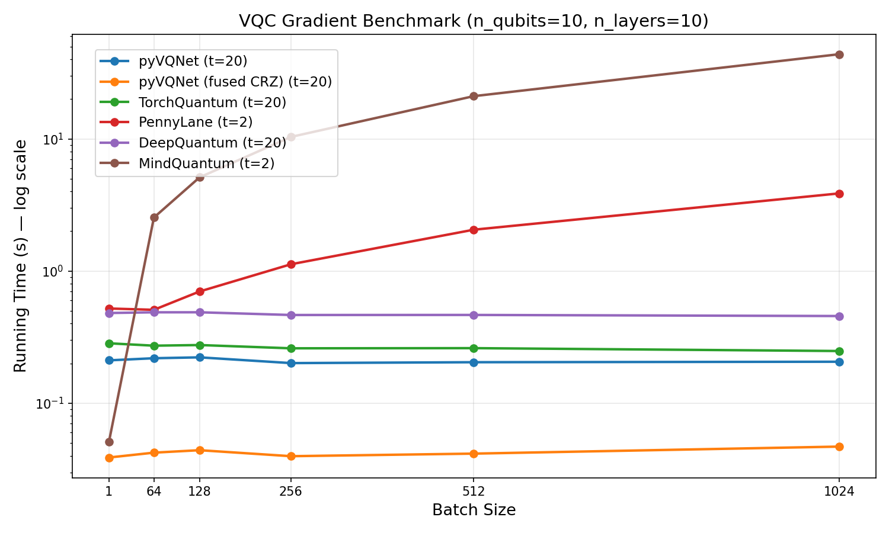

.. _vqc_api:

Variational quantum circuit automatic differentiation simulation
*****************************************************************

The following interfaces use VQNet's QTensor API to build common quantum logic gates, quantum circuits, and measurement methods. Automatic differentiation simulation can replace the quantum circuit parameter-shift method to compute gradients of parameters in variational quantum circuits.

Like other `Module` classes, the interfaces in the ``pyvqnet.qnn.vqc`` module can be used to build hybrid quantum-classical neural network models. In a `Module`, define a quantum machine `QMachine` and call reset_states on its quantum state vector data `states` according to the input batch size. See the following example for details:

.. warning::

    To ensure that the quantum state is in its initial state each time the quantum circuit forward function runs, call ``QMachine.reset_states(batchsize)`` at the beginning of the forward function.

    To support batched data in quantum circuits, when encoding input data into quantum logic gates, the input shape must be [batchsize,*], where * is the number of parameters of the gate being encoded.

    See the following example:

.. code-block::

    from pyvqnet.nn import Module,Linear,ModuleList
    from pyvqnet.qnn.vqc import VQC_HardwareEfficientAnsatz,RZZ,RZ
    from pyvqnet.qnn.vqc import Probability,QMachine
    from pyvqnet import tensor

    class QM(Module):
        def __init__(self, name=""):
            super().__init__(name)
            self.linearx = Linear(4,2)
            self.ansatz = VQC_HardwareEfficientAnsatz(4, ["rx", "RY", "rz"],
                                        entangle_gate="cnot",
                                        entangle_rules="linear",
                                        depth=2)
            #VQC-based RZ on qubit 0
            self.encode1 = RZ(wires=0)
            #VQC-based RZ on qubit 1
            self.encode2 = RZ(wires=1)
            #VQC-based probability measurement on qubits 0,2
            self.measure = Probability(wires=[0,2])
            #Quantum device QMachine with 4 qubits.
            self.device = QMachine(4)
        def forward(self, x, *args, **kwargs):
            #The states must be reset to the same batchsize as the input.
            self.device.reset_states(x.shape[0])
            y = self.linearx(x)
            #Encode the input into the RZ gate; the input must have shape [batchsize,1]
            self.encode1(params = y[:, 0],q_machine = self.device,)
            #Encode the input into the RZ gate; the input must have shape [batchsize,1]
            self.encode2(params = y[:, 1],q_machine = self.device,)
            self.ansatz(q_machine =self.device)
            return self.measure(q_machine =self.device)

    bz =3
    inputx = tensor.arange(1.0,bz*4+1).reshape([bz,4])
    inputx.requires_grad= True
    #Define it like any other Module
    qlayer = QM()
    #Forward pass
    y = qlayer(inputx)
    #Backward pass
    y.backward()
    print(y)

To use variational quantum circuit gates with trainable parameters rather than only encoding data into the circuit as in the example above, see the following example:

.. code-block::

    from pyvqnet.nn import Module,Linear,ModuleList
    from pyvqnet.qnn.vqc import VQC_HardwareEfficientAnsatz,RZZ,RZ,rz,ry,cnot
    from pyvqnet.qnn.vqc import Probability,QMachine
    from pyvqnet import tensor

    class QM(Module):
        def __init__(self, name=""):
            super().__init__(name)
            self.linearx = Linear(4,2)
            self.ansatz = VQC_HardwareEfficientAnsatz(4, ["rx", "RY", "rz"],
                                        entangle_gate="cnot",
                                        entangle_rules="linear",
                                        depth=2)
            #VQC-based RZ on qubit 0
            self.encode1 = RZ(wires=0)
            #VQC-based RZ on qubit 1
            self.encode2 = RZ(wires=1)
            #Set RZ trainable= True
            self.vqc = RZ(trainable = True,wires=1)
            #VQC-based probability measurement on qubits 0,2
            self.measure = Probability(wires=[0,2])
            #Quantum device QMachine with 4 qubits.
            self.device = QMachine(4)
        def forward(self, x, *args, **kwargs):
            #The states must be reset to the same batchsize as the input.
            self.device.reset_states(x.shape[0])
            y = self.linearx(x)
            #Encode the input into the RZ gate; the input must have shape [batchsize,1]
            self.encode1(params = y[:, 0],q_machine = self.device,)
            #Encode the input into the RZ gate; the input must have shape [batchsize,1]
            self.encode2(params = y[:, 1],q_machine = self.device,)
            #Parameterized variational circuit made of RZ gates, included in training.
            self.vqc(q_machine =self.device)
            self.ansatz(q_machine =self.device)
            return self.measure(q_machine =self.device)

    bz =3
    inputx = tensor.arange(1.0,bz*4+1).reshape([bz,4])
    inputx.requires_grad= True
    #Define it like any other Module
    qlayer = QM()
    #Forward pass
    y = qlayer(inputx)
    #Backward pass
    y.backward()
    print(y)

The following example shows how to perform variational quantum computation on a GPU (including data encoding and a parameterized variational circuit):

.. code-block::

    from pyvqnet.nn import Module,Linear,ModuleList
    from pyvqnet.qnn.vqc import VQC_HardwareEfficientAnsatz,RZZ,RZ,rz,ry,cnot
    from pyvqnet.qnn.vqc import Probability,QMachine
    from pyvqnet import tensor
    from pyvqnet import DEV_GPU
    class QM(Module):
        def __init__(self, name=""):
            super().__init__(name)
            self.linearx = Linear(4,2)
            self.ansatz = VQC_HardwareEfficientAnsatz(4, ["rx", "RY", "rz"],
                                        entangle_gate="cnot",
                                        entangle_rules="linear",
                                        depth=2)
            #VQC-based RZ on qubit 0
            self.encode1 = RZ(wires=0)
            #VQC-based RZ on qubit 1
            self.encode2 = RZ(wires=1)
            #Set RZ trainable= True
            self.vqc = RZ(trainable = True,wires=1)
            #VQC-based probability measurement on qubits 0,2
            self.measure = Probability(wires=[0,2])
            #Quantum device QMachine with 4 qubits.
            self.device = QMachine(4)
        def forward(self, x, *args, **kwargs):
            #The states must be reset to the same batchsize as the input.
            self.device.reset_states(x.shape[0])
            y = self.linearx(x)
            #Encode the input into the RZ gate; the input must have shape [batchsize,1]
            self.encode1(params = y[:, 0],q_machine = self.device,)
            #Encode the input into the RZ gate; the input must have shape [batchsize,1]
            self.encode2(params = y[:, 1],q_machine = self.device,)
            #Parameterized variational circuit made of RZ gates, included in training.
            self.vqc(q_machine =self.device)
            self.ansatz(q_machine =self.device)
            return self.measure(q_machine =self.device)

    bz =3
    #create tensor on GPU
    inputx = tensor.arange(1.0,bz*4+1,device=DEV_GPU).reshape([bz,4])
    inputx.requires_grad= True
    #Define it like any other Module
    qlayer = QM()
    #move module to GPU
    qlayer = qlayer.to(DEV_GPU)
    #Forward pass
    y = qlayer(inputx)
    #Backward pass
    y.backward()
    print(y)

Simulator
=========================================

QMachine
---------------------------------------------------------------

.. py:class:: pyvqnet.qnn.vqc.QMachine(num_wires, dtype=pyvqnet.kcomplex64,grad_mode="",save_ir=False)

    Simulator class for variational quantum computation. Its states property contains the state vectors of the quantum circuit.

    .. note::

        Before running a complete quantum circuit each time, you must call `pyvqnet.qnn.vqc.QMachine.reset_states(batchsize)` to reinitialize the initial state in the simulator and broadcast it to shape
        (batchsize,*) for batch data training.

    :param num_wires: Number of qubits.
    :param dtype: Data type used for the computation. Default: pyvqnet.kcomplex64, which corresponds to a parameter precision of pyvqnet.kfloat32.
    :param grad_mode: Gradient computation mode. Can be "adjoint". Default: "", which uses automatic differentiation simulation.
    :param save_ir: When set to True, saves the operations to originIR. Default: False.

    :return: Outputs a QMachine.

    Example::

        from pyvqnet.qnn.vqc import QMachine
        qm = QMachine(4)

        print(qm.states)

        # [[[[[1.+0.j 0.+0.j]
        #     [0.+0.j 0.+0.j]]

        #    [[0.+0.j 0.+0.j]
        #     [0.+0.j 0.+0.j]]]

        #   [[[0.+0.j 0.+0.j]
        #     [0.+0.j 0.+0.j]]

        #    [[0.+0.j 0.+0.j]
        #     [0.+0.j 0.+0.j]]]]]

    .. py:method:: reset_states(batchsize)

        Reinitializes the initial state in the simulator and broadcasts it to
        (batchsize,[2]**num_qubits) dimensions so that the simulator can perform model computation on batched data.

        :param batchsize: Batch size.

Quantum logic gate interfaces
==============================

i
---------------------------------------------------------------

.. py:function:: pyvqnet.qnn.vqc.i(q_machine, wires, params=None, use_dagger=False)

    Applies the I quantum gate to the state vectors in ``q_machine``.

    :param q_machine: Quantum machine device.
    :param wires: Qubit index.
    :param params: Parameter matrix. Default: None. For a gate operation function with p parameters, the input dimension must be [1,p] or [p].
    :param use_dagger: Whether to apply the conjugate transpose. Default: False.

    Example::

        from pyvqnet.qnn.vqc import i,QMachine
        qm  = QMachine(4)
        i(q_machine=qm, wires=1,)
        print(qm.states)

        # [[[[[1.+0.j 0.+0.j]
        #     [0.+0.j 0.+0.j]]

        #    [[0.+0.j 0.+0.j]
        #     [0.+0.j 0.+0.j]]]

        #   [[[0.+0.j 0.+0.j]
        #     [0.+0.j 0.+0.j]]

        #    [[0.+0.j 0.+0.j]
        #     [0.+0.j 0.+0.j]]]]]

I
---------------------------------------------------------------

.. py:class:: pyvqnet.qnn.vqc.I(trainable: bool = False,init_params=None,wires=None,dtype=pyvqnet.kcomplex64,use_dagger=False)

    Defines an I quantum gate class.

    :param trainable: Whether the gate has trainable parameters. Set to False when the layer builds its gate matrix from external input data, or True when the trainable parameters are initialized in this layer. Default: False.
    :param init_params: Initialization parameters used to encode classical data as a QTensor. Default: None. For a parameterized gate with p parameters, the input dimension must be [1,p] or [p].
    :param wires: Indices of the qubits the circuit acts on. Default: None.
    :param dtype: Data precision of the gate matrix. Can be set to pyvqnet.kcomplex64 or pyvqnet.kcomplex128, corresponding to float and double inputs, respectively.
    :param use_dagger: Whether to use the conjugate transpose of the gate. Default: False.
    :return: An I quantum gate instance.

    Example::

        from pyvqnet.qnn.vqc import I,QMachine
        device = QMachine(4)
        layer = I(wires=0)
        batchsize = 1
        device.reset_states(1)
        layer(q_machine = device)
        print(device.states)

hadamard
---------------------------------------------------------------

.. py:function:: pyvqnet.qnn.vqc.hadamard(q_machine, wires, params=None, use_dagger=False)

    Applies the Hadamard gate to the state vectors in q_machine.

    :param q_machine: Quantum machine device.
    :param wires: Qubit index.
    :param params: Parameter matrix. Default: None. For a gate operation function with p parameters, the input dimension must be [1,p] or [p].
    :param use_dagger: Whether to apply the conjugate transpose. Default: False.

    Example::

        from pyvqnet.qnn.vqc import hadamard,QMachine
        qm  = QMachine(4)
        hadamard(q_machine=qm, wires=1,)
        print(qm.states)
        # [[[[[0.7071068+0.j 0.       +0.j]
        #     [0.       +0.j 0.       +0.j]]
        #
        #    [[0.7071068+0.j 0.       +0.j]
        #     [0.       +0.j 0.       +0.j]]]
        #
        #
        #   [[[0.       +0.j 0.       +0.j]
        #     [0.       +0.j 0.       +0.j]]
        #
        #    [[0.       +0.j 0.       +0.j]
        #     [0.       +0.j 0.       +0.j]]]]]

Hadamard
---------------------------------------------------------------

.. py:class:: pyvqnet.qnn.vqc.Hadamard(trainable: bool = False,init_params=None,wires=None,dtype=pyvqnet.kcomplex64,use_dagger=False)

    Defines a Hadamard quantum gate class.

    :param trainable: Whether the gate has trainable parameters. Set to False when the layer builds its gate matrix from external input data, or True when the trainable parameters are initialized in this layer. Default: False.
    :param init_params: Initialization parameters used to encode classical data as a QTensor. Default: None. For a parameterized gate with p parameters, the input dimension must be [1,p] or [p].
    :param wires: Indices of the qubits the circuit acts on. Default: None.
    :param dtype: Data precision of the gate matrix. Can be set to pyvqnet.kcomplex64 or pyvqnet.kcomplex128, corresponding to float and double inputs, respectively.
    :param use_dagger: Whether to use the conjugate transpose of the gate. Default: False.
    :return: A Hadamard quantum gate instance.

    Example::

        from pyvqnet.qnn.vqc import Hadamard,QMachine
        device = QMachine(4)
        layer = Hadamard(wires=0)
        batchsize = 1
        device.reset_states(1)
        layer(q_machine = device)
        print(device.states)

t
---------------------------------------------------------------

.. py:function:: pyvqnet.qnn.vqc.t(q_machine, wires, params=None, use_dagger=False)

    Applies the T gate to the state vectors in q_machine.

    :param q_machine: Quantum machine device.
    :param wires: Qubit index.
    :param params: Parameter matrix. Default: None. For a gate operation function with p parameters, the input dimension must be [1,p] or [p].
    :param use_dagger: Whether to apply the conjugate transpose. Default: False.

    Example::

        from pyvqnet.qnn.vqc import t,QMachine
        qm  = QMachine(4)
        t(q_machine=qm, wires=1,)
        print(qm.states)

        # [[[[[1.+0.j 0.+0.j]
        #     [0.+0.j 0.+0.j]]
        #
        #    [[0.+0.j 0.+0.j]
        #     [0.+0.j 0.+0.j]]]
        #
        #
        #   [[[0.+0.j 0.+0.j]
        #     [0.+0.j 0.+0.j]]
        #
        #    [[0.+0.j 0.+0.j]
        #     [0.+0.j 0.+0.j]]]]]

T
---------------------------------------------------------------

.. py:class:: pyvqnet.qnn.vqc.T(trainable: bool = False,init_params=None,wires=None,dtype=pyvqnet.kcomplex64,use_dagger=False)

    Defines a T quantum gate class.

    :param trainable: Whether the gate has trainable parameters. Set to False when the layer builds its gate matrix from external input data, or True when the trainable parameters are initialized in this layer. Default: False.
    :param init_params: Initialization parameters used to encode classical data as a QTensor. Default: None. For a parameterized gate with p parameters, the input dimension must be [1,p] or [p].
    :param wires: Indices of the qubits the circuit acts on. Default: None.
    :param dtype: Data precision of the gate matrix. Can be set to pyvqnet.kcomplex64 or pyvqnet.kcomplex128, corresponding to float and double inputs, respectively.
    :param use_dagger: Whether to use the conjugate transpose of the gate. Default: False.
    :return: A T quantum gate instance.

    Example::

        from pyvqnet.qnn.vqc import T,QMachine
        device = QMachine(4)
        layer = T(wires=0)
        batchsize = 1
        device.reset_states(1)
        layer(q_machine = device)
        print(device.states)

s
---------------------------------------------------------------

.. py:function:: pyvqnet.qnn.vqc.s(q_machine, wires, params=None, use_dagger=False)

    Applies the S gate to the state vectors in q_machine.

    :param q_machine: Quantum machine device.
    :param wires: Qubit index.
    :param params: Parameter matrix. Default: None. For a gate operation function with p parameters, the input dimension must be [1,p] or [p].
    :param use_dagger: Whether to apply the conjugate transpose. Default: False.

    Example::

        from pyvqnet.qnn.vqc import s,QMachine
        qm  = QMachine(4)
        s(q_machine=qm, wires=1,)
        print(qm.states)

        # [[[[[1.+0.j 0.+0.j]
        #     [0.+0.j 0.+0.j]]
        #
        #    [[0.+0.j 0.+0.j]
        #     [0.+0.j 0.+0.j]]]
        #
        #
        #   [[[0.+0.j 0.+0.j]
        #     [0.+0.j 0.+0.j]]
        #
        #    [[0.+0.j 0.+0.j]
        #     [0.+0.j 0.+0.j]]]]]

S
---------------------------------------------------------------

.. py:class:: pyvqnet.qnn.vqc.S(trainable: bool = False,init_params=None,wires=None,dtype=pyvqnet.kcomplex64,use_dagger=False)

    Defines an S quantum gate class.

    :param trainable: Whether the gate has trainable parameters. Set to False when the layer builds its gate matrix from external input data, or True when the trainable parameters are initialized in this layer. Default: False.
    :param init_params: Initialization parameters used to encode classical data as a QTensor. Default: None. For a parameterized gate with p parameters, the input dimension must be [1,p] or [p].
    :param wires: Indices of the qubits the circuit acts on. Default: None.
    :param dtype: Data precision of the gate matrix. Can be set to pyvqnet.kcomplex64 or pyvqnet.kcomplex128, corresponding to float and double inputs, respectively.
    :param use_dagger: Whether to use the conjugate transpose of the gate. Default: False.
    :return: An S quantum gate instance.

    Example::

        from pyvqnet.qnn.vqc import S,QMachine
        device = QMachine(4)
        layer = S(wires=0)
        batchsize = 1
        device.reset_states(1)
        layer(q_machine = device)
        print(device.states)

paulix
---------------------------------------------------------------

.. py:function:: pyvqnet.qnn.vqc.paulix(q_machine, wires, params=None, use_dagger=False)

    Applies the PauliX gate to the state vectors in q_machine.

    :param q_machine: Quantum machine device.
    :param wires: Qubit index.
    :param params: Parameter matrix. Default: None. For a gate operation function with p parameters, the input dimension must be [1,p] or [p].
    :param use_dagger: Whether to apply the conjugate transpose. Default: False.

    Example::

        from pyvqnet.qnn.vqc import paulix,QMachine
        qm  = QMachine(4)
        paulix(q_machine=qm, wires=1,)
        print(qm.states)

        # [[[[[0.+0.j 0.+0.j]
        #     [0.+0.j 0.+0.j]]
        #
        #    [[1.+0.j 0.+0.j]
        #     [0.+0.j 0.+0.j]]]
        #
        #
        #   [[[0.+0.j 0.+0.j]
        #     [0.+0.j 0.+0.j]]
        #
        #    [[0.+0.j 0.+0.j]
        #     [0.+0.j 0.+0.j]]]]]

PauliX
---------------------------------------------------------------

.. py:class:: pyvqnet.qnn.vqc.PauliX(trainable: bool = False,init_params=None,wires=None,dtype=pyvqnet.kcomplex64,use_dagger=False)

    Defines a PauliX quantum gate class.

    :param trainable: Whether the gate has trainable parameters. Set to False when the layer builds its gate matrix from external input data, or True when the trainable parameters are initialized in this layer. Default: False.
    :param init_params: Initialization parameters used to encode classical data as a QTensor. Default: None. For a parameterized gate with p parameters, the input dimension must be [1,p] or [p].
    :param wires: Indices of the qubits the circuit acts on. Default: None.
    :param dtype: Data precision of the gate matrix. Can be set to pyvqnet.kcomplex64 or pyvqnet.kcomplex128, corresponding to float and double inputs, respectively.
    :param use_dagger: Whether to use the conjugate transpose of the gate. Default: False.
    :return: A PauliX quantum gate instance.

    Example::

        from pyvqnet.qnn.vqc import PauliX,QMachine
        device = QMachine(4)
        layer = PauliX(wires=0)
        batchsize = 1
        device.reset_states(1)
        layer(q_machine = device)
        print(device.states)

pauliy
---------------------------------------------------------------

.. py:function:: pyvqnet.qnn.vqc.pauliy(q_machine, wires, params=None, use_dagger=False)

    Applies the PauliY gate to the state vectors in q_machine.

    :param q_machine: Quantum machine device.
    :param wires: Qubit index.
    :param params: Parameter matrix. Default: None. For a gate operation function with p parameters, the input dimension must be [1,p] or [p].
    :param use_dagger: Whether to apply the conjugate transpose. Default: False.

    Example::

        from pyvqnet.qnn.vqc import pauliy,QMachine
        qm  = QMachine(4)
        pauliy(q_machine=qm, wires=1,)
        print(qm.states)

        # [[[[[0.+0.j 0.+0.j]
        #     [0.+0.j 0.+0.j]]
        #
        #    [[0.+1.j 0.+0.j]
        #     [0.+0.j 0.+0.j]]]
        #
        #
        #   [[[0.+0.j 0.+0.j]
        #     [0.+0.j 0.+0.j]]
        #
        #    [[0.+0.j 0.+0.j]
        #     [0.+0.j 0.+0.j]]]]]

PauliY
---------------------------------------------------------------

.. py:class:: pyvqnet.qnn.vqc.PauliY(trainable: bool = False,init_params=None,wires=None,dtype=pyvqnet.kcomplex64,use_dagger=False)

    Defines a PauliY quantum gate class.

    :param trainable: Whether the gate has trainable parameters. Set to False when the layer builds its gate matrix from external input data, or True when the trainable parameters are initialized in this layer. Default: False.
    :param init_params: Initialization parameters used to encode classical data as a QTensor. Default: None. For a parameterized gate with p parameters, the input dimension must be [1,p] or [p].
    :param wires: Indices of the qubits the circuit acts on. Default: None.
    :param dtype: Data precision of the gate matrix. Can be set to pyvqnet.kcomplex64 or pyvqnet.kcomplex128, corresponding to float and double inputs, respectively.
    :param use_dagger: Whether to use the conjugate transpose of the gate. Default: False.
    :return: A PauliY quantum gate instance.

    Example::

        from pyvqnet.qnn.vqc import PauliY,QMachine
        device = QMachine(4)
        layer = PauliY(wires=0)
        batchsize = 1
        device.reset_states(1)
        layer(q_machine = device)
        print(device.states)

pauliz
---------------------------------------------------------------

.. py:function:: pyvqnet.qnn.vqc.pauliz(q_machine, wires, params=None, use_dagger=False)

    Applies the PauliZ gate to the state vectors in q_machine.

    :param q_machine: Quantum machine device.
    :param wires: Qubit index.
    :param params: Parameter matrix. Default: None. For a gate operation function with p parameters, the input dimension must be [1,p] or [p].
    :param use_dagger: Whether to apply the conjugate transpose. Default: False.

    Example::

        from pyvqnet.qnn.vqc import pauliz,QMachine
        qm  = QMachine(4)
        pauliz(q_machine=qm, wires=1,)
        print(qm.states)

        # [[[[[1.+0.j 0.+0.j]
        #     [0.+0.j 0.+0.j]]
        #
        #    [[0.+0.j 0.+0.j]
        #     [0.+0.j 0.+0.j]]]
        #
        #
        #   [[[0.+0.j 0.+0.j]
        #     [0.+0.j 0.+0.j]]
        #
        #    [[0.+0.j 0.+0.j]
        #     [0.+0.j 0.+0.j]]]]]

PauliZ
---------------------------------------------------------------

.. py:class:: pyvqnet.qnn.vqc.PauliZ(trainable: bool = False,init_params=None,wires=None,dtype=pyvqnet.kcomplex64,use_dagger=False)

    Defines a PauliZ quantum gate class.

    :param trainable: Whether the gate has trainable parameters. Set to False when the layer builds its gate matrix from external input data, or True when the trainable parameters are initialized in this layer. Default: False.
    :param init_params: Initialization parameters used to encode classical data as a QTensor. Default: None. For a parameterized gate with p parameters, the input dimension must be [1,p] or [p].
    :param wires: Indices of the qubits the circuit acts on. Default: None.
    :param dtype: Data precision of the gate matrix. Can be set to pyvqnet.kcomplex64 or pyvqnet.kcomplex128, corresponding to float and double inputs, respectively.
    :param use_dagger: Whether to use the conjugate transpose of the gate. Default: False.
    :return: A PauliZ quantum gate instance.

    Example::

        from pyvqnet.qnn.vqc import PauliZ,QMachine
        device = QMachine(4)
        layer = PauliZ(wires=0)
        batchsize = 1
        device.reset_states(1)
        layer(q_machine = device)
        print(device.states)

x1
---------------------------------------------------------------

.. py:function:: pyvqnet.qnn.vqc.x1(q_machine, wires, params=None, use_dagger=False)

    Applies the X1 gate to the state vectors in q_machine.

    :param q_machine: Quantum machine device.
    :param wires: Qubit index.
    :param params: Parameter matrix. Default: None. For a gate operation function with p parameters, the input dimension must be [1,p] or [p].
    :param use_dagger: Whether to apply the conjugate transpose. Default: False.

    Example::

        from pyvqnet.qnn.vqc import x1,QMachine
        qm  = QMachine(4)
        x1(q_machine=qm, wires=1,)
        print(qm.states)

        # [[[[[0.7071068+0.j        0.       +0.j       ]
        #     [0.       +0.j        0.       +0.j       ]]
        #
        #    [[0.       -0.7071068j 0.       +0.j       ]
        #     [0.       +0.j        0.       +0.j       ]]]
        #
        #
        #   [[[0.       +0.j        0.       +0.j       ]
        #     [0.       +0.j        0.       +0.j       ]]
        #
        #    [[0.       +0.j        0.       +0.j       ]
        #     [0.       +0.j        0.       +0.j       ]]]]]

X1
---------------------------------------------------------------

.. py:class:: pyvqnet.qnn.vqc.X1(trainable: bool = False,init_params=None,wires=None,dtype=pyvqnet.kcomplex64,use_dagger=False)

    Defines an X1 quantum gate class.

    :param trainable: Whether the gate has trainable parameters. Set to False when the layer builds its gate matrix from external input data, or True when the trainable parameters are initialized in this layer. Default: False.
    :param init_params: Initialization parameters used to encode classical data as a QTensor. Default: None. For a parameterized gate with p parameters, the input dimension must be [1,p] or [p].
    :param wires: Indices of the qubits the circuit acts on. Default: None.
    :param dtype: Data precision of the gate matrix. Can be set to pyvqnet.kcomplex64 or pyvqnet.kcomplex128, corresponding to float and double inputs, respectively.
    :param use_dagger: Whether to use the conjugate transpose of the gate. Default: False.
    :return: An X1 quantum gate instance.

    Example::

        from pyvqnet.qnn.vqc import X1,QMachine
        device = QMachine(4)
        layer = X1(wires=0)
        batchsize = 1
        device.reset_states(1)
        layer(q_machine = device)
        print(device.states)

rx
---------------------------------------------------------------

.. py:function:: pyvqnet.qnn.vqc.rx(q_machine, wires, params=None, use_dagger=False)

    Applies the RX gate to the state vectors in q_machine.

    :param q_machine: Quantum machine device.
    :param wires: Qubit index.
    :param params: Parameter matrix. Default: None. For a gate operation function with p parameters, the input dimension must be [1,p] or [p].
    :param use_dagger: Whether to apply the conjugate transpose. Default: False.

    Example::

        from pyvqnet.qnn.vqc import rx,QMachine
        from pyvqnet.tensor import QTensor
        qm  = QMachine(4)
        rx(q_machine=qm, wires=1,params=QTensor([0.5]))
        print(qm.states)

        # [[[[[0.9689124+0.j       0.       +0.j      ]
        #     [0.       +0.j       0.       +0.j      ]]
        #
        #    [[0.       -0.247404j 0.       +0.j      ]
        #     [0.       +0.j       0.       +0.j      ]]]
        #
        #
        #   [[[0.       +0.j       0.       +0.j      ]
        #     [0.       +0.j       0.       +0.j      ]]
        #
        #    [[0.       +0.j       0.       +0.j      ]
        #     [0.       +0.j       0.       +0.j      ]]]]]

RX
---------------------------------------------------------------

.. py:class:: pyvqnet.qnn.vqc.RX(trainable: bool = False,init_params=None,wires=None,dtype=pyvqnet.kcomplex64,use_dagger=False)

    Defines an RX quantum gate class.

    :param trainable: Whether the gate has trainable parameters. Set to False when the layer builds its gate matrix from external input data, or True when the trainable parameters are initialized in this layer. Default: False.
    :param init_params: Initialization parameters used to encode classical data as a QTensor. Default: None. For a parameterized gate with p parameters, the input dimension must be [1,p] or [p].
    :param wires: Indices of the qubits the circuit acts on. Default: None.
    :param dtype: Data precision of the gate matrix. Can be set to pyvqnet.kcomplex64 or pyvqnet.kcomplex128, corresponding to float and double inputs, respectively.
    :param use_dagger: Whether to use the conjugate transpose of the gate. Default: False.
    :return: An RX quantum gate instance.

    Example::

        from pyvqnet.qnn.vqc import RX,QMachine
        device = QMachine(4)
        layer = RX(trainable=True, wires=0)
        batchsize = 2
        device.reset_states(batchsize)
        layer(q_machine = device)
        print(device.states)

ry
---------------------------------------------------------------

.. py:function:: pyvqnet.qnn.vqc.ry(q_machine, wires, params=None, use_dagger=False)

    Applies the RY gate to the state vectors in q_machine.

    :param q_machine: Quantum machine device.
    :param wires: Qubit index.
    :param params: Parameter matrix. Default: None. For a gate operation function with p parameters, the input dimension must be [1,p] or [p].
    :param use_dagger: Whether to apply the conjugate transpose. Default: False.

    Example::

        from pyvqnet.qnn.vqc import ry,QMachine
        from pyvqnet.tensor import QTensor
        qm  = QMachine(4)
        ry(q_machine=qm, wires=1,params=QTensor([0.5]),)
        print(qm.states)

        # [[[[[0.9689124+0.j 0.       +0.j]
        #     [0.       +0.j 0.       +0.j]]
        #
        #    [[0.247404 +0.j 0.       +0.j]
        #     [0.       +0.j 0.       +0.j]]]
        #
        #
        #   [[[0.       +0.j 0.       +0.j]
        #     [0.       +0.j 0.       +0.j]]
        #
        #    [[0.       +0.j 0.       +0.j]
        #     [0.       +0.j 0.       +0.j]]]]]

RY
---------------------------------------------------------------

.. py:class:: pyvqnet.qnn.vqc.RY(trainable: bool = False,init_params=None,wires=None,dtype=pyvqnet.kcomplex64,use_dagger=False)

    Defines an RY quantum gate class.

    :param trainable: Whether the gate has trainable parameters. Set to False when the layer builds its gate matrix from external input data, or True when the trainable parameters are initialized in this layer. Default: False.
    :param init_params: Initialization parameters used to encode classical data as a QTensor. Default: None. For a parameterized gate with p parameters, the input dimension must be [1,p] or [p].
    :param wires: Indices of the qubits the circuit acts on. Default: None.
    :param dtype: Data precision of the gate matrix. Can be set to pyvqnet.kcomplex64 or pyvqnet.kcomplex128, corresponding to float and double inputs, respectively.
    :param use_dagger: Whether to use the conjugate transpose of the gate. Default: False.
    :return: An RY quantum gate instance.

    Example::

        from pyvqnet.qnn.vqc import RY,QMachine
        device = QMachine(4)
        layer = RY(trainable=True, wires=0)
        batchsize = 2
        device.reset_states(batchsize)
        layer(q_machine = device)
        print(device.states)

rz
---------------------------------------------------------------

.. py:function:: pyvqnet.qnn.vqc.rz(q_machine, wires, params=None, use_dagger=False)

    Applies the RZ gate to the state vectors in q_machine.

    :param q_machine: Quantum machine device.
    :param wires: Qubit index.
    :param params: Parameter matrix. Default: None. For a gate operation function with p parameters, the input dimension must be [1,p] or [p].
    :param use_dagger: Whether to apply the conjugate transpose. Default: False.

    Example::

        from pyvqnet.qnn.vqc import rz,QMachine
        from pyvqnet.tensor import QTensor
        qm  = QMachine(4)
        rz(q_machine=qm, wires=1,params=QTensor([0.5]),)
        print(qm.states)

        # [[[[[0.9689124-0.247404j 0.       +0.j      ]
        #     [0.       +0.j       0.       +0.j      ]]
        #
        #    [[0.       +0.j       0.       +0.j      ]
        #     [0.       +0.j       0.       +0.j      ]]]
        #
        #
        #   [[[0.       +0.j       0.       +0.j      ]
        #     [0.       +0.j       0.       +0.j      ]]
        #
        #    [[0.       +0.j       0.       +0.j      ]
        #     [0.       +0.j       0.       +0.j      ]]]]]

RZ
---------------------------------------------------------------

.. py:class:: pyvqnet.qnn.vqc.RZ(trainable: bool = False,init_params=None,wires=None,dtype=pyvqnet.kcomplex64,use_dagger=False)

    Defines an RZ quantum gate class.

    :param trainable: Whether the gate has trainable parameters. Set to False when the layer builds its gate matrix from external input data, or True when the trainable parameters are initialized in this layer. Default: False.
    :param init_params: Initialization parameters used to encode classical data as a QTensor. Default: None. For a parameterized gate with p parameters, the input dimension must be [1,p] or [p].
    :param wires: Indices of the qubits the circuit acts on. Default: None.
    :param dtype: Data precision of the gate matrix. Can be set to pyvqnet.kcomplex64 or pyvqnet.kcomplex128, corresponding to float and double inputs, respectively.
    :param use_dagger: Whether to use the conjugate transpose of the gate. Default: False.
    :return: An RZ quantum gate instance.

    Example::

        from pyvqnet.qnn.vqc import RZ,QMachine
        device = QMachine(4)
        layer = RZ(trainable=True, wires=0)
        batchsize = 2
        device.reset_states(batchsize)
        layer(q_machine = device)
        print(device.states)

crx
---------------------------------------------------------------

.. py:function:: pyvqnet.qnn.vqc.crx(q_machine, wires, params=None, use_dagger=False)

    Applies the CRX gate to the state vectors in q_machine.

    :param q_machine: Quantum machine device.
    :param wires: Qubit index.
    :param params: Parameter matrix. Default: None. For a gate operation function with p parameters, the input dimension must be [1,p] or [p].
    :param use_dagger: Whether to apply the conjugate transpose. Default: False.

    Example::

        from pyvqnet.qnn.vqc import QMachine
        import pyvqnet.qnn.vqc as vqc
        from pyvqnet.tensor import QTensor
        qm = QMachine(4)
        vqc.crx(q_machine=qm,wires=[0,2], params=QTensor([0.5]),)
        print(qm.states)

        # [[[[[1.+0.j 0.+0.j]
        #     [0.+0.j 0.+0.j]]
        #
        #    [[0.+0.j 0.+0.j]
        #     [0.+0.j 0.+0.j]]]
        #
        #
        #   [[[0.+0.j 0.+0.j]
        #     [0.+0.j 0.+0.j]]
        #
        #    [[0.+0.j 0.+0.j]
        #     [0.+0.j 0.+0.j]]]]]

CRX
---------------------------------------------------------------

.. py:class:: pyvqnet.qnn.vqc.CRX(trainable: bool = False,init_params=None,wires=None,dtype=pyvqnet.kcomplex64,use_dagger=False)

    Defines a CRX quantum gate class.

    :param trainable: Whether the gate has trainable parameters. Set to False when the layer builds its gate matrix from external input data, or True when the trainable parameters are initialized in this layer. Default: False.
    :param init_params: Initialization parameters used to encode classical data as a QTensor. Default: None. For a parameterized gate with p parameters, the input dimension must be [1,p] or [p].
    :param wires: Indices of the qubits the circuit acts on. Default: None.
    :param dtype: Data precision of the gate matrix. Can be set to pyvqnet.kcomplex64 or pyvqnet.kcomplex128, corresponding to float and double inputs, respectively.
    :param use_dagger: Whether to use the conjugate transpose of the gate. Default: False.
    :return: A CRX quantum gate instance.

    Example::

        from pyvqnet.qnn.vqc import CRX,QMachine
        device = QMachine(4)
        layer = CRX(trainable=True, wires=[0,2])
        batchsize = 2
        device.reset_states(batchsize)
        layer(q_machine = device)
        print(device.states)

cry
---------------------------------------------------------------

.. py:function:: pyvqnet.qnn.vqc.cry(q_machine, wires, params=None, use_dagger=False)

    Applies the CRY gate to the state vectors in q_machine.

    :param q_machine: Quantum machine device.
    :param wires: Qubit index.
    :param params: Parameter matrix. Default: None. For a gate operation function with p parameters, the input dimension must be [1,p] or [p].
    :param use_dagger: Whether to apply the conjugate transpose. Default: False.

    Example::

        from pyvqnet.qnn.vqc import QMachine
        import pyvqnet.qnn.vqc as vqc
        from pyvqnet.tensor import QTensor
        qm = QMachine(4)
        vqc.cry(q_machine=qm,wires=[0,2], params=QTensor([0.5]))
        print(qm.states)

        # [[[[[1.+0.j 0.+0.j]
        #     [0.+0.j 0.+0.j]]
        #
        #    [[0.+0.j 0.+0.j]
        #     [0.+0.j 0.+0.j]]]
        #
        #
        #   [[[0.+0.j 0.+0.j]
        #     [0.+0.j 0.+0.j]]
        #
        #    [[0.+0.j 0.+0.j]
        #     [0.+0.j 0.+0.j]]]]]

CRY
---------------------------------------------------------------

.. py:class:: pyvqnet.qnn.vqc.CRY(trainable: bool = False,init_params=None,wires=None,dtype=pyvqnet.kcomplex64,use_dagger=False)

    Defines a CRY quantum gate class.

    :param trainable: Whether the gate has trainable parameters. Set to False when the layer builds its gate matrix from external input data, or True when the trainable parameters are initialized in this layer. Default: False.
    :param init_params: Initialization parameters used to encode classical data as a QTensor. Default: None. For a parameterized gate with p parameters, the input dimension must be [1,p] or [p].
    :param wires: Indices of the qubits the circuit acts on. Default: None.
    :param dtype: Data precision of the gate matrix. Can be set to pyvqnet.kcomplex64 or pyvqnet.kcomplex128, corresponding to float and double inputs, respectively.
    :param use_dagger: Whether to use the conjugate transpose of the gate. Default: False.
    :return: A CRY quantum gate instance.

    Example::

        from pyvqnet.qnn.vqc import CRY,QMachine
        device = QMachine(4)
        layer = CRY(trainable=True, wires=[0,2])
        batchsize = 2
        device.reset_states(batchsize)
        layer(q_machine = device)
        print(device.states)

crz
---------------------------------------------------------------

.. py:function:: pyvqnet.qnn.vqc.crz(q_machine, wires, params=None, use_dagger=False)

    Applies the CRZ gate to the state vectors in q_machine.

    :param q_machine: Quantum machine device.
    :param wires: Qubit index.
    :param params: Parameter matrix. Default: None. For a gate operation function with p parameters, the input dimension must be [1,p] or [p].
    :param use_dagger: Whether to apply the conjugate transpose. Default: False.

    Example::

        from pyvqnet.qnn.vqc import QMachine
        import pyvqnet.qnn.vqc as vqc
        from pyvqnet.tensor import QTensor
        qm = QMachine(4)
        vqc.crz(q_machine=qm,wires=[0,2], params=QTensor([0.5]))
        print(qm.states)

        # [[[[[1.+0.j 0.+0.j]
        #     [0.+0.j 0.+0.j]]
        #
        #    [[0.+0.j 0.+0.j]
        #     [0.+0.j 0.+0.j]]]
        #
        #
        #   [[[0.+0.j 0.+0.j]
        #     [0.+0.j 0.+0.j]]
        #
        #    [[0.+0.j 0.+0.j]
        #     [0.+0.j 0.+0.j]]]]]

CRZ
---------------------------------------------------------------

.. py:class:: pyvqnet.qnn.vqc.CRZ(trainable: bool = False,init_params=None,wires=None,dtype=pyvqnet.kcomplex64,use_dagger=False)

    Defines a CRZ quantum gate class.

    :param trainable: Whether the gate has trainable parameters. Set to False when the layer builds its gate matrix from external input data, or True when the trainable parameters are initialized in this layer. Default: False.
    :param init_params: Initialization parameters used to encode classical data as a QTensor. Default: None. For a parameterized gate with p parameters, the input dimension must be [1,p] or [p].
    :param wires: Indices of the qubits the circuit acts on. Default: None.
    :param dtype: Data precision of the gate matrix. Can be set to pyvqnet.kcomplex64 or pyvqnet.kcomplex128, corresponding to float and double inputs, respectively.
    :param use_dagger: Whether to use the conjugate transpose of the gate. Default: False.
    :return: A CRZ quantum gate instance.

    Example::

        from pyvqnet.qnn.vqc import CRZ,QMachine
        device = QMachine(4)
        layer = CRZ(trainable=True, wires=[0,2])
        batchsize = 2
        device.reset_states(batchsize)
        layer(q_machine = device)
        print(device.states)

u1
---------------------------------------------------------------

.. py:function:: pyvqnet.qnn.vqc.u1(q_machine, wires, params=None, use_dagger=False)

    Applies the U1 gate to the state vectors in q_machine.

    :param q_machine: Quantum machine device.
    :param wires: Qubit index.
    :param params: Parameter matrix. Default: None. For a gate operation function with p parameters, the input dimension must be [1,p] or [p].
    :param use_dagger: Whether to apply the conjugate transpose. Default: False.

    Example::

        from pyvqnet.qnn.vqc import u1,QMachine
        from pyvqnet.tensor import QTensor
        qm  = QMachine(4)
        u1(q_machine=qm, wires=1,params=QTensor([24.0]),)
        print(qm.states)

        # [[[[1.+0.j 0.+0.j]
        #     [0.+0.j 0.+0.j]]
        #
        #    [[0.+0.j 0.+0.j]
        #     [0.+0.j 0.+0.j]]]
        #
        #
        #   [[[0.+0.j 0.+0.j]
        #     [0.+0.j 0.+0.j]]
        #
        #    [[0.+0.j 0.+0.j]
        #     [0.+0.j 0.+0.j]]]]

U1
---------------------------------------------------------------

.. py:class:: pyvqnet.qnn.vqc.U1(trainable: bool = False,init_params=None,wires=None,dtype=pyvqnet.kcomplex64,use_dagger=False)

    Defines a U1 quantum gate class.

    :param trainable: Whether the gate has trainable parameters. Set to False when the layer builds its gate matrix from external input data, or True when the trainable parameters are initialized in this layer. Default: False.
    :param init_params: Initialization parameters used to encode classical data as a QTensor. Default: None. For a parameterized gate with p parameters, the input dimension must be [1,p] or [p].
    :param wires: Indices of the qubits the circuit acts on. Default: None.
    :param dtype: Data precision of the gate matrix. Can be set to pyvqnet.kcomplex64 or pyvqnet.kcomplex128, corresponding to float and double inputs, respectively.
    :param use_dagger: Whether to use the conjugate transpose of the gate. Default: False.
    :return: A U1 quantum gate instance.

    Example::

        from pyvqnet.qnn.vqc import U1,QMachine
        device = QMachine(4)
        layer = U1(trainable=True, wires=0)
        batchsize = 2
        device.reset_states(batchsize)
        layer(q_machine = device)
        print(device.states)

u2
---------------------------------------------------------------

.. py:function:: pyvqnet.qnn.vqc.u2(q_machine, wires, params=None, use_dagger=False)

    Applies the U2 gate to the state vectors in q_machine.

    :param q_machine: Quantum machine device.
    :param wires: Qubit index.
    :param params: Parameter matrix. Default: None. For a gate operation function with p parameters, the input dimension must be [1,p] or [p].
    :param use_dagger: Whether to apply the conjugate transpose. Default: False.

    Example::

        from pyvqnet.qnn.vqc import u2,QMachine
        from pyvqnet.tensor import QTensor
        qm  = QMachine(4)
        u2(q_machine=qm, wires=1,params=QTensor([[24.0,-3]]),)
        print(qm.states)

        # [[[[[0.7071068+0.j        0.       +0.j       ]
        #     [0.       +0.j        0.       +0.j       ]]
        #
        #    [[0.2999398-0.6403406j 0.       +0.j       ]
        #     [0.       +0.j        0.       +0.j       ]]]
        #
        #
        #   [[[0.       +0.j        0.       +0.j       ]
        #     [0.       +0.j        0.       +0.j       ]]
        #
        #    [[0.       +0.j        0.       +0.j       ]
        #     [0.       +0.j        0.       +0.j       ]]]]]

U2
---------------------------------------------------------------

.. py:class:: pyvqnet.qnn.vqc.U2(trainable: bool = False,init_params=None,wires=None,dtype=pyvqnet.kcomplex64,use_dagger=False)

    Defines a U2 quantum gate class.

    :param trainable: Whether the gate has trainable parameters. Set to False when the layer builds its gate matrix from external input data, or True when the trainable parameters are initialized in this layer. Default: False.
    :param init_params: Initialization parameters used to encode classical data as a QTensor. Default: None. For a parameterized gate with p parameters, the input dimension must be [1,p] or [p].
    :param wires: Indices of the qubits the circuit acts on. Default: None.
    :param dtype: Data precision of the gate matrix. Can be set to pyvqnet.kcomplex64 or pyvqnet.kcomplex128, corresponding to float and double inputs, respectively.
    :param use_dagger: Whether to use the conjugate transpose of the gate. Default: False.
    :return: A U2 quantum gate instance.

    Example::

        from pyvqnet.qnn.vqc import U2,QMachine
        device = QMachine(4)
        layer = U2(trainable=True, wires=0)
        batchsize = 2
        device.reset_states(batchsize)
        layer(q_machine = device)
        print(device.states)

u3
---------------------------------------------------------------

.. py:function:: pyvqnet.qnn.vqc.u3(q_machine, wires, params=None, use_dagger=False)

    Applies the U3 gate to the state vectors in q_machine.

    :param q_machine: Quantum machine device.
    :param wires: Qubit index.
    :param params: Parameter matrix. Default: None. For a gate operation function with p parameters, the input dimension must be [1,p] or [p].
    :param use_dagger: Whether to apply the conjugate transpose. Default: False.

    Example::

        from pyvqnet.qnn.vqc import u3,QMachine
        from pyvqnet.tensor import QTensor
        qm  = QMachine(4)
        u3(q_machine=qm, wires=1,params=QTensor([[24.0,-3,1]]),)
        print(qm.states)

        # [[[[[0.843854 +0.j        0.       +0.j       ]
        #     [0.       +0.j        0.       +0.j       ]]
        #
        #    [[0.5312032+0.0757212j 0.       +0.j       ]
        #     [0.       +0.j        0.       +0.j       ]]]
        #
        #
        #   [[[0.       +0.j        0.       +0.j       ]
        #     [0.       +0.j        0.       +0.j       ]]
        #
        #    [[0.       +0.j        0.       +0.j       ]
        #     [0.       +0.j        0.       +0.j       ]]]]]

U3
---------------------------------------------------------------

.. py:class:: pyvqnet.qnn.vqc.U3(trainable: bool = False,init_params=None,wires=None,dtype=pyvqnet.kcomplex64,use_dagger=False)

    Defines a U3 quantum gate class.

    :param trainable: Whether the gate has trainable parameters. Set to False when the layer builds its gate matrix from external input data, or True when the trainable parameters are initialized in this layer. Default: False.
    :param init_params: Initialization parameters used to encode classical data as a QTensor. Default: None. For a parameterized gate with p parameters, the input dimension must be [1,p] or [p].
    :param wires: Indices of the qubits the circuit acts on. Default: None.
    :param dtype: Data precision of the gate matrix. Can be set to pyvqnet.kcomplex64 or pyvqnet.kcomplex128, corresponding to float and double inputs, respectively.
    :param use_dagger: Whether to use the conjugate transpose of the gate. Default: False.
    :return: A U3 quantum gate instance.

    Example::

        from pyvqnet.qnn.vqc import U3,QMachine
        device = QMachine(4)
        layer = U3(trainable=True, wires=0)
        batchsize = 2
        device.reset_states(batchsize)
        layer(q_machine = device)
        print(device.states)

cy
---------------------------------------------------------------

.. py:function:: pyvqnet.qnn.vqc.cy(q_machine, wires, params=None, use_dagger=False)

    Applies the CY gate to the state vectors in q_machine.

    :param q_machine: Quantum machine device.
    :param wires: Qubit index.
    :param params: Parameter matrix. Default: None. For a gate operation function with p parameters, the input dimension must be [1,p] or [p].
    :param use_dagger: Whether to apply the conjugate transpose. Default: False.

    Example::

        from pyvqnet.qnn.vqc import cy,QMachine
        qm = QMachine(4)
        cy(q_machine=qm,wires=(1,0))
        print(qm.states)
        # [[[[[1.+0.j,0.+0.j],
        #     [0.+0.j,0.+0.j]],

        #    [[0.+0.j,0.+0.j],
        #     [0.+0.j,0.+0.j]]],

        #   [[[0.+0.j,0.+0.j],
        #     [0.+0.j,0.+0.j]],

        #    [[0.+0.j,0.+0.j],
        #     [0.+0.j,0.+0.j]]]]]

CY
---------------------------------------------------------------

.. py:class:: pyvqnet.qnn.vqc.CY(trainable: bool = False,init_params=None,wires=None,dtype=pyvqnet.kcomplex64,use_dagger=False)

    Defines a CY quantum gate class.

    :param trainable: Whether the gate has trainable parameters. Set to False when the layer builds its gate matrix from external input data, or True when the trainable parameters are initialized in this layer. Default: False.
    :param init_params: Initialization parameters used to encode classical data as a QTensor. Default: None. For a parameterized gate with p parameters, the input dimension must be [1,p] or [p].
    :param wires: Indices of the qubits the circuit acts on. Default: None.
    :param dtype: Data precision of the gate matrix. Can be set to pyvqnet.kcomplex64 or pyvqnet.kcomplex128, corresponding to float and double inputs, respectively.
    :param use_dagger: Whether to use the conjugate transpose of the gate. Default: False.
    :return: A CY quantum gate instance.

    Example::

        from pyvqnet.qnn.vqc import CY,QMachine
        device = QMachine(4)
        layer = CY(wires=[0,1])
        batchsize = 2
        device.reset_states(batchsize)
        layer(q_machine = device)
        print(device.states)

cnot
---------------------------------------------------------------

.. py:function:: pyvqnet.qnn.vqc.cnot(q_machine, wires, params=None, use_dagger=False)

    Applies the CNOT gate to the state vectors in q_machine.

    :param q_machine: Quantum machine device.
    :param wires: Qubit index.
    :param params: Parameter matrix. Default: None. For a gate operation function with p parameters, the input dimension must be [1,p] or [p].
    :param use_dagger: Whether to apply the conjugate transpose. Default: False.

    Example::

        from pyvqnet.qnn.vqc import cnot,QMachine
        qm  = QMachine(4)
        cnot(q_machine=qm,wires=[1,0],)
        print(qm.states)

        # [[[[[1.+0.j 0.+0.j]
        #     [0.+0.j 0.+0.j]]
        #
        #    [[0.+0.j 0.+0.j]
        #     [0.+0.j 0.+0.j]]]
        #
        #
        #   [[[0.+0.j 0.+0.j]
        #     [0.+0.j 0.+0.j]]
        #
        #    [[0.+0.j 0.+0.j]
        #     [0.+0.j 0.+0.j]]]]]

CNOT
---------------------------------------------------------------

.. py:class:: pyvqnet.qnn.vqc.CNOT(trainable: bool = False,init_params=None,wires=None,dtype=pyvqnet.kcomplex64,use_dagger=False)

    Defines a CNOT quantum gate class.

    :param trainable: Whether the gate has trainable parameters. Set to False when the layer builds its gate matrix from external input data, or True when the trainable parameters are initialized in this layer. Default: False.
    :param init_params: Initialization parameters used to encode classical data as a QTensor. Default: None. For a parameterized gate with p parameters, the input dimension must be [1,p] or [p].
    :param wires: Indices of the qubits the circuit acts on. Default: None.
    :param dtype: Data precision of the gate matrix. Can be set to pyvqnet.kcomplex64 or pyvqnet.kcomplex128, corresponding to float and double inputs, respectively.
    :param use_dagger: Whether to use the conjugate transpose of the gate. Default: False.
    :return: A CNOT quantum gate instance.

    Example::

        from pyvqnet.qnn.vqc import CNOT,QMachine
        device = QMachine(4)
        layer = CNOT(wires=[0,1])
        batchsize = 2
        device.reset_states(batchsize)
        layer(q_machine = device)
        print(device.states)

cr
---------------------------------------------------------------

.. py:function:: pyvqnet.qnn.vqc.cr(q_machine, wires, params=None, use_dagger=False)

    Applies the CR gate to the state vectors in q_machine.

    :param q_machine: Quantum machine device.
    :param wires: Qubit index.
    :param params: Parameter matrix. Default: None. For a gate operation function with p parameters, the input dimension must be [1,p] or [p].
    :param use_dagger: Whether to apply the conjugate transpose. Default: False.

    Example::

        from pyvqnet.qnn.vqc import cr,QMachine
        from pyvqnet.tensor import QTensor
        qm  = QMachine(4)
        cr(q_machine=qm,wires=[1,0],params=QTensor([0.5]),)
        print(qm.states)

        # [[[[[1.+0.j 0.+0.j]
        #     [0.+0.j 0.+0.j]]
        #
        #    [[0.+0.j 0.+0.j]
        #     [0.+0.j 0.+0.j]]]
        #
        #
        #   [[[0.+0.j 0.+0.j]
        #     [0.+0.j 0.+0.j]]
        #
        #    [[0.+0.j 0.+0.j]
        #     [0.+0.j 0.+0.j]]]]]

CR
---------------------------------------------------------------

.. py:class:: pyvqnet.qnn.vqc.CR(trainable: bool = False,init_params=None,wires=None,dtype=pyvqnet.kcomplex64,use_dagger=False)

    Defines a CR quantum gate class.

    :param trainable: Whether the gate has trainable parameters. Set to False when the layer builds its gate matrix from external input data, or True when the trainable parameters are initialized in this layer. Default: False.
    :param init_params: Initialization parameters used to encode classical data as a QTensor. Default: None. For a parameterized gate with p parameters, the input dimension must be [1,p] or [p].
    :param wires: Indices of the qubits the circuit acts on. Default: None.
    :param dtype: Data precision of the gate matrix. Can be set to pyvqnet.kcomplex64 or pyvqnet.kcomplex128, corresponding to float and double inputs, respectively.
    :param use_dagger: Whether to use the conjugate transpose of the gate. Default: False.
    :return: A CR quantum gate instance.

    Example::

        from pyvqnet.qnn.vqc import CR,QMachine
        device = QMachine(4)
        layer = CR(trainable=True, wires=[0,2])
        batchsize = 2
        device.reset_states(batchsize)
        layer(q_machine = device)
        print(device.states)

swap
---------------------------------------------------------------

.. py:function:: pyvqnet.qnn.vqc.swap(q_machine, wires, params=None, use_dagger=False)

    Applies the SWAP gate to the state vectors in q_machine.

    :param q_machine: Quantum machine device.
    :param wires: Qubit index.
    :param params: Parameter matrix. Default: None. For a gate operation function with p parameters, the input dimension must be [1,p] or [p].
    :param use_dagger: Whether to apply the conjugate transpose. Default: False.

    Example::

        from pyvqnet.qnn.vqc import swap,QMachine
        qm  = QMachine(4)
        swap(q_machine=qm,wires=[1,0],)
        print(qm.states)

        # [[[[[1.+0.j 0.+0.j]
        #     [0.+0.j 0.+0.j]]
        #
        #    [[0.+0.j 0.+0.j]
        #     [0.+0.j 0.+0.j]]]
        #
        #
        #   [[[0.+0.j 0.+0.j]
        #     [0.+0.j 0.+0.j]]
        #
        #    [[0.+0.j 0.+0.j]
        #     [0.+0.j 0.+0.j]]]]]

SWAP
---------------------------------------------------------------

.. py:class:: pyvqnet.qnn.vqc.SWAP(trainable: bool = False,init_params=None,wires=None,dtype=pyvqnet.kcomplex64,use_dagger=False)

    Defines a SWAP quantum gate class.

    :param trainable: Whether the gate has trainable parameters. Set to False when the layer builds its gate matrix from external input data, or True when the trainable parameters are initialized in this layer. Default: False.
    :param init_params: Initialization parameters used to encode classical data as a QTensor. Default: None. For a parameterized gate with p parameters, the input dimension must be [1,p] or [p].
    :param wires: Indices of the qubits the circuit acts on. Default: None.
    :param dtype: Data precision of the gate matrix. Can be set to pyvqnet.kcomplex64 or pyvqnet.kcomplex128, corresponding to float and double inputs, respectively.
    :param use_dagger: Whether to use the conjugate transpose of the gate. Default: False.
    :return: A SWAP quantum gate instance.

    Example::

        from pyvqnet.qnn.vqc import SWAP,QMachine
        device = QMachine(4)
        layer = SWAP(wires=[0,1])
        batchsize = 2
        device.reset_states(batchsize)
        layer(q_machine = device)
        print(device.states)

cswap
---------------------------------------------------------------

.. py:function:: pyvqnet.qnn.vqc.cswap(q_machine, wires, params=None, use_dagger=False)

    Applies the CSWAP gate to the state vectors in q_machine.

    :param q_machine: Quantum machine device.
    :param wires: Qubit index.
    :param params: Parameter matrix. Default: None. For a gate operation function with p parameters, the input dimension must be [1,p] or [p].
    :param use_dagger: Whether to apply the conjugate transpose. Default: False.

    Example::

        from pyvqnet.qnn.vqc import cswap,QMachine
        qm  = QMachine(4)
        cswap(q_machine=qm,wires=[1,0,3],)
        print(qm.states)
        # [[[[[1.+0.j,0.+0.j],
        #     [0.+0.j,0.+0.j]],

        #    [[0.+0.j,0.+0.j],
        #     [0.+0.j,0.+0.j]]],

        #   [[[0.+0.j,0.+0.j],
        #     [0.+0.j,0.+0.j]],

        #    [[0.+0.j,0.+0.j],
        #     [0.+0.j,0.+0.j]]]]]

CSWAP
---------------------------------------------------------------

.. py:class:: pyvqnet.qnn.vqc.CSWAP(trainable: bool = False,init_params=None,wires=None,dtype=pyvqnet.kcomplex64,use_dagger=False)

    Defines a CSWAP quantum gate class.

    .. math:: CSWAP = \begin{bmatrix}
            1 & 0 & 0 & 0 & 0 & 0 & 0 & 0 \\
            0 & 1 & 0 & 0 & 0 & 0 & 0 & 0 \\
            0 & 0 & 1 & 0 & 0 & 0 & 0 & 0 \\
            0 & 0 & 0 & 1 & 0 & 0 & 0 & 0 \\
            0 & 0 & 0 & 0 & 1 & 0 & 0 & 0 \\
            0 & 0 & 0 & 0 & 0 & 0 & 1 & 0 \\
            0 & 0 & 0 & 0 & 0 & 1 & 0 & 0 \\
            0 & 0 & 0 & 0 & 0 & 0 & 0 & 1
        \end{bmatrix}.

    :param trainable: Whether the gate has trainable parameters. Set to False when the layer builds its gate matrix from external input data, or True when the trainable parameters are initialized in this layer. Default: False.
    :param init_params: Initialization parameters used to encode classical data as a QTensor. Default: None. For a parameterized gate with p parameters, the input dimension must be [1,p] or [p].
    :param wires: Indices of the qubits the circuit acts on. Default: None.
    :param dtype: Data precision of the gate matrix. Can be set to pyvqnet.kcomplex64 or pyvqnet.kcomplex128, corresponding to float and double inputs, respectively.
    :param use_dagger: Whether to use the conjugate transpose of the gate. Default: False.
    :return: A CSWAP quantum gate instance.

    Example::

        from pyvqnet.qnn.vqc import CSWAP,QMachine
        device = QMachine(4)
        layer = CSWAP(wires=[0,1,2])
        batchsize = 2
        device.reset_states(batchsize)
        layer(q_machine = device)
        print(device.states)
        # [[[[[1.+0.j,0.+0.j],
        #     [0.+0.j,0.+0.j]],

        #    [[0.+0.j,0.+0.j],
        #     [0.+0.j,0.+0.j]]],

        #   [[[0.+0.j,0.+0.j],
        #     [0.+0.j,0.+0.j]],

        #    [[0.+0.j,0.+0.j],
        #     [0.+0.j,0.+0.j]]]],

        #  [[[[1.+0.j,0.+0.j],
        #     [0.+0.j,0.+0.j]],

        #    [[0.+0.j,0.+0.j],
        #     [0.+0.j,0.+0.j]]],

        #   [[[0.+0.j,0.+0.j],
        #     [0.+0.j,0.+0.j]],

        #    [[0.+0.j,0.+0.j],
        #     [0.+0.j,0.+0.j]]]]]

iswap
---------------------------------------------------------------

.. py:function:: pyvqnet.qnn.vqc.iswap(q_machine, wires, params=None, use_dagger=False)

    Applies the iSWAP gate to the state vectors in q_machine.

    :param q_machine: Quantum machine device.
    :param wires: Qubit index.
    :param params: Parameter matrix. Default: None. For a gate operation function with p parameters, the input dimension must be [1,p] or [p].
    :param use_dagger: Whether to apply the conjugate transpose. Default: False.

    Example::

        from pyvqnet.qnn.vqc import QMachine
        import pyvqnet.qnn.vqc as vqc
        from pyvqnet.tensor import QTensor
        qm = QMachine(4)
        vqc.iswap(q_machine=qm,wires=[0,1])
        print(qm.states)

        # [[[[[1.+0.j 0.+0.j]
        #     [0.+0.j 0.+0.j]]
        #
        #    [[0.+0.j 0.+0.j]
        #     [0.+0.j 0.+0.j]]]
        #
        #
        #   [[[0.+0.j 0.+0.j]
        #     [0.+0.j 0.+0.j]]
        #
        #    [[0.+0.j 0.+0.j]
        #     [0.+0.j 0.+0.j]]]]]

cz
---------------------------------------------------------------

.. py:function:: pyvqnet.qnn.vqc.cz(q_machine, wires, params=None, use_dagger=False)

    Applies the CZ gate to the state vectors in q_machine.

    :param q_machine: Quantum machine device.
    :param wires: Qubit index.
    :param params: Parameter matrix. Default: None. For a gate operation function with p parameters, the input dimension must be [1,p] or [p].
    :param use_dagger: Whether to apply the conjugate transpose. Default: False.

    Example::

        from pyvqnet.qnn.vqc import cz,QMachine
        qm  = QMachine(4)
        cz(q_machine=qm,wires=[1,0],)
        print(qm.states)

        # [[[[[1.+0.j 0.+0.j]
        #     [0.+0.j 0.+0.j]]
        #
        #    [[0.+0.j 0.+0.j]
        #     [0.+0.j 0.+0.j]]]
        #
        #
        #   [[[0.+0.j 0.+0.j]
        #     [0.+0.j 0.+0.j]]
        #
        #    [[0.+0.j 0.+0.j]
        #     [0.+0.j 0.+0.j]]]]]

CZ
---------------------------------------------------------------

.. py:class:: pyvqnet.qnn.vqc.CZ(trainable: bool = False,init_params=None,wires=None,dtype=pyvqnet.kcomplex64,use_dagger=False)

    Defines a CZ quantum gate class.

    :param trainable: Whether the gate has trainable parameters. Set to False when the layer builds its gate matrix from external input data, or True when the trainable parameters are initialized in this layer. Default: False.
    :param init_params: Initialization parameters used to encode classical data as a QTensor. Default: None. For a parameterized gate with p parameters, the input dimension must be [1,p] or [p].
    :param wires: Indices of the qubits the circuit acts on. Default: None.
    :param dtype: Data precision of the gate matrix. Can be set to pyvqnet.kcomplex64 or pyvqnet.kcomplex128, corresponding to float and double inputs, respectively.
    :param use_dagger: Whether to use the conjugate transpose of the gate. Default: False.
    :return: A CZ quantum gate instance.

    Example::

        from pyvqnet.qnn.vqc import CZ,QMachine
        device = QMachine(4)
        layer = CZ(wires=[0,1])
        batchsize = 2
        device.reset_states(batchsize)
        layer(q_machine = device)
        print(device.states)

rxx
---------------------------------------------------------------

.. py:function:: pyvqnet.qnn.vqc.rxx(q_machine, wires, params=None, use_dagger=False)

    Applies the RXX gate to the state vectors in q_machine.

    :param q_machine: Quantum machine device.
    :param wires: Qubit index.
    :param params: Parameter matrix. Default: None. For a gate operation function with p parameters, the input dimension must be [1,p] or [p].
    :param use_dagger: Whether to apply the conjugate transpose. Default: False.

    Example::

        from pyvqnet.qnn.vqc import rxx,QMachine
        from pyvqnet.tensor import QTensor
        qm  = QMachine(4)
        rxx(q_machine=qm,wires=[1,0],params=QTensor([0.2]),)
        print(qm.states)

        # [[[[[0.9950042+0.j        0.       +0.j       ]
        #     [0.       +0.j        0.       +0.j       ]]
        #
        #    [[0.       +0.j        0.       +0.j       ]
        #     [0.       +0.j        0.       +0.j       ]]]
        #
        #
        #   [[[0.       +0.j        0.       +0.j       ]
        #     [0.       +0.j        0.       +0.j       ]]
        #
        #    [[0.       -0.0998334j 0.       +0.j       ]
        #     [0.       +0.j        0.       +0.j       ]]]]]

RXX
---------------------------------------------------------------

.. py:class:: pyvqnet.qnn.vqc.RXX(trainable: bool = False,init_params=None,wires=None,dtype=pyvqnet.kcomplex64,use_dagger=False)

    Defines an RXX quantum gate class.

    :param trainable: Whether the gate has trainable parameters. Set to False when the layer builds its gate matrix from external input data, or True when the trainable parameters are initialized in this layer. Default: False.
    :param init_params: Initialization parameters used to encode classical data as a QTensor. Default: None. For a parameterized gate with p parameters, the input dimension must be [1,p] or [p].
    :param wires: Indices of the qubits the circuit acts on. Default: None.
    :param dtype: Data precision of the gate matrix. Can be set to pyvqnet.kcomplex64 or pyvqnet.kcomplex128, corresponding to float and double inputs, respectively.
    :param use_dagger: Whether to use the conjugate transpose of the gate. Default: False.
    :return: An RXX quantum gate instance.

    Example::

        from pyvqnet.qnn.vqc import RXX,QMachine
        device = QMachine(4)
        layer = RXX(trainable=True, wires=[0,2])
        batchsize = 2
        device.reset_states(batchsize)
        layer(q_machine = device)
        print(device.states)

ryy
---------------------------------------------------------------

.. py:function:: pyvqnet.qnn.vqc.ryy(q_machine, wires, params=None, use_dagger=False)

    Applies the RYY gate to the state vectors in q_machine.

    :param q_machine: Quantum machine device.
    :param wires: Qubit index.
    :param params: Parameter matrix. Default: None. For a gate operation function with p parameters, the input dimension must be [1,p] or [p].
    :param use_dagger: Whether to apply the conjugate transpose. Default: False.

    Example::

        from pyvqnet.qnn.vqc import ryy,QMachine
        from pyvqnet.tensor import QTensor
        qm  = QMachine(4)
        ryy(q_machine=qm,wires=[1,0],params=QTensor([0.2]),)
        print(qm.states)

        # [[[[[0.9950042+0.j        0.       +0.j       ]
        #     [0.       +0.j        0.       +0.j       ]]
        #
        #    [[0.       +0.j        0.       +0.j       ]
        #     [0.       +0.j        0.       +0.j       ]]]
        #
        #
        #   [[[0.       +0.j        0.       +0.j       ]
        #     [0.       +0.j        0.       +0.j       ]]
        #
        #    [[0.       +0.0998334j 0.       +0.j       ]
        #     [0.       +0.j        0.       +0.j       ]]]]]

RYY
---------------------------------------------------------------

.. py:class:: pyvqnet.qnn.vqc.RYY(trainable: bool = False,init_params=None,wires=None,dtype=pyvqnet.kcomplex64,use_dagger=False)

    Defines an RYY quantum gate class.

    :param trainable: Whether the gate has trainable parameters. Set to False when the layer builds its gate matrix from external input data, or True when the trainable parameters are initialized in this layer. Default: False.
    :param init_params: Initialization parameters used to encode classical data as a QTensor. Default: None. For a parameterized gate with p parameters, the input dimension must be [1,p] or [p].
    :param wires: Indices of the qubits the circuit acts on. Default: None.
    :param dtype: Data precision of the gate matrix. Can be set to pyvqnet.kcomplex64 or pyvqnet.kcomplex128, corresponding to float and double inputs, respectively.
    :param use_dagger: Whether to use the conjugate transpose of the gate. Default: False.
    :return: An RYY quantum gate instance.

    Example::

        from pyvqnet.qnn.vqc import RYY,QMachine
        device = QMachine(4)
        layer = RYY(trainable=True, wires=[0,2])
        batchsize = 2
        device.reset_states(batchsize)
        layer(q_machine = device)
        print(device.states)

rzz
---------------------------------------------------------------

.. py:function:: pyvqnet.qnn.vqc.rzz(q_machine, wires, params=None, use_dagger=False)

    Applies the RZZ gate to the state vectors in q_machine.

    :param q_machine: Quantum machine device.
    :param wires: Qubit index.
    :param params: Parameter matrix. Default: None. For a gate operation function with p parameters, the input dimension must be [1,p] or [p].
    :param use_dagger: Whether to apply the conjugate transpose. Default: False.

    Example::

        from pyvqnet.qnn.vqc import rzz,QMachine
        from pyvqnet.tensor import QTensor
        qm  = QMachine(4)
        rzz(q_machine=qm,wires=[1,0],params=QTensor([0.2]),)
        print(qm.states)

        # [[[[[0.9950042-0.0998334j 0.       +0.j       ]
        #     [0.       +0.j        0.       +0.j       ]]
        #
        #    [[0.       +0.j        0.       +0.j       ]
        #     [0.       +0.j        0.       +0.j       ]]]
        #
        #
        #   [[[0.       +0.j        0.       +0.j       ]
        #     [0.       +0.j        0.       +0.j       ]]
        #
        #    [[0.       +0.j        0.       +0.j       ]
        #     [0.       +0.j        0.       +0.j       ]]]]]

RZZ
---------------------------------------------------------------

.. py:class:: pyvqnet.qnn.vqc.RZZ(trainable: bool = False,init_params=None,wires=None,dtype=pyvqnet.kcomplex64,use_dagger=False)

    Defines an RZZ quantum gate class.

    :param trainable: Whether the gate has trainable parameters. Set to False when the layer builds its gate matrix from external input data, or True when the trainable parameters are initialized in this layer. Default: False.
    :param init_params: Initialization parameters used to encode classical data as a QTensor. Default: None. For a parameterized gate with p parameters, the input dimension must be [1,p] or [p].
    :param wires: Indices of the qubits the circuit acts on. Default: None.
    :param dtype: Data precision of the gate matrix. Can be set to pyvqnet.kcomplex64 or pyvqnet.kcomplex128, corresponding to float and double inputs, respectively.
    :param use_dagger: Whether to use the conjugate transpose of the gate. Default: False.
    :return: An RZZ quantum gate instance.

    Example::

        from pyvqnet.qnn.vqc import RZZ,QMachine
        device = QMachine(4)
        layer = RZZ(trainable=True, wires=[0,2])
        batchsize = 2
        device.reset_states(batchsize)
        layer(q_machine = device)
        print(device.states)

rzx
---------------------------------------------------------------

.. py:function:: pyvqnet.qnn.vqc.rzx(q_machine, wires, params=None, use_dagger=False)

    Applies the RZX gate to the state vectors in q_machine.

    :param q_machine: Quantum machine device.
    :param wires: Qubit index.
    :param params: Parameter matrix. Default: None. For a gate operation function with p parameters, the input dimension must be [1,p] or [p].
    :param use_dagger: Whether to apply the conjugate transpose. Default: False.

    Example::

        from pyvqnet.qnn.vqc import rzx,QMachine
        from pyvqnet.tensor import QTensor
        qm  = QMachine(4)
        rzx(q_machine=qm,wires=[1,0],params=QTensor([0.2]),)
        print(qm.states)

        # [[[[[0.9950042+0.j        0.       +0.j       ]
        #     [0.       +0.j        0.       +0.j       ]]
        #
        #    [[0.       +0.j        0.       +0.j       ]
        #     [0.       +0.j        0.       +0.j       ]]]
        #
        #
        #   [[[0.       -0.0998334j 0.       +0.j       ]
        #     [0.       +0.j        0.       +0.j       ]]
        #
        #    [[0.       +0.j        0.       +0.j       ]
        #     [0.       +0.j        0.       +0.j       ]]]]]

RZX
---------------------------------------------------------------

.. py:class:: pyvqnet.qnn.vqc.RZX(trainable: bool = False,init_params=None,wires=None,dtype=pyvqnet.kcomplex64,use_dagger=False)

    Defines an RZX quantum gate class.

    :param trainable: Whether the gate has trainable parameters. Set to False when the layer builds its gate matrix from external input data, or True when the trainable parameters are initialized in this layer. Default: False.
    :param init_params: Initialization parameters used to encode classical data as a QTensor. Default: None. For a parameterized gate with p parameters, the input dimension must be [1,p] or [p].
    :param wires: Indices of the qubits the circuit acts on. Default: None.
    :param dtype: Data precision of the gate matrix. Can be set to pyvqnet.kcomplex64 or pyvqnet.kcomplex128, corresponding to float and double inputs, respectively.
    :param use_dagger: Whether to use the conjugate transpose of the gate. Default: False.
    :return: An RZX quantum gate instance.

    Example::

        from pyvqnet.qnn.vqc import RZX,QMachine
        device = QMachine(4)
        layer = RZX(trainable=True, wires=[0,2])
        batchsize = 2
        device.reset_states(batchsize)
        layer(q_machine = device)
        print(device.states)

toffoli
---------------------------------------------------------------

.. py:function:: pyvqnet.qnn.vqc.toffoli(q_machine, wires, params=None, use_dagger=False)

    Applies the Toffoli gate to the state vectors in q_machine.

    :param q_machine: Quantum machine device.
    :param wires: Qubit index.
    :param params: Parameter matrix. Default: None. For a gate operation function with p parameters, the input dimension must be [1,p] or [p].
    :param use_dagger: Whether to apply the conjugate transpose. Default: False.

    Example::

        from pyvqnet.qnn.vqc import toffoli,QMachine
        qm  = QMachine(4)
        toffoli(q_machine=qm,wires=[0,1,2],)
        print(qm.states)

        # [[[[[1.+0.j 0.+0.j]
        #     [0.+0.j 0.+0.j]]
        #
        #    [[0.+0.j 0.+0.j]
        #     [0.+0.j 0.+0.j]]]
        #
        #
        #   [[[0.+0.j 0.+0.j]
        #     [0.+0.j 0.+0.j]]
        #
        #    [[0.+0.j 0.+0.j]
        #     [0.+0.j 0.+0.j]]]]]

Toffoli
---------------------------------------------------------------

.. py:class:: pyvqnet.qnn.vqc.Toffoli(trainable: bool = False,init_params=None,wires=None,dtype=pyvqnet.kcomplex64,use_dagger=False)

    Defines a Toffoli quantum gate class.

    :param trainable: Whether the gate has trainable parameters. Set to False when the layer builds its gate matrix from external input data, or True when the trainable parameters are initialized in this layer. Default: False.
    :param init_params: Initialization parameters used to encode classical data as a QTensor. Default: None. For a parameterized gate with p parameters, the input dimension must be [1,p] or [p].
    :param wires: Indices of the qubits the circuit acts on. Default: None.
    :param dtype: Data precision of the gate matrix. Can be set to pyvqnet.kcomplex64 or pyvqnet.kcomplex128, corresponding to float and double inputs, respectively.
    :param use_dagger: Whether to use the conjugate transpose of the gate. Default: False.
    :return: A Toffoli quantum gate instance.

    Example::

        from pyvqnet.qnn.vqc import Toffoli,QMachine
        device = QMachine(4)
        layer = Toffoli(  wires=[0,2,1])
        batchsize = 2
        device.reset_states(batchsize)
        layer(q_machine = device)
        print(device.states)

isingxx
---------------------------------------------------------------

.. py:function:: pyvqnet.qnn.vqc.isingxx(q_machine, wires, params=None, use_dagger=False)

    Applies the IsingXX gate to the state vectors in q_machine.

    :param q_machine: Quantum machine device.
    :param wires: Qubit index.
    :param params: Parameter matrix. Default: None. For a gate operation function with p parameters, the input dimension must be [1,p] or [p].
    :param use_dagger: Whether to apply the conjugate transpose. Default: False.

    Example::

        from pyvqnet.qnn.vqc import QMachine
        import pyvqnet.qnn.vqc as vqc
        from pyvqnet.tensor import QTensor
        qm = QMachine(4)
        vqc.isingxx(q_machine=qm,wires=[0,1], params = QTensor([0.5]),)
        print(qm.states)

        # [[[[[0.9689124+0.j       0.       +0.j      ]
        #     [0.       +0.j       0.       +0.j      ]]
        #
        #    [[0.       +0.j       0.       +0.j      ]
        #     [0.       +0.j       0.       +0.j      ]]]
        #
        #
        #   [[[0.       +0.j       0.       +0.j      ]
        #     [0.       +0.j       0.       +0.j      ]]
        #
        #    [[0.       -0.247404j 0.       +0.j      ]
        #     [0.       +0.j       0.       +0.j      ]]]]]

IsingXX
---------------------------------------------------------------

.. py:class:: pyvqnet.qnn.vqc.IsingXX(trainable: bool = False,init_params=None,wires=None,dtype=pyvqnet.kcomplex64,use_dagger=False)

    Defines an IsingXX quantum gate class.

    :param trainable: Whether the gate has trainable parameters. Set to False when the layer builds its gate matrix from external input data, or True when the trainable parameters are initialized in this layer. Default: False.
    :param init_params: Initialization parameters used to encode classical data as a QTensor. Default: None. For a parameterized gate with p parameters, the input dimension must be [1,p] or [p].
    :param wires: Indices of the qubits the circuit acts on. Default: None.
    :param dtype: Data precision of the gate matrix. Can be set to pyvqnet.kcomplex64 or pyvqnet.kcomplex128, corresponding to float and double inputs, respectively.
    :param use_dagger: Whether to use the conjugate transpose of the gate. Default: False.
    :return: An IsingXX quantum gate instance.

    Example::

        from pyvqnet.qnn.vqc import IsingXX,QMachine
        device = QMachine(4)
        layer = IsingXX(trainable=True, wires=[0,2])
        batchsize = 2
        device.reset_states(batchsize)
        layer(q_machine = device)
        print(device.states)

isingyy
---------------------------------------------------------------

.. py:function:: pyvqnet.qnn.vqc.isingyy(q_machine, wires, params=None, use_dagger=False)

    Applies the IsingYY gate to the state vectors in q_machine.

    :param q_machine: Quantum machine device.
    :param wires: Qubit index.
    :param params: Parameter matrix. Default: None. For a gate operation function with p parameters, the input dimension must be [1,p] or [p].
    :param use_dagger: Whether to apply the conjugate transpose. Default: False.

    Example::

        from pyvqnet.qnn.vqc import QMachine
        import pyvqnet.qnn.vqc as vqc
        from pyvqnet.tensor import QTensor
        qm = QMachine(4)
        vqc.isingyy(q_machine=qm,wires=[0,1], params = QTensor([0.5]),)
        print(qm.states)

        # [[[[[0.9689124+0.j       0.       +0.j      ]
        #     [0.       +0.j       0.       +0.j      ]]
        #
        #    [[0.       +0.j       0.       +0.j      ]
        #     [0.       +0.j       0.       +0.j      ]]]
        #
        #
        #   [[[0.       +0.j       0.       +0.j      ]
        #     [0.       +0.j       0.       +0.j      ]]
        #
        #    [[0.       +0.247404j 0.       +0.j      ]
        #     [0.       +0.j       0.       +0.j      ]]]]]

IsingYY
---------------------------------------------------------------

.. py:class:: pyvqnet.qnn.vqc.IsingYY(trainable: bool = False,init_params=None,wires=None,dtype=pyvqnet.kcomplex64,use_dagger=False)

    Defines an IsingYY quantum gate class.

    :param trainable: Whether the gate has trainable parameters. Set to False when the layer builds its gate matrix from external input data, or True when the trainable parameters are initialized in this layer. Default: False.
    :param init_params: Initialization parameters used to encode classical data as a QTensor. Default: None. For a parameterized gate with p parameters, the input dimension must be [1,p] or [p].
    :param wires: Indices of the qubits the circuit acts on. Default: None.
    :param dtype: Data precision of the gate matrix. Can be set to pyvqnet.kcomplex64 or pyvqnet.kcomplex128, corresponding to float and double inputs, respectively.
    :param use_dagger: Whether to use the conjugate transpose of the gate. Default: False.
    :return: An IsingYY quantum gate instance.

    Example::

        from pyvqnet.qnn.vqc import IsingYY,QMachine
        device = QMachine(4)
        layer = IsingYY(trainable=True, wires=[0,2])
        batchsize = 2
        device.reset_states(batchsize)
        layer(q_machine = device)
        print(device.states)

isingzz
---------------------------------------------------------------

.. py:function:: pyvqnet.qnn.vqc.isingzz(q_machine, wires, params=None, use_dagger=False)

    Applies the IsingZZ gate to the state vectors in q_machine.

    :param q_machine: Quantum machine device.
    :param wires: Qubit index.
    :param params: Parameter matrix. Default: None. For a gate operation function with p parameters, the input dimension must be [1,p] or [p].
    :param use_dagger: Whether to apply the conjugate transpose. Default: False.

    Example::

        from pyvqnet.qnn.vqc import QMachine
        import pyvqnet.qnn.vqc as vqc
        from pyvqnet.tensor import QTensor
        qm = QMachine(4)
        vqc.isingzz(q_machine=qm,wires=[0,1], params = QTensor([0.5]),)
        print(qm.states)

        # [[[[[0.9689124-0.247404j 0.       +0.j      ]
        #     [0.       +0.j       0.       +0.j      ]]
        #
        #    [[0.       +0.j       0.       +0.j      ]
        #     [0.       +0.j       0.       +0.j      ]]]
        #
        #
        #   [[[0.       +0.j       0.       +0.j      ]
        #     [0.       +0.j       0.       +0.j      ]]
        #
        #    [[0.       +0.j       0.       +0.j      ]
        #     [0.       +0.j       0.       +0.j      ]]]]]

IsingZZ
---------------------------------------------------------------

.. py:class:: pyvqnet.qnn.vqc.IsingZZ(trainable: bool = False,init_params=None,wires=None,dtype=pyvqnet.kcomplex64,use_dagger=False)

    Defines an IsingZZ quantum gate class.

    :param trainable: Whether the gate has trainable parameters. Set to False when the layer builds its gate matrix from external input data, or True when the trainable parameters are initialized in this layer. Default: False.
    :param init_params: Initialization parameters used to encode classical data as a QTensor. Default: None. For a parameterized gate with p parameters, the input dimension must be [1,p] or [p].
    :param wires: Indices of the qubits the circuit acts on. Default: None.
    :param dtype: Data precision of the gate matrix. Can be set to pyvqnet.kcomplex64 or pyvqnet.kcomplex128, corresponding to float and double inputs, respectively.
    :param use_dagger: Whether to use the conjugate transpose of the gate. Default: False.
    :return: An IsingZZ quantum gate instance.

    Example::

        from pyvqnet.qnn.vqc import IsingZZ,QMachine
        device = QMachine(4)
        layer = IsingZZ(trainable=True, wires=[0,2])
        batchsize = 2
        device.reset_states(batchsize)
        layer(q_machine = device)
        print(device.states)

isingxy
---------------------------------------------------------------

.. py:function:: pyvqnet.qnn.vqc.isingxy(q_machine, wires, params=None, use_dagger=False)

    Applies the IsingXY gate to the state vectors in q_machine.

    :param q_machine: Quantum machine device.
    :param wires: Qubit index.
    :param params: Parameter matrix. Default: None. For a gate operation function with p parameters, the input dimension must be [1,p] or [p].
    :param use_dagger: Whether to apply the conjugate transpose. Default: False.

    Example::

        from pyvqnet.qnn.vqc import QMachine
        import pyvqnet.qnn.vqc as vqc
        from pyvqnet.tensor import QTensor
        qm = QMachine(4)
        vqc.isingxy(q_machine=qm,wires=[0,1], params = QTensor([0.5]),)
        print(qm.states)

        # [[[[[1.+0.j 0.+0.j]
        #     [0.+0.j 0.+0.j]]
        #
        #    [[0.+0.j 0.+0.j]
        #     [0.+0.j 0.+0.j]]]
        #
        #
        #   [[[0.+0.j 0.+0.j]
        #     [0.+0.j 0.+0.j]]
        #
        #    [[0.+0.j 0.+0.j]
        #     [0.+0.j 0.+0.j]]]]]

IsingXY
---------------------------------------------------------------

.. py:class:: pyvqnet.qnn.vqc.IsingXY(trainable: bool = False,init_params=None,wires=None,dtype=pyvqnet.kcomplex64,use_dagger=False)

    Defines an IsingXY quantum gate class.

    :param trainable: Whether the gate has trainable parameters. Set to False when the layer builds its gate matrix from external input data, or True when the trainable parameters are initialized in this layer. Default: False.
    :param init_params: Initialization parameters used to encode classical data as a QTensor. Default: None. For a parameterized gate with p parameters, the input dimension must be [1,p] or [p].
    :param wires: Indices of the qubits the circuit acts on. Default: None.
    :param dtype: Data precision of the gate matrix. Can be set to pyvqnet.kcomplex64 or pyvqnet.kcomplex128, corresponding to float and double inputs, respectively.
    :param use_dagger: Whether to use the conjugate transpose of the gate. Default: False.
    :return: An IsingXY quantum gate instance.

    Example::

        from pyvqnet.qnn.vqc import IsingXY,QMachine
        device = QMachine(4)
        layer = IsingXY(trainable=True, wires=[0,2])
        batchsize = 2
        device.reset_states(batchsize)
        layer(q_machine = device)
        print(device.states)

phaseshift
---------------------------------------------------------------

.. py:function:: pyvqnet.qnn.vqc.phaseshift(q_machine, wires, params=None, use_dagger=False)

    Applies the PhaseShift gate to the state vectors in q_machine.

    :param q_machine: Quantum machine device.
    :param wires: Qubit index.
    :param params: Parameter matrix. Default: None. For a gate operation function with p parameters, the input dimension must be [1,p] or [p].
    :param use_dagger: Whether to apply the conjugate transpose. Default: False.

    Example::

        from pyvqnet.qnn.vqc import QMachine
        import pyvqnet.qnn.vqc as vqc
        from pyvqnet.tensor import QTensor
        qm = QMachine(4)
        vqc.phaseshift(q_machine=qm,wires=[0], params = QTensor([0.5]),)
        print(qm.states)

        # [[[[[1.+0.j 0.+0.j]
        #     [0.+0.j 0.+0.j]]
        #
        #    [[0.+0.j 0.+0.j]
        #     [0.+0.j 0.+0.j]]]
        #
        #
        #   [[[0.+0.j 0.+0.j]
        #     [0.+0.j 0.+0.j]]
        #
        #    [[0.+0.j 0.+0.j]
        #     [0.+0.j 0.+0.j]]]]]

PhaseShift
---------------------------------------------------------------

.. py:class:: pyvqnet.qnn.vqc.PhaseShift(trainable: bool = False,init_params=None,wires=None,dtype=pyvqnet.kcomplex64,use_dagger=False)

    Defines a PhaseShift quantum gate class.

    :param trainable: Whether the gate has trainable parameters. Set to False when the layer builds its gate matrix from external input data, or True when the trainable parameters are initialized in this layer. Default: False.
    :param init_params: Initialization parameters used to encode classical data as a QTensor. Default: None. For a parameterized gate with p parameters, the input dimension must be [1,p] or [p].
    :param wires: Indices of the qubits the circuit acts on. Default: None.
    :param dtype: Data precision of the gate matrix. Can be set to pyvqnet.kcomplex64 or pyvqnet.kcomplex128, corresponding to float and double inputs, respectively.
    :param use_dagger: Whether to use the conjugate transpose of the gate. Default: False.
    :return: A PhaseShift quantum gate instance.

    Example::

        from pyvqnet.qnn.vqc import PhaseShift,QMachine
        device = QMachine(4)
        layer = PhaseShift(trainable=True, wires=1)
        batchsize = 2
        device.reset_states(batchsize)
        layer(q_machine = device)
        print(device.states)

multirz
---------------------------------------------------------------

.. py:function:: pyvqnet.qnn.vqc.multirz(q_machine, wires, params=None, use_dagger=False)

    Applies the MultiRZ gate to the state vectors in q_machine.

    :param q_machine: Quantum machine device.
    :param wires: Qubit index.
    :param params: Parameter matrix. Default: None. For a gate operation function with p parameters, the input dimension must be [1,p] or [p].
    :param use_dagger: Whether to apply the conjugate transpose. Default: False.

    Example::

        from pyvqnet.qnn.vqc import QMachine
        import pyvqnet.qnn.vqc as vqc
        from pyvqnet.tensor import QTensor
        qm = QMachine(4)
        vqc.multirz(q_machine=qm,wires=[0, 1], params = QTensor([0.5]),)
        print(qm.states)

        # [[[[[0.9689124-0.247404j 0.       +0.j      ]
        #     [0.       +0.j       0.       +0.j      ]]
        #
        #    [[0.       +0.j       0.       +0.j      ]
        #     [0.       +0.j       0.       +0.j      ]]]
        #
        #
        #   [[[0.       +0.j       0.       +0.j      ]
        #     [0.       +0.j       0.       +0.j      ]]
        #
        #    [[0.       +0.j       0.       +0.j      ]
        #     [0.       +0.j       0.       +0.j      ]]]]]

MultiRZ
---------------------------------------------------------------

.. py:class:: pyvqnet.qnn.vqc.MultiRZ(trainable: bool = False,init_params=None,wires=None,dtype=pyvqnet.kcomplex64,use_dagger=False)

    Defines a MultiRZ quantum gate class.

    :param trainable: Whether the gate has trainable parameters. Set to False when the layer builds its gate matrix from external input data, or True when the trainable parameters are initialized in this layer. Default: False.
    :param init_params: Initialization parameters used to encode classical data as a QTensor. Default: None. For a parameterized gate with p parameters, the input dimension must be [1,p] or [p].
    :param wires: Indices of the qubits the circuit acts on. Default: None.
    :param dtype: Data precision of the gate matrix. Can be set to pyvqnet.kcomplex64 or pyvqnet.kcomplex128, corresponding to float and double inputs, respectively.
    :param use_dagger: Whether to use the conjugate transpose of the gate. Default: False.
    :return: A MultiRZ quantum gate instance.

    Example::

        from pyvqnet.qnn.vqc import MultiRZ,QMachine
        device = QMachine(4)
        layer = MultiRZ(trainable=True, wires=[0,2])
        batchsize = 2
        device.reset_states(batchsize)
        layer(q_machine = device)
        print(device.states)

sdg
---------------------------------------------------------------

.. py:function:: pyvqnet.qnn.vqc.sdg(q_machine, wires, params=None, use_dagger=False)

    Applies the SDG gate to the state vectors in q_machine.

    :param q_machine: Quantum machine device.
    :param wires: Qubit index.
    :param params: Parameter matrix. Default: None. For a gate operation function with p parameters, the input dimension must be [1,p] or [p].
    :param use_dagger: Whether to apply the conjugate transpose. Default: False.

    Example::

        from pyvqnet.qnn.vqc import QMachine
        import pyvqnet.qnn.vqc as vqc
        from pyvqnet.tensor import QTensor
        qm = QMachine(4)
        vqc.sdg(q_machine=qm,wires=[0],)
        print(qm.states)

        # [[[[[1.+0.j 0.+0.j]
        #     [0.+0.j 0.+0.j]]
        #
        #    [[0.+0.j 0.+0.j]
        #     [0.+0.j 0.+0.j]]]
        #
        #
        #   [[[0.+0.j 0.+0.j]
        #     [0.+0.j 0.+0.j]]
        #
        #    [[0.+0.j 0.+0.j]
        #     [0.+0.j 0.+0.j]]]]]

SDG
---------------------------------------------------------------

.. py:class:: pyvqnet.qnn.vqc.SDG(trainable: bool = False,init_params=None,wires=None,dtype=pyvqnet.kcomplex64,use_dagger=False)

    Defines an SDG quantum gate class.

    :param trainable: Whether the gate has trainable parameters. Set to False when the layer builds its gate matrix from external input data, or True when the trainable parameters are initialized in this layer. Default: False.
    :param init_params: Initialization parameters used to encode classical data as a QTensor. Default: None. For a parameterized gate with p parameters, the input dimension must be [1,p] or [p].
    :param wires: Indices of the qubits the circuit acts on. Default: None.
    :param dtype: Data precision of the gate matrix. Can be set to pyvqnet.kcomplex64 or pyvqnet.kcomplex128, corresponding to float and double inputs, respectively.
    :param use_dagger: Whether to use the conjugate transpose of the gate. Default: False.
    :return: An SDG quantum gate instance.

    Example::

        from pyvqnet.qnn.vqc import SDG,QMachine
        device = QMachine(4)
        layer = SDG(wires=0)
        batchsize = 1
        device.reset_states(1)
        layer(q_machine = device)
        print(device.states)

tdg
---------------------------------------------------------------

.. py:function:: pyvqnet.qnn.vqc.tdg(q_machine, wires, params=None, use_dagger=False)

    Applies the TDG gate to the state vectors in q_machine.

    :param q_machine: Quantum machine device.
    :param wires: Qubit index.
    :param params: Parameter matrix. Default: None. For a gate operation function with p parameters, the input dimension must be [1,p] or [p].
    :param use_dagger: Whether to apply the conjugate transpose. Default: False.

    Example::

        from pyvqnet.qnn.vqc import QMachine
        import pyvqnet.qnn.vqc as vqc
        from pyvqnet.tensor import QTensor
        qm = QMachine(4)
        vqc.tdg(q_machine=qm,wires=[0],)
        print(qm.states)

        # [[[[[1.+0.j 0.+0.j]
        #     [0.+0.j 0.+0.j]]
        #
        #    [[0.+0.j 0.+0.j]
        #     [0.+0.j 0.+0.j]]]
        #
        #
        #   [[[0.+0.j 0.+0.j]
        #     [0.+0.j 0.+0.j]]
        #
        #    [[0.+0.j 0.+0.j]
        #     [0.+0.j 0.+0.j]]]]]

TDG
---------------------------------------------------------------

.. py:class:: pyvqnet.qnn.vqc.TDG(trainable: bool = False,init_params=None,wires=None,dtype=pyvqnet.kcomplex64,use_dagger=False)

    Define a TDG logic gate class.

    :param trainable: Whether the layer has trainable parameters. Set to False if the layer builds the gate matrix from external input data. Set to True if the trainable parameters are initialized by this layer. Default: False.
    :param init_params: Initialization parameters, used to encode classical data as a QTensor. Default: None. For a parameterized gate with p parameters, the input data dimension must be [1,p] or [p].
    :param wires: Qubit indices on which the circuit acts. Default: None.
    :param dtype: Data precision of the matrix inside the gate. Can be set to pyvqnet.kcomplex64 or pyvqnet.kcomplex128, corresponding to float or double inputs respectively.
    :param use_dagger: Whether to use the transpose-conjugate version of this gate. Default: False.
    :return: A TDG logic gate instance.

    Example::

        from pyvqnet.qnn.vqc import TDG,QMachine
        device = QMachine(4)
        layer = TDG(wires=0)
        batchsize = 1
        device.reset_states(1)
        layer(q_machine = device)
        print(device.states)

controlledphaseshift
---------------------------------------------------------------

.. py:function:: pyvqnet.qnn.vqc.controlledphaseshift(q_machine, wires, params=None, use_dagger=False)

    Apply the quantum logic gate controlledphaseshift to the state vector in ``q_machine``.

    :param q_machine: Quantum virtual machine device.
    :param wires: Qubit indices.
    :param params: Parameter matrix. Default: None. For a logic gate operation with p parameters, the input dimension must be [1,p] or [p].
    :param use_dagger: Whether to apply the conjugate transpose. Default: False.

    Example::

        from pyvqnet.qnn.vqc import QMachine
        import pyvqnet.qnn.vqc as vqc
        from pyvqnet.tensor import QTensor
        qm = QMachine(4)
        for i in range(4):
            vqc.hadamard(q_machine=qm, wires=i)
        vqc.controlledphaseshift(q_machine=qm,params=QTensor([0.5]),wires=[0,1],)
        print(qm.states)

        # [[[[[0.25     +0.j        0.25     +0.j       ]
        #     [0.25     +0.j        0.25     +0.j       ]]
        #
        #    [[0.25     +0.j        0.25     +0.j       ]
        #     [0.25     +0.j        0.25     +0.j       ]]]
        #
        #
        #   [[[0.25     +0.j        0.25     +0.j       ]
        #     [0.25     +0.j        0.25     +0.j       ]]
        #
        #    [[0.2193956+0.1198564j 0.2193956+0.1198564j]
        #     [0.2193956+0.1198564j 0.2193956+0.1198564j]]]]]

ControlledPhaseShift
---------------------------------------------------------------

.. py:class:: pyvqnet.qnn.vqc.ControlledPhaseShift(trainable: bool = False,init_params=None,wires=None,dtype=pyvqnet.kcomplex64,use_dagger=False)

    Define a ControlledPhaseShift logic gate class.

    :param trainable: Whether the layer has trainable parameters. Set to False if the layer builds the gate matrix from external input data. Set to True if the trainable parameters are initialized by this layer. Default: False.
    :param init_params: Initialization parameters, used to encode classical data as a QTensor. Default: None. For a parameterized gate with p parameters, the input data dimension must be [1,p] or [p].
    :param wires: Qubit indices on which the circuit acts. Default: None.
    :param dtype: Data precision of the matrix inside the gate. Can be set to pyvqnet.kcomplex64 or pyvqnet.kcomplex128, corresponding to float or double inputs respectively.
    :param use_dagger: Whether to use the transpose-conjugate version of this gate. Default: False.
    :return: A ControlledPhaseShift instance.

    Example::

        from pyvqnet.qnn.vqc import ControlledPhaseShift,QMachine
        device = QMachine(4)
        layer = ControlledPhaseShift(trainable=True, wires=[0,2])
        batchsize = 2
        device.reset_states(batchsize)
        layer(q_machine = device)
        print(device.states)

multicontrolledx
---------------------------------------------------------------

.. py:function:: pyvqnet.qnn.vqc.multicontrolledx(q_machine, wires, params=None, use_dagger=False,control_values=None)

    Apply the quantum logic gate multicontrolledx to the state vector in ``q_machine``.

    :param q_machine: Quantum virtual machine device.
    :param wires: Qubit indices.
    :param params: Parameter matrix. Default: None. For a logic gate operation with p parameters, the input dimension must be [1,p] or [p].
    :param use_dagger: Whether to apply the conjugate transpose. Default: False.
    :param control_values: Control values. Default: None, which controls when the qubit is 1.

    Example::

        from pyvqnet.qnn.vqc import QMachine
        import pyvqnet.qnn.vqc as vqc
        from pyvqnet.tensor import QTensor
        qm = QMachine(4)
        for i in range(4):
            vqc.hadamard(q_machine=qm, wires=i)
        vqc.phaseshift(q_machine=qm,wires=[0], params = QTensor([0.5]))
        vqc.phaseshift(q_machine=qm,wires=[1], params = QTensor([2]))
        vqc.phaseshift(q_machine=qm,wires=[3], params = QTensor([3]))
        vqc.multicontrolledx(qm, wires=[0, 1, 3, 2])
        print(qm.states)

        # [[[[[ 0.25     +0.j       ,-0.2474981+0.03528j  ],
        #     [ 0.25     +0.j       ,-0.2474981+0.03528j  ]],

        #    [[-0.1040367+0.2273243j, 0.0709155-0.239731j ],
        #     [-0.1040367+0.2273243j, 0.0709155-0.239731j ]]],

        #   [[[ 0.2193956+0.1198564j,-0.2341141-0.0876958j],
        #     [ 0.2193956+0.1198564j,-0.2341141-0.0876958j]],

        #    [[-0.2002859+0.149618j , 0.1771674-0.176385j ],
        #     [-0.2002859+0.149618j , 0.1771674-0.176385j ]]]]]

MultiControlledX
---------------------------------------------------------------

.. py:class:: pyvqnet.qnn.vqc.MultiControlledX(trainable: bool = False,init_params=None,wires=None,dtype=pyvqnet.kcomplex64,use_dagger=False,control_values=None)

    Define a MultiControlledX logic gate class.

    :param trainable: Whether the layer has trainable parameters. Set to False if the layer builds the gate matrix from external input data. Set to True if the trainable parameters are initialized by this layer. Default: False.
    :param init_params: Initialization parameters, used to encode classical data as a QTensor. Default: None. For a parameterized gate with p parameters, the input data dimension must be [1,p] or [p].
    :param wires: Qubit indices on which the circuit acts. Default: None.
    :param dtype: Data precision of the matrix inside the gate. Can be set to pyvqnet.kcomplex64 or pyvqnet.kcomplex128, corresponding to float or double inputs respectively.
    :param use_dagger: Whether to use the transpose-conjugate version of this gate. Default: False.
    :param control_values: Control values. Default: None, which controls when the qubit is 1.

    :return: A MultiControlledX logic gate instance.

    Example::

        from pyvqnet.qnn.vqc import QMachine
        import pyvqnet.qnn.vqc as vqc
        from pyvqnet.tensor import QTensor,kcomplex64

        qm = QMachine(4,dtype=kcomplex64)
        qm.reset_states(2)
        for i in range(4):
            vqc.hadamard(q_machine=qm, wires=i)
        vqc.isingzz(q_machine=qm, params=QTensor([0.25]), wires=[1,0])
        vqc.double_excitation(q_machine=qm, params=QTensor([0.55]), wires=[0,1,2,3])

        mcx = vqc.MultiControlledX(
                        init_params=None,
                        wires=[2,3,0,1],
                        dtype=kcomplex64,
                        use_dagger=False,control_values=[1,0,0])
        y = mcx(q_machine = qm)
        print(qm.states)
        """
        [[[[[0.2480494-0.0311687j,0.2480494-0.0311687j],
            [0.2480494+0.0311687j,0.1713719-0.0215338j]],

        [[0.2480494+0.0311687j,0.2480494+0.0311687j],
            [0.2480494-0.0311687j,0.2480494+0.0311687j]]],

        [[[0.2480494+0.0311687j,0.2480494+0.0311687j],
            [0.2480494+0.0311687j,0.2480494+0.0311687j]],

        [[0.306086 -0.0384613j,0.2480494-0.0311687j],
            [0.2480494-0.0311687j,0.2480494-0.0311687j]]]],

        [[[[0.2480494-0.0311687j,0.2480494-0.0311687j],
            [0.2480494+0.0311687j,0.1713719-0.0215338j]],

        [[0.2480494+0.0311687j,0.2480494+0.0311687j],
            [0.2480494-0.0311687j,0.2480494+0.0311687j]]],

        [[[0.2480494+0.0311687j,0.2480494+0.0311687j],
            [0.2480494+0.0311687j,0.2480494+0.0311687j]],

        [[0.306086 -0.0384613j,0.2480494-0.0311687j],
            [0.2480494-0.0311687j,0.2480494-0.0311687j]]]]]
        """

single_excitation
---------------------------------------------------------------

.. py:function:: pyvqnet.qnn.vqc.single_excitation(q_machine, wires, params=None, use_dagger=False)

    Apply the quantum logic gate single_excitation to the state vector in ``q_machine``.

    :param q_machine: Quantum virtual machine device.
    :param wires: Qubit indices.
    :param params: Parameter matrix. Default: None. For a logic gate operation with p parameters, the input dimension must be [1,p] or [p].
    :param use_dagger: Whether to apply the conjugate transpose. Default: False.

    Example::

        from pyvqnet.qnn.vqc import QMachine
        import pyvqnet.qnn.vqc as vqc
        from pyvqnet.tensor import QTensor
        qm = QMachine(4)
        vqc.single_excitation(q_machine=qm, wires=[0, 1], params=QTensor([0.5]))
        print(qm.states)

        # [[[[[1.+0.j 0.+0.j]
        #     [0.+0.j 0.+0.j]]
        #
        #    [[0.+0.j 0.+0.j]
        #     [0.+0.j 0.+0.j]]]
        #
        #
        #   [[[0.+0.j 0.+0.j]
        #     [0.+0.j 0.+0.j]]
        #
        #    [[0.+0.j 0.+0.j]
        #     [0.+0.j 0.+0.j]]]]]

double_excitation
---------------------------------------------------------------

.. py:function:: pyvqnet.qnn.vqc.double_excitation(q_machine, wires, params=None, use_dagger=False)

    Apply the quantum logic gate double_excitation to the state vector in ``q_machine``.

    :param q_machine: Quantum virtual machine device.
    :param wires: Qubit indices.
    :param params: Parameter matrix. Default: None. For a logic gate operation with p parameters, the input dimension must be [1,p] or [p].
    :param use_dagger: Whether to apply the conjugate transpose. Default: False.

    Example::

        from pyvqnet.qnn.vqc import QMachine
        import pyvqnet.qnn.vqc as vqc
        from pyvqnet.tensor import QTensor
        qm = QMachine(4)
        for i in range(4):
            vqc.hadamard(q_machine=qm, wires=i)
        vqc.isingzz(q_machine=qm, params=QTensor([0.55]), wires=[1,0])
        vqc.double_excitation(q_machine=qm, params=QTensor([0.55]), wires=[0,1,2,3])
        print(qm.states)

        # [[[[[0.2406063-0.0678867j 0.2406063-0.0678867j]
        #     [0.2406063-0.0678867j 0.1662296-0.0469015j]]
        #
        #    [[0.2406063+0.0678867j 0.2406063+0.0678867j]
        #     [0.2406063+0.0678867j 0.2406063+0.0678867j]]]
        #
        #
        #   [[[0.2406063+0.0678867j 0.2406063+0.0678867j]
        #     [0.2406063+0.0678867j 0.2406063+0.0678867j]]
        #
        #    [[0.2969014-0.0837703j 0.2406063-0.0678867j]
        #     [0.2406063-0.0678867j 0.2406063-0.0678867j]]]]]

Measurement Interfaces
======================

VQC_Purity
---------------------------------------------------------------

.. py:function:: pyvqnet.qnn.vqc.VQC_Purity(state, qubits_idx, num_wires)

    Compute the purity of the specified qubits ``qubits_idx`` from the state vector.

    .. math::
        \gamma = \text{Tr}(\rho^2)

    where :math:`\rho` is the density matrix. The purity of a normalized quantum state satisfies :math:`\frac{1}{d} \leq \gamma \leq 1`,
    where :math:`d` is the dimension of the Hilbert space.
    A pure state has purity 1.

    :param state: Quantum state obtained from pyqpanda get_qstate().
    :param qubits_idx: Indices of the qubits whose purity is computed.
    :param num_wires: Number of qubits.

    :return: Purity at the specified qubit positions.

    .. note::

        The result of this function is generally [b, len(qubits_idx)], where b is the batch size passed to q_machine.reset_states(b).

    Example::

        from pyvqnet.qnn.vqc import VQC_Purity, rx, ry, cnot, QMachine
        from pyvqnet.tensor import QTensor
        from pyvqnet import kfloat64
        x = QTensor([[0.7, 0.4], [1.7, 2.4]], requires_grad=True)
        qm = QMachine(3)
        qm.reset_states(2)
        rx(q_machine=qm, wires=0, params=x[:, [0]])
        ry(q_machine=qm, wires=1, params=x[:, [1]])
        ry(q_machine=qm, wires=2, params=x[:, [1]])
        cnot(q_machine=qm, wires=[0, 1])
        cnot(q_machine=qm, wires=[2, 1])
        y = VQC_Purity(qm.states, [0, 1], num_wires=3)
        y.backward()
        print(y)

        # [0.9356751 0.875957]

VQC_VarMeasure
---------------------------------------------------------------

.. py:function:: pyvqnet.qnn.vqc.VQC_VarMeasure(q_machine, obs)

    Compute the variance of the provided observable ``obs``.

    :param q_machine: Quantum state obtained from pyqpanda get_qstate().
    :param obs: Measurement observable. Currently supports the Hadamard, I, PauliX, PauliY, and PauliZ observables.

    :return: The computed observable variance.

    .. note::

        The measurement result is generally [b,1], where b is the batch size passed to q_machine.reset_states(b).

    Example::

        from pyvqnet.tensor import QTensor
        from pyvqnet.qnn.vqc import VQC_VarMeasure, rx, cnot, hadamard, QMachine,PauliY
        x = QTensor([[0.5]], requires_grad=True)
        qm = QMachine(3)
        rx(q_machine=qm, wires=0, params=x)
        var_result = VQC_VarMeasure(q_machine= qm, obs=PauliY(wires=0))
        var_result.backward()
        print(var_result)

        # [[0.7701511]]

VQC_DensityMatrixFromQstate
---------------------------------------------------------------

.. py:function:: pyvqnet.qnn.vqc.VQC_DensityMatrixFromQstate(state, indices)

    Compute the density matrix of a quantum state over a specified set of qubits.

    :param state: One-dimensional state vector list. The list size should be ``(2**N,)`` for ``N`` qubits, and qstate should start from 000 -> 111.
    :param indices: List of qubit indices in the considered subsystem.
    :return: A density matrix of size ``(b, 2**len(indices), 2**len(indices))``, where b is the batch size passed to q_machine.reset_states(b).

    Example::

        from pyvqnet.qnn.vqc import VQC_DensityMatrixFromQstate,rx,ry,cnot,QMachine
        from pyvqnet.tensor import QTensor
        from pyvqnet import kfloat64
        x = QTensor([[0.7,0.4],[1.7,2.4]],requires_grad=True)

        qm = QMachine(3)
        qm.reset_states(2)
        rx(q_machine=qm,wires=0,params=x[:,[0]])
        ry(q_machine=qm,wires=1,params=x[:,[1]])
        ry(q_machine=qm,wires=2,params=x[:,[1]])
        cnot(q_machine=qm,wires=[0,1])
        cnot(q_machine=qm,wires=[2, 1])
        y = VQC_DensityMatrixFromQstate(qm.states,[0,1])
        print(y)

        # [[[0.8155131+0.j        0.1718155+0.j        0.       +0.0627175j
        #   0.       +0.2976855j]
        #  [0.1718155+0.j        0.0669081+0.j        0.       +0.0244234j
        #   0.       +0.0627175j]
        #  [0.       -0.0627175j 0.       -0.0244234j 0.0089152+0.j
        #   0.0228937+0.j       ]
        #  [0.       -0.2976855j 0.       -0.0627175j 0.0228937+0.j
        #   0.1086637+0.j       ]]
        #
        # [[0.3362115+0.j        0.1471083+0.j        0.       +0.1674582j
        #   0.       +0.3827205j]
        #  [0.1471083+0.j        0.0993662+0.j        0.       +0.1131119j
        #   0.       +0.1674582j]
        #  [0.       -0.1674582j 0.       -0.1131119j 0.1287589+0.j
        #   0.1906232+0.j       ]
        #  [0.       -0.3827205j 0.       -0.1674582j 0.1906232+0.j
        #   0.4356633+0.j       ]]]

Probability
---------------------------------------------------------------

.. py:class:: pyvqnet.qnn.vqc.Probability(wires, name="")

    A Module class that computes probability measurements of a quantum circuit on specified qubits.

    :param wires: Indices of the measured qubits. A list, tuple, or integer.
    :param name: Module name. Default: "".
    :return: A probability measurement class.

    .. py:method:: forward(q_machine)

        Perform the probability measurement computation.

        :param q_machine: Quantum state vector simulator on which the operation acts.
        :return: Probability measurement result.

    .. note::

        The probability measurement result computed with this class is generally [b, len(wires)], where b is the batch size passed to q_machine.reset_states(b).

    Example::

        from pyvqnet.qnn.vqc import Probability,rx,ry,cnot,QMachine,rz
        from pyvqnet.tensor import QTensor
        from pyvqnet import kfloat64
        x = QTensor([[0.56, 0.1],[0.56, 0.1]],requires_grad=True)
        qm = QMachine(4)
        qm.reset_states(2)
        rz(q_machine=qm,wires=0,params=x[:,[0]])
        rz(q_machine=qm,wires=1,params=x[:,[0]])
        cnot(q_machine=qm,wires=[0,1])
        ry(q_machine=qm,wires=2,params=x[:,[1]])
        cnot(q_machine=qm,wires=[0,2])
        rz(q_machine=qm,wires=3,params=x[:,[1]])
        ma = Probability(wires=1)
        y =ma(q_machine=qm)

        # [[1.0000002 0.       ]
        #  [1.0000002 0.       ]]

MeasureAll
---------------------------------------------------------------

.. py:class:: pyvqnet.qnn.vqc.MeasureAll(obs, name="")

    Compute measurement results of a quantum circuit. Supports the observable ``obs``. It can be a dictionary that represents an observable composed of multiple Pauli operators, or a list that represents multiple observables whose expectation values are returned.

    For example:

    {\'X0\': 0.23} applies PauliX on qubit 0 with coefficient 0.23.

    {\'X1 Z2\':2.4,\'Y2\':-0.5} corresponds to the observable 2.4 * X1 @ Z2 - 0.5 * Y2.

    [{\'X1 Z2\':4,\'Z1 Z0\':3},{\'X1 Y2 Z0\':3.5}] corresponds to the two observables 4 * X1 @ Z2 + 3 * Z1 @ Z0 and 3.5 * X1 @ Y2 @ Z0.

    :param obs: Measurement observable.
    :param name: Module name. Default: "".

    .. py:method:: forward(q_machine)

        Perform the measurement operation.

        :param q_machine: Quantum state vector simulator on which the operation acts.
        :return: Measurement result, QTensor.

    .. note::

        If ``obs`` is a list, the measurement result computed with this class is generally [b, length of the obs list], where b is the batch size passed to q_machine.reset_states(b).
        If ``obs`` is a dictionary, the measurement result computed with this class is generally [b,1], where b is the batch size passed to q_machine.reset_states(b).

    Example::

        from pyvqnet.qnn.vqc import MeasureAll,rx,ry,cnot,QMachine,rz
        from pyvqnet.tensor import QTensor
        from pyvqnet import kfloat64
        x = QTensor([[0.56, 0.1],[0.56, 0.1]],requires_grad=True)

        # 4 qubits
        qm = QMachine(4)
        # batch size = 2
        qm.reset_states(2)

        rz(q_machine=qm,wires=0,params=x[:,[0]])
        rz(q_machine=qm,wires=1,params=x[:,[0]])
        cnot(q_machine=qm,wires=[0,1])
        ry(q_machine=qm,wires=2,params=x[:,[1]])
        cnot(q_machine=qm,wires=[0,2])
        rz(q_machine=qm,wires=3,params=x[:,[1]])

        # list of 2 observables
        obs_list = [{
           "Z0 X1":2
        }, {
           "Z2 Y1":2
        }]

        ma = MeasureAll(obs = obs_list)

        y = ma(q_machine=qm)

        #return QTensor of [batch_size,len(obs)]
        print(y)

Samples
----------------------------

.. py:class:: pyvqnet.qnn.vqc.Samples(wires=None, obs=None, shots = 1,name="")

    Obtain results for the observable ``obs`` on the specified wires ``wires`` with ``shots`` samples.

    :param wires: Indices of the sampled qubits. Default: None, which uses all qubits of the simulator at runtime.
    :param obs: This value can only be None.
    :param shots: Number of sample repetitions. Default: 1.
    :param name: Name of this module. Default: "".
    :return: A measurement method class.

    .. py:method:: forward(q_machine)

        Perform the sampling operation.

        :param q_machine: Quantum state vector simulator on which the operation acts.
        :return: Measurement result, QTensor.

    .. note::

        The measurement result computed with this class is generally [b,shots,len(wires)], where b is the batch size passed to q_machine.reset_states(b).

    Example::

        from pyvqnet.qnn.vqc import Samples,rx,ry,cnot,QMachine,rz
        from pyvqnet.tensor import QTensor
        from pyvqnet import kfloat64
        x = QTensor([[0.56, 0.1],[0.56, 0.1]],requires_grad=True)

        qm = QMachine(4)
        qm.reset_states(2)
        rz(q_machine=qm,wires=0,params=x[:,[0]])
        rx(q_machine=qm,wires=1,params=x[:,[0]])
        cnot(q_machine=qm,wires=[0,1])

        cnot(q_machine=qm,wires=[0,2])
        ry(q_machine=qm,wires=3,params=x[:,[1]])

        ma = Samples(wires=[0,1,2],shots=3)
        y = ma(q_machine=qm)
        print(y)
        """
        [[[0,0,0],
        [0,1,0],
        [0,0,0]],

        [[0,1,0],
        [0,0,0],
        [0,1,0]]]
        """

HermitianExpval
---------------------------------------------------------------

.. py:class:: pyvqnet.qnn.vqc.HermitianExpval(obs, name="")

    Compute the expectation of a Hermitian observable ``obs`` for a quantum circuit.

    :param obs: Hermitian observable.
    :param name: Module name. Default: "".
    :return: Expectation result, QTensor.

    .. py:method:: forward(q_machine)

        Perform the Hermitian measurement.

        :param q_machine: Quantum state vector simulator on which the operation acts.
        :return: Measurement result, QTensor.

    .. note::

        The measurement result computed with this class is generally [b,1], where b is the batch size passed to q_machine.reset_states(b).

    Example::

        from pyvqnet.qnn.vqc import qcircuit
        from pyvqnet.qnn.vqc import QMachine, RX, RY, CNOT, PauliX, qmatrix, PauliZ, VQC_RotCircuit,HermitianExpval
        from pyvqnet.tensor import QTensor, tensor
        import pyvqnet
        from pyvqnet.nn import Parameter
        import numpy as np
        bsz = 3
        H = np.array([[8, 4, 0, -6], [4, 0, 4, 0], [0, 4, 8, 0], [-6, 0, 0, 0]])
        class QModel(pyvqnet.nn.Module):
            def __init__(self, num_wires, dtype):
                super(QModel, self).__init__()
                self.rot_param = Parameter((3, ))
                self.rot_param.copy_value_from(tensor.QTensor([-0.5, 1, 2.3]))
                self._num_wires = num_wires
                self._dtype = dtype
                self.qm = QMachine(num_wires, dtype=dtype)
                self.rx_layer1 = VQC_RotCircuit
                self.ry_layer2 = RY(trainable=True,
                                    wires=0,
                                    init_params=tensor.QTensor([-0.5]))
                self.xlayer = PauliX(wires=0)
                self.cnot = CNOT(wires=[0, 1])
                self.measure = HermitianExpval(obs = {'wires':(1,0),'observables':tensor.to_tensor(H)})

            def forward(self, x, *args, **kwargs):
                self.qm.reset_states(x.shape[0])

                qcircuit.rx(q_machine=self.qm, wires=0, params=x[:, [1]])
                qcircuit.ry(q_machine=self.qm, wires=1, params=x[:, [0]])
                self.xlayer(q_machine=self.qm)
                self.rx_layer1(params=self.rot_param, wire=1, q_machine=self.qm)
                self.ry_layer2(q_machine=self.qm)
                self.cnot(q_machine=self.qm)
                rlt = self.measure(q_machine = self.qm)

                return rlt

        input_x = tensor.arange(1, bsz * 2 + 1,
                                dtype=pyvqnet.kfloat32).reshape([bsz, 2])
        input_x.requires_grad = True

        qunatum_model = QModel(num_wires=2, dtype=pyvqnet.kcomplex64)

        batch_y = qunatum_model(input_x)
        batch_y.backward()

        print(batch_y)

        # [[5.3798223],
        #  [7.1294155],
        #  [0.7028297]]

Commonly Used Variational Quantum Circuit Templates
===================================================

VQC_HardwareEfficientAnsatz
---------------------------------------------------------------

.. py:class:: pyvqnet.qnn.vqc.VQC_HardwareEfficientAnsatz(n_qubits,single_rot_gate_list,entangle_gate="CNOT",entangle_rules='linear',depth=1,initial=None,dtype=None)

    A variational quantum circuit class with trainable parameters that implements the Hardware Efficient Ansatz introduced in `Hardware-efficient Variational Quantum Eigensolver for Small Molecules <https://arxiv.org/pdf/1704.05018.pdf>`__.

    :param n_qubits: Number of qubits.
    :param single_rot_gate_list: A list of single-qubit rotation gates, consisting of one or more rotation gates applied to each qubit. Currently supports Rx, Ry, and Rz.
    :param entangle_gate: Non-parameterized entanglement gate. Supports CNOT and CZ. Default: CNOT.
    :param entangle_rules: How entanglement gates are used in the circuit. "linear" means the entanglement gate acts on each pair of adjacent qubits. "all" means the entanglement gate acts on any two qubits. Default: "linear".
    :param depth: Depth of the ansatz. Default: 1.
    :param initial: Use initial to initialize the parameters of all parameterized gates. Default: None, in which case this module initializes parameters randomly.
    :param dtype: Data type of the parameters. Default: None, which uses float32.
    :return: A VQC_HardwareEfficientAnsatz instance.

    Example::

        from pyvqnet.nn import Module,Linear,ModuleList
        from pyvqnet.qnn.vqc import VQC_HardwareEfficientAnsatz,RZZ,RZ
        from pyvqnet.qnn.vqc import Probability,QMachine
        from pyvqnet import tensor

        class QM(Module):
            def __init__(self, name=""):
                super().__init__(name)
                self.linearx = Linear(4,2)
                self.ansatz = VQC_HardwareEfficientAnsatz(4, ["rx", "RY", "rz"],
                                            entangle_gate="cnot",
                                            entangle_rules="linear",
                                            depth=2)
                self.encode1 = RZ(wires=0)
                self.encode2 = RZ(wires=1)
                self.measure = Probability(wires=[0,2])
                self.device = QMachine(4)
            def forward(self, x, *args, **kwargs):
                self.device.reset_states(x.shape[0])
                y = self.linearx(x)
                self.encode1(params = y[:, [0]],q_machine = self.device,)
                self.encode2(params = y[:, [1]],q_machine = self.device,)
                self.ansatz(q_machine =self.device)
                return self.measure(q_machine =self.device)

        bz =3
        inputx = tensor.arange(1.0,bz*4+1).reshape([bz,4])
        inputx.requires_grad= True
        qlayer = QM()
        y = qlayer(inputx)
        y.backward()
        print(y)

        # [[0.3075959 0.2315064 0.2491432 0.2117545]
        #  [0.3075958 0.2315062 0.2491433 0.2117546]
        #  [0.3075958 0.2315062 0.2491432 0.2117545]]

VQC_BasicEntanglerTemplate
-----------------------------------------

.. py:class:: pyvqnet.qnn.vqc.VQC_BasicEntanglerTemplate(num_layers=1, num_qubits=1, rotation="RX", initial=None, dtype=None)

    A class composed of a layer of single-parameter single-qubit rotations on each qubit, followed by multiple CNOT gates arranged in a closed chain or ring.

    The CNOT gate ring connects each qubit to its neighbors, with the last qubit treated as a neighbor of the first qubit.

    :param num_layers: Number of quantum circuit layers.
    :param num_qubits: Number of qubits. Default: 1.
    :param rotation: Single-parameter single-qubit gate to use. ``RX`` is the default.
    :param initial: Use initial to initialize the parameters of all parameterized gates. Default: None, in which case this module initializes parameters randomly.
    :param dtype: Data type of the parameters. Default: None, which uses float32.
    :return: A VQC_BasicEntanglerTemplate instance with trainable parameters.

    Example::

        from pyvqnet.nn import Module, Linear, ModuleList
        from pyvqnet.qnn.vqc import VQC_BasicEntanglerTemplate, RZZ, RZ
        from pyvqnet.qnn.vqc import Probability, QMachine
        from pyvqnet import tensor

        class QM(Module):
            def __init__(self, name=""):
                super().__init__(name)

                self.ansatz = VQC_BasicEntanglerTemplate(2,
                                                    4,
                                                    "rz",
                                                    initial=tensor.ones([1, 1]))

                self.measure = Probability(wires=[0, 2])
                self.device = QMachine(4)

            def forward(self,x, *args, **kwargs):

                self.ansatz(q_machine=self.device)
                return self.measure(q_machine=self.device)

        bz = 1
        inputx = tensor.arange(1.0, bz * 4 + 1).reshape([bz, 4])
        qlayer = QM()
        y = qlayer(inputx)
        y.backward()
        print(y)

        # [[1.0000002 0.        0.        0.       ]]

VQC_StronglyEntanglingTemplate
---------------------------------------------------------------

.. py:class:: pyvqnet.qnn.vqc.VQC_StronglyEntanglingTemplate(num_layers=1, num_qubits=1, ranges=None, initial=None, dtype=None)

    A layer composed of single-qubit rotations and entanglers, see `circuit-centric classifier design <https://arxiv.org/abs/1804.00633>`__.

    :param num_layers: Number of repeated layers. Default: 1.
    :param num_qubits: Number of qubits. Default: 1.
    :param ranges: Sequence determining the range hyperparameter for each subsequent layer. Default: None, using :math:`r=l \mod M` for the :math:`l` th layer and :math:`M` qubits.
    :param initial: Use initial to initialize the parameters of all parameterized gates. Default: None, in which case this module initializes parameters randomly.
    :param dtype: Data type of the parameters. Default: None, which uses float32.
    :return: A VQC_StronglyEntanglingTemplate instance.

    Example::

        from pyvqnet.nn import Module
        from pyvqnet.qnn.vqc import VQC_StronglyEntanglingTemplate
        from pyvqnet.qnn.vqc import Probability, QMachine
        from pyvqnet import tensor

        class QM(Module):
            def __init__(self, name=""):
                super().__init__(name)

                self.ansatz = VQC_StronglyEntanglingTemplate(2,
                                                    4,
                                                    None,
                                                    initial=tensor.ones([1, 1]))

                self.measure = Probability(wires=[0, 1])
                self.device = QMachine(4)

            def forward(self,x, *args, **kwargs):

                self.ansatz(q_machine=self.device)
                return self.measure(q_machine=self.device)

        bz = 1
        inputx = tensor.arange(1.0, bz * 4 + 1).reshape([bz, 4])
        qlayer = QM()
        y = qlayer(inputx)
        y.backward()
        print(y)

        # [[0.3745951 0.154298  0.059156  0.4119509]]

VQC_QuantumEmbedding
---------------------------------------------------------------

.. py:class:: pyvqnet.qnn.vqc.VQC_QuantumEmbedding( num_repetitions_input, depth_input, num_unitary_layers, num_repetitions,initial = None,dtype = None,name= "")

    Create a variational quantum circuit using RZ, RY, and RZ to encode classical data into quantum states.
    See `Quantum embeddings for machine learning <https://arxiv.org/abs/2001.03622>`_.

    :param num_repetitions_input: Number of input encoding repetitions in the submodule.
    :param depth_input: Input dimension.
    :param num_unitary_layers: Number of repetitions of the variational quantum gates.
    :param num_repetitions: Number of repetitions of the submodule.
    :param initial: Parameter initialization value. Default: None.
    :param dtype: Parameter type. Default: None, which uses float32.
    :param name: Class name.

    Example::

        from pyvqnet.nn import Module
        from pyvqnet.qnn.vqc import VQC_QuantumEmbedding
        from pyvqnet.qnn.vqc import  QMachine,MeasureAll
        from pyvqnet import tensor
        import pyvqnet
        depth_input = 2
        num_repetitions = 2
        num_repetitions_input = 2
        num_unitary_layers = 2
        nq = depth_input * num_repetitions_input
        bz = 12

        class QM(Module):
            def __init__(self, name=""):
                super().__init__(name)

                self.ansatz = VQC_QuantumEmbedding(num_repetitions_input, depth_input,
                                                num_unitary_layers,
                                                num_repetitions, initial=tensor.full([1],12.0),dtype=pyvqnet.kfloat64)

                self.measure = MeasureAll(obs = {f"Z{nq-1}":1})
                self.device = QMachine(nq,dtype=pyvqnet.kcomplex128)

            def forward(self, x, *args, **kwargs):
                self.device.reset_states(x.shape[0])
                self.ansatz(x,q_machine=self.device)
                return self.measure(q_machine=self.device)

        inputx = tensor.arange(1.0, bz * depth_input + 1,
                                dtype=pyvqnet.kfloat64).reshape([bz, depth_input])
        qlayer = QM()
        y = qlayer(inputx)
        y.backward()
        print(y)

        # [[-0.2539548]
        #  [-0.1604787]
        #  [ 0.1492931]
        #  [-0.1711956]
        #  [-0.1577133]
        #  [ 0.1396999]
        #  [ 0.016864 ]
        #  [-0.0893069]
        #  [ 0.1897014]
        #  [ 0.0941301]
        #  [ 0.0550722]
        #  [ 0.2408579]]

ExpressiveEntanglingAnsatz
---------------------------------------------------------------

.. py:class:: pyvqnet.qnn.vqc.ExpressiveEntanglingAnsatz(type: int, num_wires: int, depth: int, dtype=None, name: str = "")

    Nineteen different ansatz circuits from the paper `Expressibility and entangling capability of parameterized quantum circuits for hybrid quantum-classical algorithms <https://arxiv.org/pdf/1905.10876.pdf>`_.

    :param type: Circuit type from 1 to 19, for 19 circuit types in total.
    :param num_wires: Number of qubits.
    :param depth: Circuit depth.
    :param dtype: Data type of the parameters. Default: None, which uses float32.
    :param name: Name. Default: "".

    :return:
        An ExpressiveEntanglingAnsatz instance

    Example::

        from pyvqnet.qnn.vqc  import *
        import pyvqnet
        pyvqnet.utils.set_random_seed(42)
        from pyvqnet.nn import Module
        class QModel(Module):
            def __init__(self, num_wires, dtype,grad_mode=""):
                super(QModel, self).__init__()

                self._num_wires = num_wires
                self._dtype = dtype
                self.qm = QMachine(num_wires, dtype=dtype,grad_mode=grad_mode,save_ir=True)
                self.c1 = ExpressiveEntanglingAnsatz(13,3,2)
                self.measure = MeasureAll(obs = {
                    "Z1":1
                })

            def forward(self, x, *args, **kwargs):
                self.qm.reset_states(x.shape[0])
                self.c1(q_machine = self.qm)
                rlt = self.measure(q_machine=self.qm)
                return rlt

        input_x = tensor.QTensor([[0.1, 0.2, 0.3]])

        input_x.requires_grad = True

        qunatum_model = QModel(num_wires=3, dtype=pyvqnet.kcomplex64)

        batch_y = qunatum_model(input_x)
        z = vqc_to_originir_list(qunatum_model)
        for zi in z:
            print(zi)
        batch_y.backward()
        print(batch_y)

VQC_BasisEmbedding
---------------------------------------------------------------

.. py:function:: pyvqnet.qnn.vqc.VQC_BasisEmbedding(basis_state,q_machine)

    Encode the binary feature ``basis_state`` into the basis state of ``q_machine``.

    For example, for ``basis_state=([0, 1, 1])``, the basis state in the quantum system is :math:`|011 \rangle`.

    :param basis_state: Binary input of size ``(n)``.
    :param q_machine: Quantum virtual machine device.

    Example::

        from pyvqnet.qnn.vqc import VQC_BasisEmbedding,QMachine
        qm  = QMachine(3)
        VQC_BasisEmbedding(basis_state=[1,1,0],q_machine=qm)
        print(qm.states)

        # [[[[0.+0.j 0.+0.j]
        #    [0.+0.j 0.+0.j]]
        #
        #   [[0.+0.j 0.+0.j]
        #    [1.+0.j 0.+0.j]]]]

VQC_AngleEmbedding
---------------------------------------------------------------

.. py:function:: pyvqnet.qnn.vqc.VQC_AngleEmbedding(input_feat, wires, q_machine: pyvqnet.qnn.vqc.QMachine, rotation: str = "X")

    Encode :math:`N` features into the rotation angles of :math:`n` qubits in ``q_machine``, where :math:`N \leq n`.

    The rotation can be selected as 'X', 'Y', or 'Z'. The ``rotation`` parameter is defined as follows:

    * ``rotation='X'`` uses the feature as the angle of an RX rotation.

    * ``rotation='Y'`` uses the feature as the angle of an RY rotation.

    * ``rotation='Z'`` uses the feature as the angle of an RZ rotation.

     ``wires`` specifies the qubit indices on which the rotation gates act.

    :param input_feat: Array representing the parameters.
    :param wires: Qubit indices.
    :param q_machine: Quantum virtual machine device.
    :param rotation: Rotation gate. Default: "X".

    Example::

        from pyvqnet.qnn.vqc import VQC_AngleEmbedding, QMachine
        from pyvqnet.tensor import QTensor
        qm  = QMachine(2)
        VQC_AngleEmbedding(QTensor([2.2, 1]), [0, 1], q_machine=qm, rotation='X')

        print(qm.states)
        # [[[ 0.398068 +0.j         0.       -0.2174655j]
        #   [ 0.       -0.7821081j -0.4272676+0.j       ]]]

        VQC_AngleEmbedding(QTensor([2.2, 1]), [0, 1], q_machine=qm, rotation='Y')

        print(qm.states)
        # [[[-0.0240995+0.6589843j  0.4207355+0.2476033j]
        #   [ 0.4042482-0.2184162j  0.       -0.3401631j]]]

        VQC_AngleEmbedding(QTensor([2.2, 1]), [0, 1], q_machine=qm, rotation='Z')

        print(qm.states)

        # [[[0.659407 +0.0048471j 0.4870554-0.0332093j]
        #   [0.4569675+0.047989j  0.340018 +0.0099326j]]]

VQC_AmplitudeEmbedding
---------------------------------------------------------------

.. py:function:: pyvqnet.qnn.vqc.VQC_AmplitudeEmbedding(input_feature, q_machine)

    Encode :math:`2^n` features into the amplitude vector of :math:`n` qubits in ``q_machine``.

    :param input_feature: NumPy array representing the parameters.
    :param q_machine: Quantum virtual machine device.

    Example::

        from pyvqnet.qnn.vqc import VQC_AmplitudeEmbedding, QMachine
        from pyvqnet.tensor import QTensor
        qm  = QMachine(3)
        VQC_AmplitudeEmbedding(QTensor([3.2,-2,-2,0.3,12,0.1,2,-1]), q_machine=qm)
        print(qm.states)

        # [[[[ 0.2473717+0.j -0.1546073+0.j]
        #    [-0.1546073+0.j  0.0231911+0.j]]
        #
        #   [[ 0.9276441+0.j  0.0077304+0.j]
        #    [ 0.1546073+0.j -0.0773037+0.j]]]]

VQC_IQPEmbedding
---------------------------------------------------------------

.. py:function:: pyvqnet.qnn.vqc.VQC_IQPEmbedding(input_feat, q_machine: pyvqnet.qnn.vqc.QMachine, rep: int = 1)

    Encode :math:`n` features into :math:`n` qubits in ``q_machine`` using the diagonal gates of an IQP circuit.

    The encoding was proposed by `Havlicek et al. (2018) <https://arxiv.org/pdf/1804.11326.pdf>`_.

    The base IQP circuit can be repeated by specifying ``rep``.

    :param input_feat: Array representing the parameters.
    :param q_machine: Quantum virtual machine device.
    :param rep: Number of times to repeat the quantum circuit block. Default: 1.

    Example::

        from pyvqnet.qnn.vqc import VQC_IQPEmbedding, QMachine
        from pyvqnet.tensor import QTensor
        qm  = QMachine(3)
        VQC_IQPEmbedding(QTensor([3.2,-2,-2]), q_machine=qm)
        print(qm.states)

        # [[[[ 0.0309356-0.3521973j  0.3256442+0.1376801j]
        #    [ 0.3256442+0.1376801j  0.2983474+0.1897071j]]
        #
        #   [[ 0.0309356+0.3521973j -0.3170519-0.1564546j]
        #    [-0.3170519-0.1564546j -0.2310978-0.2675701j]]]]

VQC_RotCircuit
---------------------------------------------------------------

.. py:function:: pyvqnet.qnn.vqc.VQC_RotCircuit(q_machine, wire, params)

    Apply a single-qubit rotation to qubit ``wire`` in ``q_machine`` using ``params``.

    .. math::

        R(\phi,\theta,\omega) = RZ(\omega)RY(\theta)RZ(\phi)= \begin{bmatrix}
        e^{-i(\phi+\omega)/2}\cos(\theta/2) & -e^{i(\phi-\omega)/2}\sin(\theta/2) \\
        e^{-i(\phi-\omega)/2}\sin(\theta/2) & e^{i(\phi+\omega)/2}\cos(\theta/2)
        \end{bmatrix}.

    :param q_machine: Quantum virtual machine device.
    :param wire: Qubit index.
    :param params: Parameters :math:`[\phi, \theta, \omega]`.

    Example::

        from pyvqnet.qnn.vqc import VQC_RotCircuit, QMachine
        from pyvqnet.tensor import QTensor
        qm  = QMachine(3)
        VQC_RotCircuit(q_machine=qm, wire=[1],params=QTensor([2.0,1.5,2.1]))
        print(qm.states)

        # [[[[-0.3373617-0.6492732j  0.       +0.j       ]
        #    [ 0.6807868-0.0340677j  0.       +0.j       ]]
        #
        #   [[ 0.       +0.j         0.       +0.j       ]
        #    [ 0.       +0.j         0.       +0.j       ]]]]

VQC_CRotCircuit
---------------------------------------------------------------

.. py:function:: pyvqnet.qnn.vqc.VQC_CRotCircuit(para,control_qubits,rot_wire,q_machine)

    Apply the controlled Rot operator to qubit ``rot_wire`` in ``q_machine`` using ``params``, controlled by ``control_qubits``.

    .. math:: CR(\phi, \theta, \omega) = \begin{bmatrix}
            1 & 0 & 0 & 0 \\
            0 & 1 & 0 & 0\\
            0 & 0 & e^{-i(\phi+\omega)/2}\cos(\theta/2) & -e^{i(\phi-\omega)/2}\sin(\theta/2)\\
            0 & 0 & e^{-i(\phi-\omega)/2}\sin(\theta/2) & e^{i(\phi+\omega)/2}\cos(\theta/2)
        \end{bmatrix}.

    :param para: Array representing the parameters.
    :param control_qubits: Control qubit indices.
    :param rot_wire: Index of the Rot qubit.
    :param q_machine: Quantum virtual machine device.

    Example::

        from pyvqnet.tensor import QTensor
        from pyvqnet.qnn.vqc import VQC_CRotCircuit
        from pyvqnet.qnn.vqc import QMachine, MeasureAll
        p = QTensor([2, 3, 4.0])
        qm = QMachine(2)
        VQC_CRotCircuit(p, 0, 1, qm)
        m = MeasureAll(obs={"Z0": 1})
        exp = m(q_machine=qm)
        print(exp)

        # [[0.9999999]]

VQC_Controlled_Hadamard
---------------------------------------------------------------

.. py:function:: pyvqnet.qnn.vqc.VQC_Controlled_Hadamard(wires, q_machine)

    Apply the controlled Hadamard logic gate on qubit ``wire`` in ``q_machine``.

    .. math:: CH = \begin{bmatrix}
            1 & 0 & 0 & 0 \\
            0 & 1 & 0 & 0 \\
            0 & 0 & \frac{1}{\sqrt{2}} & \frac{1}{\sqrt{2}} \\
            0 & 0 & \frac{1}{\sqrt{2}} & -\frac{1}{\sqrt{2}}
        \end{bmatrix}.

    :param wires: List of qubit indices. The first entry is the control qubit and the list length is 2.
    :param q_machine: Quantum virtual machine device.

    Example::

        from pyvqnet.tensor import QTensor
        from pyvqnet.qnn.vqc import VQC_Controlled_Hadamard
        from pyvqnet.qnn.vqc import QMachine, MeasureAll
        p = QTensor([0.2, 3, 4.0])

        qm = QMachine(3)

        VQC_Controlled_Hadamard([1, 0], qm)
        m = MeasureAll(obs={"Z0": 1})
        exp = m(q_machine=qm)
        print(exp)

        # [[1.]]

VQC_CCZ
---------------------------------------------------------------

.. py:function:: pyvqnet.qnn.vqc.VQC_CCZ(wires, q_machine)

    Apply the controlled-controlled-Z (CCZ) logic gate on qubit ``wire`` in ``q_machine``.

    .. math::

        CCZ =
        \begin{pmatrix}
        1 & 0 & 0 & 0 & 0 & 0 & 0 & 0\\
        0 & 1 & 0 & 0 & 0 & 0 & 0 & 0\\
        0 & 0 & 1 & 0 & 0 & 0 & 0 & 0\\
        0 & 0 & 0 & 1 & 0 & 0 & 0 & 0\\
        0 & 0 & 0 & 0 & 1 & 0 & 0 & 0\\
        0 & 0 & 0 & 0 & 0 & 1 & 0 & 0\\
        0 & 0 & 0 & 0 & 0 & 0 & 1 & 0\\
        0 & 0 & 0 & 0 & 0 & 0 & 0 & -1
        \end{pmatrix}

    :param wires: List of qubit indices. The first entry is the control qubit. The list length is 3.
    :param q_machine: Quantum virtual machine device.

    Example::

        from pyvqnet.tensor import QTensor
        from pyvqnet.qnn.vqc import VQC_CCZ
        from pyvqnet.qnn.vqc import QMachine, MeasureAll
        p = QTensor([0.2, 3, 4.0])

        qm = QMachine(3)

        VQC_CCZ([1, 0, 2], qm)
        m = MeasureAll(obs={"Z0": 1})
        exp = m(q_machine=qm)
        print(exp)

        # [[0.9999999]]

VQC_FermionicSingleExcitation
---------------------------------------------------------------

.. py:function:: pyvqnet.qnn.vqc.VQC_FermionicSingleExcitation(weight, wires, q_machine)

    Apply the coupled-cluster single excitation operator, given by the exponential of a tensor product of Pauli matrices weighted by ``weight``, on qubit ``wire`` in ``q_machine``. Its matrix form is:

    .. math::

        \hat{U}_{pr}(\theta) = \mathrm{exp} \{ \theta_{pr} (\hat{c}_p^\dagger \hat{c}_r
        -\mathrm{H.c.}) \},

    :param weight: Parameter on qubit p, with a single element.
    :param wires: Subset of qubit indices in the interval [r, p]. The minimum length is 2. The first index is interpreted as r and the last index as p.
                 The intermediate indices are acted on by CNOT gates to compute the parity of the qubit set.
    :param q_machine: Quantum virtual machine device.

    Example::

        from pyvqnet.tensor import QTensor
        from pyvqnet.qnn.vqc import VQC_FermionicSingleExcitation
        from pyvqnet.qnn.vqc import QMachine, MeasureAll
        qm = QMachine(3)
        p0 = QTensor([0.5])

        VQC_FermionicSingleExcitation(p0, [1, 0, 2], qm)
        m = MeasureAll(obs={"Z0": 1})
        exp = m(q_machine=qm)
        print(exp)

        # [[0.9999998]]

VQC_FermionicDoubleExcitation
---------------------------------------------------------------

.. py:function:: pyvqnet.qnn.vqc.VQC_FermionicDoubleExcitation(weight, wires1, wires2, q_machine)

    Apply the coupled-cluster double excitation operator, given by the exponential of a tensor product of Pauli matrices weighted by ``weight``, on qubits ``wire1`` and ``wire2`` in ``q_machine``. Its matrix form is:

    .. math::

        \hat{U}_{pqrs}(\theta) = \mathrm{exp} \{ \theta (\hat{c}_p^\dagger \hat{c}_q^\dagger
        \hat{c}_r \hat{c}_s - \mathrm{H.c.}) \},

    where :math:`\hat{c}` and :math:`\hat{c}^\dagger` are the fermionic annihilation and
    creation operators, and indices :math:`r, s` and :math:`p, q` refer to occupied and
    empty molecular orbitals, respectively. Using the `Jordan-Wigner transformation
    <https://arxiv.org/abs/1208.5986>`_, the fermionic operator defined above can be written
    in terms of Pauli matrices (see
    `arXiv:1805.04340 <https://arxiv.org/abs/1805.04340>`_ for more details).

    .. math::

        \hat{U}_{pqrs}(\theta) = \mathrm{exp} \Big\{
        \frac{i\theta}{8} \bigotimes_{b=s+1}^{r-1} \hat{Z}_b \bigotimes_{a=q+1}^{p-1}
        \hat{Z}_a (\hat{X}_s \hat{X}_r \hat{Y}_q \hat{X}_p +
        \hat{Y}_s \hat{X}_r \hat{Y}_q \hat{Y}_p +\\ \hat{X}_s \hat{Y}_r \hat{Y}_q \hat{Y}_p +
        \hat{X}_s \hat{X}_r \hat{X}_q \hat{Y}_p - \mathrm{H.c.}  ) \Big\}

    :param weight: Variable parameter.
    :param wires1: Subset of occupied qubits in the index list interval [s, r]. The first index is interpreted as s and the last index as r. CNOT gates act on the intermediate indices to compute the parity of the qubit set.
    :param wires2: Subset of occupied qubits in the index list interval [q, p]. The first index is interpreted as q and the last index as p. CNOT gates act on the intermediate indices to compute the parity of the qubit set.
    :param q_machine: Quantum virtual machine device.

    Example::

        from pyvqnet.tensor import QTensor
        from pyvqnet.qnn.vqc import VQC_FermionicDoubleExcitation
        from pyvqnet.qnn.vqc import QMachine, MeasureAll
        qm = QMachine(5)
        p0 = QTensor([0.5])

        VQC_FermionicDoubleExcitation(p0, [0, 1], [2, 3], qm)
        m = MeasureAll(obs={"Z0": 1})
        exp = m(q_machine=qm)
        print(exp)

        # [[0.9999998]]

VQC_UCCSD
---------------------------------------------------------------

.. py:function:: pyvqnet.qnn.vqc.VQC_UCCSD(weights, wires, s_wires, d_wires, init_state, q_machine)

    Implement the unitary coupled-cluster singles and doubles ansatz (UCCSD) on ``q_machine``. UCCSD is a VQE ansatz commonly used for quantum chemistry simulations.

    Within the first-order Trotter approximation, the UCCSD unitary is given by:

    .. math::

        \hat{U}(\vec{\theta}) =
        \prod_{p > r} \mathrm{exp} \Big\{\theta_{pr}
        (\hat{c}_p^\dagger \hat{c}_r-\mathrm{H.c.}) \Big\}
        \prod_{p > q > r > s} \mathrm{exp} \Big\{\theta_{pqrs}
        (\hat{c}_p^\dagger \hat{c}_q^\dagger \hat{c}_r \hat{c}_s-\mathrm{H.c.}) \Big\}

    where :math:`\hat{c}` and :math:`\hat{c}^\dagger` are the fermionic annihilation and
    creation operators, and indices :math:`r, s` and :math:`p, q` refer to occupied and
    empty molecular orbitals, respectively (see
    `arXiv:1805.04340 <https://arxiv.org/abs/1805.04340>`_ for more details):

    :param weights: Tensor of size ``(len(s_wires)+ len(d_wires))`` containing the parameters
        :math:`\theta_{pr}` and :math:`\theta_{pqrs}` for the Z rotations in
        ``FermionicSingleExcitation`` and ``FermionicDoubleExcitation``.
    :param wires: Qubit indices on which the template acts.
    :param s_wires: List sequence containing qubit indices ``[r,...,p]``
        generated by a single excitation
        :math:`\vert r, p \rangle = \hat{c}_p^\dagger \hat{c}_r \vert \mathrm{HF} \rangle`,
        where :math:`\vert \mathrm{HF} \rangle` denotes the Hartree-Fock reference state.
    :param d_wires: List sequence in which each list contains two lists
        specifying indices ``[s, ...,r]`` and ``[q,..., p]``
        that define a double excitation :math:`\vert s, r, q, p \rangle = \hat{c}_p^\dagger \hat{c}_q^\dagger \hat{c}_r\hat{c}_s \vert \mathrm{HF} \rangle`.
    :param init_state: Occupation-number vector of length ``len(wires)`` representing
        the Hartree-Fock state. ``init_state`` initializes the qubit state.
    :param q_machine: Quantum virtual machine device.

    Example::

        from pyvqnet.qnn.vqc import VQC_UCCSD, QMachine, MeasureAll
        from pyvqnet.tensor import QTensor
        p0 = QTensor([2, 0.5, -0.2, 0.3, -2, 1, 3, 0])
        s_wires = [[0, 1, 2], [0, 1, 2, 3, 4], [1, 2, 3], [1, 2, 3, 4, 5]]
        d_wires = [[[0, 1], [2, 3]], [[0, 1], [2, 3, 4, 5]], [[0, 1], [3, 4]],
                [[0, 1], [4, 5]]]
        qm = QMachine(6)

        VQC_UCCSD(p0, range(6), s_wires, d_wires, QTensor([1.0, 1, 0, 0, 0, 0]), qm)
        m = MeasureAll(obs={"Z1": 1})
        exp = m(q_machine=qm)
        print(exp)

        # [[0.963802]]

VQC_ZFeatureMap
---------------------------------------------------------------

.. py:function:: pyvqnet.qnn.vqc.VQC_ZFeatureMap(input_feat, q_machine: pyvqnet.qnn.vqc.QMachine, data_map_func=None, rep: int = 2)

    Run a first-order Pauli-Z evolution circuit on ``q_machine``.

    For 3 qubits and 2 repetitions, the circuit is:

    .. parsed-literal::

        ┌───┐┌──────────────┐┌───┐┌──────────────┐
        ┤ H ├┤ U1(2.0*x[0]) ├┤ H ├┤ U1(2.0*x[0]) ├
        ├───┤├──────────────┤├───┤├──────────────┤
        ┤ H ├┤ U1(2.0*x[1]) ├┤ H ├┤ U1(2.0*x[1]) ├
        ├───┤├──────────────┤├───┤├──────────────┤
        ┤ H ├┤ U1(2.0*x[2]) ├┤ H ├┤ U1(2.0*x[2]) ├
        └───┘└──────────────┘└───┘└──────────────┘

    The Pauli strings are fixed to ``Z``. Therefore, the first-order expansion is a circuit without entanglement gates.

    :param input_feat: Array representing the input parameters.
    :param q_machine: Quantum virtual machine.
    :param data_map_func: Parameter mapping matrix, provided as a callable function. For example: ``data_map_func = lambda x: x``.
    :param rep: Number of module repetitions.

    Example::

        from pyvqnet.qnn.vqc import VQC_ZFeatureMap, QMachine,hadamard
        from pyvqnet.tensor import QTensor
        qm = QMachine(3)
        for i in range(3):
            hadamard(q_machine=qm, wires=[i])
        VQC_ZFeatureMap(input_feat=QTensor([[0.1,0.2,0.3]]),q_machine = qm)
        print(qm.states)

        # [[[[0.3535534+0.j        0.2918002+0.1996312j]
        #    [0.3256442+0.1376801j 0.1910257+0.2975049j]]
        #
        #   [[0.3465058+0.0702402j 0.246323 +0.2536236j]
        #    [0.2918002+0.1996312j 0.1281128+0.3295255j]]]]

VQC_ZZFeatureMap
---------------------------------------------------------------

.. py:function:: pyvqnet.qnn.vqc.VQC_ZZFeatureMap(input_feat, q_machine: pyvqnet.qnn.vqc.QMachine, data_map_func=None, entanglement: Union[str, List[List[int]],Callable[[int], List[int]]] = "full",rep: int = 2)

    Run a second-order Pauli-Z evolution circuit on ``q_machine``.

    For 3 qubits, 1 repetition, and linear entanglement, the circuit is:

    .. parsed-literal::

        ┌───┐┌─────────────────┐
        ┤ H ├┤ U1(2.0*φ(x[0])) ├──■────────────────────────────■────────────────────────────────────
        ├───┤├─────────────────┤┌─┴─┐┌──────────────────────┐┌─┴─┐
        ┤ H ├┤ U1(2.0*φ(x[1])) ├┤ X ├┤ U1(2.0*φ(x[0],x[1])) ├┤ X ├──■────────────────────────────■──
        ├───┤├─────────────────┤└───┘└──────────────────────┘└───┘┌─┴─┐┌──────────────────────┐┌─┴─┐
        ┤ H ├┤ U1(2.0*φ(x[2])) ├──────────────────────────────────┤ X ├┤ U1(2.0*φ(x[1],x[2])) ├┤ X ├
        └───┘└─────────────────┘                                  └───┘└──────────────────────┘└───┘

    where ``φ`` is a classical nonlinear function. For two inputs, ``φ(x,y) = (pi - x)(pi - y)``; for one input, ``φ(x) = x``. It is represented by ``data_map_func`` as follows:

    .. code-block::

        def data_map_func(x):
            coeff = x if x.shape[-1] == 1 else ft.reduce(lambda x, y: (np.pi - x) * (np.pi - y), x)
            return coeff

    :param input_feat: Array representing the input parameters.
    :param q_machine: Quantum virtual machine.
    :param data_map_func: Parameter mapping matrix, provided as a callable function.
    :param entanglement: Specified entanglement structure.
    :param rep: Number of module repetitions.

    Example::

        from pyvqnet.qnn.vqc import VQC_ZZFeatureMap, QMachine
        from pyvqnet.tensor import QTensor
        qm = QMachine(3)
        VQC_ZZFeatureMap(q_machine=qm, input_feat=QTensor([[0.1,0.2,0.3]]))
        print(qm.states)

        # [[[[-0.4234843-0.0480578j -0.144067 +0.1220178j]
        #    [-0.0800646+0.0484439j -0.5512857-0.2947832j]]
        #
        #   [[ 0.0084012-0.0050071j -0.2593993-0.2717131j]
        #    [-0.1961917-0.3470543j  0.2786197+0.0732045j]]]]

VQC_AllSinglesDoubles
---------------------------------------------------------------

.. py:function:: pyvqnet.qnn.vqc.VQC_AllSinglesDoubles(weights, q_machine: pyvqnet.qnn.vqc.QMachine, hf_state, wires, singles=None, doubles=None)

    In this case, four single and double excitations preserve the total spin projection of the Hartree-Fock state.

    The resulting unitary preserves the particle number and prepares an n-qubit system in a superposition of the initial Hartree-Fock state and other states encoding multi-excitation configurations.

    :param weights: QTensor of size ``(len(singles) + len(doubles),)`` containing the angles passed in order to vqc.qCircuit.single_excitation and vqc.qCircuit.double_excitation
    :param q_machine: Quantum virtual machine.
    :param hf_state: Occupation-number vector of length ``len(wires)`` representing the Hartree-Fock state. ``hf_state`` is used to initialize the circuit.
    :param wires: Qubits on which the operation acts.
    :param singles: List sequence of pairs of qubit indices on which the single_exitation operation acts.
    :param doubles: List sequence of pairs of qubit indices on which the double_exitation operation acts.

    For example, the quantum circuit for two electrons and six qubits is shown below:

.. image:: ./images/all_singles_doubles.png
    :width: 600 px
    :align: center

|

    Example::

        from pyvqnet.qnn.vqc import VQC_AllSinglesDoubles, QMachine
        from pyvqnet.tensor import QTensor
        qubits = 4
        qm = QMachine(qubits)

        VQC_AllSinglesDoubles(q_machine=qm, weights=QTensor([0.55, 0.11, 0.53]),
                              hf_state = QTensor([1,1,0,0]), singles=[[0, 2], [1, 3]], doubles=[[0, 1, 2, 3]], wires=[0,1,2,3])
        print(qm.states)

        # [ 0.        +0.j  0.        +0.j  0.        +0.j -0.23728043+0.j
        #   0.        +0.j  0.        +0.j -0.27552837+0.j  0.        +0.j
        #   0.        +0.j -0.12207296+0.j  0.        +0.j  0.        +0.j
        #   0.9235152 +0.j  0.        +0.j  0.        +0.j  0.        +0.j]

VQC_BasisRotation
---------------------------------------------------------------

.. py:function:: pyvqnet.qnn.vqc.VQC_BasisRotation(q_machine: pyvqnet.qnn.vqc.QMachine, wires, unitary_matrix: QTensor, check=False)

    Implement a circuit on ``q_machine`` that performs an exact single-body basis rotation.

    :class:`~.vqc.VQC_BasisRotation` performs the following unitary transformation :math:`U(u)` determined by the single-particle fermionic operator given in `arXiv:1711.04789 <https://arxiv.org/abs/1711.04789>`_

    .. math::

        U(u) = \exp{\left( \sum_{pq} \left[\log u \right]_{pq} (a_p^\dagger a_q - a_q^\dagger a_p) \right)}.

    :math:`U(u)` uses the scheme given in `Optica, 3, 1460 (2016) <https://opg.optica.org/optica/fulltext.cfm?uri=optica-3-12-1460&id=355743>`_.

    :param q_machine: Quantum virtual machine.
    :param wires: Qubits on which the operation acts.
    :param unitary_matrix: Matrix specifying the basis transformation.
    :param check: Check whether `unitary_matrix` is a unitary matrix.

    Example::

        from pyvqnet.qnn.vqc import VQC_BasisRotation, QMachine, hadamard, isingzz
        from pyvqnet.tensor import QTensor
        import numpy as np
        V = np.array([[0.73678+0.27511j, -0.5095 +0.10704j, -0.06847+0.32515j],
                      [0.73678+0.27511j, -0.5095 +0.10704j, -0.06847+0.32515j],
                      [-0.21271+0.34938j, -0.38853+0.36497j,  0.61467-0.41317j]])

        eigen_vals, eigen_vecs = np.linalg.eigh(V)
        umat = eigen_vecs.T
        wires = range(len(umat))

        qm = QMachine(len(umat))

        for i in range(len(umat)):
            hadamard(q_machine=qm, wires=i)
        isingzz(q_machine=qm, params=QTensor([0.55]), wires=[0,2])
        VQC_BasisRotation(q_machine=qm, wires=wires,unitary_matrix=QTensor(umat,dtype=qm.states.dtype))

        print(qm.states)

        # [[[[ 0.3402686-0.0960063j  0.4140436-0.3069579j]
        #    [ 0.1206574+0.1982292j  0.5662895-0.0949503j]]
        #
        #   [[-0.1715559-0.1614315j  0.1624039-0.0598041j]
        #    [ 0.0608986-0.1078906j -0.305845 +0.1773662j]]]]

vqc_qft_add_to_register
-------------------------------------

.. py:function:: pyvqnet.qnn.vqc.vqc_qft_add_to_register(q_machine, m, k)

    Perform the following operation on ``q_machine``: encode the unsigned integer `m` into qubits, then add `k` to this register.

    .. math:: \text{Sum(k)}\vert m \rangle = \vert m + k \rangle.

    The procedure for implementing this unitary operation is as follows:
    (1). Apply the QFT to the :math:`\vert m \rangle` state to transform it from the computational basis to the Fourier basis.
    (2). Use :math:`R_Z` gates to rotate the :math:`j`-th qubit by :math:`\frac{2k\pi}{2^{j}}`, producing the new phase :math:`\frac{2(m + k)\pi}{2^{j}}`.
    (3). Apply the inverse QFT to return to the computational basis and obtain :math:`m+k`.

    :param q_machine: Quantum machine used for simulation.
    :param m: Classical integer embedded in the register.
    :param k: Classical integer added to the register.

    :retrun: Return the binary representation of the target sum.

    .. note::

        Note that the number of qubits used by ``q_machine`` must be sufficient to encode the binary value of the result sum using X basis states.

    Example::

        import numpy as np
        from pyvqnet.qnn.vqc import QMachine,Samples, vqc_qft_add_to_register
        dev = QMachine(4)
        vqc_qft_add_to_register(dev,3, 7)
        ma = Samples()
        y = ma(q_machine=dev)
        print(y)
        #[[1,0,1,0]]

vqc_qft_add_two_register
-------------------------------------

.. py:function:: pyvqnet.qnn.vqc.vqc_qft_add_two_register(q_machine, m, k, wires_m, wires_k, wires_solution)

    Perform the following operation on ``q_machine``: add the unsigned integers `m` and `k` encoded in the two qubit registers wires_m and wires_k, and store the result in the qubits wires_solution.

    .. math:: \text{Sum}_2\vert m \rangle \vert k \rangle \vert 0 \rangle = \vert m \rangle \vert k \rangle \vert m+k \rangle

    In this case, the third register, initially at :math:`0`, can be viewed as a counter that accumulates the number of units in the sum of :math:`m` and :math:`k`. Binary decomposition makes this straightforward. If :math:`\vert m \rangle = \vert \overline{q_0q_1q_2} \rangle`, then when :math:`q_2 = 1`, we must add :math:`1` to the counter; otherwise we add nothing. In general, if the :math:`i`-th qubit is in the :math:`\vert 1 \rangle` state, we should add :math:`2^{n-i-1}` units; otherwise we add 0.

    :param q_machine: Quantum machine used for simulation.
    :param m: Classical integer embedded in the register as the lhs.
    :param k: Classical integer embedded in the register as the rhs.
    :param wires_m: Indices of the qubits that encode m.
    :param wires_k: Indices of the qubits that encode k.
    :param wires_solution: Indices of the qubits that encode the solution.

    :retrun: Return the binary representation of the target sum.

    .. note::

        The number of qubits used by ``wires_m`` must be sufficient to encode the binary value of `m` using X basis states.
        The number of qubits used by ``wires_k`` must be sufficient to encode the binary value of `k` using X basis states.
        The number of qubits used by ``wires_solution`` must be sufficient to encode the binary value of the result using X basis states.

    Example::

        import numpy as np
        from pyvqnet.qnn.vqc import QMachine,Samples, vqc_qft_add_two_register

        wires_m = [0, 1, 2]             # qubits needed to encode m
        wires_k = [3, 4, 5]             # qubits needed to encode k
        wires_solution = [6, 7, 8, 9]   # qubits needed to encode the solution
        dev = QMachine(len(wires_m) + len(wires_k) + len(wires_solution))

        vqc_qft_add_two_register(dev,3, 7, wires_m, wires_k, wires_solution)

        ma = Samples(wires=wires_solution)
        y = ma(q_machine=dev)
        print(y)

vqc_qft_mul
-------------------------------------

.. py:function:: pyvqnet.qnn.vqc.vqc_qft_mul(q_machine, m, k, wires_m, wires_k, wires_solution)

    Perform the following operation on ``q_machine``: multiply the values `m` and `k` encoded in the two qubit registers wires_m and wires_k, and store the result in the qubits wires_solution.

    .. math:: \text{Mul}\vert m \rangle \vert k \rangle \vert 0 \rangle = \vert m \rangle \vert k \rangle \vert m\cdot k \rangle

    :param q_machine: Quantum machine used for simulation.
    :param m: Classical integer embedded in the register as the left-hand side.
    :param k: Classical integer embedded in the register as the right-hand side.
    :param wires_m: Indices of the qubits that encode m.
    :param wires_k: Indices of the qubits that encode k.
    :param wires_solution: Indices of the qubits that encode the solution.

    :retrun: Return the binary representation of the target product.

    .. note::

        The number of qubits used by ``wires_m`` must be sufficient to encode the binary value of `m` using X basis states.
        The number of qubits used by ``wires_k`` must be sufficient to encode the binary value of `k` using X basis states.
        The number of qubits used by ``wires_solution`` must be sufficient to encode the binary value of the result using X basis states.

    Example::

        import numpy as np
        from pyvqnet.qnn.vqc import QMachine,Samples, vqc_qft_mul
        wires_m = [0, 1, 2]           # qubits needed to encode m
        wires_k = [3, 4, 5]           # qubits needed to encode k
        wires_solution = [6, 7, 8, 9, 10]  # qubits needed to encode the solution

        dev = QMachine(len(wires_m) + len(wires_k) + len(wires_solution))

        vqc_qft_mul(dev,3, 7, wires_m, wires_k, wires_solution)

        ma = Samples(wires=wires_solution)
        y = ma(q_machine=dev)
        print(y)
        #[[1,0,1,0,1]]

VQC_FABLE
--------------------

.. py:class:: pyvqnet.qnn.vqc.VQC_FABLE(wires)

    Build a VQC-based QCircuit using the fast approximate block encoding method. For matrices with a specific structure [`arXiv:2205.00081 <https://arxiv.org/abs/2205.00081>`_], the FABLE method can simplify the block encoding circuit without reducing accuracy.

    :param wires: Indices of the qlist on which the operator acts.

    :return: A VQC-based FABLE class instance.

    Example::

        from pyvqnet.qnn.vqc import VQC_FABLE
        from pyvqnet.qnn.vqc import QMachine
        from pyvqnet.dtype import float_dtype_to_complex_dtype
        import numpy as np
        from pyvqnet import QTensor

        A = QTensor(np.array([[0.1, 0.2 ], [0.3, 0.4 ]]) )
        qf = VQC_FABLE(list(range(3)))
        qm = QMachine(3,dtype=float_dtype_to_complex_dtype(A.dtype))
        qm.reset_states(1)
        z1 = qf(qm,A,0.001)

        """
        [[[[0.05     +0.j,0.15     +0.j],
        [0.05     +0.j,0.15     +0.j]],

        [[0.4974937+0.j,0.4769696+0.j],
        [0.4974937+0.j,0.4769696+0.j]]]]
        """

VQC_LCU
--------------------

.. py:class:: pyvqnet.qnn.vqc.VQC_LCU(wires=None, check_hermitian=True)

    Build a VQC-based QCircuit using a linear combination of unitaries (LCU), following `Hamiltonian simulation by qubitization <https://arxiv.org/abs/1610.06546>`_.
    The input dtype can be kfloat32, kfloat64, kcomplex64, or kcomplex128.
    The input must be Hermitian.

    :param wires: Indices of the qlist on which the operator acts. Ancilla qubits may be required.
    :param check_hermitian: Check whether the input is Hermitian. Default: True.

    Example::

        from pyvqnet.qnn.vqc import VQC_LCU
        from pyvqnet.qnn.vqc import QMachine
        from pyvqnet.dtype import float_dtype_to_complex_dtype,kfloat64

        from pyvqnet import QTensor

        A = QTensor([[0.25,0,0,0.75],[0,-0.25,0.75,0],[0,0.75,0.25,0],[0.75,0,0,-0.25]],device=1001,dtype=kfloat64)
        qf = VQC_LCU(list(range(3)))
        qm = QMachine(3,dtype=float_dtype_to_complex_dtype(A.dtype))
        qm.reset_states(2)
        z1 = qf(qm,A)
        print(z1)
        """
        [[[[ 0.25     +0.j, 0.       +0.j],
        [ 0.       +0.j, 0.75     +0.j]],

        [[-0.4330127+0.j, 0.       +0.j],
        [ 0.       +0.j, 0.4330127+0.j]]],

        [[[ 0.25     +0.j, 0.       +0.j],
        [ 0.       +0.j, 0.75     +0.j]],

        [[-0.4330127+0.j, 0.       +0.j],
        [ 0.       +0.j, 0.4330127+0.j]]]]
        <QTensor [2, 2, 2, 2] DEV_CPU kcomplex128>
        """

VQC_QSVT
--------------------

.. py:class:: pyvqnet.qnn.vqc.VQC_QSVT(A, angles, wires)

    Implement a
    `quantum singular value transformation <https://arxiv.org/abs/1806.01838>`__ (QSVT) circuit.

    :param A: General :math:`(n \times m)` matrix to encode.
    :param angles: Shift coefficients that construct the QSVT polynomial.
    :param wires: Indices of the qubits on which A acts.

    Example::

        from pyvqnet import DEV_GPU
        from pyvqnet.qnn.vqc import QMachine,VQC_QSVT
        from pyvqnet.dtype import float_dtype_to_complex_dtype,kfloat64
        import numpy as np
        from pyvqnet import QTensor

        A = QTensor([[0.1, 0.2], [0.3, 0.4]])
        angles = QTensor([0.1, 0.2, 0.3])
        qm = QMachine(4,dtype=float_dtype_to_complex_dtype(A.dtype))
        qm.reset_states(1)
        qf = VQC_QSVT(A,angles,wires=[2,1,3])
        z1 = qf(qm)
        print(z1)
        """
        [[[[[ 0.9645935+0.2352667j,-0.0216623+0.0512362j],
        [-0.0062613+0.0308878j,-0.0199871+0.0985996j]],

        [[ 0.       +0.j       , 0.       +0.j       ],
            [ 0.       +0.j       , 0.       +0.j       ]]],

        [[[ 0.       +0.j       , 0.       +0.j       ],
            [ 0.       +0.j       , 0.       +0.j       ]],

        [[ 0.       +0.j       , 0.       +0.j       ],
            [ 0.       +0.j       , 0.       +0.j       ]]]]]
        """

Quantum Machine Learning Model Interfaces
==========================================

Quanvolution
---------------------------------------------------------------

.. py:class:: pyvqnet.qnn.qcnn.Quanvolution(params_shape, strides=(1, 1), kernel_initializer=quantum_uniform, machine_type: str = "cpu")

    Quantum convolution based on "Quanvolutional Neural Networks: Powering Image Recognition with Quantum Circuits" (https://arxiv.org/abs/1904.04767). It replaces classical convolution filters with variational quantum circuits, yielding a quantum convolutional neural network with quantum convolution filters.

    :param params_shape: Shape of the parameters. It should be two-dimensional.
    :param strides: Step size of the sliding window. Default: (1,1).
    :param kernel_initializer: Convolution kernel initializer for the parameters.
    :param machine_type: Machine type string. Default: "cpu".

    Example::

        from pyvqnet.qnn.qcnn import Quanvolution
        import pyvqnet.tensor as tensor
        qlayer = Quanvolution([4,2],(3,3))

        x = tensor.arange(1,25*25*3+1).reshape([3,1,25,25])

        y = qlayer(x)

        print(y.shape)

        y.backward()

        print(qlayer.m_para)
        print(qlayer.m_para.grad)
        #[3, 4, 8, 8]

        #[4.0270405,4.3587413,2.4935627,2.8155506,0.3314773,0.8889271,3.7357519, 0.9196261]
        #<Parameter [8] DEV_CPU kfloat32>

        #[ -0.2364242, -0.6942478, -8.445061 , -0.0558891, -0.       ,-49.498577 ,40.339344 , 40.339344 ]
        #<QTensor [8] DEV_CPU kfloat32>

QDRL
---------------------------------------------------------------

.. py:class:: pyvqnet.qnn.qdrl_vqc.QDRL(nq)

    The Quantum Data Re-uploading (QDRL) algorithm based on "Data re-uploading for a universal quantum classifier" (https://arxiv.org/abs/1907.02085) is a quantum data re-uploading model that combines quantum circuits with classical neural networks.

    :param nq: Number of qubits used in the quantum circuit. This determines the scale of the quantum system that the model processes.

    Example::

        import numpy as np
        from pyvqnet.dtype import kfloat32
        from pyvqnet.qnn.qdrl_vqc import QDRL
        import pyvqnet.tensor as tensor

        # Set the number of quantum bits (qubits)
        nq = 1

        # Initialize the model
        model = QDRL(nq)

        # Create an example input (assume the input is a (batch_size, 3) shaped data)
        # Suppose we have a batch_size of 4 and each input has 3 features
        x_input = tensor.QTensor(np.random.randn(4, 3), dtype=kfloat32)

        # Pass the input through the model
        output = model(x_input)

        output.backward()

        # Output the result
        print("Model output:")
        print(output)

QGRU
------------------------------------------------------------

.. py:class:: pyvqnet.qnn.qgru.QGRU(para_num, num_of_qubits=4, input_size=100, hidden_size=100, batch_first=True)

    A GRU (gated recurrent unit) implemented with variational quantum circuits, using quantum circuits for state updates and memory retention.

    :param para_num: Number of parameters in the quantum circuit.
    :param num_of_qubits: Number of qubits.
    :param input_size: Feature dimension of the input data.
    :param hidden_size: Dimension of the hidden unit.
    :param batch_first: Whether the first dimension of the input is the batch size.

    Example::

        import numpy as np
        from pyvqnet.tensor import tensor
        from pyvqnet.qnn.qgru import QGRU
        from pyvqnet.dtype import kfloat32
        # Example usage

        # Set parameters
        para_num = 8
        num_of_qubits = 8
        input_size = 4
        hidden_size = 4
        batch_size = 1
        seq_length = 1
        # Create QGRU model
        qgru = QGRU(para_num, num_of_qubits, input_size, hidden_size, batch_first=True)

        # Create input data
        x = tensor.QTensor(np.random.randn(batch_size, seq_length, input_size), dtype=kfloat32)

        # Call the model
        output, h_t = qgru(x)
        output.backward()

        print("Output shape:", output.shape)  # Output shape
        print("h_t shape:", h_t.shape)  # Final hidden state shape

QLSTM
-------------------------------------------------------------

.. py:class:: pyvqnet.qnn.qlstm.QLSTM(para_num, num_of_qubits=4, input_size=100, hidden_size=100, batch_first=True)

    QLSTM (Quantum Long Short-Term Memory) is a hybrid model that combines quantum computing and classical LSTM, using the parallelism of quantum computing and the memory capability of classical LSTM to process sequence data.

    :param para_num: Number of parameters in the quantum circuit.
    :param num_of_qubits: Number of qubits.
    :param input_size: Feature dimension of the input data.
    :param hidden_size: Dimension of the hidden unit.
    :param batch_first: Whether the first dimension of the input is the batch size.

    Example::

        import numpy as np
        from pyvqnet.tensor import tensor
        from pyvqnet.qnn.qlstm import QLSTM
        from pyvqnet.dtype import *

        para_num = 4
        num_of_qubits = 4
        input_size = 4
        hidden_size = 20
        batch_size = 3
        seq_length = 5
        qlstm = QLSTM(para_num, num_of_qubits, input_size, hidden_size, batch_first=True)
        x = tensor.QTensor(np.random.randn(batch_size, seq_length, input_size), dtype=kfloat32)

        output, (h_t, c_t) = qlstm(x)

        print("Output shape:", output.shape)
        print("h_t shape:", h_t.shape)
        print("c_t shape:", c_t.shape)

QMLPModel
--------------------------------------------------------------

.. py:class:: pyvqnet.qnn.qmlp.qmlp.QMLPModel(input_channels: int,output_channels: int,num_qubits: int, kernel: _size_type,stride: _size_type,padding: _padding_type = "valid",weight_initializer: Union[Callable, None] = None,bias_initializer: Union[Callable, None] = None,use_bias: bool = True,dtype: Union[int, None] = None)

    QMLPModel is a quantum-inspired neural network based on "QMLP: An Error-Tolerant Nonlinear Quantum MLP Architecture using Parameterized Two-Qubit Gates" (https://arxiv.org/abs/2206.01345). It combines quantum circuits with classical neural network operations such as pooling and fully connected layers. It is designed to process quantum data and extract relevant features through quantum operations and classical layers.

    :param input_channels: Number of input features.
    :param output_channels: Number of output features.
    :param num_qubits: Number of qubits.
    :param kernel: Size of the average pooling window.
    :param stride: Step factor for downsampling.
    :param padding: Padding mode, either "valid" or "same".
    :param weight_initializer: Weight initializer. Default: normal distribution.
    :param bias_initializer: Bias initializer. Default: zero initialization.
    :param use_bias: Whether to use bias. Default: True.
    :param dtype: Default: None, which uses the default data type.

    Example::

        import numpy as np
        from pyvqnet.tensor import tensor
        from pyvqnet.qnn.qmlp.qmlp import QMLPModel
        from pyvqnet.dtype import *

        input_channels = 16
        output_channels = 10
        num_qubits = 4
        kernel = (2, 2)
        stride = (2, 2)
        padding = "valid"
        batch_size = 8

        model = QMLPModel(input_channels=num_qubits,
                          output_channels=output_channels,
                          num_qubits=num_qubits,
                          kernel=kernel,
                          stride=stride,
                          padding=padding)

        x = tensor.QTensor(np.random.randn(batch_size, input_channels, 32, 32),dtype=kfloat32)

        output = model(x)

        print("Output shape:", output.shape)

QRLModel
-------------------------------------------------------------

.. py:class:: pyvqnet.qnn.qrl.QRLModel(num_qubits, n_layers=2)

    A quantum deep reinforcement learning model using variational quantum circuits, following the circuit implementation in :ref:`QDRL_DEMO`.

    :param num_qubits: Number of qubits used in the quantum circuit.
    :param n_layers: Number of layers in the variational quantum circuit.

    Example::

        from pyvqnet.tensor import tensor, QTensor
        from pyvqnet.qnn.qrl import QRLModel

        num_qubits = 4
        model = QRLModel(num_qubits=num_qubits, n_layers=2)

        batch_size = 3
        x = QTensor([[1.1, 0.3, 1.2, 0.6], [0.2, 1.1, 0, 1.1], [1.3, 1.3, 0.3, 0.3]])
        output = model(x)
        output.backward()

        print("Model output:", output)

QRNN
--------------------------------------------------------------

.. py:class:: pyvqnet.qnn.qrnn.QRNN(para_num, num_of_qubits=4,input_size=100,hidden_size=100,batch_first=True)

    QRNN (Quantum Recurrent Neural Network) is a quantum recurrent neural network designed to process sequence data and capture long-term dependencies in the sequence.

    :param para_num: Number of parameters in the quantum circuit.
    :param num_of_qubits: Number of qubits.
    :param input_size: Feature dimension of the input data.
    :param hidden_size: Dimension of the hidden unit.
    :param batch_first: Whether the first dimension of the input is the batch size. Default: True.

    Example::

        from pyvqnet.dtype import kfloat32
        from pyvqnet.qnn.qrnn import QRNN
        from pyvqnet.tensor import tensor, QTensor
        import numpy as np

        para_num = 8
        num_of_qubits = 8
        input_size = 4
        hidden_size = 4
        batch_size = 1
        seq_length = 1
        qrnn = QRNN(para_num, num_of_qubits, input_size, hidden_size, batch_first=True)

        x = tensor.QTensor(np.random.randn(batch_size, seq_length, input_size), dtype=kfloat32)

        output, h_t = qrnn(x)

        print("Output shape:", output.shape)
        print("h_t shape:", h_t.shape)

TTOLayer
----------------------------------------------------------------

.. py:class:: pyvqnet.qnn.ttolayer.TTOLayer(inp_modes,out_modes,mat_ranks,biases_initializer=tensor.zeros)

    TTOLayer, based on "Compressing deep neural networks by matrix product operators" (https://arxiv.org/abs/1904.06194), decomposes the input tensor to efficiently represent high-dimensional data. This layer learns tensor decomposition under rank constraints, reducing computational complexity and memory usage compared with traditional fully connected layers.

    :param inp_modes: Dimensions of the input tensor.
    :param out_modes: Dimensions of the output tensor.
    :param mat_ranks: Rank of the tensor kernels (decomposition ranks) in the tensor decomposition.
    :param biases_initializer: Initialization function for the bias.

    Example::

        from pyvqnet.tensor import tensor
        import numpy as np
        from pyvqnet.qnn.ttolayer import TTOLayer
        from pyvqnet.dtype import kfloat32

        inp_modes = [4, 5]
        out_modes = [4, 5]
        mat_ranks = [1, 3, 1]
        tto_layer = TTOLayer(inp_modes, out_modes, mat_ranks)

        batch_size = 2
        len = 4
        embed_size = 5
        inp = tensor.QTensor(np.random.randn(batch_size, len, embed_size), dtype=kfloat32)

        output = tto_layer(inp)

        print("Input shape:", inp.shape)
        print("Output shape:", output.shape)

Other Functions and Classes
===========================

QuantumLayerAdjoint
---------------------------------------------------------------

.. py:class:: pyvqnet.qnn.vqc.QuantumLayerAdjoint(vqc_module: pyvqnet.nn.Module, name="")

    An automatically differentiable QuantumLayer that computes gradients with the adjoint method, see `Efficient calculation of gradients in classical simulations of variational quantum algorithms <https://arxiv.org/abs/2009.02823>`_.

    :param vqc_module: A `pyvqnet.nn.Module` instance built only from the quantum circuit interfaces under ``pyvqnet.qnn.vqc``.
    :param name: Name of this layer. Default: "".
    :return: A QuantumLayerAdjoint class instance.

    .. warning::
        The Module is in `eval` mode by default. To train parameters, call the `train()` method to enter training mode.

    .. note::

        The QMachine of vqc_module should set grad_method = "adjoint".

        Currently supports variational circuits composed of the following parameterized logic gates: `RX`, `RY`, `RZ`, `PhaseShift`, `RXX`, `RYY`, `RZZ`, `RZX`, `U1`, `U2`, `U3`, and other non-parameterized logic gates.

    Example::

        import pyvqnet
        from pyvqnet import tensor
        from pyvqnet.qnn.vqc import QuantumLayerAdjoint, QMachine, RX, RY, CNOT, PauliX, qmatrix, PauliZ, T, MeasureAll, RZ, VQC_RotCircuit, VQC_HardwareEfficientAnsatz
        from pyvqnet.utils import set_random_seed

        set_random_seed(42)
        class QModel(pyvqnet.nn.Module):
            def __init__(self, num_wires, dtype, grad_mode=""):
                super(QModel, self).__init__()

                self._num_wires = num_wires
                self._dtype = dtype
                self.qm = QMachine(num_wires, dtype=dtype, grad_mode=grad_mode)
                self.rx_layer = RX(trainable=False, wires=0)
                self.ry_layer = RY(trainable=False, wires=1)
                self.rz_layer = RZ(trainable=False, wires=1)
                self.rz_layer2 = RZ(trainable=True, wires=1)

                self.rot = VQC_HardwareEfficientAnsatz(6, ["rx", "RY", "rz"],
                                                    entangle_gate="cnot",
                                                    entangle_rules="linear",
                                                    depth=5)
                self.tlayer = T(wires=1)
                self.cnot = CNOT(wires=[0, 1])
                self.measure = MeasureAll(obs = {
                    "Z1":1
                })

            def forward(self, x, *args, **kwargs):
                self.qm.reset_states(x.shape[0])

                self.rx_layer(params=x[:, [0]], q_machine=self.qm)
                self.cnot(q_machine=self.qm)
                self.ry_layer(params=x[:, [1]], q_machine=self.qm)
                self.tlayer(q_machine=self.qm)
                self.rz_layer(params=x[:, [2]], q_machine=self.qm)
                self.rz_layer2(q_machine=self.qm)
                self.rot(q_machine=self.qm)
                rlt = self.measure(q_machine=self.qm)

                return rlt

        input_x = tensor.QTensor([[0.1, 0.2, 0.3]])

        input_x = tensor.broadcast_to(input_x, [4, 3])

        input_x.requires_grad = True

        qunatum_model = QModel(num_wires=6,
                            dtype=pyvqnet.kcomplex64,
                            grad_mode="adjoint")

        adjoint_model = QuantumLayerAdjoint(qunatum_model)
        adjoint_model.train()
        batch_y = adjoint_model(input_x)
        batch_y.backward()
        print(batch_y)

DataParallelVQCAdjointLayer
---------------------------------------------------------------

.. py:class:: pyvqnet.distributed.DataParallelVQCAdjointLayer(Comm_OP, vqc_module, name="", use_bucket_cpp_allreduce=True, bucket_bytes_cap=25*1024*1024, first_bucket_bytes_cap=1024*1024, find_unused_parameters=False, gradient_as_bucket_view=False)

    Create a variational quantum circuit with distributed data parallelism over the data batch size and compute gradients with the adjoint method. ``vqc_module`` must be a VQC module of type ``QuantumLayerAdjoint``.
    If N nodes are used to run this module,
    each node forwards `batch_size/N` data samples through the variational quantum circuit to compute gradients.

    :param Comm_OP: Communication controller that sets up the distributed environment.
    :param vqc_module: VQC module of type QuantumLayerAdjoint with forward(). Make sure qmachine is configured correctly.
    :param name: Name of the module. Default: empty string.
    :param use_bucket_cpp_allreduce: Whether to use the C++ bucketed all-reduce implementation. Must currently be True. Passing False raises NotImplementedError because the legacy per-parameter all-reduce has been removed. Default: True.
    :param bucket_bytes_cap: Maximum size of a gradient bucket in bytes. Default: 25*1024*1024.
    :param first_bucket_bytes_cap: Maximum size of the first gradient bucket in bytes. Default: 1024*1024.
    :param find_unused_parameters: Whether to find unused parameters in the autograd graph. Default: False.
    :param gradient_as_bucket_view: Whether to expose gradients as views into the communication buckets. Default: False.
    :return: A module that can compute quantum circuits.

    Example::

        # vqnetrun --nproc_per_node 2 python test.py

        import sys
        sys.path.insert(0,"../../")
        from pyvqnet.distributed import CommController,DataParallelVQCAdjointLayer,\
        get_local_rank

        from pyvqnet.qnn import *
        from pyvqnet.qnn.vqc import *
        import pyvqnet
        from pyvqnet.nn import Module, Linear
        from pyvqnet.device import DEV_GPU_0

        bsize = 100

        class QModel(Module):
            def __init__(self, num_wires, dtype, grad_mode="adjoint"):
                super(QModel, self).__init__()

                self._num_wires = num_wires
                self._dtype = dtype
                self.qm = QMachine(num_wires, dtype=dtype, grad_mode=grad_mode)
                self.rx_layer = RX(trainable=False, wires=0)
                self.ry_layer = RY(trainable=False, wires=1)
                self.rz_layer = RZ(trainable=False, wires=1)
                self.u1 = U1(trainable=True, wires=[2])
                self.u2 = U2(trainable=True, wires=[3])
                self.u3 = U3(trainable=True, wires=[1])
                self.i = I(wires=[3])
                self.s = S(wires=[3])
                self.x1 = X1(wires=[3])
                self.y1 = Y1(wires=[3])
                self.z1 = Z1(wires=[3])
                self.x = PauliX(wires=[3])
                self.y = PauliY(wires=[3])
                self.z = PauliZ(wires=[3])
                self.swap = SWAP(wires=[2, 3])
                self.cz = CZ(wires=[2, 3])
                self.cr = CR(trainable=True, wires=[2, 3])
                self.rxx = RXX(trainable=True, wires=[2, 3])
                self.rzz = RYY(trainable=True, wires=[2, 3])
                self.ryy = RZZ(trainable=True, wires=[2, 3])
                self.rzx = RZX(trainable=False, wires=[2, 3])
                self.toffoli = Toffoli(wires=[2, 3, 4], use_dagger=True)

                self.h = Hadamard(wires=[1])

                self.iSWAP = iSWAP(wires=[0, 2])
                self.tlayer = T(wires=1)
                self.cnot = CNOT(wires=[0, 1])
                self.measure = MeasureAll(obs={'Z0': 2})

            def forward(self, x, *args, **kwargs):
                self.qm.reset_states(x.shape[0])
                self.i(q_machine=self.qm)
                self.s(q_machine=self.qm)
                self.swap(q_machine=self.qm)
                self.cz(q_machine=self.qm)
                self.x(q_machine=self.qm)
                self.x1(q_machine=self.qm)
                self.y(q_machine=self.qm)
                self.y1(q_machine=self.qm)
                self.z(q_machine=self.qm)
                self.z1(q_machine=self.qm)
                self.ryy(q_machine=self.qm)
                self.rxx(q_machine=self.qm)
                self.rzz(q_machine=self.qm)
                self.rzx(q_machine=self.qm, params=x[:, [1]])

                self.u1(q_machine=self.qm)
                self.u2(q_machine=self.qm)
                self.u3(q_machine=self.qm)
                self.rx_layer(params=x[:, [0]], q_machine=self.qm)
                self.cnot(q_machine=self.qm)
                self.h(q_machine=self.qm)
                self.iSWAP(q_machine=self.qm)
                self.ry_layer(params=x[:, [1]], q_machine=self.qm)
                self.tlayer(q_machine=self.qm)
                self.rz_layer(params=x[:, [2]], q_machine=self.qm)
                self.toffoli(q_machine=self.qm)
                rlt = self.measure(q_machine=self.qm)

                return rlt

        pyvqnet.utils.set_random_seed(42)

        Comm_OP = CommController("gloo")

        input_x = tensor.QTensor([[0.1, 0.2, 0.3]])
        input_x = tensor.broadcast_to(input_x, [bsize, 3])
        input_x.requires_grad = True

        qunatum_model = QModel(num_wires=6, dtype=pyvqnet.kcomplex64)

        l = DataParallelVQCAdjointLayer(
            Comm_OP,
            qunatum_model,
        )
        l.train()
        y = l(input_x)

        y.backward()

DataParallelVQCLayer
---------------------------------------------------------------

.. py:class:: pyvqnet.distributed.DataParallelVQCLayer(Comm_OP, vqc_module, use_bucket_cpp_allreduce=True, bucket_bytes_cap=25*1024*1024, first_bucket_bytes_cap=1024*1024, find_unused_parameters=False, gradient_as_bucket_view=False)

    Create a variational quantum circuit with distributed data parallelism over the data batch size and compute gradients with automatic differentiation.
    If N nodes are used to run this module,
    each node forwards `batch_size/N` data samples through the variational quantum circuit to compute gradients.

    :param Comm_OP: Communication controller that sets up the distributed environment.
    :param vqc_module: VQC module with forward(). Make sure qmachine is configured correctly.
    :param use_bucket_cpp_allreduce: Whether to use the C++ bucketed all-reduce implementation. Must currently be True. Passing False raises NotImplementedError because the legacy per-parameter all-reduce has been removed. Default: True.
    :param bucket_bytes_cap: Maximum size of a gradient bucket in bytes. Default: 25*1024*1024.
    :param first_bucket_bytes_cap: Maximum size of the first gradient bucket in bytes. Default: 1024*1024.
    :param find_unused_parameters: Whether to find unused parameters in the autograd graph. Default: False.
    :param gradient_as_bucket_view: Whether to expose gradients as views into the communication buckets. Default: False.
    :return: A module that can compute quantum circuits.

    Example::

        # vqnetrun --nproc_per_node 2 python xxx.py

        import pyvqnet.backends

        from pyvqnet.qnn.vqc import QMachine, cnot, rx, rz, ry, MeasureAll
        from pyvqnet.tensor import tensor

        from pyvqnet.distributed import CommController, DataParallelVQCLayer

        from pyvqnet.qnn import *
        from pyvqnet.qnn.vqc import *
        import pyvqnet
        from pyvqnet.nn import Module, Linear
        from pyvqnet.device import DEV_GPU_0

        class QModel(Module):

            def __init__(self, num_wires, num_layer, dtype, grad_mode=""):
                super(QModel, self).__init__()

                self._num_wires = num_wires
                self._dtype = dtype
                self.qm = QMachine(num_wires, dtype=dtype, grad_mode=grad_mode)

                self.measure = MeasureAll(obs=PauliX)
                self.n = num_wires
                self.l = num_layer

            def forward(self, param, *args, **kwargs):
                n = self.n
                l = self.l
                qm = self.qm
                qm.reset_states(param.shape[0])
                j = 0

                for j in range(l):
                    cnot(qm, wires=[j, (j + 1) % l])
                    for i in range(n):
                        rx(qm, i, param[:, 3 * n * j + i])
                    for i in range(n):
                        rz(qm, i, param[:, 3 * n * j + i + n], i)
                    for i in range(n):
                        rx(qm, i, param[:, 3 * n * j + i + 2 * n], i)

                y = self.measure(qm)
                return y

        n = 4
        b = 4
        l = 2

        input = tensor.ones([b, 3 * n * l])

        Comm = CommController("gloo")

        input.requires_grad = True
        qunatum_model = QModel(num_wires=n, num_layer=l, dtype=pyvqnet.kcomplex64)

        layer = qunatum_model

        layer = DataParallelVQCLayer(
            Comm,
            qunatum_model,
        )
        y = layer(input)
        y.backward()

vqc_to_originir_list
---------------------------------------------------------------

.. py:function:: pyvqnet.qnn.vqc.vqc_to_originir_list(vqc_model: pyvqnet.nn.Module)

    Convert a VQNet vqc module to `originIR <https://qpanda-tutorial.readthedocs.io/zh/latest/QProgToOriginIR.html#id2>`_.

    vqc_model must run its forward function before this function to obtain the input data.
    If the input data is batched, it returns multiple IR strings, one for each input.

    :param vqc_model: VQNet vqc module. Its forward function should be run first.

    :return: originIR string or list of originIR strings.

    Example::

        import pyvqnet
        import pyvqnet.tensor as tensor
        from pyvqnet.qnn.vqc import *
        from pyvqnet.nn import Module
        from pyvqnet.utils import set_random_seed
        set_random_seed(42)
        class QModel(Module):
            def __init__(self, num_wires, dtype,grad_mode=""):
                super(QModel, self).__init__()

                self._num_wires = num_wires
                self._dtype = dtype
                self.qm = QMachine(num_wires, dtype=dtype,grad_mode=grad_mode,save_ir=True)
                self.rx_layer = RX(trainable=False, wires=0)
                self.ry_layer = RY(trainable=False, wires=1)
                self.rz_layer = RZ(trainable=False, wires=1)
                self.u1 = U1(trainable=True,wires=[2])
                self.u2 = U2(trainable=True,wires=[3])
                self.u3 = U3(trainable=True,wires=[1])
                self.i = I(wires=[3])
                self.s = S(wires=[3])
                self.x1 = X1(wires=[3])
                self.y1 = Y1(wires=[3])
                self.z1 = Z1(wires=[3])
                self.x = PauliX(wires=[3])
                self.y = PauliY(wires=[3])
                self.z = PauliZ(wires=[3])
                self.swap = SWAP(wires=[2,3])
                self.cz = CZ(wires=[2,3])
                self.cr = CR(trainable=True,wires=[2,3])
                self.rxx = RXX(trainable=True,wires=[2,3])
                self.rzz = RYY(trainable=True,wires=[2,3])
                self.ryy = RZZ(trainable=True,wires=[2,3])
                self.rzx = RZX(trainable=False, wires=[2,3])
                self.toffoli = Toffoli(wires=[2,3,4],use_dagger=True)

                self.h =Hadamard(wires=[1])
                self.rot = VQC_HardwareEfficientAnsatz(6, ["rx", "RY", "rz"],
                                                    entangle_gate="cnot",
                                                    entangle_rules="linear",
                                                    depth=5)

                self.iSWAP = iSWAP(wires=[0,2])
                self.tlayer = T(wires=1)
                self.cnot = CNOT(wires=[0, 1])
                self.measure = MeasureAll(obs = {
                    "X1":1
                })

            def forward(self, x, *args, **kwargs):
                self.qm.reset_states(x.shape[0])
                self.i(q_machine=self.qm)
                self.s(q_machine=self.qm)
                self.swap(q_machine=self.qm)
                self.cz(q_machine=self.qm)
                self.x(q_machine=self.qm)
                self.x1(q_machine=self.qm)
                self.y(q_machine=self.qm)
                self.y1(q_machine=self.qm)
                self.z(q_machine=self.qm)
                self.z1(q_machine=self.qm)
                self.ryy(q_machine=self.qm)
                self.rxx(q_machine=self.qm)
                self.rzz(q_machine=self.qm)
                self.rzx(q_machine=self.qm,params = x[:,[1]])
                self.cr(q_machine=self.qm)
                self.u1(q_machine=self.qm)
                self.u2(q_machine=self.qm)
                self.u3(q_machine=self.qm)
                self.rx_layer(params = x[:,[0]], q_machine=self.qm)
                self.cnot(q_machine=self.qm)
                self.h(q_machine=self.qm)
                self.iSWAP(q_machine=self.qm)
                self.ry_layer(params = x[:,[1]], q_machine=self.qm)
                self.tlayer(q_machine=self.qm)
                self.rz_layer(params = x[:,[2]], q_machine=self.qm)
                self.toffoli(q_machine=self.qm)
                rlt = self.measure(q_machine=self.qm)

                return rlt

        input_x = tensor.QTensor([[0.1, 0.2, 0.3]])

        input_x = tensor.broadcast_to(input_x,[2,3])

        input_x.requires_grad = True

        qunatum_model = QModel(num_wires=6, dtype=pyvqnet.kcomplex64)

        batch_y = qunatum_model(input_x)
        batch_y.backward()
        ll = vqc_to_originir_list(qunatum_model)
        from pyqpanda3.intermediate_compiler import convert_originir_string_to_qprog

        for l in ll :
            print(l)

            prog = convert_originir_string_to_qprog(l)
            print(prog)

originir_to_vqc
---------------------------------------------------------------

.. py:function:: pyvqnet.qnn.vqc.originir_to_vqc(originir, tmp="code_tmp.py", verbose=False)

    Parse originIR into vqc model code.
    The code creates a variational quantum circuit `pyvqnet.nn.Module` without `Measure` and returns the state vector form of the quantum state, such as [b,2,...,2].
    This function generates a code file that defines the corresponding VQNet model in "./origin_ir_gen_code/" + tmp + ".py".

    :param originir: Original IR.
    :param tmp: Code file name. Default: ``code_tmp.py``.
    :param verbose: Whether to display the generated code. Default: False.
    :return:
        Generate runnable code.

    Example::

        from pyvqnet.qnn.vqc import originir_to_vqc
        ss = "QINIT 3\nCREG 3\nH q[1]"

        Z = originir_to_vqc(ss,verbose=True)

        exec(Z)
        m =Exported_Model()
        print(m(2))

        # from pyvqnet.nn import Module
        # from pyvqnet.tensor import QTensor
        # from pyvqnet.qnn.vqc import *
        # class Exported_Model(Module):
        #         def __init__(self, name=""):
        #                 super().__init__(name)

        #                 self.q_machine = QMachine(num_wires=3)
        #                 self.H_0 = Hadamard(wires=1, use_dagger = False)

        #         def forward(self, x, *args, **kwargs):
        #                 x = self.H_0(q_machine=self.q_machine)
        #                 return self.q_machine.states

        # [[[[0.7071068+0.j 0.       +0.j]
        #    [0.7071068+0.j 0.       +0.j]]

        #   [[0.       +0.j 0.       +0.j]
        #    [0.       +0.j 0.       +0.j]]]]

model_summary
---------------------------------------------------------------

.. py:function:: pyvqnet.model_summary(vqc_module)

    Print information about the classical layers and quantum gate operators registered in vqc_module.

    :param vqc_module: vqc module.
    :return:
         Summary string

    Example::

        from pyvqnet.qnn.vqc import QMachine, RX, RY, CNOT, PauliX, qmatrix, PauliZ,MeasureAll
        from pyvqnet.tensor import QTensor, tensor,kcomplex64
        import pyvqnet
        from pyvqnet.nn import LSTM,Linear
        from pyvqnet import model_summary
        class QModel(pyvqnet.nn.Module):
            def __init__(self, num_wires, dtype):
                super(QModel, self).__init__()

                self._num_wires = num_wires
                self._dtype = dtype
                self.qm = QMachine(num_wires, dtype=dtype)
                self.rx_layer1 = RX(trainable=True,
                                    wires=1,
                                    init_params=tensor.QTensor([0.5]))
                self.ry_layer2 = RY(trainable=True,
                                    wires=0,
                                    init_params=tensor.QTensor([-0.5]))
                self.xlayer = PauliX(wires=0)
                self.cnot = CNOT(wires=[0, 1])
                self.measure = MeasureAll(obs = PauliZ)
                self.linear = Linear(24,2)
                self.lstm =LSTM(23,5)
            def forward(self, x, *args, **kwargs):
                return super().forward(x, *args, **kwargs)
        Z = QModel(4,kcomplex64)

        print(model_summary(Z))
        # ###################QModel Summary#######################

        # classic layers: {'Linear': 1, 'LSTM': 1}
        # total classic parameters: 650

        # =========================================
        # qubits num: 4
        # gates: {'RX': 1, 'RY': 1, 'PauliX': 1, 'CNOT': 1}
        # total quantum gates: 4
        # total quantum parameter gates: 2
        # total quantum parameters: 2
        # #########################################################

QNG
---------------------------------------------------------------

.. py:class:: pyvqnet.qnn.vqc.qng.QNG(qmodel, stepsize=0.01,momentum=0)

    The `quantum natural gradient method <https://arxiv.org/abs/1909.02108>`_ borrows the concept of the classical natural gradient method from `Amari (1998) <https://www.mitpressjournals.org/doi/abs/10.1162/089976698300017746>`__.
    We instead treat the optimization problem as a probability distribution over the possible output values for a given input (that is, maximum likelihood estimation). A better approach is then to perform gradient descent in distribution
    space, which is dimensionless and invariant with respect to the parameterization. Therefore, regardless of the parameterization, each optimization step always selects the best step size for each parameter.
    In quantum machine learning tasks, the quantum state space has a unique invariant metric tensor called the Fubini-Study metric tensor :math:`g_{ij}`.
    This tensor converts steepest descent in the quantum circuit parameter space into steepest descent in distribution space.
    The quantum natural gradient is formulated as follows:

    .. math:: \theta_{t+1} = \theta_t + momentum(x^{(t)} - x^{(t-1)}) - \eta g^{+}(\theta_t)\nabla \mathcal{L}(\theta),

    where :math:`g^{+}` is the pseudo-inverse.

    ``wrapper_calculate_qng`` is a decorator that must be applied to the forward function of the model whose quantum natural gradient is computed. Only parameters of type `Parameter` registered with the model are optimized.

    :param qmodel: Quantum variational circuit model. It must use `wrapper_calculate_qng` as the decorator of its forward function.
    :param stepsize: Step size of the gradient descent method. Default: 0.01.
    :param momentum: Momentum. Default: 0.

    .. note::

        Only tested on non-batched data.
        Only purely variational quantum circuits are supported.
        step() updates the gradients of the input and parameters.
        step() only updates the numerical values of the model parameters.

    Example::

        from pyvqnet.qnn.vqc import QMachine, RX, RY, RZ, CNOT, rz, PauliX, qmatrix, PauliZ, Probability, rx, ry, MeasureAll, U2
        from pyvqnet.tensor import QTensor, tensor
        import pyvqnet
        import numpy as np

        from pyvqnet.qnn.vqc import wrapper_calculate_qng

        class QModel(pyvqnet.nn.Module):
            def __init__(self, num_wires, dtype):
                super(QModel, self).__init__()

                self._num_wires = num_wires
                self._dtype = dtype
                self.qm = QMachine(num_wires, dtype=dtype)
                self.rz_layer1 = RZ(trainable=False, wires=0)
                self.rz_layer2 = RZ(trainable=False, wires=1)
                self.u2_layer1 = U2(trainable=False, wires=0)
                self.l_train1 = RY(trainable=True, wires=1)
                self.l_train1.params.init_from_tensor(
                    QTensor([333], dtype=pyvqnet.kfloat32))
                self.l_train2 = RX(trainable=True, wires=2)
                self.l_train2.params.init_from_tensor(
                    QTensor([4444], dtype=pyvqnet.kfloat32))
                self.xlayer = PauliX(wires=0)
                self.cnot01 = CNOT(wires=[0, 1])
                self.cnot12 = CNOT(wires=[1, 2])
                self.measure = MeasureAll(obs={'Y0': 1})

            @wrapper_calculate_qng
            def forward(self, x, *args, **kwargs):
                self.qm.reset_states(x.shape[0])

                ry(q_machine=self.qm, wires=0, params=np.pi / 4)
                ry(q_machine=self.qm, wires=1, params=np.pi / 3)
                ry(q_machine=self.qm, wires=2, params=np.pi / 7)
                self.rz_layer1(q_machine=self.qm, params=x[:, [0]])
                self.rz_layer2(q_machine=self.qm, params=x[:, [1]])

                self.u2_layer1(q_machine=self.qm, params=x[:, [4, 5]])  #

                self.cnot01(q_machine=self.qm)
                self.cnot12(q_machine=self.qm)
                ry(q_machine=self.qm, wires=0, params=np.pi / 7)
                ry(q_machine=self.qm, wires=1, params=x[:, [2]])
                rx(q_machine=self.qm, wires=2, params=x[:, [3]])
                rz(q_machine=self.qm, wires=1, params=x[:, [3]])
                ry(q_machine=self.qm, wires=0, params=np.pi / 7)
                rz(q_machine=self.qm, wires=1, params=x[:, [3]])

                self.cnot01(q_machine=self.qm)
                self.cnot12(q_machine=self.qm)
                rlt = self.measure(q_machine=self.qm)
                return rlt

        qmodel = QModel(3, pyvqnet.kcomplex64)

        x = QTensor([[1111.0, 2222, 333,444, 55, 666]], requires_grad=True)

        qng = pyvqnet.qnn.vqc.QNG(qmodel,0.01)
        qng.step(x)

        print(x)
        print(x.grad)

wrapper_single_qubit_op_fuse
---------------------------------------------------------------

.. py:function:: pyvqnet.qnn.vqc.wrapper_single_qubit_op_fuse(f)

    A decorator for fusing single-qubit operations into Rot operations.

    .. note::

        f is the forward function of the module. The forward function of the model must be run once for the decorator to take effect.
        The model defined here inherits from ``pyvqnet.qnn.vqc.QModule``, which is a subclass of `pyvqnet.nn.Module`.

    Example::

        from pyvqnet import tensor
        from pyvqnet import kcomplex128
        from pyvqnet.tensor import adjoint
        import numpy as np
        from pyvqnet.qnn.vqc import single_qubit_ops_fuse, wrapper_single_qubit_op_fuse, QModule,op_history_summary
        from pyvqnet.qnn.vqc import QMachine, RX, RY, CNOT, PauliX, qmatrix, PauliZ, T, MeasureAll, RZ
        from pyvqnet.tensor import QTensor, tensor
        import pyvqnet
        import numpy as np
        from pyvqnet.utils import set_random_seed

        set_random_seed(42)

        class QModel(QModule):
            def __init__(self, num_wires, dtype):
                super(QModel, self).__init__()

                self._num_wires = num_wires
                self._dtype = dtype
                self.qm = QMachine(num_wires, dtype=dtype)
                self.rx_layer = RX(trainable=False, wires=0, dtype=dtype)
                self.ry_layer = RY(trainable=False, wires=1, dtype=dtype)
                self.rz_layer = RZ(trainable=False, wires=1, dtype=dtype)
                self.rz_layer2 = RZ(trainable=False, wires=1, dtype=dtype)
                self.tlayer = T(wires=1)
                self.cnot = CNOT(wires=[0, 1])
                self.measure = MeasureAll(obs={
                    "X1":1
                })

            @wrapper_single_qubit_op_fuse
            def forward(self, x, *args, **kwargs):
                self.qm.reset_states(x.shape[0])

                self.rx_layer(params=x[:, [0]], q_machine=self.qm)
                self.cnot(q_machine=self.qm)
                self.ry_layer(params=x[:, [1]], q_machine=self.qm)
                self.tlayer(q_machine=self.qm)
                self.rz_layer(params=x[:, [2]], q_machine=self.qm)
                self.rz_layer2(params=x[:, [3]], q_machine=self.qm)
                rlt = self.measure(q_machine=self.qm)

                return rlt

        input_x = tensor.QTensor([[0.1, 0.2, 0.3, 0.4], [0.1, 0.2, 0.3, 0.4]],
                                dtype=pyvqnet.kfloat64)

        input_xt = tensor.tile(input_x, (100, 1))
        input_xt.requires_grad = True

        qunatum_model = QModel(num_wires=2, dtype=pyvqnet.kcomplex128)
        batch_y = qunatum_model(input_xt)
        print(op_history_summary(qunatum_model.qm.op_history))

        # ###################Summary#######################
        # qubits num: 2
        # gates: {'rot': 2, 'cnot': 1}
        # total gates: 3
        # total parameter gates: 2
        # total parameters: 6
        # #################################################

wrapper_commute_controlled
---------------------------------------------------------------

.. py:function:: pyvqnet.qnn.vqc.wrapper_commute_controlled(f, direction = "right")

    A decorator for commuting controlled gates.
    This is a quantum transformation that moves commutable gates before the control and target bits of a controlled operation.
    Diagonal gates on either side of the control bit do not affect the result of the controlled gate, so we can push all single-qubit gates acting on the first bit together to the right, fusing them if needed.
    Similarly, X gates commute with the target bits of CNOT and Toffoli (as does PauliY with CRY).
    We can use this transformation to push single-qubit gates as deep as possible into controlled operations.

    .. note::

        f is the forward function of the module. The forward function of the model must be run once for the decorator to take effect.
        The model defined here inherits from ``pyvqnet.qnn.vqc.QModule``, which is a subclass of `pyvqnet.nn.Module`.

    :param f: Forward function.
    :param direction: Direction in which to move single-qubit gates. Valid values are "left" or "right". Default: "right".

    Example::

        from pyvqnet import tensor
        from pyvqnet.qnn.vqc import QMachine
        from pyvqnet import kcomplex128
        from pyvqnet.tensor import adjoint
        import numpy as np
        from pyvqnet.qnn.vqc import wrapper_commute_controlled, pauliy, QModule,op_history_summary

        from pyvqnet.qnn.vqc import QMachine, RX, RY, CNOT, S, CRY, PauliZ, PauliX, T, MeasureAll, RZ, CZ, PhaseShift, Toffoli, cnot, cry, toffoli
        from pyvqnet.tensor import QTensor, tensor
        import pyvqnet
        import numpy as np
        from pyvqnet.utils import set_random_seed

        import time
        from functools import partial
        set_random_seed(42)

        class QModel(QModule):
            def __init__(self, num_wires, dtype):
                super(QModel, self).__init__()

                self._num_wires = num_wires
                self._dtype = dtype
                self.qm = QMachine(num_wires, dtype=dtype)

                self.cz = CZ(wires=[0, 2])
                self.paulix = PauliX(wires=2)
                self.s = S(wires=0)
                self.ps = PhaseShift(trainable= True, wires=0, dtype=dtype)
                self.t = T(wires=0)
                self.rz = RZ(wires=1, dtype=dtype)
                self.measure = MeasureAll(obs={
                    "X1":1
                })

            @partial(wrapper_commute_controlled, direction="left")
            def forward(self, x, *args, **kwargs):
                self.qm.reset_states(x.shape[0])
                self.cz(q_machine=self.qm)
                self.paulix(q_machine=self.qm)
                self.s(q_machine=self.qm)
                cnot(q_machine=self.qm, wires=[0, 1])
                pauliy(q_machine=self.qm, wires=1)
                cry(q_machine=self.qm, params=1 / 2, wires=[0, 1])
                self.ps(q_machine=self.qm)
                toffoli(q_machine=self.qm, wires=[0, 1, 2])
                self.t(q_machine=self.qm)
                self.rz(q_machine=self.qm)
                rlt = self.measure(q_machine=self.qm)

                return rlt

        import pyvqnet
        import pyvqnet.tensor as tensor
        input_x = tensor.QTensor([[0.1, 0.2, 0.3, 0.4], [0.1, 0.2, 0.3, 0.4]],
                                    dtype=pyvqnet.kfloat64)

        input_xt = tensor.tile(input_x, (100, 1))
        input_xt.requires_grad = True

        qunatum_model = QModel(num_wires=3, dtype=pyvqnet.kcomplex128)

        batch_y = qunatum_model(input_xt)
        for d in qunatum_model.qm.op_history:
            name = d["name"]
            wires = d["wires"]
            p = d["params"]
            print(f"name: {name} wires: {wires}, params = {p}")

        # name: s wires: (0,), params = None
        # name: phaseshift wires: (0,), params = [[4.744782]]
        # name: t wires: (0,), params = None
        # name: cz wires: (0, 2), params = None
        # name: paulix wires: (2,), params = None
        # name: cnot wires: (0, 1), params = None
        # name: pauliy wires: (1,), params = None
        # name: cry wires: (0, 1), params = [[0.5]]
        # name: rz wires: (1,), params = [[4.7447823]]
        # name: toffoli wires: (0, 1, 2), params = None
        # name: MeasureAll wires: [0], params = None

wrapper_merge_rotations
---------------------------------------------------------------

.. py:function:: pyvqnet.qnn.vqc.wrapper_merge_rotations(f)

    A decorator that merges rotation gates of the same type, including "rx", "ry", "rz", "phaseshift", "crx", "cry", "crz", "controlledphaseshift", "isingxx",
    "isingyy", "isingzz", and "rot".

    .. note::

        f is the forward function of the module. The forward function of the model must be run once for the decorator to take effect.
        The model defined here inherits from ``pyvqnet.qnn.vqc.QModule``, which is a subclass of `pyvqnet.nn.Module`.

    :param f: Forward function.

    Example::

        import pyvqnet
        from pyvqnet.tensor import tensor

        from pyvqnet import tensor
        from pyvqnet.qnn.vqc import QMachine,op_history_summary
        from pyvqnet import kcomplex128
        from pyvqnet.tensor import adjoint
        import numpy as np

        from pyvqnet.qnn.vqc import *
        from pyvqnet.qnn.vqc import QModule
        from pyvqnet.tensor import QTensor, tensor
        import pyvqnet
        import numpy as np
        from pyvqnet.utils import set_random_seed

        set_random_seed(42)

        class QModel(QModule):
            def __init__(self, num_wires, dtype):
                super(QModel, self).__init__()

                self._num_wires = num_wires
                self._dtype = dtype
                self.qm = QMachine(num_wires, dtype=dtype)

                self.measure = MeasureAll(obs={
                    "X1":1
                })

            @wrapper_merge_rotations
            def forward(self, x, *args, **kwargs):

                self.qm.reset_states(x.shape[0])

                rx(q_machine=self.qm, params=x[:, [1]], wires=(0, ))
                rx(q_machine=self.qm, params=x[:, [1]], wires=(0, ))
                rx(q_machine=self.qm, params=x[:, [1]], wires=(0, ))
                rot(q_machine=self.qm, params=x, wires=(1, ), use_dagger=True)
                rot(q_machine=self.qm, params=x, wires=(1, ), use_dagger=True)
                isingxy(q_machine=self.qm, params=x[:, [2]], wires=(0, 1))
                isingxy(q_machine=self.qm, params=x[:, [0]], wires=(0, 1))
                cnot(q_machine=self.qm, wires=[1, 2])
                ry(q_machine=self.qm, params=x[:, [1]], wires=(1, ))
                hadamard(q_machine=self.qm, wires=(2, ))
                crz(q_machine=self.qm, params=x[:, [2]], wires=(2, 0))
                ry(q_machine=self.qm, params=-x[:, [1]], wires=1)
                return self.measure(q_machine=self.qm)

        input_x = tensor.QTensor([[1, 2, 3], [1, 2, 3]], dtype=pyvqnet.kfloat64)

        input_x.requires_grad = True

        qunatum_model = QModel(num_wires=3, dtype=pyvqnet.kcomplex128)
        qunatum_model.use_merge_rotations = True
        batch_y = qunatum_model(input_x)
        print(op_history_summary(qunatum_model.qm.op_history))
        # ###################Summary#######################
        # qubits num: 3
        # gates: {'rx': 1, 'rot': 1, 'isingxy': 2, 'cnot': 1, 'hadamard': 1, 'crz': 1}
        # total gates: 7
        # total parameter gates: 5
        # total parameters: 7
        # #################################################

wrapper_compile
---------------------------------------------------------------

.. py:function:: pyvqnet.qnn.vqc.wrapper_compile(f,compile_rules=[commute_controlled_right, merge_rotations, single_qubit_ops_fuse])

    Use compilation rules to optimize the circuit of a QModule.

    .. note::

        f is the forward function of the module. The forward function of the model must be run once for the decorator to take effect.
        The model defined here inherits from `pyvqnet.qnn.vqc.QModule`, which is a subclass of `pyvqnet.nn.Module`.

    :param f: Forward function.

    Example::

        from functools import partial

        from pyvqnet.qnn.vqc import op_history_summary
        from pyvqnet.qnn.vqc import QModule
        from pyvqnet import tensor
        from pyvqnet.qnn.vqc import QMachine, wrapper_compile

        from pyvqnet.qnn.vqc import pauliy

        from pyvqnet.qnn.vqc import QMachine, ry,rz, ControlledPhaseShift, \
            rx, S, rot, isingxy,CSWAP, PauliX, T, MeasureAll, RZ, CZ, PhaseShift, u3, cnot, cry, toffoli, cy
        from pyvqnet.tensor import QTensor, tensor
        import pyvqnet

        class QModel_before(QModule):
            def __init__(self, num_wires, dtype):
                super(QModel_before, self).__init__()

                self._num_wires = num_wires
                self._dtype = dtype
                self.qm = QMachine(num_wires, dtype=dtype)
                self.qm.set_save_op_history_flag(True)
                self.cswap = CSWAP(wires=(0, 2, 1))
                self.cz = CZ(wires=[0, 2])

                self.paulix = PauliX(wires=2)

                self.s = S(wires=0)

                self.ps = PhaseShift(trainable=True,
                                        wires=0,
                                        dtype=dtype)

                self.cps = ControlledPhaseShift(trainable=True,
                                                wires=(1, 0),
                                                dtype=dtype)
                self.t = T(wires=0)
                self.rz = RZ(wires=1, dtype=dtype)

                self.measure = MeasureAll(obs={
                    "X1":1
                })

            def forward(self, x, *args, **kwargs):
                self.qm.reset_states(x.shape[0])
                self.cz(q_machine=self.qm)
                self.paulix(q_machine=self.qm)
                rx(q_machine=self.qm,wires=1,params = x[:,[0]])
                ry(q_machine=self.qm,wires=1,params = x[:,[1]])
                rz(q_machine=self.qm,wires=1,params = x[:,[2]])
                rot(q_machine=self.qm, params=x[:, 0:3], wires=(1, ), use_dagger=True)
                rot(q_machine=self.qm, params=x[:, 1:4], wires=(1, ), use_dagger=True)
                isingxy(q_machine=self.qm, params=x[:, [2]], wires=(0, 1))
                u3(q_machine=self.qm, params=x[:, 0:3], wires=1)
                self.s(q_machine=self.qm)
                self.cswap(q_machine=self.qm)
                cnot(q_machine=self.qm, wires=[0, 1])
                ry(q_machine=self.qm,wires=2,params = x[:,[1]])
                pauliy(q_machine=self.qm, wires=1)
                cry(q_machine=self.qm, params=1 / 2, wires=[0, 1])
                self.ps(q_machine=self.qm)
                self.cps(q_machine=self.qm)
                ry(q_machine=self.qm,wires=2,params = x[:,[1]])
                rz(q_machine=self.qm,wires=2,params = x[:,[2]])
                toffoli(q_machine=self.qm, wires=[0, 1, 2])
                self.t(q_machine=self.qm)

                cy(q_machine=self.qm, wires=(2, 1))
                ry(q_machine=self.qm,wires=1,params = x[:,[1]])
                self.rz(q_machine=self.qm)

                rlt = self.measure(q_machine=self.qm)

                return rlt
        class QModel(QModule):
            def __init__(self, num_wires, dtype):
                super(QModel, self).__init__()

                self._num_wires = num_wires
                self._dtype = dtype
                self.qm = QMachine(num_wires, dtype=dtype)

                self.cswap = CSWAP(wires=(0, 2, 1))
                self.cz = CZ(wires=[0, 2])

                self.paulix = PauliX(wires=2)

                self.s = S(wires=0)

                self.ps = PhaseShift(trainable=True,
                                        wires=0,
                                        dtype=dtype)

                self.cps = ControlledPhaseShift(trainable=True,
                                                wires=(1, 0),
                                                dtype=dtype)
                self.t = T(wires=0)
                self.rz = RZ(wires=1, dtype=dtype)

                self.measure = MeasureAll(obs={
                    "X1":1
                })

            @partial(wrapper_compile)
            def forward(self, x, *args, **kwargs):
                self.qm.reset_states(x.shape[0])
                self.cz(q_machine=self.qm)
                self.paulix(q_machine=self.qm)
                rx(q_machine=self.qm,wires=1,params = x[:,[0]])
                ry(q_machine=self.qm,wires=1,params = x[:,[1]])
                rz(q_machine=self.qm,wires=1,params = x[:,[2]])
                rot(q_machine=self.qm, params=x[:, 0:3], wires=(1, ), use_dagger=True)
                rot(q_machine=self.qm, params=x[:, 1:4], wires=(1, ), use_dagger=True)
                isingxy(q_machine=self.qm, params=x[:, [2]], wires=(0, 1))
                u3(q_machine=self.qm, params=x[:, 0:3], wires=1)
                self.s(q_machine=self.qm)
                self.cswap(q_machine=self.qm)
                cnot(q_machine=self.qm, wires=[0, 1])
                ry(q_machine=self.qm,wires=2,params = x[:,[1]])
                pauliy(q_machine=self.qm, wires=1)
                cry(q_machine=self.qm, params=1 / 2, wires=[0, 1])
                self.ps(q_machine=self.qm)
                self.cps(q_machine=self.qm)
                ry(q_machine=self.qm,wires=2,params = x[:,[1]])
                rz(q_machine=self.qm,wires=2,params = x[:,[2]])
                toffoli(q_machine=self.qm, wires=[0, 1, 2])
                self.t(q_machine=self.qm)

                cy(q_machine=self.qm, wires=(2, 1))
                ry(q_machine=self.qm,wires=1,params = x[:,[1]])
                self.rz(q_machine=self.qm)

                rlt = self.measure(q_machine=self.qm)

                return rlt

        import pyvqnet
        import pyvqnet.tensor as tensor
        input_x = tensor.QTensor([[0.1, 0.2, 0.3, 0.4], [0.1, 0.2, 0.3, 0.4]],
                                    dtype=pyvqnet.kfloat64)

        input_x.requires_grad = True
        num_wires = 3
        qunatum_model = QModel(num_wires=num_wires, dtype=pyvqnet.kcomplex128)
        qunatum_model_before = QModel_before(num_wires=num_wires, dtype=pyvqnet.kcomplex128)

        batch_y = qunatum_model(input_x)
        batch_y = qunatum_model_before(input_x)

        flatten_oph_names = []

        print("before")

        print(op_history_summary(qunatum_model_before.qm.op_history))
        flatten_oph_names = []
        for d in qunatum_model.compiled_op_historys:
                if "compile" in d.keys():
                    oph = d["op_history"]
                    for i in oph:
                        n = i["name"]
                        w = i["wires"]
                        p = i["params"]
                        flatten_oph_names.append({"name":n,"wires":w, "params": p})
        print("after")
        print(op_history_summary(qunatum_model.qm.op_history))

        # ###################Summary#######################
        # qubits num: 3
        # gates: {'cz': 1, 'paulix': 1, 'rx': 1, 'ry': 4, 'rz': 3, 'rot': 2, 'isingxy': 1, 'u3': 1, 's': 1, 'cswap': 1, 'cnot': 1, 'pauliy': 1, 'cry': 1, 'phaseshift': 1, 'controlledphaseshift': 1, 'toffoli': 1, 't': 1, 'cy': 1}
        # total gates: 24
        # total parameter gates: 15
        # total parameters: 21
        # #################################################

        # after

        # ###################Summary#######################
        # qubits num: 3
        # gates: {'cz': 1, 'rot': 7, 'isingxy': 1, 'u3': 1, 'cswap': 1, 'cnot': 1, 'cry': 1, 'controlledphaseshift': 1, 'toffoli': 1, 'cy': 1}
        # total gates: 16
        # total parameter gates: 11
        # total parameters: 27
        # #################################################

QNSPSAOptimizer
---------------------------------------------------------------

.. py:class:: pyvqnet.qnn.vqc.QNSPSAOptimizer(stepsize=1e-3,regularization=1e-3,finite_diff_step=1e-2,resamplings=1,blocking=True,history_length=5,seed=None)

    Quantum Natural SPSA (QNSPSA) optimizer.

    A second-order stochastic optimizer for quantum circuits that combines gradient descent with Fubini-Study metric tensor information.

    Gradient estimation using symmetric perturbations (similar to SPSA):

    .. math::

        \widehat{\nabla f}(\mathbf{x}) \approx \frac{f(\mathbf{x}+\epsilon \mathbf{h})-f(\mathbf{x}-\epsilon \mathbf{h})}{2\epsilon}

    Compute the Fubini-Study metric from the state overlap measurement:

    .. math::

        \widehat{\mathbf{g}}(\mathbf{x}) \approx \frac{\delta F}{8\epsilon^2}(\mathbf{h}_1\mathbf{h}_2^\intercal + \mathbf{h}_2\mathbf{h}_1^\intercal)

    .. math::

        \delta F = F(\mathbf{x}+\epsilon\mathbf{h}_1+\epsilon\mathbf{h}_2) - F(\mathbf{x}+\epsilon\mathbf{h}_1) - F(\mathbf{x}-\epsilon\mathbf{h}_1+\epsilon\mathbf{h}_2) + F(\mathbf{x}-\epsilon\mathbf{h}_1)

    where δF measures the overlap difference evaluated across the four circuits.

    Update rule:

    .. math::

        \mathbf{x}^{(t+1)} = \mathbf{x}^{(t)} - \eta \widehat{\mathbf{g}}^{-1}(\mathbf{x}^{(t)})\widehat{\nabla f}(\mathbf{x}^{(t)})

    :param stepsize: User-defined learning rate hyperparameter :math:`\eta` (default: 1e-3)
    :param regularization: Regularization term :math:`\beta` for the Fubini-Study metric tensor, used for numerical stability (default: 1e-3)
    :param finite_diff_step: Step size :math:`\epsilon` used to compute finite-difference gradients and the Fubini-Study metric tensor (default: 1e-2)
    :param resamplings: Average number of samples per parameter update (default: 1)
    :param blocking: When True, only accept updates whose loss is no greater than the sum of the previous loss values (helps convergence) (default: True)
    :param history_length: When ``blocking`` is True, the tolerance is set to the average of the previous ``history_length`` cost values (default: 5)
    :param seed: Seed for random sampling (default: None)

    .. py:method:: step(qmodel, *args, **kwargs)

        Update the trainable parameters once with the optimizer.

        :param qmodel: Trainable quantum model.
        :param args: Variable-length trainable qtensors for qmodel.
        :param kwargs: Variable-length keyword arguments for qmodel.

        :return: Updated parameters.

        Example::

                from pyvqnet.tensor import QTensor,ones,randu
                from pyvqnet.qnn.vqc import rx,cry,QMachine,MeasureAll,QModule

                num_qubits = 2
                class QModuleDemo(QModule):
                    def __init__(self, name=""):
                        super().__init__(name)
                        self.qm = QMachine(num_qubits)
                        self.ma = MeasureAll({"Z1 Z0":1})
                    def forward(self,params):
                        qm = self.qm
                        qm.reset_states(1)
                        rx(qm, 0, params[0])
                        cry(qm, [0, 1], params[1])
                        return self.ma(qm)

                qmd = QModuleDemo()

                from pyvqnet.qnn.vqc.sv.native.qnspsa import QNSPSAOptimizer
                params = QTensor([0.37454012, 0.95071431])

                params.requires_grad = True
                opt =  QNSPSAOptimizer(stepsize=5e-2,seed=1)
                for i in range(51):
                    params = opt.step(qmd, params)
                    loss =qmd(params)
                    if i % 10 == 0:
                        print(f"Step {i}: cost = {loss}")

.. _benchmarks:

Quantum Machine Learning Batch Data Training Benchmarks
=======================================================

Test 1: Gradient Comparison on Batch Data
------------------------------------------------------------

In quantum machine learning, gradient computation is critical to the efficiency of variational quantum circuits. To evaluate quantum gradient performance across frameworks, this work benchmarks VQNet, Deepquantum, and Pennylane on Linux with a GPU. Tests cover different batch sizes (16 and 32), circuit depths (2 and 4 layers), and qubit counts (4, 8, 12, and 16), recording the average runtime of 10 runs for each framework. The circuit structure is a CNOT + RX + RZ + RX encoding layer. Deepquantum and Pennylane use the Torch GPU backend, while VQNet implements GPU computation with its own code.

.. image:: ./images/grad-benchmarks.png
   :width: 600 px
   :align: center

|

.. code-block::

    import time
    import json
    from functools import reduce
    import numpy as np
    import pennylane as qml

    import matplotlib.pyplot as plt
    def benchmark(f, *args, trials=10, sync_fn=None):
        time0 = time.time()
        r = f(*args)
        if sync_fn:
            sync_fn(r)
        time1 = time.time()
        for _ in range(trials):
            r = f(*args)
        if sync_fn:
            sync_fn(r)
        time2 = time.time()
        if trials > 0:
            time21 = (time2 - time1) / trials
        else:
            time21 = 0
        ts = (time1 - time0, time21)

        print('staging time: %.6f s' % ts[0])
        if trials > 0:
            print('running time: %.6f s' % ts[1])
        return r, ts[1]

    import torch
    import deepquantum as dq
    def grad_dq(b, n, l, trials=10):
        def get_grad_dq(params):
            if params.grad != None:
                params.grad.zero_()
            cir = dq.QubitCircuit(n)
            for j in range(l):

                for i in range(n - 1):
                    cir.cnot(i, i + 1)
                cir.rxlayer(encode=True)
                cir.rzlayer(encode=True)
                cir.rxlayer(encode=True)
            for w in range(n):
                cir.observable(basis='z',wires=w)
            cir.to("cuda:0")
            cir(data=params)
            exp = cir.expectation()
            exp.backward(torch.ones_like(exp))
            return params.grad

        return benchmark(get_grad_dq, torch.ones([b,3 * n * l], requires_grad=True,device="cuda:0"),
                         sync_fn=lambda _: torch.cuda.synchronize())

    def grad_pl_torchlayer(b, n, l,t):

        dev = qml.device("default.qubit", wires=n)

        @qml.qnode(dev, interface="torch")
        def circuit(inputs,weights):
            params = inputs

            for j in range(l):
                for i in range(n - 1):
                    qml.CNOT(wires=[i, i + 1])
                for i in range(n):
                    qml.RX(params[:,3 * n * j + i], i)
                for i in range(n):
                    qml.RZ(params[:,3 * n * j + i + n], i)
                for i in range(n):
                    qml.RX(params[:,3 * n * j + i + 2 * n], i)

            obs = reduce(lambda x, y: x @ y, [qml.PauliZ(i) for i in range(n)])
            y = qml.expval(obs)
            return y

        def get_grad_pl(params):
            params.grad = None
            weight_shapes = {"weights": 1}

            qlayer = qml.qnn.TorchLayer(circuit, weight_shapes = weight_shapes)
            qlayer.to("cuda:0")
            y = qlayer(params)

            y.backward(torch.ones_like(y))
            return params.grad
        return benchmark(get_grad_pl, torch.ones([b,3 * n * l],device="cuda:0", requires_grad=True),trials=t,
                         sync_fn=lambda _: torch.cuda.synchronize())

    def grad_pyvqnet_vqc(b, n, l, t):
        from pyvqnet.qnn.vqc import QMachine,cnot,rx,rz,ry,MeasureAll
        from pyvqnet.tensor import tensor
        import pyvqnet
        pyvqnet.backends.set_backend("pyvqnet-ad")
        def pqctest(qm,param):
            param.zero_grad()
            qm.reset_states(param.shape[0])
            for j in range(l):
                for i in range(n - 1):
                    cnot(qm,[i, i + 1])
                for i in range(n):
                    rx(qm, i, param[:,3 * n * j + i])
                for i in range(n):
                    rz(qm, i, param[:,3 * n * j + i + n])
                for i in range(n):
                    rx(qm, i, param[:,3 * n * j + i + 2 * n])
            pauli_str =""
            for position in range(n):
                pauli_str += "Z" + str(position)+" "
            p_dict = {pauli_str:1}
            ma = MeasureAll(obs=p_dict)

            y = ma(qm)
            y.backward()

            return param.grad

        def get_grad(qm,values):
            r = pqctest(qm,values)

            return r

        input = tensor.ones([b,3 * n * l],device=pyvqnet.DEV_GPU)
        input.requires_grad = True
        qm = QMachine(n)
        qm.toGPU(pyvqnet.DEV_GPU)
        return benchmark(get_grad, qm, input, trials=t,
                         sync_fn=lambda r: r.numpy())

    N_LIST = [ 4,8,12,16 ]
    L_LIST =[2,4]
    B_LIST =[16, 32]
    def test_1():
        results ={}
        config_key = []
        for n in N_LIST:
            for l in L_LIST:
                for b in B_LIST:
                    for t in [10,]:
                        config_key.append(str(b) + '-' + str(n) + '-' + str(l))

                        dqr, ts1 = grad_pl_torchlayer(b,n, l, t)
                        results[str(b) + '-' + str(n) + '-' + str(l) + '-' + 'grad' + '-pl'] = ts1
                        print(f'pennylane batch size: {b} qubits: {n} circuit layers: {l}  iterations: {t}, average grad computation time {ts1:4f} s' )

                        dqr, ts3 = grad_dq(b, n, l, t)
                        results[str(b) + '-' + str(n) + '-' + str(l) + '-' + 'grad' + '-dq'] = ts3
                        print(f'dq batch size: {b} qubits: {n} circuit layers: {l}  iterations: {t}, average grad computation time {ts3:4f} s' )

                        result, ts2 = grad_pyvqnet_vqc(b, n, l, t)
                        results[str(b) + '-' + str(n) + '-' + str(l) + '-' + 'grad' + '-pyvqnet'] = ts2
                        print(f'pyvqnet batch size: {b} qubits: {n} circuit layers: {l}  iterations: {t}, average grad computation time {ts2:4f} s' )

        with open('gradient_results.data', 'w') as f:
            json.dump(results, f)

        with open('gradient_results.data', 'r') as f:
            results = json.load(f)

        data = results

        sub_w  = 2
        sub_l = int(len(N_LIST)/2)
        assert len(N_LIST)%2==0
        fig, axes = plt.subplots(sub_w, sub_l, figsize=(12, 10))
        ax_i=0
        for n in N_LIST:
            config_key = []
            for l in L_LIST:
                for b in B_LIST:
                    for t in [10,]:
                        config_key.append(str(b) + '-' + str(n) + '-' + str(l))
            groups = config_key
            pl_times = [data[f'{group}-grad-pl'] for group in groups]
            dq_times = [data[f'{group}-grad-dq'] for group in groups]
            pyvqnet_times = [data[f'{group}-grad-pyvqnet'] for group in groups]

            x = np.arange(len(groups))
            width = 0.15

            ax = axes[int(ax_i/sub_w), ax_i %sub_w]
            ax_i +=1
            #fig, ax = plt.subplots(figsize=(10, 6))

            rects2 = ax.bar(x , pyvqnet_times, width, label='pyvqnet')
            rects3 = ax.bar(x + width, dq_times, width, label='deepquantum')
            rects1 = ax.bar(x - width, pl_times, width, label='pennylane')

            ax.set_ylabel('cost time (sec)')
            ax.set_title(f'Gradient benchmarks of {n}-Qubit Variational Quantum Circuit.')
            ax.set_xticks(x)
            ax.set_xlabel('batchsize-qubits-layer_depth')
            ax.set_xticklabels(groups)
            ax.legend()
            ax.grid(axis='y', linestyle='--', alpha=0.7)

            def autolabel(rects):

                for rect in rects:
                    height = rect.get_height()
                    ax.annotate(f'{height:.2f}',
                                xy=(rect.get_x() + rect.get_width() / 2, height),
                                xytext=(0, 3),  # 3 points vertical offset
                                textcoords="offset points",
                                ha='center', va='bottom')

            autolabel(rects1)
            autolabel(rects2)
            autolabel(rects3)
        fig.tight_layout()
        plt.savefig(f"grad-benchmarks.png")

    test_1()

Test 2: 10-Qubit VQC Gradient Comparison
------------------------------------------------------------

This test uses the 10-qubit, 10-layer VQC circuit from the Origin Quantum large model paper to compare gradient computation performance across five frameworks: VQNet, TorchQuantum (TQ), DeepQuantum (DQ), Pennylane (PL), and MindQuantum (MQ). The circuit structure is:

  RY(data) → [RY(param) → CRZ(param) → RY(param) → CRZ(param)] × L

Each layer contains 40 parameters (4 groups × 10 qubits), for 400 parameters in total. Batch sizes range from 1 to 1024. Trial counts: 20 for VQNet, TQ, and DQ; 2 for PL and MQ, since the latter two are slower with batched data and were run only twice to save time.

|

.. code-block:: python

    from pyvqnet.tensor import tensor
    from pyvqnet.qnn.vqc import RX, RY, RZ, crz, PauliX, PauliY, PauliZ, paulix, pauliy, pauliz, rx, ry, rz, MeasureAll, fused_multi_crz
    from pyvqnet.nn import ParameterDict, Parameter
    from pyvqnet.qnn.vqc import QModule, QMachine
    import numpy as np
    import pyvqnet
    import time

    QuantumDevice = QMachine
    class Encoder(QModule):

        def __init__(self):
            super().__init__()
            pass

        def forward(self, x, qdev):
            raise NotImplementedError

    op_name_dict = {
        "x": PauliX,
        "y": PauliY,
        "z": PauliZ,
        "rx": RX,
        "ry": RY,
        "rz": RZ
    }

    func_name_dict = {
        "x": paulix,
        "y": pauliy,
        "z": pauliz,
        "rx": rx,
        "ry": ry,
        "rz": rz
    }

    class GeneralEncoder(Encoder):
        """func_list list of dict

        """

        def __init__(self, func_list):
            super().__init__()
            self.func_list = func_list

        def forward(self, x, qdev):
            for info in self.func_list:
                if op_name_dict[info["func"]].num_params > 0:
                    params = x[:, info["input_idx"]]
                else:
                    params = None

                func_name_dict[info["func"]](qdev,
                                             wires=info["wires"],
                                             params=params)

        def __call__(self, *args, **kwargs):
            return self.forward(*args, **kwargs)

    class VQC_new(QModule):
        """VQC using fused_multi_crz - one parameter vector per layer"""

        def __init__(self, n_wires: int = 4, n_qlayers: int = 1):
            super().__init__()
            self.n_wires = n_wires
            self.n_qlayers = n_qlayers
            self.dev = QuantumDevice(self.n_wires)
            enc_cnt = list()
            for i in range(self.n_wires):
                cnt = {'input_idx': [i], 'func': 'ry', 'wires': [i]}
                enc_cnt.append(cnt)

            self.encoder = GeneralEncoder(enc_cnt)
            self._use_vqnet = True

            self.params_ry1_dct = ParameterDict()
            self.params_ry2_dct = ParameterDict()
            self.params_crx1_dct = ParameterDict()
            self.params_crx2_dct = ParameterDict()

            for k in range(self.n_qlayers):
                self.params_crx1_dct[str(k)] = Parameter([self.n_wires])
                self.params_crx2_dct[str(k)] = Parameter([self.n_wires])
                for i in range(self.n_wires):
                    self.params_ry1_dct[str(i + k * self.n_wires)] = Parameter([1])
                    self.params_ry2_dct[str(i + k * self.n_wires)] = Parameter([1])

            self.use_pq3 = False

            obs_list = []
            for i in range(self.n_wires):
                obs_list.append({f"Z{i}": 1})

            self.measure = MeasureAll(obs=obs_list)

        def forward(self, x):
            q_device = self.dev
            q_device.reset_states(x.shape[0])

            self.encoder(x, q_device)

            for k in range(self.n_qlayers):
                for i in range(self.n_wires):
                    ry(q_machine=q_device, wires=i, params=self.params_ry1_dct[str(i + k * self.n_wires)])

                obj_qubits = [(i + 1) % self.n_wires for i in range(self.n_wires - 1, -1, -1)]
                ctrls = list(range(self.n_wires - 1, -1, -1))
                fused_multi_crz(
                    q_machine=q_device,
                    params=self.params_crx1_dct[str(k)],
                    obj_qubits=obj_qubits,
                    ctrls=ctrls)

                for i in range(self.n_wires):
                    ry(q_machine=q_device, params=self.params_ry2_dct[str(i + k * self.n_wires)], wires=i)

                obj_qubits = [(i - 1) % self.n_wires for i in [self.n_wires - 1] + list(range(self.n_wires - 1))]
                ctrls = [self.n_wires - 1] + list(range(self.n_wires - 1))
                fused_multi_crz(
                    q_machine=q_device,
                    params=self.params_crx2_dct[str(k)],
                    obj_qubits=obj_qubits,
                    ctrls=ctrls)

            if self.use_pq3:
                return x
            else:
                return self.measure(q_device)

    class VQC(QModule):
        """VQC using individual crz gates - one parameter per gate"""

        def __init__(self, n_wires: int = 4, n_qlayers: int = 1):
            super().__init__()
            self.n_wires = n_wires
            self.n_qlayers = n_qlayers
            self.dev = QuantumDevice(self.n_wires)
            enc_cnt = list()
            for i in range(self.n_wires):
                cnt = {'input_idx': [i], 'func': 'ry', 'wires': [i]}
                enc_cnt.append(cnt)

            self.encoder = GeneralEncoder(enc_cnt)
            self._use_vqnet = True

            self.params_ry1_dct = ParameterDict()
            self.params_ry2_dct = ParameterDict()
            self.params_crx1_dct = ParameterDict()
            self.params_crx2_dct = ParameterDict()

            for k in range(self.n_qlayers):
                for i in range(self.n_wires):
                    self.params_crx1_dct[str(i + k * self.n_wires)] = Parameter([1])
                    self.params_crx2_dct[str(i + k * self.n_wires)] = Parameter([1])
                    self.params_ry1_dct[str(i + k * self.n_wires)] = Parameter([1])
                    self.params_ry2_dct[str(i + k * self.n_wires)] = Parameter([1])

            self.use_pq3 = False

            obs_list = []
            for i in range(self.n_wires):
                obs_list.append({f"Z{i}": 1})

            self.measure = MeasureAll(obs=obs_list)

        def forward(self, x):
            q_device = self.dev
            q_device.reset_states(x.shape[0])

            self.encoder(x, q_device)

            for k in range(self.n_qlayers):
                for i in range(self.n_wires):
                    ry(q_machine=q_device, wires=i, params=self.params_ry1_dct[str(i + k * self.n_wires)])

                for i in range(self.n_wires - 1, -1, -1):
                    crz(
                        q_machine=q_device,
                        params=self.params_crx1_dct[str(i + k * self.n_wires)],
                        wires=[i, (i + 1) % self.n_wires])

                for i in range(self.n_wires):
                    ry(q_machine=q_device, params=self.params_ry2_dct[str(i + k * self.n_wires)], wires=i)

                for i in [self.n_wires - 1] + list(range(self.n_wires - 1)):
                    crz(
                        q_machine=q_device,
                        params=self.params_crx2_dct[str(i + k * self.n_wires)],
                        wires=[i, (i - 1) % self.n_wires])

            if self.use_pq3:
                return x
            else:
                return self.measure(q_device)

    def benchmark(f, *args, trials=10, sync_fn=None):
        time0 = time.time()
        r = f(*args)
        if sync_fn:
            sync_fn(r)
        time1 = time.time()
        for _ in range(trials):
            r = f(*args)
        if sync_fn:
            sync_fn(r)
        time2 = time.time()
        if trials > 0:
            time21 = (time2 - time1) / trials
        else:
            time21 = 0
        ts = (time1 - time0, time21)
        print('staging time: %.6f s' % ts[0])
        if trials > 0:
            print('running time: %.6f s' % ts[1])
        return r, ts

    def grad_pyvqnet_vqc_new(b, n, l, trials=10):
        """Test VQC_new (fused_multi_crz)"""
        pyvqnet.utils.set_random_seed(42)
        layer = VQC_new(n, l)
        layer.toGPU(pyvqnet.DEV_GPU)

        def get_grad(values):
            r = layer(values)
            r.backward()
            return values.grad

        input = tensor.ones([b, n], device=pyvqnet.DEV_GPU)
        input.requires_grad = True
        return benchmark(get_grad, input, trials=trials,
                         sync_fn=lambda r: r.numpy())

    def grad_pyvqnet_vqc(b, n, l, trials=10):
        pyvqnet.utils.set_random_seed(42)
        layer = VQC(n, l)
        layer.toGPU(pyvqnet.DEV_GPU)

        def get_grad(values):
            r = layer(values)
            r.backward()
            return values.grad

        input = tensor.ones([b, n], device=pyvqnet.DEV_GPU)
        input.requires_grad = True
        return benchmark(get_grad, input, trials=trials,
                         sync_fn=lambda r: r.numpy())

    def grad_tq_vqc_with_params(b, n, l, trials=10):
        """TorchQuantum VQC benchmark"""
        import torchquantum as tq
        import torch
        import torch.cuda

        class VQC_TQ(tq.QuantumModule):
            """TorchQuantum VQC matching VQNet's VQC structure"""

            def __init__(self, n_wires: int = 4, n_qlayers: int = 1):
                super().__init__()
                self.n_wires = n_wires
                self.n_qlayers = n_qlayers

                enc_cnt = list()
                for i in range(self.n_wires):
                    cnt = {'input_idx': [i], 'func': 'ry', 'wires': [i]}
                    enc_cnt.append(cnt)
                self.encoder = tq.GeneralEncoder(enc_cnt)

                self.params_ry1_dct = tq.QuantumModuleDict()
                self.params_ry2_dct = tq.QuantumModuleDict()
                self.params_crx1_dct = tq.QuantumModuleDict()
                self.params_crx2_dct = tq.QuantumModuleDict()

                for k in range(self.n_qlayers):
                    for i in range(self.n_wires):
                        self.params_ry1_dct[str(i + k * self.n_wires)] = tq.RY(trainable=True)
                        self.params_crx1_dct[str(i + k * self.n_wires)] = tq.CRZ(trainable=True)
                        self.params_ry2_dct[str(i + k * self.n_wires)] = tq.RY(trainable=True)
                        self.params_crx2_dct[str(i + k * self.n_wires)] = tq.CRZ(trainable=True)

                self.measure = tq.MeasureMultipleTimes([{'wires': range(self.n_wires), 'observables': ['z'] * self.n_wires}])

                from torchquantum import QuantumDevice as TQQuantumDevice
                self.dev = TQQuantumDevice(self.n_wires)

            def forward(self, x: torch.Tensor):
                q_device = self.dev
                q_device.reset_states(x.shape[0])
                self.encoder(q_device, x)

                for k in range(self.n_qlayers):
                    for i in range(self.n_wires):
                        self.params_ry1_dct[str(i + k * self.n_wires)](q_device, wires=i)

                    for i in range(self.n_wires - 1, -1, -1):
                        self.params_crx1_dct[str(i + k * self.n_wires)](q_device, wires=[i, (i + 1) % self.n_wires])

                    for i in range(self.n_wires):
                        self.params_ry2_dct[str(i + k * self.n_wires)](q_device, wires=i)

                    for i in [self.n_wires - 1] + list(range(self.n_wires - 1)):
                        self.params_crx2_dct[str(i + k * self.n_wires)](q_device, wires=[i, (i - 1) % self.n_wires])

                return self.measure(q_device)

        torch.manual_seed(42)
        layer = VQC_TQ(n, l)
        layer.to("cuda:0")

        def get_grad(values):
            r = layer(values)
            r.backward(torch.ones_like(r))
            return values.grad

        input = torch.ones([b, n], device="cuda:0")
        input.requires_grad = True
        return benchmark(get_grad, input, trials=trials,
                         sync_fn=lambda _: torch.cuda.synchronize())

    # ──────────────────────────────────────────────
    # PennyLane benchmark
    # ──────────────────────────────────────────────

    def grad_pl_vqc(b, n, l, trials=1):
        """PennyLane VQC (default.qubit) matching VQNet VQC structure."""
        import pennylane as qml
        from functools import reduce
        import torch
        dev = qml.device("default.qubit", wires=n)

        @qml.qnode(dev, interface="torch")
        def circuit(inputs, weights_ry1, weights_crz1, weights_ry2, weights_crz2):
            for j in range(l):
                for i in range(n):
                    qml.RY(inputs[:, i], wires=i)
                for i in range(n):
                    qml.RY(weights_ry1[j, i], wires=i)
                for i in range(n - 1, -1, -1):
                    qml.CRZ(weights_crz1[j, i], wires=[i, (i + 1) % n])
                for i in range(n):
                    qml.RY(weights_ry2[j, i], wires=i)
                for i in [n - 1] + list(range(n - 1)):
                    qml.CRZ(weights_crz2[j, i], wires=[i, (i - 1) % n])

            obs = reduce(lambda x, y: x @ y, [qml.PauliZ(i) for i in range(n)])
            return qml.expval(obs)

        weight_shapes = {
            "weights_ry1": (l, n),
            "weights_crz1": (l, n),
            "weights_ry2": (l, n),
            "weights_crz2": (l, n),
        }

        def get_grad_pl(inputs):
            torch.manual_seed(42)
            qlayer = qml.qnn.TorchLayer(circuit, weight_shapes=weight_shapes)
            qlayer.to("cuda:0")
            y = qlayer(inputs)
            y.backward(torch.ones_like(y))
            return inputs.grad

        params = torch.ones([b, n], device="cuda:0", requires_grad=True)
        return benchmark(get_grad_pl, params, trials=trials)

    # ──────────────────────────────────────────────
    # DeepQuantum benchmark
    # ──────────────────────────────────────────────

    def grad_dq_vqc(b, n, l, trials=10):
        """DeepQuantum VQC matching VQNet VQC structure."""
        import deepquantum as dq
        import torch
        import torch.cuda
        def get_grad_dq(input_data):
            cir = dq.QubitCircuit(n, reupload=True)
            for j in range(l):
                for i in range(n):
                    cir.ry(wires=i, encode=True)
                for i in range(n):
                    cir.ry(wires=i)
                for i in range(n - 1, -1, -1):
                    cir.crz(control=i, target=(i + 1) % n)
                for i in range(n):
                    cir.ry(wires=i)
                for i in [n - 1] + list(range(n - 1)):
                    cir.crz(control=i, target=(i - 1) % n)
            for w in range(n):
                cir.observable(basis='z', wires=w)
            cir.to("cuda:0")
            cir(data=input_data)
            exp = cir.expectation()
            exp.backward(torch.ones_like(exp))
            return input_data.grad

        params = torch.ones([b, n], device="cuda:0", requires_grad=True)
        return benchmark(get_grad_dq, params, trials=trials,
                         sync_fn=lambda _: torch.cuda.synchronize())

    # ──────────────────────────────────────────────
    # MindQuantum benchmark
    # ──────────────────────────────────────────────

    def grad_mq_vqc(b, n, l, trials=1):
        """MindQuantum VQC with mqvector_gpu (cuQuantum) backend."""
        from mindquantum.core.circuit import Circuit
        from mindquantum.core.gates import RY, RZ, X
        from mindquantum.core.operators import Hamiltonian, QubitOperator
        from mindquantum.simulator import Simulator

        total_circuit = Circuit()
        for j in range(l):
            layer_enc = Circuit()
            for i in range(n):
                layer_enc += RY(f'enc_{j}_{i}').on(i)
            layer_enc.as_encoder()

            layer_ans = Circuit()
            for i in range(n):
                layer_ans += RY(f'ry1_{j}_{i}').on(i)
            for i in range(n - 1, -1, -1):
                tgt = (i + 1) % n
                ctrl = i
                p = f'crz1_{j}_{i}'
                layer_ans += RZ({p: 0.5}).on(tgt)
                layer_ans += X.on(tgt, ctrl)
                layer_ans += RZ({p: -0.5}).on(tgt)
                layer_ans += X.on(tgt, ctrl)
            for i in range(n):
                layer_ans += RY(f'ry2_{j}_{i}').on(i)
            for i in [n - 1] + list(range(n - 1)):
                tgt = (i - 1) % n
                ctrl = i
                p = f'crz2_{j}_{i}'
                layer_ans += RZ({p: 0.5}).on(tgt)
                layer_ans += X.on(tgt, ctrl)
                layer_ans += RZ({p: -0.5}).on(tgt)
                layer_ans += X.on(tgt, ctrl)
            layer_ans.as_ansatz()

            total_circuit += layer_enc + layer_ans

        obs = ' '.join(f'Z{i}' for i in range(n))
        ham = Hamiltonian(QubitOperator(obs))
        sim = Simulator('mqvector_gpu', n)
        grad_ops = sim.get_expectation_with_grad(ham, total_circuit)
        n_ansatz_params = 4 * n * l
        ansatz_data = np.ones(n_ansatz_params, dtype=np.float32)

        def get_grad_mq(input_data):
            encoder_data = np.tile(input_data, (1, l)).astype(np.float32)
            _, g_enc, _ = grad_ops(encoder_data, ansatz_data)
            return g_enc

        def sync_mq(g_enc):
            g_enc_real = np.asarray(g_enc.real, dtype=np.float32)
            g = np.zeros((b, n), dtype=np.float32)
            for j in range(l):
                g += g_enc_real[:, 0, j * n : (j + 1) * n]
            return g

        input_data = np.ones((b, n), dtype=np.float32)
        return benchmark(get_grad_mq, input_data, trials=trials,
                         sync_fn=sync_mq)

    # ──────────────────────────────────────────────
    # Plotting
    # ──────────────────────────────────────────────

    def _parse_trials(results, fw):
        """Extract trials count from results keys like '*-grad-{fw}-t{N}'."""
        for k in results:
            if f'-grad-{fw}-t' in k:
                return k.split('-t')[-1]
        return '?'

    def plot_results(results, output_path="grad_benchmarks_10q_ry_crz.png"):
        """
        Line chart: x = batch size, y = running time (log scale).
        Keys format: "{batch}-{n}-{l}-grad-{framework}-t{trials}".
        """
        import matplotlib.pyplot as plt

        frameworks = ['pyvqnet', 'new', 'torchquantum', 'pl', 'dq', 'mq']
        labels_base = {
            'pyvqnet': 'pyVQNet',
            'new': 'pyVQNet (fused CRZ)',
            'torchquantum': 'TorchQuantum',
            'pl': 'PennyLane',
            'dq': 'DeepQuantum',
            'mq': 'MindQuantum',
        }
        colors = ['#1f77b4', '#ff7f0e', '#2ca02c', '#d62728', '#9467bd', '#8c564b']

        batch_sizes = sorted({int(k.split('-')[0]) for k in results})
        n_qubits = sorted({k.split('-')[1] for k in results})
        n_layers = sorted({k.split('-')[2] for k in results})
        n_q = int(n_qubits[0]) if n_qubits else 10
        n_l = int(n_layers[0]) if n_layers else 10

        fig, ax = plt.subplots(figsize=(10, 6))

        for fw, color in zip(frameworks, colors):
            trials_str = _parse_trials(results, fw)
            label = f"{labels_base[fw]} (t={trials_str})"
            times = []
            for bs in batch_sizes:
                candidates = [k for k in results if k.startswith(f'{bs}-{n_q}-{n_l}-grad-{fw}')]
                if candidates:
                    times.append(results[candidates[0]][1])
                else:
                    times.append(None)
            valid = [(bs, t) for bs, t in zip(batch_sizes, times) if t is not None]
            if valid:
                xs, ys = zip(*valid)
                ax.plot(xs, ys, marker='o', label=label, color=color, linewidth=2)

        ax.set_xlabel('Batch Size', fontsize=13)
        ax.set_ylabel('Running Time (s) — log scale', fontsize=13)
        ax.set_title(f'VQC Gradient Benchmark (n_qubits={n_q}, n_layers={n_l})', fontsize=14)
        ax.set_xticks(batch_sizes)
        ax.set_yscale('log')
        ax.legend(fontsize=11, loc='upper left', bbox_to_anchor=(0.02, 0.98))
        ax.grid(True, alpha=0.3)

        fig.tight_layout()
        fig.savefig(output_path, dpi=150)

    def test_3():
        """
        Run all benchmarks across multiple configs.
        Fast frameworks (pyvqnet, TQ, DQ): trials=100
        Slow frameworks (PL, MQ):         trials=2
        JSON keys include trials count so results are distinguishable.
        """
        import os
        import json
        json_path = "compare_grad_calc_results.json"
        if os.path.exists(json_path):
            print(f"{json_path} already exists, loading and plotting directly...")
            with open(json_path) as f:
                results = json.load(f)
            print()
            print("=== Loaded Results ===")
            for key, ts in results.items():
                print(f"{key}: staging={ts[0]:.4f}s, running={ts[1]:.4f}s")
            plot_results(results)
            return

        results = {}
        n_list = [10,]
        l_list = [10, ]
        b_list = [1024,512,256,128,64]
        t_fast, t_slow = 20, 2

        for n in n_list:
            for l in l_list:
                for b in b_list:
                    print(str(b) + '-' + str(n) + '-' + str(l) + '-' + 'grad')
                    print("grad_pyvqnet_vqc")
                    pyvqnet.utils.set_random_seed(42)
                    result2, ts = grad_pyvqnet_vqc(b, n, l, trials=t_fast)
                    results[str(b) + '-' + str(n) + '-' + str(l) + '-' + 'grad' + f'-pyvqnet-t{t_fast}'] = ts

                    print(str(b) + '-' + str(n) + '-' + str(l) + '-' + 'grad')
                    print("grad_pyvqnet_vqc_new")
                    pyvqnet.utils.set_random_seed(42)
                    result1, ts = grad_pyvqnet_vqc_new(b, n, l, trials=t_fast)
                    results[str(b) + '-' + str(n) + '-' + str(l) + '-' + 'grad' + f'-new-t{t_fast}'] = ts

                    print(str(b) + '-' + str(n) + '-' + str(l) + '-' + 'grad')
                    print("grad_torchquantum_vqc")
                    result_tq, ts = grad_tq_vqc_with_params(b, n, l, trials=t_fast)
                    results[str(b) + '-' + str(n) + '-' + str(l) + '-' + 'grad' + f'-torchquantum-t{t_fast}'] = ts

                    print(str(b) + '-' + str(n) + '-' + str(l) + '-' + 'grad')
                    print("grad_pennylane_vqc")
                    _, ts = grad_pl_vqc(b, n, l, trials=t_slow)
                    results[f'{b}-{n}-{l}-grad-pl-t{t_slow}'] = ts

                    print(str(b) + '-' + str(n) + '-' + str(l) + '-' + 'grad')
                    print("grad_deepquantum_vqc")
                    _, ts = grad_dq_vqc(b, n, l, trials=t_fast)
                    results[f'{b}-{n}-{l}-grad-dq-t{t_fast}'] = ts

                    print(str(b) + '-' + str(n) + '-' + str(l) + '-' + 'grad')
                    print("grad_mindquantum_vqc")
                    _, ts = grad_mq_vqc(b, n, l, trials=t_slow)
                    results[f'{b}-{n}-{l}-grad-mq-t{t_slow}'] = ts

        print("\n=== All Results ===")
        for key, ts in results.items():
            print(f"{key}: staging={ts[0]:.4f}s, running={ts[1]:.4f}s")

        with open('compare_grad_calc_results.json', 'w') as f:
            json.dump(results, f)
        print("Results saved to compare_grad_calc_results.json")

        # Also generate plot
        plot_results(results)

    test_3()

+--------------+---------------+
| Item         | Specification |
+==============+===============+
| CPU          | i9-9900K      |
+--------------+---------------+
| GPU          | GTX3090       |
+--------------+---------------+
| CUDA         | 12.6          |
+--------------+---------------+
| Memory       | 64GB          |
+--------------+---------------+
| deepquantum  | 4.5.0         |
+--------------+---------------+
| mindquantum  | 0.12.0        |
+--------------+---------------+
| pennylane    | 0.42.3        |
+--------------+---------------+
| pyvqnet      | 2.18.0        |
+--------------+---------------+
| torch        | 2.12.0        |
+--------------+---------------+
| torchquantum | 0.2.0         |
+--------------+---------------+

Tensor Network Backend Variational Quantum Circuit Module
=========================================================

.. note::

    This module uses ``jax`` for automatic differentiation and GPU acceleration. The default ``pyvqnet`` installation does not include this dependency. Install it with ``pip install jax`` (CPU) or ``pip install jax[cuda12]`` (GPU, requires CUDA 12.6). You also need to install ``tensornetwork``: ``pip install tensornetwork``.

A tensor network (TN) significantly reduces computational complexity by decomposing a complex tensor into a network of lower-dimensional tensors.

A matrix product state (MPS) is a special form of tensor network. MPS represents a quantum state as a product of a series of matrices, effectively reducing the number of parameters and lowering computational complexity.

The interfaces below are based on the ``pyvqnet`` backend (the default backend) and support building quantum circuits with tensor networks, including base classes for circuit construction, quantum logic gates, quantum circuits, and measurement methods. They compute parameter gradients by automatic differentiation simulation instead of the parameter-shift method.

Building circuits in MPS mode adds support for large-qubit quantum circuits.

.. warning::

        Enable MPS circuit construction with the ``use_mps`` parameter of ``TNQMachine``, which supports large-qubit (100 and above) quantum circuits.

.. warning::

        Batching differs from the classical module usage. With the vmap approach, data and parameters used to build the circuit need one fewer input dimension, so the state-vector simulation code ``x[:,i]`` must be changed to ``x[i]``. See the examples in the interfaces below. Batched execution requires both ``TNQMachine`` and ``TNQModule``, and the batch size must be explicitly set with ``reset_states`` of ``TNQMachine``.

Base Classes
--------------------------------------------------

TNQModule
^^^^^^^^^^^^^^^^^^^^^^^^

Variational quantum circuit models built with tensor networks must inherit from ``TNQModule``.

.. py:class:: pyvqnet.qnn.vqc.tn.native.TNQModule(use_jit=True,vectorized_argnums: Union[int, Sequence[int]]=0, name="", mesh=None, cotengra_options=None, tree_path=None)

    Under the `pyvqnet` backend (the default backend), this is the base class that tensor-network variational quantum circuit models (`Module`) should inherit from.
    The class uses tensor-network modules to execute quantum circuits.

    :param use_jit: Enable just-in-time compilation. Default: True.
    :param vectorized_argnums: Arguments to vectorize. These arguments should share the same batch shape along the same dimension. Default: 0.
    :param name: Module name.
    :param mesh: ``jax.sharding.Mesh`` for distributed contraction. ``None`` uses single-device JIT; specifying a mesh enables model parallelism through SPMD.
    :param cotengra_options: Optional dictionary passed to ``cotengra.ReusableHyperOptimizer`` when ``mesh`` is specified.
    :param tree_path: Optional path to a precomputed contraction path file (``.pkl``). If specified, the runtime cotengra search is skipped.

    .. note::

        When ``use_jit`` is enabled, the model is JIT-compiled with ``jax`` ``jit``. The first run performs the compilation and takes a long time.

    .. note::

        This class and its derived classes are only applicable under ``pyvqnet.backends.set_backend("pyvqnet")``.

    Example::

        import pyvqnet
        from pyvqnet.nn import Parameter
        pyvqnet.backends.set_backend("pyvqnet")
        from pyvqnet.qnn.vqc.tn.native import TNQModule
        from pyvqnet.qnn.vqc.tn.native import TNQMachine, RX, RY, CNOT, PauliX, PauliZ,qmeasure,qcircuit,VQC_RotCircuit
        class QModel(TNQModule):
            def __init__(self, num_wires, dtype,batch_size=2):
                super(QModel, self).__init__()

                self._num_wires = num_wires
                self._dtype = dtype
                self.qm = TNQMachine(num_wires, dtype=dtype)

                self.w = Parameter((2,4,3),initializer=pyvqnet.utils.initializer.quantum_uniform)
                self.cnot = CNOT(wires=[0, 1])
                self.batch_size = batch_size
            def forward(self, x, *args, **kwargs):
                self.qm.reset_states(batchsize=self.batch_size)

                def get_cnot(nqubits,qm):
                    for i in range(len(nqubits) - 1):
                        CNOT(wires = [nqubits[i], nqubits[i + 1]])(q_machine = qm)
                    CNOT(wires = [nqubits[len(nqubits) - 1], nqubits[0]])(q_machine = qm)

                def build_circuit(weights, xx, nqubits,qm):
                    def Rot(weights_j, nqubits,qm):#pylint:disable=invalid-name
                        VQC_RotCircuit(qm,nqubits,weights_j)

                    def basisstate(qm,xx, nqubits):
                        for i in nqubits:
                            qcircuit.rz(q_machine=qm, wires=i, params=xx[i])
                            qcircuit.ry(q_machine=qm, wires=i, params=xx[i])
                            qcircuit.rz(q_machine=qm, wires=i, params=xx[i])

                    basisstate(qm,xx,nqubits)

                    for i in range(weights.shape[0]):

                        weights_i = weights[i, :, :]
                        for j in range(len(nqubits)):
                            weights_j = weights_i[j]
                            Rot(weights_j, nqubits[j],qm)
                        get_cnot(nqubits,qm)

                build_circuit(self.w, x,range(4),self.qm)

                y= qmeasure.MeasureAll(obs={'Z0': 1})(self.qm)
                return y

        x= pyvqnet.tensor.QTensor([[1,0,0,1],[1,1,0,1]],dtype=pyvqnet.kfloat32)
        model = QModel(4,pyvqnet.kcomplex64,2)
        y = model(x)
        y.backward(pyvqnet.tensor.ones_like(y))

TNQMachine
^^^^^^^^^^^^^^^^^^^^^^^^

Tensor-network variational quantum circuit devices must be initialized with ``TNQMachine``.

.. py:class:: pyvqnet.qnn.vqc.tn.native.TNQMachine(num_wires, dtype=pyvqnet.kcomplex64,use_mps=False)

    Simulator class for variational quantum computing. Its ``states`` attribute holds the state vectors of the quantum circuit.

    .. warning::

        Before running a complete quantum circuit, use `pyvqnet.qnn.vqc.tn.native.TNQMachine.reset_states(batchsize)` to reinitialize the initial state in the simulator and broadcast it to
        (batchsize,*) dimensions for batch data training.

    .. warning::

        In tensor-network quantum circuits, ``vmap`` is enabled by default, and the batch dimension is removed from logic gate parameters on the circuit.
        When calling, if the parameter dimension is [batch_size, \*], the first batch_size dimension is discarded and the remaining dimensions are used directly, for example x[:,1] -> x[1] for input data. The same applies to trainable parameters. See the usage of xx and weights in the examples below.

    :param num_wires: Number of qubits.
    :param dtype: Data type for computation. Default: pyvqnet.kcomplex64, which corresponds to parameter precision pyvqnet.kfloat32.
    :param use_mps: Whether to simulate with mpscircuit, used for large-qubit quantum circuit execution.

    :return: A TNQMachine object.

    Example::

        import pyvqnet
        from pyvqnet.nn import Parameter
        pyvqnet.backends.set_backend("pyvqnet")
        from pyvqnet.qnn.vqc.tn.native import TNQModule
        from pyvqnet.qnn.vqc.tn.native import TNQMachine, RX, RY, CNOT, PauliX, PauliZ,qmeasure,qcircuit,VQC_RotCircuit
        class QModel(TNQModule):
            def __init__(self, num_wires, dtype,batch_size=2):
                super(QModel, self).__init__()

                self._num_wires = num_wires
                self._dtype = dtype
                self.qm = TNQMachine(num_wires, dtype=dtype)

                self.w = Parameter((2,4,3),initializer=pyvqnet.utils.initializer.quantum_uniform)
                self.cnot = CNOT(wires=[0, 1])
                self.batch_size = batch_size
            def forward(self, x, *args, **kwargs):
                self.qm.reset_states(batchsize=self.batch_size)

                def get_cnot(nqubits,qm):
                    for i in range(len(nqubits) - 1):
                        CNOT(wires = [nqubits[i], nqubits[i + 1]])(q_machine = qm)
                    CNOT(wires = [nqubits[len(nqubits) - 1], nqubits[0]])(q_machine = qm)

                def build_circuit(weights, xx, nqubits,qm):
                    def Rot(weights_j, nqubits,qm):#pylint:disable=invalid-name
                        VQC_RotCircuit(qm,nqubits,weights_j)

                    def basisstate(qm,xx, nqubits):
                        for i in nqubits:
                            qcircuit.rz(q_machine=qm, wires=i, params=xx[i])
                            qcircuit.ry(q_machine=qm, wires=i, params=xx[i])
                            qcircuit.rz(q_machine=qm, wires=i, params=xx[i])

                    basisstate(qm,xx,nqubits)

                    for i in range(weights.shape[0]):

                        weights_i = weights[i, :, :]
                        for j in range(len(nqubits)):
                            weights_j = weights_i[j]
                            Rot(weights_j, nqubits[j],qm)
                        get_cnot(nqubits,qm)

                build_circuit(self.w, x,range(4),self.qm)

                y= qmeasure.MeasureAll(obs={'Z0': 1})(self.qm)
                return y

        x= pyvqnet.tensor.QTensor([[1,0,0,1],[1,1,0,1]],dtype=pyvqnet.kfloat32)
        model = QModel(4,pyvqnet.kcomplex64,2)
        y = model(x)
        y.backward(pyvqnet.tensor.ones_like(y))

    .. py:method:: get_states()

        Obtain the states in the tensor network.

Variational Quantum Logic Gate Module
--------------------------------------------------

The function interfaces in ``pyvqnet.qnn.vqc`` below directly support computation with ``QTensor`` on the ``pyvqnet`` backend and are used by calling through ``pyvqnet.qnn.vqc.tn``.

.. csv-table:: List of supported pyvqnet.qnn.vqc.sv.native interfaces
   :file: ./images/same_apis_from_tn.csv

The following quantum circuit modules inherit from ``pyvqnet.qnn.vqc.tn.native.TNQModule`` and perform computation with ``QTensor``.

.. warning::

    This class and its derived classes are only applicable under ``pyvqnet.backends.set_backend("pyvqnet")``.

    If these classes have a non-parameter member variable ``_buffers``, its data is of type ``QTensor``.
    If these classes have a parameter member variable ``_parmeters``, its data is of type ``pyvqnet.nn.Parameter``.

I
^^^^^^^^^^^^^^^^^^^^^^^^

.. py:class:: pyvqnet.qnn.vqc.tn.native.I(trainable: bool = False,init_params=None,wires=None,dtype=pyvqnet.kcomplex64,use_dagger=False)

    Define an I logic gate class.

    .. warning::

        This class inherits from ``pyvqnet.qnn.vqc.tn.native.QModule`` and ``pyvqnet.nn.Module``.
        This class can be added as a submodule of ``pyvqnet.nn.Module`` to a ``TNQModule`` model.

    :param trainable: Whether the layer has trainable parameters. Set to False if the layer builds the gate matrix from external input data. Set to True if the trainable parameters are initialized by this layer. Default: False.
    :param init_params: Initialization parameters, used to encode classical data as a QTensor. Default: None.
    :param wires: Qubit indices on which the circuit acts. Default: None.
    :param dtype: Data precision of the matrix inside the gate. Can be set to pyvqnet.kcomplex64 or pyvqnet.kcomplex128, corresponding to float or double inputs respectively.
    :param use_dagger: Whether to use the transpose-conjugate version of this gate. Default: False.
    :return: An I logic gate instance.

    Example::

        import pyvqnet
        pyvqnet.backends.set_backend("pyvqnet")
        from pyvqnet.qnn.vqc.tn.native import I,TNQMachine
        device = TNQMachine(4)
        layer = I(wires=0)
        batchsize = 1
        device.reset_states(1)
        layer(q_machine = device)
        print(device.get_states())

Hadamard
^^^^^^^^^^^^^^^^^^^^^^^^

.. py:class:: pyvqnet.qnn.vqc.tn.native.Hadamard(trainable: bool = False,init_params=None,wires=None,dtype=pyvqnet.kcomplex64,use_dagger=False)

    Define a Hadamard logic gate class.

    .. warning::

        This class inherits from ``pyvqnet.qnn.vqc.tn.native.QModule`` and ``pyvqnet.nn.Module``.
        This class can be added as a submodule of ``pyvqnet.nn.Module`` to a ``TNQModule`` model.

    :param trainable: Whether the layer has trainable parameters. Set to False if the layer builds the gate matrix from external input data. Set to True if the trainable parameters are initialized by this layer. Default: False.
    :param init_params: Initialization parameters, used to encode classical data as a QTensor. Default: None.
    :param wires: Qubit indices on which the circuit acts. Default: None.
    :param dtype: Data precision of the matrix inside the gate. Can be set to pyvqnet.kcomplex64 or pyvqnet.kcomplex128, corresponding to float or double inputs respectively.
    :param use_dagger: Whether to use the transpose-conjugate version of this gate. Default: False.
    :return: A Hadamard logic gate instance.

    Example::

        import pyvqnet
        pyvqnet.backends.set_backend("pyvqnet")
        from pyvqnet.qnn.vqc.tn.native import Hadamard,TNQMachine
        device = TNQMachine(4)
        layer = Hadamard(wires=0)
        batchsize = 1
        device.reset_states(1)
        layer(q_machine = device)
        print(device.get_states())

T
^^^^^^^^^^^^^^^^^^^^^^^^

.. py:class:: pyvqnet.qnn.vqc.tn.native.T(trainable: bool = False,init_params=None,wires=None,dtype=pyvqnet.kcomplex64,use_dagger=False)

    Define a T logic gate class.

    .. warning::

        This class inherits from ``pyvqnet.qnn.vqc.tn.native.QModule`` and ``pyvqnet.nn.Module``.
        This class can be added as a submodule of ``pyvqnet.nn.Module`` to a ``TNQModule`` model.

    :param trainable: Whether the layer has trainable parameters. Set to False if the layer builds the gate matrix from external input data. Set to True if the trainable parameters are initialized by this layer. Default: False.
    :param init_params: Initialization parameters, used to encode classical data as a QTensor. Default: None.
    :param wires: Qubit indices on which the circuit acts. Default: None.
    :param dtype: Data precision of the matrix inside the gate. Can be set to pyvqnet.kcomplex64 or pyvqnet.kcomplex128, corresponding to float or double inputs respectively.
    :param use_dagger: Whether to use the transpose-conjugate version of this gate. Default: False.
    :return: A T logic gate instance.

    Example::

        import pyvqnet
        pyvqnet.backends.set_backend("pyvqnet")
        from pyvqnet.qnn.vqc.tn.native import T,TNQMachine
        device = TNQMachine(4)
        layer = T(wires=0)
        batchsize = 1
        device.reset_states(1)
        layer(q_machine = device)
        print(device.get_states())

S
^^^^^^^^^^^^^^^^^^^^^^^^

.. py:class:: pyvqnet.qnn.vqc.tn.native.S(trainable: bool = False,init_params=None,wires=None,dtype=pyvqnet.kcomplex64,use_dagger=False)

    Define an S logic gate class.

    .. warning::

        This class inherits from ``pyvqnet.qnn.vqc.tn.native.QModule`` and ``pyvqnet.nn.Module``.
        This class can be added as a submodule of ``pyvqnet.nn.Module`` to a ``TNQModule`` model.

    :param trainable: Whether the layer has trainable parameters. Set to False if the layer builds the gate matrix from external input data. Set to True if the trainable parameters are initialized by this layer. Default: False.
    :param init_params: Initialization parameters, used to encode classical data as a QTensor. Default: None.
    :param wires: Qubit indices on which the circuit acts. Default: None.
    :param dtype: Data precision of the matrix inside the gate. Can be set to pyvqnet.kcomplex64 or pyvqnet.kcomplex128, corresponding to float or double inputs respectively.
    :param use_dagger: Whether to use the transpose-conjugate version of this gate. Default: False.
    :return: An S logic gate instance.

    Example::

        import pyvqnet
        pyvqnet.backends.set_backend("pyvqnet")
        from pyvqnet.qnn.vqc.tn.native import S,TNQMachine
        device = TNQMachine(4)
        layer = S(wires=0)
        batchsize = 1
        device.reset_states(1)
        layer(q_machine = device)
        print(device.get_states())

PauliX
^^^^^^^^^^^^^^^^^^^^^^^^

.. py:class:: pyvqnet.qnn.vqc.tn.native.PauliX(trainable: bool = False,init_params=None,wires=None,dtype=pyvqnet.kcomplex64,use_dagger=False)

    Define a PauliX logic gate class.

    .. warning::

        This class inherits from ``pyvqnet.qnn.vqc.tn.native.QModule`` and ``pyvqnet.nn.Module``.
        This class can be added as a submodule of ``pyvqnet.nn.Module`` to a ``TNQModule`` model.

    :param trainable: Whether the layer has trainable parameters. Set to False if the layer builds the gate matrix from external input data. Set to True if the trainable parameters are initialized by this layer. Default: False.
    :param init_params: Initialization parameters, used to encode classical data as a QTensor. Default: None.
    :param wires: Qubit indices on which the circuit acts. Default: None.
    :param dtype: Data precision of the matrix inside the gate. Can be set to pyvqnet.kcomplex64 or pyvqnet.kcomplex128, corresponding to float or double inputs respectively.
    :param use_dagger: Whether to use the transpose-conjugate version of this gate. Default: False.
    :return: A PauliX logic gate instance.

    Example::

        import pyvqnet
        pyvqnet.backends.set_backend("pyvqnet")
        from pyvqnet.qnn.vqc.tn.native import PauliX,TNQMachine
        device = TNQMachine(4)
        layer = PauliX(wires=0)
        batchsize = 1
        device.reset_states(1)
        layer(q_machine = device)
        print(device.get_states())

PauliY
^^^^^^^^^^^^^^^^^^^^^^^^

.. py:class:: pyvqnet.qnn.vqc.tn.native.PauliY(trainable: bool = False,init_params=None,wires=None,dtype=pyvqnet.kcomplex64,use_dagger=False)

    Define a PauliY logic gate class.

    .. warning::

        This class inherits from ``pyvqnet.qnn.vqc.tn.native.QModule`` and ``pyvqnet.nn.Module``.
        This class can be added as a submodule of ``pyvqnet.nn.Module`` to a ``TNQModule`` model.

    :param trainable: Whether the layer has trainable parameters. Set to False if the layer builds the gate matrix from external input data. Set to True if the trainable parameters are initialized by this layer. Default: False.
    :param init_params: Initialization parameters, used to encode classical data as a QTensor. Default: None.
    :param wires: Qubit indices on which the circuit acts. Default: None.
    :param dtype: Data precision of the matrix inside the gate. Can be set to pyvqnet.kcomplex64 or pyvqnet.kcomplex128, corresponding to float or double inputs respectively.
    :param use_dagger: Whether to use the transpose-conjugate version of this gate. Default: False.
    :return: A PauliY logic gate instance.

    Example::

        import pyvqnet
        pyvqnet.backends.set_backend("pyvqnet")
        from pyvqnet.qnn.vqc.tn.native import PauliY,TNQMachine
        device = TNQMachine(4)
        layer = PauliY(wires=0)
        batchsize = 1
        device.reset_states(1)
        layer(q_machine = device)
        print(device.get_states())

PauliZ
^^^^^^^^^^^^^^^^^^^^^^^^

.. py:class:: pyvqnet.qnn.vqc.tn.native.PauliZ(trainable: bool = False,init_params=None,wires=None,dtype=pyvqnet.kcomplex64,use_dagger=False)

    Define a PauliZ logic gate class.

    .. warning::

        This class inherits from ``pyvqnet.qnn.vqc.tn.native.QModule`` and ``pyvqnet.nn.Module``.
        This class can be added as a submodule of ``pyvqnet.nn.Module`` to a ``TNQModule`` model.

    :param trainable: Whether the layer has trainable parameters. Set to False if the layer builds the gate matrix from external input data. Set to True if the trainable parameters are initialized by this layer. Default: False.
    :param init_params: Initialization parameters, used to encode classical data as a QTensor. Default: None.
    :param wires: Qubit indices on which the circuit acts. Default: None.
    :param dtype: Data precision of the matrix inside the gate. Can be set to pyvqnet.kcomplex64 or pyvqnet.kcomplex128, corresponding to float or double inputs respectively.
    :param use_dagger: Whether to use the transpose-conjugate version of this gate. Default: False.
    :return: A PauliZ logic gate instance.

    Example::

        import pyvqnet
        pyvqnet.backends.set_backend("pyvqnet")
        from pyvqnet.qnn.vqc.tn.native import PauliZ,TNQMachine
        device = TNQMachine(4)
        layer = PauliZ(wires=0)
        batchsize = 1
        device.reset_states(1)
        layer(q_machine = device)
        print(device.get_states())

RX
^^^^^^^^^^^^^^^^^^^^^^^^

.. py:class:: pyvqnet.qnn.vqc.tn.native.RX(trainable: bool = False,init_params=None,wires=None,dtype=pyvqnet.kcomplex64,use_dagger=False)

    Define an RX logic gate class.

    .. warning::

        This class inherits from ``pyvqnet.qnn.vqc.tn.native.QModule`` and ``pyvqnet.nn.Module``.
        This class can be added as a submodule of ``pyvqnet.nn.Module`` to a ``TNQModule`` model.

    :param trainable: Whether the layer has trainable parameters. Set to False if the layer builds the gate matrix from external input data. Set to True if the trainable parameters are initialized by this layer. Default: False.
    :param init_params: Initialization parameters, used to encode classical data as a QTensor. Default: None.
    :param wires: Qubit indices on which the circuit acts. Default: None.
    :param dtype: Data precision of the matrix inside the gate. Can be set to pyvqnet.kcomplex64 or pyvqnet.kcomplex128, corresponding to float or double inputs respectively.
    :param use_dagger: Whether to use the transpose-conjugate version of this gate. Default: False.
    :return: An RX logic gate instance.

    Example::

        import pyvqnet
        pyvqnet.backends.set_backend("pyvqnet")
        from pyvqnet.qnn.vqc.tn.native import RX,TNQMachine
        device = TNQMachine(4)
        layer = RX(has_params= True, trainable= True, wires=0)
        batchsize = 2
        device.reset_states(batchsize)
        layer(q_machine = device)
        print(device.get_states())

RY
^^^^^^^^^^^^^^^^^^^^^^^^

.. py:class:: pyvqnet.qnn.vqc.tn.native.RY(trainable: bool = False,init_params=None,wires=None,dtype=pyvqnet.kcomplex64,use_dagger=False)

    Define an RY logic gate class.

    .. warning::

        This class inherits from ``pyvqnet.qnn.vqc.tn.native.QModule`` and ``pyvqnet.nn.Module``.
        This class can be added as a submodule of ``pyvqnet.nn.Module`` to a ``TNQModule`` model.

    :param trainable: Whether the layer has trainable parameters. Set to False if the layer builds the gate matrix from external input data. Set to True if the trainable parameters are initialized by this layer. Default: False.
    :param init_params: Initialization parameters, used to encode classical data as a QTensor. Default: None.
    :param wires: Qubit indices on which the circuit acts. Default: None.
    :param dtype: Data precision of the matrix inside the gate. Can be set to pyvqnet.kcomplex64 or pyvqnet.kcomplex128, corresponding to float or double inputs respectively.
    :param use_dagger: Whether to use the transpose-conjugate version of this gate. Default: False.
    :return: An RY logic gate instance.

    Example::

        import pyvqnet
        pyvqnet.backends.set_backend("pyvqnet")
        from pyvqnet.qnn.vqc.tn.native import RY,TNQMachine
        device = TNQMachine(4)
        layer = RY(has_params= True, trainable= True, wires=0)
        batchsize = 2
        device.reset_states(batchsize)
        layer(q_machine = device)
        print(device.get_states())

RZ
^^^^^^^^^^^^^^^^^^^^^^^^

.. py:class:: pyvqnet.qnn.vqc.tn.native.RZ(trainable: bool = False,init_params=None,wires=None,dtype=pyvqnet.kcomplex64,use_dagger=False)

    Define an RZ logic gate class.

    .. warning::

        This class inherits from ``pyvqnet.qnn.vqc.tn.native.QModule`` and ``pyvqnet.nn.Module``.
        This class can be added as a submodule of ``pyvqnet.nn.Module`` to a ``TNQModule`` model.

    :param trainable: Whether the layer has trainable parameters. Set to False if the layer builds the gate matrix from external input data. Set to True if the trainable parameters are initialized by this layer. Default: False.
    :param init_params: Initialization parameters, used to encode classical data as a QTensor. Default: None.
    :param wires: Qubit indices on which the circuit acts. Default: None.
    :param dtype: Data precision of the matrix inside the gate. Can be set to pyvqnet.kcomplex64 or pyvqnet.kcomplex128, corresponding to float or double inputs respectively.
    :param use_dagger: Whether to use the transpose-conjugate version of this gate. Default: False.
    :return: An RZ logic gate instance.

    Example::

        import pyvqnet
        pyvqnet.backends.set_backend("pyvqnet")
        from pyvqnet.qnn.vqc.tn.native import RZ,TNQMachine
        device = TNQMachine(4)
        layer = RZ(has_params= True, trainable= True, wires=0)
        batchsize = 2
        device.reset_states(batchsize)
        layer(q_machine = device)
        print(device.get_states())

CRX
^^^^^^^^^^^^^^^^^^^^^^^^

.. py:class:: pyvqnet.qnn.vqc.tn.native.CRX(trainable: bool = False,init_params=None,wires=None,dtype=pyvqnet.kcomplex64,use_dagger=False)

    Define a CRX logic gate class.

    .. warning::

        This class inherits from ``pyvqnet.qnn.vqc.tn.native.QModule`` and ``pyvqnet.nn.Module``.
        This class can be added as a submodule of ``pyvqnet.nn.Module`` to a ``TNQModule`` model.

    :param trainable: Whether the layer has trainable parameters. Set to False if the layer builds the gate matrix from external input data. Set to True if the trainable parameters are initialized by this layer. Default: False.
    :param init_params: Initialization parameters, used to encode classical data as a QTensor. Default: None.
    :param wires: Qubit indices on which the circuit acts. Default: None.
    :param dtype: Data precision of the matrix inside the gate. Can be set to pyvqnet.kcomplex64 or pyvqnet.kcomplex128, corresponding to float or double inputs respectively.
    :param use_dagger: Whether to use the transpose-conjugate version of this gate. Default: False.
    :return: A CRX logic gate instance.

    Example::

        import pyvqnet
        pyvqnet.backends.set_backend("pyvqnet")
        from pyvqnet.qnn.vqc.tn.native import CRX,TNQMachine
        device = TNQMachine(4)
        layer = CRX(has_params= True, trainable= True, wires=[0,2])
        batchsize = 2
        device.reset_states(batchsize)
        layer(q_machine = device)
        print(device.get_states())

CRY
^^^^^^^^^^^^^^^^^^^^^^^^

.. py:class:: pyvqnet.qnn.vqc.tn.native.CRY(trainable: bool = False,init_params=None,wires=None,dtype=pyvqnet.kcomplex64,use_dagger=False)

    Define a CRY logic gate class.

    .. warning::

        This class inherits from ``pyvqnet.qnn.vqc.tn.native.QModule`` and ``pyvqnet.nn.Module``.
        This class can be added as a submodule of ``pyvqnet.nn.Module`` to a ``TNQModule`` model.

    :param trainable: Whether the layer has trainable parameters. Set to False if the layer builds the gate matrix from external input data. Set to True if the trainable parameters are initialized by this layer. Default: False.
    :param init_params: Initialization parameters, used to encode classical data as a QTensor. Default: None.
    :param wires: Qubit indices on which the circuit acts. Default: None.
    :param dtype: Data precision of the matrix inside the gate. Can be set to pyvqnet.kcomplex64 or pyvqnet.kcomplex128, corresponding to float or double inputs respectively.
    :param use_dagger: Whether to use the transpose-conjugate version of this gate. Default: False.
    :return: A CRY logic gate instance.

    Example::

        import pyvqnet
        pyvqnet.backends.set_backend("pyvqnet")
        from pyvqnet.qnn.vqc.tn.native import CRY,TNQMachine
        device = TNQMachine(4)
        layer = CRY(has_params= True, trainable= True, wires=[0,2])
        batchsize = 2
        device.reset_states(batchsize)
        layer(q_machine = device)
        print(device.get_states())

CRZ
^^^^^^^^^^^^^^^^^^^^^^^^

.. py:class:: pyvqnet.qnn.vqc.tn.native.CRZ(trainable: bool = False,init_params=None,wires=None,dtype=pyvqnet.kcomplex64,use_dagger=False)

    Define a CRZ logic gate class.

    .. warning::

        This class inherits from ``pyvqnet.qnn.vqc.tn.native.QModule`` and ``pyvqnet.nn.Module``.
        This class can be added as a submodule of ``pyvqnet.nn.Module`` to a ``TNQModule`` model.

    :param trainable: Whether the layer has trainable parameters. Set to False if the layer builds the gate matrix from external input data. Set to True if the trainable parameters are initialized by this layer. Default: False.
    :param init_params: Initialization parameters, used to encode classical data as a QTensor. Default: None.
    :param wires: Qubit indices on which the circuit acts. Default: None.
    :param dtype: Data precision of the matrix inside the gate. Can be set to pyvqnet.kcomplex64 or pyvqnet.kcomplex128, corresponding to float or double inputs respectively.
    :param use_dagger: Whether to use the transpose-conjugate version of this gate. Default: False.
    :return: A CRZ logic gate instance.

    Example::

        import pyvqnet
        pyvqnet.backends.set_backend("pyvqnet")
        from pyvqnet.qnn.vqc.tn.native import CRZ,TNQMachine
        device = TNQMachine(4)
        layer = CRZ(has_params= True, trainable= True, wires=[0,2])
        batchsize = 2
        device.reset_states(batchsize)
        layer(q_machine = device)
        print(device.get_states())

U1
^^^^^^^^^^^^^^^^^^^^^^^^

.. py:class:: pyvqnet.qnn.vqc.tn.native.U1(trainable: bool = False,init_params=None,wires=None,dtype=pyvqnet.kcomplex64,use_dagger=False)

    Define a U1 logic gate class.

    .. warning::

        This class inherits from ``pyvqnet.qnn.vqc.tn.native.QModule`` and ``pyvqnet.nn.Module``.
        This class can be added as a submodule of ``pyvqnet.nn.Module`` to a ``TNQModule`` model.

    :param trainable: Whether the layer has trainable parameters. Set to False if the layer builds the gate matrix from external input data. Set to True if the trainable parameters are initialized by this layer. Default: False.
    :param init_params: Initialization parameters, used to encode classical data as a QTensor. Default: None.
    :param wires: Qubit indices on which the circuit acts. Default: None.
    :param dtype: Data precision of the matrix inside the gate. Can be set to pyvqnet.kcomplex64 or pyvqnet.kcomplex128, corresponding to float or double inputs respectively.
    :param use_dagger: Whether to use the transpose-conjugate version of this gate. Default: False.
    :return: A U1 logic gate instance.

    Example::

        import pyvqnet
        pyvqnet.backends.set_backend("pyvqnet")
        from pyvqnet.qnn.vqc.tn.native import U1,TNQMachine
        device = TNQMachine(4)
        layer = U1(has_params= True, trainable= True, wires=0)
        batchsize = 2
        device.reset_states(batchsize)
        layer(q_machine = device)
        print(device.get_states())

U2
^^^^^^^^^^^^^^^^^^^^^^^^

.. py:class:: pyvqnet.qnn.vqc.tn.native.U2(trainable: bool = False,init_params=None,wires=None,dtype=pyvqnet.kcomplex64,use_dagger=False)

    Define a U2 logic gate class.

    .. warning::

        This class inherits from ``pyvqnet.qnn.vqc.tn.native.QModule`` and ``pyvqnet.nn.Module``.
        This class can be added as a submodule of ``pyvqnet.nn.Module`` to a ``TNQModule`` model.

    :param trainable: Whether the layer has trainable parameters. Set to False if the layer builds the gate matrix from external input data. Set to True if the trainable parameters are initialized by this layer. Default: False.
    :param init_params: Initialization parameters, used to encode classical data as a QTensor. Default: None.
    :param wires: Qubit indices on which the circuit acts. Default: None.
    :param dtype: Data precision of the matrix inside the gate. Can be set to pyvqnet.kcomplex64 or pyvqnet.kcomplex128, corresponding to float or double inputs respectively.
    :param use_dagger: Whether to use the transpose-conjugate version of this gate. Default: False.
    :return: A U2 logic gate instance.

    Example::

        import pyvqnet
        pyvqnet.backends.set_backend("pyvqnet")
        from pyvqnet.qnn.vqc.tn.native import U2,TNQMachine
        device = TNQMachine(4)
        layer = U2(has_params= True, trainable= True, wires=0)
        batchsize = 2
        device.reset_states(batchsize)
        layer(q_machine = device)
        print(device.get_states())

U3
^^^^^^^^^^^^^^^^^^^^^^^^

.. py:class:: pyvqnet.qnn.vqc.tn.native.U3(trainable: bool = False,init_params=None,wires=None,dtype=pyvqnet.kcomplex64,use_dagger=False)

    Define a U3 logic gate class.

    .. warning::

        This class inherits from ``pyvqnet.qnn.vqc.tn.native.QModule`` and ``pyvqnet.nn.Module``.
        This class can be added as a submodule of ``pyvqnet.nn.Module`` to a ``TNQModule`` model.

    :param trainable: Whether the layer has trainable parameters. Set to False if the layer builds the gate matrix from external input data. Set to True if the trainable parameters are initialized by this layer. Default: False.
    :param init_params: Initialization parameters, used to encode classical data as a QTensor. Default: None.
    :param wires: Qubit indices on which the circuit acts. Default: None.
    :param dtype: Data precision of the matrix inside the gate. Can be set to pyvqnet.kcomplex64 or pyvqnet.kcomplex128, corresponding to float or double inputs respectively.
    :param use_dagger: Whether to use the transpose-conjugate version of this gate. Default: False.
    :return: A U3 logic gate instance.

    Example::

        import pyvqnet
        pyvqnet.backends.set_backend("pyvqnet")
        from pyvqnet.qnn.vqc.tn.native import U3,TNQMachine
        device = TNQMachine(4)
        layer = U3(has_params= True, trainable= True, wires=0)
        batchsize = 2
        device.reset_states(batchsize)
        layer(q_machine = device)
        print(device.get_states())

CNOT
^^^^^^^^^^^^^^^^^^^^^^^^

.. py:class:: pyvqnet.qnn.vqc.tn.native.CNOT(trainable: bool = False,init_params=None,wires=None,dtype=pyvqnet.kcomplex64,use_dagger=False)

    Define a CNOT logic gate class, also called CX.

    .. warning::

        This class inherits from ``pyvqnet.qnn.vqc.tn.native.QModule`` and ``pyvqnet.nn.Module``.
        This class can be added as a submodule of ``pyvqnet.nn.Module`` to a ``TNQModule`` model.

    :param trainable: Whether the layer has trainable parameters. Set to False if the layer builds the gate matrix from external input data. Set to True if the trainable parameters are initialized by this layer. Default: False.
    :param init_params: Initialization parameters, used to encode classical data as a QTensor. Default: None.
    :param wires: Qubit indices on which the circuit acts. Default: None.
    :param dtype: Data precision of the matrix inside the gate. Can be set to pyvqnet.kcomplex64 or pyvqnet.kcomplex128, corresponding to float or double inputs respectively.
    :param use_dagger: Whether to use the transpose-conjugate version of this gate. Default: False.
    :return: A CNOT logic gate instance.

    Example::

        import pyvqnet
        pyvqnet.backends.set_backend("pyvqnet")
        from pyvqnet.qnn.vqc.tn.native import CNOT,TNQMachine
        device = TNQMachine(4)
        layer = CNOT(wires=[0,1])
        batchsize = 2
        device.reset_states(batchsize)
        layer(q_machine = device)
        print(device.get_states())

CY
^^^^^^^^^^^^^^^^^^^^^^^^

.. py:class:: pyvqnet.qnn.vqc.tn.native.CY(trainable: bool = False,init_params=None,wires=None,dtype=pyvqnet.kcomplex64,use_dagger=False)

    Define a CY logic gate class.

    .. warning::

        This class inherits from ``pyvqnet.qnn.vqc.tn.native.QModule`` and ``pyvqnet.nn.Module``.
        This class can be added as a submodule of ``pyvqnet.nn.Module`` to a ``TNQModule`` model.

    :param trainable: Whether the layer has trainable parameters. Set to False if the layer builds the gate matrix from external input data. Set to True if the trainable parameters are initialized by this layer. Default: False.
    :param init_params: Initialization parameters, used to encode classical data as a QTensor. Default: None.
    :param wires: Qubit indices on which the circuit acts. Default: None.
    :param dtype: Data precision of the matrix inside the gate. Can be set to pyvqnet.kcomplex64 or pyvqnet.kcomplex128, corresponding to float or double inputs respectively.
    :param use_dagger: Whether to use the transpose-conjugate version of this gate. Default: False.
    :return: A CY logic gate instance.

    Example::

        import pyvqnet
        pyvqnet.backends.set_backend("pyvqnet")
        from pyvqnet.qnn.vqc.tn.native import CY,TNQMachine
        device = TNQMachine(4)
        layer = CY(wires=[0,1])
        batchsize = 2
        device.reset_states(batchsize)
        layer(q_machine = device)
        print(device.get_states())

CZ
^^^^^^^^^^^^^^^^^^^^^^^^

.. py:class:: pyvqnet.qnn.vqc.tn.native.CZ(trainable: bool = False,init_params=None,wires=None,dtype=pyvqnet.kcomplex64,use_dagger=False)

    Define a CZ logic gate class.

    .. warning::

        This class inherits from ``pyvqnet.qnn.vqc.tn.native.QModule`` and ``pyvqnet.nn.Module``.
        This class can be added as a submodule of ``pyvqnet.nn.Module`` to a ``TNQModule`` model.

    :param trainable: Whether the layer has trainable parameters. Set to False if the layer builds the gate matrix from external input data. Set to True if the trainable parameters are initialized by this layer. Default: False.
    :param init_params: Initialization parameters, used to encode classical data as a QTensor. Default: None.
    :param wires: Qubit indices on which the circuit acts. Default: None.
    :param dtype: Data precision of the matrix inside the gate. Can be set to pyvqnet.kcomplex64 or pyvqnet.kcomplex128, corresponding to float or double inputs respectively.
    :param use_dagger: Whether to use the transpose-conjugate version of this gate. Default: False.
    :return: A CZ logic gate instance.

    Example::

        import pyvqnet
        pyvqnet.backends.set_backend("pyvqnet")
        from pyvqnet.qnn.vqc.tn.native import CZ,TNQMachine
        device = TNQMachine(4)
        layer = CZ(wires=[0,1])
        batchsize = 2
        device.reset_states(batchsize)
        layer(q_machine = device)
        print(device.get_states())

CR
^^^^^^^^^^^^^^^^^^^^^^^^

.. py:class:: pyvqnet.qnn.vqc.tn.native.CR(trainable: bool = False,init_params=None,wires=None,dtype=pyvqnet.kcomplex64,use_dagger=False)

    Define a CR logic gate class.

    .. warning::

        This class inherits from ``pyvqnet.qnn.vqc.tn.native.QModule`` and ``pyvqnet.nn.Module``.
        This class can be added as a submodule of ``pyvqnet.nn.Module`` to a ``TNQModule`` model.

    :param trainable: Whether the layer has trainable parameters. Set to False if the layer builds the gate matrix from external input data. Set to True if the trainable parameters are initialized by this layer. Default: False.
    :param init_params: Initialization parameters, used to encode classical data as a QTensor. Default: None.
    :param wires: Qubit indices on which the circuit acts. Default: None.
    :param dtype: Data precision of the matrix inside the gate. Can be set to pyvqnet.kcomplex64 or pyvqnet.kcomplex128, corresponding to float or double inputs respectively.
    :param use_dagger: Whether to use the transpose-conjugate version of this gate. Default: False.
    :return: A CR logic gate instance.

    Example::

        import pyvqnet
        pyvqnet.backends.set_backend("pyvqnet")
        from pyvqnet.qnn.vqc.tn.native import CR,TNQMachine
        device = TNQMachine(4)
        layer = CR(has_params= True, trainable= True, wires=[0,2])
        batchsize = 2
        device.reset_states(batchsize)
        layer(q_machine = device)
        print(device.get_states())

SWAP
^^^^^^^^^^^^^^^^^^^^^^^^

.. py:class:: pyvqnet.qnn.vqc.tn.native.SWAP(trainable: bool = False,init_params=None,wires=None,dtype=pyvqnet.kcomplex64,use_dagger=False)

    Define a SWAP logic gate class.

    .. warning::

        This class inherits from ``pyvqnet.qnn.vqc.tn.native.QModule`` and ``pyvqnet.nn.Module``.
        This class can be added as a submodule of ``pyvqnet.nn.Module`` to a ``TNQModule`` model.

    :param trainable: Whether the layer has trainable parameters. Set to False if the layer builds the gate matrix from external input data. Set to True if the trainable parameters are initialized by this layer. Default: False.
    :param init_params: Initialization parameters, used to encode classical data as a QTensor. Default: None.
    :param wires: Qubit indices on which the circuit acts. Default: None.
    :param dtype: Data precision of the matrix inside the gate. Can be set to pyvqnet.kcomplex64 or pyvqnet.kcomplex128, corresponding to float or double inputs respectively.
    :param use_dagger: Whether to use the transpose-conjugate version of this gate. Default: False.
    :return: A SWAP logic gate instance.

    Example::

        import pyvqnet
        pyvqnet.backends.set_backend("pyvqnet")
        from pyvqnet.qnn.vqc.tn.native import SWAP,TNQMachine
        device = TNQMachine(4)
        layer = SWAP(wires=[0,1])
        batchsize = 2
        device.reset_states(batchsize)
        layer(q_machine = device)
        print(device.get_states())

CSWAP
^^^^^^^^^^^^^^^^^^^^^^^^

.. py:class:: pyvqnet.qnn.vqc.tn.native.CSWAP(trainable: bool = False,init_params=None,wires=None,dtype=pyvqnet.kcomplex64,use_dagger=False)

    Define a CSWAP logic gate class.

    .. math:: CSWAP = \begin{bmatrix}
            1 & 0 & 0 & 0 & 0 & 0 & 0 & 0 \\
            0 & 1 & 0 & 0 & 0 & 0 & 0 & 0 \\
            0 & 0 & 1 & 0 & 0 & 0 & 0 & 0 \\
            0 & 0 & 0 & 1 & 0 & 0 & 0 & 0 \\
            0 & 0 & 0 & 0 & 1 & 0 & 0 & 0 \\
            0 & 0 & 0 & 0 & 0 & 0 & 1 & 0 \\
            0 & 0 & 0 & 0 & 0 & 1 & 0 & 0 \\
            0 & 0 & 0 & 0 & 0 & 0 & 0 & 1
        \end{bmatrix}.

    .. warning::

        This class inherits from ``pyvqnet.qnn.vqc.tn.native.QModule`` and ``pyvqnet.nn.Module``.
        This class can be added as a submodule of ``pyvqnet.nn.Module`` to a ``TNQModule`` model.

    :param trainable: Whether the layer has trainable parameters. Set to False if the layer builds the gate matrix from external input data. Set to True if the trainable parameters are initialized by this layer. Default: False.
    :param init_params: Initialization parameters, used to encode classical data as a QTensor. Default: None.
    :param wires: Qubit indices on which the circuit acts. Default: None.
    :param dtype: Data precision of the matrix inside the gate. Can be set to pyvqnet.kcomplex64 or pyvqnet.kcomplex128, corresponding to float or double inputs respectively.
    :param use_dagger: Whether to use the transpose-conjugate version of this gate. Default: False.
    :return: A CSWAP logic gate instance.

    Example::

        import pyvqnet
        pyvqnet.backends.set_backend("pyvqnet")
        from pyvqnet.qnn.vqc.tn.native import CSWAP,TNQMachine
        device = TNQMachine(4)
        layer = CSWAP(wires=[0,1,2])
        batchsize = 2
        device.reset_states(batchsize)
        layer(q_machine = device)
        print(device.get_states())

RXX
^^^^^^^^^^^^^^^^^^^^^^^^

.. py:class:: pyvqnet.qnn.vqc.tn.native.RXX(trainable: bool = False,init_params=None,wires=None,dtype=pyvqnet.kcomplex64,use_dagger=False)

    Define an RXX logic gate class.

    .. warning::

        This class inherits from ``pyvqnet.qnn.vqc.tn.native.QModule`` and ``pyvqnet.nn.Module``.
        This class can be added as a submodule of ``pyvqnet.nn.Module`` to a ``TNQModule`` model.

    :param trainable: Whether the layer has trainable parameters. Set to False if the layer builds the gate matrix from external input data. Set to True if the trainable parameters are initialized by this layer. Default: False.
    :param init_params: Initialization parameters, used to encode classical data as a QTensor. Default: None.
    :param wires: Qubit indices on which the circuit acts. Default: None.
    :param dtype: Data precision of the matrix inside the gate. Can be set to pyvqnet.kcomplex64 or pyvqnet.kcomplex128, corresponding to float or double inputs respectively.
    :param use_dagger: Whether to use the transpose-conjugate version of this gate. Default: False.
    :return: An RXX logic gate instance.

    Example::

        import pyvqnet
        pyvqnet.backends.set_backend("pyvqnet")
        from pyvqnet.qnn.vqc.tn.native import RXX,TNQMachine
        device = TNQMachine(4)
        layer = RXX(has_params= True, trainable= True, wires=[0,2])
        batchsize = 2
        device.reset_states(batchsize)
        layer(q_machine = device)
        print(device.get_states())

RYY
^^^^^^^^^^^^^^^^^^^^^^^^

.. py:class:: pyvqnet.qnn.vqc.tn.native.RYY(trainable: bool = False,init_params=None,wires=None,dtype=pyvqnet.kcomplex64,use_dagger=False)

    Define an RYY logic gate class.

    .. warning::

        This class inherits from ``pyvqnet.qnn.vqc.tn.native.QModule`` and ``pyvqnet.nn.Module``.
        This class can be added as a submodule of ``pyvqnet.nn.Module`` to a ``TNQModule`` model.

    :param trainable: Whether the layer has trainable parameters. Set to False if the layer builds the gate matrix from external input data. Set to True if the trainable parameters are initialized by this layer. Default: False.
    :param init_params: Initialization parameters, used to encode classical data as a QTensor. Default: None.
    :param wires: Qubit indices on which the circuit acts. Default: None.
    :param dtype: Data precision of the matrix inside the gate. Can be set to pyvqnet.kcomplex64 or pyvqnet.kcomplex128, corresponding to float or double inputs respectively.
    :param use_dagger: Whether to use the transpose-conjugate version of this gate. Default: False.
    :return: An RYY logic gate instance.

    Example::

        import pyvqnet
        pyvqnet.backends.set_backend("pyvqnet")
        from pyvqnet.qnn.vqc.tn.native import RYY,TNQMachine
        device = TNQMachine(4)
        layer = RYY(has_params= True, trainable= True, wires=[0,2])
        batchsize = 2
        device.reset_states(batchsize)
        layer(q_machine = device)
        print(device.get_states())

RZZ
^^^^^^^^^^^^^^^^^^^^^^^^

.. py:class:: pyvqnet.qnn.vqc.tn.native.RZZ(trainable: bool = False,init_params=None,wires=None,dtype=pyvqnet.kcomplex64,use_dagger=False)

    Define an RZZ logic gate class.

    .. warning::

        This class inherits from ``pyvqnet.qnn.vqc.tn.native.QModule`` and ``pyvqnet.nn.Module``.
        This class can be added as a submodule of ``pyvqnet.nn.Module`` to a ``TNQModule`` model.

    :param trainable: Whether the layer has trainable parameters. Set to False if the layer builds the gate matrix from external input data. Set to True if the trainable parameters are initialized by this layer. Default: False.
    :param init_params: Initialization parameters, used to encode classical data as a QTensor. Default: None.
    :param wires: Qubit indices on which the circuit acts. Default: None.
    :param dtype: Data precision of the matrix inside the gate. Can be set to pyvqnet.kcomplex64 or pyvqnet.kcomplex128, corresponding to float or double inputs respectively.
    :param use_dagger: Whether to use the transpose-conjugate version of this gate. Default: False.
    :return: An RZZ logic gate instance.

    Example::

        import pyvqnet
        pyvqnet.backends.set_backend("pyvqnet")
        from pyvqnet.qnn.vqc.tn.native import RZZ,TNQMachine
        device = TNQMachine(4)
        layer = RZZ(has_params= True, trainable= True, wires=[0,2])
        batchsize = 2
        device.reset_states(batchsize)
        layer(q_machine = device)
        print(device.get_states())

RZX
^^^^^^^^^^^^^^^^^^^^^^^^

.. py:class:: pyvqnet.qnn.vqc.tn.native.RZX(trainable: bool = False,init_params=None,wires=None,dtype=pyvqnet.kcomplex64,use_dagger=False)

    Define an RZX logic gate class.

    .. warning::

        This class inherits from ``pyvqnet.qnn.vqc.tn.native.QModule`` and ``pyvqnet.nn.Module``.
        This class can be added as a submodule of ``pyvqnet.nn.Module`` to a ``TNQModule`` model.

    :param trainable: Whether the layer has trainable parameters. Set to False if the layer builds the gate matrix from external input data. Set to True if the trainable parameters are initialized by this layer. Default: False.
    :param init_params: Initialization parameters, used to encode classical data as a QTensor. Default: None.
    :param wires: Qubit indices on which the circuit acts. Default: None.
    :param dtype: Data precision of the matrix inside the gate. Can be set to pyvqnet.kcomplex64 or pyvqnet.kcomplex128, corresponding to float or double inputs respectively.
    :param use_dagger: Whether to use the transpose-conjugate version of this gate. Default: False.
    :return: An RZX logic gate instance.

    Example::

        import pyvqnet
        pyvqnet.backends.set_backend("pyvqnet")
        from pyvqnet.qnn.vqc.tn.native import RZX,TNQMachine
        device = TNQMachine(4)
        layer = RZX(has_params= True, trainable= True, wires=[0,2])
        batchsize = 2
        device.reset_states(batchsize)
        layer(q_machine = device)
        print(device.get_states())

Toffoli
^^^^^^^^^^^^^^^^^^^^^^^^

.. py:class:: pyvqnet.qnn.vqc.tn.native.Toffoli(trainable: bool = False,init_params=None,wires=None,dtype=pyvqnet.kcomplex64,use_dagger=False)

    Define a Toffoli logic gate class.

    .. warning::

        This class inherits from ``pyvqnet.qnn.vqc.tn.native.QModule`` and ``pyvqnet.nn.Module``.
        This class can be added as a submodule of ``pyvqnet.nn.Module`` to a ``TNQModule`` model.

    :param trainable: Whether the layer has trainable parameters. Set to False if the layer builds the gate matrix from external input data. Set to True if the trainable parameters are initialized by this layer. Default: False.
    :param init_params: Initialization parameters, used to encode classical data as a QTensor. Default: None.
    :param wires: Qubit indices on which the circuit acts. Default: None.
    :param dtype: Data precision of the matrix inside the gate. Can be set to pyvqnet.kcomplex64 or pyvqnet.kcomplex128, corresponding to float or double inputs respectively.
    :param use_dagger: Whether to use the transpose-conjugate version of this gate. Default: False.
    :return: A Toffoli logic gate instance.

    Example::

        import pyvqnet
        pyvqnet.backends.set_backend("pyvqnet")
        from pyvqnet.qnn.vqc.tn.native import Toffoli,TNQMachine
        device = TNQMachine(4)
        layer = Toffoli(  wires=[0,2,1])
        batchsize = 2
        device.reset_states(batchsize)
        layer(q_machine = device)
        print(device.get_states())

IsingXX
^^^^^^^^^^^^^^^^^^^^^^^^

.. py:class:: pyvqnet.qnn.vqc.tn.native.IsingXX(trainable: bool = False,init_params=None,wires=None,dtype=pyvqnet.kcomplex64,use_dagger=False)

    Define an IsingXX logic gate class.

    .. warning::

        This class inherits from ``pyvqnet.qnn.vqc.tn.native.QModule`` and ``pyvqnet.nn.Module``.
        This class can be added as a submodule of ``pyvqnet.nn.Module`` to a ``TNQModule`` model.

    :param trainable: Whether the layer has trainable parameters. Set to False if the layer builds the gate matrix from external input data. Set to True if the trainable parameters are initialized by this layer. Default: False.
    :param init_params: Initialization parameters, used to encode classical data as a QTensor. Default: None.
    :param wires: Qubit indices on which the circuit acts. Default: None.
    :param dtype: Data precision of the matrix inside the gate. Can be set to pyvqnet.kcomplex64 or pyvqnet.kcomplex128, corresponding to float or double inputs respectively.
    :param use_dagger: Whether to use the transpose-conjugate version of this gate. Default: False.
    :return: An IsingXX logic gate instance.

    Example::

        import pyvqnet
        pyvqnet.backends.set_backend("pyvqnet")
        from pyvqnet.qnn.vqc.tn.native import IsingXX,TNQMachine
        device = TNQMachine(4)
        layer = IsingXX(has_params= True, trainable= True, wires=[0,2])
        batchsize = 2
        device.reset_states(batchsize)
        layer(q_machine = device)
        print(device.get_states())

IsingYY
^^^^^^^^^^^^^^^^^^^^^^^^

.. py:class:: pyvqnet.qnn.vqc.tn.native.IsingYY(trainable: bool = False,init_params=None,wires=None,dtype=pyvqnet.kcomplex64,use_dagger=False)

    Define an IsingYY logic gate class.

    .. warning::

        This class inherits from ``pyvqnet.qnn.vqc.tn.native.QModule`` and ``pyvqnet.nn.Module``.
        It can be added as a submodule of ``pyvqnet.nn.Module`` to a ``TNQModule`` model.

    :param trainable: Whether the gate carries trainable parameters. Set to False if the layer uses external input data to construct the gate matrix; set to True if the trainable parameters are initialized by this layer. Defaults to False.
    :param init_params: Initialization parameters used to encode classical data as a QTensor. Defaults to None.
    :param wires: Indices of the qubits the circuit acts on. Defaults to None.
    :param dtype: Data precision of the matrix inside the gate. Can be set to pyvqnet.kcomplex64 or pyvqnet.kcomplex128, corresponding to float or double inputs.
    :param use_dagger: Whether to use the conjugate transpose version of this gate. Defaults to False.
    :return: An IsingYY logic gate instance.

    Example::

        import pyvqnet
        pyvqnet.backends.set_backend("pyvqnet")
        from pyvqnet.qnn.vqc.tn.native import IsingYY,TNQMachine
        device = TNQMachine(4)
        layer = IsingYY(has_params= True, trainable= True, wires=[0,2])
        batchsize = 2
        device.reset_states(batchsize)
        layer(q_machine = device)
        print(device.get_states())

IsingZZ
^^^^^^^^^^^^^^^^^^^^^^^^

.. py:class:: pyvqnet.qnn.vqc.tn.native.IsingZZ(trainable: bool = False,init_params=None,wires=None,dtype=pyvqnet.kcomplex64,use_dagger=False)

    Define an IsingZZ logic gate class.

    .. warning::

        This class inherits from ``pyvqnet.qnn.vqc.tn.native.QModule`` and ``pyvqnet.nn.Module``.
        It can be added as a submodule of ``pyvqnet.nn.Module`` to a ``TNQModule`` model.

    :param trainable: Whether the gate carries trainable parameters. Set to False if the layer uses external input data to construct the gate matrix; set to True if the trainable parameters are initialized by this layer. Defaults to False.
    :param init_params: Initialization parameters used to encode classical data as a QTensor. Defaults to None.
    :param wires: Indices of the qubits the circuit acts on. Defaults to None.
    :param dtype: Data precision of the matrix inside the gate. Can be set to pyvqnet.kcomplex64 or pyvqnet.kcomplex128, corresponding to float or double inputs.
    :param use_dagger: Whether to use the conjugate transpose version of this gate. Defaults to False.
    :return: An IsingZZ logic gate instance.

    Example::

        import pyvqnet
        pyvqnet.backends.set_backend("pyvqnet")
        from pyvqnet.qnn.vqc.tn.native import IsingZZ,TNQMachine
        device = TNQMachine(4)
        layer = IsingZZ(has_params= True, trainable= True, wires=[0,2])
        batchsize = 2
        device.reset_states(batchsize)
        layer(q_machine = device)
        print(device.get_states())

IsingXY
^^^^^^^^^^^^^^^^^^^^^^^^

.. py:class:: pyvqnet.qnn.vqc.tn.native.IsingXY(trainable: bool = False,init_params=None,wires=None,dtype=pyvqnet.kcomplex64,use_dagger=False)

    Define an IsingXY logic gate class.

    .. warning::

        This class inherits from ``pyvqnet.qnn.vqc.tn.native.QModule`` and ``pyvqnet.nn.Module``.
        It can be added as a submodule of ``pyvqnet.nn.Module`` to a ``TNQModule`` model.

    :param trainable: Whether the gate carries trainable parameters. Set to False if the layer uses external input data to construct the gate matrix; set to True if the trainable parameters are initialized by this layer. Defaults to False.
    :param init_params: Initialization parameters used to encode classical data as a QTensor. Defaults to None.
    :param wires: Indices of the qubits the circuit acts on. Defaults to None.
    :param dtype: Data precision of the matrix inside the gate. Can be set to pyvqnet.kcomplex64 or pyvqnet.kcomplex128, corresponding to float or double inputs.
    :param use_dagger: Whether to use the conjugate transpose version of this gate. Defaults to False.
    :return: An IsingXY logic gate instance.

    Example::

        import pyvqnet
        pyvqnet.backends.set_backend("pyvqnet")
        from pyvqnet.qnn.vqc.tn.native import IsingXY,TNQMachine
        device = TNQMachine(4)
        layer = IsingXY(has_params= True, trainable= True, wires=[0,2])
        batchsize = 2
        device.reset_states(batchsize)
        layer(q_machine = device)
        print(device.get_states())

PhaseShift
^^^^^^^^^^^^^^^^^^^^^^^^

.. py:class:: pyvqnet.qnn.vqc.tn.native.PhaseShift(trainable: bool = False,init_params=None,wires=None,dtype=pyvqnet.kcomplex64,use_dagger=False)

    Define a PhaseShift logic gate class.

    .. warning::

        This class inherits from ``pyvqnet.qnn.vqc.tn.native.QModule`` and ``pyvqnet.nn.Module``.
        It can be added as a submodule of ``pyvqnet.nn.Module`` to a ``TNQModule`` model.

    :param trainable: Whether the gate carries trainable parameters. Set to False if the layer uses external input data to construct the gate matrix; set to True if the trainable parameters are initialized by this layer. Defaults to False.
    :param init_params: Initialization parameters used to encode classical data as a QTensor. Defaults to None.
    :param wires: Indices of the qubits the circuit acts on. Defaults to None.
    :param dtype: Data precision of the matrix inside the gate. Can be set to pyvqnet.kcomplex64 or pyvqnet.kcomplex128, corresponding to float or double inputs.
    :param use_dagger: Whether to use the conjugate transpose version of this gate. Defaults to False.
    :return: A PhaseShift logic gate instance.

    Example::

        import pyvqnet
        pyvqnet.backends.set_backend("pyvqnet")
        from pyvqnet.qnn.vqc.tn.native import PhaseShift,TNQMachine
        device = TNQMachine(4)
        layer = PhaseShift(has_params= True, trainable= True, wires=1)
        batchsize = 2
        device.reset_states(batchsize)
        layer(q_machine = device)
        print(device.get_states())

MultiRZ
^^^^^^^^^^^^^^^^^^^^^^^^

.. py:class:: pyvqnet.qnn.vqc.tn.native.MultiRZ(trainable: bool = False,init_params=None,wires=None,dtype=pyvqnet.kcomplex64,use_dagger=False)

    Define a MultiRZ logic gate class.

    .. warning::

        This class inherits from ``pyvqnet.qnn.vqc.tn.native.QModule`` and ``pyvqnet.nn.Module``.
        It can be added as a submodule of ``pyvqnet.nn.Module`` to a ``TNQModule`` model.

    :param trainable: Whether the gate carries trainable parameters. Set to False if the layer uses external input data to construct the gate matrix; set to True if the trainable parameters are initialized by this layer. Defaults to False.
    :param init_params: Initialization parameters used to encode classical data as a QTensor. Defaults to None.
    :param wires: Indices of the qubits the circuit acts on. Defaults to None.
    :param dtype: Data precision of the matrix inside the gate. Can be set to pyvqnet.kcomplex64 or pyvqnet.kcomplex128, corresponding to float or double inputs.
    :param use_dagger: Whether to use the conjugate transpose version of this gate. Defaults to False.
    :return: A MultiRZ logic gate instance.

    Example::

        import pyvqnet
        pyvqnet.backends.set_backend("pyvqnet")
        from pyvqnet.qnn.vqc.tn.native import MultiRZ,TNQMachine
        device = TNQMachine(4)
        layer = MultiRZ(has_params= True, trainable= True, wires=[0,2])
        batchsize = 2
        device.reset_states(batchsize)
        layer(q_machine = device)
        print(device.get_states())

SDG
^^^^^^^^^^^^^^^^^^^^^^^^

.. py:class:: pyvqnet.qnn.vqc.tn.native.SDG(trainable: bool = False,init_params=None,wires=None,dtype=pyvqnet.kcomplex64,use_dagger=False)

    Define an SDG logic gate class.

    .. warning::

        This class inherits from ``pyvqnet.qnn.vqc.tn.native.QModule`` and ``pyvqnet.nn.Module``.
        It can be added as a submodule of ``pyvqnet.nn.Module`` to a ``TNQModule`` model.

    :param trainable: Whether the gate carries trainable parameters. Set to False if the layer uses external input data to construct the gate matrix; set to True if the trainable parameters are initialized by this layer. Defaults to False.
    :param init_params: Initialization parameters used to encode classical data as a QTensor. Defaults to None.
    :param wires: Indices of the qubits the circuit acts on. Defaults to None.
    :param dtype: Data precision of the matrix inside the gate. Can be set to pyvqnet.kcomplex64 or pyvqnet.kcomplex128, corresponding to float or double inputs.
    :param use_dagger: Whether to use the conjugate transpose version of this gate. Defaults to False.
    :return: An SDG logic gate instance.

    Example::

        import pyvqnet
        pyvqnet.backends.set_backend("pyvqnet")
        from pyvqnet.qnn.vqc.tn.native import SDG,TNQMachine
        device = TNQMachine(4)
        layer = SDG(wires=0)
        batchsize = 1
        device.reset_states(1)
        layer(q_machine = device)
        print(device.get_states())

TDG
^^^^^^^^^^^^^^^^^^^^^^^^

.. py:class:: pyvqnet.qnn.vqc.tn.native.TDG(trainable: bool = False,init_params=None,wires=None,dtype=pyvqnet.kcomplex64,use_dagger=False)

    Define an SDG logic gate class.

    .. warning::

        This class inherits from ``pyvqnet.qnn.vqc.tn.native.QModule`` and ``pyvqnet.nn.Module``.
        It can be added as a submodule of ``pyvqnet.nn.Module`` to a ``TNQModule`` model.

    :param trainable: Whether the gate carries trainable parameters. Set to False if the layer uses external input data to construct the gate matrix; set to True if the trainable parameters are initialized by this layer. Defaults to False.
    :param init_params: Initialization parameters used to encode classical data as a QTensor. Defaults to None.
    :param wires: Indices of the qubits the circuit acts on. Defaults to None.
    :param dtype: Data precision of the matrix inside the gate. Can be set to pyvqnet.kcomplex64 or pyvqnet.kcomplex128, corresponding to float or double inputs.
    :param use_dagger: Whether to use the conjugate transpose version of this gate. Defaults to False.
    :return: A TDG logic gate instance.

    Example::

        import pyvqnet
        pyvqnet.backends.set_backend("pyvqnet")
        from pyvqnet.qnn.vqc.tn.native import TDG,TNQMachine
        device = TNQMachine(4)
        layer = TDG(wires=0)
        batchsize = 1
        device.reset_states(1)
        layer(q_machine = device)
        print(device.get_states())

ControlledPhaseShift
^^^^^^^^^^^^^^^^^^^^^^^^

.. py:class:: pyvqnet.qnn.vqc.tn.native.ControlledPhaseShift(trainable: bool = False,init_params=None,wires=None,dtype=pyvqnet.kcomplex64,use_dagger=False)

    Define a ControlledPhaseShift logic gate class.

    .. warning::

        This class inherits from ``pyvqnet.qnn.vqc.tn.native.QModule`` and ``pyvqnet.nn.Module``.
        It can be added as a submodule of ``pyvqnet.nn.Module`` to a ``TNQModule`` model.

    :param trainable: Whether the gate carries trainable parameters. Set to False if the layer uses external input data to construct the gate matrix; set to True if the trainable parameters are initialized by this layer. Defaults to False.
    :param init_params: Initialization parameters used to encode classical data as a QTensor. Defaults to None.
    :param wires: Indices of the qubits the circuit acts on. Defaults to None.
    :param dtype: Data precision of the matrix inside the gate. Can be set to pyvqnet.kcomplex64 or pyvqnet.kcomplex128, corresponding to float or double inputs.
    :param use_dagger: Whether to use the conjugate transpose version of this gate. Defaults to False.
    :return: A ControlledPhaseShift logic gate instance.

    Example::

        import pyvqnet
        pyvqnet.backends.set_backend("pyvqnet")
        from pyvqnet.qnn.vqc.tn.native import ControlledPhaseShift,TNQMachine
        device = TNQMachine(4)
        layer = ControlledPhaseShift(has_params= True, trainable= True, wires=[0,2])
        batchsize = 2
        device.reset_states(batchsize)
        layer(q_machine = device)
        print(device.get_states())

Common Measurement Interfaces
--------------------------------------

VQC_Purity
^^^^^^^^^^^^^^^^^^^^^^^^^^^^^^^^^^^^^^^^^^^^^^^^

.. py:function:: pyvqnet.qnn.vqc.tn.native.VQC_Purity(qubits_idx, num_wires, qmachine)

    Calculate the purity of the specified qubits ``qubits_idx`` from the state vector.

    .. math::
        \gamma = \text{Tr}(\rho^2)

    Here :math:`\rho` is the density matrix. For a normalized quantum state, the purity satisfies :math:`\frac{1}{d} \leq \gamma \leq 1`,
    where :math:`d` is the dimension of the Hilbert space.
    The purity of a pure state is 1.

    :param qubits_idx: Indices of the qubits whose purity is to be calculated.
    :param num_wires: Number of qubits.
    :param qmachine: A TNQMachine or TNQModule instance.

    :return: The purity at the corresponding qubit positions.

    .. note::

        Batching must be used with TNQModule.

    Example::

        import pyvqnet
        from pyvqnet.qnn.vqc.tn.native import TNQMachine, qcircuit, TNQModule,VQC_Purity
        pyvqnet.backends.set_backend("pyvqnet")
        from pyvqnet.tensor import QTensor

        x = QTensor([[0.7, 0.4], [1.7, 2.4]], requires_grad=True).toGPU()
        x.requires_grad = True
        class QM(TNQModule):
            def __init__(self, name=""):
                super().__init__(name)
                self.device = TNQMachine(3)

            def forward(self, x):
                self.device.reset_states(2)
                qcircuit.rx(q_machine=self.device, wires=0, params=x[0])
                qcircuit.ry(q_machine=self.device, wires=1, params=x[1])
                qcircuit.ry(q_machine=self.device, wires=2, params=x[1])
                qcircuit.cnot(q_machine=self.device, wires=[0, 1])
                qcircuit.cnot(q_machine=self.device, wires=[2, 1])
                return VQC_Purity([0, 1], 3, self.device)

        model = QM().toGPU()
        y_tn = model(x)

        y_tn.backward(pyvqnet.tensor.ones_like(y_tn))
        print(y_tn)

VQC_DensityMatrixFromQstate
^^^^^^^^^^^^^^^^^^^^^^^^^^^^^^^^^^^^^^^^^^^^^^^^

.. py:function:: pyvqnet.qnn.vqc.tn.native.VQC_DensityMatrixFromQstate(indices, num_wires, qmachine)

    Calculate the density matrix of a quantum state on a specified set of qubits.

    :param indices: List of qubit indices in the subsystem under consideration.
    :param num_wires: Number of qubits.
    :param qmachine: A TNQMachine or TNQModule instance.
    :return: A density matrix of size "(b, 2**len(indices), 2**len(indices))", where b is the batch size passed to q_machine.reset_states(b).

    Example::

        import pyvqnet
        from pyvqnet.tensor import QTensor
        from pyvqnet.qnn.vqc.tn.native import TNQMachine, qcircuit, VQC_DensityMatrixFromQstate,TNQModule
        pyvqnet.backends.set_backend("pyvqnet")
        x = QTensor([[0.7,0.4],[1.7,2.4]], requires_grad=True).toGPU()
        x.requires_grad = True
        class QM(TNQModule):
            def __init__(self, name=""):
                super().__init__(name=name, use_jit=True)
                self.device = TNQMachine(3)

            def forward(self, x):
                self.device.reset_states(2)
                qcircuit.rx(q_machine=self.device, wires=0, params=x[0])
                qcircuit.ry(q_machine=self.device, wires=1, params=x[1])
                qcircuit.ry(q_machine=self.device, wires=2, params=x[1])
                qcircuit.cnot(q_machine=self.device, wires=[0, 1])
                qcircuit.cnot(q_machine=self.device, wires=[2, 1])
                return VQC_DensityMatrixFromQstate([0,1], 3, self.device)

        model = QM().toGPU()
        y = model(x)

        y.backward(pyvqnet.tensor.ones_like(y))
        print(y)

        # [[[0.8155131+0.j        0.1718155+0.j        0.       +0.0627175j
        #   0.       +0.2976855j]
        #  [0.1718155+0.j        0.0669081+0.j        0.       +0.0244234j
        #   0.       +0.0627175j]
        #  [0.       -0.0627175j 0.       -0.0244234j 0.0089152+0.j
        #   0.0228937+0.j       ]
        #  [0.       -0.2976855j 0.       -0.0627175j 0.0228937+0.j
        #   0.1086637+0.j       ]]
        #
        # [[0.3362115+0.j        0.1471083+0.j        0.       +0.1674582j
        #   0.       +0.3827205j]
        #  [0.1471083+0.j        0.0993662+0.j        0.       +0.1131119j
        #   0.       +0.1674582j]
        #  [0.       -0.1674582j 0.       -0.1131119j 0.1287589+0.j
        #   0.1906232+0.j       ]
        #  [0.       -0.3827205j 0.       -0.1674582j 0.1906232+0.j
        #   0.4356633+0.j       ]]]

Probability
^^^^^^^^^^^^^^^^^^^^^^^^

.. py:class:: pyvqnet.qnn.vqc.tn.native.Probability(wires, name="")

    Calculate the probability measurement results of a quantum circuit on specified qubits.

    .. warning::

        This class inherits from ``pyvqnet.qnn.vqc.tn.native.QModule`` and ``pyvqnet.nn.Module``.
        It can be added as a submodule of ``pyvqnet.nn.Module`` to a ``TNQModule`` model.

    :param wires: Indices of the qubits to measure, as a list, tuple, or integer.
    :param name: Module name. Default: "".
    :return: Measurement result, a QTensor.

    Example::

        import pyvqnet
        pyvqnet.backends.set_backend("pyvqnet")
        from pyvqnet.qnn.vqc.tn.native import Probability, qcircuit, TNQMachine, Hadamard, CNOT
        qm = TNQMachine(2)
        qm.reset_states(2)
        Hadamard(wires=0)(q_machine=qm)
        CNOT(wires=[0, 1])(q_machine=qm)
        ma = Probability(wires=1)
        y = ma(q_machine=qm)
        print(y)

MeasureAll
^^^^^^^^^^^^^^^^^^^^^^^^

.. py:class:: pyvqnet.qnn.vqc.tn.native.MeasureAll(obs, name="")

    Calculate the measurement result of a quantum circuit. The input obs can be one or more Pauli operators or Hamiltonians.
    For example:

    {\'wires\': [0,  1], \'observables\': [\'x\', \'i\'],\'coefficient\':[0.23,-3.5]}
    or:
    {\'X0\': 0.23}
    or:
    [{\'wires\': [0, 2, 3],\'observables\': [\'X\', \'Y\', \'Z\'],\'coefficient\': [1, 0.5, 0.4]}, {\'wires\': [0, 1, 2],\'observables\': [\'X\', \'Y\', \'Z\'],\'coefficient\': [1, 0.5, 0.4]}]

    .. warning::

        This class inherits from ``pyvqnet.qnn.vqc.tn.native.QModule`` and ``pyvqnet.nn.Module``.
        It can be added as a submodule of ``pyvqnet.nn.Module`` to a ``TNQModule`` model.

    :param obs: observable.
    :param name: Module name. Default: "".
    :return: A MeasureAll measurement method instance.

    Example::

        import pyvqnet
        pyvqnet.backends.set_backend("pyvqnet")
        from pyvqnet.qnn.vqc.tn.native import MeasureAll, qcircuit, TNQMachine, Hadamard, CNOT
        qm = TNQMachine(2)
        qm.reset_states(2)
        Hadamard(wires=0)(q_machine=qm)
        CNOT(wires=[0, 1])(q_machine=qm)
        obs_list = [{"Z0 Z1": 2}, {"X1 X0": 2}]
        ma = MeasureAll(obs=obs_list)
        y = ma(q_machine=qm)
        print(y)

Samples
^^^^^^^^^^^^^^^^^^^^^^^^

.. py:class:: pyvqnet.qnn.vqc.tn.native.Samples(wires=None, obs=None, shots = 1,name="")

    Obtain sampled results with shots on specified wires.

    .. warning::

        This class inherits from ``pyvqnet.qnn.vqc.tn.native.QModule`` and ``pyvqnet.nn.Module``.
        It can be added as a submodule of ``pyvqnet.nn.Module`` to a ``TNQModule`` model.

    :param wires: Qubit indices for samples. Default: None, which uses all qubits of the simulator at runtime.
    :param obs: This value can only be set to None.
    :param shots: Number of sample repetitions. Default: 1.
    :param name: Name of this module. Default: "".
    :return: A Samples measurement method instance.

    Example::

        import pyvqnet
        pyvqnet.backends.set_backend("pyvqnet")
        from pyvqnet.qnn.vqc.tn.native import Samples, TNQMachine, Hadamard, CNOT
        qm = TNQMachine(3)
        qm.reset_states(2)
        Hadamard(wires=0)(q_machine=qm)
        CNOT(wires=[0, 1])(q_machine=qm)
        ma = Samples(wires=[0, 1, 2], shots=3)
        y = ma(q_machine=qm)
        print(y)

HermitianExpval
^^^^^^^^^^^^^^^^^^^^^^^^

.. py:class:: pyvqnet.qnn.vqc.tn.native.HermitianExpval(obs, name="")

    Calculate the expectation of a Hermitian quantity for a quantum circuit.

    .. warning::

        This class inherits from ``pyvqnet.qnn.vqc.tn.native.QModule`` and ``pyvqnet.nn.Module``.
        It can be added as a submodule of ``pyvqnet.nn.Module`` to a ``TNQModule`` model.

    :param obs: A Hermitian quantity.
    :param name: Module name. Default: "".
    :return: A HermitianExpval measurement method instance.

    Example::

        import pyvqnet
        pyvqnet.backends.set_backend("pyvqnet")
        from pyvqnet.qnn.vqc.tn.native import TNQModule, TNQMachine, HermitianExpval, RX, RY, CNOT, PauliX, PauliZ, VQC_RotCircuit, rx, ry
        from pyvqnet.tensor import QTensor, tensor
        from pyvqnet.nn import Parameter
        import numpy as np
        bsz = 3
        H = np.array([[8, 4, 0, -6], [4, 0, 4, 0], [0, 4, 8, 0], [-6, 0, 0, 0]])
        class QModel(TNQModule):
            def __init__(self, num_wires, dtype):
                super(QModel, self).__init__()
                self.rot_param = Parameter((3, ))
                self._num_wires = num_wires
                self._dtype = dtype
                self.qm = TNQMachine(num_wires, dtype=dtype)
                self.rx_layer1 = VQC_RotCircuit
                self.ry_layer2 = RY(trainable=True,
                                    wires=0,
                                    init_params=tensor.QTensor([-0.5]))
                self.xlayer = PauliX(wires=0)
                self.cnot = CNOT(wires=[0, 1])
                self.measure = HermitianExpval(obs = {'wires':(1,0),'observables':tensor.to_tensor(H)})

            def forward(self, x, *args, **kwargs):
                self.qm.reset_states(bsz)

                rx(q_machine=self.qm, wires=0, params=x[1])
                ry(q_machine=self.qm, wires=1, params=x[0])
                self.xlayer(q_machine=self.qm)
                self.rx_layer1(params=self.rot_param, wire=1, q_machine=self.qm)
                self.ry_layer2(q_machine=self.qm)
                self.cnot(q_machine=self.qm)
                rlt = self.measure(q_machine = self.qm)

                return rlt

        input_x = tensor.arange(1, bsz * 2 + 1,
                                dtype=pyvqnet.kfloat32).reshape([bsz, 2])
        input_x.requires_grad = True

        qunatum_model = QModel(num_wires=2, dtype=pyvqnet.kcomplex64)

        batch_y = qunatum_model(input_x)
        batch_y.backward(pyvqnet.tensor.ones_like(batch_y))

Common Quantum Circuit Templates
--------------------------------------------------

VQC_HardwareEfficientAnsatz
^^^^^^^^^^^^^^^^^^^^^^^^^^^^^^^^^^^^^^^^^^^^^^^^

.. py:class:: pyvqnet.qnn.vqc.tn.native.VQC_HardwareEfficientAnsatz(n_qubits,single_rot_gate_list,entangle_gate="CNOT",entangle_rules='linear',depth=1,initial = None,dtype=None)

    Implementation of the Hardware Efficient Ansatz introduced in the paper: `Hardware-efficient Variational Quantum Eigensolver for Small Molecules <https://arxiv.org/pdf/1704.05018.pdf>`__ .

    .. warning::

        This class inherits from ``pyvqnet.qnn.vqc.tn.native.QModule`` and ``pyvqnet.nn.Module``.
        It can be added as a submodule of ``pyvqnet.nn.Module`` to a ``TNQModule`` model.

    :param n_qubits: Number of qubits.
    :param single_rot_gate_list: A list of single-qubit rotation gates, consisting of one or more rotation gates applied to each qubit. Currently Rx, Ry, and Rz are supported.
    :param entangle_gate: Non-parameterized entangling gate. CNOT and CZ are supported. Default: CNOT.
    :param entangle_rules: How the entangling gates are used in the circuit. 'linear' means the entangling gate acts on each pair of adjacent qubits. 'all' means the entangling gate acts on any two qubits. Default: linear.
    :param depth: Assumed depth. Default: 1.
    :param initial: Use initial to initialize the parameters of all parameterized gates. Default: None, in which case this module initializes the parameters randomly.
    :param dtype: Data type of the parameters. Default: None, which uses float32.
    :return: A VQC_HardwareEfficientAnsatz instance.

    Example::

        from pyvqnet.nn import Linear
        from pyvqnet.qnn.vqc.tn.native.qcircuit import VQC_HardwareEfficientAnsatz,RZZ,RZ
        from pyvqnet.qnn.vqc.tn.native import Probability,TNQMachine, TNQModule
        from pyvqnet import tensor
        import pyvqnet
        pyvqnet.backends.set_backend("pyvqnet")
        pyvqnet.utils.set_random_seed(25)

        class QM(TNQModule):
            def __init__(self, name=""):
                super().__init__(name)
                self.linearx = Linear(4,2)
                self.ansatz = VQC_HardwareEfficientAnsatz(4, ["rx", "RY", "rz"],
                                            entangle_gate="cnot",
                                            entangle_rules="linear",
                                            depth=2)
                self.encode1 = RZ(wires=0)
                self.encode2 = RZ(wires=1)
                self.measure = Probability(wires=[0, 2])
                self.device = TNQMachine(4)
            def forward(self, x, *args, **kwargs):
                self.device.reset_states(bz)
                y = self.linearx(x)
                self.encode1(params = y[0],q_machine = self.device,)
                self.encode2(params = y[1],q_machine = self.device,)
                self.ansatz(q_machine =self.device)
                return self.measure(q_machine =self.device)

        bz =3
        inputx = tensor.arange(1.0,bz*4+1).reshape([bz,4])
        inputx.requires_grad= True
        qlayer = QM()
        y = qlayer(inputx)
        y.backward(pyvqnet.tensor.ones_like(y))
        print(y)

VQC_BasicEntanglerTemplate
^^^^^^^^^^^^^^^^^^^^^^^^^^^^^^^^^^^^^^^^^^^^^^^^

.. py:class:: pyvqnet.qnn.vqc.tn.native.VQC_BasicEntanglerTemplate(num_layers=1, num_qubits=1, rotation="RX", initial=None, dtype=None)

    A layer consisting of a single-parameter single-qubit rotation on each qubit, followed by multiple CNOT gates arranged in a closed chain or ring.

    The CNOT ring connects each qubit to its neighbor, and the last qubit is considered the neighbor of the first qubit.

    .. warning::

        This class inherits from ``pyvqnet.qnn.vqc.tn.native.QModule`` and ``pyvqnet.nn.Module``.
        It can be added as a submodule of ``pyvqnet.nn.Module`` to a ``TNQModule`` model.

    :param num_layers: Number of circuit layers.
    :param num_qubits: Number of qubits. Defaults to 1.
    :param rotation: Single-parameter single-qubit gate to use. ``RX`` is the default.
    :param initial: Use initial to initialize the parameters of all parameterized gates. Default: None, in which case this module initializes the parameters randomly.
    :param dtype: Data type of the parameters. Default: None, which uses float32.
    :return: Returns a VQC_BasicEntanglerTemplate instance with trainable parameters.

    Example::

        import pyvqnet
        pyvqnet.backends.set_backend("pyvqnet")
        from pyvqnet.qnn.vqc.tn.native import TNQModule, VQC_BasicEntanglerTemplate, Probability, TNQMachine
        from pyvqnet import tensor

        class QM(TNQModule):
            def __init__(self, name=""):
                super().__init__(name)

                self.ansatz = VQC_BasicEntanglerTemplate(2,
                                                    4,
                                                    "rz",
                                                    initial=tensor.ones([1, 1]))

                self.measure = Probability(wires=[0, 2])
                self.device = TNQMachine(4)

            def forward(self,x, *args, **kwargs):

                self.ansatz(q_machine=self.device)
                return self.measure(q_machine=self.device)

        bz = 1
        inputx = tensor.arange(1.0, bz * 4 + 1).reshape([bz, 4])
        qlayer = QM()
        y = qlayer(inputx)
        y.backward(pyvqnet.tensor.ones_like(y))
        print(y)

VQC_StronglyEntanglingTemplate
^^^^^^^^^^^^^^^^^^^^^^^^^^^^^^^^^^^^^^^^^^^^^^^^

.. py:class:: pyvqnet.qnn.vqc.tn.native.VQC_StronglyEntanglingTemplate(num_layers=1, num_qubits=1, ranges=None, initial=None, dtype=None)

    A layer composed of single-qubit rotations and entanglers, following `circuit-centric classifier design <https://arxiv.org/abs/1804.00633>`__ .

    .. warning::

        This class inherits from ``pyvqnet.qnn.vqc.tn.native.QModule`` and ``pyvqnet.nn.Module``.
        It can be added as a submodule of ``pyvqnet.nn.Module`` to a ``TNQModule`` model.

    :param num_layers: Number of repeated layers. Default: 1.
    :param num_qubits: Number of qubits. Default: 1.
    :param ranges: Sequence determining the range hyperparameter for each subsequent layer. Default: None, using :math:`r=l \mod M` for the :math:`l` th layer and :math:`M` qubits.
    :param initial: Use initial to initialize the parameters of all parameterized gates. Default: None, in which case this module initializes the parameters randomly.
    :param dtype: Data type of the parameters. Default: None, which uses float32.
    :return: A VQC_StronglyEntanglingTemplate instance.

    Example::

        from pyvqnet.nn.torch import TorchModule,Linear,TorchModuleList
        from pyvqnet.qnn.vqc.tn.native.qcircuit import VQC_StronglyEntanglingTemplate
        from pyvqnet.qnn.vqc.tn.native import Probability, TNQMachine, TNQModule
        from pyvqnet import tensor
        import pyvqnet

        pyvqnet.backends.set_backend("pyvqnet")
        pyvqnet.utils.set_random_seed(25)
        class QM(TNQModule):
            def __init__(self, name=""):
                super().__init__(name)

                self.ansatz = VQC_StronglyEntanglingTemplate(2,
                                                    4,
                                                    None,
                                                    initial=tensor.ones([1, 1]))

                self.measure = Probability(wires=[0, 1])
                self.device = TNQMachine(4)

            def forward(self,x, *args, **kwargs):

                self.ansatz(q_machine=self.device)
                return self.measure(q_machine=self.device)

        bz = 1
        inputx = tensor.arange(1.0, bz * 4 + 1).reshape([bz, 4])
        qlayer = QM()
        y = qlayer(inputx)
        y.backward(pyvqnet.tensor.ones_like(y))
        print(y)

VQC_QuantumEmbedding
^^^^^^^^^^^^^^^^^^^^^^^^^^^^^^^^^^^^^^^^^^^^^^^^

.. py:class:: pyvqnet.qnn.vqc.tn.native.VQC_QuantumEmbedding(  num_repetitions_input, depth_input, num_unitary_layers, num_repetitions,initial = None,dtype = None,name= "")

    Create a variational quantum circuit using RZ, RY, RZ to encode classical data into a quantum state.
    See `Quantum embeddings for machine learning <https://arxiv.org/abs/2001.03622>`_.

    .. warning::

        This class inherits from ``pyvqnet.qnn.vqc.tn.native.QModule`` and ``pyvqnet.nn.Module``.
        It can be added as a submodule of ``pyvqnet.nn.Module`` to a ``TNQModule`` model.

    :param num_repetitions_input: Number of repetitions of the input encoding in the submodule.
    :param depth_input: Input dimension.
    :param num_unitary_layers: Number of repetitions of variational quantum gates.
    :param num_repetitions: Number of repetitions of the submodule.
    :param initial: Parameter initialization values. Defaults to None.
    :param dtype: Parameter type. Default: None, which uses float32.
    :param name: Name of the class.

    Example::

        from pyvqnet.qnn.vqc.tn.native.qcircuit import VQC_QuantumEmbedding
        from pyvqnet.qnn.vqc.tn.native import TNQMachine, MeasureAll, TNQModule
        from pyvqnet import tensor
        import pyvqnet

        pyvqnet.backends.set_backend("pyvqnet")
        pyvqnet.utils.set_random_seed(25)
        depth_input = 2
        num_repetitions = 2
        num_repetitions_input = 2
        num_unitary_layers = 2
        nq = depth_input * num_repetitions_input
        bz = 12

        class QM(TNQModule):
            def __init__(self, name=""):
                super().__init__(name)

                self.ansatz = VQC_QuantumEmbedding(num_repetitions_input, depth_input,
                                                num_unitary_layers,
                                                num_repetitions, initial=tensor.full([1],12.0),dtype=pyvqnet.kfloat32)

                self.measure = MeasureAll(obs={f"Z{nq-1}":1})
                self.device = TNQMachine(nq)

            def forward(self, x, *args, **kwargs):
                self.device.reset_states(bz)
                self.ansatz(x,q_machine=self.device)
                return self.measure(q_machine=self.device)

        inputx = tensor.arange(1.0, bz * depth_input + 1).reshape([bz, depth_input])
        qlayer = QM()
        y = qlayer(inputx)
        y.backward(pyvqnet.tensor.ones_like(y))
        print(y)

ExpressiveEntanglingAnsatz
^^^^^^^^^^^^^^^^^^^^^^^^^^^^^^^^^^^^^^^^^^^^^^^^

.. py:class:: pyvqnet.qnn.vqc.tn.native.ExpressiveEntanglingAnsatz(type: int, num_wires: int, depth: int, dtype=None, name: str = "")

    The 19 different ansatzes in the paper `Expressibility and entangling capability of parameterized quantum circuits for hybrid quantum-classical algorithms <https://arxiv.org/pdf/1905.10876.pdf>`_.

    .. warning::

        This class inherits from ``pyvqnet.qnn.vqc.tn.native.QModule`` and ``pyvqnet.nn.Module``.
        It can be added as a submodule of ``pyvqnet.nn.Module`` to a ``TNQModule`` model.

    :param type: Circuit type from 1 to 19, for a total of 19 circuits.
    :param num_wires: Number of qubits.
    :param depth: Circuit depth.
    :param dtype: Data type of the parameters. Default: None, which uses float32.
    :param name: Name, default "".

    :return:
        An ExpressiveEntanglingAnsatz instance

    Example::

        from pyvqnet.qnn.vqc.tn.native.qcircuit import ExpressiveEntanglingAnsatz
        from pyvqnet.qnn.vqc.tn.native import Probability, TNQMachine, MeasureAll, TNQModule
        from pyvqnet import tensor
        import pyvqnet

        pyvqnet.backends.set_backend("pyvqnet")
        pyvqnet.utils.set_random_seed(25)

        class QModel(TNQModule):
            def __init__(self, num_wires, dtype):
                super(QModel, self).__init__()

                self._num_wires = num_wires
                self._dtype = dtype
                self.qm = TNQMachine(num_wires, dtype=dtype)
                self.c1 = ExpressiveEntanglingAnsatz(1,3,2)
                self.measure = MeasureAll(obs={
                    "Z1":1
                })

            def forward(self, x, *args, **kwargs):
                self.qm.reset_states(1)
                self.c1(q_machine = self.qm)
                rlt = self.measure(q_machine=self.qm)
                return rlt

        input_x = tensor.QTensor([[0.1, 0.2, 0.3]])

        qunatum_model = QModel(num_wires=3, dtype=pyvqnet.kcomplex64)

        batch_y = qunatum_model(input_x)
        batch_y.backward()
        print(batch_y)

vqc_basis_embedding
^^^^^^^^^^^^^^^^^^^^^^^^^^^^^^^^^^^^^^^^^^^^^^^^

.. py:function:: pyvqnet.qnn.vqc.tn.native.vqc_basis_embedding(basis_state,q_machine)
   :noindex:

    Encode n binary features into the basis state of n qubits in ``q_machine``. This function is an alias of `VQC_BasisEmbedding`.

    For example, for ``basis_state=([0, 1, 1])``, the corresponding basis state in the quantum system is :math:`|011 \rangle`.

    :param basis_state: Binary input of size ``(n)``.
    :param q_machine: Quantum virtual machine device.

    Example::

        import pyvqnet
        pyvqnet.backends.set_backend("pyvqnet")
        from pyvqnet.qnn.vqc.tn.native import vqc_basis_embedding,TNQMachine
        qm  = TNQMachine(3)
        vqc_basis_embedding(basis_state=[1,1,0],q_machine=qm)
        print(qm.get_states())

vqc_angle_embedding
^^^^^^^^^^^^^^^^^^^^^^^^^^^^^^^^^^^^^^^^^^^^^^^^

.. py:function:: pyvqnet.qnn.vqc.tn.native.vqc_angle_embedding(input_feat, wires, q_machine: pyvqnet.qnn.vqc.tn.native.TNQMachine, rotation: str = "X")
   :noindex:

    Encode :math:`N` features into the rotation angles of :math:`n` qubits, where :math:`N \leq n`.
    This function is an alias of `VQC_AngleEmbedding`.

    The rotation can be 'X', 'Y', or 'Z'. The ``rotation`` parameter is defined as follows:

    * ``rotation='X'`` uses the features as the angles of RX rotations.

    * ``rotation='Y'`` uses the features as the angles of RY rotations.

    * ``rotation='Z'`` uses the features as the angles of RZ rotations.

     ``wires`` represents the indices of the qubits on which the rotation gates act.

    :param input_feat: Array representing the parameters.
    :param wires: Qubit indices.
    :param q_machine: Quantum virtual machine device.
    :param rotation: Rotation gate. Default: "X".

    Example::

        import pyvqnet
        pyvqnet.backends.set_backend("pyvqnet")
        from pyvqnet.qnn.vqc.tn.native import vqc_angle_embedding, TNQMachine
        from pyvqnet.tensor import QTensor
        qm  = TNQMachine(2)
        vqc_angle_embedding(QTensor([2.2, 1]), [0, 1], q_machine=qm, rotation='X')
        print(qm.get_states())
        vqc_angle_embedding(QTensor([2.2, 1]), [0, 1], q_machine=qm, rotation='Y')
        print(qm.get_states())
        vqc_angle_embedding(QTensor([2.2, 1]), [0, 1], q_machine=qm, rotation='Z')
        print(qm.get_states())

vqc_amplitude_embedding
^^^^^^^^^^^^^^^^^^^^^^^^^^^^^^^^^^^^^^^^^^^^^^^^

.. py:function:: pyvqnet.qnn.vqc.tn.native.vqc_amplitude_embedding(input_feature, q_machine)

    Encode :math:`2^n` features into the amplitude vector of :math:`n` qubits. This function is an alias of `VQC_AmplitudeEmbedding`.

    :param input_feature: NumPy array representing the parameters.
    :param q_machine: Quantum virtual machine device.

    Example::

        import pyvqnet
        pyvqnet.backends.set_backend("pyvqnet")
        from pyvqnet.qnn.vqc.tn.native import vqc_amplitude_embedding, TNQMachine
        from pyvqnet.tensor import QTensor
        qm  = TNQMachine(3)
        vqc_amplitude_embedding(QTensor([3.2,-2,-2,0.3,12,0.1,2,-1]), q_machine=qm)
        print(qm.get_states())

vqc_iqp_embedding
^^^^^^^^^^^^^^^^^^^^^^^^^^^^^^^^^^^^^^^^^^^^^^^^

.. py:function:: pyvqnet.qnn.vqc.tn.native.vqc_iqp_embedding(input_feat, q_machine: pyvqnet.qnn.vqc.tn.native.TNQMachine, rep: int = 1)
   :noindex:

    Encode :math:`n` features into :math:`n` qubits using the diagonal gates of an IQP circuit. This function is an alias of: ``VQC_IQPEmbedding``.

    The encoding was proposed by `Havlicek et al. (2018) <https://arxiv.org/pdf/1804.11326.pdf>`_.

    By specifying ``rep``, the basic IQP circuit can be repeated.

    :param input_feat: Array representing the parameters.
    :param q_machine: Quantum virtual machine device.
    :param rep: Number of repetitions of the quantum circuit block. The default is 1.

    Example::

        import pyvqnet
        pyvqnet.backends.set_backend("pyvqnet")
        from pyvqnet.qnn.vqc.tn.native import vqc_iqp_embedding, TNQMachine
        from pyvqnet.tensor import QTensor
        qm  = TNQMachine(3)
        vqc_iqp_embedding(QTensor([3.2,-2,-2]), q_machine=qm)
        print(qm.get_states())

vqc_rotcircuit
^^^^^^^^^^^^^^^^^^^^^^^^^^^^^^^^^^^^^^^^^^^^^^^^

.. py:function:: pyvqnet.qnn.vqc.tn.native.vqc_rotcircuit(q_machine, wire, params)
   :noindex:

    A combination of quantum logic gates for arbitrary single-qubit rotation. This function is an alias of: ``VQC_RotCircuit``.

    .. math::

        R(\phi,\theta,\omega) = RZ(\omega)RY(\theta)RZ(\phi)= \begin{bmatrix}
        e^{-i(\phi+\omega)/2}\cos(\theta/2) & -e^{i(\phi-\omega)/2}\sin(\theta/2) \\
        e^{-i(\phi-\omega)/2}\sin(\theta/2) & e^{i(\phi+\omega)/2}\cos(\theta/2)
        \end{bmatrix}.

    :param q_machine: Quantum virtual machine device.
    :param wire: Qubit index.
    :param params: Parameters represented by :math:`[\phi, \theta, \omega]`.

    Example::

        import pyvqnet
        pyvqnet.backends.set_backend("pyvqnet")
        from pyvqnet.qnn.vqc.tn.native import vqc_rotcircuit, TNQMachine
        from pyvqnet.tensor import QTensor
        qm  = TNQMachine(3)
        vqc_rotcircuit(q_machine=qm, wire=[1],params=QTensor([2.0,1.5,2.1]))
        print(qm.get_states())

vqc_crot_circuit
^^^^^^^^^^^^^^^^^^^^^^^^^^^^^^^^^^^^^^^^^^^^^^^^

.. py:function:: pyvqnet.qnn.vqc.tn.native.vqc_crot_circuit(para,control_qubits,rot_wire,q_machine)
   :noindex:

    A quantum logic gate combination for controlled Rot single-qubit rotation. This function is an alias of: ``VQC_CRotCircuit``.

    .. math:: CR(\phi, \theta, \omega) = \begin{bmatrix}
            1 & 0 & 0 & 0 \\
            0 & 1 & 0 & 0\\
            0 & 0 & e^{-i(\phi+\omega)/2}\cos(\theta/2) & -e^{i(\phi-\omega)/2}\sin(\theta/2)\\
            0 & 0 & e^{-i(\phi-\omega)/2}\sin(\theta/2) & e^{i(\phi+\omega)/2}\cos(\theta/2)
        \end{bmatrix}.

    :param para: Array representing the parameters.
    :param control_qubits: Control qubit indices.
    :param rot_wire: Rot qubit index.
    :param q_machine: Quantum virtual machine device.

    Example::

        import pyvqnet
        pyvqnet.backends.set_backend("pyvqnet")
        from pyvqnet.tensor import QTensor
        from pyvqnet.qnn.vqc.tn.native import vqc_crot_circuit,TNQMachine, MeasureAll
        p = QTensor([2, 3, 4.0])
        qm = TNQMachine(2)
        vqc_crot_circuit(p, 0, 1, qm)
        m = MeasureAll(obs={"Z0": 1})
        exp = m(q_machine=qm)
        print(exp)

vqc_controlled_hadamard
^^^^^^^^^^^^^^^^^^^^^^^^^^^^^^^^^^^^^^^^^^^^^^^^

.. py:function:: pyvqnet.qnn.vqc.tn.native.vqc_controlled_hadamard(wires, q_machine)
   :noindex:

    Quantum circuit for the controlled Hadamard logic gate. This function is an alias of: ``VQC_Controlled_Hadamard``.

    .. math:: CH = \begin{bmatrix}
            1 & 0 & 0 & 0 \\
            0 & 1 & 0 & 0 \\
            0 & 0 & \frac{1}{\sqrt{2}} & \frac{1}{\sqrt{2}} \\
            0 & 0 & \frac{1}{\sqrt{2}} & -\frac{1}{\sqrt{2}}
        \end{bmatrix}.

    :param wires: List of qubit indices. The first position is the control qubit, and the list length is 2.
    :param q_machine: Quantum virtual machine device.

    Example::

        import pyvqnet
        pyvqnet.backends.set_backend("pyvqnet")
        from pyvqnet.tensor import QTensor
        from pyvqnet.qnn.vqc.tn.native import vqc_controlled_hadamard,\
            TNQMachine, MeasureAll

        p = QTensor([0.2, 3, 4.0])
        qm = TNQMachine(3)
        vqc_controlled_hadamard([1, 0], qm)
        m = MeasureAll(obs={"Z0": 1})
        exp = m(q_machine=qm)
        print(exp)

vqc_ccz
^^^^^^^^^^^^^^^^^^^^^^^^^^^^^^^^^^^^^^^^^^^^^^^^

.. py:function:: pyvqnet.qnn.vqc.tn.native.vqc_ccz(wires, q_machine)
   :noindex:

    Controlled-controlled-Z (CCZ) logic gate. This function is an alias of: ``VQC_CCZ``.

    .. math::

        CCZ =
        \begin{pmatrix}
        1 & 0 & 0 & 0 & 0 & 0 & 0 & 0\\
        0 & 1 & 0 & 0 & 0 & 0 & 0 & 0\\
        0 & 0 & 1 & 0 & 0 & 0 & 0 & 0\\
        0 & 0 & 0 & 1 & 0 & 0 & 0 & 0\\
        0 & 0 & 0 & 0 & 1 & 0 & 0 & 0\\
        0 & 0 & 0 & 0 & 0 & 1 & 0 & 0\\
        0 & 0 & 0 & 0 & 0 & 0 & 1 & 0\\
        0 & 0 & 0 & 0 & 0 & 0 & 0 & -1
        \end{pmatrix}

    :param wires: List of qubit indices. The first position is the control qubit. The list length is 3.
    :param q_machine: Quantum virtual machine device.

    Example::

        import pyvqnet
        pyvqnet.backends.set_backend("pyvqnet")
        from pyvqnet.tensor import QTensor
        from pyvqnet.qnn.vqc.tn.native import vqc_ccz,TNQMachine, MeasureAll
        p = QTensor([0.2, 3, 4.0])

        qm = TNQMachine(3)

        vqc_ccz([1, 0, 2], qm)
        m = MeasureAll(obs={"Z0": 1})
        exp = m(q_machine=qm)
        print(exp)

vqc_fermionic_single_excitation
^^^^^^^^^^^^^^^^^^^^^^^^^^^^^^^^^^^^^^^^^^^^^^^^

.. py:function:: pyvqnet.qnn.vqc.tn.native.vqc_fermionic_single_excitation(weight, wires, q_machine)
   :noindex:

    Coupled-cluster single excitation operator obtained by exponentiating the tensor product of Pauli matrices. Its matrix form is given by:

    .. math::

        \hat{U}_{pr}(\theta) = \mathrm{exp} \{ \theta_{pr} (\hat{c}_p^\dagger \hat{c}_r
        -\mathrm{H.c.}) \},

    This function is an alias of: ``VQC_FermionicSingleExcitation``.

    :param weight: Parameter on qubit p, with only one element.
    :param wires: Subset of qubit indices in the interval [r, p]. The minimum length must be 2. The first index is interpreted as r and the last as p.
                 Intermediate indices are acted on by CNOT gates to compute the parity of the qubit set.
    :param q_machine: Quantum virtual machine device.

    Example::

        import pyvqnet
        pyvqnet.backends.set_backend("pyvqnet")
        from pyvqnet.tensor import QTensor
        from pyvqnet.qnn.vqc.tn.native import vqc_fermionic_single_excitation,\
            TNQMachine, MeasureAll
        qm = TNQMachine(3)
        p0 = QTensor([0.5])

        vqc_fermionic_single_excitation(p0, [1, 0, 2], qm)
        m = MeasureAll(obs={"Z0": 1})
        exp = m(q_machine=qm)
        print(exp)

vqc_fermionic_double_excitation
^^^^^^^^^^^^^^^^^^^^^^^^^^^^^^^^^^^^^^^^^^^^^^^^

.. py:function:: pyvqnet.qnn.vqc.tn.native.vqc_fermionic_double_excitation(weight, wires1, wires2, q_machine)
   :noindex:

    Coupled-cluster double excitation operator obtained by exponentiating the tensor product of Pauli matrices. Its matrix form is given by:

    .. math::

        \hat{U}_{pqrs}(\theta) = \mathrm{exp} \{ \theta (\hat{c}_p^\dagger \hat{c}_q^\dagger
        \hat{c}_r \hat{c}_s - \mathrm{H.c.}) \},

    where :math:`\hat{c}` and :math:`\hat{c}^\dagger` are fermionic annihilation and
    creation operators, and indices :math:`r, s` and :math:`p, q` correspond to occupied and
    empty molecular orbitals, respectively. Using the `Jordan-Wigner transformation
    <https://arxiv.org/abs/1208.5986>`_, the fermionic operator defined above can be written
    in terms of Pauli matrices (see
    `arXiv:1805.04340 <https://arxiv.org/abs/1805.04340>`_ for more details):

    .. math::

        \hat{U}_{pqrs}(\theta) = \mathrm{exp} \Big\{
        \frac{i\theta}{8} \bigotimes_{b=s+1}^{r-1} \hat{Z}_b \bigotimes_{a=q+1}^{p-1}
        \hat{Z}_a (\hat{X}_s \hat{X}_r \hat{Y}_q \hat{X}_p +
        \hat{Y}_s \hat{X}_r \hat{Y}_q \hat{Y}_p +\\ \hat{X}_s \hat{Y}_r \hat{Y}_q \hat{Y}_p +
        \hat{X}_s \hat{X}_r \hat{X}_q \hat{Y}_p - \mathrm{H.c.}  ) \Big\}

    This function is an alias of: ``VQC_FermionicDoubleExcitation``.

    :param weight: Variational parameter.
    :param wires1: Subset of occupied qubit indices in the index-list interval [s, r]. The first index is interpreted as s and the last as r. CNOT gates act on intermediate indices to compute the parity of a set of qubits.
    :param wires2: Subset of occupied qubit indices in the index-list interval [q, p]. The first index is interpreted as q and the last as p. CNOT gates act on intermediate indices to compute the parity of a set of qubits.
    :param q_machine: Quantum virtual machine device.

    Example::

        import pyvqnet
        pyvqnet.backends.set_backend("pyvqnet")
        from pyvqnet.tensor import QTensor
        from pyvqnet.qnn.vqc.tn.native import vqc_fermionic_double_excitation,\
            TNQMachine, MeasureAll
        qm = TNQMachine(5)
        p0 = QTensor([0.5])

        vqc_fermionic_double_excitation(p0, [0, 1], [2, 3], qm)
        m = MeasureAll(obs={"Z0": 1})
        exp = m(q_machine=qm)
        print(exp)

vqc_uccsd
^^^^^^^^^^^^^^^^^^^^^^^^^^^^^^^^^^^^^^^^^^^^^^^^

.. py:function:: pyvqnet.qnn.vqc.tn.native.vqc_uccsd(weights, wires, s_wires, d_wires, init_state, q_machine)
   :noindex:

    Implements the unitary coupled-cluster singles and doubles ansatz (UCCSD). UCCSD is a VQE ansatz commonly used to run quantum chemistry simulations.

    Within the first-order Trotter approximation, the UCCSD unitary is given by:

    .. math::

        \hat{U}(\vec{\theta}) =
        \prod_{p > r} \mathrm{exp} \Big\{\theta_{pr}
        (\hat{c}_p^\dagger \hat{c}_r-\mathrm{H.c.}) \Big\}
        \prod_{p > q > r > s} \mathrm{exp} \Big\{\theta_{pqrs}
        (\hat{c}_p^\dagger \hat{c}_q^\dagger \hat{c}_r \hat{c}_s-\mathrm{H.c.}) \Big\}

    where :math:`\hat{c}` and :math:`\hat{c}^\dagger` are fermionic annihilation and
    creation operators, and indices :math:`r, s` and :math:`p, q` correspond to occupied and
    empty molecular orbitals, respectively. (See
    `arXiv:1805.04340 <https://arxiv.org/abs/1805.04340>`_ for more details):

    This function is an alias of: ``VQC_UCCSD``.

    :param weights: Tensor of size ``(len(s_wires)+ len(d_wires))`` containing the parameters
        :math:`\theta_{pr}` and :math:`\theta_{pqrs}` for the Z rotations in
        ``FermionicSingleExcitation`` and ``FermionicDoubleExcitation``.
    :param wires: Qubit indices on which the template acts.
    :param s_wires: Sequence of lists containing qubit indices ``[r,...,p]``
        generated by single excitations
        :math:`\vert r, p \rangle = \hat{c}_p^\dagger \hat{c}_r \vert \mathrm{HF} \rangle`,
        where :math:`\vert \mathrm{HF} \rangle` denotes the Hartree-Fock reference state.
    :param d_wires: Sequence of lists, where each list contains two lists
        specifying the indices ``[s, ...,r]`` and ``[q,..., p]``
        that define double excitations :math:`\vert s, r, q, p \rangle = \hat{c}_p^\dagger \hat{c}_q^\dagger \hat{c}_r\hat{c}_s \vert \mathrm{HF} \rangle`.
    :param init_state: Occupation-number vector of length ``len(wires)`` representing
        the Hartree-Fock state. ``init_state`` initializes the qubit state.
    :param q_machine: Quantum virtual machine device.

    Example::

        import pyvqnet
        pyvqnet.backends.set_backend("pyvqnet")
        from pyvqnet.qnn.vqc.tn.native import vqc_uccsd, TNQMachine, MeasureAll
        from pyvqnet.tensor import QTensor
        p0 = QTensor([2, 0.5, -0.2, 0.3, -2, 1, 3, 0])
        s_wires = [[0, 1, 2], [0, 1, 2, 3, 4], [1, 2, 3], [1, 2, 3, 4, 5]]
        d_wires = [[[0, 1], [2, 3]], [[0, 1], [2, 3, 4, 5]], [[0, 1], [3, 4]],
                [[0, 1], [4, 5]]]
        qm = TNQMachine(6)

        vqc_uccsd(p0, range(6), s_wires, d_wires, QTensor([1.0, 1, 0, 0, 0, 0]), qm)
        m = MeasureAll(obs={"Z1": 1})
        exp = m(q_machine=qm)
        print(exp)

        # [[0.963802]]

vqc_zfeaturemap
^^^^^^^^^^^^^^^^^^^^^^^^^^^^^^^^^^^^^^^^^^^^^^^^

.. py:function:: pyvqnet.qnn.vqc.tn.native.vqc_zfeaturemap(input_feat, q_machine: pyvqnet.qnn.vqc.tn.native.TNQMachine, data_map_func=None, rep: int = 2)
   :noindex:

    First-order Pauli-Z evolution circuit.

    For 3 qubits and 2 repetitions, the circuit is represented as:

    .. parsed-literal::

        ┌───┐┌──────────────┐┌───┐┌──────────────┐
        ┤ H ├┤ U1(2.0*x[0]) ├┤ H ├┤ U1(2.0*x[0]) ├
        ├───┤├──────────────┤├───┤├──────────────┤
        ┤ H ├┤ U1(2.0*x[1]) ├┤ H ├┤ U1(2.0*x[1]) ├
        ├───┤├──────────────┤├───┤├──────────────┤
        ┤ H ├┤ U1(2.0*x[2]) ├┤ H ├┤ U1(2.0*x[2]) ├
        └───┘└──────────────┘└───┘└──────────────┘

    The Pauli string is fixed to ``Z``. Therefore, the first-order expansion is a circuit without entangling gates.

    :param input_feat: Array representing the input parameters.
    :param q_machine: Quantum virtual machine.
    :param data_map_func: Parameter mapping function, which is callable, for example: ``data_map_func = lambda x: x``.
    :param rep: Number of repetitions of the module.

    Example::

        import pyvqnet
        pyvqnet.backends.set_backend("pyvqnet")
        from pyvqnet.qnn.vqc.tn.native import vqc_zfeaturemap, TNQMachine, hadamard
        from pyvqnet.tensor import QTensor
        qm = TNQMachine(3)
        for i in range(3):
            hadamard(q_machine=qm, wires=[i])
        vqc_zfeaturemap(input_feat=QTensor([[0.1,0.2,0.3]]),q_machine = qm)
        print(qm.get_states())

vqc_zzfeaturemap
^^^^^^^^^^^^^^^^^^^^^^^^^^^^^^^^^^^^^^^^^^^^^^^^

.. py:function:: pyvqnet.qnn.vqc.tn.native.vqc_zzfeaturemap(input_feat, q_machine: pyvqnet.qnn.vqc.tn.native.TNQMachine, data_map_func=None, entanglement: Union[str, List[List[int]],Callable[[int], List[int]]] = "full",rep: int = 2)
   :noindex:

    Second-order Pauli-Z evolution circuit.

    For 3 qubits, 1 repetition, and linear entanglement, the circuit is represented as:

    .. parsed-literal::

        ┌───┐┌─────────────────┐
        ┤ H ├┤ U1(2.0*φ(x[0])) ├──■────────────────────────────■────────────────────────────────────
        ├───┤├─────────────────┤┌─┴─┐┌──────────────────────┐┌─┴─┐
        ┤ H ├┤ U1(2.0*φ(x[1])) ├┤ X ├┤ U1(2.0*φ(x[0],x[1])) ├┤ X ├──■────────────────────────────■──
        ├───┤├─────────────────┤└───┘└──────────────────────┘└───┘┌─┴─┐┌──────────────────────┐┌─┴─┐
        ┤ H ├┤ U1(2.0*φ(x[2])) ├──────────────────────────────────┤ X ├┤ U1(2.0*φ(x[1],x[2])) ├┤ X ├
        └───┘└─────────────────┘                                  └───┘└──────────────────────┘└───┘

    where ``φ`` is a classical nonlinear function. For two inputs, ``φ(x,y) = (pi - x)(pi - y)``; for one input, ``φ(x) = x``. This can be expressed with ``data_map_func`` as follows:

    .. code-block::

        def data_map_func(x):
            coeff = x if x.shape[-1] == 1 else ft.reduce(lambda x, y: (np.pi - x) * (np.pi - y), x)
            return coeff

    :param input_feat: Array representing the input parameters.
    :param q_machine: Quantum virtual machine.
    :param data_map_func: Parameter mapping function, which is callable.
    :param entanglement: Specified entanglement structure.
    :param rep: Number of repetitions of the module.

    Example::

        import pyvqnet
        pyvqnet.backends.set_backend("pyvqnet")
        from pyvqnet.qnn.vqc.tn.native import vqc_zzfeaturemap, TNQMachine
        from pyvqnet.tensor import QTensor

        qm = TNQMachine(3)
        vqc_zzfeaturemap(q_machine=qm, input_feat=QTensor([[0.1,0.2,0.3]]))
        print(qm.get_states())

vqc_allsinglesdoubles
^^^^^^^^^^^^^^^^^^^^^^^^^^^^^^^^^^^^^^^^^^^^^^^^

.. py:function:: pyvqnet.qnn.vqc.tn.native.vqc_allsinglesdoubles(weights, q_machine: pyvqnet.qnn.vqc.tn.native.TNQMachine, hf_state, wires, singles=None, doubles=None)
   :noindex:

    In this case, we have four single and double excitations that preserve the total spin projection of the Hartree-Fock state.

    The resulting unitary preserves particle number and prepares an n-qubit system in a superposition of the initial Hartree-Fock state and other states encoding multi-excitation configurations.

    :param weights: QTensor of size ``(len(singles) + len(doubles),)`` containing the angles that enter the vqc.qCircuit.single_excitation and vqc.qCircuit.double_excitation operations in order.
    :param q_machine: Quantum virtual machine.
    :param hf_state: Occupation-number vector of length ``len(wires)`` representing the Hartree-Fock state. ``hf_state`` is used to initialize the circuit.
    :param wires: Qubits on which the circuit acts.
    :param singles: Sequence of lists of two qubit indices on which the single_excitation operation acts.
    :param doubles: Sequence of lists of two qubit indices on which the double_excitation operation acts.

    For example, the quantum circuit for two electrons and six qubits is shown in the following figure:

.. image:: ./images/all_singles_doubles.png
    :width: 600 px
    :align: center

|

    Example::

        import pyvqnet
        pyvqnet.backends.set_backend("pyvqnet")
        from pyvqnet.qnn.vqc.tn.native import vqc_allsinglesdoubles, TNQMachine

        from pyvqnet.tensor import QTensor
        qubits = 4
        qm = TNQMachine(qubits)

        vqc_allsinglesdoubles(q_machine=qm, weights=QTensor([0.55, 0.11, 0.53]),
                              hf_state = QTensor([1,1,0,0]), singles=[[0, 2], [1, 3]], doubles=[[0, 1, 2, 3]], wires=[0,1,2,3])
        print(qm.get_states())

vqc_basisrotation
^^^^^^^^^^^^^^^^^^^^^^^^^^^^^^^^^^^^^^^^^^^^^^^^

.. py:function:: pyvqnet.qnn.vqc.tn.native.vqc_basisrotation(q_machine: pyvqnet.qnn.vqc.tn.native.TNQMachine, wires, unitary_matrix: QTensor, check=False)
   :noindex:

    Implements a circuit that provides an overall transformation for performing exact single-body basis rotations. The circuit is derived from the unitary transformation :math:`U(u)` determined by single-particle fermions as given in `arXiv:1711.04789 <https://arxiv.org/abs/1711.04789>`_\ .

    .. math::

        U(u) = \exp{\left( \sum_{pq} \left[\log u \right]_{pq} (a_p^\dagger a_q - a_q^\dagger a_p) \right)}.

    :math:`U(u)` uses the scheme given in the paper `Optica, 3, 1460 (2016) <https://opg.optica.org/optica/fulltext.cfm?uri=optica-3-12-1460&id=355743>`_\ .

    :param q_machine: Quantum virtual machine.
    :param wires: Qubits on which the circuit acts.
    :param unitary_matrix: Matrix specifying the basis transformation.
    :param check: Check whether `unitary_matrix` is a unitary matrix.

    Example::

        import pyvqnet

        pyvqnet.backends.set_backend("pyvqnet")
        from pyvqnet.qnn.vqc.tn.native import vqc_basisrotation, TNQMachine
        from pyvqnet.tensor import QTensor
        import numpy as np

        V = np.array([[0.73678 + 0.27511j, -0.5095 + 0.10704j, -0.06847 + 0.32515j],
                    [0.73678 + 0.27511j, -0.5095 + 0.10704j, -0.06847 + 0.32515j],
                    [-0.21271 + 0.34938j, -0.38853 + 0.36497j, 0.61467 - 0.41317j]])

        eigen_vals, eigen_vecs = np.linalg.eigh(V)
        umat = eigen_vecs.T
        wires = range(len(umat))

        qm = TNQMachine(len(umat))

        vqc_basisrotation(q_machine=qm,
                        wires=wires,
                        unitary_matrix=QTensor(umat, dtype=qm.dtype))

        print(qm.get_states())
