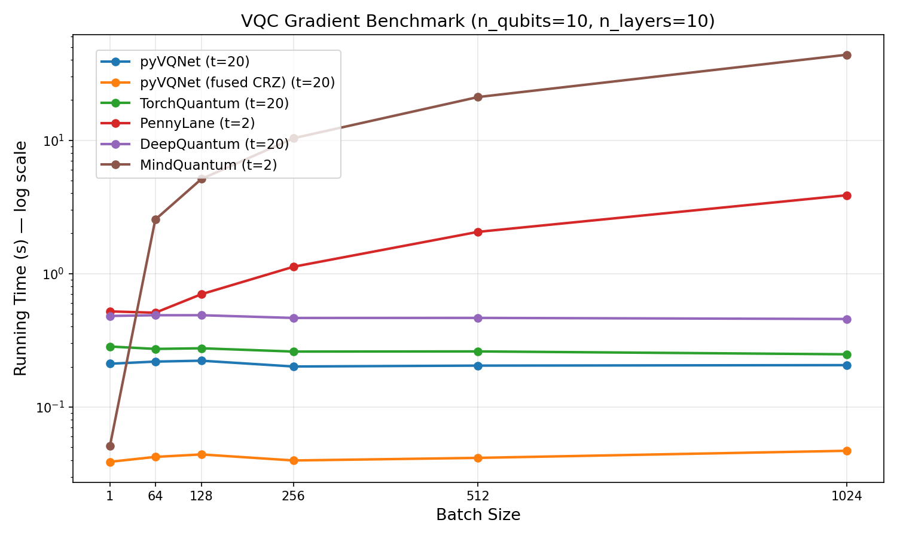

.. _vqc_api:

Variational quantum circuit automatic differentiation simulation
*****************************************************************

The following interfaces use VQNet's QTensor API to build common quantum logic gates, quantum circuits, and measurement methods. Automatic differentiation simulation can replace the quantum circuit parameter-shift method to compute gradients of parameters in variational quantum circuits.

Like other `Module` classes, the interfaces in the ``pyvqnet.qnn.vqc`` module can be used to build hybrid quantum-classical neural network models. In a `Module`, define a quantum machine `QMachine` and call reset_states on its quantum state vector data `states` according to the input batch size. See the following example for details:

.. warning::

    To ensure that the quantum state is in its initial state each time the quantum circuit forward function runs, call ``QMachine.reset_states(batchsize)`` at the beginning of the forward function.

    To support batched data in quantum circuits, when encoding input data into quantum logic gates, the input shape must be [batchsize,*], where * is the number of parameters of the gate being encoded.

    See the following example:

.. code-block::

    from pyvqnet.nn import Module,Linear,ModuleList
    from pyvqnet.qnn.vqc import VQC_HardwareEfficientAnsatz,RZZ,RZ
    from pyvqnet.qnn.vqc import Probability,QMachine
    from pyvqnet import tensor

    class QM(Module):
        def __init__(self, name=""):
            super().__init__(name)
            self.linearx = Linear(4,2)
            self.ansatz = VQC_HardwareEfficientAnsatz(4, ["rx", "RY", "rz"],
                                        entangle_gate="cnot",
                                        entangle_rules="linear",
                                        depth=2)
            #VQC-based RZ on qubit 0
            self.encode1 = RZ(wires=0)
            #VQC-based RZ on qubit 1
            self.encode2 = RZ(wires=1)
            #VQC-based probability measurement on qubits 0,2
            self.measure = Probability(wires=[0,2])
            #Quantum device QMachine with 4 qubits.
            self.device = QMachine(4)
        def forward(self, x, *args, **kwargs):
            #The states must be reset to the same batchsize as the input.
            self.device.reset_states(x.shape[0])
            y = self.linearx(x)
            #Encode the input into the RZ gate; the input must have shape [batchsize,1]
            self.encode1(params = y[:, 0],q_machine = self.device,)
            #Encode the input into the RZ gate; the input must have shape [batchsize,1]
            self.encode2(params = y[:, 1],q_machine = self.device,)
            self.ansatz(q_machine =self.device)
            return self.measure(q_machine =self.device)

    bz =3
    inputx = tensor.arange(1.0,bz*4+1).reshape([bz,4])
    inputx.requires_grad= True
    #Define it like any other Module
    qlayer = QM()
    #Forward pass
    y = qlayer(inputx)
    #Backward pass
    y.backward()
    print(y)

To use variational quantum circuit gates with trainable parameters rather than only encoding data into the circuit as in the example above, see the following example:

.. code-block::

    from pyvqnet.nn import Module,Linear,ModuleList
    from pyvqnet.qnn.vqc import VQC_HardwareEfficientAnsatz,RZZ,RZ,rz,ry,cnot
    from pyvqnet.qnn.vqc import Probability,QMachine
    from pyvqnet import tensor

    class QM(Module):
        def __init__(self, name=""):
            super().__init__(name)
            self.linearx = Linear(4,2)
            self.ansatz = VQC_HardwareEfficientAnsatz(4, ["rx", "RY", "rz"],
                                        entangle_gate="cnot",
                                        entangle_rules="linear",
                                        depth=2)
            #VQC-based RZ on qubit 0
            self.encode1 = RZ(wires=0)
            #VQC-based RZ on qubit 1
            self.encode2 = RZ(wires=1)
            #Set RZ trainable= True
            self.vqc = RZ(trainable = True,wires=1)
            #VQC-based probability measurement on qubits 0,2
            self.measure = Probability(wires=[0,2])
            #Quantum device QMachine with 4 qubits.
            self.device = QMachine(4)
        def forward(self, x, *args, **kwargs):
            #The states must be reset to the same batchsize as the input.
            self.device.reset_states(x.shape[0])
            y = self.linearx(x)
            #Encode the input into the RZ gate; the input must have shape [batchsize,1]
            self.encode1(params = y[:, 0],q_machine = self.device,)
            #Encode the input into the RZ gate; the input must have shape [batchsize,1]
            self.encode2(params = y[:, 1],q_machine = self.device,)
            #Parameterized variational circuit made of RZ gates, included in training.
            self.vqc(q_machine =self.device)
            self.ansatz(q_machine =self.device)
            return self.measure(q_machine =self.device)

    bz =3
    inputx = tensor.arange(1.0,bz*4+1).reshape([bz,4])
    inputx.requires_grad= True
    #Define it like any other Module
    qlayer = QM()
    #Forward pass
    y = qlayer(inputx)
    #Backward pass
    y.backward()
    print(y)

The following example shows how to perform variational quantum computation on a GPU (including data encoding and a parameterized variational circuit):

.. code-block::

    from pyvqnet.nn import Module,Linear,ModuleList
    from pyvqnet.qnn.vqc import VQC_HardwareEfficientAnsatz,RZZ,RZ,rz,ry,cnot
    from pyvqnet.qnn.vqc import Probability,QMachine
    from pyvqnet import tensor
    from pyvqnet import DEV_GPU
    class QM(Module):
        def __init__(self, name=""):
            super().__init__(name)
            self.linearx = Linear(4,2)
            self.ansatz = VQC_HardwareEfficientAnsatz(4, ["rx", "RY", "rz"],
                                        entangle_gate="cnot",
                                        entangle_rules="linear",
                                        depth=2)
            #VQC-based RZ on qubit 0
            self.encode1 = RZ(wires=0)
            #VQC-based RZ on qubit 1
            self.encode2 = RZ(wires=1)
            #Set RZ trainable= True
            self.vqc = RZ(trainable = True,wires=1)
            #VQC-based probability measurement on qubits 0,2
            self.measure = Probability(wires=[0,2])
            #Quantum device QMachine with 4 qubits.
            self.device = QMachine(4)
        def forward(self, x, *args, **kwargs):
            #The states must be reset to the same batchsize as the input.
            self.device.reset_states(x.shape[0])
            y = self.linearx(x)
            #Encode the input into the RZ gate; the input must have shape [batchsize,1]
            self.encode1(params = y[:, 0],q_machine = self.device,)
            #Encode the input into the RZ gate; the input must have shape [batchsize,1]
            self.encode2(params = y[:, 1],q_machine = self.device,)
            #Parameterized variational circuit made of RZ gates, included in training.
            self.vqc(q_machine =self.device)
            self.ansatz(q_machine =self.device)
            return self.measure(q_machine =self.device)

    bz =3
    #create tensor on GPU
    inputx = tensor.arange(1.0,bz*4+1,device=DEV_GPU).reshape([bz,4])
    inputx.requires_grad= True
    #Define it like any other Module
    qlayer = QM()
    #move module to GPU
    qlayer = qlayer.to(DEV_GPU)
    #Forward pass
    y = qlayer(inputx)
    #Backward pass
    y.backward()
    print(y)

Simulator
=========================================

QMachine
---------------------------------------------------------------

.. py:class:: pyvqnet.qnn.vqc.QMachine(num_wires, dtype=pyvqnet.kcomplex64, save_ir=False, state_storage=None)

    Simulator class for variational quantum computation. Its states property contains the state vectors of the quantum circuit. ``states`` is a ``QTensor`` of shape ``(batchsize, 2, ..., 2)``; ``dtype`` is the data type used for the computation and ``state_storage`` is the storage data type of ``states`` (``None`` when it is not set).

    .. note::

        Before running a complete quantum circuit each time, you must call ``pyvqnet.qnn.vqc.QMachine.reset_states(batchsize)`` to reinitialize the initial state in the simulator and broadcast it to
        (batchsize,*) dimensions for batch data training.

    :param num_wires: Number of qubits.
    :param dtype: Data type used for the computation. Default: pyvqnet.kcomplex64, which corresponds to a parameter precision of pyvqnet.kfloat32. It can also be set to ``pyvqnet.kcomplex128``, which corresponds to a parameter precision of ``pyvqnet.kfloat64``. Passing ``pyvqnet.kcomplex32`` is equivalent to ``dtype=pyvqnet.kcomplex64`` together with ``state_storage=pyvqnet.kcomplex32``.
    :param save_ir: When set to True, saves the operations to originIR. Default: False.
    :param state_storage: Storage data type of the state vector ``states``. Default: None, which means the same as ``dtype``. When it is set to ``pyvqnet.kcomplex32`` (or ``torch.complex32``), ``states`` is stored in half precision, with 4 bytes per amplitude; in this case ``dtype`` can only be ``pyvqnet.kcomplex64``, the computation inside the gates is still carried out at ``pyvqnet.kcomplex64`` precision, the gate parameters are stored as ``pyvqnet.kfloat16``, the gate matrices are ``pyvqnet.kcomplex32``, and the measurement results of ``MeasureAll`` and ``Probability`` have the data type ``pyvqnet.kfloat16``. Passing any other value raises ``ValueError``.

    :return: Outputs a QMachine.

    Example::

        from pyvqnet.qnn.vqc import QMachine
        qm = QMachine(4)

        print(qm.states)
        print(qm.dtype, qm.state_storage, qm.num_wires, qm.batch_size)

        # [[[[[1.+0.j,0.+0.j],
        #     [0.+0.j,0.+0.j]],
        #
        #    [[0.+0.j,0.+0.j],
        #     [0.+0.j,0.+0.j]]],
        #
        #
        #   [[[0.+0.j,0.+0.j],
        #     [0.+0.j,0.+0.j]],
        #
        #    [[0.+0.j,0.+0.j],
        #     [0.+0.j,0.+0.j]]]]]
        # <QTensor [1, 2, 2, 2, 2] DEV_CPU complex64>
        # complex64 None 4 1

    With ``state_storage=pyvqnet.kcomplex32``, ``dtype`` is still ``pyvqnet.kcomplex64``, ``states`` is stored as ``pyvqnet.kcomplex32`` and the measurement results have the data type ``pyvqnet.kfloat16``:

    .. code-block::

        from pyvqnet.qnn.vqc import QMachine, MeasureAll, ry
        from pyvqnet import kcomplex32, tensor

        # fp16 storage: the compute dtype stays kcomplex64, the states are complex32
        qm = QMachine(3, dtype=kcomplex32)
        print(qm.dtype, qm.state_storage, qm.states.dtype)

        x = tensor.QTensor([[0.3], [1.2]], requires_grad=True)
        qm.reset_states(2)
        ry(q_machine=qm, wires=0, params=x)
        y = MeasureAll(obs={"Z0": 1.0})(q_machine=qm)
        print(y, y.dtype)
        y.backward()
        print(x.grad)

        # complex64 complex32 complex32
        #
        # [[0.9556],
        #  [0.3618]]
        # <QTensor [2, 1] DEV_CPU float16> float16
        #
        # [[-0.2954102],
        #  [-0.9321289]]
        # <QTensor [2, 1] DEV_CPU float32>

    .. py:method:: reset_states(batchsize)

        Reinitializes the initial state in the simulator and broadcasts it to
        (batchsize,[2]**num_qubits) dimensions so that the simulator can perform model computation on batched data. The circuit record of the previous forward pass (``op_history``, the originIR strings and the parameter registry) is cleared at the same time.

        :param batchsize: Batch size.

    .. py:method:: init_states(init_state)

        Sets ``states`` of the simulator to the given quantum state, which can replace the default initial state :math:`|00\cdots 0\rangle` produced by ``reset_states``.

        :param init_state: The normalized quantum state, a ``QTensor`` of shape ``(batchsize, 2, ..., 2)``, or of shape ``(2, ..., 2)`` (broadcast along the batch dimension to every sample). The norm of each sample must be 1, otherwise a ``ValueError`` is raised; the data type must be the same as ``dtype`` (including when ``state_storage=pyvqnet.kcomplex32``, in which case a ``pyvqnet.kcomplex64`` state is passed), and the device must be the same as that of the simulator.

        Example::

            from pyvqnet.qnn.vqc import QMachine, Probability
            from pyvqnet import tensor

            qm = QMachine(2)
            qm.reset_states(3)
            # one normalized state, broadcast over the 3 batch entries
            qm.init_states(tensor.QTensor([[0.0, 1.0], [0.0, 0.0]], dtype=tensor.kcomplex64))
            print(Probability(wires=[0, 1])(q_machine=qm))

            # one normalized state per batch entry
            qm.init_states(tensor.QTensor([[[0.0, 1.0], [0.0, 0.0]],
                                           [[0.0, 0.0], [1.0, 0.0]],
                                           [[0.0, 0.0], [0.0, 1.0]]], dtype=tensor.kcomplex64))
            print(Probability(wires=[0, 1])(q_machine=qm))

            # [[0.,1.,0.,0.],
            #  [0.,1.,0.,0.],
            #  [0.,1.,0.,0.]]
            # <QTensor [3, 4] DEV_CPU float32>
            #
            # [[0.,1.,0.,0.],
            #  [0.,0.,1.,0.],
            #  [0.,0.,0.,1.]]
            # <QTensor [3, 4] DEV_CPU float32>

    .. py:method:: is_adjoint()

        Returns whether the simulator is currently in adjoint gradient mode.

        The adjoint mode is not set on the ``QMachine``: when the ``Module`` that contains the simulator is wrapped with ``pyvqnet.qnn.vqc.QuantumLayerAdjoint``, the wrapper switches the simulator to adjoint mode during each forward computation and switches it back to the automatic differentiation mode after the forward computation ends.

        :return: ``True`` when it is in adjoint mode, ``False`` otherwise.

        Example::

            import pyvqnet
            from pyvqnet import tensor
            from pyvqnet.qnn.vqc import QMachine, QuantumLayerAdjoint, RX, RY, CNOT, MeasureAll
            from pyvqnet.utils import set_random_seed

            set_random_seed(42)

            class QModel(pyvqnet.nn.Module):
                def __init__(self):
                    super().__init__()
                    self.qm = QMachine(2)
                    self.rx = RX(trainable=False, wires=0)
                    self.ry = RY(trainable=True, wires=1)
                    self.cnot = CNOT(wires=[0, 1])
                    self.measure = MeasureAll(obs={"Z0": 1.0, "Z1": 1.0})
                    self.adjoint_flags = []

                def forward(self, x, *args, **kwargs):
                    self.adjoint_flags.append(self.qm.is_adjoint())
                    self.qm.reset_states(x.shape[0])
                    self.rx(params=x, q_machine=self.qm)
                    self.ry(q_machine=self.qm)
                    self.cnot(q_machine=self.qm)
                    return self.measure(q_machine=self.qm)

            x = tensor.QTensor([[0.5]], requires_grad=True)
            model = QModel()
            model(x)
            print(model.adjoint_flags, model.qm.is_adjoint())

            x = tensor.QTensor([[0.5]], requires_grad=True)
            adjoint_model = QuantumLayerAdjoint(model)
            adjoint_model.train()
            y = adjoint_model(x)
            print(model.adjoint_flags, model.qm.is_adjoint())
            y.backward()
            print(y, x.grad)

            # [False] False
            # [False, True] False
            #
            # [[1.2884717]]
            # <QTensor [1, 1] DEV_CPU float32>
            # [[-0.7038953]]
            # <QTensor [1, 1] DEV_CPU float32>

    .. py:method:: set_noise_seed(seed)

        Sets the random seed of the Monte Carlo sampling of the noise channels on this simulator (the branch drawn for each circuit).

        :param seed: Random seed; passing ``None`` uses fresh random entropy.

        Example::

            from pyvqnet.qnn.vqc import MeasureAll, QMachine, depolarizing, ry

            qm = QMachine(1)
            qm.set_noise_seed(7)
            qm.reset_states(1024)            # 1024 trajectories
            ry(q_machine=qm, wires=0, params=0.4)
            depolarizing(q_machine=qm, wire=0, p=0.05)
            y = MeasureAll(obs={"Z0": 1.0})(q_machine=qm)
            print(y.to_numpy().mean())        # noisy <Z0>

            # 0.8724892

Quantum logic gate interfaces
==============================

The gate functions in this section share the same argument checks: the qubit indices in ``wires`` must be distinct and must lie in ``[0, q_machine.num_wires)``; the ``params`` of a parameterized gate can be a ``QTensor`` or a Python number, and a ``QTensor`` must have either 1 row (the same angle is broadcast to all samples) or as many rows as the batch size passed to ``q_machine.reset_states(batchsize)``. A violation raises ``ValueError``, the same as an invalid qubit index.

i
---------------------------------------------------------------

.. py:function:: pyvqnet.qnn.vqc.i(q_machine, wires, params=None, use_dagger=False)

    Applies the I quantum gate to the state vectors in ``q_machine``.

    :param q_machine: Quantum machine device.
    :param wires: Qubit index.
    :param params: Parameter matrix. Default: None. For a gate operation function with p parameters, the input dimension must be [1,p] or [p].
    :param use_dagger: Whether to apply the conjugate transpose. Default: False.

    Example::

        from pyvqnet.qnn.vqc import i,QMachine
        qm  = QMachine(4)
        i(q_machine=qm, wires=1,)
        print(qm.states)

        # [[[[[1.+0.j 0.+0.j]
        #     [0.+0.j 0.+0.j]]

        #    [[0.+0.j 0.+0.j]
        #     [0.+0.j 0.+0.j]]]

        #   [[[0.+0.j 0.+0.j]
        #     [0.+0.j 0.+0.j]]

        #    [[0.+0.j 0.+0.j]
        #     [0.+0.j 0.+0.j]]]]]

I
---------------------------------------------------------------

.. py:class:: pyvqnet.qnn.vqc.I(trainable: bool = False,init_params=None,wires=None,dtype=pyvqnet.kcomplex64,use_dagger=False)

    Defines an I quantum gate class.

    :param trainable: Whether the gate has trainable parameters. Set to False when the layer builds its gate matrix from external input data, or True when the trainable parameters are initialized in this layer. Default: False.
    :param init_params: Initialization parameters used to encode classical data as a QTensor. Default: None. For a parameterized gate with p parameters, the input dimension must be [1,p] or [p].
    :param wires: Indices of the qubits the circuit acts on. Default: None.
    :param dtype: Data precision of the gate matrix. Can be set to pyvqnet.kcomplex64 or pyvqnet.kcomplex128, corresponding to float and double inputs, respectively.
    :param use_dagger: Whether to use the conjugate transpose of the gate. Default: False.
    :return: An I quantum gate instance.

    Example::

        from pyvqnet.qnn.vqc import I,QMachine
        device = QMachine(4)
        layer = I(wires=0)
        batchsize = 1
        device.reset_states(1)
        layer(q_machine = device)
        print(device.states)

hadamard
---------------------------------------------------------------

.. py:function:: pyvqnet.qnn.vqc.hadamard(q_machine, wires, params=None, use_dagger=False)

    Applies the Hadamard gate to the state vectors in q_machine.

    :param q_machine: Quantum machine device.
    :param wires: Qubit index.
    :param params: Parameter matrix. Default: None. For a gate operation function with p parameters, the input dimension must be [1,p] or [p].
    :param use_dagger: Whether to apply the conjugate transpose. Default: False.

    Example::

        from pyvqnet.qnn.vqc import hadamard,QMachine
        qm  = QMachine(4)
        hadamard(q_machine=qm, wires=1,)
        print(qm.states)
        # [[[[[0.7071068+0.j 0.       +0.j]
        #     [0.       +0.j 0.       +0.j]]
        #
        #    [[0.7071068+0.j 0.       +0.j]
        #     [0.       +0.j 0.       +0.j]]]
        #
        #
        #   [[[0.       +0.j 0.       +0.j]
        #     [0.       +0.j 0.       +0.j]]
        #
        #    [[0.       +0.j 0.       +0.j]
        #     [0.       +0.j 0.       +0.j]]]]]

Hadamard
---------------------------------------------------------------

.. py:class:: pyvqnet.qnn.vqc.Hadamard(trainable: bool = False,init_params=None,wires=None,dtype=pyvqnet.kcomplex64,use_dagger=False)

    Defines a Hadamard quantum gate class.

    :param trainable: Whether the gate has trainable parameters. Set to False when the layer builds its gate matrix from external input data, or True when the trainable parameters are initialized in this layer. Default: False.
    :param init_params: Initialization parameters used to encode classical data as a QTensor. Default: None. For a parameterized gate with p parameters, the input dimension must be [1,p] or [p].
    :param wires: Indices of the qubits the circuit acts on. Default: None.
    :param dtype: Data precision of the gate matrix. Can be set to pyvqnet.kcomplex64 or pyvqnet.kcomplex128, corresponding to float and double inputs, respectively.
    :param use_dagger: Whether to use the conjugate transpose of the gate. Default: False.
    :return: A Hadamard quantum gate instance.

    Example::

        from pyvqnet.qnn.vqc import Hadamard,QMachine
        device = QMachine(4)
        layer = Hadamard(wires=0)
        batchsize = 1
        device.reset_states(1)
        layer(q_machine = device)
        print(device.states)

t
---------------------------------------------------------------

.. py:function:: pyvqnet.qnn.vqc.t(q_machine, wires, params=None, use_dagger=False)

    Applies the T gate to the state vectors in q_machine. The T gate applies the phase :math:`e^{i\pi/4}` to :math:`|1\rangle`; with ``use_dagger=True``, its conjugate transpose :math:`T^\dagger` is applied instead.

    :param q_machine: Quantum machine device.
    :param wires: Qubit index.
    :param params: Parameter matrix. Default: None. For a gate operation function with p parameters, the input dimension must be [1,p] or [p].
    :param use_dagger: Whether to apply the conjugate transpose. Default: False.

    Example::

        from pyvqnet.qnn.vqc import QMachine, hadamard, t

        qm = QMachine(2)
        hadamard(q_machine=qm, wires=0)
        t(q_machine=qm, wires=0)
        print(qm.states)

        qm = QMachine(2)
        hadamard(q_machine=qm, wires=0)
        t(q_machine=qm, wires=0, use_dagger=True)
        print(qm.states)

        # [[[0.7071068+0.j ,0.       +0.j ],
        #   [0.5      +0.5j,0.       +0.j ]]]
        # <QTensor [1, 2, 2] DEV_CPU complex64>
        #
        # [[[0.7071068+0.j ,0.       +0.j ],
        #   [0.5      -0.5j,0.       +0.j ]]]
        # <QTensor [1, 2, 2] DEV_CPU complex64>

T
---------------------------------------------------------------

.. py:class:: pyvqnet.qnn.vqc.T(trainable: bool = False,init_params=None,wires=None,dtype=pyvqnet.kcomplex64,use_dagger=False)

    Defines a T quantum gate class. With ``use_dagger=True`` the gate is its conjugate transpose :math:`T^\dagger`.

    :param trainable: Whether the gate has trainable parameters. Set to False when the layer builds its gate matrix from external input data, or True when the trainable parameters are initialized in this layer. Default: False.
    :param init_params: Initialization parameters used to encode classical data as a QTensor. Default: None. For a parameterized gate with p parameters, the input dimension must be [1,p] or [p].
    :param wires: Indices of the qubits the circuit acts on. Default: None.
    :param dtype: Data precision of the gate matrix. Can be set to pyvqnet.kcomplex64 or pyvqnet.kcomplex128, corresponding to float and double inputs, respectively.
    :param use_dagger: Whether to use the conjugate transpose of the gate. Default: False.
    :return: A T quantum gate instance.

    Example::

        from pyvqnet.qnn.vqc import QMachine, Hadamard, T

        device = QMachine(2)
        hadamard = Hadamard(wires=0)
        t_gate = T(wires=0)
        t_dagger = T(wires=0, use_dagger=True)

        device.reset_states(1)
        hadamard(q_machine=device)
        t_gate(q_machine=device)
        print(device.states)

        device.reset_states(1)
        hadamard(q_machine=device)
        t_dagger(q_machine=device)
        print(device.states)

        # [[[0.7071068+0.j ,0.       +0.j ],
        #   [0.5      +0.5j,0.       +0.j ]]]
        # <QTensor [1, 2, 2] DEV_CPU complex64>
        #
        # [[[0.7071068+0.j ,0.       +0.j ],
        #   [0.5      -0.5j,0.       +0.j ]]]
        # <QTensor [1, 2, 2] DEV_CPU complex64>

s
---------------------------------------------------------------

.. py:function:: pyvqnet.qnn.vqc.s(q_machine, wires, params=None, use_dagger=False)

    Applies the S gate to the state vectors in q_machine. The S gate applies the phase :math:`i` to :math:`|1\rangle`; with ``use_dagger=True``, its conjugate transpose :math:`S^\dagger` is applied instead.

    :param q_machine: Quantum machine device.
    :param wires: Qubit index.
    :param params: Parameter matrix. Default: None. For a gate operation function with p parameters, the input dimension must be [1,p] or [p].
    :param use_dagger: Whether to apply the conjugate transpose. Default: False.

    Example::

        from pyvqnet.qnn.vqc import QMachine, hadamard, s

        qm = QMachine(2)
        hadamard(q_machine=qm, wires=0)
        s(q_machine=qm, wires=0)
        print(qm.states)

        qm = QMachine(2)
        hadamard(q_machine=qm, wires=0)
        s(q_machine=qm, wires=0, use_dagger=True)
        print(qm.states)

        # [[[0.7071068+0.j       ,0.       +0.j       ],
        #   [0.       +0.7071068j,0.       +0.j       ]]]
        # <QTensor [1, 2, 2] DEV_CPU complex64>
        #
        # [[[0.7071068+0.j       ,0.       +0.j       ],
        #   [0.       -0.7071068j,0.       +0.j       ]]]
        # <QTensor [1, 2, 2] DEV_CPU complex64>

S
---------------------------------------------------------------

.. py:class:: pyvqnet.qnn.vqc.S(trainable: bool = False,init_params=None,wires=None,dtype=pyvqnet.kcomplex64,use_dagger=False)

    Defines an S quantum gate class. With ``use_dagger=True`` the gate is its conjugate transpose :math:`S^\dagger`.

    :param trainable: Whether the gate has trainable parameters. Set to False when the layer builds its gate matrix from external input data, or True when the trainable parameters are initialized in this layer. Default: False.
    :param init_params: Initialization parameters used to encode classical data as a QTensor. Default: None. For a parameterized gate with p parameters, the input dimension must be [1,p] or [p].
    :param wires: Indices of the qubits the circuit acts on. Default: None.
    :param dtype: Data precision of the gate matrix. Can be set to pyvqnet.kcomplex64 or pyvqnet.kcomplex128, corresponding to float and double inputs, respectively.
    :param use_dagger: Whether to use the conjugate transpose of the gate. Default: False.
    :return: An S quantum gate instance.

    Example::

        from pyvqnet.qnn.vqc import QMachine, Hadamard, S

        device = QMachine(2)
        hadamard = Hadamard(wires=0)
        s_gate = S(wires=0)
        s_dagger = S(wires=0, use_dagger=True)

        device.reset_states(1)
        hadamard(q_machine=device)
        s_gate(q_machine=device)
        print(device.states)

        device.reset_states(1)
        hadamard(q_machine=device)
        s_dagger(q_machine=device)
        print(device.states)

        # [[[0.7071068+0.j       ,0.       +0.j       ],
        #   [0.       +0.7071068j,0.       +0.j       ]]]
        # <QTensor [1, 2, 2] DEV_CPU complex64>
        #
        # [[[0.7071068+0.j       ,0.       +0.j       ],
        #   [0.       -0.7071068j,0.       +0.j       ]]]
        # <QTensor [1, 2, 2] DEV_CPU complex64>

paulix
---------------------------------------------------------------

.. py:function:: pyvqnet.qnn.vqc.paulix(q_machine, wires, params=None, use_dagger=False)

    Applies the PauliX gate to the state vectors in q_machine.

    :param q_machine: Quantum machine device.
    :param wires: Qubit index.
    :param params: Parameter matrix. Default: None. For a gate operation function with p parameters, the input dimension must be [1,p] or [p].
    :param use_dagger: Whether to apply the conjugate transpose. Default: False.

    Example::

        from pyvqnet.qnn.vqc import paulix,QMachine
        qm  = QMachine(4)
        paulix(q_machine=qm, wires=1,)
        print(qm.states)

        # [[[[[0.+0.j 0.+0.j]
        #     [0.+0.j 0.+0.j]]
        #
        #    [[1.+0.j 0.+0.j]
        #     [0.+0.j 0.+0.j]]]
        #
        #
        #   [[[0.+0.j 0.+0.j]
        #     [0.+0.j 0.+0.j]]
        #
        #    [[0.+0.j 0.+0.j]
        #     [0.+0.j 0.+0.j]]]]]

PauliX
---------------------------------------------------------------

.. py:class:: pyvqnet.qnn.vqc.PauliX(trainable: bool = False,init_params=None,wires=None,dtype=pyvqnet.kcomplex64,use_dagger=False)

    Defines a PauliX quantum gate class.

    :param trainable: Whether the gate has trainable parameters. Set to False when the layer builds its gate matrix from external input data, or True when the trainable parameters are initialized in this layer. Default: False.
    :param init_params: Initialization parameters used to encode classical data as a QTensor. Default: None. For a parameterized gate with p parameters, the input dimension must be [1,p] or [p].
    :param wires: Indices of the qubits the circuit acts on. Default: None.
    :param dtype: Data precision of the gate matrix. Can be set to pyvqnet.kcomplex64 or pyvqnet.kcomplex128, corresponding to float and double inputs, respectively.
    :param use_dagger: Whether to use the conjugate transpose of the gate. Default: False.
    :return: A PauliX quantum gate instance.

    Example::

        from pyvqnet.qnn.vqc import PauliX,QMachine
        device = QMachine(4)
        layer = PauliX(wires=0)
        batchsize = 1
        device.reset_states(1)
        layer(q_machine = device)
        print(device.states)

pauliy
---------------------------------------------------------------

.. py:function:: pyvqnet.qnn.vqc.pauliy(q_machine, wires, params=None, use_dagger=False)

    Applies the PauliY gate to the state vectors in q_machine.

    :param q_machine: Quantum machine device.
    :param wires: Qubit index.
    :param params: Parameter matrix. Default: None. For a gate operation function with p parameters, the input dimension must be [1,p] or [p].
    :param use_dagger: Whether to apply the conjugate transpose. Default: False.

    Example::

        from pyvqnet.qnn.vqc import pauliy,QMachine
        qm  = QMachine(4)
        pauliy(q_machine=qm, wires=1,)
        print(qm.states)

        # [[[[[0.+0.j 0.+0.j]
        #     [0.+0.j 0.+0.j]]
        #
        #    [[0.+1.j 0.+0.j]
        #     [0.+0.j 0.+0.j]]]
        #
        #
        #   [[[0.+0.j 0.+0.j]
        #     [0.+0.j 0.+0.j]]
        #
        #    [[0.+0.j 0.+0.j]
        #     [0.+0.j 0.+0.j]]]]]

PauliY
---------------------------------------------------------------

.. py:class:: pyvqnet.qnn.vqc.PauliY(trainable: bool = False,init_params=None,wires=None,dtype=pyvqnet.kcomplex64,use_dagger=False)

    Defines a PauliY quantum gate class.

    :param trainable: Whether the gate has trainable parameters. Set to False when the layer builds its gate matrix from external input data, or True when the trainable parameters are initialized in this layer. Default: False.
    :param init_params: Initialization parameters used to encode classical data as a QTensor. Default: None. For a parameterized gate with p parameters, the input dimension must be [1,p] or [p].
    :param wires: Indices of the qubits the circuit acts on. Default: None.
    :param dtype: Data precision of the gate matrix. Can be set to pyvqnet.kcomplex64 or pyvqnet.kcomplex128, corresponding to float and double inputs, respectively.
    :param use_dagger: Whether to use the conjugate transpose of the gate. Default: False.
    :return: A PauliY quantum gate instance.

    Example::

        from pyvqnet.qnn.vqc import PauliY,QMachine
        device = QMachine(4)
        layer = PauliY(wires=0)
        batchsize = 1
        device.reset_states(1)
        layer(q_machine = device)
        print(device.states)

pauliz
---------------------------------------------------------------

.. py:function:: pyvqnet.qnn.vqc.pauliz(q_machine, wires, params=None, use_dagger=False)

    Applies the PauliZ gate to the state vectors in q_machine.

    :param q_machine: Quantum machine device.
    :param wires: Qubit index.
    :param params: Parameter matrix. Default: None. For a gate operation function with p parameters, the input dimension must be [1,p] or [p].
    :param use_dagger: Whether to apply the conjugate transpose. Default: False.

    Example::

        from pyvqnet.qnn.vqc import pauliz,QMachine
        qm  = QMachine(4)
        pauliz(q_machine=qm, wires=1,)
        print(qm.states)

        # [[[[[1.+0.j 0.+0.j]
        #     [0.+0.j 0.+0.j]]
        #
        #    [[0.+0.j 0.+0.j]
        #     [0.+0.j 0.+0.j]]]
        #
        #
        #   [[[0.+0.j 0.+0.j]
        #     [0.+0.j 0.+0.j]]
        #
        #    [[0.+0.j 0.+0.j]
        #     [0.+0.j 0.+0.j]]]]]

PauliZ
---------------------------------------------------------------

.. py:class:: pyvqnet.qnn.vqc.PauliZ(trainable: bool = False,init_params=None,wires=None,dtype=pyvqnet.kcomplex64,use_dagger=False)

    Defines a PauliZ quantum gate class.

    :param trainable: Whether the gate has trainable parameters. Set to False when the layer builds its gate matrix from external input data, or True when the trainable parameters are initialized in this layer. Default: False.
    :param init_params: Initialization parameters used to encode classical data as a QTensor. Default: None. For a parameterized gate with p parameters, the input dimension must be [1,p] or [p].
    :param wires: Indices of the qubits the circuit acts on. Default: None.
    :param dtype: Data precision of the gate matrix. Can be set to pyvqnet.kcomplex64 or pyvqnet.kcomplex128, corresponding to float and double inputs, respectively.
    :param use_dagger: Whether to use the conjugate transpose of the gate. Default: False.
    :return: A PauliZ quantum gate instance.

    Example::

        from pyvqnet.qnn.vqc import PauliZ,QMachine
        device = QMachine(4)
        layer = PauliZ(wires=0)
        batchsize = 1
        device.reset_states(1)
        layer(q_machine = device)
        print(device.states)

x1
---------------------------------------------------------------

.. py:function:: pyvqnet.qnn.vqc.x1(q_machine, wires, params=None, use_dagger=False)

    Applies the X1 gate to the state vectors in q_machine.

    :param q_machine: Quantum machine device.
    :param wires: Qubit index.
    :param params: Parameter matrix. Default: None. For a gate operation function with p parameters, the input dimension must be [1,p] or [p].
    :param use_dagger: Whether to apply the conjugate transpose. Default: False.

    Example::

        from pyvqnet.qnn.vqc import x1,QMachine
        qm  = QMachine(4)
        x1(q_machine=qm, wires=1,)
        print(qm.states)

        # [[[[[0.7071068+0.j        0.       +0.j       ]
        #     [0.       +0.j        0.       +0.j       ]]
        #
        #    [[0.       -0.7071068j 0.       +0.j       ]
        #     [0.       +0.j        0.       +0.j       ]]]
        #
        #
        #   [[[0.       +0.j        0.       +0.j       ]
        #     [0.       +0.j        0.       +0.j       ]]
        #
        #    [[0.       +0.j        0.       +0.j       ]
        #     [0.       +0.j        0.       +0.j       ]]]]]

X1
---------------------------------------------------------------

.. py:class:: pyvqnet.qnn.vqc.X1(trainable: bool = False,init_params=None,wires=None,dtype=pyvqnet.kcomplex64,use_dagger=False)

    Defines an X1 quantum gate class.

    :param trainable: Whether the gate has trainable parameters. Set to False when the layer builds its gate matrix from external input data, or True when the trainable parameters are initialized in this layer. Default: False.
    :param init_params: Initialization parameters used to encode classical data as a QTensor. Default: None. For a parameterized gate with p parameters, the input dimension must be [1,p] or [p].
    :param wires: Indices of the qubits the circuit acts on. Default: None.
    :param dtype: Data precision of the gate matrix. Can be set to pyvqnet.kcomplex64 or pyvqnet.kcomplex128, corresponding to float and double inputs, respectively.
    :param use_dagger: Whether to use the conjugate transpose of the gate. Default: False.
    :return: An X1 quantum gate instance.

    Example::

        from pyvqnet.qnn.vqc import X1,QMachine
        device = QMachine(4)
        layer = X1(wires=0)
        batchsize = 1
        device.reset_states(1)
        layer(q_machine = device)
        print(device.states)

rx
---------------------------------------------------------------

.. py:function:: pyvqnet.qnn.vqc.rx(q_machine, wires, params=None, use_dagger=False)

    Applies the RX gate to the state vectors in q_machine.

    :param q_machine: Quantum machine device.
    :param wires: Qubit index.
    :param params: Parameter matrix. Default: None. For a gate operation function with p parameters, the input dimension must be [1,p] or [p].
    :param use_dagger: Whether to apply the conjugate transpose. Default: False.

    Example::

        from pyvqnet.qnn.vqc import rx,QMachine
        from pyvqnet.tensor import QTensor
        qm  = QMachine(4)
        rx(q_machine=qm, wires=1,params=QTensor([0.5]))
        print(qm.states)

        # [[[[[0.9689124+0.j       0.       +0.j      ]
        #     [0.       +0.j       0.       +0.j      ]]
        #
        #    [[0.       -0.247404j 0.       +0.j      ]
        #     [0.       +0.j       0.       +0.j      ]]]
        #
        #
        #   [[[0.       +0.j       0.       +0.j      ]
        #     [0.       +0.j       0.       +0.j      ]]
        #
        #    [[0.       +0.j       0.       +0.j      ]
        #     [0.       +0.j       0.       +0.j      ]]]]]

RX
---------------------------------------------------------------

.. py:class:: pyvqnet.qnn.vqc.RX(trainable: bool = False,init_params=None,wires=None,dtype=pyvqnet.kcomplex64,use_dagger=False)

    Defines an RX quantum gate class.

    :param trainable: Whether the gate has trainable parameters. Set to False when the layer builds its gate matrix from external input data, or True when the trainable parameters are initialized in this layer. Default: False.
    :param init_params: Initialization parameters used to encode classical data as a QTensor. Default: None. For a parameterized gate with p parameters, the input dimension must be [1,p] or [p].
    :param wires: Indices of the qubits the circuit acts on. Default: None.
    :param dtype: Data precision of the gate matrix. Can be set to pyvqnet.kcomplex64 or pyvqnet.kcomplex128, corresponding to float and double inputs, respectively.
    :param use_dagger: Whether to use the conjugate transpose of the gate. Default: False.
    :return: An RX quantum gate instance.

    Example::

        from pyvqnet.qnn.vqc import RX,QMachine
        device = QMachine(4)
        layer = RX(trainable=True, wires=0)
        batchsize = 2
        device.reset_states(batchsize)
        layer(q_machine = device)
        print(device.states)

ry
---------------------------------------------------------------

.. py:function:: pyvqnet.qnn.vqc.ry(q_machine, wires, params=None, use_dagger=False)

    Applies the RY gate to the state vectors in q_machine.

    :param q_machine: Quantum machine device.
    :param wires: Qubit index.
    :param params: Parameter matrix. Default: None. For a gate operation function with p parameters, the input dimension must be [1,p] or [p].
    :param use_dagger: Whether to apply the conjugate transpose. Default: False.

    Example::

        from pyvqnet.qnn.vqc import ry,QMachine
        from pyvqnet.tensor import QTensor
        qm  = QMachine(4)
        ry(q_machine=qm, wires=1,params=QTensor([0.5]),)
        print(qm.states)

        # [[[[[0.9689124+0.j 0.       +0.j]
        #     [0.       +0.j 0.       +0.j]]
        #
        #    [[0.247404 +0.j 0.       +0.j]
        #     [0.       +0.j 0.       +0.j]]]
        #
        #
        #   [[[0.       +0.j 0.       +0.j]
        #     [0.       +0.j 0.       +0.j]]
        #
        #    [[0.       +0.j 0.       +0.j]
        #     [0.       +0.j 0.       +0.j]]]]]

RY
---------------------------------------------------------------

.. py:class:: pyvqnet.qnn.vqc.RY(trainable: bool = False,init_params=None,wires=None,dtype=pyvqnet.kcomplex64,use_dagger=False)

    Defines an RY quantum gate class.

    :param trainable: Whether the gate has trainable parameters. Set to False when the layer builds its gate matrix from external input data, or True when the trainable parameters are initialized in this layer. Default: False.
    :param init_params: Initialization parameters used to encode classical data as a QTensor. Default: None. For a parameterized gate with p parameters, the input dimension must be [1,p] or [p].
    :param wires: Indices of the qubits the circuit acts on. Default: None.
    :param dtype: Data precision of the gate matrix. Can be set to pyvqnet.kcomplex64 or pyvqnet.kcomplex128, corresponding to float and double inputs, respectively.
    :param use_dagger: Whether to use the conjugate transpose of the gate. Default: False.
    :return: An RY quantum gate instance.

    Example::

        from pyvqnet.qnn.vqc import RY,QMachine
        device = QMachine(4)
        layer = RY(trainable=True, wires=0)
        batchsize = 2
        device.reset_states(batchsize)
        layer(q_machine = device)
        print(device.states)

rz
---------------------------------------------------------------

.. py:function:: pyvqnet.qnn.vqc.rz(q_machine, wires, params=None, use_dagger=False)

    Applies the RZ gate to the state vectors in q_machine.

    :param q_machine: Quantum machine device.
    :param wires: Qubit index.
    :param params: Parameter matrix. Default: None. For a gate operation function with p parameters, the input dimension must be [1,p] or [p].
    :param use_dagger: Whether to apply the conjugate transpose. Default: False.

    Example::

        from pyvqnet.qnn.vqc import rz,QMachine
        from pyvqnet.tensor import QTensor
        qm  = QMachine(4)
        rz(q_machine=qm, wires=1,params=QTensor([0.5]),)
        print(qm.states)

        # [[[[[0.9689124-0.247404j 0.       +0.j      ]
        #     [0.       +0.j       0.       +0.j      ]]
        #
        #    [[0.       +0.j       0.       +0.j      ]
        #     [0.       +0.j       0.       +0.j      ]]]
        #
        #
        #   [[[0.       +0.j       0.       +0.j      ]
        #     [0.       +0.j       0.       +0.j      ]]
        #
        #    [[0.       +0.j       0.       +0.j      ]
        #     [0.       +0.j       0.       +0.j      ]]]]]

RZ
---------------------------------------------------------------

.. py:class:: pyvqnet.qnn.vqc.RZ(trainable: bool = False,init_params=None,wires=None,dtype=pyvqnet.kcomplex64,use_dagger=False)

    Defines an RZ quantum gate class.

    :param trainable: Whether the gate has trainable parameters. Set to False when the layer builds its gate matrix from external input data, or True when the trainable parameters are initialized in this layer. Default: False.
    :param init_params: Initialization parameters used to encode classical data as a QTensor. Default: None. For a parameterized gate with p parameters, the input dimension must be [1,p] or [p].
    :param wires: Indices of the qubits the circuit acts on. Default: None.
    :param dtype: Data precision of the gate matrix. Can be set to pyvqnet.kcomplex64 or pyvqnet.kcomplex128, corresponding to float and double inputs, respectively.
    :param use_dagger: Whether to use the conjugate transpose of the gate. Default: False.
    :return: An RZ quantum gate instance.

    Example::

        from pyvqnet.qnn.vqc import RZ,QMachine
        device = QMachine(4)
        layer = RZ(trainable=True, wires=0)
        batchsize = 2
        device.reset_states(batchsize)
        layer(q_machine = device)
        print(device.states)

crx
---------------------------------------------------------------

.. py:function:: pyvqnet.qnn.vqc.crx(q_machine, wires, params=None, use_dagger=False)

    Applies the CRX gate to the state vectors in q_machine.

    :param q_machine: Quantum machine device.
    :param wires: Qubit index.
    :param params: Parameter matrix. Default: None. For a gate operation function with p parameters, the input dimension must be [1,p] or [p].
    :param use_dagger: Whether to apply the conjugate transpose. Default: False.

    Example::

        from pyvqnet.qnn.vqc import QMachine
        import pyvqnet.qnn.vqc as vqc
        from pyvqnet.tensor import QTensor
        qm = QMachine(4)
        vqc.crx(q_machine=qm,wires=[0,2], params=QTensor([0.5]),)
        print(qm.states)

        # [[[[[1.+0.j 0.+0.j]
        #     [0.+0.j 0.+0.j]]
        #
        #    [[0.+0.j 0.+0.j]
        #     [0.+0.j 0.+0.j]]]
        #
        #
        #   [[[0.+0.j 0.+0.j]
        #     [0.+0.j 0.+0.j]]
        #
        #    [[0.+0.j 0.+0.j]
        #     [0.+0.j 0.+0.j]]]]]

CRX
---------------------------------------------------------------

.. py:class:: pyvqnet.qnn.vqc.CRX(trainable: bool = False,init_params=None,wires=None,dtype=pyvqnet.kcomplex64,use_dagger=False)

    Defines a CRX quantum gate class.

    :param trainable: Whether the gate has trainable parameters. Set to False when the layer builds its gate matrix from external input data, or True when the trainable parameters are initialized in this layer. Default: False.
    :param init_params: Initialization parameters used to encode classical data as a QTensor. Default: None. For a parameterized gate with p parameters, the input dimension must be [1,p] or [p].
    :param wires: Indices of the qubits the circuit acts on. Default: None.
    :param dtype: Data precision of the gate matrix. Can be set to pyvqnet.kcomplex64 or pyvqnet.kcomplex128, corresponding to float and double inputs, respectively.
    :param use_dagger: Whether to use the conjugate transpose of the gate. Default: False.
    :return: A CRX quantum gate instance.

    Example::

        from pyvqnet.qnn.vqc import CRX,QMachine
        device = QMachine(4)
        layer = CRX(trainable=True, wires=[0,2])
        batchsize = 2
        device.reset_states(batchsize)
        layer(q_machine = device)
        print(device.states)

cry
---------------------------------------------------------------

.. py:function:: pyvqnet.qnn.vqc.cry(q_machine, wires, params=None, use_dagger=False)

    Applies the CRY gate to the state vectors in q_machine.

    :param q_machine: Quantum machine device.
    :param wires: Qubit index.
    :param params: Parameter matrix. Default: None. For a gate operation function with p parameters, the input dimension must be [1,p] or [p].
    :param use_dagger: Whether to apply the conjugate transpose. Default: False.

    Example::

        from pyvqnet.qnn.vqc import QMachine
        import pyvqnet.qnn.vqc as vqc
        from pyvqnet.tensor import QTensor
        qm = QMachine(4)
        vqc.cry(q_machine=qm,wires=[0,2], params=QTensor([0.5]))
        print(qm.states)

        # [[[[[1.+0.j 0.+0.j]
        #     [0.+0.j 0.+0.j]]
        #
        #    [[0.+0.j 0.+0.j]
        #     [0.+0.j 0.+0.j]]]
        #
        #
        #   [[[0.+0.j 0.+0.j]
        #     [0.+0.j 0.+0.j]]
        #
        #    [[0.+0.j 0.+0.j]
        #     [0.+0.j 0.+0.j]]]]]

CRY
---------------------------------------------------------------

.. py:class:: pyvqnet.qnn.vqc.CRY(trainable: bool = False,init_params=None,wires=None,dtype=pyvqnet.kcomplex64,use_dagger=False)

    Defines a CRY quantum gate class.

    :param trainable: Whether the gate has trainable parameters. Set to False when the layer builds its gate matrix from external input data, or True when the trainable parameters are initialized in this layer. Default: False.
    :param init_params: Initialization parameters used to encode classical data as a QTensor. Default: None. For a parameterized gate with p parameters, the input dimension must be [1,p] or [p].
    :param wires: Indices of the qubits the circuit acts on. Default: None.
    :param dtype: Data precision of the gate matrix. Can be set to pyvqnet.kcomplex64 or pyvqnet.kcomplex128, corresponding to float and double inputs, respectively.
    :param use_dagger: Whether to use the conjugate transpose of the gate. Default: False.
    :return: A CRY quantum gate instance.

    Example::

        from pyvqnet.qnn.vqc import CRY,QMachine
        device = QMachine(4)
        layer = CRY(trainable=True, wires=[0,2])
        batchsize = 2
        device.reset_states(batchsize)
        layer(q_machine = device)
        print(device.states)

crz
---------------------------------------------------------------

.. py:function:: pyvqnet.qnn.vqc.crz(q_machine, wires, params=None, use_dagger=False)

    Applies the CRZ gate to the state vectors in q_machine.

    :param q_machine: Quantum machine device.
    :param wires: Qubit index.
    :param params: Parameter matrix. Default: None. For a gate operation function with p parameters, the input dimension must be [1,p] or [p].
    :param use_dagger: Whether to apply the conjugate transpose. Default: False.

    Example::

        from pyvqnet.qnn.vqc import QMachine
        import pyvqnet.qnn.vqc as vqc
        from pyvqnet.tensor import QTensor
        qm = QMachine(4)
        vqc.crz(q_machine=qm,wires=[0,2], params=QTensor([0.5]))
        print(qm.states)

        # [[[[[1.+0.j 0.+0.j]
        #     [0.+0.j 0.+0.j]]
        #
        #    [[0.+0.j 0.+0.j]
        #     [0.+0.j 0.+0.j]]]
        #
        #
        #   [[[0.+0.j 0.+0.j]
        #     [0.+0.j 0.+0.j]]
        #
        #    [[0.+0.j 0.+0.j]
        #     [0.+0.j 0.+0.j]]]]]

CRZ
---------------------------------------------------------------

.. py:class:: pyvqnet.qnn.vqc.CRZ(trainable: bool = False,init_params=None,wires=None,dtype=pyvqnet.kcomplex64,use_dagger=False)

    Defines a CRZ quantum gate class.

    :param trainable: Whether the gate has trainable parameters. Set to False when the layer builds its gate matrix from external input data, or True when the trainable parameters are initialized in this layer. Default: False.
    :param init_params: Initialization parameters used to encode classical data as a QTensor. Default: None. For a parameterized gate with p parameters, the input dimension must be [1,p] or [p].
    :param wires: Indices of the qubits the circuit acts on. Default: None.
    :param dtype: Data precision of the gate matrix. Can be set to pyvqnet.kcomplex64 or pyvqnet.kcomplex128, corresponding to float and double inputs, respectively.
    :param use_dagger: Whether to use the conjugate transpose of the gate. Default: False.
    :return: A CRZ quantum gate instance.

    Example::

        from pyvqnet.qnn.vqc import CRZ,QMachine
        device = QMachine(4)
        layer = CRZ(trainable=True, wires=[0,2])
        batchsize = 2
        device.reset_states(batchsize)
        layer(q_machine = device)
        print(device.states)

u1
---------------------------------------------------------------

.. py:function:: pyvqnet.qnn.vqc.u1(q_machine, wires, params=None, use_dagger=False)

    Applies the U1 gate to the state vectors in q_machine.

    :param q_machine: Quantum machine device.
    :param wires: Qubit index.
    :param params: Parameter matrix. Default: None. For a gate operation function with p parameters, the input dimension must be [1,p] or [p].
    :param use_dagger: Whether to apply the conjugate transpose. Default: False.

    Example::

        from pyvqnet.qnn.vqc import u1,QMachine
        from pyvqnet.tensor import QTensor
        qm  = QMachine(4)
        u1(q_machine=qm, wires=1,params=QTensor([24.0]),)
        print(qm.states)

        # [[[[1.+0.j 0.+0.j]
        #     [0.+0.j 0.+0.j]]
        #
        #    [[0.+0.j 0.+0.j]
        #     [0.+0.j 0.+0.j]]]
        #
        #
        #   [[[0.+0.j 0.+0.j]
        #     [0.+0.j 0.+0.j]]
        #
        #    [[0.+0.j 0.+0.j]
        #     [0.+0.j 0.+0.j]]]]

U1
---------------------------------------------------------------

.. py:class:: pyvqnet.qnn.vqc.U1(trainable: bool = False,init_params=None,wires=None,dtype=pyvqnet.kcomplex64,use_dagger=False)

    Defines a U1 quantum gate class.

    :param trainable: Whether the gate has trainable parameters. Set to False when the layer builds its gate matrix from external input data, or True when the trainable parameters are initialized in this layer. Default: False.
    :param init_params: Initialization parameters used to encode classical data as a QTensor. Default: None. For a parameterized gate with p parameters, the input dimension must be [1,p] or [p].
    :param wires: Indices of the qubits the circuit acts on. Default: None.
    :param dtype: Data precision of the gate matrix. Can be set to pyvqnet.kcomplex64 or pyvqnet.kcomplex128, corresponding to float and double inputs, respectively.
    :param use_dagger: Whether to use the conjugate transpose of the gate. Default: False.
    :return: A U1 quantum gate instance.

    Example::

        from pyvqnet.qnn.vqc import U1,QMachine
        device = QMachine(4)
        layer = U1(trainable=True, wires=0)
        batchsize = 2
        device.reset_states(batchsize)
        layer(q_machine = device)
        print(device.states)

u2
---------------------------------------------------------------

.. py:function:: pyvqnet.qnn.vqc.u2(q_machine, wires, params=None, use_dagger=False)

    Applies the U2 gate to the state vectors in q_machine.

    :param q_machine: Quantum machine device.
    :param wires: Qubit index.
    :param params: Parameter matrix. Default: None. For a gate operation function with p parameters, the input dimension must be [1,p] or [p].
    :param use_dagger: Whether to apply the conjugate transpose. Default: False.

    Example::

        from pyvqnet.qnn.vqc import u2,QMachine
        from pyvqnet.tensor import QTensor
        qm  = QMachine(4)
        u2(q_machine=qm, wires=1,params=QTensor([[24.0,-3]]),)
        print(qm.states)

        # [[[[[0.7071068+0.j        0.       +0.j       ]
        #     [0.       +0.j        0.       +0.j       ]]
        #
        #    [[0.2999398-0.6403406j 0.       +0.j       ]
        #     [0.       +0.j        0.       +0.j       ]]]
        #
        #
        #   [[[0.       +0.j        0.       +0.j       ]
        #     [0.       +0.j        0.       +0.j       ]]
        #
        #    [[0.       +0.j        0.       +0.j       ]
        #     [0.       +0.j        0.       +0.j       ]]]]]

U2
---------------------------------------------------------------

.. py:class:: pyvqnet.qnn.vqc.U2(trainable: bool = False,init_params=None,wires=None,dtype=pyvqnet.kcomplex64,use_dagger=False)

    Defines a U2 quantum gate class.

    :param trainable: Whether the gate has trainable parameters. Set to False when the layer builds its gate matrix from external input data, or True when the trainable parameters are initialized in this layer. Default: False.
    :param init_params: Initialization parameters used to encode classical data as a QTensor. Default: None. For a parameterized gate with p parameters, the input dimension must be [1,p] or [p].
    :param wires: Indices of the qubits the circuit acts on. Default: None.
    :param dtype: Data precision of the gate matrix. Can be set to pyvqnet.kcomplex64 or pyvqnet.kcomplex128, corresponding to float and double inputs, respectively.
    :param use_dagger: Whether to use the conjugate transpose of the gate. Default: False.
    :return: A U2 quantum gate instance.

    Example::

        from pyvqnet.qnn.vqc import U2,QMachine
        device = QMachine(4)
        layer = U2(trainable=True, wires=0)
        batchsize = 2
        device.reset_states(batchsize)
        layer(q_machine = device)
        print(device.states)

u3
---------------------------------------------------------------

.. py:function:: pyvqnet.qnn.vqc.u3(q_machine, wires, params=None, use_dagger=False)

    Applies the U3 gate to the state vectors in q_machine.

    :param q_machine: Quantum machine device.
    :param wires: Qubit index.
    :param params: Parameter matrix. Default: None. For a gate operation function with p parameters, the input dimension must be [1,p] or [p].
    :param use_dagger: Whether to apply the conjugate transpose. Default: False.

    Example::

        from pyvqnet.qnn.vqc import u3,QMachine
        from pyvqnet.tensor import QTensor
        qm  = QMachine(4)
        u3(q_machine=qm, wires=1,params=QTensor([[24.0,-3,1]]),)
        print(qm.states)

        # [[[[[0.843854 +0.j        0.       +0.j       ]
        #     [0.       +0.j        0.       +0.j       ]]
        #
        #    [[0.5312032+0.0757212j 0.       +0.j       ]
        #     [0.       +0.j        0.       +0.j       ]]]
        #
        #
        #   [[[0.       +0.j        0.       +0.j       ]
        #     [0.       +0.j        0.       +0.j       ]]
        #
        #    [[0.       +0.j        0.       +0.j       ]
        #     [0.       +0.j        0.       +0.j       ]]]]]

U3
---------------------------------------------------------------

.. py:class:: pyvqnet.qnn.vqc.U3(trainable: bool = False,init_params=None,wires=None,dtype=pyvqnet.kcomplex64,use_dagger=False)

    Defines a U3 quantum gate class.

    :param trainable: Whether the gate has trainable parameters. Set to False when the layer builds its gate matrix from external input data, or True when the trainable parameters are initialized in this layer. Default: False.
    :param init_params: Initialization parameters used to encode classical data as a QTensor. Default: None. For a parameterized gate with p parameters, the input dimension must be [1,p] or [p].
    :param wires: Indices of the qubits the circuit acts on. Default: None.
    :param dtype: Data precision of the gate matrix. Can be set to pyvqnet.kcomplex64 or pyvqnet.kcomplex128, corresponding to float and double inputs, respectively.
    :param use_dagger: Whether to use the conjugate transpose of the gate. Default: False.
    :return: A U3 quantum gate instance.

    Example::

        from pyvqnet.qnn.vqc import U3,QMachine
        device = QMachine(4)
        layer = U3(trainable=True, wires=0)
        batchsize = 2
        device.reset_states(batchsize)
        layer(q_machine = device)
        print(device.states)

cy
---------------------------------------------------------------

.. py:function:: pyvqnet.qnn.vqc.cy(q_machine, wires, params=None, use_dagger=False)

    Applies the CY gate to the state vectors in q_machine.

    :param q_machine: Quantum machine device.
    :param wires: Qubit index.
    :param params: Parameter matrix. Default: None. For a gate operation function with p parameters, the input dimension must be [1,p] or [p].
    :param use_dagger: Whether to apply the conjugate transpose. Default: False.

    Example::

        from pyvqnet.qnn.vqc import cy,QMachine
        qm = QMachine(4)
        cy(q_machine=qm,wires=(1,0))
        print(qm.states)
        # [[[[[1.+0.j,0.+0.j],
        #     [0.+0.j,0.+0.j]],

        #    [[0.+0.j,0.+0.j],
        #     [0.+0.j,0.+0.j]]],

        #   [[[0.+0.j,0.+0.j],
        #     [0.+0.j,0.+0.j]],

        #    [[0.+0.j,0.+0.j],
        #     [0.+0.j,0.+0.j]]]]]

CY
---------------------------------------------------------------

.. py:class:: pyvqnet.qnn.vqc.CY(trainable: bool = False,init_params=None,wires=None,dtype=pyvqnet.kcomplex64,use_dagger=False)

    Defines a CY quantum gate class.

    :param trainable: Whether the gate has trainable parameters. Set to False when the layer builds its gate matrix from external input data, or True when the trainable parameters are initialized in this layer. Default: False.
    :param init_params: Initialization parameters used to encode classical data as a QTensor. Default: None. For a parameterized gate with p parameters, the input dimension must be [1,p] or [p].
    :param wires: Indices of the qubits the circuit acts on. Default: None.
    :param dtype: Data precision of the gate matrix. Can be set to pyvqnet.kcomplex64 or pyvqnet.kcomplex128, corresponding to float and double inputs, respectively.
    :param use_dagger: Whether to use the conjugate transpose of the gate. Default: False.
    :return: A CY quantum gate instance.

    Example::

        from pyvqnet.qnn.vqc import CY,QMachine
        device = QMachine(4)
        layer = CY(wires=[0,1])
        batchsize = 2
        device.reset_states(batchsize)
        layer(q_machine = device)
        print(device.states)

cnot
---------------------------------------------------------------

.. py:function:: pyvqnet.qnn.vqc.cnot(q_machine, wires, params=None, use_dagger=False)

    Applies the CNOT gate to the state vectors in q_machine.

    :param q_machine: Quantum machine device.
    :param wires: Qubit index.
    :param params: Parameter matrix. Default: None. For a gate operation function with p parameters, the input dimension must be [1,p] or [p].
    :param use_dagger: Whether to apply the conjugate transpose. Default: False.

    Example::

        from pyvqnet.qnn.vqc import cnot,QMachine
        qm  = QMachine(4)
        cnot(q_machine=qm,wires=[1,0],)
        print(qm.states)

        # [[[[[1.+0.j 0.+0.j]
        #     [0.+0.j 0.+0.j]]
        #
        #    [[0.+0.j 0.+0.j]
        #     [0.+0.j 0.+0.j]]]
        #
        #
        #   [[[0.+0.j 0.+0.j]
        #     [0.+0.j 0.+0.j]]
        #
        #    [[0.+0.j 0.+0.j]
        #     [0.+0.j 0.+0.j]]]]]

CNOT
---------------------------------------------------------------

.. py:class:: pyvqnet.qnn.vqc.CNOT(trainable: bool = False,init_params=None,wires=None,dtype=pyvqnet.kcomplex64,use_dagger=False)

    Defines a CNOT quantum gate class.

    :param trainable: Whether the gate has trainable parameters. Set to False when the layer builds its gate matrix from external input data, or True when the trainable parameters are initialized in this layer. Default: False.
    :param init_params: Initialization parameters used to encode classical data as a QTensor. Default: None. For a parameterized gate with p parameters, the input dimension must be [1,p] or [p].
    :param wires: Indices of the qubits the circuit acts on. Default: None.
    :param dtype: Data precision of the gate matrix. Can be set to pyvqnet.kcomplex64 or pyvqnet.kcomplex128, corresponding to float and double inputs, respectively.
    :param use_dagger: Whether to use the conjugate transpose of the gate. Default: False.
    :return: A CNOT quantum gate instance.

    Example::

        from pyvqnet.qnn.vqc import CNOT,QMachine
        device = QMachine(4)
        layer = CNOT(wires=[0,1])
        batchsize = 2
        device.reset_states(batchsize)
        layer(q_machine = device)
        print(device.states)

cr
---------------------------------------------------------------

.. py:function:: pyvqnet.qnn.vqc.cr(q_machine, wires, params=None, use_dagger=False)

    Applies the CR gate to the state vectors in q_machine.

    :param q_machine: Quantum machine device.
    :param wires: Qubit index.
    :param params: Parameter matrix. Default: None. For a gate operation function with p parameters, the input dimension must be [1,p] or [p].
    :param use_dagger: Whether to apply the conjugate transpose. Default: False.

    Example::

        from pyvqnet.qnn.vqc import cr,QMachine
        from pyvqnet.tensor import QTensor
        qm  = QMachine(4)
        cr(q_machine=qm,wires=[1,0],params=QTensor([0.5]),)
        print(qm.states)

        # [[[[[1.+0.j 0.+0.j]
        #     [0.+0.j 0.+0.j]]
        #
        #    [[0.+0.j 0.+0.j]
        #     [0.+0.j 0.+0.j]]]
        #
        #
        #   [[[0.+0.j 0.+0.j]
        #     [0.+0.j 0.+0.j]]
        #
        #    [[0.+0.j 0.+0.j]
        #     [0.+0.j 0.+0.j]]]]]

CR
---------------------------------------------------------------

.. py:class:: pyvqnet.qnn.vqc.CR(trainable: bool = False,init_params=None,wires=None,dtype=pyvqnet.kcomplex64,use_dagger=False)

    Defines a CR quantum gate class.

    :param trainable: Whether the gate has trainable parameters. Set to False when the layer builds its gate matrix from external input data, or True when the trainable parameters are initialized in this layer. Default: False.
    :param init_params: Initialization parameters used to encode classical data as a QTensor. Default: None. For a parameterized gate with p parameters, the input dimension must be [1,p] or [p].
    :param wires: Indices of the qubits the circuit acts on. Default: None.
    :param dtype: Data precision of the gate matrix. Can be set to pyvqnet.kcomplex64 or pyvqnet.kcomplex128, corresponding to float and double inputs, respectively.
    :param use_dagger: Whether to use the conjugate transpose of the gate. Default: False.
    :return: A CR quantum gate instance.

    Example::

        from pyvqnet.qnn.vqc import CR,QMachine
        device = QMachine(4)
        layer = CR(trainable=True, wires=[0,2])
        batchsize = 2
        device.reset_states(batchsize)
        layer(q_machine = device)
        print(device.states)

swap
---------------------------------------------------------------

.. py:function:: pyvqnet.qnn.vqc.swap(q_machine, wires, params=None, use_dagger=False)

    Applies the SWAP gate to the state vectors in q_machine.

    :param q_machine: Quantum machine device.
    :param wires: Qubit index.
    :param params: Parameter matrix. Default: None. For a gate operation function with p parameters, the input dimension must be [1,p] or [p].
    :param use_dagger: Whether to apply the conjugate transpose. Default: False.

    Example::

        from pyvqnet.qnn.vqc import swap,QMachine
        qm  = QMachine(4)
        swap(q_machine=qm,wires=[1,0],)
        print(qm.states)

        # [[[[[1.+0.j 0.+0.j]
        #     [0.+0.j 0.+0.j]]
        #
        #    [[0.+0.j 0.+0.j]
        #     [0.+0.j 0.+0.j]]]
        #
        #
        #   [[[0.+0.j 0.+0.j]
        #     [0.+0.j 0.+0.j]]
        #
        #    [[0.+0.j 0.+0.j]
        #     [0.+0.j 0.+0.j]]]]]

SWAP
---------------------------------------------------------------

.. py:class:: pyvqnet.qnn.vqc.SWAP(trainable: bool = False,init_params=None,wires=None,dtype=pyvqnet.kcomplex64,use_dagger=False)

    Defines a SWAP quantum gate class.

    :param trainable: Whether the gate has trainable parameters. Set to False when the layer builds its gate matrix from external input data, or True when the trainable parameters are initialized in this layer. Default: False.
    :param init_params: Initialization parameters used to encode classical data as a QTensor. Default: None. For a parameterized gate with p parameters, the input dimension must be [1,p] or [p].
    :param wires: Indices of the qubits the circuit acts on. Default: None.
    :param dtype: Data precision of the gate matrix. Can be set to pyvqnet.kcomplex64 or pyvqnet.kcomplex128, corresponding to float and double inputs, respectively.
    :param use_dagger: Whether to use the conjugate transpose of the gate. Default: False.
    :return: A SWAP quantum gate instance.

    Example::

        from pyvqnet.qnn.vqc import SWAP,QMachine
        device = QMachine(4)
        layer = SWAP(wires=[0,1])
        batchsize = 2
        device.reset_states(batchsize)
        layer(q_machine = device)
        print(device.states)

cswap
---------------------------------------------------------------

.. py:function:: pyvqnet.qnn.vqc.cswap(q_machine, wires, params=None, use_dagger=False)

    Applies the CSWAP gate to the state vectors in q_machine.

    :param q_machine: Quantum machine device.
    :param wires: Qubit index.
    :param params: Parameter matrix. Default: None. For a gate operation function with p parameters, the input dimension must be [1,p] or [p].
    :param use_dagger: Whether to apply the conjugate transpose. Default: False.

    Example::

        from pyvqnet.qnn.vqc import cswap,QMachine
        qm  = QMachine(4)
        cswap(q_machine=qm,wires=[1,0,3],)
        print(qm.states)
        # [[[[[1.+0.j,0.+0.j],
        #     [0.+0.j,0.+0.j]],

        #    [[0.+0.j,0.+0.j],
        #     [0.+0.j,0.+0.j]]],

        #   [[[0.+0.j,0.+0.j],
        #     [0.+0.j,0.+0.j]],

        #    [[0.+0.j,0.+0.j],
        #     [0.+0.j,0.+0.j]]]]]

CSWAP
---------------------------------------------------------------

.. py:class:: pyvqnet.qnn.vqc.CSWAP(trainable: bool = False,init_params=None,wires=None,dtype=pyvqnet.kcomplex64,use_dagger=False)

    Defines a CSWAP quantum gate class.

    .. math:: CSWAP = \begin{bmatrix}
            1 & 0 & 0 & 0 & 0 & 0 & 0 & 0 \\
            0 & 1 & 0 & 0 & 0 & 0 & 0 & 0 \\
            0 & 0 & 1 & 0 & 0 & 0 & 0 & 0 \\
            0 & 0 & 0 & 1 & 0 & 0 & 0 & 0 \\
            0 & 0 & 0 & 0 & 1 & 0 & 0 & 0 \\
            0 & 0 & 0 & 0 & 0 & 0 & 1 & 0 \\
            0 & 0 & 0 & 0 & 0 & 1 & 0 & 0 \\
            0 & 0 & 0 & 0 & 0 & 0 & 0 & 1
        \end{bmatrix}.

    :param trainable: Whether the gate has trainable parameters. Set to False when the layer builds its gate matrix from external input data, or True when the trainable parameters are initialized in this layer. Default: False.
    :param init_params: Initialization parameters used to encode classical data as a QTensor. Default: None. For a parameterized gate with p parameters, the input dimension must be [1,p] or [p].
    :param wires: Indices of the qubits the circuit acts on. Default: None.
    :param dtype: Data precision of the gate matrix. Can be set to pyvqnet.kcomplex64 or pyvqnet.kcomplex128, corresponding to float and double inputs, respectively.
    :param use_dagger: Whether to use the conjugate transpose of the gate. Default: False.
    :return: A CSWAP quantum gate instance.

    Example::

        from pyvqnet.qnn.vqc import CSWAP,QMachine
        device = QMachine(4)
        layer = CSWAP(wires=[0,1,2])
        batchsize = 2
        device.reset_states(batchsize)
        layer(q_machine = device)
        print(device.states)
        # [[[[[1.+0.j,0.+0.j],
        #     [0.+0.j,0.+0.j]],

        #    [[0.+0.j,0.+0.j],
        #     [0.+0.j,0.+0.j]]],

        #   [[[0.+0.j,0.+0.j],
        #     [0.+0.j,0.+0.j]],

        #    [[0.+0.j,0.+0.j],
        #     [0.+0.j,0.+0.j]]]],

        #  [[[[1.+0.j,0.+0.j],
        #     [0.+0.j,0.+0.j]],

        #    [[0.+0.j,0.+0.j],
        #     [0.+0.j,0.+0.j]]],

        #   [[[0.+0.j,0.+0.j],
        #     [0.+0.j,0.+0.j]],

        #    [[0.+0.j,0.+0.j],
        #     [0.+0.j,0.+0.j]]]]]

iswap
---------------------------------------------------------------

.. py:function:: pyvqnet.qnn.vqc.iswap(q_machine, wires, params=None, use_dagger=False)

    Applies the iSWAP gate to the state vectors in q_machine.

    :param q_machine: Quantum machine device.
    :param wires: Qubit index.
    :param params: Parameter matrix. Default: None. For a gate operation function with p parameters, the input dimension must be [1,p] or [p].
    :param use_dagger: Whether to apply the conjugate transpose. Default: False.

    Example::

        from pyvqnet.qnn.vqc import QMachine
        import pyvqnet.qnn.vqc as vqc
        from pyvqnet.tensor import QTensor
        qm = QMachine(4)
        vqc.iswap(q_machine=qm,wires=[0,1])
        print(qm.states)

        # [[[[[1.+0.j 0.+0.j]
        #     [0.+0.j 0.+0.j]]
        #
        #    [[0.+0.j 0.+0.j]
        #     [0.+0.j 0.+0.j]]]
        #
        #
        #   [[[0.+0.j 0.+0.j]
        #     [0.+0.j 0.+0.j]]
        #
        #    [[0.+0.j 0.+0.j]
        #     [0.+0.j 0.+0.j]]]]]

cz
---------------------------------------------------------------

.. py:function:: pyvqnet.qnn.vqc.cz(q_machine, wires, params=None, use_dagger=False)

    Applies the CZ gate to the state vectors in q_machine.

    :param q_machine: Quantum machine device.
    :param wires: Qubit index.
    :param params: Parameter matrix. Default: None. For a gate operation function with p parameters, the input dimension must be [1,p] or [p].
    :param use_dagger: Whether to apply the conjugate transpose. Default: False.

    Example::

        from pyvqnet.qnn.vqc import cz,QMachine
        qm  = QMachine(4)
        cz(q_machine=qm,wires=[1,0],)
        print(qm.states)

        # [[[[[1.+0.j 0.+0.j]
        #     [0.+0.j 0.+0.j]]
        #
        #    [[0.+0.j 0.+0.j]
        #     [0.+0.j 0.+0.j]]]
        #
        #
        #   [[[0.+0.j 0.+0.j]
        #     [0.+0.j 0.+0.j]]
        #
        #    [[0.+0.j 0.+0.j]
        #     [0.+0.j 0.+0.j]]]]]

CZ
---------------------------------------------------------------

.. py:class:: pyvqnet.qnn.vqc.CZ(trainable: bool = False,init_params=None,wires=None,dtype=pyvqnet.kcomplex64,use_dagger=False)

    Defines a CZ quantum gate class.

    :param trainable: Whether the gate has trainable parameters. Set to False when the layer builds its gate matrix from external input data, or True when the trainable parameters are initialized in this layer. Default: False.
    :param init_params: Initialization parameters used to encode classical data as a QTensor. Default: None. For a parameterized gate with p parameters, the input dimension must be [1,p] or [p].
    :param wires: Indices of the qubits the circuit acts on. Default: None.
    :param dtype: Data precision of the gate matrix. Can be set to pyvqnet.kcomplex64 or pyvqnet.kcomplex128, corresponding to float and double inputs, respectively.
    :param use_dagger: Whether to use the conjugate transpose of the gate. Default: False.
    :return: A CZ quantum gate instance.

    Example::

        from pyvqnet.qnn.vqc import CZ,QMachine
        device = QMachine(4)
        layer = CZ(wires=[0,1])
        batchsize = 2
        device.reset_states(batchsize)
        layer(q_machine = device)
        print(device.states)

rxx
---------------------------------------------------------------

.. py:function:: pyvqnet.qnn.vqc.rxx(q_machine, wires, params=None, use_dagger=False)

    Applies the RXX gate to the state vectors in q_machine.

    :param q_machine: Quantum machine device.
    :param wires: Qubit index.
    :param params: Parameter matrix. Default: None. For a gate operation function with p parameters, the input dimension must be [1,p] or [p].
    :param use_dagger: Whether to apply the conjugate transpose. Default: False.

    Example::

        from pyvqnet.qnn.vqc import rxx,QMachine
        from pyvqnet.tensor import QTensor
        qm  = QMachine(4)
        rxx(q_machine=qm,wires=[1,0],params=QTensor([0.2]),)
        print(qm.states)

        # [[[[[0.9950042+0.j        0.       +0.j       ]
        #     [0.       +0.j        0.       +0.j       ]]
        #
        #    [[0.       +0.j        0.       +0.j       ]
        #     [0.       +0.j        0.       +0.j       ]]]
        #
        #
        #   [[[0.       +0.j        0.       +0.j       ]
        #     [0.       +0.j        0.       +0.j       ]]
        #
        #    [[0.       -0.0998334j 0.       +0.j       ]
        #     [0.       +0.j        0.       +0.j       ]]]]]

RXX
---------------------------------------------------------------

.. py:class:: pyvqnet.qnn.vqc.RXX(trainable: bool = False,init_params=None,wires=None,dtype=pyvqnet.kcomplex64,use_dagger=False)

    Defines an RXX quantum gate class.

    :param trainable: Whether the gate has trainable parameters. Set to False when the layer builds its gate matrix from external input data, or True when the trainable parameters are initialized in this layer. Default: False.
    :param init_params: Initialization parameters used to encode classical data as a QTensor. Default: None. For a parameterized gate with p parameters, the input dimension must be [1,p] or [p].
    :param wires: Indices of the qubits the circuit acts on. Default: None.
    :param dtype: Data precision of the gate matrix. Can be set to pyvqnet.kcomplex64 or pyvqnet.kcomplex128, corresponding to float and double inputs, respectively.
    :param use_dagger: Whether to use the conjugate transpose of the gate. Default: False.
    :return: An RXX quantum gate instance.

    Example::

        from pyvqnet.qnn.vqc import RXX,QMachine
        device = QMachine(4)
        layer = RXX(trainable=True, wires=[0,2])
        batchsize = 2
        device.reset_states(batchsize)
        layer(q_machine = device)
        print(device.states)

ryy
---------------------------------------------------------------

.. py:function:: pyvqnet.qnn.vqc.ryy(q_machine, wires, params=None, use_dagger=False)

    Applies the RYY gate to the state vectors in q_machine.

    :param q_machine: Quantum machine device.
    :param wires: Qubit index.
    :param params: Parameter matrix. Default: None. For a gate operation function with p parameters, the input dimension must be [1,p] or [p].
    :param use_dagger: Whether to apply the conjugate transpose. Default: False.

    Example::

        from pyvqnet.qnn.vqc import ryy,QMachine
        from pyvqnet.tensor import QTensor
        qm  = QMachine(4)
        ryy(q_machine=qm,wires=[1,0],params=QTensor([0.2]),)
        print(qm.states)

        # [[[[[0.9950042+0.j        0.       +0.j       ]
        #     [0.       +0.j        0.       +0.j       ]]
        #
        #    [[0.       +0.j        0.       +0.j       ]
        #     [0.       +0.j        0.       +0.j       ]]]
        #
        #
        #   [[[0.       +0.j        0.       +0.j       ]
        #     [0.       +0.j        0.       +0.j       ]]
        #
        #    [[0.       +0.0998334j 0.       +0.j       ]
        #     [0.       +0.j        0.       +0.j       ]]]]]

RYY
---------------------------------------------------------------

.. py:class:: pyvqnet.qnn.vqc.RYY(trainable: bool = False,init_params=None,wires=None,dtype=pyvqnet.kcomplex64,use_dagger=False)

    Defines an RYY quantum gate class.

    :param trainable: Whether the gate has trainable parameters. Set to False when the layer builds its gate matrix from external input data, or True when the trainable parameters are initialized in this layer. Default: False.
    :param init_params: Initialization parameters used to encode classical data as a QTensor. Default: None. For a parameterized gate with p parameters, the input dimension must be [1,p] or [p].
    :param wires: Indices of the qubits the circuit acts on. Default: None.
    :param dtype: Data precision of the gate matrix. Can be set to pyvqnet.kcomplex64 or pyvqnet.kcomplex128, corresponding to float and double inputs, respectively.
    :param use_dagger: Whether to use the conjugate transpose of the gate. Default: False.
    :return: An RYY quantum gate instance.

    Example::

        from pyvqnet.qnn.vqc import RYY,QMachine
        device = QMachine(4)
        layer = RYY(trainable=True, wires=[0,2])
        batchsize = 2
        device.reset_states(batchsize)
        layer(q_machine = device)
        print(device.states)

rzz
---------------------------------------------------------------

.. py:function:: pyvqnet.qnn.vqc.rzz(q_machine, wires, params=None, use_dagger=False)

    Applies the RZZ gate to the state vectors in q_machine.

    :param q_machine: Quantum machine device.
    :param wires: Qubit index.
    :param params: Parameter matrix. Default: None. For a gate operation function with p parameters, the input dimension must be [1,p] or [p].
    :param use_dagger: Whether to apply the conjugate transpose. Default: False.

    Example::

        from pyvqnet.qnn.vqc import rzz,QMachine
        from pyvqnet.tensor import QTensor
        qm  = QMachine(4)
        rzz(q_machine=qm,wires=[1,0],params=QTensor([0.2]),)
        print(qm.states)

        # [[[[[0.9950042-0.0998334j 0.       +0.j       ]
        #     [0.       +0.j        0.       +0.j       ]]
        #
        #    [[0.       +0.j        0.       +0.j       ]
        #     [0.       +0.j        0.       +0.j       ]]]
        #
        #
        #   [[[0.       +0.j        0.       +0.j       ]
        #     [0.       +0.j        0.       +0.j       ]]
        #
        #    [[0.       +0.j        0.       +0.j       ]
        #     [0.       +0.j        0.       +0.j       ]]]]]

RZZ
---------------------------------------------------------------

.. py:class:: pyvqnet.qnn.vqc.RZZ(trainable: bool = False,init_params=None,wires=None,dtype=pyvqnet.kcomplex64,use_dagger=False)

    Defines an RZZ quantum gate class.

    :param trainable: Whether the gate has trainable parameters. Set to False when the layer builds its gate matrix from external input data, or True when the trainable parameters are initialized in this layer. Default: False.
    :param init_params: Initialization parameters used to encode classical data as a QTensor. Default: None. For a parameterized gate with p parameters, the input dimension must be [1,p] or [p].
    :param wires: Indices of the qubits the circuit acts on. Default: None.
    :param dtype: Data precision of the gate matrix. Can be set to pyvqnet.kcomplex64 or pyvqnet.kcomplex128, corresponding to float and double inputs, respectively.
    :param use_dagger: Whether to use the conjugate transpose of the gate. Default: False.
    :return: An RZZ quantum gate instance.

    Example::

        from pyvqnet.qnn.vqc import RZZ,QMachine
        device = QMachine(4)
        layer = RZZ(trainable=True, wires=[0,2])
        batchsize = 2
        device.reset_states(batchsize)
        layer(q_machine = device)
        print(device.states)

rzx
---------------------------------------------------------------

.. py:function:: pyvqnet.qnn.vqc.rzx(q_machine, wires, params=None, use_dagger=False)

    Applies the RZX gate to the state vectors in q_machine.

    :param q_machine: Quantum machine device.
    :param wires: Qubit index.
    :param params: Parameter matrix. Default: None. For a gate operation function with p parameters, the input dimension must be [1,p] or [p].
    :param use_dagger: Whether to apply the conjugate transpose. Default: False.

    Example::

        from pyvqnet.qnn.vqc import rzx,QMachine
        from pyvqnet.tensor import QTensor
        qm  = QMachine(4)
        rzx(q_machine=qm,wires=[1,0],params=QTensor([0.2]),)
        print(qm.states)

        # [[[[[0.9950042+0.j        0.       +0.j       ]
        #     [0.       +0.j        0.       +0.j       ]]
        #
        #    [[0.       +0.j        0.       +0.j       ]
        #     [0.       +0.j        0.       +0.j       ]]]
        #
        #
        #   [[[0.       -0.0998334j 0.       +0.j       ]
        #     [0.       +0.j        0.       +0.j       ]]
        #
        #    [[0.       +0.j        0.       +0.j       ]
        #     [0.       +0.j        0.       +0.j       ]]]]]

RZX
---------------------------------------------------------------

.. py:class:: pyvqnet.qnn.vqc.RZX(trainable: bool = False,init_params=None,wires=None,dtype=pyvqnet.kcomplex64,use_dagger=False)

    Defines an RZX quantum gate class.

    :param trainable: Whether the gate has trainable parameters. Set to False when the layer builds its gate matrix from external input data, or True when the trainable parameters are initialized in this layer. Default: False.
    :param init_params: Initialization parameters used to encode classical data as a QTensor. Default: None. For a parameterized gate with p parameters, the input dimension must be [1,p] or [p].
    :param wires: Indices of the qubits the circuit acts on. Default: None.
    :param dtype: Data precision of the gate matrix. Can be set to pyvqnet.kcomplex64 or pyvqnet.kcomplex128, corresponding to float and double inputs, respectively.
    :param use_dagger: Whether to use the conjugate transpose of the gate. Default: False.
    :return: An RZX quantum gate instance.

    Example::

        from pyvqnet.qnn.vqc import RZX,QMachine
        device = QMachine(4)
        layer = RZX(trainable=True, wires=[0,2])
        batchsize = 2
        device.reset_states(batchsize)
        layer(q_machine = device)
        print(device.states)

toffoli
---------------------------------------------------------------

.. py:function:: pyvqnet.qnn.vqc.toffoli(q_machine, wires, params=None, use_dagger=False)

    Applies the Toffoli gate to the state vectors in q_machine.

    :param q_machine: Quantum machine device.
    :param wires: Qubit index.
    :param params: Parameter matrix. Default: None. For a gate operation function with p parameters, the input dimension must be [1,p] or [p].
    :param use_dagger: Whether to apply the conjugate transpose. Default: False.

    Example::

        from pyvqnet.qnn.vqc import toffoli,QMachine
        qm  = QMachine(4)
        toffoli(q_machine=qm,wires=[0,1,2],)
        print(qm.states)

        # [[[[[1.+0.j 0.+0.j]
        #     [0.+0.j 0.+0.j]]
        #
        #    [[0.+0.j 0.+0.j]
        #     [0.+0.j 0.+0.j]]]
        #
        #
        #   [[[0.+0.j 0.+0.j]
        #     [0.+0.j 0.+0.j]]
        #
        #    [[0.+0.j 0.+0.j]
        #     [0.+0.j 0.+0.j]]]]]

Toffoli
---------------------------------------------------------------

.. py:class:: pyvqnet.qnn.vqc.Toffoli(trainable: bool = False,init_params=None,wires=None,dtype=pyvqnet.kcomplex64,use_dagger=False)

    Defines a Toffoli quantum gate class.

    :param trainable: Whether the gate has trainable parameters. Set to False when the layer builds its gate matrix from external input data, or True when the trainable parameters are initialized in this layer. Default: False.
    :param init_params: Initialization parameters used to encode classical data as a QTensor. Default: None. For a parameterized gate with p parameters, the input dimension must be [1,p] or [p].
    :param wires: Indices of the qubits the circuit acts on. Default: None.
    :param dtype: Data precision of the gate matrix. Can be set to pyvqnet.kcomplex64 or pyvqnet.kcomplex128, corresponding to float and double inputs, respectively.
    :param use_dagger: Whether to use the conjugate transpose of the gate. Default: False.
    :return: A Toffoli quantum gate instance.

    Example::

        from pyvqnet.qnn.vqc import Toffoli,QMachine
        device = QMachine(4)
        layer = Toffoli(  wires=[0,2,1])
        batchsize = 2
        device.reset_states(batchsize)
        layer(q_machine = device)
        print(device.states)

isingxx
---------------------------------------------------------------

.. py:function:: pyvqnet.qnn.vqc.isingxx(q_machine, wires, params=None, use_dagger=False)

    Applies the IsingXX gate to the state vectors in q_machine.

    :param q_machine: Quantum machine device.
    :param wires: Qubit index.
    :param params: Parameter matrix. Default: None. For a gate operation function with p parameters, the input dimension must be [1,p] or [p].
    :param use_dagger: Whether to apply the conjugate transpose. Default: False.

    Example::

        from pyvqnet.qnn.vqc import QMachine
        import pyvqnet.qnn.vqc as vqc
        from pyvqnet.tensor import QTensor
        qm = QMachine(4)
        vqc.isingxx(q_machine=qm,wires=[0,1], params = QTensor([0.5]),)
        print(qm.states)

        # [[[[[0.9689124+0.j       0.       +0.j      ]
        #     [0.       +0.j       0.       +0.j      ]]
        #
        #    [[0.       +0.j       0.       +0.j      ]
        #     [0.       +0.j       0.       +0.j      ]]]
        #
        #
        #   [[[0.       +0.j       0.       +0.j      ]
        #     [0.       +0.j       0.       +0.j      ]]
        #
        #    [[0.       -0.247404j 0.       +0.j      ]
        #     [0.       +0.j       0.       +0.j      ]]]]]

IsingXX
---------------------------------------------------------------

.. py:class:: pyvqnet.qnn.vqc.IsingXX(trainable: bool = False,init_params=None,wires=None,dtype=pyvqnet.kcomplex64,use_dagger=False)

    Defines an IsingXX quantum gate class.

    :param trainable: Whether the gate has trainable parameters. Set to False when the layer builds its gate matrix from external input data, or True when the trainable parameters are initialized in this layer. Default: False.
    :param init_params: Initialization parameters used to encode classical data as a QTensor. Default: None. For a parameterized gate with p parameters, the input dimension must be [1,p] or [p].
    :param wires: Indices of the qubits the circuit acts on. Default: None.
    :param dtype: Data precision of the gate matrix. Can be set to pyvqnet.kcomplex64 or pyvqnet.kcomplex128, corresponding to float and double inputs, respectively.
    :param use_dagger: Whether to use the conjugate transpose of the gate. Default: False.
    :return: An IsingXX quantum gate instance.

    Example::

        from pyvqnet.qnn.vqc import IsingXX,QMachine
        device = QMachine(4)
        layer = IsingXX(trainable=True, wires=[0,2])
        batchsize = 2
        device.reset_states(batchsize)
        layer(q_machine = device)
        print(device.states)

isingyy
---------------------------------------------------------------

.. py:function:: pyvqnet.qnn.vqc.isingyy(q_machine, wires, params=None, use_dagger=False)

    Applies the IsingYY gate to the state vectors in q_machine.

    :param q_machine: Quantum machine device.
    :param wires: Qubit index.
    :param params: Parameter matrix. Default: None. For a gate operation function with p parameters, the input dimension must be [1,p] or [p].
    :param use_dagger: Whether to apply the conjugate transpose. Default: False.

    Example::

        from pyvqnet.qnn.vqc import QMachine
        import pyvqnet.qnn.vqc as vqc
        from pyvqnet.tensor import QTensor
        qm = QMachine(4)
        vqc.isingyy(q_machine=qm,wires=[0,1], params = QTensor([0.5]),)
        print(qm.states)

        # [[[[[0.9689124+0.j       0.       +0.j      ]
        #     [0.       +0.j       0.       +0.j      ]]
        #
        #    [[0.       +0.j       0.       +0.j      ]
        #     [0.       +0.j       0.       +0.j      ]]]
        #
        #
        #   [[[0.       +0.j       0.       +0.j      ]
        #     [0.       +0.j       0.       +0.j      ]]
        #
        #    [[0.       +0.247404j 0.       +0.j      ]
        #     [0.       +0.j       0.       +0.j      ]]]]]

IsingYY
---------------------------------------------------------------

.. py:class:: pyvqnet.qnn.vqc.IsingYY(trainable: bool = False,init_params=None,wires=None,dtype=pyvqnet.kcomplex64,use_dagger=False)

    Defines an IsingYY quantum gate class.

    :param trainable: Whether the gate has trainable parameters. Set to False when the layer builds its gate matrix from external input data, or True when the trainable parameters are initialized in this layer. Default: False.
    :param init_params: Initialization parameters used to encode classical data as a QTensor. Default: None. For a parameterized gate with p parameters, the input dimension must be [1,p] or [p].
    :param wires: Indices of the qubits the circuit acts on. Default: None.
    :param dtype: Data precision of the gate matrix. Can be set to pyvqnet.kcomplex64 or pyvqnet.kcomplex128, corresponding to float and double inputs, respectively.
    :param use_dagger: Whether to use the conjugate transpose of the gate. Default: False.
    :return: An IsingYY quantum gate instance.

    Example::

        from pyvqnet.qnn.vqc import IsingYY,QMachine
        device = QMachine(4)
        layer = IsingYY(trainable=True, wires=[0,2])
        batchsize = 2
        device.reset_states(batchsize)
        layer(q_machine = device)
        print(device.states)

isingzz
---------------------------------------------------------------

.. py:function:: pyvqnet.qnn.vqc.isingzz(q_machine, wires, params=None, use_dagger=False)

    Applies the IsingZZ gate to the state vectors in q_machine.

    :param q_machine: Quantum machine device.
    :param wires: Qubit index.
    :param params: Parameter matrix. Default: None. For a gate operation function with p parameters, the input dimension must be [1,p] or [p].
    :param use_dagger: Whether to apply the conjugate transpose. Default: False.

    Example::

        from pyvqnet.qnn.vqc import QMachine
        import pyvqnet.qnn.vqc as vqc
        from pyvqnet.tensor import QTensor
        qm = QMachine(4)
        vqc.isingzz(q_machine=qm,wires=[0,1], params = QTensor([0.5]),)
        print(qm.states)

        # [[[[[0.9689124-0.247404j 0.       +0.j      ]
        #     [0.       +0.j       0.       +0.j      ]]
        #
        #    [[0.       +0.j       0.       +0.j      ]
        #     [0.       +0.j       0.       +0.j      ]]]
        #
        #
        #   [[[0.       +0.j       0.       +0.j      ]
        #     [0.       +0.j       0.       +0.j      ]]
        #
        #    [[0.       +0.j       0.       +0.j      ]
        #     [0.       +0.j       0.       +0.j      ]]]]]

IsingZZ
---------------------------------------------------------------

.. py:class:: pyvqnet.qnn.vqc.IsingZZ(trainable: bool = False,init_params=None,wires=None,dtype=pyvqnet.kcomplex64,use_dagger=False)

    Defines an IsingZZ quantum gate class.

    :param trainable: Whether the gate has trainable parameters. Set to False when the layer builds its gate matrix from external input data, or True when the trainable parameters are initialized in this layer. Default: False.
    :param init_params: Initialization parameters used to encode classical data as a QTensor. Default: None. For a parameterized gate with p parameters, the input dimension must be [1,p] or [p].
    :param wires: Indices of the qubits the circuit acts on. Default: None.
    :param dtype: Data precision of the gate matrix. Can be set to pyvqnet.kcomplex64 or pyvqnet.kcomplex128, corresponding to float and double inputs, respectively.
    :param use_dagger: Whether to use the conjugate transpose of the gate. Default: False.
    :return: An IsingZZ quantum gate instance.

    Example::

        from pyvqnet.qnn.vqc import IsingZZ,QMachine
        device = QMachine(4)
        layer = IsingZZ(trainable=True, wires=[0,2])
        batchsize = 2
        device.reset_states(batchsize)
        layer(q_machine = device)
        print(device.states)

isingxy
---------------------------------------------------------------

.. py:function:: pyvqnet.qnn.vqc.isingxy(q_machine, wires, params=None, use_dagger=False)

    Applies the IsingXY gate to the state vectors in q_machine.

    :param q_machine: Quantum machine device.
    :param wires: Qubit index.
    :param params: Parameter matrix. Default: None. For a gate operation function with p parameters, the input dimension must be [1,p] or [p].
    :param use_dagger: Whether to apply the conjugate transpose. Default: False.

    Example::

        from pyvqnet.qnn.vqc import QMachine
        import pyvqnet.qnn.vqc as vqc
        from pyvqnet.tensor import QTensor
        qm = QMachine(4)
        vqc.isingxy(q_machine=qm,wires=[0,1], params = QTensor([0.5]),)
        print(qm.states)

        # [[[[[1.+0.j 0.+0.j]
        #     [0.+0.j 0.+0.j]]
        #
        #    [[0.+0.j 0.+0.j]
        #     [0.+0.j 0.+0.j]]]
        #
        #
        #   [[[0.+0.j 0.+0.j]
        #     [0.+0.j 0.+0.j]]
        #
        #    [[0.+0.j 0.+0.j]
        #     [0.+0.j 0.+0.j]]]]]

IsingXY
---------------------------------------------------------------

.. py:class:: pyvqnet.qnn.vqc.IsingXY(trainable: bool = False,init_params=None,wires=None,dtype=pyvqnet.kcomplex64,use_dagger=False)

    Defines an IsingXY quantum gate class.

    :param trainable: Whether the gate has trainable parameters. Set to False when the layer builds its gate matrix from external input data, or True when the trainable parameters are initialized in this layer. Default: False.
    :param init_params: Initialization parameters used to encode classical data as a QTensor. Default: None. For a parameterized gate with p parameters, the input dimension must be [1,p] or [p].
    :param wires: Indices of the qubits the circuit acts on. Default: None.
    :param dtype: Data precision of the gate matrix. Can be set to pyvqnet.kcomplex64 or pyvqnet.kcomplex128, corresponding to float and double inputs, respectively.
    :param use_dagger: Whether to use the conjugate transpose of the gate. Default: False.
    :return: An IsingXY quantum gate instance.

    Example::

        from pyvqnet.qnn.vqc import IsingXY,QMachine
        device = QMachine(4)
        layer = IsingXY(trainable=True, wires=[0,2])
        batchsize = 2
        device.reset_states(batchsize)
        layer(q_machine = device)
        print(device.states)

phaseshift
---------------------------------------------------------------

.. py:function:: pyvqnet.qnn.vqc.phaseshift(q_machine, wires, params=None, use_dagger=False)

    Applies the PhaseShift gate to the state vectors in q_machine.

    :param q_machine: Quantum machine device.
    :param wires: Qubit index.
    :param params: Parameter matrix. Default: None. For a gate operation function with p parameters, the input dimension must be [1,p] or [p].
    :param use_dagger: Whether to apply the conjugate transpose. Default: False.

    Example::

        from pyvqnet.qnn.vqc import QMachine
        import pyvqnet.qnn.vqc as vqc
        from pyvqnet.tensor import QTensor
        qm = QMachine(4)
        vqc.phaseshift(q_machine=qm,wires=[0], params = QTensor([0.5]),)
        print(qm.states)

        # [[[[[1.+0.j 0.+0.j]
        #     [0.+0.j 0.+0.j]]
        #
        #    [[0.+0.j 0.+0.j]
        #     [0.+0.j 0.+0.j]]]
        #
        #
        #   [[[0.+0.j 0.+0.j]
        #     [0.+0.j 0.+0.j]]
        #
        #    [[0.+0.j 0.+0.j]
        #     [0.+0.j 0.+0.j]]]]]

PhaseShift
---------------------------------------------------------------

.. py:class:: pyvqnet.qnn.vqc.PhaseShift(trainable: bool = False,init_params=None,wires=None,dtype=pyvqnet.kcomplex64,use_dagger=False)

    Defines a PhaseShift quantum gate class.

    :param trainable: Whether the gate has trainable parameters. Set to False when the layer builds its gate matrix from external input data, or True when the trainable parameters are initialized in this layer. Default: False.
    :param init_params: Initialization parameters used to encode classical data as a QTensor. Default: None. For a parameterized gate with p parameters, the input dimension must be [1,p] or [p].
    :param wires: Indices of the qubits the circuit acts on. Default: None.
    :param dtype: Data precision of the gate matrix. Can be set to pyvqnet.kcomplex64 or pyvqnet.kcomplex128, corresponding to float and double inputs, respectively.
    :param use_dagger: Whether to use the conjugate transpose of the gate. Default: False.
    :return: A PhaseShift quantum gate instance.

    Example::

        from pyvqnet.qnn.vqc import PhaseShift,QMachine
        device = QMachine(4)
        layer = PhaseShift(trainable=True, wires=1)
        batchsize = 2
        device.reset_states(batchsize)
        layer(q_machine = device)
        print(device.states)

multirz
---------------------------------------------------------------

.. py:function:: pyvqnet.qnn.vqc.multirz(q_machine, wires, params=None, use_dagger=False)

    Applies the multirz gate :math:`\exp\left(-i\frac{\theta}{2} Z\otimes \cdots \otimes Z\right)` to the state vectors in q_machine. It acts on the two or more qubits in ``wires``.

    :param q_machine: Quantum machine device.
    :param wires: Qubit indices; at least 2 qubits must be given.
    :param params: Parameter matrix. Default: None. For a gate operation function with p parameters, the input dimension must be [1,p] or [p].
    :param use_dagger: Whether to apply the conjugate transpose. Default: False.

    Example::

        from pyvqnet.qnn.vqc import QMachine, hadamard, multirz
        from pyvqnet.tensor import QTensor

        qm = QMachine(3)
        for wire in range(3):
            hadamard(q_machine=qm, wires=wire)
        multirz(q_machine=qm, wires=[0, 1, 2], params=QTensor([0.5]))
        print(qm.states)

        # [[[[0.3425622-0.0874705j,0.3425622+0.0874705j],
        #    [0.3425622+0.0874705j,0.3425622-0.0874705j]],
        #
        #   [[0.3425622+0.0874705j,0.3425622-0.0874705j],
        #    [0.3425622-0.0874705j,0.3425622+0.0874705j]]]]
        # <QTensor [1, 2, 2, 2] DEV_CPU complex64>

MultiRZ
---------------------------------------------------------------

.. py:class:: pyvqnet.qnn.vqc.MultiRZ(trainable: bool = False,init_params=None,wires=None,dtype=pyvqnet.kcomplex64,use_dagger=False)

    Defines a MultiRZ quantum gate class :math:`\exp\left(-i\frac{\theta}{2} Z\otimes \cdots \otimes Z\right)`, acting on the two or more qubits in ``wires``.

    :param trainable: Whether the gate has trainable parameters. Set to False when the layer builds its gate matrix from external input data, or True when the trainable parameters are initialized in this layer. Default: False.
    :param init_params: Initialization parameters used to encode classical data as a QTensor. Default: None. For a parameterized gate with p parameters, the input dimension must be [1,p] or [p].
    :param wires: Indices of the qubits the circuit acts on. Default: None. At least 2 qubits must be given.
    :param dtype: Data precision of the gate matrix. Can be set to pyvqnet.kcomplex64 or pyvqnet.kcomplex128, corresponding to float and double inputs, respectively.
    :param use_dagger: Whether to use the conjugate transpose of the gate. Default: False.
    :return: A MultiRZ quantum gate instance.

    Example::

        from pyvqnet.qnn.vqc import QMachine, hadamard, MultiRZ
        from pyvqnet.utils import set_random_seed

        set_random_seed(42)
        device = QMachine(3)
        # 3 wires: the trainable angle is initialised by the seeded generator
        layer = MultiRZ(trainable=True, wires=[0, 1, 2])
        device.reset_states(1)
        for wire in range(3):
            hadamard(q_machine=device, wires=wire)
        layer(q_machine=device)
        print(layer.params)
        print(device.states)

        # [[5.3385983]]
        # <Parameter [1, 1] DEV_CPU float32>
        #
        # [[[[-0.3148489-0.160842j,-0.3148489+0.160842j],
        #    [-0.3148489+0.160842j,-0.3148489-0.160842j]],
        #
        #   [[-0.3148489+0.160842j,-0.3148489-0.160842j],
        #    [-0.3148489-0.160842j,-0.3148489+0.160842j]]]]
        # <QTensor [1, 2, 2, 2] DEV_CPU complex64>
        
sdg
---------------------------------------------------------------

.. py:function:: pyvqnet.qnn.vqc.sdg(q_machine, wires, params=None, use_dagger=False)

    Applies the quantum gate :math:`S^\dagger` to the state vectors in q_machine, that is, ``s(q_machine, wires, use_dagger=True)``; with ``use_dagger=True`` the gate applied is :math:`S`.

    :param q_machine: Quantum machine device.
    :param wires: Qubit index.
    :param params: Parameter matrix. Default: None. For a gate operation function with p parameters, the input dimension must be [1,p] or [p].
    :param use_dagger: Whether to apply the conjugate transpose. Default: False.

    Example::

        from pyvqnet.qnn.vqc import QMachine, hadamard, s, sdg

        qm = QMachine(2)
        hadamard(q_machine=qm, wires=0)
        sdg(q_machine=qm, wires=0)
        print(qm.states)

        qm = QMachine(2)
        hadamard(q_machine=qm, wires=0)
        s(q_machine=qm, wires=0, use_dagger=True)
        print(qm.states)

        # [[[0.7071068+0.j       ,0.       +0.j       ],
        #   [0.       -0.7071068j,0.       +0.j       ]]]
        # <QTensor [1, 2, 2] DEV_CPU complex64>
        #
        # [[[0.7071068+0.j       ,0.       +0.j       ],
        #   [0.       -0.7071068j,0.       +0.j       ]]]
        # <QTensor [1, 2, 2] DEV_CPU complex64>

tdg
---------------------------------------------------------------

.. py:function:: pyvqnet.qnn.vqc.tdg(q_machine, wires, params=None, use_dagger=False)

    Applies the quantum gate :math:`T^\dagger` to the state vectors in q_machine, that is, ``t(q_machine, wires, use_dagger=True)``; with ``use_dagger=True`` the gate applied is :math:`T`.

    :param q_machine: Quantum machine device.
    :param wires: Qubit index.
    :param params: Parameter matrix. Default: None. For a gate operation function with p parameters, the input dimension must be [1,p] or [p].
    :param use_dagger: Whether to apply the conjugate transpose. Default: False.

    Example::

        from pyvqnet.qnn.vqc import QMachine, hadamard, tdg

        qm = QMachine(2)
        hadamard(q_machine=qm, wires=0)
        tdg(q_machine=qm, wires=0)
        print(qm.states)

        qm = QMachine(2)
        hadamard(q_machine=qm, wires=0)
        tdg(q_machine=qm, wires=0, use_dagger=True)
        print(qm.states)

        # [[[0.7071068+0.j ,0.       +0.j ],
        #   [0.5      -0.5j,0.       +0.j ]]]
        # <QTensor [1, 2, 2] DEV_CPU complex64>
        #
        # [[[0.7071068+0.j ,0.       +0.j ],
        #   [0.5      +0.5j,0.       +0.j ]]]
        # <QTensor [1, 2, 2] DEV_CPU complex64>

controlledphaseshift
---------------------------------------------------------------

.. py:function:: pyvqnet.qnn.vqc.controlledphaseshift(q_machine, wires, params=None, use_dagger=False)

    Apply the quantum logic gate controlledphaseshift to the state vector in ``q_machine``.

    :param q_machine: Quantum virtual machine device.
    :param wires: Qubit indices.
    :param params: Parameter matrix. Default: None. For a logic gate operation with p parameters, the input dimension must be [1,p] or [p].
    :param use_dagger: Whether to apply the conjugate transpose. Default: False.

    Example::

        from pyvqnet.qnn.vqc import QMachine
        import pyvqnet.qnn.vqc as vqc
        from pyvqnet.tensor import QTensor
        qm = QMachine(4)
        for i in range(4):
            vqc.hadamard(q_machine=qm, wires=i)
        vqc.controlledphaseshift(q_machine=qm,params=QTensor([0.5]),wires=[0,1],)
        print(qm.states)

        # [[[[[0.25     +0.j        0.25     +0.j       ]
        #     [0.25     +0.j        0.25     +0.j       ]]
        #
        #    [[0.25     +0.j        0.25     +0.j       ]
        #     [0.25     +0.j        0.25     +0.j       ]]]
        #
        #
        #   [[[0.25     +0.j        0.25     +0.j       ]
        #     [0.25     +0.j        0.25     +0.j       ]]
        #
        #    [[0.2193956+0.1198564j 0.2193956+0.1198564j]
        #     [0.2193956+0.1198564j 0.2193956+0.1198564j]]]]]

ControlledPhaseShift
---------------------------------------------------------------

.. py:class:: pyvqnet.qnn.vqc.ControlledPhaseShift(trainable: bool = False,init_params=None,wires=None,dtype=pyvqnet.kcomplex64,use_dagger=False)

    Define a ControlledPhaseShift logic gate class.

    :param trainable: Whether the layer has trainable parameters. Set to False if the layer builds the gate matrix from external input data. Set to True if the trainable parameters are initialized by this layer. Default: False.
    :param init_params: Initialization parameters, used to encode classical data as a QTensor. Default: None. For a parameterized gate with p parameters, the input data dimension must be [1,p] or [p].
    :param wires: Qubit indices on which the circuit acts. Default: None.
    :param dtype: Data precision of the matrix inside the gate. Can be set to pyvqnet.kcomplex64 or pyvqnet.kcomplex128, corresponding to float or double inputs respectively.
    :param use_dagger: Whether to use the transpose-conjugate version of this gate. Default: False.
    :return: A ControlledPhaseShift instance.

    Example::

        from pyvqnet.qnn.vqc import ControlledPhaseShift,QMachine
        device = QMachine(4)
        layer = ControlledPhaseShift(trainable=True, wires=[0,2])
        batchsize = 2
        device.reset_states(batchsize)
        layer(q_machine = device)
        print(device.states)

multicontrolledx
---------------------------------------------------------------

.. py:function:: pyvqnet.qnn.vqc.multicontrolledx(q_machine, wires, params=None, use_dagger=False,control_values=None)

    Apply the quantum logic gate multicontrolledx to the state vector in ``q_machine``.

    :param q_machine: Quantum virtual machine device.
    :param wires: Qubit indices.
    :param params: Parameter matrix. Default: None. For a logic gate operation with p parameters, the input dimension must be [1,p] or [p].
    :param use_dagger: Whether to apply the conjugate transpose. Default: False.
    :param control_values: Control values. Default: None, which controls when the qubit is 1.

    Example::

        from pyvqnet.qnn.vqc import QMachine
        import pyvqnet.qnn.vqc as vqc
        from pyvqnet.tensor import QTensor
        qm = QMachine(4)
        for i in range(4):
            vqc.hadamard(q_machine=qm, wires=i)
        vqc.phaseshift(q_machine=qm,wires=[0], params = QTensor([0.5]))
        vqc.phaseshift(q_machine=qm,wires=[1], params = QTensor([2]))
        vqc.phaseshift(q_machine=qm,wires=[3], params = QTensor([3]))
        vqc.multicontrolledx(qm, wires=[0, 1, 3, 2])
        print(qm.states)

        # [[[[[ 0.25     +0.j       ,-0.2474981+0.03528j  ],
        #     [ 0.25     +0.j       ,-0.2474981+0.03528j  ]],

        #    [[-0.1040367+0.2273243j, 0.0709155-0.239731j ],
        #     [-0.1040367+0.2273243j, 0.0709155-0.239731j ]]],

        #   [[[ 0.2193956+0.1198564j,-0.2341141-0.0876958j],
        #     [ 0.2193956+0.1198564j,-0.2341141-0.0876958j]],

        #    [[-0.2002859+0.149618j , 0.1771674-0.176385j ],
        #     [-0.2002859+0.149618j , 0.1771674-0.176385j ]]]]]

MultiControlledX
---------------------------------------------------------------

.. py:class:: pyvqnet.qnn.vqc.MultiControlledX(trainable: bool = False,init_params=None,wires=None,dtype=pyvqnet.kcomplex64,use_dagger=False,control_values=None)

    Define a MultiControlledX logic gate class.

    :param trainable: Whether the layer has trainable parameters. Set to False if the layer builds the gate matrix from external input data. Set to True if the trainable parameters are initialized by this layer. Default: False.
    :param init_params: Initialization parameters, used to encode classical data as a QTensor. Default: None. For a parameterized gate with p parameters, the input data dimension must be [1,p] or [p].
    :param wires: Qubit indices on which the circuit acts. Default: None.
    :param dtype: Data precision of the matrix inside the gate. Can be set to pyvqnet.kcomplex64 or pyvqnet.kcomplex128, corresponding to float or double inputs respectively.
    :param use_dagger: Whether to use the transpose-conjugate version of this gate. Default: False.
    :param control_values: Control values. Default: None, which controls when the qubit is 1.

    :return: A MultiControlledX logic gate instance.

    Example::

        from pyvqnet.qnn.vqc import QMachine
        import pyvqnet.qnn.vqc as vqc
        from pyvqnet.tensor import QTensor,kcomplex64

        qm = QMachine(4,dtype=kcomplex64)
        qm.reset_states(2)
        for i in range(4):
            vqc.hadamard(q_machine=qm, wires=i)
        vqc.isingzz(q_machine=qm, params=QTensor([0.25]), wires=[1,0])
        vqc.double_excitation(q_machine=qm, params=QTensor([0.55]), wires=[0,1,2,3])

        mcx = vqc.MultiControlledX(
                        init_params=None,
                        wires=[2,3,0,1],
                        dtype=kcomplex64,
                        use_dagger=False,control_values=[1,0,0])
        y = mcx(q_machine = qm)
        print(qm.states)
        """
        [[[[[0.2480494-0.0311687j,0.2480494-0.0311687j],
            [0.2480494+0.0311687j,0.1713719-0.0215338j]],

        [[0.2480494+0.0311687j,0.2480494+0.0311687j],
            [0.2480494-0.0311687j,0.2480494+0.0311687j]]],

        [[[0.2480494+0.0311687j,0.2480494+0.0311687j],
            [0.2480494+0.0311687j,0.2480494+0.0311687j]],

        [[0.306086 -0.0384613j,0.2480494-0.0311687j],
            [0.2480494-0.0311687j,0.2480494-0.0311687j]]]],

        [[[[0.2480494-0.0311687j,0.2480494-0.0311687j],
            [0.2480494+0.0311687j,0.1713719-0.0215338j]],

        [[0.2480494+0.0311687j,0.2480494+0.0311687j],
            [0.2480494-0.0311687j,0.2480494+0.0311687j]]],

        [[[0.2480494+0.0311687j,0.2480494+0.0311687j],
            [0.2480494+0.0311687j,0.2480494+0.0311687j]],

        [[0.306086 -0.0384613j,0.2480494-0.0311687j],
            [0.2480494-0.0311687j,0.2480494-0.0311687j]]]]]
        """

single_excitation
---------------------------------------------------------------

.. py:function:: pyvqnet.qnn.vqc.single_excitation(q_machine, wires, params=None, use_dagger=False)

    Apply the quantum logic gate single_excitation to the state vector in ``q_machine``.

    :param q_machine: Quantum virtual machine device.
    :param wires: Qubit indices.
    :param params: Parameter matrix. Default: None. For a logic gate operation with p parameters, the input dimension must be [1,p] or [p].
    :param use_dagger: Whether to apply the conjugate transpose. Default: False.

    Example::

        from pyvqnet.qnn.vqc import QMachine
        import pyvqnet.qnn.vqc as vqc
        from pyvqnet.tensor import QTensor
        qm = QMachine(4)
        vqc.single_excitation(q_machine=qm, wires=[0, 1], params=QTensor([0.5]))
        print(qm.states)

        # [[[[[1.+0.j 0.+0.j]
        #     [0.+0.j 0.+0.j]]
        #
        #    [[0.+0.j 0.+0.j]
        #     [0.+0.j 0.+0.j]]]
        #
        #
        #   [[[0.+0.j 0.+0.j]
        #     [0.+0.j 0.+0.j]]
        #
        #    [[0.+0.j 0.+0.j]
        #     [0.+0.j 0.+0.j]]]]]

double_excitation
---------------------------------------------------------------

.. py:function:: pyvqnet.qnn.vqc.double_excitation(q_machine, wires, params=None, use_dagger=False)

    Apply the quantum logic gate double_excitation to the state vector in ``q_machine``.

    :param q_machine: Quantum virtual machine device.
    :param wires: Qubit indices.
    :param params: Parameter matrix. Default: None. For a logic gate operation with p parameters, the input dimension must be [1,p] or [p].
    :param use_dagger: Whether to apply the conjugate transpose. Default: False.

    Example::

        from pyvqnet.qnn.vqc import QMachine
        import pyvqnet.qnn.vqc as vqc
        from pyvqnet.tensor import QTensor
        qm = QMachine(4)
        for i in range(4):
            vqc.hadamard(q_machine=qm, wires=i)
        vqc.isingzz(q_machine=qm, params=QTensor([0.55]), wires=[1,0])
        vqc.double_excitation(q_machine=qm, params=QTensor([0.55]), wires=[0,1,2,3])
        print(qm.states)

        # [[[[[0.2406063-0.0678867j 0.2406063-0.0678867j]
        #     [0.2406063-0.0678867j 0.1662296-0.0469015j]]
        #
        #    [[0.2406063+0.0678867j 0.2406063+0.0678867j]
        #     [0.2406063+0.0678867j 0.2406063+0.0678867j]]]
        #
        #
        #   [[[0.2406063+0.0678867j 0.2406063+0.0678867j]
        #     [0.2406063+0.0678867j 0.2406063+0.0678867j]]
        #
        #    [[0.2969014-0.0837703j 0.2406063-0.0678867j]
        #     [0.2406063-0.0678867j 0.2406063-0.0678867j]]]]]

unitary
---------------------------------------------------------------

.. py:function:: pyvqnet.qnn.vqc.unitary(q_machine, wires, mat, use_dagger=False)

    Applies the quantum gate given by the arbitrary unitary matrix ``mat`` to the state vectors in q_machine. ``mat`` is a constant matrix, so gradients of the parameters of the preceding gates can pass through this gate and continue to backpropagate.

    :param q_machine: Quantum machine device.
    :param wires: Qubit indices; the qubits on which ``mat`` acts.
    :param mat: Unitary matrix, a ``QTensor``: a square matrix of shape ``(2**len(wires), 2**len(wires))`` whose rows and columns are ordered by the computational basis states of the qubits in ``wires`` (the first qubit is the most significant bit). It is cast to the data type of the simulator when the gate is applied.
    :param use_dagger: Whether to apply the conjugate transpose. Default: False.

    Example::

        import numpy as np
        from pyvqnet import tensor
        from pyvqnet.qnn.vqc import QMachine, hadamard, unitary, Probability

        T = tensor.QTensor(np.array([[1, 0], [0, np.exp(1j * np.pi / 4)]], dtype=np.complex64))
        CNOT = tensor.QTensor(np.array([[1, 0, 0, 0], [0, 1, 0, 0], [0, 0, 0, 1], [0, 0, 1, 0]], dtype=np.complex64))

        qm = QMachine(2)
        hadamard(q_machine=qm, wires=0)
        unitary(q_machine=qm, wires=0, mat=T)
        hadamard(q_machine=qm, wires=0)
        print(Probability(wires=[0])(q_machine=qm))

        qm = QMachine(2)
        hadamard(q_machine=qm, wires=0)
        unitary(q_machine=qm, wires=0, mat=T)
        unitary(q_machine=qm, wires=0, mat=T, use_dagger=True)
        hadamard(q_machine=qm, wires=0)
        print(Probability(wires=[0])(q_machine=qm))

        qm = QMachine(2)
        hadamard(q_machine=qm, wires=0)
        unitary(q_machine=qm, wires=[0, 1], mat=CNOT)
        print(Probability(wires=[0, 1])(q_machine=qm))

        # [[0.8535532,0.1464466]]
        # <QTensor [1, 2] DEV_CPU float32>
        #
        # [[0.9999998,0.       ]]
        # <QTensor [1, 2] DEV_CPU float32>
        #
        # [[0.5,0. ,0. ,0.5]]
        # <QTensor [1, 4] DEV_CPU float32>

Unitary
---------------------------------------------------------------

.. py:class:: pyvqnet.qnn.vqc.Unitary(matrix=None, wires=None, dtype=None, use_dagger=False, **kwargs)

    Defines a quantum gate class for an arbitrary unitary matrix.

    :param matrix: The unitary matrix to be applied, a ``QTensor`` or a ``numpy.ndarray``: a square matrix of shape ``(2**len(wires), 2**len(wires))`` whose rows and columns are ordered by the computational basis states of the qubits in ``wires`` (the first qubit is the most significant bit).
    :param wires: Indices of the qubits the circuit acts on. Default: None.
    :param dtype: Data precision of the gate matrix. Default: None, which corresponds to pyvqnet.kcomplex64; ``matrix`` is cast to the data type of the simulator when the gate is applied.
    :param use_dagger: Whether to use the conjugate transpose of the gate. Default: False.
    :return: A Unitary quantum gate instance.

    Example::

        import numpy as np
        from pyvqnet import tensor
        from pyvqnet.qnn.vqc import QMachine, Hadamard, Unitary, Probability

        T = tensor.QTensor(np.array([[1, 0], [0, np.exp(1j * np.pi / 4)]], dtype=np.complex64))
        device = QMachine(2)
        hadamard = Hadamard(wires=0)
        t_gate = Unitary(matrix=T, wires=0)
        t_dagger = Unitary(matrix=T, wires=0, use_dagger=True)

        device.reset_states(1)
        hadamard(q_machine=device)
        t_gate(q_machine=device)
        hadamard(q_machine=device)
        print(Probability(wires=[0])(q_machine=device))

        device.reset_states(1)
        hadamard(q_machine=device)
        t_gate(q_machine=device)
        t_dagger(q_machine=device)
        hadamard(q_machine=device)
        print(Probability(wires=[0])(q_machine=device))

        # [[0.8535532,0.1464466]]
        # <QTensor [1, 2] DEV_CPU float32>
        #
        # [[0.9999998,0.       ]]
        # <QTensor [1, 2] DEV_CPU float32>

Measurement Interfaces
======================

VQC_Purity
---------------------------------------------------------------

.. py:function:: pyvqnet.qnn.vqc.VQC_Purity(q_machine, qubits_idx, num_wires=None)

    Compute the purity of the subsystem on the qubits ``qubits_idx`` of the quantum state.

    .. math::
        \gamma = \text{Tr}(\rho^2)

    where :math:`\rho` is the reduced density matrix on ``qubits_idx``. The purity of a normalized quantum state satisfies :math:`\frac{1}{d} \leq \gamma \leq 1`,
    where :math:`d` is the dimension of the Hilbert space of the subsystem.
    A pure state has purity 1.

    :param q_machine: A ``pyvqnet.qnn.vqc.QMachine`` simulator; a quantum state ``QTensor`` can also be passed directly, in which case ``num_wires`` is required and the quantum state must have the shape ``(batchsize, 2, ..., 2)`` or ``(batchsize, 2**num_wires)``.
    :param qubits_idx: Indices of the qubits whose purity is computed, as an integer or a list.
    :param num_wires: Number of qubits. Default: None; when a simulator is passed, it is given by the simulator.

    :return: The purity at the corresponding qubit positions, a ``QTensor``. Its shape is ``(1, 1)`` when the batch size is 1 and ``(batchsize,)`` otherwise, where batchsize is the batch size passed to ``q_machine.reset_states(b)``; when ``qubits_idx`` covers all qubits, the integer ``1`` is returned directly.

    Example::

        from pyvqnet.qnn.vqc import VQC_Purity, vqc_purity, rx, ry, cnot, QMachine
        from pyvqnet.tensor import QTensor

        x = QTensor([[0.7, 0.4], [1.7, 2.4]], requires_grad=True)
        qm = QMachine(3)
        qm.reset_states(2)
        rx(q_machine=qm, wires=0, params=x[:, [0]])
        ry(q_machine=qm, wires=1, params=x[:, [1]])
        ry(q_machine=qm, wires=2, params=x[:, [1]])
        cnot(q_machine=qm, wires=[0, 1])
        cnot(q_machine=qm, wires=[2, 1])
        y = VQC_Purity(qm, [0, 1])
        y.backward()
        print(y)
        print(x.grad)

        # the raw-state form needs the wire count
        print(vqc_purity(qm.states, [0, 1], num_wires=3))
        print(VQC_Purity(qm, 2))

        # [0.9356752,0.8759571]
        # <QTensor [2] DEV_CPU float32>
        #
        # [[-0.0000001,-0.2498935],
        #  [ 0.0000001, 0.0435818]]
        # <QTensor [2, 2] DEV_CPU float32>
        #
        # [0.9356752,0.8759571]
        # <QTensor [2] DEV_CPU float32>
        #
        # [0.9356751,0.8759571]
        # <QTensor [2] DEV_CPU float32>

vqc_purity
---------------------------------------------------------------

.. py:function:: pyvqnet.qnn.vqc.vqc_purity(q_machine, qubits_idx, num_wires=None)

    This is the same function as ``pyvqnet.qnn.vqc.VQC_Purity`` (``VQC_Purity`` is its capitalized alias), with the same parameters and return value.

VQC_VarMeasure
---------------------------------------------------------------

.. py:function:: pyvqnet.qnn.vqc.VQC_VarMeasure(q_machine, obs)

    Compute the variance :math:`\langle H^2\rangle - \langle H\rangle^2` of the observable ``obs`` in the current quantum state of ``q_machine``.

    :param q_machine: A ``pyvqnet.qnn.vqc.QMachine`` simulator.
    :param obs: Measurement observable. Currently supports the Hadamard, I, PauliX, PauliY, and PauliZ observables.

    :return: The computed variance of the observable, a ``QTensor`` of shape ``(batchsize, 1)``, where batchsize is the batch size passed to ``q_machine.reset_states(b)``. The gates applied during the computation to diagonalize ``obs`` are undone before returning, so the state vector of ``q_machine`` is left unchanged.

    Example::

        from pyvqnet.tensor import QTensor
        from pyvqnet.qnn.vqc import VQC_VarMeasure, MeasureAll, Probability, rx, hadamard, QMachine, PauliY

        x = QTensor([[0.5]], requires_grad=True)
        qm = QMachine(3)
        rx(q_machine=qm, wires=0, params=x)
        hadamard(q_machine=qm, wires=1)
        var_result = VQC_VarMeasure(q_machine=qm, obs=PauliY(wires=0))
        var_result.backward()
        print(var_result)
        print(x.grad)

        # the machine's state is left unchanged by the variance call
        print(Probability(wires=[0, 1])(q_machine=qm))
        print(MeasureAll(obs={"Y0": 1.0})(q_machine=qm))

        # [[0.770151]]
        # <QTensor [1, 1] DEV_CPU float32>
        #
        # [[-0.8414709]]
        # <QTensor [1, 1] DEV_CPU float32>
        #
        # [[0.4693956,0.4693956,0.0306044,0.0306044]]
        # <QTensor [1, 4] DEV_CPU float32>
        #
        # [[-0.4794255]]
        # <QTensor [1, 1] DEV_CPU float32>

VQC_DensityMatrixFromQstate
---------------------------------------------------------------

.. py:function:: pyvqnet.qnn.vqc.VQC_DensityMatrixFromQstate(state, indices, num_wires=None)

    Compute the density matrix of a quantum state over the specified set of qubits ``indices``.

    :param state: The quantum state, a ``QTensor``. When ``num_wires`` is not given, it is a state vector of shape ``(2**N,)`` (N is the number of qubits; a one-dimensional state vector whose basis states are ordered from 000 -> 111), ``(batchsize, 2**N)`` or ``(batchsize, 2, ..., 2)``; when ``num_wires`` is given, it is a density matrix and must have the shape ``(2**N, 2**N)`` or ``(batchsize, 2**N, 2**N)``, in which case its reduced density matrix on ``indices`` is returned.
    :param indices: List of qubit indices in the considered subsystem.
    :param num_wires: Number of qubits. Default: None; needed only when ``state`` is a density matrix.
    :return: The density matrix, a ``QTensor`` with the same data type as ``state``. For an input with a batch dimension, a density matrix of size ``(b, 2**len(indices), 2**len(indices))``, where b is the batch size passed to ``q_machine.reset_states(b)``; for an input of shape ``(2**N,)``, the returned shape is ``(2**len(indices), 2**len(indices))``.

    Example::

        from pyvqnet.qnn.vqc import VQC_DensityMatrixFromQstate, rx, ry, cnot, QMachine
        from pyvqnet.tensor import QTensor

        x = QTensor([[0.7, 0.4], [1.7, 2.4]], requires_grad=True)
        qm = QMachine(3)
        qm.reset_states(2)
        rx(q_machine=qm, wires=0, params=x[:, [0]])
        ry(q_machine=qm, wires=1, params=x[:, [1]])
        ry(q_machine=qm, wires=2, params=x[:, [1]])
        cnot(q_machine=qm, wires=[0, 1])
        cnot(q_machine=qm, wires=[2, 1])
        y = VQC_DensityMatrixFromQstate(qm.states, [0, 1])
        print(y)
        print(y.shape, y.dtype)

        # a density-matrix input needs num_wires
        rho = VQC_DensityMatrixFromQstate(qm.states, [0, 1, 2])
        print(rho.shape)
        print(VQC_DensityMatrixFromQstate(rho, [0], num_wires=3))

        # [[[0.8155131+0.j       ,0.1718155+0.j       ,0.       +0.0627175j,
        #    0.       +0.2976855j],
        #   [0.1718155+0.j       ,0.0669081+0.j       ,0.       +0.0244234j,
        #    0.       +0.0627175j],
        #   [0.       -0.0627175j,0.       -0.0244234j,0.0089152+0.j       ,
        #    0.0228937+0.j       ],
        #   [0.       -0.2976855j,0.       -0.0627175j,0.0228937+0.j       ,
        #    0.1086637+0.j       ]],
        #
        #  [[0.3362115+0.j       ,0.1471084+0.j       ,0.       +0.1674583j,
        #    0.       +0.3827206j],
        #   [0.1471084+0.j       ,0.0993663+0.j       ,0.       +0.1131119j,
        #    0.       +0.1674583j],
        #   [0.       -0.1674583j,0.       -0.1131119j,0.1287589+0.j       ,
        #    0.1906232+0.j       ],
        #   [0.       -0.3827206j,0.       -0.1674583j,0.1906232+0.j       ,
        #    0.4356633+0.j       ]]]
        # <QTensor [2, 4, 4] DEV_CPU complex64>
        # [2, 4, 4] complex64
        # [2, 8, 8]
        #
        # [[[0.8824212+0.j       ,0.       +0.1254351j],
        #   [0.       -0.1254351j,0.1175789+0.j       ]],
        #
        #  [[0.4355778+0.j       ,0.       +0.3349165j],
        #   [0.       -0.3349165j,0.5644222+0.j       ]]]
        # <QTensor [2, 2, 2] DEV_CPU complex64>

VQC_DensityMatrix
---------------------------------------------------------------

.. py:function:: pyvqnet.qnn.vqc.VQC_DensityMatrix(q_machine, indices)

    Computes the density matrix of the current quantum state of the simulator on the qubits ``indices``. The lower-case function name ``pyvqnet.qnn.vqc.common.qmeasure.qinfo.vqc_density_matrix`` refers to the same function.

    :param q_machine: A ``pyvqnet.qnn.vqc.QMachine`` simulator.
    :param indices: List of qubit indices in the considered subsystem.
    :return: The density matrix, a ``QTensor`` of shape ``(b, 2**len(indices), 2**len(indices))``, where b is the batch size passed to ``q_machine.reset_states(b)``.

    Example::

        from pyvqnet.qnn.vqc import VQC_DensityMatrix, hadamard, cnot, QMachine

        qm = QMachine(2)
        hadamard(q_machine=qm, wires=0)
        cnot(q_machine=qm, wires=[0, 1])
        print(VQC_DensityMatrix(qm, [0]))
        print(VQC_DensityMatrix(qm, [0, 1]))

        # [[[0.5+0.j,0. +0.j],
        #   [0. +0.j,0.5+0.j]]]
        # <QTensor [1, 2, 2] DEV_CPU complex64>
        #
        # [[[0.5+0.j,0. +0.j,0. +0.j,0.5+0.j],
        #   [0. +0.j,0. +0.j,0. +0.j,0. +0.j],
        #   [0. +0.j,0. +0.j,0. +0.j,0. +0.j],
        #   [0.5+0.j,0. +0.j,0. +0.j,0.5+0.j]]]
        # <QTensor [1, 4, 4] DEV_CPU complex64>

VQC_PartialTrace
---------------------------------------------------------------

.. py:function:: pyvqnet.qnn.vqc.VQC_PartialTrace(q_machine, indices, num_wires=None)

    Computes the density matrix of the remaining subsystem after the partial trace over the qubits ``indices`` (that is, after discarding these qubits). The lower-case function name ``pyvqnet.qnn.vqc.common.qmeasure.qinfo.vqc_partial_trace`` refers to the same function.

    :param q_machine: A ``pyvqnet.qnn.vqc.QMachine`` simulator; it can also be a state-vector ``QTensor`` of shape ``(2**N,)``, ``(batchsize, 2**N)`` or ``(batchsize, 2, ..., 2)``, or a density-matrix tensor for which ``num_wires`` is given.
    :param indices: List of the qubit indices that are traced out (discarded).
    :param num_wires: Number of qubits. Default: None; it is given only when ``q_machine`` is a density-matrix tensor (of shape ``(2**N, 2**N)`` or ``(batchsize, 2**N, 2**N)``).
    :return: The density matrix of the remaining subsystem, a ``QTensor`` of shape ``(b, 1, 2**m, 2**m)``, where :math:`m` is the number of remaining qubits and b is the batch size; a one-dimensional state-vector input returns ``(1, 2**m, 2**m)``.

    Example::

        from pyvqnet.qnn.vqc import VQC_PartialTrace, hadamard, cnot, QMachine

        qm = QMachine(3)
        hadamard(q_machine=qm, wires=0)
        cnot(q_machine=qm, wires=[0, 1])
        # trace out wire 2, keep wires 0 and 1
        y = VQC_PartialTrace(qm, [2])
        print(y)
        print(y.shape)

        # [[[[0.5+0.j,0. +0.j,0. +0.j,0.5+0.j],
        #    [0. +0.j,0. +0.j,0. +0.j,0. +0.j],
        #    [0. +0.j,0. +0.j,0. +0.j,0. +0.j],
        #    [0.5+0.j,0. +0.j,0. +0.j,0.5+0.j]]]]
        # <QTensor [1, 1, 4, 4] DEV_CPU complex64>
        # [1, 1, 4, 4]

VQC_VN_Entropy
---------------------------------------------------------------

.. py:function:: pyvqnet.qnn.vqc.VQC_VN_Entropy(q_machine, indices, base=None)

    Computes the von Neumann entropy :math:`S = -\text{Tr}(\rho \ln \rho)` of the subsystem on the qubits ``indices``, where :math:`\rho` is the reduced density matrix of that subsystem; eigenvalues smaller than ``1e-8`` are treated as 0. The lower-case function name ``pyvqnet.qnn.vqc.common.qmeasure.qinfo.vqc_vn_entropy`` refers to the same function.

    :param q_machine: A ``pyvqnet.qnn.vqc.QMachine`` simulator.
    :param indices: List of qubit indices in the considered subsystem.
    :param base: Base of the logarithm. Default: None, which uses the natural logarithm.
    :return: The entropy of each sample, a ``QTensor`` of shape ``(b,)``, where b is the batch size passed to ``q_machine.reset_states(b)``.

    Example::

        from pyvqnet.qnn.vqc import VQC_VN_Entropy, hadamard, cnot, ry, QMachine
        from pyvqnet.tensor import QTensor

        qm = QMachine(2)
        hadamard(q_machine=qm, wires=0)
        cnot(q_machine=qm, wires=[0, 1])
        print(VQC_VN_Entropy(qm, [0]))
        print(VQC_VN_Entropy(qm, [0], base=2))
        print(VQC_VN_Entropy(qm, [0, 1]))

        qm = QMachine(1)
        ry(q_machine=qm, wires=0, params=QTensor([0.5]))
        print(VQC_VN_Entropy(qm, [0]))

        # [0.6931472]
        # <QTensor [1] DEV_CPU float32>
        #
        # [1.]
        # <QTensor [1] DEV_CPU float32>
        #
        # [0.0000001]
        # <QTensor [1] DEV_CPU float32>
        #
        # [0.0000001]
        # <QTensor [1] DEV_CPU float32>

VQC_Mutual_Info
---------------------------------------------------------------

.. py:function:: pyvqnet.qnn.vqc.VQC_Mutual_Info(q_machine, indices0, indices1, base=None)

    Computes the mutual information :math:`I(A:B) = S(\rho_A) + S(\rho_B) - S(\rho_{AB})` between the two subsystems ``indices0`` and ``indices1``, where :math:`S` is the von Neumann entropy. The lower-case function name ``pyvqnet.qnn.vqc.common.qmeasure.qinfo.vqc_mutual_info`` refers to the same function.

    :param q_machine: A ``pyvqnet.qnn.vqc.QMachine`` simulator.
    :param indices0: List of qubit indices of subsystem A.
    :param indices1: List of qubit indices of subsystem B. The two subsystems must not contain the same qubit, otherwise a ``ValueError`` is raised.
    :param base: Base of the logarithm. Default: None, which uses the natural logarithm.
    :return: The mutual information of each sample, a ``QTensor`` of shape ``(b,)``, where b is the batch size passed to ``q_machine.reset_states(b)``.

    Example::

        from pyvqnet.qnn.vqc import VQC_Mutual_Info, hadamard, cnot, QMachine

        qm = QMachine(2)
        hadamard(q_machine=qm, wires=0)
        cnot(q_machine=qm, wires=[0, 1])
        print(VQC_Mutual_Info(qm, [0], [1]))
        print(VQC_Mutual_Info(qm, [0], [1], base=2))

        # [1.3862942]
        # <QTensor [1] DEV_CPU float32>
        #
        # [1.9999999]
        # <QTensor [1] DEV_CPU float32>

VQC_MeyerWallachMeasure
---------------------------------------------------------------

.. py:function:: pyvqnet.qnn.vqc.VQC_MeyerWallachMeasure(q_machine, num_wires=None)

    Computes the Meyer-Wallach entanglement measure :math:`Q = 2\left(1 - \frac{1}{n}\sum_{k=0}^{n-1} \text{Tr}(\rho_k^2)\right)` of the quantum state, where :math:`\rho_k` is the reduced density matrix of the :math:`k`-th qubit and :math:`n` is the number of qubits; it is 0 for product states and 1 for maximally entangled states. The lower-case function name ``pyvqnet.qnn.vqc.common.qmeasure.qinfo.vqc_meyer_wallach_measure`` refers to the same function.

    :param q_machine: A ``pyvqnet.qnn.vqc.QMachine`` simulator; it can also be a density-matrix tensor for which ``num_wires`` is given.
    :param num_wires: Number of qubits. Default: None; it is not needed when a simulator is passed and is given only when ``q_machine`` is a density-matrix tensor.
    :return: The Meyer-Wallach entanglement measure of each sample, a ``QTensor`` of shape ``(b,)``, where b is the batch size passed to ``q_machine.reset_states(b)``.

    Example::

        from pyvqnet.qnn.vqc import VQC_MeyerWallachMeasure, hadamard, cnot, ry, QMachine
        from pyvqnet.tensor import QTensor

        qm = QMachine(3)
        hadamard(q_machine=qm, wires=0)
        cnot(q_machine=qm, wires=[0, 1])
        ry(q_machine=qm, wires=2, params=QTensor([1.0]))
        print(VQC_MeyerWallachMeasure(qm))

        # [0.6666667]
        # <QTensor [1] DEV_CPU float32>

Probability
---------------------------------------------------------------

.. py:class:: pyvqnet.qnn.vqc.Probability(wires, name="")

    A Module class that computes probability measurements of a quantum circuit on specified qubits.

    :param wires: Indices of the measured qubits. A list, tuple, or integer.
    :param name: Module name. Default: "".
    :return: A probability measurement class.

    .. py:method:: forward(q_machine)

        Perform the probability measurement computation.

        :param q_machine: Quantum state vector simulator on which the operation acts.
        :return: Probability measurement result.

    .. note::

        The probability measurement result computed with this class is generally ``[b, 2**len(wires)]``, where b is the batch size passed to ``q_machine.reset_states(b)``; when ``wires`` is a single integer, ``len(wires)`` is 1. When a subset of the qubits is measured, the results are ordered by the computational basis states in the order of the ``wires`` list (the first qubit in the list is the most significant bit); when all qubits are measured, the results are ordered by ascending qubit index.

        The data type of the result corresponds to the precision of the simulator: ``pyvqnet.kfloat32`` for ``pyvqnet.kcomplex64`` states, ``pyvqnet.kfloat64`` for ``pyvqnet.kcomplex128`` states and ``pyvqnet.kfloat16`` for states with ``state_storage=pyvqnet.kcomplex32``. This measurement can be used in ``pyvqnet.qnn.vqc.QuantumLayerAdjoint``, and the result can be differentiated with respect to the circuit parameters.

    Example::

        from pyvqnet.qnn.vqc import Probability, rx, ry, cnot, QMachine, rz
        from pyvqnet.tensor import QTensor

        x = QTensor([[0.56, 0.1], [0.56, 0.1]], requires_grad=True)
        qm = QMachine(4)
        qm.reset_states(2)
        rz(q_machine=qm, wires=0, params=x[:, [0]])
        rz(q_machine=qm, wires=1, params=x[:, [0]])
        cnot(q_machine=qm, wires=[0, 1])
        ry(q_machine=qm, wires=2, params=x[:, [1]])
        cnot(q_machine=qm, wires=[0, 2])
        rz(q_machine=qm, wires=3, params=x[:, [1]])
        ma = Probability(wires=1)
        y = ma(q_machine=qm)
        print(y)

        # [[1.0000004,0.       ],
        #  [1.0000004,0.       ]]
        # <QTensor [2, 2] DEV_CPU float32>

    Gradient of the probability measurement result:

    .. code-block::

        from pyvqnet.qnn.vqc import Probability, QMachine, ry
        from pyvqnet import tensor

        x = tensor.QTensor([[0.5]], requires_grad=True)
        qm = QMachine(2)
        qm.reset_states(1)
        ry(q_machine=qm, wires=0, params=x)
        y = Probability(wires=[0])(q_machine=qm)
        print(y, y.dtype)
        y[:, 1].backward()
        print(x.grad)

        # [[0.9387913,0.0612087]]
        # <QTensor [1, 2] DEV_CPU float32> float32
        #
        # [[0.2397128]]
        # <QTensor [1, 1] DEV_CPU float32>

MeasureAll
---------------------------------------------------------------

.. py:class:: pyvqnet.qnn.vqc.MeasureAll(obs, name="")

    Compute measurement results of a quantum circuit. Supports the observable ``obs``. It can be a dictionary that represents an observable composed of multiple Pauli operators, or a list that represents multiple observables whose expectation values are returned.

    For example:

    {\'X0\': 0.23} applies PauliX on qubit 0 with coefficient 0.23.

    {\'X1 Z2\':2.4,\'Y2\':-0.5} corresponds to the observable 2.4 * X1 @ Z2 - 0.5 * Y2.

    [{\'X1 Z2\':4,\'Z1 Z0\':3},{\'X1 Y2 Z0\':3.5}] corresponds to the two observables 4 * X1 @ Z2 + 3 * Z1 @ Z0 and 3.5 * X1 @ Y2 @ Z0.

    :param obs: Measurement observable.
    :param name: Module name. Default: "".

    .. py:method:: forward(q_machine)

        Perform the measurement operation.

        :param q_machine: Quantum state vector simulator on which the operation acts.
        :return: Measurement result, QTensor.

    .. note::

        If ``obs`` is a list, the measurement result computed with this class is generally ``[b, length of the obs list]``, where b is the batch size passed to ``q_machine.reset_states(b)``.
        If ``obs`` is a dictionary, the measurement result computed with this class is generally ``[b, 1]``, where b is the batch size passed to ``q_machine.reset_states(b)``.

        The data type of the result corresponds to the precision of the simulator: ``pyvqnet.kfloat32`` for ``pyvqnet.kcomplex64`` states, ``pyvqnet.kfloat64`` for ``pyvqnet.kcomplex128`` states and ``pyvqnet.kfloat16`` for states with ``state_storage=pyvqnet.kcomplex32``. This measurement can be used in ``pyvqnet.qnn.vqc.QuantumLayerAdjoint``.

    Example::

        from pyvqnet.qnn.vqc import MeasureAll, rx, ry, cnot, QMachine
        from pyvqnet.tensor import QTensor

        x = QTensor([[0.3, 0.5, 1.2], [0.9, -0.4, 0.1]], requires_grad=True)

        # 3 qubits
        qm = QMachine(3)
        # batch size = 2
        qm.reset_states(2)

        ry(q_machine=qm, wires=0, params=x[:, [0]])
        ry(q_machine=qm, wires=1, params=x[:, [1]])
        cnot(q_machine=qm, wires=[0, 1])
        rx(q_machine=qm, wires=2, params=x[:, [2]])

        # list of 3 observables: one output column per list entry
        obs_list = [{"Z0": 1.0}, {"X1": 1.0}, {"Y2": 2.0}]

        ma = MeasureAll(obs=obs_list)
        y = ma(q_machine=qm)
        print(y)

        # dict: one Pauli sum, one output column
        ma = MeasureAll(obs={"Z0": 1.0, "X1": -0.5})
        y = ma(q_machine=qm)
        print(y)
        y.backward()
        print(x.grad)

        # [[ 0.9553365, 0.4794255,-1.8640782],
        #  [ 0.62161  ,-0.3894184,-0.1996669]]
        # <QTensor [2, 3] DEV_CPU float32>
        #
        # [[0.7156237],
        #  [0.8163192]]
        # <QTensor [2, 1] DEV_CPU float32>
        #
        # [[-0.2955202,-0.4387913, 0.       ],
        #  [-0.783327 ,-0.4605306, 0.       ]]
        # <QTensor [2, 3] DEV_CPU float32>
 

Samples
----------------------------

.. py:class:: pyvqnet.qnn.vqc.Samples(wires=None, obs=None, shots = 1,name="")

    Obtain results for the observable ``obs`` on the specified wires ``wires`` with ``shots`` samples.

    :param wires: Indices of the sampled qubits, an integer or a list. Default: None, which uses all qubits of the simulator at runtime.
    :param obs: This value can only be None.
    :param shots: Number of sample repetitions. Default: 1.
    :param name: Name of this module. Default: "".
    :return: A measurement method class.

    .. py:method:: forward(q_machine)

        Perform the sampling operation.

        :param q_machine: Quantum state vector simulator on which the operation acts.
        :return: Measurement result, QTensor.

    .. note::

        The measurement result computed with this class is generally a ``pyvqnet.kint64`` tensor of shape ``[b, shots, len(wires)]``, where b is the batch size passed to ``q_machine.reset_states(b)``; each element is one sampled outcome (0 or 1) of the corresponding qubit, and the columns are ordered as in ``wires``.

        The samples are drawn from the probability distribution over the computational basis. The random numbers come from the default generator of the current backend and can be fixed with ``pyvqnet.utils.set_random_seed``: repeated calls under the same seed advance the random sequence in turn. The sampling result is an integer tensor, so no gradient can be computed for it; this measurement cannot be used in ``pyvqnet.qnn.vqc.QuantumLayerAdjoint``.

    Example::

        from pyvqnet.qnn.vqc import Samples, rx, ry, cnot, QMachine, rz
        from pyvqnet.tensor import QTensor
        from pyvqnet.utils import set_random_seed

        x = QTensor([[0.56, 0.1], [0.56, 0.1]], requires_grad=True)

        set_random_seed(42)
        qm = QMachine(4)
        qm.reset_states(2)
        rz(q_machine=qm, wires=0, params=x[:, [0]])
        rx(q_machine=qm, wires=1, params=x[:, [0]])
        cnot(q_machine=qm, wires=[0, 1])

        cnot(q_machine=qm, wires=[0, 2])
        ry(q_machine=qm, wires=3, params=x[:, [1]])

        ma = Samples(wires=[0, 1, 2], shots=3)
        y = ma(q_machine=qm)
        print(y)

        # [[[0,0,0],
        #   [0,0,0],
        #   [0,0,0]],
        #
        #  [[0,1,0],
        #   [0,0,0],
        #   [0,0,0]]]
        # <QTensor [2, 3, 3] DEV_CPU int64>

QInfoMeasurement
---------------------------------------------------------------

.. py:class:: pyvqnet.qnn.vqc.QInfoMeasurement(quantity=None, wires=None, obs=None, name="")

    A measurement module that computes a quantum information quantity of the circuit. ``quantity`` selects the quantity to compute:

    * ``"purity"``: the purity :math:`\text{Tr}(\rho^2)` of the subsystem on ``wires``.
    * ``"entropy"``: the von Neumann entropy :math:`-\text{Tr}(\rho \ln \rho)` of the subsystem on ``wires``.
    * ``"mutual_info"``: the mutual information :math:`S(\rho_A) + S(\rho_B) - S(\rho_{AB})` between two subsystems.
    * ``"meyer_wallach"``: the Meyer-Wallach entanglement measure :math:`Q = 2\left(1 - \frac{1}{n}\sum_{k=0}^{n-1} \text{Tr}(\rho_k^2)\right)`, computed over all :math:`n` qubits of the simulator.
    * ``"variance"``: the variance :math:`\langle H^2\rangle - \langle H\rangle^2` of the Hermitian matrix ``obs``.
    * ``"expectation"``: the expectation :math:`\langle H\rangle` of the Hermitian matrix ``obs``.

    Here :math:`\rho` is the reduced density matrix of the corresponding subsystem and :math:`S(\rho)` is the von Neumann entropy; the entropy and the mutual information use the natural logarithm.

    :param quantity: A string, one of ``"purity"``, ``"entropy"``, ``"mutual_info"``, ``"meyer_wallach"``, ``"variance"`` or ``"expectation"``. Default: None.
    :param wires: Qubit indices on which the measurement acts. For ``"purity"`` it is an integer or a list; for ``"entropy"`` a list; for ``"mutual_info"`` a list of two lists of qubit indices, for example ``[[0, 1], [2]]``, and the two subsystems must not contain the same qubit; for ``"meyer_wallach"`` it must be given (its content is not used in the computation); for ``"variance"`` and ``"expectation"`` it is an integer or a list. When ``wires`` is omitted for ``"variance"`` and ``"expectation"``, ``obs`` acts on all qubits.
    :param obs: For ``"variance"``, a Hermitian matrix of shape ``(2**len(wires), 2**len(wires))``, or ``(2**num_wires, 2**num_wires)`` when ``wires`` is omitted; for ``"expectation"``, a Hermitian matrix, or a dictionary that has ``observables`` (or ``matrix``) and an optional ``wires``, for example ``{"wires": (1, 0), "observables": matrix}``, where the shape of the matrix must correspond to ``wires``. When ``quantity`` is omitted and ``obs`` is a matrix or a dictionary with an ``observables``/``matrix`` key, the quantity is computed as ``"expectation"``. The other quantities do not need this parameter.
    :param name: Module name. Default: "".
    :return: A QInfoMeasurement measurement method class instance.

    .. py:method:: forward(q_machine)

        Perform the measurement operation.

        :param q_machine: Quantum state vector simulator on which the operation acts.
        :return: Measurement result, QTensor.

    .. note::

        In the returned results, b is the batch size passed to ``q_machine.reset_states(b)``. The results of ``"purity"``, ``"variance"`` and ``"expectation"`` have shape ``(b, 1)``, except that ``"purity"`` returns the integer ``1`` directly when ``wires`` covers all qubits; the results of ``"entropy"``, ``"mutual_info"`` and ``"meyer_wallach"`` have shape ``(b,)``.

        The data type of the result corresponds to the precision of the simulator: ``pyvqnet.kfloat32`` for ``pyvqnet.kcomplex64`` states, ``pyvqnet.kfloat64`` for ``pyvqnet.kcomplex128`` states and ``pyvqnet.kfloat16`` for states with ``state_storage=pyvqnet.kcomplex32`` (``"meyer_wallach"`` is still ``pyvqnet.kfloat32``). This measurement can be used in ``pyvqnet.qnn.vqc.QuantumLayerAdjoint``; there, ``"expectation"`` requires ``wires`` to be given, and the matrix of ``obs`` must have the size of the full register, ``(2**num_wires, 2**num_wires)``.

    On the simulators of the tensor-network backends (``pyvqnet.qnn.vqc.tn.native`` and ``pyvqnet.qnn.vqc.tn.torch``, for both MPS and non-MPS circuits), only ``"expectation"`` (with ``wires`` and the ``obs`` matrix, or with ``wires`` omitted and a matrix of the full-register size), ``"purity"`` and ``"variance"`` are supported, and the result has shape ``(b,)``; ``"entropy"``, ``"meyer_wallach"`` and ``"mutual_info"`` raise ``NotImplementedError``.

    Example::

        import numpy as np
        from pyvqnet.qnn.vqc import QMachine, hadamard, cnot, ry, QInfoMeasurement
        from pyvqnet.tensor import QTensor

        X = np.array([[0, 1], [1, 0]], dtype=np.float64)

        # batch size 2: a Bell pair on wires 0, 1 and one rotation on wire 2
        qm = QMachine(3)
        qm.reset_states(2)
        hadamard(q_machine=qm, wires=0)
        cnot(q_machine=qm, wires=[0, 1])
        ry(q_machine=qm, wires=2, params=QTensor([[1.0], [0.5]]))

        purity = QInfoMeasurement("purity", wires=[0])(q_machine=qm)
        entropy = QInfoMeasurement("entropy", wires=[0])(q_machine=qm)
        mutual_info = QInfoMeasurement("mutual_info", wires=[[0], [1]])(q_machine=qm)
        meyer_wallach = QInfoMeasurement("meyer_wallach", wires=[0, 1, 2])(q_machine=qm)
        variance = QInfoMeasurement("variance", wires=[2], obs=X)(q_machine=qm)
        expectation = QInfoMeasurement("expectation", obs={"wires": (2,), "observables": X})(q_machine=qm)

        print(purity, purity.shape)
        print(entropy, entropy.shape)
        print(mutual_info, mutual_info.shape)
        print(meyer_wallach, meyer_wallach.shape)
        print(variance, variance.shape)
        print(expectation, expectation.shape)

        # [0.4999999,0.4999999]
        # <QTensor [2] DEV_CPU float32> [2]
        #
        # [0.6931472,0.6931472]
        # <QTensor [2] DEV_CPU float32> [2]
        #
        # [1.3862942,1.3862942]
        # <QTensor [2] DEV_CPU float32> [2]
        #
        # [0.6666667,0.6666667]
        # <QTensor [2] DEV_CPU float32> [2]
        #
        # [[0.2919267],
        #  [0.7701511]]
        # <QTensor [2, 1] DEV_CPU float32> [2, 1]
        #
        # [[0.8414709],
        #  [0.4794255]]
        # <QTensor [2, 1] DEV_CPU float32> [2, 1]

    Omitting ``quantity`` and passing ``obs`` as a dictionary computes the expectation of the Hermitian observable:

    Example::

        from pyvqnet.qnn.vqc import qcircuit
        from pyvqnet.qnn.vqc import QMachine, RX, RY, CNOT, PauliX, PauliZ, VQC_RotCircuit, QInfoMeasurement
        from pyvqnet.tensor import QTensor, tensor
        import pyvqnet
        from pyvqnet.nn import Parameter
        import numpy as np
        bsz = 3
        H = np.array([[8, 4, 0, -6], [4, 0, 4, 0], [0, 4, 8, 0], [-6, 0, 0, 0]])
        class QModel(pyvqnet.nn.Module):
            def __init__(self, num_wires, dtype):
                super(QModel, self).__init__()
                self.rot_param = Parameter((3, ))
                self.rot_param.copy_value_from(tensor.QTensor([-0.5, 1, 2.3]))
                self._num_wires = num_wires
                self._dtype = dtype
                self.qm = QMachine(num_wires, dtype=dtype)
                self.rx_layer1 = VQC_RotCircuit
                self.ry_layer2 = RY(trainable=True,
                                    wires=0,
                                    init_params=tensor.QTensor([-0.5]))
                self.xlayer = PauliX(wires=0)
                self.cnot = CNOT(wires=[0, 1])
                self.measure = QInfoMeasurement(obs={'wires': (1, 0), 'observables': tensor.to_tensor(H)})

            def forward(self, x, *args, **kwargs):
                self.qm.reset_states(x.shape[0])

                qcircuit.rx(q_machine=self.qm, wires=0, params=x[:, [1]])
                qcircuit.ry(q_machine=self.qm, wires=1, params=x[:, [0]])
                self.xlayer(q_machine=self.qm)
                self.rx_layer1(params=self.rot_param, wire=1, q_machine=self.qm)
                self.ry_layer2(q_machine=self.qm)
                self.cnot(q_machine=self.qm)
                rlt = self.measure(q_machine=self.qm)

                return rlt

        input_x = tensor.arange(1, bsz * 2 + 1,
                                dtype=pyvqnet.kfloat32).reshape([bsz, 2])
        input_x.requires_grad = True

        qunatum_model = QModel(num_wires=2, dtype=pyvqnet.kcomplex64)

        batch_y = qunatum_model(input_x)
        batch_y.backward()

        print(batch_y)

        # [[5.3798223],
        #  [7.129416 ],
        #  [0.70283  ]]
        # <QTensor [3, 1] DEV_CPU float32>

ShotConfig
---------------------------------------------------------------

.. py:class:: pyvqnet.qnn.vqc.ShotConfig(shots=None, seed=None, readout=None)

    Configuration of a finite-shot measurement: the number of shots, the seed of the random sampling and an optional readout error. ``ShotConfig`` is an immutable dataclass used by ``sample_counts`` and ``sample_expectation``.

    :param shots: Number of shots, a positive integer. Default: None, which means that no sampling is done and ``sample_expectation`` returns the analytically computed expectation directly.
    :param seed: Seed of the random sampling, an integer. Default: None, in which case the seed set most recently by ``pyvqnet.utils.set_random_seed`` is used, or random entropy if no seed has ever been set.
    :param readout: Readout error. Default: None, which means that there is no readout error. It can be a float :math:`p` in ``[0, 1]``, meaning that each qubit is flipped with probability :math:`p` when it is read out; or a row-stochastic :math:`2 \times 2` matrix ``[[P(read 0 | true 0), P(read 1 | true 0)], [P(read 0 | true 1), P(read 1 | true 1)]]``, in which each row must sum to 1.
    :return: A ShotConfig configuration instance.

    Example::

        from pyvqnet.qnn.vqc import ShotConfig

        config = ShotConfig(shots=2000, seed=123, readout=0.02)
        print(config.shots, config.seed, config.readout)
        print(ShotConfig())                       # analytic path: no sampling
        print(ShotConfig(shots=1000, readout=[[0.98, 0.02], [0.05, 0.95]]).readout)

        # 2000 123 0.02
        # ShotConfig(shots=None, seed=None, readout=None)
        # ((0.98, 0.02), (0.05, 0.95))

sample_counts
---------------------------------------------------------------

.. py:function:: pyvqnet.qnn.vqc.sample_counts(qm, wires, config)

    Samples the current quantum state of ``qm`` on the qubits ``wires`` a finite number of times and returns the number of occurrences of each computational-basis outcome.

    :param qm: A ``pyvqnet.qnn.vqc.QMachine`` simulator.
    :param wires: Qubit indices to sample, an integer or a list; ``None`` means all qubits of the simulator.
    :param config: A ``ShotConfig`` configuration; its ``shots`` must be a positive integer, otherwise a ``ValueError`` is raised.
    :return: A ``numpy.ndarray`` of data type ``int64`` and shape ``(b, 2**len(wires))``; each row holds the counts of the basis outcomes for the corresponding batch entry and sums to ``shots``, where b is the batch size passed to ``qm.reset_states(b)``. When a subset of the qubits is sampled, the basis states are ordered as in the ``wires`` list (the first qubit is the most significant bit); when all qubits are sampled, they are ordered by ascending qubit index.

    Example::

        from pyvqnet.qnn.vqc import QMachine, Probability, ShotConfig, ry, sample_counts
        from pyvqnet import tensor

        qm = QMachine(2)
        qm.reset_states(2)
        ry(q_machine=qm, wires=0, params=tensor.QTensor([[0.9], [0.3]]))

        config = ShotConfig(shots=2000, seed=123)
        counts = sample_counts(qm, [0], config)
        print(type(counts).__name__, counts.dtype, counts.shape)
        print(counts)
        print(counts / config.shots)
        print(Probability(wires=[0])(q_machine=qm))

        # ndarray int64 (2, 2)
        # [[1607  393]
        #  [1957   43]]
        # [[0.8035 0.1965]
        #  [0.9785 0.0215]]
        #
        # [[0.810805 ,0.189195 ],
        #  [0.9776682,0.0223318]]
        # <QTensor [2, 2] DEV_CPU float32>

sample_expectation
---------------------------------------------------------------

.. py:function:: pyvqnet.qnn.vqc.sample_expectation(qm, obs, config)

    Estimates the expectation of the sum of Pauli operators ``obs``.

    When ``config.shots`` is ``None`` or ``config.readout`` has no readout error (``None``, ``0.0`` or the identity matrix), the analytically computed expectation is returned directly; otherwise the expectation is estimated from the results of finite shots with the readout error, and then ``obs`` may contain only the ``Z`` and ``I`` operators; a ``ValueError`` is raised when it contains ``X`` or ``Y``.

    :param qm: A ``pyvqnet.qnn.vqc.QMachine`` simulator.
    :param obs: A sum of Pauli operators in dictionary format, the same as the ``obs`` of ``MeasureAll``, for example ``{"Z0": 1.0, "Z1 Z2": -0.5}``.
    :param config: A ``ShotConfig`` configuration.
    :return: The estimated expectation, a ``float``; for a batch, the average over the batch entries.

    Example::

        from pyvqnet.qnn.vqc import QMachine, ShotConfig, cnot, ry, sample_expectation
        from pyvqnet import tensor

        qm = QMachine(2)
        qm.reset_states(1)
        ry(q_machine=qm, wires=0, params=tensor.QTensor([0.9]))
        cnot(q_machine=qm, wires=[0, 1])

        # no readout error: the analytic expectation is returned
        print(sample_expectation(qm, {"Z0": 1.0}, ShotConfig(shots=2000, seed=123)))

        # with a readout error the estimate comes from finite shots
        config = ShotConfig(shots=200000, seed=123, readout=0.05)
        print(sample_expectation(qm, {"Z0": 1.0}, config))
        print(sample_expectation(qm, {"Z0": 1.0, "Z1": 1.0}, config))

        # 0.6216100454330444
        # 0.5586
        # 1.12107

fit_shot_scaling
---------------------------------------------------------------

.. py:function:: pyvqnet.qnn.vqc.fit_shot_scaling(counts_by_shots)

    Fits the scaling exponent of the standard error of finite sampling with the number of shots: for each number of shots, the frequency of the first basis outcome is estimated from the counts of several independent repetitions, its standard error is taken, and the function returns the slope of the linear fit of the logarithm of the standard error against the logarithm of the number of shots. Ideally the standard error is proportional to :math:`1/\sqrt{\text{shots}}`, and the slope is about ``-0.5``.

    :param counts_by_shots: A dictionary whose keys are the numbers of shots ``shots`` and whose values are arrays obtained by stacking the results of ``sample_counts`` along the first dimension, of shape ``(repetitions, b, 2**len(wires))``; at least two numbers of shots are needed, with at least two repetitions each.
    :return: The fitted slope, a ``float``.

    Example::

        import numpy as np
        from pyvqnet.qnn.vqc import QMachine, ShotConfig, ry, fit_shot_scaling, sample_counts
        from pyvqnet import tensor

        qm = QMachine(1)
        qm.reset_states(1)
        ry(q_machine=qm, wires=0, params=tensor.QTensor([0.9]))

        counts_by_shots = {}
        for shots in (100, 1000, 10000):
            repetitions = [
                sample_counts(qm, [0], ShotConfig(shots=shots, seed=1000 + index))
                for index in range(20)
            ]
            counts_by_shots[shots] = np.stack(repetitions)
            print(shots, counts_by_shots[shots].shape, counts_by_shots[shots].sum(axis=1)[:3])

        # the standard error scales as shots ** slope, the slope is about -0.5
        print(fit_shot_scaling(counts_by_shots))

        # 100 (20, 1, 2) [[75 25]
        #  [79 21]
        #  [80 20]]
        # 1000 (20, 1, 2) [[823 177]
        #  [825 175]
        #  [809 191]]
        # 10000 (20, 1, 2) [[8145 1855]
        #  [8088 1912]
        #  [8075 1925]]
        # -0.5033285530545737

Commonly Used Variational Quantum Circuit Templates
===================================================

VQC_HardwareEfficientAnsatz
---------------------------------------------------------------

.. py:class:: pyvqnet.qnn.vqc.VQC_HardwareEfficientAnsatz(n_qubits,single_rot_gate_list,entangle_gate="CNOT",entangle_rules='linear',depth=1,initial=None,dtype=None)

    A variational quantum circuit class with trainable parameters that implements the Hardware Efficient Ansatz introduced in `Hardware-efficient Variational Quantum Eigensolver for Small Molecules <https://arxiv.org/pdf/1704.05018.pdf>`__.

    :param n_qubits: Number of qubits.
    :param single_rot_gate_list: A list of single-qubit rotation gates, consisting of one or more rotation gates applied to each qubit. Currently supports Rx, Ry, and Rz.
    :param entangle_gate: Non-parameterized entanglement gate. Supports CNOT and CZ. Default: CNOT.
    :param entangle_rules: How entanglement gates are used in the circuit. "linear" means the entanglement gate acts on each pair of adjacent qubits. "all" means the entanglement gate acts on any two qubits. Default: "linear".
    :param depth: Depth of the ansatz. Default: 1.
    :param initial: Use initial to initialize the parameters of all parameterized gates. Default: None, in which case this module initializes parameters randomly.
    :param dtype: Data type of the parameters. Default: None, which uses float32.
    :return: A VQC_HardwareEfficientAnsatz instance.

    Example::

        from pyvqnet.nn import Module,Linear,ModuleList
        from pyvqnet.qnn.vqc import VQC_HardwareEfficientAnsatz,RZZ,RZ
        from pyvqnet.qnn.vqc import Probability,QMachine
        from pyvqnet import tensor

        class QM(Module):
            def __init__(self, name=""):
                super().__init__(name)
                self.linearx = Linear(4,2)
                self.ansatz = VQC_HardwareEfficientAnsatz(4, ["rx", "RY", "rz"],
                                            entangle_gate="cnot",
                                            entangle_rules="linear",
                                            depth=2)
                self.encode1 = RZ(wires=0)
                self.encode2 = RZ(wires=1)
                self.measure = Probability(wires=[0,2])
                self.device = QMachine(4)
            def forward(self, x, *args, **kwargs):
                self.device.reset_states(x.shape[0])
                y = self.linearx(x)
                self.encode1(params = y[:, [0]],q_machine = self.device,)
                self.encode2(params = y[:, [1]],q_machine = self.device,)
                self.ansatz(q_machine =self.device)
                return self.measure(q_machine =self.device)

        bz =3
        inputx = tensor.arange(1.0,bz*4+1).reshape([bz,4])
        inputx.requires_grad= True
        qlayer = QM()
        y = qlayer(inputx)
        y.backward()
        print(y)

        # [[0.3075959 0.2315064 0.2491432 0.2117545]
        #  [0.3075958 0.2315062 0.2491433 0.2117546]
        #  [0.3075958 0.2315062 0.2491432 0.2117545]]

VQC_BasicEntanglerTemplate
-----------------------------------------

.. py:class:: pyvqnet.qnn.vqc.VQC_BasicEntanglerTemplate(num_layers=1, num_qubits=1, rotation="RX", initial=None, dtype=None)

    A class composed of a layer of single-parameter single-qubit rotations on each qubit, followed by multiple CNOT gates arranged in a closed chain or ring.

    The CNOT gate ring connects each qubit to its neighbors, with the last qubit treated as a neighbor of the first qubit.

    :param num_layers: Number of quantum circuit layers.
    :param num_qubits: Number of qubits. Default: 1.
    :param rotation: Single-parameter single-qubit gate to use. ``RX`` is the default.
    :param initial: Use initial to initialize the parameters of all parameterized gates. Default: None, in which case this module initializes parameters randomly.
    :param dtype: Data type of the parameters. Default: None, which uses float32.
    :return: A VQC_BasicEntanglerTemplate instance with trainable parameters.

    Example::

        from pyvqnet.nn import Module, Linear, ModuleList
        from pyvqnet.qnn.vqc import VQC_BasicEntanglerTemplate, RZZ, RZ
        from pyvqnet.qnn.vqc import Probability, QMachine
        from pyvqnet import tensor

        class QM(Module):
            def __init__(self, name=""):
                super().__init__(name)

                self.ansatz = VQC_BasicEntanglerTemplate(2,
                                                    4,
                                                    "rz",
                                                    initial=tensor.ones([1, 1]))

                self.measure = Probability(wires=[0, 2])
                self.device = QMachine(4)

            def forward(self,x, *args, **kwargs):

                self.ansatz(q_machine=self.device)
                return self.measure(q_machine=self.device)

        bz = 1
        inputx = tensor.arange(1.0, bz * 4 + 1).reshape([bz, 4])
        qlayer = QM()
        y = qlayer(inputx)
        y.backward()
        print(y)

        # [[1.0000002 0.        0.        0.       ]]

VQC_StronglyEntanglingTemplate
---------------------------------------------------------------

.. py:class:: pyvqnet.qnn.vqc.VQC_StronglyEntanglingTemplate(num_layers=1, num_qubits=1, ranges=None, initial=None, dtype=None)

    A layer composed of single-qubit rotations and entanglers, see `circuit-centric classifier design <https://arxiv.org/abs/1804.00633>`__.

    :param num_layers: Number of repeated layers. Default: 1.
    :param num_qubits: Number of qubits. Default: 1.
    :param ranges: Sequence determining the range hyperparameter for each subsequent layer. Default: None, using :math:`r=l \mod M` for the :math:`l` th layer and :math:`M` qubits.
    :param initial: Use initial to initialize the parameters of all parameterized gates. Default: None, in which case this module initializes parameters randomly.
    :param dtype: Data type of the parameters. Default: None, which uses float32.
    :return: A VQC_StronglyEntanglingTemplate instance.

    Example::

        from pyvqnet.nn import Module
        from pyvqnet.qnn.vqc import VQC_StronglyEntanglingTemplate
        from pyvqnet.qnn.vqc import Probability, QMachine
        from pyvqnet import tensor

        class QM(Module):
            def __init__(self, name=""):
                super().__init__(name)

                self.ansatz = VQC_StronglyEntanglingTemplate(2,
                                                    4,
                                                    None,
                                                    initial=tensor.ones([1, 1]))

                self.measure = Probability(wires=[0, 1])
                self.device = QMachine(4)

            def forward(self,x, *args, **kwargs):

                self.ansatz(q_machine=self.device)
                return self.measure(q_machine=self.device)

        bz = 1
        inputx = tensor.arange(1.0, bz * 4 + 1).reshape([bz, 4])
        qlayer = QM()
        y = qlayer(inputx)
        y.backward()
        print(y)

        # [[0.3745951 0.154298  0.059156  0.4119509]]

VQC_QuantumEmbedding
---------------------------------------------------------------

.. py:class:: pyvqnet.qnn.vqc.VQC_QuantumEmbedding( num_repetitions_input, depth_input, num_unitary_layers, num_repetitions,initial = None,dtype = None,name= "")

    Create a variational quantum circuit using RZ, RY, and RZ to encode classical data into quantum states.
    See `Quantum embeddings for machine learning <https://arxiv.org/abs/2001.03622>`_.

    :param num_repetitions_input: Number of input encoding repetitions in the submodule.
    :param depth_input: Input dimension.
    :param num_unitary_layers: Number of repetitions of the variational quantum gates.
    :param num_repetitions: Number of repetitions of the submodule.
    :param initial: Parameter initialization value. Default: None.
    :param dtype: Parameter type. Default: None, which uses float32.
    :param name: Class name.

    Example::

        from pyvqnet.nn import Module
        from pyvqnet.qnn.vqc import VQC_QuantumEmbedding
        from pyvqnet.qnn.vqc import  QMachine,MeasureAll
        from pyvqnet import tensor
        import pyvqnet
        depth_input = 2
        num_repetitions = 2
        num_repetitions_input = 2
        num_unitary_layers = 2
        nq = depth_input * num_repetitions_input
        bz = 12

        class QM(Module):
            def __init__(self, name=""):
                super().__init__(name)

                self.ansatz = VQC_QuantumEmbedding(num_repetitions_input, depth_input,
                                                num_unitary_layers,
                                                num_repetitions, initial=tensor.full([1],12.0),dtype=pyvqnet.kfloat64)

                self.measure = MeasureAll(obs = {f"Z{nq-1}":1})
                self.device = QMachine(nq,dtype=pyvqnet.kcomplex128)

            def forward(self, x, *args, **kwargs):
                self.device.reset_states(x.shape[0])
                self.ansatz(x,q_machine=self.device)
                return self.measure(q_machine=self.device)

        inputx = tensor.arange(1.0, bz * depth_input + 1,
                                dtype=pyvqnet.kfloat64).reshape([bz, depth_input])
        qlayer = QM()
        y = qlayer(inputx)
        y.backward()
        print(y)

        # [[-0.2539548]
        #  [-0.1604787]
        #  [ 0.1492931]
        #  [-0.1711956]
        #  [-0.1577133]
        #  [ 0.1396999]
        #  [ 0.016864 ]
        #  [-0.0893069]
        #  [ 0.1897014]
        #  [ 0.0941301]
        #  [ 0.0550722]
        #  [ 0.2408579]]

ExpressiveEntanglingAnsatz
---------------------------------------------------------------

.. py:class:: pyvqnet.qnn.vqc.ExpressiveEntanglingAnsatz(type: int, num_wires: int, depth: int, dtype=None, name: str = "")

    Nineteen different ansatz circuits from the paper `Expressibility and entangling capability of parameterized quantum circuits for hybrid quantum-classical algorithms <https://arxiv.org/pdf/1905.10876.pdf>`_.

    :param type: Circuit type from 1 to 19, for 19 circuit types in total.
    :param num_wires: Number of qubits.
    :param depth: Circuit depth.
    :param dtype: Data type of the parameters. Default: None, which uses float32.
    :param name: Name. Default: "".

    :return:
        An ExpressiveEntanglingAnsatz instance

    Example::

        from pyvqnet.qnn.vqc  import *
        import pyvqnet
        pyvqnet.utils.set_random_seed(42)
        from pyvqnet.nn import Module
        class QModel(Module):
            def __init__(self, num_wires, dtype):
                super(QModel, self).__init__()

                self._num_wires = num_wires
                self._dtype = dtype
                self.qm = QMachine(num_wires, dtype=dtype,save_ir=True)
                self.c1 = ExpressiveEntanglingAnsatz(13,3,2)
                self.measure = MeasureAll(obs = {
                    "Z1":1
                })

            def forward(self, x, *args, **kwargs):
                self.qm.reset_states(x.shape[0])
                self.c1(q_machine = self.qm)
                rlt = self.measure(q_machine=self.qm)
                return rlt

        input_x = tensor.QTensor([[0.1, 0.2, 0.3]])

        input_x.requires_grad = True

        qunatum_model = QModel(num_wires=3, dtype=pyvqnet.kcomplex64)

        batch_y = qunatum_model(input_x)
        z = vqc_to_originir_list(qunatum_model)
        for zi in z:
            print(zi)
        batch_y.backward()
        print(batch_y)

VQC_BasisEmbedding
---------------------------------------------------------------

.. py:function:: pyvqnet.qnn.vqc.VQC_BasisEmbedding(basis_state,q_machine,wires=None)

    Encode the binary feature ``basis_state`` into the basis state of ``q_machine``.

    For example, for ``basis_state=([0, 1, 1])``, the basis state in the quantum system is :math:`|011 \rangle`.

    :param basis_state: Binary input of size ``(n)``.
    :param q_machine: Quantum virtual machine device.
    :param wires: Qubits on which the encoding acts; default: None, which uses all the qubits of ``q_machine``.

    Example::

        from pyvqnet.qnn.vqc import VQC_BasisEmbedding,QMachine
        qm  = QMachine(3)
        VQC_BasisEmbedding(basis_state=[1,1,0],q_machine=qm)
        print(qm.states)

        # [[[[0.+0.j 0.+0.j]
        #    [0.+0.j 0.+0.j]]
        #
        #   [[0.+0.j 0.+0.j]
        #    [1.+0.j 0.+0.j]]]]

VQC_AngleEmbedding
---------------------------------------------------------------

.. py:function:: pyvqnet.qnn.vqc.VQC_AngleEmbedding(input_feat, wires, q_machine: pyvqnet.qnn.vqc.QMachine, rotation: str = "X")

    Encode :math:`N` features into the rotation angles of :math:`n` qubits in ``q_machine``, where :math:`N \leq n`.

    The rotation can be selected as 'X', 'Y', or 'Z'. The ``rotation`` parameter is defined as follows:

    * ``rotation='X'`` uses the feature as the angle of an RX rotation.

    * ``rotation='Y'`` uses the feature as the angle of an RY rotation.

    * ``rotation='Z'`` uses the feature as the angle of an RZ rotation.

     ``wires`` specifies the qubit indices on which the rotation gates act.

    :param input_feat: Array representing the parameters.
    :param wires: Qubit indices.
    :param q_machine: Quantum virtual machine device.
    :param rotation: Rotation gate. Default: "X".

    Example::

        from pyvqnet.qnn.vqc import VQC_AngleEmbedding, QMachine
        from pyvqnet.tensor import QTensor
        qm  = QMachine(2)
        VQC_AngleEmbedding(QTensor([2.2, 1]), [0, 1], q_machine=qm, rotation='X')

        print(qm.states)
        # [[[ 0.398068 +0.j         0.       -0.2174655j]
        #   [ 0.       -0.7821081j -0.4272676+0.j       ]]]

        VQC_AngleEmbedding(QTensor([2.2, 1]), [0, 1], q_machine=qm, rotation='Y')

        print(qm.states)
        # [[[-0.0240995+0.6589843j  0.4207355+0.2476033j]
        #   [ 0.4042482-0.2184162j  0.       -0.3401631j]]]

        VQC_AngleEmbedding(QTensor([2.2, 1]), [0, 1], q_machine=qm, rotation='Z')

        print(qm.states)

        # [[[0.659407 +0.0048471j 0.4870554-0.0332093j]
        #   [0.4569675+0.047989j  0.340018 +0.0099326j]]]

VQC_AmplitudeEmbedding
---------------------------------------------------------------

.. py:function:: pyvqnet.qnn.vqc.VQC_AmplitudeEmbedding(input_feature, q_machine)

    Encode :math:`2^n` features into the amplitude vector of :math:`n` qubits in ``q_machine``.

    :param input_feature: NumPy array representing the parameters.
    :param q_machine: Quantum virtual machine device.

    Example::

        from pyvqnet.qnn.vqc import VQC_AmplitudeEmbedding, QMachine
        from pyvqnet.tensor import QTensor
        qm  = QMachine(3)
        VQC_AmplitudeEmbedding(QTensor([3.2,-2,-2,0.3,12,0.1,2,-1]), q_machine=qm)
        print(qm.states)

        # [[[[ 0.2473717+0.j -0.1546073+0.j]
        #    [-0.1546073+0.j  0.0231911+0.j]]
        #
        #   [[ 0.9276441+0.j  0.0077304+0.j]
        #    [ 0.1546073+0.j -0.0773037+0.j]]]]

VQC_IQPEmbedding
---------------------------------------------------------------

.. py:function:: pyvqnet.qnn.vqc.VQC_IQPEmbedding(input_feat, q_machine: pyvqnet.qnn.vqc.QMachine, rep: int = 1)

    Encode :math:`n` features into :math:`n` qubits in ``q_machine`` using the diagonal gates of an IQP circuit.

    The encoding was proposed by `Havlicek et al. (2018) <https://arxiv.org/pdf/1804.11326.pdf>`_.

    The base IQP circuit can be repeated by specifying ``rep``.

    :param input_feat: Array representing the parameters.
    :param q_machine: Quantum virtual machine device.
    :param rep: Number of times to repeat the quantum circuit block. Default: 1.

    Example::

        from pyvqnet.qnn.vqc import VQC_IQPEmbedding, QMachine
        from pyvqnet.tensor import QTensor
        qm  = QMachine(3)
        VQC_IQPEmbedding(QTensor([3.2,-2,-2]), q_machine=qm)
        print(qm.states)

        # [[[[ 0.0309356-0.3521973j  0.3256442+0.1376801j]
        #    [ 0.3256442+0.1376801j  0.2983474+0.1897071j]]
        #
        #   [[ 0.0309356+0.3521973j -0.3170519-0.1564546j]
        #    [-0.3170519-0.1564546j -0.2310978-0.2675701j]]]]

VQC_RotCircuit
---------------------------------------------------------------

.. py:function:: pyvqnet.qnn.vqc.VQC_RotCircuit(q_machine, wire, params)

    Apply a single-qubit rotation to qubit ``wire`` in ``q_machine`` using ``params``.

    .. math::

        R(\phi,\theta,\omega) = RZ(\omega)RY(\theta)RZ(\phi)= \begin{bmatrix}
        e^{-i(\phi+\omega)/2}\cos(\theta/2) & -e^{i(\phi-\omega)/2}\sin(\theta/2) \\
        e^{-i(\phi-\omega)/2}\sin(\theta/2) & e^{i(\phi+\omega)/2}\cos(\theta/2)
        \end{bmatrix}.

    :param q_machine: Quantum virtual machine device.
    :param wire: Qubit index.
    :param params: Parameters :math:`[\phi, \theta, \omega]`.

    Example::

        from pyvqnet.qnn.vqc import VQC_RotCircuit, QMachine
        from pyvqnet.tensor import QTensor
        qm  = QMachine(3)
        VQC_RotCircuit(q_machine=qm, wire=[1],params=QTensor([2.0,1.5,2.1]))
        print(qm.states)

        # [[[[-0.3373617-0.6492732j  0.       +0.j       ]
        #    [ 0.6807868-0.0340677j  0.       +0.j       ]]
        #
        #   [[ 0.       +0.j         0.       +0.j       ]
        #    [ 0.       +0.j         0.       +0.j       ]]]]

VQC_CRotCircuit
---------------------------------------------------------------

.. py:function:: pyvqnet.qnn.vqc.VQC_CRotCircuit(para,control_wire,rot_wire,q_machine)

    Apply the controlled Rot operator to qubit ``rot_wire`` in ``q_machine`` using ``params``, controlled by ``control_wire``.

    .. math:: CR(\phi, \theta, \omega) = \begin{bmatrix}
            1 & 0 & 0 & 0 \\
            0 & 1 & 0 & 0\\
            0 & 0 & e^{-i(\phi+\omega)/2}\cos(\theta/2) & -e^{i(\phi-\omega)/2}\sin(\theta/2)\\
            0 & 0 & e^{-i(\phi-\omega)/2}\sin(\theta/2) & e^{i(\phi+\omega)/2}\cos(\theta/2)
        \end{bmatrix}.

    :param para: Array representing the parameters.
    :param control_wire: Control qubit indices.
    :param rot_wire: Index of the Rot qubit.
    :param q_machine: Quantum virtual machine device.

    Example::

        from pyvqnet.tensor import QTensor
        from pyvqnet.qnn.vqc import VQC_CRotCircuit
        from pyvqnet.qnn.vqc import QMachine, MeasureAll
        p = QTensor([2, 3, 4.0])
        qm = QMachine(2)
        VQC_CRotCircuit(p, 0, 1, qm)
        m = MeasureAll(obs={"Z0": 1})
        exp = m(q_machine=qm)
        print(exp)

        # [[0.9999999]]

VQC_Controlled_Hadamard
---------------------------------------------------------------

.. py:function:: pyvqnet.qnn.vqc.VQC_Controlled_Hadamard(wires, q_machine)

    Apply the controlled Hadamard logic gate on qubit ``wire`` in ``q_machine``.

    .. math:: CH = \begin{bmatrix}
            1 & 0 & 0 & 0 \\
            0 & 1 & 0 & 0 \\
            0 & 0 & \frac{1}{\sqrt{2}} & \frac{1}{\sqrt{2}} \\
            0 & 0 & \frac{1}{\sqrt{2}} & -\frac{1}{\sqrt{2}}
        \end{bmatrix}.

    :param wires: List of qubit indices. The first entry is the control qubit and the list length is 2.
    :param q_machine: Quantum virtual machine device.

    Example::

        from pyvqnet.tensor import QTensor
        from pyvqnet.qnn.vqc import VQC_Controlled_Hadamard
        from pyvqnet.qnn.vqc import QMachine, MeasureAll
        p = QTensor([0.2, 3, 4.0])

        qm = QMachine(3)

        VQC_Controlled_Hadamard([1, 0], qm)
        m = MeasureAll(obs={"Z0": 1})
        exp = m(q_machine=qm)
        print(exp)

        # [[1.]]

VQC_CCZ
---------------------------------------------------------------

.. py:function:: pyvqnet.qnn.vqc.VQC_CCZ(wires, q_machine)

    Apply the controlled-controlled-Z (CCZ) logic gate on qubit ``wire`` in ``q_machine``.

    .. math::

        CCZ =
        \begin{pmatrix}
        1 & 0 & 0 & 0 & 0 & 0 & 0 & 0\\
        0 & 1 & 0 & 0 & 0 & 0 & 0 & 0\\
        0 & 0 & 1 & 0 & 0 & 0 & 0 & 0\\
        0 & 0 & 0 & 1 & 0 & 0 & 0 & 0\\
        0 & 0 & 0 & 0 & 1 & 0 & 0 & 0\\
        0 & 0 & 0 & 0 & 0 & 1 & 0 & 0\\
        0 & 0 & 0 & 0 & 0 & 0 & 1 & 0\\
        0 & 0 & 0 & 0 & 0 & 0 & 0 & -1
        \end{pmatrix}

    :param wires: List of qubit indices. The first entry is the control qubit. The list length is 3.
    :param q_machine: Quantum virtual machine device.

    Example::

        from pyvqnet.tensor import QTensor
        from pyvqnet.qnn.vqc import VQC_CCZ
        from pyvqnet.qnn.vqc import QMachine, MeasureAll
        p = QTensor([0.2, 3, 4.0])

        qm = QMachine(3)

        VQC_CCZ([1, 0, 2], qm)
        m = MeasureAll(obs={"Z0": 1})
        exp = m(q_machine=qm)
        print(exp)

        # [[0.9999999]]

VQC_FermionicSingleExcitation
---------------------------------------------------------------

.. py:function:: pyvqnet.qnn.vqc.VQC_FermionicSingleExcitation(weight, wires, q_machine)

    Apply the coupled-cluster single excitation operator, given by the exponential of a tensor product of Pauli matrices weighted by ``weight``, on qubit ``wire`` in ``q_machine``. Its matrix form is:

    .. math::

        \hat{U}_{pr}(\theta) = \mathrm{exp} \{ \theta_{pr} (\hat{c}_p^\dagger \hat{c}_r
        -\mathrm{H.c.}) \},

    :param weight: Parameter on qubit p, with a single element.
    :param wires: Subset of qubit indices in the interval [r, p]. The minimum length is 2. The first index is interpreted as r and the last index as p.
                 The intermediate indices are acted on by CNOT gates to compute the parity of the qubit set.
    :param q_machine: Quantum virtual machine device.

    Example::

        from pyvqnet.tensor import QTensor
        from pyvqnet.qnn.vqc import VQC_FermionicSingleExcitation
        from pyvqnet.qnn.vqc import QMachine, MeasureAll
        qm = QMachine(3)
        p0 = QTensor([0.5])

        VQC_FermionicSingleExcitation(p0, [1, 0, 2], qm)
        m = MeasureAll(obs={"Z0": 1})
        exp = m(q_machine=qm)
        print(exp)

        # [[0.9999998]]

VQC_FermionicDoubleExcitation
---------------------------------------------------------------

.. py:function:: pyvqnet.qnn.vqc.VQC_FermionicDoubleExcitation(weight, wires1, wires2, q_machine)

    Apply the coupled-cluster double excitation operator, given by the exponential of a tensor product of Pauli matrices weighted by ``weight``, on qubits ``wire1`` and ``wire2`` in ``q_machine``. Its matrix form is:

    .. math::

        \hat{U}_{pqrs}(\theta) = \mathrm{exp} \{ \theta (\hat{c}_p^\dagger \hat{c}_q^\dagger
        \hat{c}_r \hat{c}_s - \mathrm{H.c.}) \},

    where :math:`\hat{c}` and :math:`\hat{c}^\dagger` are the fermionic annihilation and
    creation operators, and indices :math:`r, s` and :math:`p, q` refer to occupied and
    empty molecular orbitals, respectively. Using the `Jordan-Wigner transformation
    <https://arxiv.org/abs/1208.5986>`_, the fermionic operator defined above can be written
    in terms of Pauli matrices (see
    `arXiv:1805.04340 <https://arxiv.org/abs/1805.04340>`_ for more details).

    .. math::

        \hat{U}_{pqrs}(\theta) = \mathrm{exp} \Big\{
        \frac{i\theta}{8} \bigotimes_{b=s+1}^{r-1} \hat{Z}_b \bigotimes_{a=q+1}^{p-1}
        \hat{Z}_a (\hat{X}_s \hat{X}_r \hat{Y}_q \hat{X}_p +
        \hat{Y}_s \hat{X}_r \hat{Y}_q \hat{Y}_p +\\ \hat{X}_s \hat{Y}_r \hat{Y}_q \hat{Y}_p +
        \hat{X}_s \hat{X}_r \hat{X}_q \hat{Y}_p - \mathrm{H.c.}  ) \Big\}

    :param weight: Variable parameter.
    :param wires1: Subset of occupied qubits in the index list interval [s, r]. The first index is interpreted as s and the last index as r. CNOT gates act on the intermediate indices to compute the parity of the qubit set.
    :param wires2: Subset of occupied qubits in the index list interval [q, p]. The first index is interpreted as q and the last index as p. CNOT gates act on the intermediate indices to compute the parity of the qubit set.
    :param q_machine: Quantum virtual machine device.

    Example::

        from pyvqnet.tensor import QTensor
        from pyvqnet.qnn.vqc import VQC_FermionicDoubleExcitation
        from pyvqnet.qnn.vqc import QMachine, MeasureAll
        qm = QMachine(5)
        p0 = QTensor([0.5])

        VQC_FermionicDoubleExcitation(p0, [0, 1], [2, 3], qm)
        m = MeasureAll(obs={"Z0": 1})
        exp = m(q_machine=qm)
        print(exp)

        # [[0.9999998]]

VQC_UCCSD
---------------------------------------------------------------

.. py:function:: pyvqnet.qnn.vqc.VQC_UCCSD(weights, wires, s_wires, d_wires, init_state, q_machine)

    Implement the unitary coupled-cluster singles and doubles ansatz (UCCSD) on ``q_machine``. UCCSD is a VQE ansatz commonly used for quantum chemistry simulations.

    Within the first-order Trotter approximation, the UCCSD unitary is given by:

    .. math::

        \hat{U}(\vec{\theta}) =
        \prod_{p > r} \mathrm{exp} \Big\{\theta_{pr}
        (\hat{c}_p^\dagger \hat{c}_r-\mathrm{H.c.}) \Big\}
        \prod_{p > q > r > s} \mathrm{exp} \Big\{\theta_{pqrs}
        (\hat{c}_p^\dagger \hat{c}_q^\dagger \hat{c}_r \hat{c}_s-\mathrm{H.c.}) \Big\}

    where :math:`\hat{c}` and :math:`\hat{c}^\dagger` are the fermionic annihilation and
    creation operators, and indices :math:`r, s` and :math:`p, q` refer to occupied and
    empty molecular orbitals, respectively (see
    `arXiv:1805.04340 <https://arxiv.org/abs/1805.04340>`_ for more details):

    :param weights: Tensor of size ``(len(s_wires)+ len(d_wires))`` containing the parameters
        :math:`\theta_{pr}` and :math:`\theta_{pqrs}` for the Z rotations in
        ``FermionicSingleExcitation`` and ``FermionicDoubleExcitation``.
    :param wires: Qubit indices on which the template acts.
    :param s_wires: List sequence containing qubit indices ``[r,...,p]``
        generated by a single excitation
        :math:`\vert r, p \rangle = \hat{c}_p^\dagger \hat{c}_r \vert \mathrm{HF} \rangle`,
        where :math:`\vert \mathrm{HF} \rangle` denotes the Hartree-Fock reference state.
    :param d_wires: List sequence in which each list contains two lists
        specifying indices ``[s, ...,r]`` and ``[q,..., p]``
        that define a double excitation :math:`\vert s, r, q, p \rangle = \hat{c}_p^\dagger \hat{c}_q^\dagger \hat{c}_r\hat{c}_s \vert \mathrm{HF} \rangle`.
    :param init_state: Occupation-number vector of length ``len(wires)`` representing
        the Hartree-Fock state. ``init_state`` initializes the qubit state.
    :param q_machine: Quantum virtual machine device.

    Example::

        from pyvqnet.qnn.vqc import VQC_UCCSD, QMachine, MeasureAll
        from pyvqnet.tensor import QTensor
        p0 = QTensor([2, 0.5, -0.2, 0.3, -2, 1, 3, 0])
        s_wires = [[0, 1, 2], [0, 1, 2, 3, 4], [1, 2, 3], [1, 2, 3, 4, 5]]
        d_wires = [[[0, 1], [2, 3]], [[0, 1], [2, 3, 4, 5]], [[0, 1], [3, 4]],
                [[0, 1], [4, 5]]]
        qm = QMachine(6)

        VQC_UCCSD(p0, range(6), s_wires, d_wires, QTensor([1.0, 1, 0, 0, 0, 0]), qm)
        m = MeasureAll(obs={"Z1": 1})
        exp = m(q_machine=qm)
        print(exp)

        # [[0.963802]]

VQC_ZFeatureMap
---------------------------------------------------------------

.. py:function:: pyvqnet.qnn.vqc.VQC_ZFeatureMap(input_feat, q_machine: pyvqnet.qnn.vqc.QMachine, data_map_func=None, rep: int = 2)

    Run a first-order Pauli-Z evolution circuit on ``q_machine``.

    For 3 qubits and 2 repetitions, the circuit is:

    .. parsed-literal::

        ┌───┐┌──────────────┐┌───┐┌──────────────┐
        ┤ H ├┤ U1(2.0*x[0]) ├┤ H ├┤ U1(2.0*x[0]) ├
        ├───┤├──────────────┤├───┤├──────────────┤
        ┤ H ├┤ U1(2.0*x[1]) ├┤ H ├┤ U1(2.0*x[1]) ├
        ├───┤├──────────────┤├───┤├──────────────┤
        ┤ H ├┤ U1(2.0*x[2]) ├┤ H ├┤ U1(2.0*x[2]) ├
        └───┘└──────────────┘└───┘└──────────────┘

    The Pauli strings are fixed to ``Z``. Therefore, the first-order expansion is a circuit without entanglement gates.

    :param input_feat: Array representing the input parameters.
    :param q_machine: Quantum virtual machine.
    :param data_map_func: Parameter mapping matrix, provided as a callable function. For example: ``data_map_func = lambda x: x``.
    :param rep: Number of module repetitions.

    Example::

        from pyvqnet.qnn.vqc import VQC_ZFeatureMap, QMachine,hadamard
        from pyvqnet.tensor import QTensor
        qm = QMachine(3)
        for i in range(3):
            hadamard(q_machine=qm, wires=[i])
        VQC_ZFeatureMap(input_feat=QTensor([[0.1,0.2,0.3]]),q_machine = qm)
        print(qm.states)

        # [[[[0.3535534+0.j        0.2918002+0.1996312j]
        #    [0.3256442+0.1376801j 0.1910257+0.2975049j]]
        #
        #   [[0.3465058+0.0702402j 0.246323 +0.2536236j]
        #    [0.2918002+0.1996312j 0.1281128+0.3295255j]]]]

VQC_ZZFeatureMap
---------------------------------------------------------------

.. py:function:: pyvqnet.qnn.vqc.VQC_ZZFeatureMap(input_feat, q_machine: pyvqnet.qnn.vqc.QMachine, data_map_func=None, entanglement: Union[str, List[List[int]],Callable[[int], List[int]]] = "full",rep: int = 2)

    Run a second-order Pauli-Z evolution circuit on ``q_machine``.

    For 3 qubits, 1 repetition, and linear entanglement, the circuit is:

    .. parsed-literal::

        ┌───┐┌─────────────────┐
        ┤ H ├┤ U1(2.0*φ(x[0])) ├──■────────────────────────────■────────────────────────────────────
        ├───┤├─────────────────┤┌─┴─┐┌──────────────────────┐┌─┴─┐
        ┤ H ├┤ U1(2.0*φ(x[1])) ├┤ X ├┤ U1(2.0*φ(x[0],x[1])) ├┤ X ├──■────────────────────────────■──
        ├───┤├─────────────────┤└───┘└──────────────────────┘└───┘┌─┴─┐┌──────────────────────┐┌─┴─┐
        ┤ H ├┤ U1(2.0*φ(x[2])) ├──────────────────────────────────┤ X ├┤ U1(2.0*φ(x[1],x[2])) ├┤ X ├
        └───┘└─────────────────┘                                  └───┘└──────────────────────┘└───┘

    where ``φ`` is a classical nonlinear function. For two inputs, ``φ(x,y) = (pi - x)(pi - y)``; for one input, ``φ(x) = x``. It is represented by ``data_map_func`` as follows:

    .. code-block::

        def data_map_func(x):
            coeff = x if x.shape[-1] == 1 else ft.reduce(lambda x, y: (np.pi - x) * (np.pi - y), x)
            return coeff

    :param input_feat: Array representing the input parameters.
    :param q_machine: Quantum virtual machine.
    :param data_map_func: Parameter mapping matrix, provided as a callable function.
    :param entanglement: Specified entanglement structure.
    :param rep: Number of module repetitions.

    Example::

        from pyvqnet.qnn.vqc import VQC_ZZFeatureMap, QMachine
        from pyvqnet.tensor import QTensor
        qm = QMachine(3)
        VQC_ZZFeatureMap(q_machine=qm, input_feat=QTensor([[0.1,0.2,0.3]]))
        print(qm.states)

        # [[[[-0.4234843-0.0480578j -0.144067 +0.1220178j]
        #    [-0.0800646+0.0484439j -0.5512857-0.2947832j]]
        #
        #   [[ 0.0084012-0.0050071j -0.2593993-0.2717131j]
        #    [-0.1961917-0.3470543j  0.2786197+0.0732045j]]]]

VQC_AllSinglesDoubles
---------------------------------------------------------------

.. py:function:: pyvqnet.qnn.vqc.VQC_AllSinglesDoubles(weights, q_machine: pyvqnet.qnn.vqc.QMachine, hf_state, wires, singles=None, doubles=None)

    In this case, four single and double excitations preserve the total spin projection of the Hartree-Fock state.

    The resulting unitary preserves the particle number and prepares an n-qubit system in a superposition of the initial Hartree-Fock state and other states encoding multi-excitation configurations.

    :param weights: QTensor of size ``(len(singles) + len(doubles),)`` containing the angles passed in order to vqc.qCircuit.single_excitation and vqc.qCircuit.double_excitation
    :param q_machine: Quantum virtual machine.
    :param hf_state: Occupation-number vector of length ``len(wires)`` representing the Hartree-Fock state. ``hf_state`` is used to initialize the circuit.
    :param wires: Qubits on which the operation acts.
    :param singles: List sequence of pairs of qubit indices on which the single_exitation operation acts.
    :param doubles: List sequence of pairs of qubit indices on which the double_exitation operation acts.

    For example, the quantum circuit for two electrons and six qubits is shown below:

.. image:: ./images/all_singles_doubles.png
    :width: 600 px
    :align: center

|

    Example::

        from pyvqnet.qnn.vqc import VQC_AllSinglesDoubles, QMachine
        from pyvqnet.tensor import QTensor
        qubits = 4
        qm = QMachine(qubits)

        VQC_AllSinglesDoubles(q_machine=qm, weights=QTensor([0.55, 0.11, 0.53]),
                              hf_state = QTensor([1,1,0,0]), singles=[[0, 2], [1, 3]], doubles=[[0, 1, 2, 3]], wires=[0,1,2,3])
        print(qm.states)

        # [ 0.        +0.j  0.        +0.j  0.        +0.j -0.23728043+0.j
        #   0.        +0.j  0.        +0.j -0.27552837+0.j  0.        +0.j
        #   0.        +0.j -0.12207296+0.j  0.        +0.j  0.        +0.j
        #   0.9235152 +0.j  0.        +0.j  0.        +0.j  0.        +0.j]

VQC_BasisRotation
---------------------------------------------------------------

.. py:function:: pyvqnet.qnn.vqc.VQC_BasisRotation(q_machine: pyvqnet.qnn.vqc.QMachine, wires, unitary_matrix: QTensor, check=False)

    Implement a circuit on ``q_machine`` that performs an exact single-body basis rotation.

    :class:`~.vqc.VQC_BasisRotation` performs the following unitary transformation :math:`U(u)` determined by the single-particle fermionic operator given in `arXiv:1711.04789 <https://arxiv.org/abs/1711.04789>`_

    .. math::

        U(u) = \exp{\left( \sum_{pq} \left[\log u \right]_{pq} (a_p^\dagger a_q - a_q^\dagger a_p) \right)}.

    :math:`U(u)` uses the scheme given in `Optica, 3, 1460 (2016) <https://opg.optica.org/optica/fulltext.cfm?uri=optica-3-12-1460&id=355743>`_.

    :param q_machine: Quantum virtual machine.
    :param wires: Qubits on which the operation acts.
    :param unitary_matrix: Matrix specifying the basis transformation.
    :param check: Check whether `unitary_matrix` is a unitary matrix.

    Example::

        from pyvqnet.qnn.vqc import VQC_BasisRotation, QMachine, hadamard, isingzz
        from pyvqnet.tensor import QTensor
        import numpy as np
        V = np.array([[0.73678+0.27511j, -0.5095 +0.10704j, -0.06847+0.32515j],
                      [0.73678+0.27511j, -0.5095 +0.10704j, -0.06847+0.32515j],
                      [-0.21271+0.34938j, -0.38853+0.36497j,  0.61467-0.41317j]])

        eigen_vals, eigen_vecs = np.linalg.eigh(V)
        umat = eigen_vecs.T
        wires = range(len(umat))

        qm = QMachine(len(umat))

        for i in range(len(umat)):
            hadamard(q_machine=qm, wires=i)
        isingzz(q_machine=qm, params=QTensor([0.55]), wires=[0,2])
        VQC_BasisRotation(q_machine=qm, wires=wires,unitary_matrix=QTensor(umat,dtype=qm.states.dtype))

        print(qm.states)

        # [[[[ 0.3402686-0.0960063j  0.4140436-0.3069579j]
        #    [ 0.1206574+0.1982292j  0.5662895-0.0949503j]]
        #
        #   [[-0.1715559-0.1614315j  0.1624039-0.0598041j]
        #    [ 0.0608986-0.1078906j -0.305845 +0.1773662j]]]]

vqc_qft_add_to_register
-------------------------------------

.. py:function:: pyvqnet.qnn.vqc.vqc_qft_add_to_register(q_machine, m, k)

    Perform the following operation on ``q_machine``: encode the unsigned integer `m` into qubits, then add `k` to this register.

    .. math:: \text{Sum(k)}\vert m \rangle = \vert m + k \rangle.

    The procedure for implementing this unitary operation is as follows:
    (1). Apply the QFT to the :math:`\vert m \rangle` state to transform it from the computational basis to the Fourier basis.
    (2). Use :math:`R_Z` gates to rotate the :math:`j`-th qubit by :math:`\frac{2k\pi}{2^{j}}`, producing the new phase :math:`\frac{2(m + k)\pi}{2^{j}}`.
    (3). Apply the inverse QFT to return to the computational basis and obtain :math:`m+k`.

    :param q_machine: Quantum machine used for simulation.
    :param m: Classical integer embedded in the register.
    :param k: Classical integer added to the register.

    :retrun: Return the binary representation of the target sum.

    .. note::

        Note that the number of qubits used by ``q_machine`` must be sufficient to encode the binary value of the result sum using X basis states.

    Example::

        import numpy as np
        from pyvqnet.qnn.vqc import QMachine,Samples, vqc_qft_add_to_register
        dev = QMachine(4)
        vqc_qft_add_to_register(dev,3, 7)
        ma = Samples()
        y = ma(q_machine=dev)
        print(y)
        #[[1,0,1,0]]

vqc_qft_add_two_register
-------------------------------------

.. py:function:: pyvqnet.qnn.vqc.vqc_qft_add_two_register(q_machine, m, k, wires_m, wires_k, wires_solution)

    Perform the following operation on ``q_machine``: add the unsigned integers `m` and `k` encoded in the two qubit registers wires_m and wires_k, and store the result in the qubits wires_solution.

    .. math:: \text{Sum}_2\vert m \rangle \vert k \rangle \vert 0 \rangle = \vert m \rangle \vert k \rangle \vert m+k \rangle

    In this case, the third register, initially at :math:`0`, can be viewed as a counter that accumulates the number of units in the sum of :math:`m` and :math:`k`. Binary decomposition makes this straightforward. If :math:`\vert m \rangle = \vert \overline{q_0q_1q_2} \rangle`, then when :math:`q_2 = 1`, we must add :math:`1` to the counter; otherwise we add nothing. In general, if the :math:`i`-th qubit is in the :math:`\vert 1 \rangle` state, we should add :math:`2^{n-i-1}` units; otherwise we add 0.

    :param q_machine: Quantum machine used for simulation.
    :param m: Classical integer embedded in the register as the lhs.
    :param k: Classical integer embedded in the register as the rhs.
    :param wires_m: Indices of the qubits that encode m.
    :param wires_k: Indices of the qubits that encode k.
    :param wires_solution: Indices of the qubits that encode the solution.

    :retrun: Return the binary representation of the target sum.

    .. note::

        The number of qubits used by ``wires_m`` must be sufficient to encode the binary value of `m` using X basis states.
        The number of qubits used by ``wires_k`` must be sufficient to encode the binary value of `k` using X basis states.
        The number of qubits used by ``wires_solution`` must be sufficient to encode the binary value of the result using X basis states.

    Example::

        import numpy as np
        from pyvqnet.qnn.vqc import QMachine,Samples, vqc_qft_add_two_register

        wires_m = [0, 1, 2]             # qubits needed to encode m
        wires_k = [3, 4, 5]             # qubits needed to encode k
        wires_solution = [6, 7, 8, 9]   # qubits needed to encode the solution
        dev = QMachine(len(wires_m) + len(wires_k) + len(wires_solution))

        vqc_qft_add_two_register(dev,3, 7, wires_m, wires_k, wires_solution)

        ma = Samples(wires=wires_solution)
        y = ma(q_machine=dev)
        print(y)

vqc_qft_mul
-------------------------------------

.. py:function:: pyvqnet.qnn.vqc.vqc_qft_mul(q_machine, m, k, wires_m, wires_k, wires_solution)

    Perform the following operation on ``q_machine``: multiply the values `m` and `k` encoded in the two qubit registers wires_m and wires_k, and store the result in the qubits wires_solution.

    .. math:: \text{Mul}\vert m \rangle \vert k \rangle \vert 0 \rangle = \vert m \rangle \vert k \rangle \vert m\cdot k \rangle

    :param q_machine: Quantum machine used for simulation.
    :param m: Classical integer embedded in the register as the left-hand side.
    :param k: Classical integer embedded in the register as the right-hand side.
    :param wires_m: Indices of the qubits that encode m.
    :param wires_k: Indices of the qubits that encode k.
    :param wires_solution: Indices of the qubits that encode the solution.

    :retrun: Return the binary representation of the target product.

    .. note::

        The number of qubits used by ``wires_m`` must be sufficient to encode the binary value of `m` using X basis states.
        The number of qubits used by ``wires_k`` must be sufficient to encode the binary value of `k` using X basis states.
        The number of qubits used by ``wires_solution`` must be sufficient to encode the binary value of the result using X basis states.

    Example::

        import numpy as np
        from pyvqnet.qnn.vqc import QMachine,Samples, vqc_qft_mul
        wires_m = [0, 1, 2]           # qubits needed to encode m
        wires_k = [3, 4, 5]           # qubits needed to encode k
        wires_solution = [6, 7, 8, 9, 10]  # qubits needed to encode the solution

        dev = QMachine(len(wires_m) + len(wires_k) + len(wires_solution))

        vqc_qft_mul(dev,3, 7, wires_m, wires_k, wires_solution)

        ma = Samples(wires=wires_solution)
        y = ma(q_machine=dev)
        print(y)
        #[[1,0,1,0,1]]

VQC_FABLE
--------------------

.. py:class:: pyvqnet.qnn.vqc.VQC_FABLE(wires)

    Build a VQC-based QCircuit using the fast approximate block encoding method. For matrices with a specific structure [`arXiv:2205.00081 <https://arxiv.org/abs/2205.00081>`_], the FABLE method can simplify the block encoding circuit without reducing accuracy.

    :param wires: Indices of the qlist on which the operator acts.

    :return: A VQC-based FABLE class instance.

    Example::

        from pyvqnet.qnn.vqc import VQC_FABLE
        from pyvqnet.qnn.vqc import QMachine
        from pyvqnet.dtype import float_dtype_to_complex_dtype
        import numpy as np
        from pyvqnet import QTensor

        A = QTensor(np.array([[0.1, 0.2 ], [0.3, 0.4 ]]) )
        qf = VQC_FABLE(list(range(3)))
        qm = QMachine(3,dtype=float_dtype_to_complex_dtype(A.dtype))
        qm.reset_states(1)
        z1 = qf(qm,A,0.001)

        """
        [[[[0.05     +0.j,0.15     +0.j],
        [0.05     +0.j,0.15     +0.j]],

        [[0.4974937+0.j,0.4769696+0.j],
        [0.4974937+0.j,0.4769696+0.j]]]]
        """

VQC_LCU
--------------------

.. py:class:: pyvqnet.qnn.vqc.VQC_LCU(wires=None, check_hermitian=True)

    Build a VQC-based QCircuit using a linear combination of unitaries (LCU), following `Hamiltonian simulation by qubitization <https://arxiv.org/abs/1610.06546>`_.
    The input dtype can be kfloat32, kfloat64, kcomplex64, or kcomplex128.
    The input must be Hermitian.

    :param wires: Indices of the qlist on which the operator acts. Ancilla qubits may be required.
    :param check_hermitian: Check whether the input is Hermitian. Default: True.

    Example::

        from pyvqnet.qnn.vqc import VQC_LCU
        from pyvqnet.qnn.vqc import QMachine
        from pyvqnet.dtype import float_dtype_to_complex_dtype,kfloat64

        from pyvqnet import QTensor

        A = QTensor([[0.25,0,0,0.75],[0,-0.25,0.75,0],[0,0.75,0.25,0],[0.75,0,0,-0.25]],device=1001,dtype=kfloat64)
        qf = VQC_LCU(list(range(3)))
        qm = QMachine(3,dtype=float_dtype_to_complex_dtype(A.dtype))
        qm.reset_states(2)
        z1 = qf(qm,A)
        print(z1)
        """
        [[[[ 0.25     +0.j, 0.       +0.j],
        [ 0.       +0.j, 0.75     +0.j]],

        [[-0.4330127+0.j, 0.       +0.j],
        [ 0.       +0.j, 0.4330127+0.j]]],

        [[[ 0.25     +0.j, 0.       +0.j],
        [ 0.       +0.j, 0.75     +0.j]],

        [[-0.4330127+0.j, 0.       +0.j],
        [ 0.       +0.j, 0.4330127+0.j]]]]
        <QTensor [2, 2, 2, 2] DEV_CPU kcomplex128>
        """

VQC_QSVT
--------------------

.. py:class:: pyvqnet.qnn.vqc.VQC_QSVT(A, angles, wires)

    Implement a
    `quantum singular value transformation <https://arxiv.org/abs/1806.01838>`__ (QSVT) circuit.

    :param A: General :math:`(n \times m)` matrix to encode.
    :param angles: Shift coefficients that construct the QSVT polynomial.
    :param wires: Indices of the qubits on which A acts.

    Example::

        from pyvqnet import DEV_GPU
        from pyvqnet.qnn.vqc import QMachine,VQC_QSVT
        from pyvqnet.dtype import float_dtype_to_complex_dtype,kfloat64
        import numpy as np
        from pyvqnet import QTensor

        A = QTensor([[0.1, 0.2], [0.3, 0.4]])
        angles = QTensor([0.1, 0.2, 0.3])
        qm = QMachine(4,dtype=float_dtype_to_complex_dtype(A.dtype))
        qm.reset_states(1)
        qf = VQC_QSVT(A,angles,wires=[2,1,3])
        z1 = qf(qm)
        print(z1)
        """
        [[[[[ 0.9645935+0.2352667j,-0.0216623+0.0512362j],
        [-0.0062613+0.0308878j,-0.0199871+0.0985996j]],

        [[ 0.       +0.j       , 0.       +0.j       ],
            [ 0.       +0.j       , 0.       +0.j       ]]],

        [[[ 0.       +0.j       , 0.       +0.j       ],
            [ 0.       +0.j       , 0.       +0.j       ]],

        [[ 0.       +0.j       , 0.       +0.j       ],
            [ 0.       +0.j       , 0.       +0.j       ]]]]]
        """

Quantum Machine Learning Model Interfaces
==========================================

Quanvolution
---------------------------------------------------------------

.. py:class:: pyvqnet.qnn.qcnn.Quanvolution(params_shape, strides=(1, 1), kernel_initializer=quantum_uniform, machine_type: str = "cpu")

    Quantum convolution based on "Quanvolutional Neural Networks: Powering Image Recognition with Quantum Circuits" (https://arxiv.org/abs/1904.04767). It replaces classical convolution filters with variational quantum circuits, yielding a quantum convolutional neural network with quantum convolution filters.

    :param params_shape: Shape of the parameters. It should be two-dimensional.
    :param strides: Step size of the sliding window. Default: (1,1).
    :param kernel_initializer: Convolution kernel initializer for the parameters.
    :param machine_type: Machine type string. Default: "cpu".

    Example::

        from pyvqnet.qnn.qcnn import Quanvolution
        import pyvqnet.tensor as tensor
        qlayer = Quanvolution([4,2],(3,3))

        x = tensor.arange(1,25*25*3+1).reshape([3,1,25,25])

        y = qlayer(x)

        print(y.shape)

        y.backward()

        print(qlayer.m_para)
        print(qlayer.m_para.grad)
        #[3, 4, 8, 8]

        #[4.0270405,4.3587413,2.4935627,2.8155506,0.3314773,0.8889271,3.7357519, 0.9196261]
        #<Parameter [8] DEV_CPU kfloat32>

        #[ -0.2364242, -0.6942478, -8.445061 , -0.0558891, -0.       ,-49.498577 ,40.339344 , 40.339344 ]
        #<QTensor [8] DEV_CPU kfloat32>

QDRL
---------------------------------------------------------------

.. py:class:: pyvqnet.qnn.qdrl_vqc.QDRL(nq)

    The Quantum Data Re-uploading (QDRL) algorithm based on "Data re-uploading for a universal quantum classifier" (https://arxiv.org/abs/1907.02085) is a quantum data re-uploading model that combines quantum circuits with classical neural networks.

    :param nq: Number of qubits used in the quantum circuit. This determines the scale of the quantum system that the model processes.

    Example::

        import numpy as np
        from pyvqnet.dtype import kfloat32
        from pyvqnet.qnn.qdrl_vqc import QDRL
        import pyvqnet.tensor as tensor

        # Set the number of quantum bits (qubits)
        nq = 1

        # Initialize the model
        model = QDRL(nq)

        # Create an example input (assume the input is a (batch_size, 3) shaped data)
        # Suppose we have a batch_size of 4 and each input has 3 features
        x_input = tensor.QTensor(np.random.randn(4, 3), dtype=kfloat32)

        # Pass the input through the model
        output = model(x_input)

        output.backward()

        # Output the result
        print("Model output:")
        print(output)

QGRU
------------------------------------------------------------

.. py:class:: pyvqnet.qnn.qgru.QGRU(para_num, num_of_qubits=4, input_size=100, hidden_size=100, batch_first=True)

    A GRU (gated recurrent unit) implemented with variational quantum circuits, using quantum circuits for state updates and memory retention.

    :param para_num: Number of parameters in the quantum circuit.
    :param num_of_qubits: Number of qubits.
    :param input_size: Feature dimension of the input data.
    :param hidden_size: Dimension of the hidden unit.
    :param batch_first: Whether the first dimension of the input is the batch size.

    Example::

        import numpy as np
        from pyvqnet.tensor import tensor
        from pyvqnet.qnn.qgru import QGRU
        from pyvqnet.dtype import kfloat32
        # Example usage

        # Set parameters
        para_num = 8
        num_of_qubits = 8
        input_size = 4
        hidden_size = 4
        batch_size = 1
        seq_length = 1
        # Create QGRU model
        qgru = QGRU(para_num, num_of_qubits, input_size, hidden_size, batch_first=True)

        # Create input data
        x = tensor.QTensor(np.random.randn(batch_size, seq_length, input_size), dtype=kfloat32)

        # Call the model
        output, h_t = qgru(x)
        output.backward()

        print("Output shape:", output.shape)  # Output shape
        print("h_t shape:", h_t.shape)  # Final hidden state shape

QLSTM
-------------------------------------------------------------

.. py:class:: pyvqnet.qnn.qlstm.QLSTM(para_num, num_of_qubits=4, input_size=100, hidden_size=100, batch_first=True)

    QLSTM (Quantum Long Short-Term Memory) is a hybrid model that combines quantum computing and classical LSTM, using the parallelism of quantum computing and the memory capability of classical LSTM to process sequence data.

    :param para_num: Number of parameters in the quantum circuit.
    :param num_of_qubits: Number of qubits.
    :param input_size: Feature dimension of the input data.
    :param hidden_size: Dimension of the hidden unit.
    :param batch_first: Whether the first dimension of the input is the batch size.

    Example::

        import numpy as np
        from pyvqnet.tensor import tensor
        from pyvqnet.qnn.qlstm import QLSTM
        from pyvqnet.dtype import *

        para_num = 4
        num_of_qubits = 4
        input_size = 4
        hidden_size = 20
        batch_size = 3
        seq_length = 5
        qlstm = QLSTM(para_num, num_of_qubits, input_size, hidden_size, batch_first=True)
        x = tensor.QTensor(np.random.randn(batch_size, seq_length, input_size), dtype=kfloat32)

        output, (h_t, c_t) = qlstm(x)

        print("Output shape:", output.shape)
        print("h_t shape:", h_t.shape)
        print("c_t shape:", c_t.shape)

QMLPModel
--------------------------------------------------------------

.. py:class:: pyvqnet.qnn.qmlp.qmlp.QMLPModel(input_channels: int,output_channels: int,num_qubits: int, kernel: _size_type,stride: _size_type,padding: _padding_type = "valid",weight_initializer: Union[Callable, None] = None,bias_initializer: Union[Callable, None] = None,use_bias: bool = True,dtype: Union[int, None] = None)

    QMLPModel is a quantum-inspired neural network based on "QMLP: An Error-Tolerant Nonlinear Quantum MLP Architecture using Parameterized Two-Qubit Gates" (https://arxiv.org/abs/2206.01345). It combines quantum circuits with classical neural network operations such as pooling and fully connected layers. It is designed to process quantum data and extract relevant features through quantum operations and classical layers.

    :param input_channels: Number of input features.
    :param output_channels: Number of output features.
    :param num_qubits: Number of qubits.
    :param kernel: Size of the average pooling window.
    :param stride: Step factor for downsampling.
    :param padding: Padding mode, either "valid" or "same".
    :param weight_initializer: Weight initializer. Default: normal distribution.
    :param bias_initializer: Bias initializer. Default: zero initialization.
    :param use_bias: Whether to use bias. Default: True.
    :param dtype: Default: None, which uses the default data type.

    Example::

        import numpy as np
        from pyvqnet.tensor import tensor
        from pyvqnet.qnn.qmlp.qmlp import QMLPModel
        from pyvqnet.dtype import *

        input_channels = 16
        output_channels = 10
        num_qubits = 4
        kernel = (2, 2)
        stride = (2, 2)
        padding = "valid"
        batch_size = 8

        model = QMLPModel(input_channels=num_qubits,
                          output_channels=output_channels,
                          num_qubits=num_qubits,
                          kernel=kernel,
                          stride=stride,
                          padding=padding)

        x = tensor.QTensor(np.random.randn(batch_size, input_channels, 32, 32),dtype=kfloat32)

        output = model(x)

        print("Output shape:", output.shape)

QRLModel
-------------------------------------------------------------

.. py:class:: pyvqnet.qnn.qrl.QRLModel(num_qubits, n_layers=2)

    A quantum deep reinforcement learning model using variational quantum circuits, following the circuit implementation in :ref:`QDRL_DEMO`.

    :param num_qubits: Number of qubits used in the quantum circuit.
    :param n_layers: Number of layers in the variational quantum circuit.

    Example::

        from pyvqnet.tensor import tensor, QTensor
        from pyvqnet.qnn.qrl import QRLModel

        num_qubits = 4
        model = QRLModel(num_qubits=num_qubits, n_layers=2)

        batch_size = 3
        x = QTensor([[1.1, 0.3, 1.2, 0.6], [0.2, 1.1, 0, 1.1], [1.3, 1.3, 0.3, 0.3]])
        output = model(x)
        output.backward()

        print("Model output:", output)

QRNN
--------------------------------------------------------------

.. py:class:: pyvqnet.qnn.qrnn.QRNN(para_num, num_of_qubits=4,input_size=100,hidden_size=100,batch_first=True)

    QRNN (Quantum Recurrent Neural Network) is a quantum recurrent neural network designed to process sequence data and capture long-term dependencies in the sequence.

    :param para_num: Number of parameters in the quantum circuit.
    :param num_of_qubits: Number of qubits.
    :param input_size: Feature dimension of the input data.
    :param hidden_size: Dimension of the hidden unit.
    :param batch_first: Whether the first dimension of the input is the batch size. Default: True.

    Example::

        from pyvqnet.dtype import kfloat32
        from pyvqnet.qnn.qrnn import QRNN
        from pyvqnet.tensor import tensor, QTensor
        import numpy as np

        para_num = 8
        num_of_qubits = 8
        input_size = 4
        hidden_size = 4
        batch_size = 1
        seq_length = 1
        qrnn = QRNN(para_num, num_of_qubits, input_size, hidden_size, batch_first=True)

        x = tensor.QTensor(np.random.randn(batch_size, seq_length, input_size), dtype=kfloat32)

        output, h_t = qrnn(x)

        print("Output shape:", output.shape)
        print("h_t shape:", h_t.shape)

TTOLayer
----------------------------------------------------------------

.. py:class:: pyvqnet.qnn.ttolayer.TTOLayer(inp_modes,out_modes,mat_ranks,biases_initializer=tensor.zeros)

    TTOLayer, based on "Compressing deep neural networks by matrix product operators" (https://arxiv.org/abs/1904.06194), decomposes the input tensor to efficiently represent high-dimensional data. This layer learns tensor decomposition under rank constraints, reducing computational complexity and memory usage compared with traditional fully connected layers.

    :param inp_modes: Dimensions of the input tensor.
    :param out_modes: Dimensions of the output tensor.
    :param mat_ranks: Rank of the tensor kernels (decomposition ranks) in the tensor decomposition.
    :param biases_initializer: Initialization function for the bias.

    Example::

        from pyvqnet.tensor import tensor
        import numpy as np
        from pyvqnet.qnn.ttolayer import TTOLayer
        from pyvqnet.dtype import kfloat32

        inp_modes = [4, 5]
        out_modes = [4, 5]
        mat_ranks = [1, 3, 1]
        tto_layer = TTOLayer(inp_modes, out_modes, mat_ranks)

        batch_size = 2
        len = 4
        embed_size = 5
        inp = tensor.QTensor(np.random.randn(batch_size, len, embed_size), dtype=kfloat32)

        output = tto_layer(inp)

        print("Input shape:", inp.shape)
        print("Output shape:", output.shape)

Other Functions and Classes
===========================

QuantumLayerAdjoint
---------------------------------------------------------------

.. py:class:: pyvqnet.qnn.vqc.QuantumLayerAdjoint(vqc_module: pyvqnet.nn.Module, name="")

    An automatically differentiable QuantumLayer that computes gradients with the adjoint method, see `Efficient calculation of gradients in classical simulations of variational quantum algorithms <https://arxiv.org/abs/2009.02823>`_.

    The adjoint mode is switched on automatically by this layer on every forward pass: when the forward pass starts, the ``QMachine`` used by ``vqc_module`` is switched to adjoint mode (``qm.is_adjoint()`` is then ``True``) and the gates of the circuit are recorded instead of being executed one by one; when the forward pass ends, the previous mode is restored (``qm.is_adjoint()`` is ``False``). When ``backward()`` is called, the whole circuit is swept in reverse starting from the state vector before the measurement, which gives the gradients of all input angles and all trainable parameters at once. The ``QMachine`` itself does not need any gradient mode to be set.

    By default the forward and backward passes use the tiled adjoint path first and fall back to the gate-by-gate (per-op) adjoint path when a step is declined; this is controlled by the environment variable ``VQNET_ADJOINT_MODE``. The gates, measurements and data layouts accepted by the two paths are described in the ``Tiled Adjoint Path`` entry of this section. ``train()`` / ``eval()`` are used in the same way as for other ``pyvqnet.nn.Module``; whether the layer is in training mode does not affect its forward pass and gradient computation.

    :param vqc_module: A `pyvqnet.nn.Module` instance built only from the quantum circuit interfaces under ``pyvqnet.qnn.vqc``.
    :param name: Name of this layer. Default: "".
    :return: A QuantumLayerAdjoint class instance.

    Attributes:

    * ``vqc_module``: The wrapped VQC module.
    * ``qm``: The ``QMachine`` used by ``vqc_module``.
    * ``last_execution_impl``: ``"cpp"`` after the tile executor has driven the forward pass; ``None`` when the forward pass is executed by the Python per-op path. The value is not cleared by later per-op forward passes.
    * ``jac``: The Jacobian matrix, of shape ``[batch, number of observable outputs, number of trainable parameter columns]``. The columns are ordered by the order in which the parameterized gates of the circuit are called, with one column for every gate that carries an angle (several columns for a multi-parameter gate); both the input columns that need gradients and the ``Parameter`` of trainable gates are counted. When the same ``Parameter`` is used by several gates, each gate takes its own column and the gradient of that parameter is the sum of these columns. It is actually computed on the first read.

    .. note::

        The measurement must use a measurement class that supports the adjoint gradient: ``MeasureAll``, ``Probability`` or ``QInfoMeasurement``. Other measurement classes (for example ``Samples``) raise a ``ValueError`` in the forward pass.

        To measure the expectation of a Hermitian operator, use ``QInfoMeasurement("expectation", obs=...)``: the matrix in ``obs`` can be a ``2^n x 2^n`` matrix on the whole register (``wires`` may be omitted, or given in any order), or a smaller matrix acting on ``wires``; a ``ValueError`` is raised when the matrix size does not match ``wires``. With both forms, the forward values and gradients agree with those obtained without this layer.

        The per-op adjoint path supports variational circuits composed of the following parameterized logic gates: ``RX``, ``RY``, ``RZ``, ``PhaseShift``, ``RXX``, ``RYY``, ``RZZ``, ``RZX``, ``U1``, ``U2``, ``U3``, and other non-parameterized logic gates. It also supports gates that can be decomposed into these gates (for example ``CRX``, ``CRY``, ``CRZ``, ``Toffoli``, ``CSWAP``, ``qft``, ``MulticontrolledX``). The three-parameter ``rot`` gate, called in its function form (``pyvqnet.qnn.vqc.rot``), can only be used on the tiled path and raises ``NotImplementedError`` on the backward pass of the per-op path; the ``Rot`` module form can be used on both paths.

    .. py:method:: invalidate_execution_plans()

        Discard the cached tile execution plans and the backward context saved by the last forward pass; the next forward pass records the circuit again.

    .. py:method:: invalidate_engine_plan()

        An alias of ``invalidate_execution_plans``.

    Example::

        import pyvqnet
        from pyvqnet import tensor
        from pyvqnet.qnn.vqc import (
            CNOT, MeasureAll, QMachine, QuantumLayerAdjoint, RY, T, cnot, ry,
        )

        class QModel(pyvqnet.nn.Module):
            def __init__(self, num_wires, dtype):
                super(QModel, self).__init__()
                self.qm = QMachine(num_wires, dtype=dtype)
                self.ry0 = RY(trainable=True, wires=0, init_params=tensor.QTensor([[0.5]]))
                self.ry1 = RY(trainable=True, wires=1, init_params=tensor.QTensor([[-0.4]]))
                self.tlayer = T(wires=1)
                self.cnot = CNOT(wires=[0, 1])
                self.measure = MeasureAll(obs={"Z0": 1, "Z1": 1})

            def forward(self, x, *args, **kwargs):
                self.qm.reset_states(x.shape[0])
                ry(self.qm, 0, x[:, 0:1])
                ry(self.qm, 1, x[:, 1:2])
                self.cnot(q_machine=self.qm)
                self.tlayer(q_machine=self.qm)
                self.ry0(q_machine=self.qm)
                self.ry1(q_machine=self.qm)
                return self.measure(q_machine=self.qm)

        input_x = tensor.QTensor([[0.1, 0.2], [0.3, -0.2], [0.5, 0.4], [0.7, -0.4]])
        input_x.requires_grad = True

        quantum_model = QModel(num_wires=3, dtype=pyvqnet.kcomplex64)
        adjoint_model = QuantumLayerAdjoint(quantum_model)
        adjoint_model.train()
        print("is_adjoint outside forward:", adjoint_model.qm.is_adjoint())

        batch_y = adjoint_model(input_x)
        print("last_execution_impl:", adjoint_model.last_execution_impl)
        batch_y.backward()
        print(batch_y)
        print(input_x.grad)
        print(quantum_model.ry0.params.grad)
        print(quantum_model.ry1.params.grad)

        # is_adjoint outside forward: False
        # last_execution_impl: cpp

        # [[1.8165869],
        #  [1.6742121],
        #  [1.5323746],
        #  [1.3331119]]
        # <QTensor [4, 1] DEV_CPU float32>

        # [[-0.2725032, 0.0408904],
        #  [-0.4351169, 0.3058294],
        #  [-0.9913   ,-0.2728508],
        #  [-0.9690847, 0.2434821]]
        # <QTensor [4, 2] DEV_CPU float32>

        # [[-1.6320289]]
        # <QTensor [1, 1] DEV_CPU float32>

        # [[1.3334608]]
        # <QTensor [1, 1] DEV_CPU float32>

    The following example measures a 4x4 Hermitian operator with ``QInfoMeasurement("expectation")`` inside ``QuantumLayerAdjoint`` and compares the results with the automatic differentiation obtained without this layer.

    Example::

        import numpy as np
        import pyvqnet
        from pyvqnet.qnn.vqc import QInfoMeasurement, QuantumLayerAdjoint, QMachine, qcircuit
        from pyvqnet.tensor import QTensor

        class QModel(pyvqnet.nn.Module):
            """Measures the expectation of a 4x4 Hermitian operator H after RX(theta) and CNOT."""

            def __init__(self, obs):
                super().__init__()
                self.qm = QMachine(2, dtype=pyvqnet.kcomplex128)
                self.theta = QTensor(np.array([[0.7]], np.float64), requires_grad=True)
                self.measure = QInfoMeasurement("expectation", obs=obs)

            def forward(self, x):
                self.qm.reset_states(x.shape[0])
                qcircuit.ry(q_machine=self.qm, wires=0, params=self.theta)
                qcircuit.cnot(q_machine=self.qm, wires=[0, 1])
                return self.measure(q_machine=self.qm)

        H = np.array([[8, 4, 0, -6], [4, 0, 4, 0], [0, 4, 8, 0], [-6, 0, 0, 0]], np.complex128)
        H1 = np.array([[1, 0], [0, -1]], np.complex128)
        x = QTensor(np.zeros((2, 1)))

        for obs in ({"observables": QTensor(H)},
                    {"wires": (0, 1), "observables": QTensor(H)},
                    {"wires": (1, 0), "observables": QTensor(H)},
                    {"wires": (1,), "observables": QTensor(H1)}):
            text = {k: (tuple(v) if not isinstance(v, QTensor) else v.shape) for k, v in obs.items()}
            eager = QModel(obs)
            y_eager = eager(x)
            y_eager.sum().backward()
            layer = QModel(obs)
            y_tile = QuantumLayerAdjoint(layer)(x)
            y_tile.sum().backward()
            print(text, "value diff = %.1e, theta grad diff = %.1e" % (
                abs(float(y_tile.to_numpy().ravel()[0]) - float(y_eager.to_numpy().ravel()[0])),
                abs(float(layer.theta.grad.to_numpy().ravel()[0]) - float(eager.theta.grad.to_numpy().ravel()[0]))))

        mismatched = QModel({"wires": (0, 1), "observables": QTensor(H1)})
        try:
            QuantumLayerAdjoint(mismatched)(x)
        except ValueError as e:
            print(f"ValueError: {e}")

        # {'observables': [4, 4]} value diff = 0.0e+00, theta grad diff = 3.6e-15
        # {'wires': (0, 1), 'observables': [4, 4]} value diff = 0.0e+00, theta grad diff = 3.6e-15
        # {'wires': (1, 0), 'observables': [4, 4]} value diff = 1.8e-15, theta grad diff = 3.6e-15
        # {'wires': (1,), 'observables': [2, 2]} value diff = 0.0e+00, theta grad diff = 0.0e+00
        # ValueError: the observable is 2x2 but sits on 2 wire(s); pass the wires it acts on

    ``pyvqnet.qnn.vqc.QuantumAdjointLayer`` is an alias of ``QuantumLayerAdjoint``.

Tiled Adjoint Path
---------------------------------------------------------------

The forward and backward passes of ``QuantumLayerAdjoint`` use the tiled adjoint path first by default. This path compiles the recorded variational quantum circuit into a number of windows: each window is a contiguous range of qubits, and one C++ kernel launch updates the gates inside the window. The forward pass applies the whole circuit window by window and measures; the backward pass starts from the state vector before the measurement and completes the whole reverse sweep with one kernel call, giving the Jacobian matrix ``[batch, number of observable outputs, number of trainable parameter columns]``. The tiled path runs on both CPU and CUDA state vector simulators.

A step that does not meet the conditions of the tiled path is said to be declined. Whether the execution falls back is decided by the environment variable ``VQNET_ADJOINT_MODE``: by default the step falls back to the gate-by-gate (per-op) adjoint path, and neither the forward result nor the gradients are affected; in tile-only mode an exception is raised.

Circuits accepted by the tiled path:

* **Data type**: the state vector is stored as ``complex64``, ``complex128`` or ``complex32`` (``QMachine(..., state_storage=pyvqnet.kcomplex32)``, computed at ``complex64`` precision). The ``dtype`` of the simulator must match the storage type of the state vector (with ``complex32`` storage, ``dtype`` can be ``complex32`` or ``complex64``).
* **Window width**: 13 qubits for all three precisions on the CPU; on CUDA, 12 for ``complex64``, 11 for ``complex128`` and 13 for ``complex32``. Among the gates whose span exceeds the window width, only ``SWAP`` can run as a barrier gate (barrier, applied on its own to the whole state vector); in this case the forward pass still uses the tiled path, while the backward pass falls back to the per-op path.
* **Gates** (both the function form and the module form are accepted):

    * Recorded directly: ``RX``, ``RY``, ``RZ``, ``PhaseShift``, ``CRX``, ``CRY``, ``CRZ``, ``CNOT``, ``Hadamard``, ``PauliX``, ``PauliY``, ``PauliZ``, ``S``, ``T``, ``CZ``, ``SWAP``, ``Toffoli``, ``I``, ``CU1``.
    * Replaced at record time by a sequence of the single-angle gates above: ``U3``, ``U2``, ``Rot``, ``CRot``, ``RXX``, ``RYY``, ``RZZ``, ``RZX``, ``IsingXX``, ``IsingYY``, ``IsingZZ``, ``IsingXY``, ``MultiRZ``, ``U1``, ``X1``, ``Y1``, ``Z1``, ``CY``, ``CH``, ``ISWAP``, ``ControlledPhaseShift``; ``CR`` is recorded as ``CU1``.
    * Arbitrary unitary gate ``unitary``: when it acts on one qubit it is replaced by ``U3``; when it acts on two qubits it is recorded as a 4x4 matrix (its conjugate transpose is used in the backward pass); it is declined when it acts on three or more qubits.
    * Multi-controlled X gate ``multicontrolledx`` / ``MultiControlledX`` (``control_values`` is supported): with two control qubits it is replaced by a sequence of ``Toffoli`` gates, with three or more control qubits by a ``CU1`` chain.
    * ``cswap``, ``vqc_ccz``, ``qft``, ``sdg``, ``tdg``, ``p``, ``single_excitation``, ``double_excitation`` and ``Projector`` also run on the tiled path.
    * Other gates (for example custom gate modules) are declined.
* **Measurement**: the circuit must end with exactly one measurement, and that measurement must be ``MeasureAll``, ``Probability`` or ``QInfoMeasurement``; the total number of observable outputs must not exceed 16 (``Probability`` has :math:`2^k` outputs on :math:`k` qubits).
* **Trainable parameters**: the circuit must contain at least one angle that needs a gradient (an input column with ``requires_grad = True``, or a parameterized gate with ``trainable=True``). The initial state must be :math:`|0\cdots 0\rangle`; setting another initial state with ``init_states`` is declined.
* **Angle layout**: the angle of each gate is either one value shared by the whole batch (shape ``[1, 1]`` or ``[1]``) or one value per sample (shape ``[batch, 1]`` or ``[batch]``). The same per-sample angle column cannot be the parameter of both a half-angle gate (``RX``, ``RY``, ``RZ``, ``CRX``, ``CRY``, ``CRZ``, etc.) and a full-angle gate (``PhaseShift``, ``U1``, ``CR``); for example, the same ``x[:, k:k+1]`` cannot be passed to both ``ry`` and ``phaseshift``.
* **Simulators that are not accepted**: state vector simulators with noise channels (the density-matrix simulator selects its execution path with ``VQNET_DM_MODE``), and simulators that use qubit reordering (``use_qr``), a tensor network or a custom communicator.

The following example trains a 4-qubit circuit on the CPU under each of the three values of ``VQNET_ADJOINT_MODE``, and compares the gradients with the automatic-differentiation results obtained without ``QuantumLayerAdjoint`` and with the analytic values.

.. code-block::

    import os

    import numpy as np
    import pyvqnet
    from pyvqnet import tensor
    from pyvqnet.nn import Module, ModuleList
    from pyvqnet.optim import SGD
    from pyvqnet.qnn.vqc import (
        MeasureAll, QMachine, QuantumLayerAdjoint, RY, RZ, cnot, ry,
    )
    from pyvqnet.qnn.vqc.sv.common import tile_pass

    NUM_WIRES = 4

    class QModel(Module):
        """Data-encoding RY(x) + CNOT ring + one trainable RZ and one trainable RY per qubit; measures <Z0>."""

        def __init__(self):
            super().__init__()
            self.qm = QMachine(NUM_WIRES, dtype=pyvqnet.kcomplex64)
            self.rz = ModuleList([RZ(trainable=True, wires=w, init_params=tensor.QTensor([[0.5]]))
                                  for w in range(NUM_WIRES)])
            self.ry = ModuleList([RY(trainable=True, wires=w, init_params=tensor.QTensor([[-0.4]]))
                                  for w in range(NUM_WIRES)])
            self.measure = MeasureAll(obs={"Z0": 1})

        def forward(self, x):
            self.qm.reset_states(x.shape[0])
            for w in range(NUM_WIRES):
                ry(self.qm, w, x[:, w:w + 1])                 # data-encoding angle: a slice view of the input
            for w in range(NUM_WIRES):
                cnot(self.qm, [w, (w + 1) % NUM_WIRES])
            for w in range(NUM_WIRES):
                self.rz[w](q_machine=self.qm)
                self.ry[w](q_machine=self.qm)
            return self.measure(q_machine=self.qm)

    def make_data(batch=8):
        rng = np.random.RandomState(0)
        x = rng.uniform(-np.pi, np.pi, size=(batch, NUM_WIRES)).astype(np.float32)
        target = (np.cos(x[:, 0]) * 0.5).astype(np.float32)
        return tensor.QTensor(x), tensor.QTensor(target.reshape(batch, 1))

    def trainable_grads(model):
        return np.concatenate([g.params.grad.to_numpy().ravel()
                               for g in list(model.rz) + list(model.ry)])

    def train(mode, steps=30):
        os.environ["VQNET_ADJOINT_MODE"] = str(mode)
        tile_pass.TILE_PASS_STATS.reset()
        model = QModel()
        layer = QuantumLayerAdjoint(model)
        layer.train()
        opt = SGD(layer.parameters(), lr=0.1)
        x, target = make_data()
        losses = []
        for _ in range(steps):
            opt.zero_grad()
            y = layer(x)
            loss = tensor.mean((y - target) ** 2)
            loss.backward()
            opt.step()
            losses.append(float(loss.to_numpy()))
        print(f"VQNET_ADJOINT_MODE={mode}: loss {losses[0]:.6f} -> {losses[-1]:.6f}, "
              f"last_execution_impl={layer.last_execution_impl}, "
              f"tile_forward_calls={tile_pass.TILE_PASS_STATS.forward_calls}, "
              f"tile_backward_calls={tile_pass.TILE_PASS_STATS.backward_calls}")

    def adjoint_grads(mode):
        os.environ["VQNET_ADJOINT_MODE"] = str(mode)
        model = QModel()
        x, _ = make_data()
        x.requires_grad = True
        layer = QuantumLayerAdjoint(model)
        y = layer(x)
        tensor.sum(y).backward()
        return y.to_numpy().ravel(), x.grad.to_numpy().copy(), trainable_grads(model)

    # 1. Train the same circuit under the three values of VQNET_ADJOINT_MODE
    for mode in (0, 1, 2):
        train(mode)

    # 2. Gradient check: automatic differentiation without QuantumLayerAdjoint is the reference
    model = QModel()
    x, _ = make_data()
    x.requires_grad = True
    y_auto = model(x)
    tensor.sum(y_auto).backward()
    ref = (y_auto.to_numpy().ravel(), x.grad.to_numpy().copy(), trainable_grads(model))
    for mode in (0, 1, 2):
        y, gx, gt = adjoint_grads(mode)
        print(f"VQNET_ADJOINT_MODE={mode}: max|dy|={np.abs(y - ref[0]).max():.2e}, "
              f"max|dx|={np.abs(gx - ref[1]).max():.2e}, "
              f"max|dtheta|={np.abs(gt - ref[2]).max():.2e}")

    # 3. Analytic check: for RY(theta)|0>, <Z> = cos(theta) and the gradient is -sin(theta)
    class OneQubit(Module):
        def __init__(self):
            super().__init__()
            self.qm = QMachine(1, dtype=pyvqnet.kcomplex64)
            self.ry = RY(trainable=True, wires=0, init_params=tensor.QTensor([[0.3]]))
            self.measure = MeasureAll(obs={"Z0": 1})

        def forward(self, x):
            self.qm.reset_states(x.shape[0])
            self.ry(q_machine=self.qm)
            return self.measure(q_machine=self.qm)

    os.environ["VQNET_ADJOINT_MODE"] = "2"
    model = OneQubit()
    layer = QuantumLayerAdjoint(model)
    y = layer(tensor.QTensor([[0.0]]))
    y.backward()
    print(f"<Z0> = {float(y.to_numpy().ravel()[0]):.7f}, cos(0.3) = {np.cos(0.3):.7f}")
    print(f"d<Z0>/dtheta = {float(model.ry.params.grad.to_numpy().ravel()[0]):.7f}, "
          f"-sin(0.3) = {-np.sin(0.3):.7f}")

    # VQNET_ADJOINT_MODE=0: loss 0.398472 -> 0.311775, last_execution_impl=None, tile_forward_calls=0, tile_backward_calls=0
    # VQNET_ADJOINT_MODE=1: loss 0.398471 -> 0.311775, last_execution_impl=cpp, tile_forward_calls=30, tile_backward_calls=30
    # VQNET_ADJOINT_MODE=2: loss 0.398471 -> 0.311775, last_execution_impl=cpp, tile_forward_calls=30, tile_backward_calls=30
    # VQNET_ADJOINT_MODE=0: max|dy|=0.00e+00, max|dx|=2.68e-07, max|dtheta|=1.42e-07
    # VQNET_ADJOINT_MODE=1: max|dy|=1.19e-07, max|dx|=1.79e-07, max|dtheta|=2.38e-07
    # VQNET_ADJOINT_MODE=2: max|dy|=1.19e-07, max|dx|=1.79e-07, max|dtheta|=2.38e-07
    # <Z0> = 0.9553365, cos(0.3) = 0.9553365
    # d<Z0>/dtheta = -0.2955202, -sin(0.3) = -0.2955202

The following circuit contains a multi-controlled X gate, ``Toffoli``, ``CRot`` and one-qubit and two-qubit arbitrary unitary gates; in tile-only mode (``VQNET_ADJOINT_MODE=2``) any declined step raises an exception, and the results agree with automatic differentiation.

.. code-block::

    import os

    import numpy as np
    import pyvqnet
    from pyvqnet import tensor
    from pyvqnet.nn import Module
    from pyvqnet.qnn.vqc import (
        CRot, MeasureAll, QMachine, QuantumLayerAdjoint, RY, cnot, hadamard,
        multicontrolledx, phaseshift, ry, toffoli, unitary,
    )

    rng = np.random.default_rng(4)
    u1 = rng.normal(size=(2, 2)) + 1j * rng.normal(size=(2, 2))
    U1 = tensor.QTensor(np.linalg.qr(u1)[0].astype(np.complex64))       # one-qubit unitary
    u2 = rng.normal(size=(4, 4)) + 1j * rng.normal(size=(4, 4))
    U2 = tensor.QTensor(np.linalg.qr(u2)[0].astype(np.complex64))       # two-qubit unitary
    x = tensor.QTensor(rng.uniform(-1.0, 1.0, size=(3, 5)).astype(np.float32))

    class QModel(Module):
        def __init__(self):
            super().__init__()
            self.qm = QMachine(5, dtype=pyvqnet.kcomplex64)
            self.theta = RY(trainable=True, wires=4, init_params=tensor.QTensor([[0.6]]))
            self.measure = MeasureAll(obs={"Z0": 1.0, "Z1": 0.5})

        def forward(self, x):
            self.qm.reset_states(x.shape[0])
            ry(self.qm, 4, x[:, 0:1])
            self.theta(q_machine=self.qm)                       # trainable Parameter
            cnot(self.qm, [4, 3])
            hadamard(self.qm, 2)
            cnot(self.qm, [2, 1])
            multicontrolledx(self.qm, [3, 2, 1, 0], control_values=[1, 0, 1])
            toffoli(self.qm, [0, 1, 2])
            CRot(wires=[2, 3], trainable=False)(params=x[:, 1:4], q_machine=self.qm)
            phaseshift(self.qm, 0, x[:, 4:5])                   # the full-angle gate uses a separate input column
            unitary(self.qm, [1], U1)
            unitary(self.qm, [1, 2], U2, use_dagger=True)
            return self.measure(q_machine=self.qm)

    def run(model):
        x_in = tensor.QTensor(x.to_numpy().copy())
        x_in.requires_grad = True
        y = model(x_in)
        tensor.sum(y).backward()
        theta = model.vqc_module.theta if hasattr(model, "vqc_module") else model.theta
        return y.to_numpy().ravel(), x_in.grad.to_numpy().ravel(), theta.params.grad.to_numpy().ravel()

    # Reference: automatic differentiation without QuantumLayerAdjoint
    ref_y, ref_dx, ref_dtheta = run(QModel())

    os.environ["VQNET_ADJOINT_MODE"] = "2"          # tile only: any declined step raises an exception
    layer = QuantumLayerAdjoint(QModel())
    y, dx, dtheta = run(layer)
    print("last_execution_impl:", layer.last_execution_impl)
    print("y =", np.round(y, 6))
    print("max|dy| =", float(np.abs(y - ref_y).max()))
    print("max|dx.grad| =", float(np.abs(dx - ref_dx).max()))
    print("max|dtheta.grad| =", float(np.abs(dtheta - ref_dtheta).max()))

    # last_execution_impl: cpp
    # y = [1.425533 1.401409 1.419964]
    # max|dy| = 4.76837158203125e-07
    # max|dx.grad| = 2.551823854446411e-07
    # max|dtheta.grad| = 1.471489667892456e-07

VQNET_ADJOINT_MODE
---------------------------------------------------------------

The environment variable ``VQNET_ADJOINT_MODE`` selects the adjoint execution path used by ``QuantumLayerAdjoint``. It is read on every forward pass, so ``os.environ`` can be modified between two forward passes.

* ``0``: only the gate-by-gate (per-op) adjoint path is used; the tiled path is switched off.
* ``1`` (the default when the variable is unset or an empty string): the tiled path is used first; when the tiled path declines a step, the step falls back to the per-op path, and neither the forward result nor the gradients are affected.
* ``2``: only the tiled path is used; when the forward or backward pass is declined, a ``RuntimeError`` is raised whose message starts with ``VQNET_ADJOINT_MODE=2 but`` and contains the reason for the decline.
* Any other value: a ``ValueError`` is raised on the first forward pass.

In the default mode, the tiled path declines the step and falls back to the per-op path in the following situations: a gate outside the gate table of the tiled path (for example a custom gate module, or a ``unitary`` acting on three or more qubits), more than 16 observable outputs, no angle in the circuit that needs a gradient, an initial state other than :math:`|0\cdots 0\rangle`, an angle layout that cannot be expressed, and a state vector simulator that carries noise channels. When the circuit contains a barrier gate, only the backward pass falls back to the per-op path. To see why a circuit does not take the tiled path, set ``VQNET_ADJOINT_MODE=2`` temporarily and read the exception message.

The density-matrix simulator does not read this variable; its execution path is selected by ``VQNET_DM_MODE``.

.. code-block::

    import os

    import numpy as np
    import pyvqnet
    from pyvqnet import tensor
    from pyvqnet.nn import Module
    from pyvqnet.qnn.vqc import (
        CNOT, MeasureAll, QMachine, QuantumLayerAdjoint, RY, unitary,
    )
    from pyvqnet.qnn.vqc.sv.common import tile_pass

    class QModel(Module):
        def __init__(self):
            super().__init__()
            self.qm = QMachine(3, dtype=pyvqnet.kcomplex64)
            self.measure = MeasureAll(obs={"Z0": 1})

        def forward(self, x):
            self.qm.reset_states(x.shape[0])
            RY(trainable=False, wires=2)(params=x[:, [0]], q_machine=self.qm)
            CNOT(wires=[2, 1])(q_machine=self.qm)
            RY(trainable=False, wires=0)(params=x[:, [1]], q_machine=self.qm)
            return self.measure(q_machine=self.qm)

    def run(model, mode):
        os.environ["VQNET_ADJOINT_MODE"] = str(mode)      # the environment variable is read on every forward pass
        tile_pass.TILE_PASS_STATS.reset()
        x = tensor.QTensor([[0.3, -0.2], [0.5, 0.1]])
        x.requires_grad = True
        layer = QuantumLayerAdjoint(model)
        y = layer(x)
        y.backward()
        print(f"VQNET_ADJOINT_MODE={mode}: y={np.round(y.to_numpy().ravel(), 6)}, "
              f"x.grad[:, 1]={np.round(x.grad.to_numpy()[:, 1], 6)}, "
              f"last_execution_impl={layer.last_execution_impl}, "
              f"tile_forward_calls={tile_pass.TILE_PASS_STATS.forward_calls}")

    for mode in (0, 1, 2):
        run(QModel(), mode)

    # An invalid value raises ValueError on the first forward pass
    try:
        run(QModel(), 3)
    except ValueError as e:
        print(f"ValueError: {e}")

    # A circuit the tiled path declines: a three-qubit arbitrary unitary gate
    class ThreeWireUnitary(Module):
        def __init__(self):
            super().__init__()
            self.qm = QMachine(3, dtype=pyvqnet.kcomplex64)
            self.mat = tensor.QTensor(np.eye(8, dtype=np.complex64) * 0.5)
            self.measure = MeasureAll(obs={"Z0": 1})

        def forward(self, x):
            self.qm.reset_states(x.shape[0])
            RY(trainable=False, wires=2)(params=x[:, [0]], q_machine=self.qm)
            CNOT(wires=[2, 1])(q_machine=self.qm)
            unitary(self.qm, [0, 1, 2], self.mat)
            RY(trainable=False, wires=0)(params=x[:, [1]], q_machine=self.qm)
            return self.measure(q_machine=self.qm)

    print("--- the tile path declines this step ---")
    run(ThreeWireUnitary(), 1)     # falls back to the per-op adjoint path; the result is still correct
    try:
        run(ThreeWireUnitary(), 2)  # tile-only mode: raises an exception that gives the reason
    except RuntimeError as e:
        print(f"RuntimeError: {e}")

    # VQNET_ADJOINT_MODE=0: y=[0.980067 0.995004], x.grad[:, 1]=[ 0.198669 -0.099833], last_execution_impl=None, tile_forward_calls=0
    # VQNET_ADJOINT_MODE=1: y=[0.980067 0.995004], x.grad[:, 1]=[ 0.198669 -0.099833], last_execution_impl=cpp, tile_forward_calls=1
    # VQNET_ADJOINT_MODE=2: y=[0.980067 0.995004], x.grad[:, 1]=[ 0.198669 -0.099833], last_execution_impl=cpp, tile_forward_calls=1
    # ValueError: VQNET_ADJOINT_MODE must be 0 (per-op only), 1 (tile with fallback) or 2 (tile only), got '3'
        # --- the tile path declines this step ---
    # VQNET_ADJOINT_MODE=1: y=[0.245017 0.248751], x.grad[:, 1]=[ 0.049667 -0.024958], last_execution_impl=None, tile_forward_calls=0
    # RuntimeError: VQNET_ADJOINT_MODE=2 but the tile forward declined: the gate plan cannot be compiled for the tile bytecode (gate 2 'unitary' is outside the table)

Recording and Replay of Tile Plans
---------------------------------------------------------------

The first time the tiled path runs a circuit, it needs one recording pass: the user's ``forward`` is run once in a record-only fashion, without executing the gates, which yields the gate sequence, the angles and the measurement; the windows are then planned and compiled (``TILE_PASS_STATS.plan_calls`` is incremented). The training steps that follow replay the recorded plan directly, without running ``forward`` again, when the following conditions hold:

* The batch size, data type, device, shape, strides and ``requires_grad`` of the layer input ``x`` are the same as at record time, and ``forward`` receives only the single argument ``x``.
* The angle of every gate is a slice view of the layer input ``x`` (``x[:, k:k+1]`` or ``x[:, k]``, passed through the function form of the gate interface, for example ``ry(q_machine, wires, params)``), or a ``Parameter`` of the module (a parameterized gate with ``trainable=True``).
* ``save_ir=True`` is not set, no random numbers are consumed during the forward pass, and ``VQNET_TILE_PLAN_CACHE`` is not ``0``.

When the replay conditions are not met, the circuit is recorded again on every step. If the circuit structure (the layout of gates, qubits and angle slots), the batch size, the precision and the device are all unchanged, the window plan itself is still a cache hit (``plan_calls`` is 0 and ``plan_hits`` is incremented), and only the recording pass is repeated. Each simulator caches at most 8 plans, and the process-level cache of window plans holds at most 64 entries. The following ways of writing the circuit make every step record the circuit again (the results are not affected):

* The angle is written as ``x[:, [k]]``: list indexing yields a copy, not a slice view of the input.
* The angle is passed through the ``params`` argument of a gate module, for example ``RY(trainable=False, wires=0)(params=x[:, 0:1], q_machine=qm)``.
* The angle is computed from the input, for example ``x[:, 0:1] * 0.5``.
* The angle is a constant, for example ``ry(qm, 0, 0.4)``, including the constant angle :math:`\pi/2` introduced when ``U2`` is replaced. In this case a warning is also printed once by default, with the text ``the tile plan cache cannot replay this layer: an angle view is computed outside the layer input and the Parameters, so every step records the circuit again. ...``.

After the batch size changes, after ``QuantumLayerAdjoint.invalidate_execution_plans()`` is called, or when ``VQNET_TILE_PLAN_CACHE=0`` is set, the plan is recorded and planned again. The following example shows when recording, replay and re-recording happen.

.. code-block::

    import os

    import numpy as np
    import pyvqnet
    from pyvqnet import tensor
    from pyvqnet.nn import Module, ModuleList
    from pyvqnet.qnn.vqc import (
        CNOT, MeasureAll, QMachine, QuantumLayerAdjoint, RY, cnot, ry,
    )
    from pyvqnet.qnn.vqc.sv.common import tile_pass
    from pyvqnet.qnn.vqc.sv.common.tile_window_plan import window_plan_cache_info

    NUM_WIRES = 4

    class QModel(Module):
        def __init__(self):
            super().__init__()
            self.qm = QMachine(NUM_WIRES, dtype=pyvqnet.kcomplex64)
            self.rot = ModuleList([RY(trainable=True, wires=w, init_params=tensor.QTensor([[0.5]]))
                                   for w in range(NUM_WIRES)])
            self.measure = MeasureAll(obs={"Z0": 1})

        def forward(self, x):
            self.qm.reset_states(x.shape[0])
            for wire in range(NUM_WIRES):
                # input angle: a slice view of the input tensor; the tiled path replays the recorded plan through it
                ry(self.qm, wire, x[:, wire:wire + 1])
            for wire in range(NUM_WIRES - 1):
                cnot(self.qm, [wire, wire + 1])
            for wire in range(NUM_WIRES):
                self.rot[wire](q_machine=self.qm)     # trainable parameter: a module Parameter
            return self.measure(q_machine=self.qm)

    def step(layer, batch, seed):
        stats = tile_pass.TILE_PASS_STATS
        stats.reset()
        x = tensor.QTensor(np.random.RandomState(seed).randn(batch, NUM_WIRES).astype(np.float32))
        x.requires_grad = True
        y = layer(x)
        print(f"batch={batch}: y.shape={tuple(y.shape)}, "
              f"last_execution_impl={layer.last_execution_impl}, "
              f"last_execution_mode={layer.qm.last_execution_mode}")
        y.backward()
        print(f"           plan_calls={stats.plan_calls}, plan_hits={stats.plan_hits}, "
              f"forward_calls={stats.forward_calls}, backward_calls={stats.backward_calls}, "
              f"decline_reason={stats.decline_reason!r}")

    os.environ["VQNET_ADJOINT_MODE"] = "2"
    layer = QuantumLayerAdjoint(QModel())
    print("before any forward: last_execution_impl =", layer.last_execution_impl)
    for batch, seed in ((4, 0), (4, 1), (4, 2), (8, 3), (4, 4)):
        step(layer, batch, seed)
    print("window plan cache:", window_plan_cache_info())

    layer.invalidate_execution_plans()
    step(layer, 4, 5)

    # before any forward: last_execution_impl = None
    # batch=4: y.shape=(4, 1), last_execution_impl=cpp, last_execution_mode=tile
    #            plan_calls=1, plan_hits=0, forward_calls=1, backward_calls=1, decline_reason=''
    # batch=4: y.shape=(4, 1), last_execution_impl=cpp, last_execution_mode=tile
    #            plan_calls=0, plan_hits=0, forward_calls=1, backward_calls=1, decline_reason=''
    # batch=4: y.shape=(4, 1), last_execution_impl=cpp, last_execution_mode=tile
    #            plan_calls=0, plan_hits=0, forward_calls=1, backward_calls=1, decline_reason=''
    # batch=8: y.shape=(8, 1), last_execution_impl=cpp, last_execution_mode=tile
    #            plan_calls=1, plan_hits=0, forward_calls=1, backward_calls=1, decline_reason=''
    # batch=4: y.shape=(4, 1), last_execution_impl=cpp, last_execution_mode=tile
    #            plan_calls=0, plan_hits=1, forward_calls=1, backward_calls=1, decline_reason=''
    # window plan cache: {'size': 1, 'hits': 1, 'misses': 1, 'evictions': 0, 'max_size': 64}
    # batch=4: y.shape=(4, 1), last_execution_impl=cpp, last_execution_mode=tile
    #            plan_calls=1, plan_hits=0, forward_calls=1, backward_calls=1, decline_reason=''

VQNET_ADJOINT_ASSUME_LITERAL_ANGLES and VQNET_TILE_PLAN_CACHE
---------------------------------------------------------------

``VQNET_ADJOINT_ASSUME_LITERAL_ANGLES``: setting it to ``1`` is a declaration by the user that every angle which belongs neither to the layer input nor to a ``Parameter`` is a constant that does not change (a literal); for the density-matrix simulator it also declares that the parameters of the noise channels in the circuit (``p``, ``gamma``) stay the same on every step. With this setting, circuits that contain constant angles (including ``U2``) can also replay their plan. By default (unset), such angles cannot be distinguished from angles computed from the input; the tiled path prints a warning once and makes every step record the circuit again. Angles that are computed from the input and carry a gradient (for example ``x[:, k:k+1] * 0.5``) cannot be replayed even when this variable is set.

``VQNET_TILE_PLAN_CACHE``: setting it to ``"0"`` switches the plan cache off, so that every step records the circuit again and plans the windows again; any other value (the default) switches the cache on.

.. code-block::

    import os

    import numpy as np
    import pyvqnet
    from pyvqnet import tensor
    from pyvqnet.nn import Module
    from pyvqnet.qnn.vqc import MeasureAll, QMachine, QuantumLayerAdjoint, cnot, phaseshift, ry
    from pyvqnet.qnn.vqc.sv.common import tile_pass
    from pyvqnet.qnn.vqc.sv.common.tile_window_plan import clear_window_plan_cache, plan_cache_enabled

    class QModel(Module):
        """One angle is a slice of the input, the other is a constant literal."""

        def __init__(self):
            super().__init__()
            self.qm = QMachine(3, dtype=pyvqnet.kcomplex64)
            self.measure = MeasureAll(obs={"Z0": 1})

        def forward(self, x):
            self.qm.reset_states(x.shape[0])
            ry(self.qm, 2, x[:, 0:1])
            cnot(self.qm, [2, 1])
            phaseshift(self.qm, 1, 0.3)          # neither a slice of the input nor a Parameter
            ry(self.qm, 0, x[:, 1:2])
            return self.measure(q_machine=self.qm)

    def three_steps(label):
        clear_window_plan_cache()
        layer = QuantumLayerAdjoint(QModel())
        trace = []
        for step in range(3):
            tile_pass.TILE_PASS_STATS.reset()
            x = tensor.QTensor([[0.4, -0.2], [0.1, 0.5]])
            x.requires_grad = True
            y = layer(x)
            y.backward()
            stats = tile_pass.TILE_PASS_STATS
            trace.append((stats.plan_calls, stats.plan_hits))
        print(f"{label}: plan_cache_enabled={plan_cache_enabled()}, "
              f"(plan_calls, plan_hits) per step = {trace}")

    os.environ["VQNET_ADJOINT_MODE"] = "2"
    os.environ.pop("VQNET_ADJOINT_ASSUME_LITERAL_ANGLES", None)
    os.environ.pop("VQNET_TILE_PLAN_CACHE", None)
    three_steps("default switches")

    os.environ["VQNET_ADJOINT_ASSUME_LITERAL_ANGLES"] = "1"
    three_steps("VQNET_ADJOINT_ASSUME_LITERAL_ANGLES=1")
    os.environ.pop("VQNET_ADJOINT_ASSUME_LITERAL_ANGLES")

    os.environ["VQNET_TILE_PLAN_CACHE"] = "0"
    three_steps("VQNET_TILE_PLAN_CACHE=0")

    # default switches: plan_cache_enabled=True, (plan_calls, plan_hits) per step = [(1, 0), (0, 1), (0, 1)]
    # VQNET_ADJOINT_ASSUME_LITERAL_ANGLES=1: plan_cache_enabled=True, (plan_calls, plan_hits) per step = [(1, 0), (0, 0), (0, 0)]
    # VQNET_TILE_PLAN_CACHE=0: plan_cache_enabled=False, (plan_calls, plan_hits) per step = [(1, 0), (1, 0), (1, 0)]

Inspecting the Tiled Adjoint Path
---------------------------------------------------------------

The following attributes of ``QuantumLayerAdjoint`` and ``QMachine`` describe the most recent tiled execution:

* ``QuantumLayerAdjoint.last_execution_impl`` and ``qm.last_execution_impl``: ``"cpp"`` after the tile executor has driven the forward pass; the initial value is ``None``, and it stays ``None`` when the forward pass is run by the Python per-op path.
* ``qm.last_execution_mode``: ``"tile"`` after a tiled forward pass. This attribute does not exist until the tiled path has run once.

These two attributes record the most recent tiled forward pass; later per-op forward passes do not clear them. To tell whether a given step took the tiled path, go by how much ``forward_calls`` and ``backward_calls`` have increased after ``TILE_PASS_STATS.reset()``.

.. py:data:: pyvqnet.qnn.vqc.sv.common.tile_pass.TILE_PASS_STATS

    Run counters of the tiled path (shared within the process); ``reset()`` zeroes every counter and sets ``decline_reason`` to the empty string.

    * ``forward_calls`` / ``backward_calls``: number of runs of the tiled forward / backward kernel.
    * ``plan_calls`` / ``plan_hits``: number of times a window plan was planned / number of cache hits.
    * ``encode_calls``: number of times the plan bytecode was encoded.
    * ``combine_calls`` / ``flat_calls``: number of calls of the gradient-combining kernels.
    * ``decline_reason``: reason of the most recent sub-step that was not taken; the empty string when there was no such sub-step.

    .. note::

        A forward pass on the tiled path does not guarantee that the backward pass also takes the tiled path: when the circuit contains a barrier gate, the backward pass falls back to the per-op path and ``backward_calls`` does not increase. ``decline_reason`` can also be non-empty while the tiled path is running normally, because it records why an optional sub-step was not taken; the reason why a whole step is declined is given in the ``RuntimeError`` message of tile-only mode (``VQNET_ADJOINT_MODE=2``).

.. py:function:: pyvqnet.qnn.vqc.sv.common.tile_window_plan.window_plan_cache_info()

    Return the statistics of the window plan cache: ``{"size", "hits", "misses", "evictions", "max_size"}``.

.. py:function:: pyvqnet.qnn.vqc.sv.common.tile_window_plan.clear_window_plan_cache()

    Clear the window plan cache and reset its hit/miss counters to zero.

op_history_to_list
---------------------------------------------------------------

.. py:function:: pyvqnet.qnn.vqc.op_history_to_list(op_history, op_class_dict, use_param_with_autograd=False)

    Rebuild the ``op_history`` recorded by a ``QMachine`` into a list of operators (``Operator``), skipping the measurement entries in it. The adjoint execution path uses this function to rebuild the gate list from the recorded circuit.

    :param op_history: The ``QMachine.op_history`` list.
    :param op_class_dict: Dictionary from gate names to operator classes, for example ``pyvqnet.backends.global_backend.op_class_dict()``.
    :param use_param_with_autograd: When ``True``, the parameters that carry autograd information in the record (``params_with_autograd``) are used as the parameters of the operators; otherwise the recorded ``params`` are used and the operators are set to non-trainable. Default: False.
    :return: List of operator objects.

    Example::

        import pyvqnet
        from pyvqnet.qnn.vqc import CNOT, MeasureAll, QMachine, RY, op_history_to_list, rx, ry
        from pyvqnet.backends import global_backend
        from pyvqnet.tensor import QTensor

        qm = QMachine(2)
        qm.set_save_op_history_flag(True)
        qm.reset_states(2)
        ry(qm, 0, QTensor([[0.3], [0.5]]))
        CNOT(wires=[0, 1])(q_machine=qm)
        y = MeasureAll(obs={"Z1": 1})(q_machine=qm)

        print([entry["name"] for entry in qm.op_history])
        ops = op_history_to_list(qm.op_history, global_backend.op_class_dict(), True)
        for op in ops:
            print(type(op).__name__, op.wires, op.use_dagger, tuple(op.params.shape) if op.params is not None else None)

        # ['ry', 'cnot', 'MeasureAll']
        # RY (0,) False (2, 1)
        # CNOT (0, 1) False None

DataParallelVQCAdjointLayer
---------------------------------------------------------------

.. py:class:: pyvqnet.distributed.DataParallelVQCAdjointLayer(Comm_OP, vqc_module, name="", use_bucket_cpp_allreduce=True, bucket_bytes_cap=25*1024*1024, first_bucket_bytes_cap=1024*1024, find_unused_parameters=False, gradient_as_bucket_view=False)

    A module that trains a variational quantum circuit with distributed data parallelism and computes gradients with the adjoint method. The class inherits from ``QuantumLayerAdjoint``. ``vqc_module`` is a VQC module built only from the ``pyvqnet.qnn.vqc`` interfaces; each process holds an identical copy of the model and processes its own data shard (the data has to be split by the user before ``forward`` is called). During backpropagation, the gradients of the processes are combined by an all-reduce (MEAN semantics: the gradients are divided by the number of processes before being summed).

    :param Comm_OP: Communication controller that sets up the distributed environment.
    :param vqc_module: VQC module with forward(). Make sure qmachine is configured correctly.
    :param name: Name of the module. Default: empty string.
    :param use_bucket_cpp_allreduce: Whether to use the C++ bucketed all-reduce implementation. Must currently be True. Passing False raises NotImplementedError because the legacy per-parameter all-reduce has been removed. Default: True.
    :param bucket_bytes_cap: Maximum size of a gradient bucket in bytes. Default: 25*1024*1024.
    :param first_bucket_bytes_cap: Maximum size of the first gradient bucket in bytes. Default: 1024*1024.
    :param find_unused_parameters: Whether to find unused parameters in the autograd graph. Default: False.
    :param gradient_as_bucket_view: Whether to expose gradients as views into the communication buckets. Default: False.
    :return: A module that can compute quantum circuits.

    Example::

        # Single-process run: vqnetrun --nproc_per_node 1 python test.py
        # Multi-process run: vqnetrun --nproc_per_node 2 python test.py

        import pyvqnet
        from pyvqnet.device import DEV_GPU_0
        from pyvqnet.distributed import CommController, DataParallelVQCAdjointLayer
        from pyvqnet.nn import Module
        from pyvqnet.qnn.vqc import (
            CR, CZ, CNOT, Hadamard, I, MeasureAll, PauliX, PauliY, PauliZ, QMachine, RXX, RY,
            RZ, RZX, RX, RYY, RZZ, S, SWAP, T, Toffoli, U1, U2, U3, X1, Y1, Z1, iSWAP,
        )
        from pyvqnet.tensor import tensor

        bsize = 100

        class QModel(Module):
            def __init__(self, num_wires, dtype):
                super(QModel, self).__init__()

                self._num_wires = num_wires
                self._dtype = dtype
                self.qm = QMachine(num_wires, dtype=dtype)
                self.rx_layer = RX(trainable=False, wires=0)
                self.ry_layer = RY(trainable=False, wires=1)
                self.rz_layer = RZ(trainable=False, wires=1)
                self.u1 = U1(trainable=True, wires=[2])
                self.u2 = U2(trainable=True, wires=[3])
                self.u3 = U3(trainable=True, wires=[1])
                self.i = I(wires=[3])
                self.s = S(wires=[3])
                self.x1 = X1(wires=[3])
                self.y1 = Y1(wires=[3])
                self.z1 = Z1(wires=[3])
                self.x = PauliX(wires=[3])
                self.y = PauliY(wires=[3])
                self.z = PauliZ(wires=[3])
                self.swap = SWAP(wires=[2, 3])
                self.cz = CZ(wires=[2, 3])
                self.cr = CR(trainable=True, wires=[2, 3])
                self.rxx = RXX(trainable=True, wires=[2, 3])
                self.ryy = RYY(trainable=True, wires=[2, 3])
                self.rzz = RZZ(trainable=True, wires=[2, 3])
                self.rzx = RZX(trainable=False, wires=[2, 3])
                self.toffoli = Toffoli(wires=[2, 3, 4], use_dagger=True)

                self.h = Hadamard(wires=[1])

                self.iSWAP = iSWAP(wires=[0, 2])
                self.tlayer = T(wires=1)
                self.cnot = CNOT(wires=[0, 1])
                self.measure = MeasureAll(obs={'Z0': 2})

            def forward(self, x, *args, **kwargs):
                self.qm.reset_states(x.shape[0])
                self.i(q_machine=self.qm)
                self.s(q_machine=self.qm)
                self.swap(q_machine=self.qm)
                self.cz(q_machine=self.qm)
                self.x(q_machine=self.qm)
                self.x1(q_machine=self.qm)
                self.y(q_machine=self.qm)
                self.y1(q_machine=self.qm)
                self.z(q_machine=self.qm)
                self.z1(q_machine=self.qm)
                self.rxx(q_machine=self.qm)
                self.ryy(q_machine=self.qm)
                self.rzz(q_machine=self.qm)
                self.rzx(q_machine=self.qm, params=x[:, [1]])

                self.u1(q_machine=self.qm)
                self.u2(q_machine=self.qm)
                self.u3(q_machine=self.qm)
                self.rx_layer(params=x[:, [0]], q_machine=self.qm)
                self.cnot(q_machine=self.qm)
                self.h(q_machine=self.qm)
                self.iSWAP(q_machine=self.qm)
                self.ry_layer(params=x[:, [1]], q_machine=self.qm)
                self.tlayer(q_machine=self.qm)
                self.rz_layer(params=x[:, [2]], q_machine=self.qm)
                self.toffoli(q_machine=self.qm)
                rlt = self.measure(q_machine=self.qm)

                return rlt

        pyvqnet.utils.set_random_seed(42)

        Comm_OP = CommController("nccl")

        input_x = tensor.QTensor([[0.1, 0.2, 0.3]])
        input_x = tensor.broadcast_to(input_x, [bsize, 3])
        input_x = input_x.toGPU(Comm_OP.get_local_rank() + DEV_GPU_0)
        input_x.requires_grad = True

        qunatum_model = QModel(num_wires=6, dtype=pyvqnet.kcomplex64)
        qunatum_model.toGPU(Comm_OP.get_local_rank() + DEV_GPU_0)

        l = DataParallelVQCAdjointLayer(
            Comm_OP,
            qunatum_model,
        )
        l.train()
        y = l(input_x)

        y.backward()
        print("rank", Comm_OP.get_local_rank(), "y.shape", tuple(y.shape),
              "x.grad.shape", tuple(input_x.grad.shape), "last_execution_impl", l.last_execution_impl)

        # rank 0 y.shape (100, 1) x.grad.shape (100, 3) last_execution_impl cpp

DataParallelVQCLayer
---------------------------------------------------------------

.. py:class:: pyvqnet.distributed.DataParallelVQCLayer(Comm_OP, vqc_module, name="", use_bucket_cpp_allreduce=True, bucket_bytes_cap=25*1024*1024, first_bucket_bytes_cap=1024*1024, find_unused_parameters=False, gradient_as_bucket_view=False)

    A module that trains a variational quantum circuit with distributed data parallelism and computes gradients with automatic differentiation. ``vqc_module`` is a VQC module with ``forward()``; each process holds an identical copy of the model and processes its own data shard (the data has to be split by the user before ``forward`` is called). During backpropagation, the gradients of the processes are combined by an all-reduce (MEAN semantics: the gradients are divided by the number of processes before being summed).

    :param Comm_OP: Communication controller that sets up the distributed environment.
    :param vqc_module: VQC module with forward(). Make sure qmachine is configured correctly.
    :param name: Name of the module. Default: empty string.
    :param use_bucket_cpp_allreduce: Whether to use the C++ bucketed all-reduce implementation. Must currently be True. Passing False raises NotImplementedError because the legacy per-parameter all-reduce has been removed. Default: True.
    :param bucket_bytes_cap: Maximum size of a gradient bucket in bytes. Default: 25*1024*1024.
    :param first_bucket_bytes_cap: Maximum size of the first gradient bucket in bytes. Default: 1024*1024.
    :param find_unused_parameters: Whether to find unused parameters in the autograd graph. Default: False.
    :param gradient_as_bucket_view: Whether to expose gradients as views into the communication buckets. Default: False.
    :return: A module that can compute quantum circuits.

    Example::

        # Single-process run: vqnetrun --nproc_per_node 1 python xxx.py
        # Multi-process run: vqnetrun --nproc_per_node 2 python xxx.py

        import pyvqnet
        from pyvqnet.device import DEV_GPU_0
        from pyvqnet.distributed import CommController, DataParallelVQCLayer
        from pyvqnet.nn import Module
        from pyvqnet.qnn.vqc import MeasureAll, QMachine, cnot, rx, rz
        from pyvqnet.tensor import tensor

        class QModel(Module):
            def __init__(self, num_wires, num_layer, dtype):
                super(QModel, self).__init__()
                self.qm = QMachine(num_wires, dtype=dtype)
                self.measure = MeasureAll(obs={"Z0": 1})
                self.n = num_wires
                self.l = num_layer

            def forward(self, param, *args, **kwargs):
                n = self.n
                l = self.l
                qm = self.qm
                qm.reset_states(param.shape[0])
                for j in range(l):
                    cnot(qm, wires=[j, (j + 1) % l])
                    for i in range(n):
                        rx(qm, i, param[:, 3 * n * j + i])
                    for i in range(n):
                        rz(qm, i, param[:, 3 * n * j + i + n])
                    for i in range(n):
                        rx(qm, i, param[:, 3 * n * j + i + 2 * n])
                return self.measure(qm)

        n = 4
        b = 4
        l = 2

        input = tensor.ones([b, 3 * n * l])

        Comm = CommController("nccl")

        input = input.toGPU(Comm.get_local_rank() + DEV_GPU_0)
        input.requires_grad = True
        qunatum_model = QModel(num_wires=n, num_layer=l, dtype=pyvqnet.kcomplex64)
        qunatum_model.toGPU(Comm.get_local_rank() + DEV_GPU_0)

        layer = DataParallelVQCLayer(
            Comm,
            qunatum_model,
        )
        y = layer(input)
        y.backward()
        print("rank", Comm.get_local_rank(), "y.shape", tuple(y.shape), "x.grad.shape", tuple(input.grad.shape))

        # rank 0 y.shape (4, 1) x.grad.shape (4, 24)

vqc_to_originir_list
---------------------------------------------------------------

.. py:function:: pyvqnet.qnn.vqc.vqc_to_originir_list(vqc_model: pyvqnet.nn.Module)

    Convert a VQNet vqc module to `originIR <https://qpanda-tutorial.readthedocs.io/zh/latest/QProgToOriginIR.html#id2>`_.

    vqc_model must run its forward function before this function to obtain the input data.
    If the input data is batched, it returns multiple IR strings, one for each input.

    :param vqc_model: VQNet vqc module. Its forward function should be run first.

    :return: originIR string or list of originIR strings.

    Example::

        import pyvqnet
        import pyvqnet.tensor as tensor
        from pyvqnet.qnn.vqc import *
        from pyvqnet.nn import Module
        from pyvqnet.utils import set_random_seed
        set_random_seed(42)
        class QModel(Module):
            def __init__(self, num_wires, dtype):
                super(QModel, self).__init__()

                self._num_wires = num_wires
                self._dtype = dtype
                self.qm = QMachine(num_wires, dtype=dtype,save_ir=True)
                self.rx_layer = RX(trainable=False, wires=0)
                self.ry_layer = RY(trainable=False, wires=1)
                self.rz_layer = RZ(trainable=False, wires=1)
                self.u1 = U1(trainable=True,wires=[2])
                self.u2 = U2(trainable=True,wires=[3])
                self.u3 = U3(trainable=True,wires=[1])
                self.i = I(wires=[3])
                self.s = S(wires=[3])
                self.x1 = X1(wires=[3])
                self.y1 = Y1(wires=[3])
                self.z1 = Z1(wires=[3])
                self.x = PauliX(wires=[3])
                self.y = PauliY(wires=[3])
                self.z = PauliZ(wires=[3])
                self.swap = SWAP(wires=[2,3])
                self.cz = CZ(wires=[2,3])
                self.cr = CR(trainable=True,wires=[2,3])
                self.rxx = RXX(trainable=True,wires=[2,3])
                self.rzz = RYY(trainable=True,wires=[2,3])
                self.ryy = RZZ(trainable=True,wires=[2,3])
                self.rzx = RZX(trainable=False, wires=[2,3])
                self.toffoli = Toffoli(wires=[2,3,4],use_dagger=True)

                self.h =Hadamard(wires=[1])
                self.rot = VQC_HardwareEfficientAnsatz(6, ["rx", "RY", "rz"],
                                                    entangle_gate="cnot",
                                                    entangle_rules="linear",
                                                    depth=5)

                self.iSWAP = iSWAP(wires=[0,2])
                self.tlayer = T(wires=1)
                self.cnot = CNOT(wires=[0, 1])
                self.measure = MeasureAll(obs = {
                    "X1":1
                })

            def forward(self, x, *args, **kwargs):
                self.qm.reset_states(x.shape[0])
                self.i(q_machine=self.qm)
                self.s(q_machine=self.qm)
                self.swap(q_machine=self.qm)
                self.cz(q_machine=self.qm)
                self.x(q_machine=self.qm)
                self.x1(q_machine=self.qm)
                self.y(q_machine=self.qm)
                self.y1(q_machine=self.qm)
                self.z(q_machine=self.qm)
                self.z1(q_machine=self.qm)
                self.ryy(q_machine=self.qm)
                self.rxx(q_machine=self.qm)
                self.rzz(q_machine=self.qm)
                self.rzx(q_machine=self.qm,params = x[:,[1]])
                self.cr(q_machine=self.qm)
                self.u1(q_machine=self.qm)
                self.u2(q_machine=self.qm)
                self.u3(q_machine=self.qm)
                self.rx_layer(params = x[:,[0]], q_machine=self.qm)
                self.cnot(q_machine=self.qm)
                self.h(q_machine=self.qm)
                self.iSWAP(q_machine=self.qm)
                self.ry_layer(params = x[:,[1]], q_machine=self.qm)
                self.tlayer(q_machine=self.qm)
                self.rz_layer(params = x[:,[2]], q_machine=self.qm)
                self.toffoli(q_machine=self.qm)
                rlt = self.measure(q_machine=self.qm)

                return rlt

        input_x = tensor.QTensor([[0.1, 0.2, 0.3]])

        input_x = tensor.broadcast_to(input_x,[2,3])

        input_x.requires_grad = True

        qunatum_model = QModel(num_wires=6, dtype=pyvqnet.kcomplex64)

        batch_y = qunatum_model(input_x)
        batch_y.backward()
        ll = vqc_to_originir_list(qunatum_model)
        from pyqpanda3.intermediate_compiler import convert_originir_string_to_qprog

        for l in ll :
            print(l)

            prog = convert_originir_string_to_qprog(l)
            print(prog)

originir_to_vqc
---------------------------------------------------------------

.. py:function:: pyvqnet.qnn.vqc.originir_to_vqc(originir, tmp="code_tmp.py", verbose=False)

    Parse originIR into vqc model code.
    The code creates a variational quantum circuit `pyvqnet.nn.Module` without `Measure` and returns the state vector form of the quantum state, such as [b,2,...,2].
    This function generates a code file that defines the corresponding VQNet model in "./origin_ir_gen_code/" + tmp + ".py".

    :param originir: Original IR.
    :param tmp: Code file name. Default: ``code_tmp.py``.
    :param verbose: Whether to display the generated code. Default: False.
    :return:
        Generate runnable code.

    Example::

        from pyvqnet.qnn.vqc import originir_to_vqc
        ss = "QINIT 3\nCREG 3\nH q[1]"

        Z = originir_to_vqc(ss,verbose=True)

        exec(Z)
        m =Exported_Model()
        print(m(2))

        # from pyvqnet.nn import Module
        # from pyvqnet.tensor import QTensor
        # from pyvqnet.qnn.vqc import *
        # class Exported_Model(Module):
        #         def __init__(self, name=""):
        #                 super().__init__(name)

        #                 self.q_machine = QMachine(num_wires=3)
        #                 self.H_0 = Hadamard(wires=1, use_dagger = False)

        #         def forward(self, x, *args, **kwargs):
        #                 x = self.H_0(q_machine=self.q_machine)
        #                 return self.q_machine.states

        # [[[[0.7071068+0.j 0.       +0.j]
        #    [0.7071068+0.j 0.       +0.j]]

        #   [[0.       +0.j 0.       +0.j]
        #    [0.       +0.j 0.       +0.j]]]]

model_summary
---------------------------------------------------------------

.. py:function:: pyvqnet.model_summary(vqc_module)

    Print information about the classical layers and quantum gate operators registered in vqc_module.

    :param vqc_module: vqc module.
    :return:
         Summary string

    Example::

        from pyvqnet.qnn.vqc import QMachine, RX, RY, CNOT, PauliX, qmatrix, PauliZ,MeasureAll
        from pyvqnet.tensor import QTensor, tensor,kcomplex64
        import pyvqnet
        from pyvqnet.nn import LSTM,Linear
        from pyvqnet import model_summary
        class QModel(pyvqnet.nn.Module):
            def __init__(self, num_wires, dtype):
                super(QModel, self).__init__()

                self._num_wires = num_wires
                self._dtype = dtype
                self.qm = QMachine(num_wires, dtype=dtype)
                self.rx_layer1 = RX(trainable=True,
                                    wires=1,
                                    init_params=tensor.QTensor([0.5]))
                self.ry_layer2 = RY(trainable=True,
                                    wires=0,
                                    init_params=tensor.QTensor([-0.5]))
                self.xlayer = PauliX(wires=0)
                self.cnot = CNOT(wires=[0, 1])
                self.measure = MeasureAll(obs = PauliZ)
                self.linear = Linear(24,2)
                self.lstm =LSTM(23,5)
            def forward(self, x, *args, **kwargs):
                return super().forward(x, *args, **kwargs)
        Z = QModel(4,kcomplex64)

        print(model_summary(Z))
        # ###################QModel Summary#######################

        # classic layers: {'Linear': 1, 'LSTM': 1}
        # total classic parameters: 650

        # =========================================
        # qubits num: 4
        # gates: {'RX': 1, 'RY': 1, 'PauliX': 1, 'CNOT': 1}
        # total quantum gates: 4
        # total quantum parameter gates: 2
        # total quantum parameters: 2
        # #########################################################

QNG
---------------------------------------------------------------

.. py:class:: pyvqnet.qnn.vqc.QNG(qmodel, stepsize=0.01, momentum=0)

    The `quantum natural gradient method <https://arxiv.org/abs/1909.02108>`_ borrows the concept of the classical natural gradient method from `Amari (1998) <https://www.mitpressjournals.org/doi/abs/10.1162/089976698300017746>`__.
    We instead treat the optimization problem as a probability distribution over the possible output values for a given input (that is, maximum likelihood estimation). A better approach is then to perform gradient descent in distribution
    space, which is dimensionless and invariant with respect to the parameterization. Therefore, regardless of the parameterization, each optimization step always selects the best step size for each parameter.
    In quantum machine learning tasks, the quantum state space has a unique invariant metric tensor called the Fubini-Study metric tensor :math:`g_{ij}`.
    This tensor converts steepest descent in the quantum circuit parameter space into steepest descent in distribution space.
    The quantum natural gradient is formulated as follows:

    .. math:: \theta_{t+1} = \theta_t + momentum(x^{(t)} - x^{(t-1)}) - \eta g^{+}(\theta_t)\nabla \mathcal{L}(\theta),

    where :math:`g^{+}` is the pseudo-inverse.

    ``wrapper_calculate_qng`` is a decorator that must be applied to the forward function of the model whose quantum natural gradient is computed. Only parameters of type `Parameter` registered with the model are optimized.

    The Fubini-Study metric is computed in blocks, one per parameterized layer of the circuit, and is then mapped onto the leaf parameters (the inputs and the ``Parameter``) through the classical Jacobian of the gate angles with respect to each leaf parameter; angles obtained by scaling the input (for example ``x[:, [k]] * 0.5``) get their natural gradient in the same way.

    :param qmodel: Quantum variational circuit model. It must use `wrapper_calculate_qng` as the decorator of its forward function, and it must contain at least one registered ``Parameter`` (a parameterized gate with ``trainable=True``); otherwise a ``ValueError`` is raised at construction.
    :param stepsize: Step size of the gradient descent method. Default: 0.01.
    :param momentum: Momentum. Default: 0.

    .. note::

        Only tested on non-batched data. ``step()`` requires ``qm.batch_size == 1``.
        Only purely variational quantum circuits are supported.
        step() updates the gradients of the input and parameters.
        step() only updates the numerical values of the model parameters; the values of the input ``x`` stay unchanged.
        When the metric tensor is singular (for example for an ``RZ`` gate acting on :math:`|0\rangle`, whose generator has zero variance in that state), ``step()`` raises ``numpy.linalg.LinAlgError``.

    .. py:method:: step(x, g=None)

        Run one forward pass, compute the quantum natural gradient and update the model parameters with ``stepsize``.

        :param x: Input parameters; they must have ``requires_grad = True`` and the shape ``[x]`` or ``[1, x]``. ``None`` when there are no input parameters.
        :param g: Gradient of the output. Default: None (that is, all ones).

    .. py:method:: zero_grad()

        Zero the gradients of the parameters in the optimizer.

    Example::

        from pyvqnet.qnn.vqc import QMachine, RX, RY, RZ, CNOT, rz, PauliX, qmatrix, PauliZ, Probability, rx, ry, MeasureAll, U2
        from pyvqnet.tensor import QTensor, tensor
        import pyvqnet
        import numpy as np

        from pyvqnet.qnn.vqc import wrapper_calculate_qng

        class QModel(pyvqnet.nn.Module):
            def __init__(self, num_wires, dtype):
                super(QModel, self).__init__()

                self._num_wires = num_wires
                self._dtype = dtype
                self.qm = QMachine(num_wires, dtype=dtype)
                self.rz_layer1 = RZ(trainable=False, wires=0)
                self.rz_layer2 = RZ(trainable=False, wires=1)
                self.u2_layer1 = U2(trainable=False, wires=0)
                self.l_train1 = RY(trainable=True, wires=1)
                self.l_train1.params.init_from_tensor(
                    QTensor([333], dtype=pyvqnet.kfloat32))
                self.l_train2 = RX(trainable=True, wires=2)
                self.l_train2.params.init_from_tensor(
                    QTensor([4444], dtype=pyvqnet.kfloat32))
                self.xlayer = PauliX(wires=0)
                self.cnot01 = CNOT(wires=[0, 1])
                self.cnot12 = CNOT(wires=[1, 2])
                self.measure = MeasureAll(obs={'Y0': 1})

            @wrapper_calculate_qng
            def forward(self, x, *args, **kwargs):
                self.qm.reset_states(x.shape[0])

                ry(q_machine=self.qm, wires=0, params=np.pi / 4)
                ry(q_machine=self.qm, wires=1, params=np.pi / 3)
                ry(q_machine=self.qm, wires=2, params=np.pi / 7)
                self.rz_layer1(q_machine=self.qm, params=x[:, [0]])
                self.rz_layer2(q_machine=self.qm, params=x[:, [1]])

                self.u2_layer1(q_machine=self.qm, params=x[:, [4, 5]])  #

                self.cnot01(q_machine=self.qm)
                self.cnot12(q_machine=self.qm)
                ry(q_machine=self.qm, wires=0, params=np.pi / 7)
                ry(q_machine=self.qm, wires=1, params=x[:, [2]])
                rx(q_machine=self.qm, wires=2, params=x[:, [3]])
                rz(q_machine=self.qm, wires=1, params=x[:, [3]])
                ry(q_machine=self.qm, wires=0, params=np.pi / 7)
                rz(q_machine=self.qm, wires=1, params=x[:, [3]])

                self.cnot01(q_machine=self.qm)
                self.cnot12(q_machine=self.qm)
                rlt = self.measure(q_machine=self.qm)
                return rlt

        qmodel = QModel(3, pyvqnet.kcomplex64)

        x = QTensor([[1111.0, 2222, 333,444, 55, 666]], requires_grad=True)

        qng = pyvqnet.qnn.vqc.QNG(qmodel,0.01)
        qng.step(x)

        print(x)
        print(x.grad)
        print(qmodel.l_train1.params)
        print(qmodel.l_train2.params)

        # [[1111.,2222., 333., 444.,  55., 666.]]
        # <QTensor [1, 6] DEV_CPU float32>

        # [[ 0.4306372, 0.0076731,-0.9832919, 1.0491865, 1.1636074, 0.0925422]]
        # <QTensor [1, 6] DEV_CPU float32>

        # [[333.]]
        # <Parameter [1, 1] DEV_CPU float32>

        # [[4444.]]
        # <Parameter [1, 1] DEV_CPU float32>

    In the following example the circuit has a single trainable ``RY`` gate: :math:`C = \langle Z_0\rangle = \cos\theta`, the metric is :math:`G = 1/4`, and one quantum natural gradient update is :math:`\theta' = \theta + 4\eta\sin\theta`.

    Example::

        import numpy as np
        import pyvqnet
        from pyvqnet.qnn.vqc import MeasureAll, QMachine, RY, wrapper_calculate_qng
        from pyvqnet.tensor import QTensor, tensor

        class SingleRY(pyvqnet.nn.Module):
            """RY(theta)|0>, measuring <Z0>: cost C = cos(theta), metric G = 1/4."""

            def __init__(self):
                super().__init__()
                self.qm = QMachine(1, dtype=pyvqnet.kcomplex64)
                self.ry = RY(trainable=True, wires=0, init_params=tensor.QTensor([[0.3]]))
                self.measure = MeasureAll(obs={"Z0": 1})

            @wrapper_calculate_qng
            def forward(self, x, *args, **kwargs):
                self.qm.reset_states(1)
                self.ry(q_machine=self.qm)
                return self.measure(q_machine=self.qm)

        model = SingleRY()
        qng = pyvqnet.qnn.vqc.QNG(model, stepsize=0.1)
        qng.step(None)                         # pass None when there are no input parameters
        theta = float(model.ry.params.to_numpy().ravel()[0])
        print(f"theta after one QNG step: {theta:.7f}")
        print(f"closed form 0.3 + 4 * 0.1 * sin(0.3): {0.3 + 4 * 0.1 * np.sin(0.3):.7f}")

        # theta after one QNG step: 0.4182081
        # closed form 0.3 + 4 * 0.1 * sin(0.3): 0.4182081

.. _precompile_execution:

Precompiled Execution
---------------------------------------------------------------

On the native backend (``pyvqnet`` or ``pyvqnet-ad``), a ``pyvqnet.qnn.vqc.QMachine`` whose state vector is on a CUDA device automatically records the gates of a forward pass instead of executing them one by one: ``reset_states`` opens a recording, and the ``MeasureAll`` at the end of the circuit triggers the execution. The recorded gate sequence is first processed by the C++ fusion pass and then handed to the fused executor, which runs it in a single call; this is reported as ``"cxx"``. When a gate or the measurement cannot be handed to the fused executor, the recorded gates are replayed through the per-op interface in recording order; this is reported as ``"replay"``. A circuit for which no recording was opened is executed gate by gate and reported as ``"eager"``. Precompilation does not have to be switched on by the user: simulators that meet the conditions use it automatically, and the results and gradients are the same as with per-op execution.

.. note::

    The ``"cxx"`` path requires all of the following at the same time:

    * The state vector of the simulator is on a CUDA device. A state vector on the CPU is always ``"eager"``.
    * The circuit is in the ordinary execution phase: ``set_just_defined(True)`` or ``set_save_op_history_flag(True)`` has not been called, there is no ``save_ir=True``, qubit reordering (``use_qr``), tensor network or custom communicator, and ``set_enable_decompose(True)`` is not switched on. The per-op forward pass of ``QuantumLayerAdjoint`` does not use the fused executor.
    * The circuit ends with a ``MeasureAll`` whose ``obs`` is a dictionary or a list of Pauli terms with constant coefficients, and which contains no term made up of ``I`` only. The operator-class form ``MeasureAll(obs=PauliZ)`` cannot be handed to the fused executor.
    * All recorded gates are in the gate table of the fused executor.

    When either of the last two conditions is not met, the circuit runs as ``"replay"``. Reading the state vector before the measurement (for example accessing ``qm.states``) also ends the recording, and the gates are then executed one by one.

**Gate table**: the fused executor directly runs ``RX``, ``RY``, ``RZ``, ``CRX``, ``CRY``, ``CRZ``, ``CNOT``, ``Hadamard``, ``PauliX``, ``PauliY``, ``PauliZ``, ``SWAP`` and a ``unitary`` acting on one qubit. Other gates (for example ``PhaseShift``, ``U3``, ``S``, ``T``, ``Toffoli``, a ``unitary`` acting on two qubits) make the whole circuit run as ``"replay"``.

**Fusion rules**: the ``"cxx"`` path applies, in this order, ``cancel_inverses`` (cancels adjacent pairs of self-inverse gates: ``H``, ``X``, ``Y``, ``Z``, ``CNOT``, ``CZ``, ``SWAP``), ``merge_rotations`` (merges adjacent rotation gates of the same type) and ``promote_fixed_rotations`` (folds an adjacent fixed Pauli gate into a rotation gate about the same axis, for example ``X`` into ``RX``, up to a global phase). The ``"replay"`` path additionally uses ``fuse_disjoint_layers`` to group disjoint gates into fused kernels. The grouping rule is skipped when more than 256 gates were recorded. The fused plan is cached by the recorded circuit structure (at most 64 entries), and the next forward pass with the same structure reuses it directly.

**Switching precompilation off**: keep the state vector on the CPU; or call ``qm.set_save_op_history_flag(True)`` before calling ``reset_states``; or set the module switch ``pyvqnet.qnn.vqc.sv.common.cxx_runner.CXX_RUNNER_AVAILABLE = False``.

**Switching the execution mode**: switching to another execution mode after ``reset_states`` has opened a recording (for example ``set_just_defined(True)``, ``set_save_op_history_flag(True)``, or entering the adjoint forward pass of ``QuantumLayerAdjoint``) discards that recording, and the next gate call raises ``RuntimeError: cxx_runner: a recording was open when another execution mode started ...``. Call ``reset_states`` inside these modes. In addition, an installed noise policy cannot be applied to the circuit recorded by the fused executor: ``pyvqnet.qnn.vqc.common.noise_policy.validate_execution_config`` raises a ``RuntimeError`` at the entry of a gate or a measurement.

.. py:function:: pyvqnet.qnn.vqc.sv.common.cxx_runner.last_execution(q_machine)

    Return the execution path taken by the last circuit the simulator finished running: ``"cxx"``, ``"replay"`` or ``"eager"``.

    :param q_machine: A ``QMachine`` instance.
    :return: A string.

.. py:function:: pyvqnet.qnn.vqc.sv.common.cxx_runner.fused_plan_cache_stats()

    Return the counters of the fused plan cache: ``{"hits", "misses", "uncacheable", "evictions", "size", "max_size"}``.

.. py:function:: pyvqnet.qnn.vqc.sv.common.cxx_runner.reset_fused_plan_cache()

    Clear the fused plan cache and reset its counters to zero.

The following example has to run on a GPU: the same circuit gives identical results and gradients with the fused executor switched off and on, and a circuit that contains ``CZ`` runs as ``"replay"``.

.. code-block::

    import numpy as np
    import pyvqnet
    from pyvqnet import DEV_GPU_0
    from pyvqnet.nn import Module
    from pyvqnet.qnn.vqc import CNOT, CZ, MeasureAll, QMachine, RX, RY, RZ
    from pyvqnet.qnn.vqc.sv.common import cxx_runner
    from pyvqnet.tensor import QTensor, tensor

    class Circuit(Module):
        """RY / RX layers + CNOT + one RZ; measures two output columns."""

        def __init__(self, with_cz=False):
            super().__init__()
            self.qm = QMachine(3, dtype=pyvqnet.kcomplex64)
            self.ry0 = RY(trainable=True, wires=0, init_params=tensor.QTensor([[0.4]]))
            self.rx1 = RX(trainable=True, wires=1, init_params=tensor.QTensor([[1.1]]))
            self.rz2 = RZ(trainable=True, wires=2, init_params=tensor.QTensor([[0.9]]))
            self.with_cz = with_cz

        def forward(self, x):
            self.qm.reset_states(x.shape[0])
            self.ry0(q_machine=self.qm)
            self.rx1(q_machine=self.qm)
            CNOT(wires=[0, 1])(q_machine=self.qm)
            if self.with_cz:
                CZ(wires=[1, 2])(q_machine=self.qm)       # CZ is not in the gate table of the fused executor
            self.rz2(q_machine=self.qm)
            return MeasureAll(obs={"Z0": 1.0, "Z1": 0.5})(q_machine=self.qm)

    def run(model, x_data, device):
        x = QTensor(x_data, requires_grad=True, device=device)
        y = model(x)
        y_data = y.to_numpy().ravel().copy()
        tensor.sum(y).backward()
        grads = {name: p.grad.to_numpy().ravel().copy() for name, p in model.named_parameters()}
        return y_data, grads

    x_data = np.array([[0.3, 0.1], [0.5, 0.2]], np.float32)

    cpu = Circuit()
    run(cpu, x_data, pyvqnet.DEV_CPU)
    print("CPU         :", cxx_runner.last_execution(cpu.qm))

    eager = Circuit().toGPU(DEV_GPU_0)
    cxx = Circuit().toGPU(DEV_GPU_0)
    cxx_runner.CXX_RUNNER_AVAILABLE = False            # switch the fused executor off: gate-by-gate execution
    y_eager, g_eager = run(eager, x_data, DEV_GPU_0)
    print("GPU, off    :", cxx_runner.last_execution(eager.qm))
    cxx_runner.CXX_RUNNER_AVAILABLE = True             # default: on
    y_cxx, g_cxx = run(cxx, x_data, DEV_GPU_0)
    print("GPU, on     :", cxx_runner.last_execution(cxx.qm))
    run(cxx, x_data, DEV_GPU_0)                        # run the same structure again: hits the fused plan cache
    print("fused plan cache:", cxx_runner.fused_plan_cache_stats())
    print("max|dy| =", float(np.abs(y_cxx - y_eager).max()))
    for name in g_cxx:
        print(f"max|d{name}| =", float(np.abs(g_cxx[name] - g_eager[name]).max()))

    refused = Circuit(with_cz=True).toGPU(DEV_GPU_0)
    y_refused, _ = run(refused, x_data, DEV_GPU_0)
    print("GPU, with CZ:", cxx_runner.last_execution(refused.qm))
    print("max|dy| =", float(np.abs(y_refused - y_eager).max()))

    # CPU         : eager
    # GPU, off    : eager
    # GPU, on     : cxx
    # fused plan cache: {'hits': 1, 'misses': 1, 'uncacheable': 0, 'evictions': 0, 'size': 1, 'max_size': 64}
    # max|dy| = 0.0
    # max|dry0.params| = 0.0
    # max|drx1.params| = 0.0
    # max|drz2.params| = 0.0
    # GPU, with CZ: replay
    # max|dy| = 0.0

PrecompileNotSupported
---------------------------------------------------------------

.. py:class:: pyvqnet.qnn.vqc.PrecompileNotSupported

    A subclass of ``RuntimeError``. The tensor-network modules ``pyvqnet.qnn.vqc.tn.native.TNQModule`` and ``pyvqnet.qnn.vqc.tn.torch.TNQModule`` record the circuit first and then compile it on the first call (``use_jit=True``). This exception is raised when the circuit cannot be recorded; there is no fallback to per-op execution, and every call attempts the recording again and raises again.

    Cases that cannot be recorded:

    * The gate parameter is not a registered ``Parameter`` (a ``trainable=True`` gate or a ``Parameter`` assigned as a module attribute), an input column passed directly (``x[k]``) or a constant. Angles computed from the module input (``x * x``, scaled or reassembled features) cannot be recorded.
    * An interface whose internal angles are computed from the input, such as ``VQC_IQPEmbedding``, is used.
    * The JIT compilation fails and the retry with JIT switched off fails as well; the message starts with ``TN JIT recording failed``.

    When this exception is raised, the circuit can be executed gate by gate on a ``TNQMachine`` without JIT, or the computed angles can be passed to ``TNQModule`` as additional input columns.

    Example::

        # When no GPU is available, set JAX_PLATFORMS=cpu to avoid the error messages printed by the CUDA plugin of jax

        import numpy as np
        import pyvqnet
        pyvqnet.backends.set_backend("pyvqnet")
        from pyvqnet.qnn.vqc import PrecompileNotSupported
        from pyvqnet.tensor import QTensor
        from pyvqnet.qnn.vqc.tn.native import Probability, RX, TNQMachine, TNQModule, VQC_IQPEmbedding

        class Recordable(TNQModule):
            """The angles are a direct input column (x[0]) and a module Parameter: can be recorded and compiled."""

            def __init__(self):
                super().__init__()
                self.device = TNQMachine(2, dtype=pyvqnet.kcomplex64)
                self.g = RX(True, init_params=0.3, wires=0)      # a trainable gate registered as a module attribute
                self.measure = Probability(wires=[0])

            def forward(self, x, *args, **kwargs):
                self.device.reset_states(x.shape[0])
                RX(trainable=False, wires=1)(params=x[0], q_machine=self.device)
                self.g(q_machine=self.device)
                return self.measure(q_machine=self.device)

        class NotRecordable(TNQModule):
            """The two-qubit gate angles of VQC_IQPEmbedding are computed from the input: cannot be recorded."""

            def __init__(self):
                super().__init__()
                self.device = TNQMachine(3, dtype=pyvqnet.kcomplex64)
                self.measure = Probability(wires=[0, 2])

            def forward(self, x, *args, **kwargs):
                self.device.reset_states(x.shape[0])
                VQC_IQPEmbedding(x, q_machine=self.device)
                return self.measure(q_machine=self.device)

        module = Recordable()
        x = QTensor(np.array([[0.4, 0.5]], np.float32), requires_grad=True)
        y = module(x)
        print("compiled:", module._jit_compiled, "use_jit:", module.use_jit, "y:", np.round(y.to_numpy(), 6))

        try:
            NotRecordable()(QTensor(np.array([[0.4, 0.5, 0.6]], np.float32), requires_grad=True))
        except PrecompileNotSupported as e:
            print(f"PrecompileNotSupported: {e}")

        # compiled: True use_jit: True y: [[0.977668 0.022332]]
        # PrecompileNotSupported: TN interface 'VQC_IQPEmbedding' requires eager execution: its gate angles are computed from the module input (input-derived arithmetic), which the JIT recorder cannot replay. A TNQModule records its circuit before running it, and this interface cannot be recorded: keep it on a bare TNQMachine (eager per-gate execution), or hand the gate angles over as input columns, module parameters or plain constants.

QNSPSAOptimizer
---------------------------------------------------------------

.. py:class:: pyvqnet.qnn.vqc.QNSPSAOptimizer(stepsize=1e-3,regularization=1e-3,finite_diff_step=1e-2,resamplings=1,blocking=True,history_length=5,seed=None)

    Quantum Natural SPSA (QNSPSA) optimizer.

    A second-order stochastic optimizer for quantum circuits that combines gradient descent with Fubini-Study metric tensor information.

    Gradient estimation using symmetric perturbations (similar to SPSA):

    .. math::

        \widehat{\nabla f}(\mathbf{x}) \approx \frac{f(\mathbf{x}+\epsilon \mathbf{h})-f(\mathbf{x}-\epsilon \mathbf{h})}{2\epsilon}

    Compute the Fubini-Study metric from the state overlap measurement:

    .. math::

        \widehat{\mathbf{g}}(\mathbf{x}) \approx \frac{\delta F}{8\epsilon^2}(\mathbf{h}_1\mathbf{h}_2^\intercal + \mathbf{h}_2\mathbf{h}_1^\intercal)

    .. math::

        \delta F = F(\mathbf{x}+\epsilon\mathbf{h}_1+\epsilon\mathbf{h}_2) - F(\mathbf{x}+\epsilon\mathbf{h}_1) - F(\mathbf{x}-\epsilon\mathbf{h}_1+\epsilon\mathbf{h}_2) + F(\mathbf{x}-\epsilon\mathbf{h}_1)

    where δF measures the overlap difference evaluated across the four circuits.

    Update rule:

    .. math::

        \mathbf{x}^{(t+1)} = \mathbf{x}^{(t)} - \eta \widehat{\mathbf{g}}^{-1}(\mathbf{x}^{(t)})\widehat{\nabla f}(\mathbf{x}^{(t)})

    :param stepsize: User-defined learning rate hyperparameter :math:`\eta` (default: 1e-3)
    :param regularization: Regularization term :math:`\beta` for the Fubini-Study metric tensor, used for numerical stability (default: 1e-3)
    :param finite_diff_step: Step size :math:`\epsilon` used to compute finite-difference gradients and the Fubini-Study metric tensor (default: 1e-2)
    :param resamplings: Average number of samples per parameter update (default: 1)
    :param blocking: When True, only accepts updates that lead to a loss value no larger than the previous loss plus tolerance (helps convergence) (default: True)
    :param history_length: When ``blocking`` is True, the tolerance is set to the average of the previous ``history_length`` cost values (default: 5)
    :param seed: Seed for random sampling (default: None)

    The ``forward`` of the model can only use ``MeasureAll`` as its measurement.

    Batched data is supported: the first dimension of the trainable parameters passed in is the data batch size, and ``reset_states`` of the circuit runs with that batch size. In this case the measurement must give exactly one cost value per sample (the expectation of one observable); the cost that the optimizer minimizes is the average of the per-sample cost values, and the estimate of the Fubini-Study metric is also averaged over the samples; a ``ValueError`` is raised when the measurement gives more than one output per sample.

    .. py:method:: step(qmodel, *args, **kwargs)

        Update the trainable parameters once with the optimizer.

        :param qmodel: Trainable quantum model.
        :param args: Variable-length trainable qtensors for qmodel. The parameters with ``requires_grad = True`` are updated and returned as new ``QTensor``; the other parameters are returned unchanged. When there is only one parameter, that parameter is returned directly, otherwise a list of parameters is returned.
        :param kwargs: Variable-length keyword arguments for qmodel.

        :return: Updated parameters.

    .. py:method:: step_and_cost(cost, *args, **kwargs)

        Update the parameters once and return the current cost.

        :param cost: Trainable quantum model.
        :param args: Variable-length trainable qtensors for qmodel.
        :param kwargs: Variable-length keyword arguments for qmodel.

        :return: ``(updated parameters, cost)``. When ``blocking`` is ``True``, the cost is the cost value of the parameters before the update (for batched data, the average of the per-sample costs); when it is ``False``, it is the cost of the parameters after the update.

    .. py:method:: execute(tapes, qm, batch)

        Static method: replay the recorded circuit ``tapes`` (a list of gate modules whose last element is the measurement module) with batch size ``batch`` and return the measurement result. The state vector, the batch size and the mode flags of ``qm`` are restored when the call ends.

        :param tapes: The list recorded by ``construct_tape``: the gate modules, with the measurement module at the end.
        :param qm: The ``QMachine`` used by the circuit.
        :param batch: Batch size used for the replay.
        :return: Measurement result, ``QTensor``.

    Example::

        import numpy as np
        from pyvqnet.tensor import QTensor
        from pyvqnet.qnn.vqc import rx, ry, cry, QMachine, MeasureAll, QModule, QNSPSAOptimizer

        class QModuleDemo(QModule):
            """Single sample: RX(theta0) and CRY(theta1), measuring <Z1 Z0>."""

            def __init__(self, name=""):
                super().__init__(name)
                self.qm = QMachine(2)
                self.ma = MeasureAll({"Z1 Z0": 1})

            def forward(self, params):
                qm = self.qm
                qm.reset_states(1)
                rx(qm, 0, params[0])
                cry(qm, [0, 1], params[1])
                return self.ma(qm)

        qmd = QModuleDemo()
        params = QTensor([0.37454012, 0.95071431])
        params.requires_grad = True
        opt = QNSPSAOptimizer(stepsize=5e-2, seed=1)
        for i in range(51):
            params = opt.step(qmd, params)
            loss = qmd(params)
            if i % 10 == 0:
                print(f"Step {i}: cost = {loss.to_numpy()}")

        class QModuleBatch(QModule):
            """Batched data: each sample applies RY(x_b) first and then RY(theta); the cost is the average of <Z0> over the samples."""

            def __init__(self, data, name=""):
                super().__init__(name)
                self.qm = QMachine(1)
                self.ma = MeasureAll({"Z0": 1})
                self.data = data

            def forward(self, params):
                qm = self.qm
                qm.reset_states(self.data.shape[0])
                ry(qm, 0, self.data)
                ry(qm, 0, params[0])
                return self.ma(qm)

        data = QTensor([0.2, 0.65, 1.1])
        qmb = QModuleBatch(data)
        theta = QTensor([0.4])
        theta.requires_grad = True
        opt = QNSPSAOptimizer(stepsize=5e-2, seed=7)
        for i in range(31):
            theta = opt.step(qmb, theta)
            if i % 10 == 0:
                print(f"Step {i}: cost = {qmb(theta).mean().to_numpy()}")
        theta, loss = opt.step_and_cost(qmb, theta)
        print("theta =", theta.to_numpy(), ", cost =", loss.to_numpy())
        print("argmin of mean_b cos(x_b + theta) =", np.pi - float(data.to_numpy().mean()))

        # Step 0: cost = [[0.9346176]]
        # Step 10: cost = [[0.43794498]]
        # Step 20: cost = [[-0.59825623]]
        # Step 30: cost = [[-0.9935878]]
        # Step 40: cost = [[-0.99988145]]
        # Step 50: cost = [[-0.99999183]]
        # Step 0: cost = 0.41116321086883545
        # Step 10: cost = -0.6304031014442444
        # Step 20: cost = -0.9210363030433655
        # Step 30: cost = -0.9332655072212219
        # theta = [2.4681888] , cost = -0.9332655
        # argmin of mean_b cos(x_b + theta) = 2.4915926178270063

Trainability Diagnostics
---------------------------------------------------------------

``pyvqnet.qnn.vqc.diagnostics`` measures the variance of the gradients over a series of random initializations and noise settings, to tell whether a variational quantum circuit will hit a barren plateau. For each configuration point it computes the gradient of every rotation-gate parameter with the parameter-shift rule (shift :math:`\pm\pi/2`), and the cost is the global magnetization :math:`(1/n)\sum_i \langle Z_i\rangle`; with noise, the average is taken over several Monte-Carlo trajectories for each seed.

.. py:data:: pyvqnet.qnn.vqc.diagnostics.ANSATZE

    A tuple with the names of the built-in ansatzes: ``("hardware_efficient", "strongly_entangling")``. Each layer of ``"hardware_efficient"`` is a row of ``RY`` gates followed by a ``CNOT`` ring; each layer of ``"strongly_entangling"`` is a row of ``RY`` gates followed by a ``CNOT`` ring, and then a row of ``RZ`` gates followed by a ``CZ`` ring. The number of parameters per layer is ``n_qubits`` and ``2 * n_qubits`` respectively.

.. py:data:: pyvqnet.qnn.vqc.diagnostics.RISK_SLOPE_HIGH

    Maximum width slope for high risk, ``-3.0``.

.. py:data:: pyvqnet.qnn.vqc.diagnostics.RISK_VARIANCE_HIGH

    Maximum gradient variance for high risk, ``1e-3``.

.. py:data:: pyvqnet.qnn.vqc.diagnostics.RISK_SLOPE_MEDIUM

    Maximum width slope for medium risk, ``-1.5``.

.. py:data:: pyvqnet.qnn.vqc.diagnostics.RISK_VARIANCE_MEDIUM

    Maximum gradient variance for medium risk, ``1e-2``.

    ``summarize_trainability`` uses these four thresholds to label the risk: the label is ``"high"`` when the least-squares slope of ``log(mean gradient variance)`` against ``log(number of qubits)`` does not exceed ``RISK_SLOPE_HIGH`` or the mean gradient variance is below ``RISK_VARIANCE_HIGH``; it is ``"medium"`` when the slope does not exceed ``RISK_SLOPE_MEDIUM`` or the mean gradient variance is below ``RISK_VARIANCE_MEDIUM``; otherwise it is ``"low"``.

.. py:class:: pyvqnet.qnn.vqc.diagnostics.TrainabilityConfig(ansatz, n_qubits, depth, noise, strength, trajectories, seeds, dtype=pyvqnet.kcomplex64, device=pyvqnet.DEV_CPU, state_storage=None)

    One configuration point of the scan matrix (an immutable dataclass). The seeds determine both the values of the parameter initialization and the random sequences of the noise.

    :param ansatz: Name of the ansatz; must be one of ``ANSATZE``.
    :param n_qubits: Number of qubits, a positive integer.
    :param depth: Number of layers, a positive integer.
    :param noise: Noise channel, ``None`` or ``"depolarizing"``. With noise, a depolarizing channel is applied to every qubit after each layer.
    :param strength: Noise strength, in the range ``[0, 1]``; must be 0 when ``noise`` is ``None``.
    :param trajectories: Number of Monte-Carlo trajectories per parameter point, a positive integer.
    :param seeds: Tuple of random seeds; must not be empty.
    :param dtype: ``pyvqnet.kcomplex64`` or ``pyvqnet.kcomplex128``. Default: ``pyvqnet.kcomplex64``.
    :param device: Device to run on. Default: ``pyvqnet.DEV_CPU``.
    :param state_storage: Storage type of the state vector; ``pyvqnet.kcomplex32`` can be used. Default: ``None``.
    :return: A configuration object. A ``ValueError`` is raised when a value is not valid.

.. py:function:: pyvqnet.qnn.vqc.diagnostics.quick_trainability_config(ansatz, seeds=(0, 1, 2))

    Return a configuration for a quick check: 4 qubits, depth 1, no noise and 32 trajectories per seed.

    :param ansatz: Name of the ansatz, one of ``ANSATZE``.
    :param seeds: Tuple of random seeds. Default: ``(0, 1, 2)``.
    :return: A ``TrainabilityConfig`` object.

.. py:function:: pyvqnet.qnn.vqc.diagnostics.gradient_samples(cfg, samples_per_seed=1)

    Compute parameter-shift gradient samples for one configuration. For each seed, parameter points are drawn uniformly from :math:`[0, 2\pi)` with ``numpy.random.default_rng(seed)``; each parameter point has :math:`P` parameters (:math:`P` is the number of parameters of the ansatz), and the number of parameter points is ``samples_per_seed / P`` rounded up.

    :param cfg: A ``TrainabilityConfig`` object.
    :param samples_per_seed: Number of gradient coefficients needed per seed, a positive integer. Default: 1.
    :return: A ``numpy`` array of shape ``[number of parameter points * P, number of seeds]``.

.. py:function:: pyvqnet.qnn.vqc.diagnostics.scan_trainability(configs, samples_per_seed=1, bootstrap_replicates=200)

    Run every configuration in turn and return the per-seed gradient-variance records.

    :param configs: An iterable of ``TrainabilityConfig``; must not be empty.
    :param samples_per_seed: Number of gradient coefficients per seed; rounded up to whole parameter points. Default: 1.
    :param bootstrap_replicates: Number of bootstrap resamples used to compute the relative standard error (``rse``) of the variance. Default: 200.
    :return: A list of dictionaries, one for each (configuration, seed). The keys of a dictionary are ``ansatz``, ``n_qubits``, ``depth``, ``noise``, ``strength``, ``trajectories``, ``seed``, ``n_parameters``, ``n_points``, ``n_coefficients``, ``samples_per_seed``, ``grad_variance``, ``grad_variance_mean_marginal``, ``grad_kurtosis_excess``, ``effective_n``, ``rse`` and ``mean_gradient``; when the configuration sets ``state_storage``, it also has ``state_storage``.

.. py:function:: pyvqnet.qnn.vqc.diagnostics.summarize_trainability(rows)

    Summarize the per-seed records into statistics, one group per configuration, and into recommendations for improvement.

    :param rows: The list returned by ``scan_trainability``; every item must contain ``grad_variance``.
    :return: A dictionary with the keys ``variance_means`` (the ``grad_variance`` of all records), ``configs``, ``recommendations`` and ``risk_thresholds`` (the four risk thresholds). Each item of ``configs`` contains ``ansatz``, ``n_qubits``, ``depth``, ``noise``, ``strength``, ``trajectories``, ``seeds``, ``seed_variances``, ``mean_grad_variance``, ``std_grad_variance``, ``ci95``, ``ci95_half_width``, ``rse_mean``, ``rse_max``, ``n_points_mean``, ``effective_n_mean``, ``grad_variance_mean_marginal_mean``, ``grad_kurtosis_excess_mean``, ``slope_vs_width`` and ``risk``. Each item of ``recommendations`` contains ``id``, ``action`` and ``evidence``, where ``id`` is ``cap_width``, ``cap_depth``, ``noise_budget``, ``start_config``, ``seed_precision`` or ``risk_summary``.

.. py:function:: pyvqnet.qnn.vqc.diagnostics.write_report(results, path)

    Write the result of ``summarize_trainability`` (optionally with ``rows`` and ``metadata`` attached) to the JSON file ``path``, and write a Markdown report with the same name (extension ``.md``) in the same directory.

    :param results: A dictionary; it must contain non-empty ``configs`` and ``recommendations``.
    :param path: Path of the output JSON file; a missing directory is created.
    :return: None.

.. code-block::

    from dataclasses import replace

    from pyvqnet.qnn.vqc.diagnostics import (
        ANSATZE,
        RISK_SLOPE_HIGH,
        RISK_VARIANCE_HIGH,
        TrainabilityConfig,
        gradient_samples,
        quick_trainability_config,
        scan_trainability,
        summarize_trainability,
        write_report,
    )

    # 1. Quick configuration: 4 qubits, depth 1, no noise, 32 trajectories
    print(ANSATZE)
    print(quick_trainability_config("hardware_efficient", seeds=(0, 1)))

    # 2. Scan matrix: 2 ansatzes x 2 widths, 2 random seeds per ansatz
    configs = []
    for ansatz in ANSATZE:
        for width in (4, 6):
            configs.append(replace(quick_trainability_config(ansatz, seeds=(0, 1)), n_qubits=width))
    rows = scan_trainability(configs, samples_per_seed=64)
    print(len(rows), sorted(rows[0]))

    # 3. Summarize every configuration and give recommendations
    summary = summarize_trainability(rows)
    for config in summary["configs"]:
        print(config["ansatz"], config["n_qubits"], f"{config['mean_grad_variance']:.6g}",
              config["risk"], f"{config['slope_vs_width']:.3f}")
    for recommendation in summary["recommendations"]:
        print(recommendation["id"], ":", recommendation["action"])

    # 4. Write the JSON and Markdown reports
    results = dict(summary)
    results["rows"] = rows
    write_report(results, "out/trainability_report.json")

    # 5. Get the gradient samples alone: shape [n_points * P, number of seeds]
    samples = gradient_samples(quick_trainability_config("hardware_efficient", seeds=(0,)))
    print(samples.shape)

    # 6. Custom configuration: with depolarizing noise
    noisy = TrainabilityConfig(ansatz="hardware_efficient", n_qubits=4, depth=2,
                               noise="depolarizing", strength=0.05, trajectories=128,
                               seeds=(0, 1, 2))
    print(noisy)
    print(RISK_SLOPE_HIGH, RISK_VARIANCE_HIGH)

    # ('hardware_efficient', 'strongly_entangling')
    # TrainabilityConfig(ansatz='hardware_efficient', n_qubits=4, depth=1, noise=None, strength=0.0, trajectories=32, seeds=(0, 1), dtype=complex64, device=device(type='cpu'), state_storage=None)
    # 8 ['ansatz', 'depth', 'effective_n', 'grad_kurtosis_excess', 'grad_variance', 'grad_variance_mean_marginal', 'mean_gradient', 'n_coefficients', 'n_parameters', 'n_points', 'n_qubits', 'noise', 'rse', 'samples_per_seed', 'seed', 'strength', 'trajectories']
    # hardware_efficient 4 0.0168729 medium -2.171
    # hardware_efficient 6 0.00699567 medium -2.171
    # strongly_entangling 4 0.00654054 medium -1.358
    # strongly_entangling 6 0.00377074 medium -1.358
    # cap_width : Cap hardware_efficient circuits at depth 1 to n_qubits <= 4: the gradient variance falls 2.4x from width 4 to 6 (log-log slope -2.17).
    # start_config : Start training from hardware_efficient n=4 depth=1 noise=none trajectories=32: it has the largest measured mean gradient variance (0.01687).
    # seed_precision : Treat the seed mean as resolved to +/-368.8% on average; add seeds or --samples-per-seed before comparing sub-10% differences.
    # risk_summary : 0 of 4 measured configurations are high risk; the smallest gradient variance is 0.003771 at strongly_entangling n=6 depth=1 noise=none trajectories=32.
    # (4, 1)
    # TrainabilityConfig(ansatz='hardware_efficient', n_qubits=4, depth=2, noise='depolarizing', strength=0.05, trajectories=128, seeds=(0, 1, 2), dtype=complex64, device=device(type='cpu'), state_storage=None)
    # -3.0 0.001

``pyvqnet.qnn.vqc.diagnostics`` also provides the command-line script ``pyVQNet/examples/qml_alg/trainability_report.py`` that generates the full report (``--quick`` uses a small-scale matrix).

.. _benchmarks:

Quantum Machine Learning Batch Data Training Benchmarks
=======================================================

 

Test 1: Gradient Comparison on Batch Data
------------------------------------------------------------

In quantum machine learning, gradient computation is critical to the efficiency of variational quantum circuits. To evaluate quantum gradient performance across frameworks, this work benchmarks VQNet and Pennylane, among others, on Linux with a GPU. Tests cover different batch sizes (16 and 32), circuit depths (2 and 4 layers), and qubit counts (4, 8, 12, and 16), recording the average runtime of 10 runs for each framework. The circuit structure is a CNOT + RX + RZ + RX encoding layer. Pennylane and similar frameworks use the Torch GPU backend, while VQNet implements GPU computation with its own code.

.. image:: ./images/grad-benchmarks.png
   :width: 600 px
   :align: center

|

.. code-block::

    import time
    import json
    from functools import reduce
    import numpy as np
    import pennylane as qml

    import matplotlib.pyplot as plt
    def benchmark(f, *args, trials=10, sync_fn=None):
        time0 = time.time()
        r = f(*args)
        if sync_fn:
            sync_fn(r)
        time1 = time.time()
        for _ in range(trials):
            r = f(*args)
        if sync_fn:
            sync_fn(r)
        time2 = time.time()
        if trials > 0:
            time21 = (time2 - time1) / trials
        else:
            time21 = 0
        ts = (time1 - time0, time21)

        print('staging time: %.6f s' % ts[0])
        if trials > 0:
            print('running time: %.6f s' % ts[1])
        return r, ts[1]

    import torch
    import deepquantum as dq
    def grad_dq(b, n, l, trials=10):
        def get_grad_dq(params):
            if params.grad != None:
                params.grad.zero_()
            cir = dq.QubitCircuit(n)
            for j in range(l):

                for i in range(n - 1):
                    cir.cnot(i, i + 1)
                cir.rxlayer(encode=True)
                cir.rzlayer(encode=True)
                cir.rxlayer(encode=True)
            for w in range(n):
                cir.observable(basis='z',wires=w)
            cir.to("cuda:0")
            cir(data=params)
            exp = cir.expectation()
            exp.backward(torch.ones_like(exp))
            return params.grad

        return benchmark(get_grad_dq, torch.ones([b,3 * n * l], requires_grad=True,device="cuda:0"),
                         sync_fn=lambda _: torch.cuda.synchronize())

    def grad_pl_torchlayer(b, n, l,t):

        dev = qml.device("default.qubit", wires=n)

        @qml.qnode(dev, interface="torch")
        def circuit(inputs,weights):
            params = inputs

            for j in range(l):
                for i in range(n - 1):
                    qml.CNOT(wires=[i, i + 1])
                for i in range(n):
                    qml.RX(params[:,3 * n * j + i], i)
                for i in range(n):
                    qml.RZ(params[:,3 * n * j + i + n], i)
                for i in range(n):
                    qml.RX(params[:,3 * n * j + i + 2 * n], i)

            obs = reduce(lambda x, y: x @ y, [qml.PauliZ(i) for i in range(n)])
            y = qml.expval(obs)
            return y

        def get_grad_pl(params):
            params.grad = None
            weight_shapes = {"weights": 1}

            qlayer = qml.qnn.TorchLayer(circuit, weight_shapes = weight_shapes)
            qlayer.to("cuda:0")
            y = qlayer(params)

            y.backward(torch.ones_like(y))
            return params.grad
        return benchmark(get_grad_pl, torch.ones([b,3 * n * l],device="cuda:0", requires_grad=True),trials=t,
                         sync_fn=lambda _: torch.cuda.synchronize())

    def grad_pyvqnet_vqc(b, n, l, t):
        from pyvqnet.qnn.vqc import QMachine,cnot,rx,rz,ry,MeasureAll
        from pyvqnet.tensor import tensor
        import pyvqnet
        pyvqnet.backends.set_backend("pyvqnet-ad")
        def pqctest(qm,param):
            param.zero_grad()
            qm.reset_states(param.shape[0])
            for j in range(l):
                for i in range(n - 1):
                    cnot(qm,[i, i + 1])
                for i in range(n):
                    rx(qm, i, param[:,3 * n * j + i])
                for i in range(n):
                    rz(qm, i, param[:,3 * n * j + i + n])
                for i in range(n):
                    rx(qm, i, param[:,3 * n * j + i + 2 * n])
            pauli_str =""
            for position in range(n):
                pauli_str += "Z" + str(position)+" "
            p_dict = {pauli_str:1}
            ma = MeasureAll(obs=p_dict)

            y = ma(qm)
            y.backward()

            return param.grad

        def get_grad(qm,values):
            r = pqctest(qm,values)

            return r

        input = tensor.ones([b,3 * n * l],device=pyvqnet.DEV_GPU)
        input.requires_grad = True
        qm = QMachine(n)
        qm.toGPU(pyvqnet.DEV_GPU)
        return benchmark(get_grad, qm, input, trials=t,
                         sync_fn=lambda r: r.numpy())

    N_LIST = [ 4,8,12,16 ]
    L_LIST =[2,4]
    B_LIST =[16, 32]
    def test_1():
        results ={}
        config_key = []
        for n in N_LIST:
            for l in L_LIST:
                for b in B_LIST:
                    for t in [10,]:
                        config_key.append(str(b) + '-' + str(n) + '-' + str(l))

                        dqr, ts1 = grad_pl_torchlayer(b,n, l, t)
                        results[str(b) + '-' + str(n) + '-' + str(l) + '-' + 'grad' + '-pl'] = ts1
                        print(f'pennylane batch size: {b} qubits: {n} circuit layers: {l}  iterations: {t}, average grad computation time {ts1:4f} s' )

                        dqr, ts3 = grad_dq(b, n, l, t)
                        results[str(b) + '-' + str(n) + '-' + str(l) + '-' + 'grad' + '-dq'] = ts3
                        print(f'dq batch size: {b} qubits: {n} circuit layers: {l}  iterations: {t}, average grad computation time {ts3:4f} s' )

                        result, ts2 = grad_pyvqnet_vqc(b, n, l, t)
                        results[str(b) + '-' + str(n) + '-' + str(l) + '-' + 'grad' + '-pyvqnet'] = ts2
                        print(f'pyvqnet batch size: {b} qubits: {n} circuit layers: {l}  iterations: {t}, average grad computation time {ts2:4f} s' )

        with open('gradient_results.data', 'w') as f:
            json.dump(results, f)

        with open('gradient_results.data', 'r') as f:
            results = json.load(f)

        data = results

        sub_w  = 2
        sub_l = int(len(N_LIST)/2)
        assert len(N_LIST)%2==0
        fig, axes = plt.subplots(sub_w, sub_l, figsize=(12, 10))
        ax_i=0
        for n in N_LIST:
            config_key = []
            for l in L_LIST:
                for b in B_LIST:
                    for t in [10,]:
                        config_key.append(str(b) + '-' + str(n) + '-' + str(l))
            groups = config_key
            pl_times = [data[f'{group}-grad-pl'] for group in groups]
            dq_times = [data[f'{group}-grad-dq'] for group in groups]
            pyvqnet_times = [data[f'{group}-grad-pyvqnet'] for group in groups]

            x = np.arange(len(groups))
            width = 0.15

            ax = axes[int(ax_i/sub_w), ax_i %sub_w]
            ax_i +=1
            #fig, ax = plt.subplots(figsize=(10, 6))

            rects2 = ax.bar(x , pyvqnet_times, width, label='pyvqnet')
            rects3 = ax.bar(x + width, dq_times, width, label='deepquantum')
            rects1 = ax.bar(x - width, pl_times, width, label='pennylane')

            ax.set_ylabel('cost time (sec)')
            ax.set_title(f'Gradient benchmarks of {n}-Qubit Variational Quantum Circuit.')
            ax.set_xticks(x)
            ax.set_xlabel('batchsize-qubits-layer_depth')
            ax.set_xticklabels(groups)
            ax.legend()
            ax.grid(axis='y', linestyle='--', alpha=0.7)

            def autolabel(rects):

                for rect in rects:
                    height = rect.get_height()
                    ax.annotate(f'{height:.2f}',
                                xy=(rect.get_x() + rect.get_width() / 2, height),
                                xytext=(0, 3),  # 3 points vertical offset
                                textcoords="offset points",
                                ha='center', va='bottom')

            autolabel(rects1)
            autolabel(rects2)
            autolabel(rects3)
        fig.tight_layout()
        plt.savefig(f"grad-benchmarks.png")

    test_1()

Test 2: 10-Qubit VQC Gradient Comparison
------------------------------------------------------------

This test uses the 10-qubit, 10-layer VQC circuit from the Origin Quantum large model paper to compare gradient computation performance across frameworks such as VQNet, TorchQuantum (TQ), and Pennylane (PL). The circuit structure is:

  RY(data) → [RY(param) → CRZ(param) → RY(param) → CRZ(param)] × L

Each layer contains 40 parameters (4 groups × 10 qubits), for 400 parameters in total. Batch sizes range from 1 to 1024. Trial counts: 20 for VQNet and TQ; 2 for PL and other slower frameworks, which were run only twice to save time with batched data.

|

.. code-block:: python

    from pyvqnet.tensor import tensor
    from pyvqnet.qnn.vqc import RX, RY, RZ, crz, PauliX, PauliY, PauliZ, paulix, pauliy, pauliz, rx, ry, rz, MeasureAll, fused_multi_crz
    from pyvqnet.nn import ParameterDict, Parameter
    from pyvqnet.qnn.vqc import QModule, QMachine
    import numpy as np
    import pyvqnet
    import time

    QuantumDevice = QMachine
    class Encoder(QModule):

        def __init__(self):
            super().__init__()
            pass

        def forward(self, x, qdev):
            raise NotImplementedError

    op_name_dict = {
        "x": PauliX,
        "y": PauliY,
        "z": PauliZ,
        "rx": RX,
        "ry": RY,
        "rz": RZ
    }

    func_name_dict = {
        "x": paulix,
        "y": pauliy,
        "z": pauliz,
        "rx": rx,
        "ry": ry,
        "rz": rz
    }

    class GeneralEncoder(Encoder):
        """func_list list of dict

        """

        def __init__(self, func_list):
            super().__init__()
            self.func_list = func_list

        def forward(self, x, qdev):
            for info in self.func_list:
                if op_name_dict[info["func"]].num_params > 0:
                    params = x[:, info["input_idx"]]
                else:
                    params = None

                func_name_dict[info["func"]](qdev,
                                             wires=info["wires"],
                                             params=params)

        def __call__(self, *args, **kwargs):
            return self.forward(*args, **kwargs)

    class VQC_new(QModule):
        """VQC using fused_multi_crz - one parameter vector per layer"""

        def __init__(self, n_wires: int = 4, n_qlayers: int = 1):
            super().__init__()
            self.n_wires = n_wires
            self.n_qlayers = n_qlayers
            self.dev = QuantumDevice(self.n_wires)
            enc_cnt = list()
            for i in range(self.n_wires):
                cnt = {'input_idx': [i], 'func': 'ry', 'wires': [i]}
                enc_cnt.append(cnt)

            self.encoder = GeneralEncoder(enc_cnt)
            self._use_vqnet = True

            self.params_ry1_dct = ParameterDict()
            self.params_ry2_dct = ParameterDict()
            self.params_crx1_dct = ParameterDict()
            self.params_crx2_dct = ParameterDict()

            for k in range(self.n_qlayers):
                self.params_crx1_dct[str(k)] = Parameter([self.n_wires])
                self.params_crx2_dct[str(k)] = Parameter([self.n_wires])
                for i in range(self.n_wires):
                    self.params_ry1_dct[str(i + k * self.n_wires)] = Parameter([1])
                    self.params_ry2_dct[str(i + k * self.n_wires)] = Parameter([1])

            self.use_pq3 = False

            obs_list = []
            for i in range(self.n_wires):
                obs_list.append({f"Z{i}": 1})

            self.measure = MeasureAll(obs=obs_list)

        def forward(self, x):
            q_device = self.dev
            q_device.reset_states(x.shape[0])

            self.encoder(x, q_device)

            for k in range(self.n_qlayers):
                for i in range(self.n_wires):
                    ry(q_machine=q_device, wires=i, params=self.params_ry1_dct[str(i + k * self.n_wires)])

                obj_qubits = [(i + 1) % self.n_wires for i in range(self.n_wires - 1, -1, -1)]
                ctrls = list(range(self.n_wires - 1, -1, -1))
                fused_multi_crz(
                    q_machine=q_device,
                    params=self.params_crx1_dct[str(k)],
                    obj_qubits=obj_qubits,
                    ctrls=ctrls)

                for i in range(self.n_wires):
                    ry(q_machine=q_device, params=self.params_ry2_dct[str(i + k * self.n_wires)], wires=i)

                obj_qubits = [(i - 1) % self.n_wires for i in [self.n_wires - 1] + list(range(self.n_wires - 1))]
                ctrls = [self.n_wires - 1] + list(range(self.n_wires - 1))
                fused_multi_crz(
                    q_machine=q_device,
                    params=self.params_crx2_dct[str(k)],
                    obj_qubits=obj_qubits,
                    ctrls=ctrls)

            if self.use_pq3:
                return x
            else:
                return self.measure(q_device)

    class VQC(QModule):
        """VQC using individual crz gates - one parameter per gate"""

        def __init__(self, n_wires: int = 4, n_qlayers: int = 1):
            super().__init__()
            self.n_wires = n_wires
            self.n_qlayers = n_qlayers
            self.dev = QuantumDevice(self.n_wires)
            enc_cnt = list()
            for i in range(self.n_wires):
                cnt = {'input_idx': [i], 'func': 'ry', 'wires': [i]}
                enc_cnt.append(cnt)

            self.encoder = GeneralEncoder(enc_cnt)
            self._use_vqnet = True

            self.params_ry1_dct = ParameterDict()
            self.params_ry2_dct = ParameterDict()
            self.params_crx1_dct = ParameterDict()
            self.params_crx2_dct = ParameterDict()

            for k in range(self.n_qlayers):
                for i in range(self.n_wires):
                    self.params_crx1_dct[str(i + k * self.n_wires)] = Parameter([1])
                    self.params_crx2_dct[str(i + k * self.n_wires)] = Parameter([1])
                    self.params_ry1_dct[str(i + k * self.n_wires)] = Parameter([1])
                    self.params_ry2_dct[str(i + k * self.n_wires)] = Parameter([1])

            self.use_pq3 = False

            obs_list = []
            for i in range(self.n_wires):
                obs_list.append({f"Z{i}": 1})

            self.measure = MeasureAll(obs=obs_list)

        def forward(self, x):
            q_device = self.dev
            q_device.reset_states(x.shape[0])

            self.encoder(x, q_device)

            for k in range(self.n_qlayers):
                for i in range(self.n_wires):
                    ry(q_machine=q_device, wires=i, params=self.params_ry1_dct[str(i + k * self.n_wires)])

                for i in range(self.n_wires - 1, -1, -1):
                    crz(
                        q_machine=q_device,
                        params=self.params_crx1_dct[str(i + k * self.n_wires)],
                        wires=[i, (i + 1) % self.n_wires])

                for i in range(self.n_wires):
                    ry(q_machine=q_device, params=self.params_ry2_dct[str(i + k * self.n_wires)], wires=i)

                for i in [self.n_wires - 1] + list(range(self.n_wires - 1)):
                    crz(
                        q_machine=q_device,
                        params=self.params_crx2_dct[str(i + k * self.n_wires)],
                        wires=[i, (i - 1) % self.n_wires])

            if self.use_pq3:
                return x
            else:
                return self.measure(q_device)

    def benchmark(f, *args, trials=10, sync_fn=None):
        time0 = time.time()
        r = f(*args)
        if sync_fn:
            sync_fn(r)
        time1 = time.time()
        for _ in range(trials):
            r = f(*args)
        if sync_fn:
            sync_fn(r)
        time2 = time.time()
        if trials > 0:
            time21 = (time2 - time1) / trials
        else:
            time21 = 0
        ts = (time1 - time0, time21)
        print('staging time: %.6f s' % ts[0])
        if trials > 0:
            print('running time: %.6f s' % ts[1])
        return r, ts

    def grad_pyvqnet_vqc_new(b, n, l, trials=10):
        """Test VQC_new (fused_multi_crz)"""
        pyvqnet.utils.set_random_seed(42)
        layer = VQC_new(n, l)
        layer.toGPU(pyvqnet.DEV_GPU)

        def get_grad(values):
            r = layer(values)
            r.backward()
            return values.grad

        input = tensor.ones([b, n], device=pyvqnet.DEV_GPU)
        input.requires_grad = True
        return benchmark(get_grad, input, trials=trials,
                         sync_fn=lambda r: r.numpy())

    def grad_pyvqnet_vqc(b, n, l, trials=10):
        pyvqnet.utils.set_random_seed(42)
        layer = VQC(n, l)
        layer.toGPU(pyvqnet.DEV_GPU)

        def get_grad(values):
            r = layer(values)
            r.backward()
            return values.grad

        input = tensor.ones([b, n], device=pyvqnet.DEV_GPU)
        input.requires_grad = True
        return benchmark(get_grad, input, trials=trials,
                         sync_fn=lambda r: r.numpy())

    def grad_tq_vqc_with_params(b, n, l, trials=10):
        """TorchQuantum VQC benchmark"""
        import torchquantum as tq
        import torch
        import torch.cuda

        class VQC_TQ(tq.QuantumModule):
            """TorchQuantum VQC matching VQNet's VQC structure"""

            def __init__(self, n_wires: int = 4, n_qlayers: int = 1):
                super().__init__()
                self.n_wires = n_wires
                self.n_qlayers = n_qlayers

                enc_cnt = list()
                for i in range(self.n_wires):
                    cnt = {'input_idx': [i], 'func': 'ry', 'wires': [i]}
                    enc_cnt.append(cnt)
                self.encoder = tq.GeneralEncoder(enc_cnt)

                self.params_ry1_dct = tq.QuantumModuleDict()
                self.params_ry2_dct = tq.QuantumModuleDict()
                self.params_crx1_dct = tq.QuantumModuleDict()
                self.params_crx2_dct = tq.QuantumModuleDict()

                for k in range(self.n_qlayers):
                    for i in range(self.n_wires):
                        self.params_ry1_dct[str(i + k * self.n_wires)] = tq.RY(trainable=True)
                        self.params_crx1_dct[str(i + k * self.n_wires)] = tq.CRZ(trainable=True)
                        self.params_ry2_dct[str(i + k * self.n_wires)] = tq.RY(trainable=True)
                        self.params_crx2_dct[str(i + k * self.n_wires)] = tq.CRZ(trainable=True)

                self.measure = tq.MeasureMultipleTimes([{'wires': range(self.n_wires), 'observables': ['z'] * self.n_wires}])

                from torchquantum import QuantumDevice as TQQuantumDevice
                self.dev = TQQuantumDevice(self.n_wires)

            def forward(self, x: torch.Tensor):
                q_device = self.dev
                q_device.reset_states(x.shape[0])
                self.encoder(q_device, x)

                for k in range(self.n_qlayers):
                    for i in range(self.n_wires):
                        self.params_ry1_dct[str(i + k * self.n_wires)](q_device, wires=i)

                    for i in range(self.n_wires - 1, -1, -1):
                        self.params_crx1_dct[str(i + k * self.n_wires)](q_device, wires=[i, (i + 1) % self.n_wires])

                    for i in range(self.n_wires):
                        self.params_ry2_dct[str(i + k * self.n_wires)](q_device, wires=i)

                    for i in [self.n_wires - 1] + list(range(self.n_wires - 1)):
                        self.params_crx2_dct[str(i + k * self.n_wires)](q_device, wires=[i, (i - 1) % self.n_wires])

                return self.measure(q_device)

        torch.manual_seed(42)
        layer = VQC_TQ(n, l)
        layer.to("cuda:0")

        def get_grad(values):
            r = layer(values)
            r.backward(torch.ones_like(r))
            return values.grad

        input = torch.ones([b, n], device="cuda:0")
        input.requires_grad = True
        return benchmark(get_grad, input, trials=trials,
                         sync_fn=lambda _: torch.cuda.synchronize())

    # ──────────────────────────────────────────────
    # PennyLane benchmark
    # ──────────────────────────────────────────────

    def grad_pl_vqc(b, n, l, trials=1):
        """PennyLane VQC (default.qubit) matching VQNet VQC structure."""
        import pennylane as qml
        from functools import reduce
        import torch
        dev = qml.device("default.qubit", wires=n)

        @qml.qnode(dev, interface="torch")
        def circuit(inputs, weights_ry1, weights_crz1, weights_ry2, weights_crz2):
            for j in range(l):
                for i in range(n):
                    qml.RY(inputs[:, i], wires=i)
                for i in range(n):
                    qml.RY(weights_ry1[j, i], wires=i)
                for i in range(n - 1, -1, -1):
                    qml.CRZ(weights_crz1[j, i], wires=[i, (i + 1) % n])
                for i in range(n):
                    qml.RY(weights_ry2[j, i], wires=i)
                for i in [n - 1] + list(range(n - 1)):
                    qml.CRZ(weights_crz2[j, i], wires=[i, (i - 1) % n])

            obs = reduce(lambda x, y: x @ y, [qml.PauliZ(i) for i in range(n)])
            return qml.expval(obs)

        weight_shapes = {
            "weights_ry1": (l, n),
            "weights_crz1": (l, n),
            "weights_ry2": (l, n),
            "weights_crz2": (l, n),
        }

        def get_grad_pl(inputs):
            torch.manual_seed(42)
            qlayer = qml.qnn.TorchLayer(circuit, weight_shapes=weight_shapes)
            qlayer.to("cuda:0")
            y = qlayer(inputs)
            y.backward(torch.ones_like(y))
            return inputs.grad

        params = torch.ones([b, n], device="cuda:0", requires_grad=True)
        return benchmark(get_grad_pl, params, trials=trials)

    # ──────────────────────────────────────────────
    # DeepQuantum benchmark
    # ──────────────────────────────────────────────

    def grad_dq_vqc(b, n, l, trials=10):
        """DeepQuantum VQC matching VQNet VQC structure."""
        import deepquantum as dq
        import torch
        import torch.cuda
        def get_grad_dq(input_data):
            cir = dq.QubitCircuit(n, reupload=True)
            for j in range(l):
                for i in range(n):
                    cir.ry(wires=i, encode=True)
                for i in range(n):
                    cir.ry(wires=i)
                for i in range(n - 1, -1, -1):
                    cir.crz(control=i, target=(i + 1) % n)
                for i in range(n):
                    cir.ry(wires=i)
                for i in [n - 1] + list(range(n - 1)):
                    cir.crz(control=i, target=(i - 1) % n)
            for w in range(n):
                cir.observable(basis='z', wires=w)
            cir.to("cuda:0")
            cir(data=input_data)
            exp = cir.expectation()
            exp.backward(torch.ones_like(exp))
            return input_data.grad

        params = torch.ones([b, n], device="cuda:0", requires_grad=True)
        return benchmark(get_grad_dq, params, trials=trials,
                         sync_fn=lambda _: torch.cuda.synchronize())

    # ──────────────────────────────────────────────
    # MindQuantum benchmark
    # ──────────────────────────────────────────────

    def grad_mq_vqc(b, n, l, trials=1):
        """MindQuantum VQC with mqvector_gpu (cuQuantum) backend."""
        from mindquantum.core.circuit import Circuit
        from mindquantum.core.gates import RY, RZ, X
        from mindquantum.core.operators import Hamiltonian, QubitOperator
        from mindquantum.simulator import Simulator

        total_circuit = Circuit()
        for j in range(l):
            layer_enc = Circuit()
            for i in range(n):
                layer_enc += RY(f'enc_{j}_{i}').on(i)
            layer_enc.as_encoder()

            layer_ans = Circuit()
            for i in range(n):
                layer_ans += RY(f'ry1_{j}_{i}').on(i)
            for i in range(n - 1, -1, -1):
                tgt = (i + 1) % n
                ctrl = i
                p = f'crz1_{j}_{i}'
                layer_ans += RZ({p: 0.5}).on(tgt)
                layer_ans += X.on(tgt, ctrl)
                layer_ans += RZ({p: -0.5}).on(tgt)
                layer_ans += X.on(tgt, ctrl)
            for i in range(n):
                layer_ans += RY(f'ry2_{j}_{i}').on(i)
            for i in [n - 1] + list(range(n - 1)):
                tgt = (i - 1) % n
                ctrl = i
                p = f'crz2_{j}_{i}'
                layer_ans += RZ({p: 0.5}).on(tgt)
                layer_ans += X.on(tgt, ctrl)
                layer_ans += RZ({p: -0.5}).on(tgt)
                layer_ans += X.on(tgt, ctrl)
            layer_ans.as_ansatz()

            total_circuit += layer_enc + layer_ans

        obs = ' '.join(f'Z{i}' for i in range(n))
        ham = Hamiltonian(QubitOperator(obs))
        sim = Simulator('mqvector_gpu', n)
        grad_ops = sim.get_expectation_with_grad(ham, total_circuit)
        n_ansatz_params = 4 * n * l
        ansatz_data = np.ones(n_ansatz_params, dtype=np.float32)

        def get_grad_mq(input_data):
            encoder_data = np.tile(input_data, (1, l)).astype(np.float32)
            _, g_enc, _ = grad_ops(encoder_data, ansatz_data)
            return g_enc

        def sync_mq(g_enc):
            g_enc_real = np.asarray(g_enc.real, dtype=np.float32)
            g = np.zeros((b, n), dtype=np.float32)
            for j in range(l):
                g += g_enc_real[:, 0, j * n : (j + 1) * n]
            return g

        input_data = np.ones((b, n), dtype=np.float32)
        return benchmark(get_grad_mq, input_data, trials=trials,
                         sync_fn=sync_mq)

    # ──────────────────────────────────────────────
    # Plotting
    # ──────────────────────────────────────────────

    def _parse_trials(results, fw):
        """Extract trials count from results keys like '*-grad-{fw}-t{N}'."""
        for k in results:
            if f'-grad-{fw}-t' in k:
                return k.split('-t')[-1]
        return '?'

    def plot_results(results, output_path="grad_benchmarks_10q_ry_crz.png"):
        """
        Line chart: x = batch size, y = running time (log scale).
        Keys format: "{batch}-{n}-{l}-grad-{framework}-t{trials}".
        """
        import matplotlib.pyplot as plt

        frameworks = ['pyvqnet', 'new', 'torchquantum', 'pl', 'dq', 'mq']
        labels_base = {
            'pyvqnet': 'pyVQNet',
            'new': 'pyVQNet (fused CRZ)',
            'torchquantum': 'TorchQuantum',
            'pl': 'PennyLane',
            'dq': 'DeepQuantum',
            'mq': 'MindQuantum',
        }
        colors = ['#1f77b4', '#ff7f0e', '#2ca02c', '#d62728', '#9467bd', '#8c564b']

        batch_sizes = sorted({int(k.split('-')[0]) for k in results})
        n_qubits = sorted({k.split('-')[1] for k in results})
        n_layers = sorted({k.split('-')[2] for k in results})
        n_q = int(n_qubits[0]) if n_qubits else 10
        n_l = int(n_layers[0]) if n_layers else 10

        fig, ax = plt.subplots(figsize=(10, 6))

        for fw, color in zip(frameworks, colors):
            trials_str = _parse_trials(results, fw)
            label = f"{labels_base[fw]} (t={trials_str})"
            times = []
            for bs in batch_sizes:
                candidates = [k for k in results if k.startswith(f'{bs}-{n_q}-{n_l}-grad-{fw}')]
                if candidates:
                    times.append(results[candidates[0]][1])
                else:
                    times.append(None)
            valid = [(bs, t) for bs, t in zip(batch_sizes, times) if t is not None]
            if valid:
                xs, ys = zip(*valid)
                ax.plot(xs, ys, marker='o', label=label, color=color, linewidth=2)

        ax.set_xlabel('Batch Size', fontsize=13)
        ax.set_ylabel('Running Time (s) — log scale', fontsize=13)
        ax.set_title(f'VQC Gradient Benchmark (n_qubits={n_q}, n_layers={n_l})', fontsize=14)
        ax.set_xticks(batch_sizes)
        ax.set_yscale('log')
        ax.legend(fontsize=11, loc='upper left', bbox_to_anchor=(0.02, 0.98))
        ax.grid(True, alpha=0.3)

        fig.tight_layout()
        fig.savefig(output_path, dpi=150)

    def test_3():
        """
        Run all benchmarks across multiple configs.
        Fast frameworks (pyvqnet, TQ, DQ): trials=100
        Slow frameworks (PL, MQ):         trials=2
        JSON keys include trials count so results are distinguishable.
        """
        import os
        import json
        json_path = "compare_grad_calc_results.json"
        if os.path.exists(json_path):
            print(f"{json_path} already exists, loading and plotting directly...")
            with open(json_path) as f:
                results = json.load(f)
            print()
            print("=== Loaded Results ===")
            for key, ts in results.items():
                print(f"{key}: staging={ts[0]:.4f}s, running={ts[1]:.4f}s")
            plot_results(results)
            return

        results = {}
        n_list = [10,]
        l_list = [10, ]
        b_list = [1024,512,256,128,64]
        t_fast, t_slow = 20, 2

        for n in n_list:
            for l in l_list:
                for b in b_list:
                    print(str(b) + '-' + str(n) + '-' + str(l) + '-' + 'grad')
                    print("grad_pyvqnet_vqc")
                    pyvqnet.utils.set_random_seed(42)
                    result2, ts = grad_pyvqnet_vqc(b, n, l, trials=t_fast)
                    results[str(b) + '-' + str(n) + '-' + str(l) + '-' + 'grad' + f'-pyvqnet-t{t_fast}'] = ts

                    print(str(b) + '-' + str(n) + '-' + str(l) + '-' + 'grad')
                    print("grad_pyvqnet_vqc_new")
                    pyvqnet.utils.set_random_seed(42)
                    result1, ts = grad_pyvqnet_vqc_new(b, n, l, trials=t_fast)
                    results[str(b) + '-' + str(n) + '-' + str(l) + '-' + 'grad' + f'-new-t{t_fast}'] = ts

                    print(str(b) + '-' + str(n) + '-' + str(l) + '-' + 'grad')
                    print("grad_torchquantum_vqc")
                    result_tq, ts = grad_tq_vqc_with_params(b, n, l, trials=t_fast)
                    results[str(b) + '-' + str(n) + '-' + str(l) + '-' + 'grad' + f'-torchquantum-t{t_fast}'] = ts

                    print(str(b) + '-' + str(n) + '-' + str(l) + '-' + 'grad')
                    print("grad_pennylane_vqc")
                    _, ts = grad_pl_vqc(b, n, l, trials=t_slow)
                    results[f'{b}-{n}-{l}-grad-pl-t{t_slow}'] = ts

                    print(str(b) + '-' + str(n) + '-' + str(l) + '-' + 'grad')
                    print("grad_deepquantum_vqc")
                    _, ts = grad_dq_vqc(b, n, l, trials=t_fast)
                    results[f'{b}-{n}-{l}-grad-dq-t{t_fast}'] = ts

                    print(str(b) + '-' + str(n) + '-' + str(l) + '-' + 'grad')
                    print("grad_mindquantum_vqc")
                    _, ts = grad_mq_vqc(b, n, l, trials=t_slow)
                    results[f'{b}-{n}-{l}-grad-mq-t{t_slow}'] = ts

        print("\n=== All Results ===")
        for key, ts in results.items():
            print(f"{key}: staging={ts[0]:.4f}s, running={ts[1]:.4f}s")

        with open('compare_grad_calc_results.json', 'w') as f:
            json.dump(results, f)
        print("Results saved to compare_grad_calc_results.json")

        # Also generate plot
        plot_results(results)

    test_3()

+--------------+---------------+
| Item         | Specification |
+==============+===============+
| CPU          | i9-9900K      |
+--------------+---------------+
| GPU          | GTX3090       |
+--------------+---------------+
| CUDA         | 12.6          |
+--------------+---------------+
| Memory       | 64GB          |
+--------------+---------------+
| deepquantum  | 4.5.0         |
+--------------+---------------+
| mindquantum  | 0.12.0        |
+--------------+---------------+
| pennylane    | 0.42.3        |
+--------------+---------------+
| pyvqnet      | 2.18.0        |
+--------------+---------------+
| torch        | 2.12.0        |
+--------------+---------------+
| torchquantum | 0.2.0         |
+--------------+---------------+

Tensor Network Backend Variational Quantum Circuit Module
=========================================================

.. note::

    This module uses ``jax`` for automatic differentiation and GPU acceleration. The default ``pyvqnet`` installation does not include this dependency. Install it with ``pip install jax`` (CPU) or ``pip install jax[cuda12]`` (GPU, requires CUDA 12.6). You also need to install ``tensornetwork``: ``pip install tensornetwork``.

A tensor network (TN) significantly reduces computational complexity by decomposing a complex tensor into a network of lower-dimensional tensors.

A matrix product state (MPS) is a special form of tensor network. MPS represents a quantum state as a product of a series of matrices, effectively reducing the number of parameters and lowering computational complexity.

The interfaces below are based on the ``pyvqnet`` backend (the default backend) and support building quantum circuits with tensor networks, including base classes for circuit construction, quantum logic gates, quantum circuits, and measurement methods. They compute parameter gradients by automatic differentiation simulation instead of the parameter-shift method.

Building circuits in MPS mode adds support for large-qubit quantum circuits.

.. warning::

        Enable MPS circuit construction with the ``use_mps`` parameter of ``TNQMachine``, which supports large-qubit (100 and above) quantum circuits.

.. warning::

        Batching differs from the classical module usage. With the vmap approach, data and parameters used to build the circuit need one fewer input dimension, so the state-vector simulation code ``x[:,i]`` must be changed to ``x[i]``. See the examples in the interfaces below. Batched execution requires both ``TNQMachine`` and ``TNQModule``, and the batch size must be explicitly set with ``reset_states`` of ``TNQMachine``.

Base Classes
--------------------------------------------------

TNQModule
^^^^^^^^^^^^^^^^^^^^^^^^

Variational quantum circuit models built with tensor networks must inherit from ``TNQModule``.

.. py:class:: pyvqnet.qnn.vqc.tn.native.TNQModule(use_jit=True,vectorized_argnums: Union[int, Sequence[int]]=0, name="", mesh=None, cotengra_options=None, tree_path=None)

    Under the `pyvqnet` backend (the default backend), this is the base class that tensor-network variational quantum circuit models (`Module`) should inherit from.
    The class uses tensor-network modules to execute quantum circuits.

    .. warning::

        ``TNQModule`` accepts only quantum child modules (``TNQMachine``,
        quantum gates, ansatz templates, measurement modules and encoding
        modules). Classical neural-network layers (e.g. ``Linear``) must not
        be registered as child modules of ``TNQModule``: JIT compilation covers
        the pure quantum circuit only, and any classical computation inside it
        would be ignored, or fixed as compile-time constants. To build a
        classical-quantum hybrid model, define the classical layers in an
        outer plain ``pyvqnet.nn.Module`` that contains the ``TNQModule`` as a
        submodule; to execute without JIT compilation, use ``TNQMachine``
        directly. See the two-level ``QPart``/``QM`` structure in the ansatz
        interface examples.

    :param use_jit: Enable just-in-time compilation. Default: True.
    :param vectorized_argnums: Arguments to vectorize. These arguments should share the same batch shape along the same dimension. Default: 0.
    :param name: Module name.
    :param mesh: ``jax.sharding.Mesh`` for distributed contraction. ``None`` uses single-device JIT; specifying a mesh enables model parallelism through SPMD.
    :param cotengra_options: Optional dictionary passed to ``cotengra.ReusableHyperOptimizer`` when ``mesh`` is specified.
    :param tree_path: Optional path to a precomputed contraction path file (``.pkl``). If specified, the runtime cotengra search is skipped.

    .. note::

        When ``use_jit`` is enabled, the model is JIT-compiled with ``jax`` ``jit``. The first run performs the compilation and takes a long time.

    .. note::

        This class and its derived classes are only applicable under ``pyvqnet.backends.set_backend("pyvqnet")``.

    Example::

        import pyvqnet
        from pyvqnet.nn import Parameter
        pyvqnet.backends.set_backend("pyvqnet")
        from pyvqnet.qnn.vqc.tn.native import TNQModule
        from pyvqnet.qnn.vqc.tn.native import TNQMachine, RX, RY, CNOT, PauliX, PauliZ,qmeasure,qcircuit,VQC_RotCircuit
        class QModel(TNQModule):
            def __init__(self, num_wires, dtype,batch_size=2):
                super(QModel, self).__init__()

                self._num_wires = num_wires
                self._dtype = dtype
                self.qm = TNQMachine(num_wires, dtype=dtype)

                self.w = Parameter((2,4,3),initializer=pyvqnet.utils.initializer.quantum_uniform)
                self.cnot = CNOT(wires=[0, 1])
                self.batch_size = batch_size
            def forward(self, x, *args, **kwargs):
                self.qm.reset_states(batchsize=self.batch_size)

                def get_cnot(nqubits,qm):
                    for i in range(len(nqubits) - 1):
                        CNOT(wires = [nqubits[i], nqubits[i + 1]])(q_machine = qm)
                    CNOT(wires = [nqubits[len(nqubits) - 1], nqubits[0]])(q_machine = qm)

                def build_circuit(weights, xx, nqubits,qm):
                    def Rot(weights_j, nqubits,qm):#pylint:disable=invalid-name
                        VQC_RotCircuit(qm,nqubits,weights_j)

                    def basisstate(qm,xx, nqubits):
                        for i in nqubits:
                            qcircuit.rz(q_machine=qm, wires=i, params=xx[i])
                            qcircuit.ry(q_machine=qm, wires=i, params=xx[i])
                            qcircuit.rz(q_machine=qm, wires=i, params=xx[i])

                    basisstate(qm,xx,nqubits)

                    for i in range(weights.shape[0]):

                        weights_i = weights[i, :, :]
                        for j in range(len(nqubits)):
                            weights_j = weights_i[j]
                            Rot(weights_j, nqubits[j],qm)
                        get_cnot(nqubits,qm)

                build_circuit(self.w, x,range(4),self.qm)

                y= qmeasure.MeasureAll(obs={'Z0': 1})(self.qm)
                return y

        x= pyvqnet.tensor.QTensor([[1,0,0,1],[1,1,0,1]],dtype=pyvqnet.kfloat32)
        model = QModel(4,pyvqnet.kcomplex64,2)
        y = model(x)
        y.backward(pyvqnet.tensor.ones_like(y))

TNQMachine
^^^^^^^^^^^^^^^^^^^^^^^^

Tensor-network variational quantum circuit devices must be initialized with ``TNQMachine``.

.. py:class:: pyvqnet.qnn.vqc.tn.native.TNQMachine(num_wires, dtype=pyvqnet.kcomplex64,use_mps=False)

    Simulator class for variational quantum computing. Its ``states`` attribute holds the state vectors of the quantum circuit.

    .. warning::

        Before running a complete quantum circuit, use `pyvqnet.qnn.vqc.tn.native.TNQMachine.reset_states(batchsize)` to reinitialize the initial state in the simulator and broadcast it to
        (batchsize,*) dimensions for batch data training.

    .. warning::

        In tensor-network quantum circuits, ``vmap`` is enabled by default, and the batch dimension is removed from logic gate parameters on the circuit.
        When calling, if the parameter dimension is [batch_size, \*], the first batch_size dimension is discarded and the remaining dimensions are used directly, for example x[:,1] -> x[1] for input data. The same applies to trainable parameters. See the usage of xx and weights in the examples below.

    :param num_wires: Number of qubits.
    :param dtype: Data type for computation. Default: pyvqnet.kcomplex64, which corresponds to parameter precision pyvqnet.kfloat32.
    :param use_mps: Whether to simulate with mpscircuit, used for large-qubit quantum circuit execution.

    :return: A TNQMachine object.

    Example::

        import pyvqnet
        from pyvqnet.nn import Parameter
        pyvqnet.backends.set_backend("pyvqnet")
        from pyvqnet.qnn.vqc.tn.native import TNQModule
        from pyvqnet.qnn.vqc.tn.native import TNQMachine, RX, RY, CNOT, PauliX, PauliZ,qmeasure,qcircuit,VQC_RotCircuit
        class QModel(TNQModule):
            def __init__(self, num_wires, dtype,batch_size=2):
                super(QModel, self).__init__()

                self._num_wires = num_wires
                self._dtype = dtype
                self.qm = TNQMachine(num_wires, dtype=dtype)

                self.w = Parameter((2,4,3),initializer=pyvqnet.utils.initializer.quantum_uniform)
                self.cnot = CNOT(wires=[0, 1])
                self.batch_size = batch_size
            def forward(self, x, *args, **kwargs):
                self.qm.reset_states(batchsize=self.batch_size)

                def get_cnot(nqubits,qm):
                    for i in range(len(nqubits) - 1):
                        CNOT(wires = [nqubits[i], nqubits[i + 1]])(q_machine = qm)
                    CNOT(wires = [nqubits[len(nqubits) - 1], nqubits[0]])(q_machine = qm)

                def build_circuit(weights, xx, nqubits,qm):
                    def Rot(weights_j, nqubits,qm):#pylint:disable=invalid-name
                        VQC_RotCircuit(qm,nqubits,weights_j)

                    def basisstate(qm,xx, nqubits):
                        for i in nqubits:
                            qcircuit.rz(q_machine=qm, wires=i, params=xx[i])
                            qcircuit.ry(q_machine=qm, wires=i, params=xx[i])
                            qcircuit.rz(q_machine=qm, wires=i, params=xx[i])

                    basisstate(qm,xx,nqubits)

                    for i in range(weights.shape[0]):

                        weights_i = weights[i, :, :]
                        for j in range(len(nqubits)):
                            weights_j = weights_i[j]
                            Rot(weights_j, nqubits[j],qm)
                        get_cnot(nqubits,qm)

                build_circuit(self.w, x,range(4),self.qm)

                y= qmeasure.MeasureAll(obs={'Z0': 1})(self.qm)
                return y

        x= pyvqnet.tensor.QTensor([[1,0,0,1],[1,1,0,1]],dtype=pyvqnet.kfloat32)
        model = QModel(4,pyvqnet.kcomplex64,2)
        y = model(x)
        y.backward(pyvqnet.tensor.ones_like(y))

    .. py:method:: get_states()

        Obtain the states in the tensor network.

Variational Quantum Logic Gate Module
--------------------------------------------------

The function interfaces in ``pyvqnet.qnn.vqc`` below directly support computation with ``QTensor`` on the ``pyvqnet`` backend and are used by calling through ``pyvqnet.qnn.vqc.tn``.

.. csv-table:: List of supported pyvqnet.qnn.vqc.sv.native interfaces
   :file: ./images/same_apis_from_tn.csv

The following quantum circuit modules inherit from ``pyvqnet.qnn.vqc.tn.native.TNQModule`` and perform computation with ``QTensor``.

.. warning::

    This class and its derived classes are only applicable under ``pyvqnet.backends.set_backend("pyvqnet")``.

    If these classes have a non-parameter member variable ``_buffers``, its data is of type ``QTensor``.
    If these classes have a parameter member variable ``_parmeters``, its data is of type ``pyvqnet.nn.Parameter``.

I
^^^^^^^^^^^^^^^^^^^^^^^^

.. py:class:: pyvqnet.qnn.vqc.tn.native.I(trainable: bool = False,init_params=None,wires=None,dtype=pyvqnet.kcomplex64,use_dagger=False)

    Define an I logic gate class.

    .. warning::

        This class inherits from ``pyvqnet.qnn.vqc.tn.native.QModule`` and ``pyvqnet.nn.Module``.
        This class can be added as a submodule of ``pyvqnet.nn.Module`` to a ``TNQModule`` model.

    :param trainable: Whether the layer has trainable parameters. Set to False if the layer builds the gate matrix from external input data. Set to True if the trainable parameters are initialized by this layer. Default: False.
    :param init_params: Initialization parameters, used to encode classical data as a QTensor. Default: None.
    :param wires: Qubit indices on which the circuit acts. Default: None.
    :param dtype: Data precision of the matrix inside the gate. Can be set to pyvqnet.kcomplex64 or pyvqnet.kcomplex128, corresponding to float or double inputs respectively.
    :param use_dagger: Whether to use the transpose-conjugate version of this gate. Default: False.
    :return: An I logic gate instance.

    Example::

        import pyvqnet
        pyvqnet.backends.set_backend("pyvqnet")
        from pyvqnet.qnn.vqc.tn.native import I,TNQMachine
        device = TNQMachine(4)
        layer = I(wires=0)
        batchsize = 1
        device.reset_states(1)
        layer(q_machine = device)
        print(device.get_states())

Hadamard
^^^^^^^^^^^^^^^^^^^^^^^^

.. py:class:: pyvqnet.qnn.vqc.tn.native.Hadamard(trainable: bool = False,init_params=None,wires=None,dtype=pyvqnet.kcomplex64,use_dagger=False)

    Define a Hadamard logic gate class.

    .. warning::

        This class inherits from ``pyvqnet.qnn.vqc.tn.native.QModule`` and ``pyvqnet.nn.Module``.
        This class can be added as a submodule of ``pyvqnet.nn.Module`` to a ``TNQModule`` model.

    :param trainable: Whether the layer has trainable parameters. Set to False if the layer builds the gate matrix from external input data. Set to True if the trainable parameters are initialized by this layer. Default: False.
    :param init_params: Initialization parameters, used to encode classical data as a QTensor. Default: None.
    :param wires: Qubit indices on which the circuit acts. Default: None.
    :param dtype: Data precision of the matrix inside the gate. Can be set to pyvqnet.kcomplex64 or pyvqnet.kcomplex128, corresponding to float or double inputs respectively.
    :param use_dagger: Whether to use the transpose-conjugate version of this gate. Default: False.
    :return: A Hadamard logic gate instance.

    Example::

        import pyvqnet
        pyvqnet.backends.set_backend("pyvqnet")
        from pyvqnet.qnn.vqc.tn.native import Hadamard,TNQMachine
        device = TNQMachine(4)
        layer = Hadamard(wires=0)
        batchsize = 1
        device.reset_states(1)
        layer(q_machine = device)
        print(device.get_states())

T
^^^^^^^^^^^^^^^^^^^^^^^^

.. py:class:: pyvqnet.qnn.vqc.tn.native.T(trainable: bool = False,init_params=None,wires=None,dtype=pyvqnet.kcomplex64,use_dagger=False)

    Define a T logic gate class.

    .. warning::

        This class inherits from ``pyvqnet.qnn.vqc.tn.native.QModule`` and ``pyvqnet.nn.Module``.
        This class can be added as a submodule of ``pyvqnet.nn.Module`` to a ``TNQModule`` model.

    :param trainable: Whether the layer has trainable parameters. Set to False if the layer builds the gate matrix from external input data. Set to True if the trainable parameters are initialized by this layer. Default: False.
    :param init_params: Initialization parameters, used to encode classical data as a QTensor. Default: None.
    :param wires: Qubit indices on which the circuit acts. Default: None.
    :param dtype: Data precision of the matrix inside the gate. Can be set to pyvqnet.kcomplex64 or pyvqnet.kcomplex128, corresponding to float or double inputs respectively.
    :param use_dagger: Whether to use the transpose-conjugate version of this gate. Default: False.
    :return: A T logic gate instance.

    Example::

        import pyvqnet
        pyvqnet.backends.set_backend("pyvqnet")
        from pyvqnet.qnn.vqc.tn.native import T,TNQMachine
        device = TNQMachine(4)
        layer = T(wires=0)
        batchsize = 1
        device.reset_states(1)
        layer(q_machine = device)
        print(device.get_states())

S
^^^^^^^^^^^^^^^^^^^^^^^^

.. py:class:: pyvqnet.qnn.vqc.tn.native.S(trainable: bool = False,init_params=None,wires=None,dtype=pyvqnet.kcomplex64,use_dagger=False)

    Define an S logic gate class.

    .. warning::

        This class inherits from ``pyvqnet.qnn.vqc.tn.native.QModule`` and ``pyvqnet.nn.Module``.
        This class can be added as a submodule of ``pyvqnet.nn.Module`` to a ``TNQModule`` model.

    :param trainable: Whether the layer has trainable parameters. Set to False if the layer builds the gate matrix from external input data. Set to True if the trainable parameters are initialized by this layer. Default: False.
    :param init_params: Initialization parameters, used to encode classical data as a QTensor. Default: None.
    :param wires: Qubit indices on which the circuit acts. Default: None.
    :param dtype: Data precision of the matrix inside the gate. Can be set to pyvqnet.kcomplex64 or pyvqnet.kcomplex128, corresponding to float or double inputs respectively.
    :param use_dagger: Whether to use the transpose-conjugate version of this gate. Default: False.
    :return: An S logic gate instance.

    Example::

        import pyvqnet
        pyvqnet.backends.set_backend("pyvqnet")
        from pyvqnet.qnn.vqc.tn.native import S,TNQMachine
        device = TNQMachine(4)
        layer = S(wires=0)
        batchsize = 1
        device.reset_states(1)
        layer(q_machine = device)
        print(device.get_states())

PauliX
^^^^^^^^^^^^^^^^^^^^^^^^

.. py:class:: pyvqnet.qnn.vqc.tn.native.PauliX(trainable: bool = False,init_params=None,wires=None,dtype=pyvqnet.kcomplex64,use_dagger=False)

    Define a PauliX logic gate class.

    .. warning::

        This class inherits from ``pyvqnet.qnn.vqc.tn.native.QModule`` and ``pyvqnet.nn.Module``.
        This class can be added as a submodule of ``pyvqnet.nn.Module`` to a ``TNQModule`` model.

    :param trainable: Whether the layer has trainable parameters. Set to False if the layer builds the gate matrix from external input data. Set to True if the trainable parameters are initialized by this layer. Default: False.
    :param init_params: Initialization parameters, used to encode classical data as a QTensor. Default: None.
    :param wires: Qubit indices on which the circuit acts. Default: None.
    :param dtype: Data precision of the matrix inside the gate. Can be set to pyvqnet.kcomplex64 or pyvqnet.kcomplex128, corresponding to float or double inputs respectively.
    :param use_dagger: Whether to use the transpose-conjugate version of this gate. Default: False.
    :return: A PauliX logic gate instance.

    Example::

        import pyvqnet
        pyvqnet.backends.set_backend("pyvqnet")
        from pyvqnet.qnn.vqc.tn.native import PauliX,TNQMachine
        device = TNQMachine(4)
        layer = PauliX(wires=0)
        batchsize = 1
        device.reset_states(1)
        layer(q_machine = device)
        print(device.get_states())

PauliY
^^^^^^^^^^^^^^^^^^^^^^^^

.. py:class:: pyvqnet.qnn.vqc.tn.native.PauliY(trainable: bool = False,init_params=None,wires=None,dtype=pyvqnet.kcomplex64,use_dagger=False)

    Define a PauliY logic gate class.

    .. warning::

        This class inherits from ``pyvqnet.qnn.vqc.tn.native.QModule`` and ``pyvqnet.nn.Module``.
        This class can be added as a submodule of ``pyvqnet.nn.Module`` to a ``TNQModule`` model.

    :param trainable: Whether the layer has trainable parameters. Set to False if the layer builds the gate matrix from external input data. Set to True if the trainable parameters are initialized by this layer. Default: False.
    :param init_params: Initialization parameters, used to encode classical data as a QTensor. Default: None.
    :param wires: Qubit indices on which the circuit acts. Default: None.
    :param dtype: Data precision of the matrix inside the gate. Can be set to pyvqnet.kcomplex64 or pyvqnet.kcomplex128, corresponding to float or double inputs respectively.
    :param use_dagger: Whether to use the transpose-conjugate version of this gate. Default: False.
    :return: A PauliY logic gate instance.

    Example::

        import pyvqnet
        pyvqnet.backends.set_backend("pyvqnet")
        from pyvqnet.qnn.vqc.tn.native import PauliY,TNQMachine
        device = TNQMachine(4)
        layer = PauliY(wires=0)
        batchsize = 1
        device.reset_states(1)
        layer(q_machine = device)
        print(device.get_states())

PauliZ
^^^^^^^^^^^^^^^^^^^^^^^^

.. py:class:: pyvqnet.qnn.vqc.tn.native.PauliZ(trainable: bool = False,init_params=None,wires=None,dtype=pyvqnet.kcomplex64,use_dagger=False)

    Define a PauliZ logic gate class.

    .. warning::

        This class inherits from ``pyvqnet.qnn.vqc.tn.native.QModule`` and ``pyvqnet.nn.Module``.
        This class can be added as a submodule of ``pyvqnet.nn.Module`` to a ``TNQModule`` model.

    :param trainable: Whether the layer has trainable parameters. Set to False if the layer builds the gate matrix from external input data. Set to True if the trainable parameters are initialized by this layer. Default: False.
    :param init_params: Initialization parameters, used to encode classical data as a QTensor. Default: None.
    :param wires: Qubit indices on which the circuit acts. Default: None.
    :param dtype: Data precision of the matrix inside the gate. Can be set to pyvqnet.kcomplex64 or pyvqnet.kcomplex128, corresponding to float or double inputs respectively.
    :param use_dagger: Whether to use the transpose-conjugate version of this gate. Default: False.
    :return: A PauliZ logic gate instance.

    Example::

        import pyvqnet
        pyvqnet.backends.set_backend("pyvqnet")
        from pyvqnet.qnn.vqc.tn.native import PauliZ,TNQMachine
        device = TNQMachine(4)
        layer = PauliZ(wires=0)
        batchsize = 1
        device.reset_states(1)
        layer(q_machine = device)
        print(device.get_states())

RX
^^^^^^^^^^^^^^^^^^^^^^^^

.. py:class:: pyvqnet.qnn.vqc.tn.native.RX(trainable: bool = False,init_params=None,wires=None,dtype=pyvqnet.kcomplex64,use_dagger=False)

    Define an RX logic gate class.

    .. warning::

        This class inherits from ``pyvqnet.qnn.vqc.tn.native.QModule`` and ``pyvqnet.nn.Module``.
        This class can be added as a submodule of ``pyvqnet.nn.Module`` to a ``TNQModule`` model.

    :param trainable: Whether the layer has trainable parameters. Set to False if the layer builds the gate matrix from external input data. Set to True if the trainable parameters are initialized by this layer. Default: False.
    :param init_params: Initialization parameters, used to encode classical data as a QTensor. Default: None.
    :param wires: Qubit indices on which the circuit acts. Default: None.
    :param dtype: Data precision of the matrix inside the gate. Can be set to pyvqnet.kcomplex64 or pyvqnet.kcomplex128, corresponding to float or double inputs respectively.
    :param use_dagger: Whether to use the transpose-conjugate version of this gate. Default: False.
    :return: An RX logic gate instance.

    Example::

        import pyvqnet
        pyvqnet.backends.set_backend("pyvqnet")
        from pyvqnet.qnn.vqc.tn.native import RX,TNQMachine
        device = TNQMachine(4)
        layer = RX(has_params= True, trainable= True, wires=0)
        batchsize = 2
        device.reset_states(batchsize)
        layer(q_machine = device)
        print(device.get_states())

RY
^^^^^^^^^^^^^^^^^^^^^^^^

.. py:class:: pyvqnet.qnn.vqc.tn.native.RY(trainable: bool = False,init_params=None,wires=None,dtype=pyvqnet.kcomplex64,use_dagger=False)

    Define an RY logic gate class.

    .. warning::

        This class inherits from ``pyvqnet.qnn.vqc.tn.native.QModule`` and ``pyvqnet.nn.Module``.
        This class can be added as a submodule of ``pyvqnet.nn.Module`` to a ``TNQModule`` model.

    :param trainable: Whether the layer has trainable parameters. Set to False if the layer builds the gate matrix from external input data. Set to True if the trainable parameters are initialized by this layer. Default: False.
    :param init_params: Initialization parameters, used to encode classical data as a QTensor. Default: None.
    :param wires: Qubit indices on which the circuit acts. Default: None.
    :param dtype: Data precision of the matrix inside the gate. Can be set to pyvqnet.kcomplex64 or pyvqnet.kcomplex128, corresponding to float or double inputs respectively.
    :param use_dagger: Whether to use the transpose-conjugate version of this gate. Default: False.
    :return: An RY logic gate instance.

    Example::

        import pyvqnet
        pyvqnet.backends.set_backend("pyvqnet")
        from pyvqnet.qnn.vqc.tn.native import RY,TNQMachine
        device = TNQMachine(4)
        layer = RY(has_params= True, trainable= True, wires=0)
        batchsize = 2
        device.reset_states(batchsize)
        layer(q_machine = device)
        print(device.get_states())

RZ
^^^^^^^^^^^^^^^^^^^^^^^^

.. py:class:: pyvqnet.qnn.vqc.tn.native.RZ(trainable: bool = False,init_params=None,wires=None,dtype=pyvqnet.kcomplex64,use_dagger=False)

    Define an RZ logic gate class.

    .. warning::

        This class inherits from ``pyvqnet.qnn.vqc.tn.native.QModule`` and ``pyvqnet.nn.Module``.
        This class can be added as a submodule of ``pyvqnet.nn.Module`` to a ``TNQModule`` model.

    :param trainable: Whether the layer has trainable parameters. Set to False if the layer builds the gate matrix from external input data. Set to True if the trainable parameters are initialized by this layer. Default: False.
    :param init_params: Initialization parameters, used to encode classical data as a QTensor. Default: None.
    :param wires: Qubit indices on which the circuit acts. Default: None.
    :param dtype: Data precision of the matrix inside the gate. Can be set to pyvqnet.kcomplex64 or pyvqnet.kcomplex128, corresponding to float or double inputs respectively.
    :param use_dagger: Whether to use the transpose-conjugate version of this gate. Default: False.
    :return: An RZ logic gate instance.

    Example::

        import pyvqnet
        pyvqnet.backends.set_backend("pyvqnet")
        from pyvqnet.qnn.vqc.tn.native import RZ,TNQMachine
        device = TNQMachine(4)
        layer = RZ(has_params= True, trainable= True, wires=0)
        batchsize = 2
        device.reset_states(batchsize)
        layer(q_machine = device)
        print(device.get_states())

CRX
^^^^^^^^^^^^^^^^^^^^^^^^

.. py:class:: pyvqnet.qnn.vqc.tn.native.CRX(trainable: bool = False,init_params=None,wires=None,dtype=pyvqnet.kcomplex64,use_dagger=False)

    Define a CRX logic gate class.

    .. warning::

        This class inherits from ``pyvqnet.qnn.vqc.tn.native.QModule`` and ``pyvqnet.nn.Module``.
        This class can be added as a submodule of ``pyvqnet.nn.Module`` to a ``TNQModule`` model.

    :param trainable: Whether the layer has trainable parameters. Set to False if the layer builds the gate matrix from external input data. Set to True if the trainable parameters are initialized by this layer. Default: False.
    :param init_params: Initialization parameters, used to encode classical data as a QTensor. Default: None.
    :param wires: Qubit indices on which the circuit acts. Default: None.
    :param dtype: Data precision of the matrix inside the gate. Can be set to pyvqnet.kcomplex64 or pyvqnet.kcomplex128, corresponding to float or double inputs respectively.
    :param use_dagger: Whether to use the transpose-conjugate version of this gate. Default: False.
    :return: A CRX logic gate instance.

    Example::

        import pyvqnet
        pyvqnet.backends.set_backend("pyvqnet")
        from pyvqnet.qnn.vqc.tn.native import CRX,TNQMachine
        device = TNQMachine(4)
        layer = CRX(has_params= True, trainable= True, wires=[0,2])
        batchsize = 2
        device.reset_states(batchsize)
        layer(q_machine = device)
        print(device.get_states())

CRY
^^^^^^^^^^^^^^^^^^^^^^^^

.. py:class:: pyvqnet.qnn.vqc.tn.native.CRY(trainable: bool = False,init_params=None,wires=None,dtype=pyvqnet.kcomplex64,use_dagger=False)

    Define a CRY logic gate class.

    .. warning::

        This class inherits from ``pyvqnet.qnn.vqc.tn.native.QModule`` and ``pyvqnet.nn.Module``.
        This class can be added as a submodule of ``pyvqnet.nn.Module`` to a ``TNQModule`` model.

    :param trainable: Whether the layer has trainable parameters. Set to False if the layer builds the gate matrix from external input data. Set to True if the trainable parameters are initialized by this layer. Default: False.
    :param init_params: Initialization parameters, used to encode classical data as a QTensor. Default: None.
    :param wires: Qubit indices on which the circuit acts. Default: None.
    :param dtype: Data precision of the matrix inside the gate. Can be set to pyvqnet.kcomplex64 or pyvqnet.kcomplex128, corresponding to float or double inputs respectively.
    :param use_dagger: Whether to use the transpose-conjugate version of this gate. Default: False.
    :return: A CRY logic gate instance.

    Example::

        import pyvqnet
        pyvqnet.backends.set_backend("pyvqnet")
        from pyvqnet.qnn.vqc.tn.native import CRY,TNQMachine
        device = TNQMachine(4)
        layer = CRY(has_params= True, trainable= True, wires=[0,2])
        batchsize = 2
        device.reset_states(batchsize)
        layer(q_machine = device)
        print(device.get_states())

CRZ
^^^^^^^^^^^^^^^^^^^^^^^^

.. py:class:: pyvqnet.qnn.vqc.tn.native.CRZ(trainable: bool = False,init_params=None,wires=None,dtype=pyvqnet.kcomplex64,use_dagger=False)

    Define a CRZ logic gate class.

    .. warning::

        This class inherits from ``pyvqnet.qnn.vqc.tn.native.QModule`` and ``pyvqnet.nn.Module``.
        This class can be added as a submodule of ``pyvqnet.nn.Module`` to a ``TNQModule`` model.

    :param trainable: Whether the layer has trainable parameters. Set to False if the layer builds the gate matrix from external input data. Set to True if the trainable parameters are initialized by this layer. Default: False.
    :param init_params: Initialization parameters, used to encode classical data as a QTensor. Default: None.
    :param wires: Qubit indices on which the circuit acts. Default: None.
    :param dtype: Data precision of the matrix inside the gate. Can be set to pyvqnet.kcomplex64 or pyvqnet.kcomplex128, corresponding to float or double inputs respectively.
    :param use_dagger: Whether to use the transpose-conjugate version of this gate. Default: False.
    :return: A CRZ logic gate instance.

    Example::

        import pyvqnet
        pyvqnet.backends.set_backend("pyvqnet")
        from pyvqnet.qnn.vqc.tn.native import CRZ,TNQMachine
        device = TNQMachine(4)
        layer = CRZ(has_params= True, trainable= True, wires=[0,2])
        batchsize = 2
        device.reset_states(batchsize)
        layer(q_machine = device)
        print(device.get_states())

U1
^^^^^^^^^^^^^^^^^^^^^^^^

.. py:class:: pyvqnet.qnn.vqc.tn.native.U1(trainable: bool = False,init_params=None,wires=None,dtype=pyvqnet.kcomplex64,use_dagger=False)

    Define a U1 logic gate class.

    .. warning::

        This class inherits from ``pyvqnet.qnn.vqc.tn.native.QModule`` and ``pyvqnet.nn.Module``.
        This class can be added as a submodule of ``pyvqnet.nn.Module`` to a ``TNQModule`` model.

    :param trainable: Whether the layer has trainable parameters. Set to False if the layer builds the gate matrix from external input data. Set to True if the trainable parameters are initialized by this layer. Default: False.
    :param init_params: Initialization parameters, used to encode classical data as a QTensor. Default: None.
    :param wires: Qubit indices on which the circuit acts. Default: None.
    :param dtype: Data precision of the matrix inside the gate. Can be set to pyvqnet.kcomplex64 or pyvqnet.kcomplex128, corresponding to float or double inputs respectively.
    :param use_dagger: Whether to use the transpose-conjugate version of this gate. Default: False.
    :return: A U1 logic gate instance.

    Example::

        import pyvqnet
        pyvqnet.backends.set_backend("pyvqnet")
        from pyvqnet.qnn.vqc.tn.native import U1,TNQMachine
        device = TNQMachine(4)
        layer = U1(has_params= True, trainable= True, wires=0)
        batchsize = 2
        device.reset_states(batchsize)
        layer(q_machine = device)
        print(device.get_states())

U2
^^^^^^^^^^^^^^^^^^^^^^^^

.. py:class:: pyvqnet.qnn.vqc.tn.native.U2(trainable: bool = False,init_params=None,wires=None,dtype=pyvqnet.kcomplex64,use_dagger=False)

    Define a U2 logic gate class.

    .. warning::

        This class inherits from ``pyvqnet.qnn.vqc.tn.native.QModule`` and ``pyvqnet.nn.Module``.
        This class can be added as a submodule of ``pyvqnet.nn.Module`` to a ``TNQModule`` model.

    :param trainable: Whether the layer has trainable parameters. Set to False if the layer builds the gate matrix from external input data. Set to True if the trainable parameters are initialized by this layer. Default: False.
    :param init_params: Initialization parameters, used to encode classical data as a QTensor. Default: None.
    :param wires: Qubit indices on which the circuit acts. Default: None.
    :param dtype: Data precision of the matrix inside the gate. Can be set to pyvqnet.kcomplex64 or pyvqnet.kcomplex128, corresponding to float or double inputs respectively.
    :param use_dagger: Whether to use the transpose-conjugate version of this gate. Default: False.
    :return: A U2 logic gate instance.

    Example::

        import pyvqnet
        pyvqnet.backends.set_backend("pyvqnet")
        from pyvqnet.qnn.vqc.tn.native import U2,TNQMachine
        device = TNQMachine(4)
        layer = U2(has_params= True, trainable= True, wires=0)
        batchsize = 2
        device.reset_states(batchsize)
        layer(q_machine = device)
        print(device.get_states())

U3
^^^^^^^^^^^^^^^^^^^^^^^^

.. py:class:: pyvqnet.qnn.vqc.tn.native.U3(trainable: bool = False,init_params=None,wires=None,dtype=pyvqnet.kcomplex64,use_dagger=False)

    Define a U3 logic gate class.

    .. warning::

        This class inherits from ``pyvqnet.qnn.vqc.tn.native.QModule`` and ``pyvqnet.nn.Module``.
        This class can be added as a submodule of ``pyvqnet.nn.Module`` to a ``TNQModule`` model.

    :param trainable: Whether the layer has trainable parameters. Set to False if the layer builds the gate matrix from external input data. Set to True if the trainable parameters are initialized by this layer. Default: False.
    :param init_params: Initialization parameters, used to encode classical data as a QTensor. Default: None.
    :param wires: Qubit indices on which the circuit acts. Default: None.
    :param dtype: Data precision of the matrix inside the gate. Can be set to pyvqnet.kcomplex64 or pyvqnet.kcomplex128, corresponding to float or double inputs respectively.
    :param use_dagger: Whether to use the transpose-conjugate version of this gate. Default: False.
    :return: A U3 logic gate instance.

    Example::

        import pyvqnet
        pyvqnet.backends.set_backend("pyvqnet")
        from pyvqnet.qnn.vqc.tn.native import U3,TNQMachine
        device = TNQMachine(4)
        layer = U3(has_params= True, trainable= True, wires=0)
        batchsize = 2
        device.reset_states(batchsize)
        layer(q_machine = device)
        print(device.get_states())

CNOT
^^^^^^^^^^^^^^^^^^^^^^^^

.. py:class:: pyvqnet.qnn.vqc.tn.native.CNOT(trainable: bool = False,init_params=None,wires=None,dtype=pyvqnet.kcomplex64,use_dagger=False)

    Define a CNOT logic gate class, also called CX.

    .. warning::

        This class inherits from ``pyvqnet.qnn.vqc.tn.native.QModule`` and ``pyvqnet.nn.Module``.
        This class can be added as a submodule of ``pyvqnet.nn.Module`` to a ``TNQModule`` model.

    :param trainable: Whether the layer has trainable parameters. Set to False if the layer builds the gate matrix from external input data. Set to True if the trainable parameters are initialized by this layer. Default: False.
    :param init_params: Initialization parameters, used to encode classical data as a QTensor. Default: None.
    :param wires: Qubit indices on which the circuit acts. Default: None.
    :param dtype: Data precision of the matrix inside the gate. Can be set to pyvqnet.kcomplex64 or pyvqnet.kcomplex128, corresponding to float or double inputs respectively.
    :param use_dagger: Whether to use the transpose-conjugate version of this gate. Default: False.
    :return: A CNOT logic gate instance.

    Example::

        import pyvqnet
        pyvqnet.backends.set_backend("pyvqnet")
        from pyvqnet.qnn.vqc.tn.native import CNOT,TNQMachine
        device = TNQMachine(4)
        layer = CNOT(wires=[0,1])
        batchsize = 2
        device.reset_states(batchsize)
        layer(q_machine = device)
        print(device.get_states())

CY
^^^^^^^^^^^^^^^^^^^^^^^^

.. py:class:: pyvqnet.qnn.vqc.tn.native.CY(trainable: bool = False,init_params=None,wires=None,dtype=pyvqnet.kcomplex64,use_dagger=False)

    Define a CY logic gate class.

    .. warning::

        This class inherits from ``pyvqnet.qnn.vqc.tn.native.QModule`` and ``pyvqnet.nn.Module``.
        This class can be added as a submodule of ``pyvqnet.nn.Module`` to a ``TNQModule`` model.

    :param trainable: Whether the layer has trainable parameters. Set to False if the layer builds the gate matrix from external input data. Set to True if the trainable parameters are initialized by this layer. Default: False.
    :param init_params: Initialization parameters, used to encode classical data as a QTensor. Default: None.
    :param wires: Qubit indices on which the circuit acts. Default: None.
    :param dtype: Data precision of the matrix inside the gate. Can be set to pyvqnet.kcomplex64 or pyvqnet.kcomplex128, corresponding to float or double inputs respectively.
    :param use_dagger: Whether to use the transpose-conjugate version of this gate. Default: False.
    :return: A CY logic gate instance.

    Example::

        import pyvqnet
        pyvqnet.backends.set_backend("pyvqnet")
        from pyvqnet.qnn.vqc.tn.native import CY,TNQMachine
        device = TNQMachine(4)
        layer = CY(wires=[0,1])
        batchsize = 2
        device.reset_states(batchsize)
        layer(q_machine = device)
        print(device.get_states())

CZ
^^^^^^^^^^^^^^^^^^^^^^^^

.. py:class:: pyvqnet.qnn.vqc.tn.native.CZ(trainable: bool = False,init_params=None,wires=None,dtype=pyvqnet.kcomplex64,use_dagger=False)

    Define a CZ logic gate class.

    .. warning::

        This class inherits from ``pyvqnet.qnn.vqc.tn.native.QModule`` and ``pyvqnet.nn.Module``.
        This class can be added as a submodule of ``pyvqnet.nn.Module`` to a ``TNQModule`` model.

    :param trainable: Whether the layer has trainable parameters. Set to False if the layer builds the gate matrix from external input data. Set to True if the trainable parameters are initialized by this layer. Default: False.
    :param init_params: Initialization parameters, used to encode classical data as a QTensor. Default: None.
    :param wires: Qubit indices on which the circuit acts. Default: None.
    :param dtype: Data precision of the matrix inside the gate. Can be set to pyvqnet.kcomplex64 or pyvqnet.kcomplex128, corresponding to float or double inputs respectively.
    :param use_dagger: Whether to use the transpose-conjugate version of this gate. Default: False.
    :return: A CZ logic gate instance.

    Example::

        import pyvqnet
        pyvqnet.backends.set_backend("pyvqnet")
        from pyvqnet.qnn.vqc.tn.native import CZ,TNQMachine
        device = TNQMachine(4)
        layer = CZ(wires=[0,1])
        batchsize = 2
        device.reset_states(batchsize)
        layer(q_machine = device)
        print(device.get_states())

CR
^^^^^^^^^^^^^^^^^^^^^^^^

.. py:class:: pyvqnet.qnn.vqc.tn.native.CR(trainable: bool = False,init_params=None,wires=None,dtype=pyvqnet.kcomplex64,use_dagger=False)

    Define a CR logic gate class.

    .. warning::

        This class inherits from ``pyvqnet.qnn.vqc.tn.native.QModule`` and ``pyvqnet.nn.Module``.
        This class can be added as a submodule of ``pyvqnet.nn.Module`` to a ``TNQModule`` model.

    :param trainable: Whether the layer has trainable parameters. Set to False if the layer builds the gate matrix from external input data. Set to True if the trainable parameters are initialized by this layer. Default: False.
    :param init_params: Initialization parameters, used to encode classical data as a QTensor. Default: None.
    :param wires: Qubit indices on which the circuit acts. Default: None.
    :param dtype: Data precision of the matrix inside the gate. Can be set to pyvqnet.kcomplex64 or pyvqnet.kcomplex128, corresponding to float or double inputs respectively.
    :param use_dagger: Whether to use the transpose-conjugate version of this gate. Default: False.
    :return: A CR logic gate instance.

    Example::

        import pyvqnet
        pyvqnet.backends.set_backend("pyvqnet")
        from pyvqnet.qnn.vqc.tn.native import CR,TNQMachine
        device = TNQMachine(4)
        layer = CR(has_params= True, trainable= True, wires=[0,2])
        batchsize = 2
        device.reset_states(batchsize)
        layer(q_machine = device)
        print(device.get_states())

SWAP
^^^^^^^^^^^^^^^^^^^^^^^^

.. py:class:: pyvqnet.qnn.vqc.tn.native.SWAP(trainable: bool = False,init_params=None,wires=None,dtype=pyvqnet.kcomplex64,use_dagger=False)

    Define a SWAP logic gate class.

    .. warning::

        This class inherits from ``pyvqnet.qnn.vqc.tn.native.QModule`` and ``pyvqnet.nn.Module``.
        This class can be added as a submodule of ``pyvqnet.nn.Module`` to a ``TNQModule`` model.

    :param trainable: Whether the layer has trainable parameters. Set to False if the layer builds the gate matrix from external input data. Set to True if the trainable parameters are initialized by this layer. Default: False.
    :param init_params: Initialization parameters, used to encode classical data as a QTensor. Default: None.
    :param wires: Qubit indices on which the circuit acts. Default: None.
    :param dtype: Data precision of the matrix inside the gate. Can be set to pyvqnet.kcomplex64 or pyvqnet.kcomplex128, corresponding to float or double inputs respectively.
    :param use_dagger: Whether to use the transpose-conjugate version of this gate. Default: False.
    :return: A SWAP logic gate instance.

    Example::

        import pyvqnet
        pyvqnet.backends.set_backend("pyvqnet")
        from pyvqnet.qnn.vqc.tn.native import SWAP,TNQMachine
        device = TNQMachine(4)
        layer = SWAP(wires=[0,1])
        batchsize = 2
        device.reset_states(batchsize)
        layer(q_machine = device)
        print(device.get_states())

CSWAP
^^^^^^^^^^^^^^^^^^^^^^^^

.. py:class:: pyvqnet.qnn.vqc.tn.native.CSWAP(trainable: bool = False,init_params=None,wires=None,dtype=pyvqnet.kcomplex64,use_dagger=False)

    Define a CSWAP logic gate class.

    .. math:: CSWAP = \begin{bmatrix}
            1 & 0 & 0 & 0 & 0 & 0 & 0 & 0 \\
            0 & 1 & 0 & 0 & 0 & 0 & 0 & 0 \\
            0 & 0 & 1 & 0 & 0 & 0 & 0 & 0 \\
            0 & 0 & 0 & 1 & 0 & 0 & 0 & 0 \\
            0 & 0 & 0 & 0 & 1 & 0 & 0 & 0 \\
            0 & 0 & 0 & 0 & 0 & 0 & 1 & 0 \\
            0 & 0 & 0 & 0 & 0 & 1 & 0 & 0 \\
            0 & 0 & 0 & 0 & 0 & 0 & 0 & 1
        \end{bmatrix}.

    .. warning::

        This class inherits from ``pyvqnet.qnn.vqc.tn.native.QModule`` and ``pyvqnet.nn.Module``.
        This class can be added as a submodule of ``pyvqnet.nn.Module`` to a ``TNQModule`` model.

    :param trainable: Whether the layer has trainable parameters. Set to False if the layer builds the gate matrix from external input data. Set to True if the trainable parameters are initialized by this layer. Default: False.
    :param init_params: Initialization parameters, used to encode classical data as a QTensor. Default: None.
    :param wires: Qubit indices on which the circuit acts. Default: None.
    :param dtype: Data precision of the matrix inside the gate. Can be set to pyvqnet.kcomplex64 or pyvqnet.kcomplex128, corresponding to float or double inputs respectively.
    :param use_dagger: Whether to use the transpose-conjugate version of this gate. Default: False.
    :return: A CSWAP logic gate instance.

    Example::

        import pyvqnet
        pyvqnet.backends.set_backend("pyvqnet")
        from pyvqnet.qnn.vqc.tn.native import CSWAP,TNQMachine
        device = TNQMachine(4)
        layer = CSWAP(wires=[0,1,2])
        batchsize = 2
        device.reset_states(batchsize)
        layer(q_machine = device)
        print(device.get_states())

RXX
^^^^^^^^^^^^^^^^^^^^^^^^

.. py:class:: pyvqnet.qnn.vqc.tn.native.RXX(trainable: bool = False,init_params=None,wires=None,dtype=pyvqnet.kcomplex64,use_dagger=False)

    Define an RXX logic gate class.

    .. warning::

        This class inherits from ``pyvqnet.qnn.vqc.tn.native.QModule`` and ``pyvqnet.nn.Module``.
        This class can be added as a submodule of ``pyvqnet.nn.Module`` to a ``TNQModule`` model.

    :param trainable: Whether the layer has trainable parameters. Set to False if the layer builds the gate matrix from external input data. Set to True if the trainable parameters are initialized by this layer. Default: False.
    :param init_params: Initialization parameters, used to encode classical data as a QTensor. Default: None.
    :param wires: Qubit indices on which the circuit acts. Default: None.
    :param dtype: Data precision of the matrix inside the gate. Can be set to pyvqnet.kcomplex64 or pyvqnet.kcomplex128, corresponding to float or double inputs respectively.
    :param use_dagger: Whether to use the transpose-conjugate version of this gate. Default: False.
    :return: An RXX logic gate instance.

    Example::

        import pyvqnet
        pyvqnet.backends.set_backend("pyvqnet")
        from pyvqnet.qnn.vqc.tn.native import RXX,TNQMachine
        device = TNQMachine(4)
        layer = RXX(has_params= True, trainable= True, wires=[0,2])
        batchsize = 2
        device.reset_states(batchsize)
        layer(q_machine = device)
        print(device.get_states())

RYY
^^^^^^^^^^^^^^^^^^^^^^^^

.. py:class:: pyvqnet.qnn.vqc.tn.native.RYY(trainable: bool = False,init_params=None,wires=None,dtype=pyvqnet.kcomplex64,use_dagger=False)

    Define an RYY logic gate class.

    .. warning::

        This class inherits from ``pyvqnet.qnn.vqc.tn.native.QModule`` and ``pyvqnet.nn.Module``.
        This class can be added as a submodule of ``pyvqnet.nn.Module`` to a ``TNQModule`` model.

    :param trainable: Whether the layer has trainable parameters. Set to False if the layer builds the gate matrix from external input data. Set to True if the trainable parameters are initialized by this layer. Default: False.
    :param init_params: Initialization parameters, used to encode classical data as a QTensor. Default: None.
    :param wires: Qubit indices on which the circuit acts. Default: None.
    :param dtype: Data precision of the matrix inside the gate. Can be set to pyvqnet.kcomplex64 or pyvqnet.kcomplex128, corresponding to float or double inputs respectively.
    :param use_dagger: Whether to use the transpose-conjugate version of this gate. Default: False.
    :return: An RYY logic gate instance.

    Example::

        import pyvqnet
        pyvqnet.backends.set_backend("pyvqnet")
        from pyvqnet.qnn.vqc.tn.native import RYY,TNQMachine
        device = TNQMachine(4)
        layer = RYY(has_params= True, trainable= True, wires=[0,2])
        batchsize = 2
        device.reset_states(batchsize)
        layer(q_machine = device)
        print(device.get_states())

RZZ
^^^^^^^^^^^^^^^^^^^^^^^^

.. py:class:: pyvqnet.qnn.vqc.tn.native.RZZ(trainable: bool = False,init_params=None,wires=None,dtype=pyvqnet.kcomplex64,use_dagger=False)

    Define an RZZ logic gate class.

    .. warning::

        This class inherits from ``pyvqnet.qnn.vqc.tn.native.QModule`` and ``pyvqnet.nn.Module``.
        This class can be added as a submodule of ``pyvqnet.nn.Module`` to a ``TNQModule`` model.

    :param trainable: Whether the layer has trainable parameters. Set to False if the layer builds the gate matrix from external input data. Set to True if the trainable parameters are initialized by this layer. Default: False.
    :param init_params: Initialization parameters, used to encode classical data as a QTensor. Default: None.
    :param wires: Qubit indices on which the circuit acts. Default: None.
    :param dtype: Data precision of the matrix inside the gate. Can be set to pyvqnet.kcomplex64 or pyvqnet.kcomplex128, corresponding to float or double inputs respectively.
    :param use_dagger: Whether to use the transpose-conjugate version of this gate. Default: False.
    :return: An RZZ logic gate instance.

    Example::

        import pyvqnet
        pyvqnet.backends.set_backend("pyvqnet")
        from pyvqnet.qnn.vqc.tn.native import RZZ,TNQMachine
        device = TNQMachine(4)
        layer = RZZ(has_params= True, trainable= True, wires=[0,2])
        batchsize = 2
        device.reset_states(batchsize)
        layer(q_machine = device)
        print(device.get_states())

RZX
^^^^^^^^^^^^^^^^^^^^^^^^

.. py:class:: pyvqnet.qnn.vqc.tn.native.RZX(trainable: bool = False,init_params=None,wires=None,dtype=pyvqnet.kcomplex64,use_dagger=False)

    Define an RZX logic gate class.

    .. warning::

        This class inherits from ``pyvqnet.qnn.vqc.tn.native.QModule`` and ``pyvqnet.nn.Module``.
        This class can be added as a submodule of ``pyvqnet.nn.Module`` to a ``TNQModule`` model.

    :param trainable: Whether the layer has trainable parameters. Set to False if the layer builds the gate matrix from external input data. Set to True if the trainable parameters are initialized by this layer. Default: False.
    :param init_params: Initialization parameters, used to encode classical data as a QTensor. Default: None.
    :param wires: Qubit indices on which the circuit acts. Default: None.
    :param dtype: Data precision of the matrix inside the gate. Can be set to pyvqnet.kcomplex64 or pyvqnet.kcomplex128, corresponding to float or double inputs respectively.
    :param use_dagger: Whether to use the transpose-conjugate version of this gate. Default: False.
    :return: An RZX logic gate instance.

    Example::

        import pyvqnet
        pyvqnet.backends.set_backend("pyvqnet")
        from pyvqnet.qnn.vqc.tn.native import RZX,TNQMachine
        device = TNQMachine(4)
        layer = RZX(has_params= True, trainable= True, wires=[0,2])
        batchsize = 2
        device.reset_states(batchsize)
        layer(q_machine = device)
        print(device.get_states())

Toffoli
^^^^^^^^^^^^^^^^^^^^^^^^

.. py:class:: pyvqnet.qnn.vqc.tn.native.Toffoli(trainable: bool = False,init_params=None,wires=None,dtype=pyvqnet.kcomplex64,use_dagger=False)

    Define a Toffoli logic gate class.

    .. warning::

        This class inherits from ``pyvqnet.qnn.vqc.tn.native.QModule`` and ``pyvqnet.nn.Module``.
        This class can be added as a submodule of ``pyvqnet.nn.Module`` to a ``TNQModule`` model.

    :param trainable: Whether the layer has trainable parameters. Set to False if the layer builds the gate matrix from external input data. Set to True if the trainable parameters are initialized by this layer. Default: False.
    :param init_params: Initialization parameters, used to encode classical data as a QTensor. Default: None.
    :param wires: Qubit indices on which the circuit acts. Default: None.
    :param dtype: Data precision of the matrix inside the gate. Can be set to pyvqnet.kcomplex64 or pyvqnet.kcomplex128, corresponding to float or double inputs respectively.
    :param use_dagger: Whether to use the transpose-conjugate version of this gate. Default: False.
    :return: A Toffoli logic gate instance.

    Example::

        import pyvqnet
        pyvqnet.backends.set_backend("pyvqnet")
        from pyvqnet.qnn.vqc.tn.native import Toffoli,TNQMachine
        device = TNQMachine(4)
        layer = Toffoli(  wires=[0,2,1])
        batchsize = 2
        device.reset_states(batchsize)
        layer(q_machine = device)
        print(device.get_states())

IsingXX
^^^^^^^^^^^^^^^^^^^^^^^^

.. py:class:: pyvqnet.qnn.vqc.tn.native.IsingXX(trainable: bool = False,init_params=None,wires=None,dtype=pyvqnet.kcomplex64,use_dagger=False)

    Define an IsingXX logic gate class.

    .. warning::

        This class inherits from ``pyvqnet.qnn.vqc.tn.native.QModule`` and ``pyvqnet.nn.Module``.
        This class can be added as a submodule of ``pyvqnet.nn.Module`` to a ``TNQModule`` model.

    :param trainable: Whether the layer has trainable parameters. Set to False if the layer builds the gate matrix from external input data. Set to True if the trainable parameters are initialized by this layer. Default: False.
    :param init_params: Initialization parameters, used to encode classical data as a QTensor. Default: None.
    :param wires: Qubit indices on which the circuit acts. Default: None.
    :param dtype: Data precision of the matrix inside the gate. Can be set to pyvqnet.kcomplex64 or pyvqnet.kcomplex128, corresponding to float or double inputs respectively.
    :param use_dagger: Whether to use the transpose-conjugate version of this gate. Default: False.
    :return: An IsingXX logic gate instance.

    Example::

        import pyvqnet
        pyvqnet.backends.set_backend("pyvqnet")
        from pyvqnet.qnn.vqc.tn.native import IsingXX,TNQMachine
        device = TNQMachine(4)
        layer = IsingXX(has_params= True, trainable= True, wires=[0,2])
        batchsize = 2
        device.reset_states(batchsize)
        layer(q_machine = device)
        print(device.get_states())

IsingYY
^^^^^^^^^^^^^^^^^^^^^^^^

.. py:class:: pyvqnet.qnn.vqc.tn.native.IsingYY(trainable: bool = False,init_params=None,wires=None,dtype=pyvqnet.kcomplex64,use_dagger=False)

    Define an IsingYY logic gate class.

    .. warning::

        This class inherits from ``pyvqnet.qnn.vqc.tn.native.QModule`` and ``pyvqnet.nn.Module``.
        It can be added as a submodule of ``pyvqnet.nn.Module`` to a ``TNQModule`` model.

    :param trainable: Whether the gate carries trainable parameters. Set to False if the layer uses external input data to construct the gate matrix; set to True if the trainable parameters are initialized by this layer. Defaults to False.
    :param init_params: Initialization parameters used to encode classical data as a QTensor. Defaults to None.
    :param wires: Indices of the qubits the circuit acts on. Defaults to None.
    :param dtype: Data precision of the matrix inside the gate. Can be set to pyvqnet.kcomplex64 or pyvqnet.kcomplex128, corresponding to float or double inputs.
    :param use_dagger: Whether to use the conjugate transpose version of this gate. Defaults to False.
    :return: An IsingYY logic gate instance.

    Example::

        import pyvqnet
        pyvqnet.backends.set_backend("pyvqnet")
        from pyvqnet.qnn.vqc.tn.native import IsingYY,TNQMachine
        device = TNQMachine(4)
        layer = IsingYY(has_params= True, trainable= True, wires=[0,2])
        batchsize = 2
        device.reset_states(batchsize)
        layer(q_machine = device)
        print(device.get_states())

IsingZZ
^^^^^^^^^^^^^^^^^^^^^^^^

.. py:class:: pyvqnet.qnn.vqc.tn.native.IsingZZ(trainable: bool = False,init_params=None,wires=None,dtype=pyvqnet.kcomplex64,use_dagger=False)

    Define an IsingZZ logic gate class.

    .. warning::

        This class inherits from ``pyvqnet.qnn.vqc.tn.native.QModule`` and ``pyvqnet.nn.Module``.
        It can be added as a submodule of ``pyvqnet.nn.Module`` to a ``TNQModule`` model.

    :param trainable: Whether the gate carries trainable parameters. Set to False if the layer uses external input data to construct the gate matrix; set to True if the trainable parameters are initialized by this layer. Defaults to False.
    :param init_params: Initialization parameters used to encode classical data as a QTensor. Defaults to None.
    :param wires: Indices of the qubits the circuit acts on. Defaults to None.
    :param dtype: Data precision of the matrix inside the gate. Can be set to pyvqnet.kcomplex64 or pyvqnet.kcomplex128, corresponding to float or double inputs.
    :param use_dagger: Whether to use the conjugate transpose version of this gate. Defaults to False.
    :return: An IsingZZ logic gate instance.

    Example::

        import pyvqnet
        pyvqnet.backends.set_backend("pyvqnet")
        from pyvqnet.qnn.vqc.tn.native import IsingZZ,TNQMachine
        device = TNQMachine(4)
        layer = IsingZZ(has_params= True, trainable= True, wires=[0,2])
        batchsize = 2
        device.reset_states(batchsize)
        layer(q_machine = device)
        print(device.get_states())

IsingXY
^^^^^^^^^^^^^^^^^^^^^^^^

.. py:class:: pyvqnet.qnn.vqc.tn.native.IsingXY(trainable: bool = False,init_params=None,wires=None,dtype=pyvqnet.kcomplex64,use_dagger=False)

    Define an IsingXY logic gate class.

    .. warning::

        This class inherits from ``pyvqnet.qnn.vqc.tn.native.QModule`` and ``pyvqnet.nn.Module``.
        It can be added as a submodule of ``pyvqnet.nn.Module`` to a ``TNQModule`` model.

    :param trainable: Whether the gate carries trainable parameters. Set to False if the layer uses external input data to construct the gate matrix; set to True if the trainable parameters are initialized by this layer. Defaults to False.
    :param init_params: Initialization parameters used to encode classical data as a QTensor. Defaults to None.
    :param wires: Indices of the qubits the circuit acts on. Defaults to None.
    :param dtype: Data precision of the matrix inside the gate. Can be set to pyvqnet.kcomplex64 or pyvqnet.kcomplex128, corresponding to float or double inputs.
    :param use_dagger: Whether to use the conjugate transpose version of this gate. Defaults to False.
    :return: An IsingXY logic gate instance.

    Example::

        import pyvqnet
        pyvqnet.backends.set_backend("pyvqnet")
        from pyvqnet.qnn.vqc.tn.native import IsingXY,TNQMachine
        device = TNQMachine(4)
        layer = IsingXY(has_params= True, trainable= True, wires=[0,2])
        batchsize = 2
        device.reset_states(batchsize)
        layer(q_machine = device)
        print(device.get_states())

PhaseShift
^^^^^^^^^^^^^^^^^^^^^^^^

.. py:class:: pyvqnet.qnn.vqc.tn.native.PhaseShift(trainable: bool = False,init_params=None,wires=None,dtype=pyvqnet.kcomplex64,use_dagger=False)

    Define a PhaseShift logic gate class.

    .. warning::

        This class inherits from ``pyvqnet.qnn.vqc.tn.native.QModule`` and ``pyvqnet.nn.Module``.
        It can be added as a submodule of ``pyvqnet.nn.Module`` to a ``TNQModule`` model.

    :param trainable: Whether the gate carries trainable parameters. Set to False if the layer uses external input data to construct the gate matrix; set to True if the trainable parameters are initialized by this layer. Defaults to False.
    :param init_params: Initialization parameters used to encode classical data as a QTensor. Defaults to None.
    :param wires: Indices of the qubits the circuit acts on. Defaults to None.
    :param dtype: Data precision of the matrix inside the gate. Can be set to pyvqnet.kcomplex64 or pyvqnet.kcomplex128, corresponding to float or double inputs.
    :param use_dagger: Whether to use the conjugate transpose version of this gate. Defaults to False.
    :return: A PhaseShift logic gate instance.

    Example::

        import pyvqnet
        pyvqnet.backends.set_backend("pyvqnet")
        from pyvqnet.qnn.vqc.tn.native import PhaseShift,TNQMachine
        device = TNQMachine(4)
        layer = PhaseShift(has_params= True, trainable= True, wires=1)
        batchsize = 2
        device.reset_states(batchsize)
        layer(q_machine = device)
        print(device.get_states())

MultiRZ
^^^^^^^^^^^^^^^^^^^^^^^^

.. py:class:: pyvqnet.qnn.vqc.tn.native.MultiRZ(trainable: bool = False,init_params=None,wires=None,dtype=pyvqnet.kcomplex64,use_dagger=False)

    Define a MultiRZ logic gate class.

    .. warning::

        This class inherits from ``pyvqnet.qnn.vqc.tn.native.QModule`` and ``pyvqnet.nn.Module``.
        It can be added as a submodule of ``pyvqnet.nn.Module`` to a ``TNQModule`` model.

    :param trainable: Whether the gate carries trainable parameters. Set to False if the layer uses external input data to construct the gate matrix; set to True if the trainable parameters are initialized by this layer. Defaults to False.
    :param init_params: Initialization parameters used to encode classical data as a QTensor. Defaults to None.
    :param wires: Indices of the qubits the circuit acts on. Defaults to None.
    :param dtype: Data precision of the matrix inside the gate. Can be set to pyvqnet.kcomplex64 or pyvqnet.kcomplex128, corresponding to float or double inputs.
    :param use_dagger: Whether to use the conjugate transpose version of this gate. Defaults to False.
    :return: A MultiRZ logic gate instance.

    Example::

        import pyvqnet
        pyvqnet.backends.set_backend("pyvqnet")
        from pyvqnet.qnn.vqc.tn.native import MultiRZ,TNQMachine
        device = TNQMachine(4)
        layer = MultiRZ(has_params= True, trainable= True, wires=[0,2])
        batchsize = 2
        device.reset_states(batchsize)
        layer(q_machine = device)
        print(device.get_states())

ControlledPhaseShift
^^^^^^^^^^^^^^^^^^^^^^^^

.. py:class:: pyvqnet.qnn.vqc.tn.native.ControlledPhaseShift(trainable: bool = False,init_params=None,wires=None,dtype=pyvqnet.kcomplex64,use_dagger=False)

    Define a ControlledPhaseShift logic gate class.

    .. warning::

        This class inherits from ``pyvqnet.qnn.vqc.tn.native.QModule`` and ``pyvqnet.nn.Module``.
        It can be added as a submodule of ``pyvqnet.nn.Module`` to a ``TNQModule`` model.

    :param trainable: Whether the gate carries trainable parameters. Set to False if the layer uses external input data to construct the gate matrix; set to True if the trainable parameters are initialized by this layer. Defaults to False.
    :param init_params: Initialization parameters used to encode classical data as a QTensor. Defaults to None.
    :param wires: Indices of the qubits the circuit acts on. Defaults to None.
    :param dtype: Data precision of the matrix inside the gate. Can be set to pyvqnet.kcomplex64 or pyvqnet.kcomplex128, corresponding to float or double inputs.
    :param use_dagger: Whether to use the conjugate transpose version of this gate. Defaults to False.
    :return: A ControlledPhaseShift logic gate instance.

    Example::

        import pyvqnet
        pyvqnet.backends.set_backend("pyvqnet")
        from pyvqnet.qnn.vqc.tn.native import ControlledPhaseShift,TNQMachine
        device = TNQMachine(4)
        layer = ControlledPhaseShift(has_params= True, trainable= True, wires=[0,2])
        batchsize = 2
        device.reset_states(batchsize)
        layer(q_machine = device)
        print(device.get_states())

Common Measurement Interfaces
--------------------------------------

VQC_Purity
^^^^^^^^^^^^^^^^^^^^^^^^^^^^^^^^^^^^^^^^^^^^^^^^

.. py:function:: pyvqnet.qnn.vqc.tn.native.VQC_Purity(qubits_idx, num_wires, qmachine)

    Calculate the purity of the specified qubits ``qubits_idx`` from the state vector.

    .. math::
        \gamma = \text{Tr}(\rho^2)

    Here :math:`\rho` is the density matrix. For a normalized quantum state, the purity satisfies :math:`\frac{1}{d} \leq \gamma \leq 1`,
    where :math:`d` is the dimension of the Hilbert space.
    The purity of a pure state is 1.

    :param qubits_idx: Indices of the qubits whose purity is to be calculated.
    :param num_wires: Number of qubits.
    :param qmachine: A TNQMachine or TNQModule instance.

    :return: The purity at the corresponding qubit positions.

    .. note::

        Batching must be used with TNQModule.

    Example::

        import pyvqnet
        from pyvqnet.qnn.vqc.tn.native import TNQMachine, qcircuit, TNQModule,VQC_Purity
        pyvqnet.backends.set_backend("pyvqnet")
        from pyvqnet.tensor import QTensor

        x = QTensor([[0.7, 0.4], [1.7, 2.4]], requires_grad=True).toGPU()
        x.requires_grad = True
        class QM(TNQModule):
            def __init__(self, name=""):
                super().__init__(name)
                self.device = TNQMachine(3)

            def forward(self, x):
                self.device.reset_states(2)
                qcircuit.rx(q_machine=self.device, wires=0, params=x[0])
                qcircuit.ry(q_machine=self.device, wires=1, params=x[1])
                qcircuit.ry(q_machine=self.device, wires=2, params=x[1])
                qcircuit.cnot(q_machine=self.device, wires=[0, 1])
                qcircuit.cnot(q_machine=self.device, wires=[2, 1])
                return VQC_Purity([0, 1], 3, self.device)

        model = QM().toGPU()
        y_tn = model(x)

        y_tn.backward(pyvqnet.tensor.ones_like(y_tn))
        print(y_tn)

VQC_DensityMatrixFromQstate
^^^^^^^^^^^^^^^^^^^^^^^^^^^^^^^^^^^^^^^^^^^^^^^^

.. py:function:: pyvqnet.qnn.vqc.tn.native.VQC_DensityMatrixFromQstate(indices, num_wires, qmachine)

    Calculate the density matrix of a quantum state on a specified set of qubits.

    :param indices: List of qubit indices in the subsystem under consideration.
    :param num_wires: Number of qubits.
    :param qmachine: A TNQMachine or TNQModule instance.
    :return: A density matrix of size "(b, 2**len(indices), 2**len(indices))", where b is the batch size passed to q_machine.reset_states(b).

    Example::

        import pyvqnet
        from pyvqnet.tensor import QTensor
        from pyvqnet.qnn.vqc.tn.native import TNQMachine, qcircuit, VQC_DensityMatrixFromQstate,TNQModule
        pyvqnet.backends.set_backend("pyvqnet")
        x = QTensor([[0.7,0.4],[1.7,2.4]], requires_grad=True).toGPU()
        x.requires_grad = True
        class QM(TNQModule):
            def __init__(self, name=""):
                super().__init__(name=name, use_jit=True)
                self.device = TNQMachine(3)

            def forward(self, x):
                self.device.reset_states(2)
                qcircuit.rx(q_machine=self.device, wires=0, params=x[0])
                qcircuit.ry(q_machine=self.device, wires=1, params=x[1])
                qcircuit.ry(q_machine=self.device, wires=2, params=x[1])
                qcircuit.cnot(q_machine=self.device, wires=[0, 1])
                qcircuit.cnot(q_machine=self.device, wires=[2, 1])
                return VQC_DensityMatrixFromQstate([0,1], 3, self.device)

        model = QM().toGPU()
        y = model(x)

        y.backward(pyvqnet.tensor.ones_like(y))
        print(y)

        # [[[0.8155131+0.j        0.1718155+0.j        0.       +0.0627175j
        #   0.       +0.2976855j]
        #  [0.1718155+0.j        0.0669081+0.j        0.       +0.0244234j
        #   0.       +0.0627175j]
        #  [0.       -0.0627175j 0.       -0.0244234j 0.0089152+0.j
        #   0.0228937+0.j       ]
        #  [0.       -0.2976855j 0.       -0.0627175j 0.0228937+0.j
        #   0.1086637+0.j       ]]
        #
        # [[0.3362115+0.j        0.1471083+0.j        0.       +0.1674582j
        #   0.       +0.3827205j]
        #  [0.1471083+0.j        0.0993662+0.j        0.       +0.1131119j
        #   0.       +0.1674582j]
        #  [0.       -0.1674582j 0.       -0.1131119j 0.1287589+0.j
        #   0.1906232+0.j       ]
        #  [0.       -0.3827205j 0.       -0.1674582j 0.1906232+0.j
        #   0.4356633+0.j       ]]]

Probability
^^^^^^^^^^^^^^^^^^^^^^^^

.. py:class:: pyvqnet.qnn.vqc.tn.native.Probability(wires, name="")

    Calculate the probability measurement results of a quantum circuit on specified qubits.

    .. warning::

        This class inherits from ``pyvqnet.qnn.vqc.tn.native.QModule`` and ``pyvqnet.nn.Module``.
        It can be added as a submodule of ``pyvqnet.nn.Module`` to a ``TNQModule`` model.

    :param wires: Indices of the qubits to measure, as a list, tuple, or integer.
    :param name: Module name. Default: "".
    :return: Measurement result, a QTensor.

    Example::

        import pyvqnet
        pyvqnet.backends.set_backend("pyvqnet")
        from pyvqnet.qnn.vqc.tn.native import Probability, qcircuit, TNQMachine, Hadamard, CNOT
        qm = TNQMachine(2)
        qm.reset_states(2)
        Hadamard(wires=0)(q_machine=qm)
        CNOT(wires=[0, 1])(q_machine=qm)
        ma = Probability(wires=1)
        y = ma(q_machine=qm)
        print(y)

MeasureAll
^^^^^^^^^^^^^^^^^^^^^^^^

.. py:class:: pyvqnet.qnn.vqc.tn.native.MeasureAll(obs, name="")

    Calculate the measurement result of a quantum circuit. The input obs can be one or more Pauli operators or Hamiltonians.
    For example:

    {\'wires\': [0,  1], \'observables\': [\'x\', \'i\'],\'coefficient\':[0.23,-3.5]}
    or:
    {\'X0\': 0.23}
    or:
    [{\'wires\': [0, 2, 3],\'observables\': [\'X\', \'Y\', \'Z\'],\'coefficient\': [1, 0.5, 0.4]}, {\'wires\': [0, 1, 2],\'observables\': [\'X\', \'Y\', \'Z\'],\'coefficient\': [1, 0.5, 0.4]}]

    .. warning::

        This class inherits from ``pyvqnet.qnn.vqc.tn.native.QModule`` and ``pyvqnet.nn.Module``.
        It can be added as a submodule of ``pyvqnet.nn.Module`` to a ``TNQModule`` model.

    :param obs: observable.
    :param name: Module name. Default: "".
    :return: A MeasureAll measurement method instance.

    Example::

        import pyvqnet
        pyvqnet.backends.set_backend("pyvqnet")
        from pyvqnet.qnn.vqc.tn.native import MeasureAll, qcircuit, TNQMachine, Hadamard, CNOT
        qm = TNQMachine(2)
        qm.reset_states(2)
        Hadamard(wires=0)(q_machine=qm)
        CNOT(wires=[0, 1])(q_machine=qm)
        obs_list = [{"Z0 Z1": 2}, {"X1 X0": 2}]
        ma = MeasureAll(obs=obs_list)
        y = ma(q_machine=qm)
        print(y)

Samples
^^^^^^^^^^^^^^^^^^^^^^^^

.. py:class:: pyvqnet.qnn.vqc.tn.native.Samples(wires=None, obs=None, shots = 1,name="")

    Obtain sampled results with shots on specified wires.

    .. warning::

        This class inherits from ``pyvqnet.qnn.vqc.tn.native.QModule`` and ``pyvqnet.nn.Module``.
        It can be added as a submodule of ``pyvqnet.nn.Module`` to a ``TNQModule`` model.

    :param wires: Qubit indices for samples. Default: None, which uses all qubits of the simulator at runtime.
    :param obs: This value can only be set to None.
    :param shots: Number of sample repetitions. Default: 1.
    :param name: Name of this module. Default: "".
    :return: A Samples measurement method instance.

    Example::

        import pyvqnet
        pyvqnet.backends.set_backend("pyvqnet")
        from pyvqnet.qnn.vqc.tn.native import Samples, TNQMachine, Hadamard, CNOT
        qm = TNQMachine(3)
        qm.reset_states(2)
        Hadamard(wires=0)(q_machine=qm)
        CNOT(wires=[0, 1])(q_machine=qm)
        ma = Samples(wires=[0, 1, 2], shots=3)
        y = ma(q_machine=qm)
        print(y)

QInfoMeasurement
^^^^^^^^^^^^^^^^^^^^^^^^

.. py:class:: pyvqnet.qnn.vqc.tn.native.QInfoMeasurement(quantity=None, wires=None, obs=None, name="")

    A measurement module that computes a quantum information quantity of a tensor-network circuit. The tensor-network backends support three quantities: ``quantity="expectation"`` computes the expectation of a Hermitian operator, ``quantity="purity"`` computes the purity of a set of qubits, and ``quantity="variance"`` computes the variance of a Hermitian operator. ``quantity="entropy"``, ``"meyer_wallach"`` and ``"mutual_info"`` raise ``NotImplementedError`` on the tensor-network backends.

    .. warning::

        This class inherits from ``pyvqnet.qnn.vqc.tn.native.QModule`` and ``pyvqnet.nn.Module``.
        It can be added as a submodule of ``pyvqnet.nn.Module`` to a ``TNQModule`` model.

    :param quantity: The quantity to measure: ``"expectation"``, ``"purity"`` or ``"variance"``. ``"expectation"`` can be omitted when ``obs`` is a dictionary that contains the key ``matrix`` or ``observables``.
    :param wires: Qubit indices on which the measurement acts, a single index or a list of indices. It must be given for ``"purity"``; it can be omitted for ``"expectation"`` and ``"variance"`` when the matrix acts on the whole ``TNQMachine``.
    :param obs: Hermitian matrix. For ``"expectation"`` it can be a dictionary of the form ``{'wires': (1, 0), 'observables': matrix}``, or the matrix given directly; for ``"variance"`` the matrix is given directly.
    :param name: Module name. Default: "".
    :return: A QInfoMeasurement measurement method instance. The measurement result has shape [b], where b is the batch size passed to ``TNQMachine.reset_states(b)``.

    Example::

        import pyvqnet
        pyvqnet.backends.set_backend("pyvqnet")
        import numpy as np
        from pyvqnet.qnn.vqc.tn.native import (
            TNQModule, TNQMachine, QInfoMeasurement, vqc_rotcircuit, RY, CNOT, PauliX, qcircuit,
        )
        from pyvqnet.qnn.vqc import rx, ry
        from pyvqnet.tensor import QTensor, tensor
        from pyvqnet.nn import Parameter

        bsz = 3
        H = np.array([[8, 4, 0, -6], [4, 0, 4, 0], [0, 4, 8, 0], [-6, 0, 0, 0]])

        class QModel(TNQModule):
            def __init__(self, num_wires, dtype):
                super(QModel, self).__init__()
                rot_param = Parameter((3,))
                rot_param.copy_value_from(tensor.QTensor([-0.5, 1, 2.3]))
                self.rot_param = rot_param
                self.qm = TNQMachine(num_wires, dtype=dtype)
                self.ry_layer2 = RY(trainable=True, wires=0, init_params=tensor.QTensor([-0.5]))
                self.xlayer = PauliX(wires=0)
                self.cnot = CNOT(wires=[0, 1])
                self.measure = QInfoMeasurement("expectation", obs={'wires': (1, 0), 'observables': tensor.to_tensor(H)})

            def forward(self, x, *args, **kwargs):
                self.qm.reset_states(x.shape[0])
                rx(q_machine=self.qm, wires=0, params=x[1])
                ry(q_machine=self.qm, wires=1, params=x[0])
                self.xlayer(q_machine=self.qm)
                vqc_rotcircuit(self.qm, 1, self.rot_param)
                self.ry_layer2(q_machine=self.qm)
                self.cnot(q_machine=self.qm)
                return self.measure(q_machine=self.qm)

        input_x = tensor.arange(1, bsz * 2 + 1, dtype=pyvqnet.kfloat32).reshape([bsz, 2])
        input_x.requires_grad = True

        qunatum_model = QModel(num_wires=2, dtype=pyvqnet.kcomplex64)

        batch_y = qunatum_model(input_x)
        batch_y.backward(pyvqnet.tensor.ones_like(batch_y))
        print(batch_y)
        print(input_x.grad)
        print(qunatum_model.ry_layer2.params.grad)
        print(qunatum_model.rot_param.grad)

        Z = np.array([[1.0, 0.0], [0.0, -1.0]])
        qm = TNQMachine(2)
        qm.reset_states(1)
        qcircuit.ry(q_machine=qm, wires=1, params=QTensor([[0.4]]))
        qcircuit.cnot(q_machine=qm, wires=[1, 0])
        print(QInfoMeasurement("purity", wires=[0])(q_machine=qm))
        print(QInfoMeasurement("variance", obs=Z, wires=[0])(q_machine=qm))
        try:
            QInfoMeasurement("entropy", wires=[0])(q_machine=qm)
        except NotImplementedError as e:
            print(type(e).__name__)

        # [5.379823 ,7.1294165,0.7028296]
        # <QTensor [3] DEV_CPU float32>
        # [[-1.3423377, 5.311905 ],
        #  [-2.0510893,-2.0441792],
        #  [-0.9808328, 0.9307353]]
        # <QTensor [3, 2] DEV_CPU float32>
        # [[-2.3934531]]
        # <QTensor [1, 1] DEV_CPU float32>
        # [-0.4425026, 3.3497314, 3.6554477]
        # <QTensor [3] DEV_CPU float32>
        # [0.9241767]
        # <QTensor [1] DEV_CPU float32>
        # [0.1516466]
        # <QTensor [1] DEV_CPU float32>
        # NotImplementedError
 

Common Quantum Circuit Templates
--------------------------------------------------

VQC_HardwareEfficientAnsatz
^^^^^^^^^^^^^^^^^^^^^^^^^^^^^^^^^^^^^^^^^^^^^^^^

.. py:class:: pyvqnet.qnn.vqc.tn.native.VQC_HardwareEfficientAnsatz(n_qubits,single_rot_gate_list,entangle_gate="CNOT",entangle_rules='linear',depth=1,initial = None,dtype=None)

    Implementation of the Hardware Efficient Ansatz introduced in the paper: `Hardware-efficient Variational Quantum Eigensolver for Small Molecules <https://arxiv.org/pdf/1704.05018.pdf>`__ .

    .. warning::

        This class inherits from ``pyvqnet.qnn.vqc.tn.native.QModule`` and ``pyvqnet.nn.Module``.
        It can be added as a submodule of ``pyvqnet.nn.Module`` to a ``TNQModule`` model.

    :param n_qubits: Number of qubits.
    :param single_rot_gate_list: A list of single-qubit rotation gates, consisting of one or more rotation gates applied to each qubit. Currently Rx, Ry, and Rz are supported.
    :param entangle_gate: Non-parameterized entangling gate. CNOT and CZ are supported. Default: CNOT.
    :param entangle_rules: How the entangling gates are used in the circuit. 'linear' means the entangling gate acts on each pair of adjacent qubits. 'all' means the entangling gate acts on any two qubits. Default: linear.
    :param depth: Assumed depth. Default: 1.
    :param initial: Use initial to initialize the parameters of all parameterized gates. Default: None, in which case this module initializes the parameters randomly.
    :param dtype: Data type of the parameters. Default: None, which uses float32.
    :return: A VQC_HardwareEfficientAnsatz instance.

    Example::

        from pyvqnet.nn import Linear, Module
        from pyvqnet.qnn.vqc.tn.native.qcircuit import VQC_HardwareEfficientAnsatz,RZZ,RZ
        from pyvqnet.qnn.vqc.tn.native import Probability,TNQMachine, TNQModule
        from pyvqnet import tensor
        import pyvqnet
        pyvqnet.backends.set_backend("pyvqnet")
        pyvqnet.utils.set_random_seed(25)

        class QPart(TNQModule):
            def __init__(self, batch_size, name=""):
                super().__init__(name)
                self.batch_size = batch_size
                self.ansatz = VQC_HardwareEfficientAnsatz(4, ["rx", "RY", "rz"],
                                            entangle_gate="cnot",
                                            entangle_rules="linear",
                                            depth=2)
                self.encode1 = RZ(wires=0)
                self.encode2 = RZ(wires=1)
                self.measure = Probability(wires=[0, 2])
                self.device = TNQMachine(4)
            def forward(self, y, *args, **kwargs):
                self.device.reset_states(self.batch_size)
                self.encode1(params = y[0],q_machine = self.device,)
                self.encode2(params = y[1],q_machine = self.device,)
                self.ansatz(q_machine =self.device)
                return self.measure(q_machine =self.device)

        class QM(Module):
            def __init__(self, batch_size, name=""):
                super().__init__(name)
                self.linearx = Linear(4,2)
                self.qpart = QPart(batch_size)
            def forward(self, x, *args, **kwargs):
                return self.qpart(self.linearx(x))

        bz =3
        inputx = tensor.arange(1.0,bz*4+1).reshape([bz,4])
        inputx.requires_grad= True
        qlayer = QM(bz)
        y = qlayer(inputx)
        y.backward(pyvqnet.tensor.ones_like(y))
        print(y)

VQC_BasicEntanglerTemplate
^^^^^^^^^^^^^^^^^^^^^^^^^^^^^^^^^^^^^^^^^^^^^^^^

.. py:class:: pyvqnet.qnn.vqc.tn.native.VQC_BasicEntanglerTemplate(num_layers=1, num_qubits=1, rotation="RX", initial=None, dtype=None)

    A layer consisting of a single-parameter single-qubit rotation on each qubit, followed by multiple CNOT gates arranged in a closed chain or ring.

    The CNOT ring connects each qubit to its neighbor, and the last qubit is considered the neighbor of the first qubit.

    .. warning::

        This class inherits from ``pyvqnet.qnn.vqc.tn.native.QModule`` and ``pyvqnet.nn.Module``.
        It can be added as a submodule of ``pyvqnet.nn.Module`` to a ``TNQModule`` model.

    :param num_layers: Number of circuit layers.
    :param num_qubits: Number of qubits. Defaults to 1.
    :param rotation: Single-parameter single-qubit gate to use. ``RX`` is the default.
    :param initial: Use initial to initialize the parameters of all parameterized gates. Default: None, in which case this module initializes the parameters randomly.
    :param dtype: Data type of the parameters. Default: None, which uses float32.
    :return: Returns a VQC_BasicEntanglerTemplate instance with trainable parameters.

    Example::

        import pyvqnet
        pyvqnet.backends.set_backend("pyvqnet")
        from pyvqnet.qnn.vqc.tn.native import TNQModule, VQC_BasicEntanglerTemplate, Probability, TNQMachine
        from pyvqnet import tensor

        class QM(TNQModule):
            def __init__(self, name=""):
                super().__init__(name)

                self.ansatz = VQC_BasicEntanglerTemplate(2,
                                                    4,
                                                    "rz",
                                                    initial=tensor.ones([1, 1]))

                self.measure = Probability(wires=[0, 2])
                self.device = TNQMachine(4)

            def forward(self,x, *args, **kwargs):

                self.ansatz(q_machine=self.device)
                return self.measure(q_machine=self.device)

        bz = 1
        inputx = tensor.arange(1.0, bz * 4 + 1).reshape([bz, 4])
        qlayer = QM()
        y = qlayer(inputx)
        y.backward(pyvqnet.tensor.ones_like(y))
        print(y)

VQC_StronglyEntanglingTemplate
^^^^^^^^^^^^^^^^^^^^^^^^^^^^^^^^^^^^^^^^^^^^^^^^

.. py:class:: pyvqnet.qnn.vqc.tn.native.VQC_StronglyEntanglingTemplate(num_layers=1, num_qubits=1, ranges=None, initial=None, dtype=None)

    A layer composed of single-qubit rotations and entanglers, following `circuit-centric classifier design <https://arxiv.org/abs/1804.00633>`__ .

    .. warning::

        This class inherits from ``pyvqnet.qnn.vqc.tn.native.QModule`` and ``pyvqnet.nn.Module``.
        It can be added as a submodule of ``pyvqnet.nn.Module`` to a ``TNQModule`` model.

    :param num_layers: Number of repeated layers. Default: 1.
    :param num_qubits: Number of qubits. Default: 1.
    :param ranges: Sequence determining the range hyperparameter for each subsequent layer. Default: None, using :math:`r=l \mod M` for the :math:`l` th layer and :math:`M` qubits.
    :param initial: Use initial to initialize the parameters of all parameterized gates. Default: None, in which case this module initializes the parameters randomly.
    :param dtype: Data type of the parameters. Default: None, which uses float32.
    :return: A VQC_StronglyEntanglingTemplate instance.

    Example::

        from pyvqnet.nn.torch import TorchModule,Linear,TorchModuleList
        from pyvqnet.qnn.vqc.tn.native.qcircuit import VQC_StronglyEntanglingTemplate
        from pyvqnet.qnn.vqc.tn.native import Probability, TNQMachine, TNQModule
        from pyvqnet import tensor
        import pyvqnet

        pyvqnet.backends.set_backend("pyvqnet")
        pyvqnet.utils.set_random_seed(25)
        class QM(TNQModule):
            def __init__(self, name=""):
                super().__init__(name)

                self.ansatz = VQC_StronglyEntanglingTemplate(2,
                                                    4,
                                                    None,
                                                    initial=tensor.ones([1, 1]))

                self.measure = Probability(wires=[0, 1])
                self.device = TNQMachine(4)

            def forward(self,x, *args, **kwargs):

                self.ansatz(q_machine=self.device)
                return self.measure(q_machine=self.device)

        bz = 1
        inputx = tensor.arange(1.0, bz * 4 + 1).reshape([bz, 4])
        qlayer = QM()
        y = qlayer(inputx)
        y.backward(pyvqnet.tensor.ones_like(y))
        print(y)

VQC_QuantumEmbedding
^^^^^^^^^^^^^^^^^^^^^^^^^^^^^^^^^^^^^^^^^^^^^^^^

.. py:class:: pyvqnet.qnn.vqc.tn.native.VQC_QuantumEmbedding(  num_repetitions_input, depth_input, num_unitary_layers, num_repetitions,initial = None,dtype = None,name= "")

    Create a variational quantum circuit using RZ, RY, RZ to encode classical data into a quantum state.
    See `Quantum embeddings for machine learning <https://arxiv.org/abs/2001.03622>`_.

    .. warning::

        This class inherits from ``pyvqnet.qnn.vqc.tn.native.QModule`` and ``pyvqnet.nn.Module``.
        It can be added as a submodule of ``pyvqnet.nn.Module`` to a ``TNQModule`` model.

    :param num_repetitions_input: Number of repetitions of the input encoding in the submodule.
    :param depth_input: Input dimension.
    :param num_unitary_layers: Number of repetitions of variational quantum gates.
    :param num_repetitions: Number of repetitions of the submodule.
    :param initial: Parameter initialization values. Defaults to None.
    :param dtype: Parameter type. Default: None, which uses float32.
    :param name: Name of the class.

    Example::

        from pyvqnet.qnn.vqc.tn.native.qcircuit import VQC_QuantumEmbedding
        from pyvqnet.qnn.vqc.tn.native import TNQMachine, MeasureAll, TNQModule
        from pyvqnet import tensor
        import pyvqnet

        pyvqnet.backends.set_backend("pyvqnet")
        pyvqnet.utils.set_random_seed(25)
        depth_input = 2
        num_repetitions = 2
        num_repetitions_input = 2
        num_unitary_layers = 2
        nq = depth_input * num_repetitions_input
        bz = 12

        class QM(TNQModule):
            def __init__(self, name=""):
                super().__init__(name)

                self.ansatz = VQC_QuantumEmbedding(num_repetitions_input, depth_input,
                                                num_unitary_layers,
                                                num_repetitions, initial=tensor.full([1],12.0),dtype=pyvqnet.kfloat32)

                self.measure = MeasureAll(obs={f"Z{nq-1}":1})
                self.device = TNQMachine(nq)

            def forward(self, x, *args, **kwargs):
                self.device.reset_states(bz)
                self.ansatz(x,q_machine=self.device)
                return self.measure(q_machine=self.device)

        inputx = tensor.arange(1.0, bz * depth_input + 1).reshape([bz, depth_input])
        qlayer = QM()
        y = qlayer(inputx)
        y.backward(pyvqnet.tensor.ones_like(y))
        print(y)

ExpressiveEntanglingAnsatz
^^^^^^^^^^^^^^^^^^^^^^^^^^^^^^^^^^^^^^^^^^^^^^^^

.. py:class:: pyvqnet.qnn.vqc.tn.native.ExpressiveEntanglingAnsatz(type: int, num_wires: int, depth: int, dtype=None, name: str = "")

    The 19 different ansatzes in the paper `Expressibility and entangling capability of parameterized quantum circuits for hybrid quantum-classical algorithms <https://arxiv.org/pdf/1905.10876.pdf>`_.

    .. warning::

        This class inherits from ``pyvqnet.qnn.vqc.tn.native.QModule`` and ``pyvqnet.nn.Module``.
        It can be added as a submodule of ``pyvqnet.nn.Module`` to a ``TNQModule`` model.

    :param type: Circuit type from 1 to 19, for a total of 19 circuits.
    :param num_wires: Number of qubits.
    :param depth: Circuit depth.
    :param dtype: Data type of the parameters. Default: None, which uses float32.
    :param name: Name, default "".

    :return:
        An ExpressiveEntanglingAnsatz instance

    Example::

        from pyvqnet.qnn.vqc.tn.native.qcircuit import ExpressiveEntanglingAnsatz
        from pyvqnet.qnn.vqc.tn.native import Probability, TNQMachine, MeasureAll, TNQModule
        from pyvqnet import tensor
        import pyvqnet

        pyvqnet.backends.set_backend("pyvqnet")
        pyvqnet.utils.set_random_seed(25)

        class QModel(TNQModule):
            def __init__(self, num_wires, dtype):
                super(QModel, self).__init__()

                self._num_wires = num_wires
                self._dtype = dtype
                self.qm = TNQMachine(num_wires, dtype=dtype)
                self.c1 = ExpressiveEntanglingAnsatz(1,3,2)
                self.measure = MeasureAll(obs={
                    "Z1":1
                })

            def forward(self, x, *args, **kwargs):
                self.qm.reset_states(1)
                self.c1(q_machine = self.qm)
                rlt = self.measure(q_machine=self.qm)
                return rlt

        input_x = tensor.QTensor([[0.1, 0.2, 0.3]])

        qunatum_model = QModel(num_wires=3, dtype=pyvqnet.kcomplex64)

        batch_y = qunatum_model(input_x)
        batch_y.backward()
        print(batch_y)

vqc_basis_embedding
^^^^^^^^^^^^^^^^^^^^^^^^^^^^^^^^^^^^^^^^^^^^^^^^

.. py:function:: pyvqnet.qnn.vqc.tn.native.vqc_basis_embedding(basis_state,q_machine,wires=None)
   :noindex:

    Encode n binary features into the basis state of n qubits in ``q_machine``. This function is an alias of `VQC_BasisEmbedding`.

    For example, for ``basis_state=([0, 1, 1])``, the corresponding basis state in the quantum system is :math:`|011 \rangle`.

    :param basis_state: Binary input of size ``(n)``.
    :param q_machine: Quantum virtual machine device.
    :param wires: Qubits on which the encoding acts; default: None, which uses all the qubits of ``q_machine``.

    Example::

        import pyvqnet
        pyvqnet.backends.set_backend("pyvqnet")
        from pyvqnet.qnn.vqc.tn.native import vqc_basis_embedding,TNQMachine
        qm  = TNQMachine(3)
        vqc_basis_embedding(basis_state=[1,1,0],q_machine=qm)
        print(qm.get_states())

vqc_angle_embedding
^^^^^^^^^^^^^^^^^^^^^^^^^^^^^^^^^^^^^^^^^^^^^^^^

.. py:function:: pyvqnet.qnn.vqc.tn.native.vqc_angle_embedding(input_feat, wires, q_machine: pyvqnet.qnn.vqc.tn.native.TNQMachine, rotation: str = "X")
   :noindex:

    Encode :math:`N` features into the rotation angles of :math:`n` qubits, where :math:`N \leq n`.
    This function is an alias of `VQC_AngleEmbedding`.

    The rotation can be 'X', 'Y', or 'Z'. The ``rotation`` parameter is defined as follows:

    * ``rotation='X'`` uses the features as the angles of RX rotations.

    * ``rotation='Y'`` uses the features as the angles of RY rotations.

    * ``rotation='Z'`` uses the features as the angles of RZ rotations.

     ``wires`` represents the indices of the qubits on which the rotation gates act.

    :param input_feat: Array representing the parameters.
    :param wires: Qubit indices.
    :param q_machine: Quantum virtual machine device.
    :param rotation: Rotation gate. Default: "X".

    Example::

        import pyvqnet
        pyvqnet.backends.set_backend("pyvqnet")
        from pyvqnet.qnn.vqc.tn.native import vqc_angle_embedding, TNQMachine
        from pyvqnet.tensor import QTensor
        qm  = TNQMachine(2)
        vqc_angle_embedding(QTensor([2.2, 1]), [0, 1], q_machine=qm, rotation='X')
        print(qm.get_states())
        vqc_angle_embedding(QTensor([2.2, 1]), [0, 1], q_machine=qm, rotation='Y')
        print(qm.get_states())
        vqc_angle_embedding(QTensor([2.2, 1]), [0, 1], q_machine=qm, rotation='Z')
        print(qm.get_states())

vqc_amplitude_embedding
^^^^^^^^^^^^^^^^^^^^^^^^^^^^^^^^^^^^^^^^^^^^^^^^

.. py:function:: pyvqnet.qnn.vqc.tn.native.vqc_amplitude_embedding(input_feature, q_machine)

    Encode :math:`2^n` features into the amplitude vector of :math:`n` qubits. This function is an alias of `VQC_AmplitudeEmbedding`.

    :param input_feature: NumPy array representing the parameters.
    :param q_machine: Quantum virtual machine device.

    Example::

        import pyvqnet
        pyvqnet.backends.set_backend("pyvqnet")
        from pyvqnet.qnn.vqc.tn.native import vqc_amplitude_embedding, TNQMachine
        from pyvqnet.tensor import QTensor
        qm  = TNQMachine(3)
        vqc_amplitude_embedding(QTensor([3.2,-2,-2,0.3,12,0.1,2,-1]), q_machine=qm)
        print(qm.get_states())

vqc_iqp_embedding
^^^^^^^^^^^^^^^^^^^^^^^^^^^^^^^^^^^^^^^^^^^^^^^^

.. py:function:: pyvqnet.qnn.vqc.tn.native.vqc_iqp_embedding(input_feat, q_machine: pyvqnet.qnn.vqc.tn.native.TNQMachine, rep: int = 1)
   :noindex:

    Encode :math:`n` features into :math:`n` qubits using the diagonal gates of an IQP circuit. This function is an alias of: ``VQC_IQPEmbedding``.

    The encoding was proposed by `Havlicek et al. (2018) <https://arxiv.org/pdf/1804.11326.pdf>`_.

    By specifying ``rep``, the basic IQP circuit can be repeated.

    :param input_feat: Array representing the parameters.
    :param q_machine: Quantum virtual machine device.
    :param rep: Number of repetitions of the quantum circuit block. The default is 1.

    Example::

        import pyvqnet
        pyvqnet.backends.set_backend("pyvqnet")
        from pyvqnet.qnn.vqc.tn.native import vqc_iqp_embedding, TNQMachine
        from pyvqnet.tensor import QTensor
        qm  = TNQMachine(3)
        vqc_iqp_embedding(QTensor([3.2,-2,-2]), q_machine=qm)
        print(qm.get_states())

vqc_rotcircuit
^^^^^^^^^^^^^^^^^^^^^^^^^^^^^^^^^^^^^^^^^^^^^^^^

.. py:function:: pyvqnet.qnn.vqc.tn.native.vqc_rotcircuit(q_machine, wire, params)
   :noindex:

    A combination of quantum logic gates for arbitrary single-qubit rotation. This function is an alias of: ``VQC_RotCircuit``.

    .. math::

        R(\phi,\theta,\omega) = RZ(\omega)RY(\theta)RZ(\phi)= \begin{bmatrix}
        e^{-i(\phi+\omega)/2}\cos(\theta/2) & -e^{i(\phi-\omega)/2}\sin(\theta/2) \\
        e^{-i(\phi-\omega)/2}\sin(\theta/2) & e^{i(\phi+\omega)/2}\cos(\theta/2)
        \end{bmatrix}.

    :param q_machine: Quantum virtual machine device.
    :param wire: Qubit index.
    :param params: Parameters represented by :math:`[\phi, \theta, \omega]`.

    Example::

        import pyvqnet
        pyvqnet.backends.set_backend("pyvqnet")
        from pyvqnet.qnn.vqc.tn.native import vqc_rotcircuit, TNQMachine
        from pyvqnet.tensor import QTensor
        qm  = TNQMachine(3)
        vqc_rotcircuit(q_machine=qm, wire=[1],params=QTensor([2.0,1.5,2.1]))
        print(qm.get_states())

vqc_crot_circuit
^^^^^^^^^^^^^^^^^^^^^^^^^^^^^^^^^^^^^^^^^^^^^^^^

.. py:function:: pyvqnet.qnn.vqc.tn.native.vqc_crot_circuit(para,control_wire,rot_wire,q_machine)
   :noindex:

    A quantum logic gate combination for controlled Rot single-qubit rotation. This function is an alias of: ``VQC_CRotCircuit``.

    .. math:: CR(\phi, \theta, \omega) = \begin{bmatrix}
            1 & 0 & 0 & 0 \\
            0 & 1 & 0 & 0\\
            0 & 0 & e^{-i(\phi+\omega)/2}\cos(\theta/2) & -e^{i(\phi-\omega)/2}\sin(\theta/2)\\
            0 & 0 & e^{-i(\phi-\omega)/2}\sin(\theta/2) & e^{i(\phi+\omega)/2}\cos(\theta/2)
        \end{bmatrix}.

    :param para: Array representing the parameters.
    :param control_wire: Control qubit indices.
    :param rot_wire: Rot qubit index.
    :param q_machine: Quantum virtual machine device.

    Example::

        import pyvqnet
        pyvqnet.backends.set_backend("pyvqnet")
        from pyvqnet.tensor import QTensor
        from pyvqnet.qnn.vqc.tn.native import vqc_crot_circuit,TNQMachine, MeasureAll
        p = QTensor([2, 3, 4.0])
        qm = TNQMachine(2)
        vqc_crot_circuit(p, 0, 1, qm)
        m = MeasureAll(obs={"Z0": 1})
        exp = m(q_machine=qm)
        print(exp)

vqc_controlled_hadamard
^^^^^^^^^^^^^^^^^^^^^^^^^^^^^^^^^^^^^^^^^^^^^^^^

.. py:function:: pyvqnet.qnn.vqc.tn.native.vqc_controlled_hadamard(wires, q_machine)
   :noindex:

    Quantum circuit for the controlled Hadamard logic gate. This function is an alias of: ``VQC_Controlled_Hadamard``.

    .. math:: CH = \begin{bmatrix}
            1 & 0 & 0 & 0 \\
            0 & 1 & 0 & 0 \\
            0 & 0 & \frac{1}{\sqrt{2}} & \frac{1}{\sqrt{2}} \\
            0 & 0 & \frac{1}{\sqrt{2}} & -\frac{1}{\sqrt{2}}
        \end{bmatrix}.

    :param wires: List of qubit indices. The first position is the control qubit, and the list length is 2.
    :param q_machine: Quantum virtual machine device.

    Example::

        import pyvqnet
        pyvqnet.backends.set_backend("pyvqnet")
        from pyvqnet.tensor import QTensor
        from pyvqnet.qnn.vqc.tn.native import vqc_controlled_hadamard,\
            TNQMachine, MeasureAll

        p = QTensor([0.2, 3, 4.0])
        qm = TNQMachine(3)
        vqc_controlled_hadamard([1, 0], qm)
        m = MeasureAll(obs={"Z0": 1})
        exp = m(q_machine=qm)
        print(exp)

vqc_ccz
^^^^^^^^^^^^^^^^^^^^^^^^^^^^^^^^^^^^^^^^^^^^^^^^

.. py:function:: pyvqnet.qnn.vqc.tn.native.vqc_ccz(wires, q_machine)
   :noindex:

    Controlled-controlled-Z (CCZ) logic gate. This function is an alias of: ``VQC_CCZ``.

    .. math::

        CCZ =
        \begin{pmatrix}
        1 & 0 & 0 & 0 & 0 & 0 & 0 & 0\\
        0 & 1 & 0 & 0 & 0 & 0 & 0 & 0\\
        0 & 0 & 1 & 0 & 0 & 0 & 0 & 0\\
        0 & 0 & 0 & 1 & 0 & 0 & 0 & 0\\
        0 & 0 & 0 & 0 & 1 & 0 & 0 & 0\\
        0 & 0 & 0 & 0 & 0 & 1 & 0 & 0\\
        0 & 0 & 0 & 0 & 0 & 0 & 1 & 0\\
        0 & 0 & 0 & 0 & 0 & 0 & 0 & -1
        \end{pmatrix}

    :param wires: List of qubit indices. The first position is the control qubit. The list length is 3.
    :param q_machine: Quantum virtual machine device.

    Example::

        import pyvqnet
        pyvqnet.backends.set_backend("pyvqnet")
        from pyvqnet.tensor import QTensor
        from pyvqnet.qnn.vqc.tn.native import vqc_ccz,TNQMachine, MeasureAll
        p = QTensor([0.2, 3, 4.0])

        qm = TNQMachine(3)

        vqc_ccz([1, 0, 2], qm)
        m = MeasureAll(obs={"Z0": 1})
        exp = m(q_machine=qm)
        print(exp)

vqc_fermionic_single_excitation
^^^^^^^^^^^^^^^^^^^^^^^^^^^^^^^^^^^^^^^^^^^^^^^^

.. py:function:: pyvqnet.qnn.vqc.tn.native.vqc_fermionic_single_excitation(weight, wires, q_machine)
   :noindex:

    Coupled-cluster single excitation operator obtained by exponentiating the tensor product of Pauli matrices. Its matrix form is given by:

    .. math::

        \hat{U}_{pr}(\theta) = \mathrm{exp} \{ \theta_{pr} (\hat{c}_p^\dagger \hat{c}_r
        -\mathrm{H.c.}) \},

    This function is an alias of: ``VQC_FermionicSingleExcitation``.

    :param weight: Parameter on qubit p, with only one element.
    :param wires: Subset of qubit indices in the interval [r, p]. The minimum length must be 2. The first index is interpreted as r and the last as p.
                 Intermediate indices are acted on by CNOT gates to compute the parity of the qubit set.
    :param q_machine: Quantum virtual machine device.

    Example::

        import pyvqnet
        pyvqnet.backends.set_backend("pyvqnet")
        from pyvqnet.tensor import QTensor
        from pyvqnet.qnn.vqc.tn.native import vqc_fermionic_single_excitation,\
            TNQMachine, MeasureAll
        qm = TNQMachine(3)
        p0 = QTensor([0.5])

        vqc_fermionic_single_excitation(p0, [1, 0, 2], qm)
        m = MeasureAll(obs={"Z0": 1})
        exp = m(q_machine=qm)
        print(exp)

 

vqc_fermionic_double_excitation
^^^^^^^^^^^^^^^^^^^^^^^^^^^^^^^^^^^^^^^^^^^^^^^^

.. py:function:: pyvqnet.qnn.vqc.tn.native.vqc_fermionic_double_excitation(weight, wires1, wires2, q_machine)
   :noindex:

    Coupled-cluster double excitation operator obtained by exponentiating the tensor product of Pauli matrices. Its matrix form is given by:

    .. math::

        \hat{U}_{pqrs}(\theta) = \mathrm{exp} \{ \theta (\hat{c}_p^\dagger \hat{c}_q^\dagger
        \hat{c}_r \hat{c}_s - \mathrm{H.c.}) \},

    where :math:`\hat{c}` and :math:`\hat{c}^\dagger` are fermionic annihilation and
    creation operators, and indices :math:`r, s` and :math:`p, q` correspond to occupied and
    empty molecular orbitals, respectively. Using the `Jordan-Wigner transformation
    <https://arxiv.org/abs/1208.5986>`_, the fermionic operator defined above can be written
    in terms of Pauli matrices (see
    `arXiv:1805.04340 <https://arxiv.org/abs/1805.04340>`_ for more details):

    .. math::

        \hat{U}_{pqrs}(\theta) = \mathrm{exp} \Big\{
        \frac{i\theta}{8} \bigotimes_{b=s+1}^{r-1} \hat{Z}_b \bigotimes_{a=q+1}^{p-1}
        \hat{Z}_a (\hat{X}_s \hat{X}_r \hat{Y}_q \hat{X}_p +
        \hat{Y}_s \hat{X}_r \hat{Y}_q \hat{Y}_p +\\ \hat{X}_s \hat{Y}_r \hat{Y}_q \hat{Y}_p +
        \hat{X}_s \hat{X}_r \hat{X}_q \hat{Y}_p - \mathrm{H.c.}  ) \Big\}

    This function is an alias of: ``VQC_FermionicDoubleExcitation``.

    :param weight: Variational parameter.
    :param wires1: Subset of occupied qubit indices in the index-list interval [s, r]. The first index is interpreted as s and the last as r. CNOT gates act on intermediate indices to compute the parity of a set of qubits.
    :param wires2: Subset of occupied qubit indices in the index-list interval [q, p]. The first index is interpreted as q and the last as p. CNOT gates act on intermediate indices to compute the parity of a set of qubits.
    :param q_machine: Quantum virtual machine device.

    Example::

        import pyvqnet
        pyvqnet.backends.set_backend("pyvqnet")
        from pyvqnet.tensor import QTensor
        from pyvqnet.qnn.vqc.tn.native import vqc_fermionic_double_excitation,\
            TNQMachine, MeasureAll
        qm = TNQMachine(5)
        p0 = QTensor([0.5])

        vqc_fermionic_double_excitation(p0, [0, 1], [2, 3], qm)
        m = MeasureAll(obs={"Z0": 1})
        exp = m(q_machine=qm)
        print(exp)
 

vqc_uccsd
^^^^^^^^^^^^^^^^^^^^^^^^^^^^^^^^^^^^^^^^^^^^^^^^

.. py:function:: pyvqnet.qnn.vqc.tn.native.vqc_uccsd(weights, wires, s_wires, d_wires, init_state, q_machine)
   :noindex:

    Implements the unitary coupled-cluster singles and doubles ansatz (UCCSD). UCCSD is a VQE ansatz commonly used to run quantum chemistry simulations.

    Within the first-order Trotter approximation, the UCCSD unitary is given by:

    .. math::

        \hat{U}(\vec{\theta}) =
        \prod_{p > r} \mathrm{exp} \Big\{\theta_{pr}
        (\hat{c}_p^\dagger \hat{c}_r-\mathrm{H.c.}) \Big\}
        \prod_{p > q > r > s} \mathrm{exp} \Big\{\theta_{pqrs}
        (\hat{c}_p^\dagger \hat{c}_q^\dagger \hat{c}_r \hat{c}_s-\mathrm{H.c.}) \Big\}

    where :math:`\hat{c}` and :math:`\hat{c}^\dagger` are fermionic annihilation and
    creation operators, and indices :math:`r, s` and :math:`p, q` correspond to occupied and
    empty molecular orbitals, respectively. (See
    `arXiv:1805.04340 <https://arxiv.org/abs/1805.04340>`_ for more details):

    This function is an alias of: ``VQC_UCCSD``.

    :param weights: Tensor of size ``(len(s_wires)+ len(d_wires))`` containing the parameters
        :math:`\theta_{pr}` and :math:`\theta_{pqrs}` for the Z rotations in
        ``FermionicSingleExcitation`` and ``FermionicDoubleExcitation``.
    :param wires: Qubit indices on which the template acts.
    :param s_wires: Sequence of lists containing qubit indices ``[r,...,p]``
        generated by single excitations
        :math:`\vert r, p \rangle = \hat{c}_p^\dagger \hat{c}_r \vert \mathrm{HF} \rangle`,
        where :math:`\vert \mathrm{HF} \rangle` denotes the Hartree-Fock reference state.
    :param d_wires: Sequence of lists, where each list contains two lists
        specifying the indices ``[s, ...,r]`` and ``[q,..., p]``
        that define double excitations :math:`\vert s, r, q, p \rangle = \hat{c}_p^\dagger \hat{c}_q^\dagger \hat{c}_r\hat{c}_s \vert \mathrm{HF} \rangle`.
    :param init_state: Occupation-number vector of length ``len(wires)`` representing
        the Hartree-Fock state. ``init_state`` initializes the qubit state.
    :param q_machine: Quantum virtual machine device.

    Example::

        import pyvqnet
        pyvqnet.backends.set_backend("pyvqnet")
        from pyvqnet.qnn.vqc.tn.native import vqc_uccsd, TNQMachine, MeasureAll
        from pyvqnet.tensor import QTensor
        p0 = QTensor([2, 0.5, -0.2, 0.3, -2, 1, 3, 0])
        s_wires = [[0, 1, 2], [0, 1, 2, 3, 4], [1, 2, 3], [1, 2, 3, 4, 5]]
        d_wires = [[[0, 1], [2, 3]], [[0, 1], [2, 3, 4, 5]], [[0, 1], [3, 4]],
                [[0, 1], [4, 5]]]
        qm = TNQMachine(6)

        vqc_uccsd(p0, range(6), s_wires, d_wires, QTensor([1.0, 1, 0, 0, 0, 0]), qm)
        m = MeasureAll(obs={"Z1": 1})
        exp = m(q_machine=qm)
        print(exp)

        # [[0.963802]]

vqc_zfeaturemap
^^^^^^^^^^^^^^^^^^^^^^^^^^^^^^^^^^^^^^^^^^^^^^^^

.. py:function:: pyvqnet.qnn.vqc.tn.native.vqc_zfeaturemap(input_feat, q_machine: pyvqnet.qnn.vqc.tn.native.TNQMachine, data_map_func=None, rep: int = 2)
   :noindex:

    First-order Pauli-Z evolution circuit.

    For 3 qubits and 2 repetitions, the circuit is represented as:

    .. parsed-literal::

        ┌───┐┌──────────────┐┌───┐┌──────────────┐
        ┤ H ├┤ U1(2.0*x[0]) ├┤ H ├┤ U1(2.0*x[0]) ├
        ├───┤├──────────────┤├───┤├──────────────┤
        ┤ H ├┤ U1(2.0*x[1]) ├┤ H ├┤ U1(2.0*x[1]) ├
        ├───┤├──────────────┤├───┤├──────────────┤
        ┤ H ├┤ U1(2.0*x[2]) ├┤ H ├┤ U1(2.0*x[2]) ├
        └───┘└──────────────┘└───┘└──────────────┘

    The Pauli string is fixed to ``Z``. Therefore, the first-order expansion is a circuit without entangling gates.

    :param input_feat: Array representing the input parameters.
    :param q_machine: Quantum virtual machine.
    :param data_map_func: Parameter mapping function, which is callable, for example: ``data_map_func = lambda x: x``.
    :param rep: Number of repetitions of the module.

    Example::

        import pyvqnet
        pyvqnet.backends.set_backend("pyvqnet")
        from pyvqnet.qnn.vqc.tn.native import vqc_zfeaturemap, TNQMachine, hadamard
        from pyvqnet.tensor import QTensor
        qm = TNQMachine(3)
        for i in range(3):
            hadamard(q_machine=qm, wires=[i])
        vqc_zfeaturemap(input_feat=QTensor([[0.1,0.2,0.3]]),q_machine = qm)
        print(qm.get_states())
 

vqc_zzfeaturemap
^^^^^^^^^^^^^^^^^^^^^^^^^^^^^^^^^^^^^^^^^^^^^^^^

.. py:function:: pyvqnet.qnn.vqc.tn.native.vqc_zzfeaturemap(input_feat, q_machine: pyvqnet.qnn.vqc.tn.native.TNQMachine, data_map_func=None, entanglement: Union[str, List[List[int]],Callable[[int], List[int]]] = "full",rep: int = 2)
   :noindex:

    Second-order Pauli-Z evolution circuit.

    For 3 qubits, 1 repetition, and linear entanglement, the circuit is represented as:

    .. parsed-literal::

        ┌───┐┌─────────────────┐
        ┤ H ├┤ U1(2.0*φ(x[0])) ├──■────────────────────────────■────────────────────────────────────
        ├───┤├─────────────────┤┌─┴─┐┌──────────────────────┐┌─┴─┐
        ┤ H ├┤ U1(2.0*φ(x[1])) ├┤ X ├┤ U1(2.0*φ(x[0],x[1])) ├┤ X ├──■────────────────────────────■──
        ├───┤├─────────────────┤└───┘└──────────────────────┘└───┘┌─┴─┐┌──────────────────────┐┌─┴─┐
        ┤ H ├┤ U1(2.0*φ(x[2])) ├──────────────────────────────────┤ X ├┤ U1(2.0*φ(x[1],x[2])) ├┤ X ├
        └───┘└─────────────────┘                                  └───┘└──────────────────────┘└───┘

    where ``φ`` is a classical nonlinear function. For two inputs, ``φ(x,y) = (pi - x)(pi - y)``; for one input, ``φ(x) = x``. This can be expressed with ``data_map_func`` as follows:

    .. code-block::

        def data_map_func(x):
            coeff = x if x.shape[-1] == 1 else ft.reduce(lambda x, y: (np.pi - x) * (np.pi - y), x)
            return coeff

    :param input_feat: Array representing the input parameters.
    :param q_machine: Quantum virtual machine.
    :param data_map_func: Parameter mapping function, which is callable.
    :param entanglement: Specified entanglement structure.
    :param rep: Number of repetitions of the module.

    Example::

        import pyvqnet
        pyvqnet.backends.set_backend("pyvqnet")
        from pyvqnet.qnn.vqc.tn.native import vqc_zzfeaturemap, TNQMachine
        from pyvqnet.tensor import QTensor

        qm = TNQMachine(3)
        vqc_zzfeaturemap(q_machine=qm, input_feat=QTensor([[0.1,0.2,0.3]]))
        print(qm.get_states())

vqc_allsinglesdoubles
^^^^^^^^^^^^^^^^^^^^^^^^^^^^^^^^^^^^^^^^^^^^^^^^

.. py:function:: pyvqnet.qnn.vqc.tn.native.vqc_allsinglesdoubles(weights, q_machine: pyvqnet.qnn.vqc.tn.native.TNQMachine, hf_state, wires, singles=None, doubles=None)
   :noindex:

    In this case, we have four single and double excitations that preserve the total spin projection of the Hartree-Fock state.

    The resulting unitary preserves particle number and prepares an n-qubit system in a superposition of the initial Hartree-Fock state and other states encoding multi-excitation configurations.

    :param weights: QTensor of size ``(len(singles) + len(doubles),)`` containing the angles that enter the vqc.qCircuit.single_excitation and vqc.qCircuit.double_excitation operations in order.
    :param q_machine: Quantum virtual machine.
    :param hf_state: Occupation-number vector of length ``len(wires)`` representing the Hartree-Fock state. ``hf_state`` is used to initialize the circuit.
    :param wires: Qubits on which the circuit acts.
    :param singles: Sequence of lists of two qubit indices on which the single_excitation operation acts.
    :param doubles: Sequence of lists of two qubit indices on which the double_excitation operation acts.

    For example, the quantum circuit for two electrons and six qubits is shown in the following figure:

.. image:: ./images/all_singles_doubles.png
    :width: 600 px
    :align: center

|

    Example::

        import pyvqnet
        pyvqnet.backends.set_backend("pyvqnet")
        from pyvqnet.qnn.vqc.tn.native import vqc_allsinglesdoubles, TNQMachine

        from pyvqnet.tensor import QTensor
        qubits = 4
        qm = TNQMachine(qubits)

        vqc_allsinglesdoubles(q_machine=qm, weights=QTensor([0.55, 0.11, 0.53]),
                              hf_state = QTensor([1,1,0,0]), singles=[[0, 2], [1, 3]], doubles=[[0, 1, 2, 3]], wires=[0,1,2,3])
        print(qm.get_states())

vqc_basisrotation
^^^^^^^^^^^^^^^^^^^^^^^^^^^^^^^^^^^^^^^^^^^^^^^^

.. py:function:: pyvqnet.qnn.vqc.tn.native.vqc_basisrotation(q_machine: pyvqnet.qnn.vqc.tn.native.TNQMachine, wires, unitary_matrix: QTensor, check=False)
   :noindex:

    Implements a circuit that provides an overall transformation for performing exact single-body basis rotations. The circuit is derived from the unitary transformation :math:`U(u)` determined by single-particle fermions as given in `arXiv:1711.04789 <https://arxiv.org/abs/1711.04789>`_\ .

    .. math::

        U(u) = \exp{\left( \sum_{pq} \left[\log u \right]_{pq} (a_p^\dagger a_q - a_q^\dagger a_p) \right)}.

    :math:`U(u)` uses the scheme given in the paper `Optica, 3, 1460 (2016) <https://opg.optica.org/optica/fulltext.cfm?uri=optica-3-12-1460&id=355743>`_\ .

    :param q_machine: Quantum virtual machine.
    :param wires: Qubits on which the circuit acts.
    :param unitary_matrix: Matrix specifying the basis transformation.
    :param check: Check whether `unitary_matrix` is a unitary matrix.

    Example::

        import pyvqnet

        pyvqnet.backends.set_backend("pyvqnet")
        from pyvqnet.qnn.vqc.tn.native import vqc_basisrotation, TNQMachine
        from pyvqnet.tensor import QTensor
        import numpy as np

        V = np.array([[0.73678 + 0.27511j, -0.5095 + 0.10704j, -0.06847 + 0.32515j],
                    [0.73678 + 0.27511j, -0.5095 + 0.10704j, -0.06847 + 0.32515j],
                    [-0.21271 + 0.34938j, -0.38853 + 0.36497j, 0.61467 - 0.41317j]])

        eigen_vals, eigen_vecs = np.linalg.eigh(V)
        umat = eigen_vecs.T
        wires = range(len(umat))

        qm = TNQMachine(len(umat))

        vqc_basisrotation(q_machine=qm,
                        wires=wires,
                        unitary_matrix=QTensor(umat, dtype=qm.dtype))

        print(qm.get_states())

Noise Channels
============================================================

The following interfaces simulate quantum noise. A noise channel is an instruction that is called in the same way as a quantum logic gate (for example ``depolarizing(q_machine=qm, wire=0, p=0.05)``): it acts, in program order, on the **current** state of the simulator and is not attached to any logic gate. The same functions act both on the state-vector simulator ``pyvqnet.qnn.vqc.QMachine`` and on the exact density-matrix simulator introduced in the section "Exact Density-Matrix Simulator" on this page. This section describes the behavior on the state-vector simulator.

The available channels are listed below. Every strength parameter must be a Python number; it cannot be a trainable parameter.

.. csv-table::
    :header: "Channel", "Strength parameter", "Effect"
    :widths: 22, 32, 46

    "``depolarizing``", "``p``, range ``[0, 1]``", "Depolarizing channel ``E(rho) = (1 - p) rho + p I/2``"
    "``amplitude_damping``", "``gamma``, range ``[0, 1]``", "Amplitude damping channel (energy relaxation)"
    "``phase_damping``", "``gamma``, range ``[0, 1]``", "Phase damping channel (loss of coherence)"
    "``decoherence``", "``T1``, ``T2``, ``gate_time``", "T1/T2 decoherence channel"
    "``bit_flip``", "``p``, range ``[0, 1]``", "Bit-flip channel ``E(rho) = (1 - p) rho + p X rho X``"
    "``readout``", "2x2 row-stochastic matrix ``matrix``", "Readout error channel"

Execution Model
---------------------------------------------------------------

On the state-vector simulator, noise channels are executed as Monte Carlo trajectories:

* Trajectory: each entry of the batch dimension of ``reset_states(batchsize)`` is an independent trajectory, and every trajectory stays a normalized pure state from beginning to end.
* Branch: when a channel acts, each trajectory draws one branch according to the probabilities of the Kraus branches, and the Kraus operator of that branch is applied to the state vector of the trajectory; after a non-unitary branch acts, the state is renormalized. The branches of the whole batch are drawn at once by a single batched operation.
* Branch probabilities: the branch probabilities of ``depolarizing`` and ``bit_flip`` are independent of the state; they are ``1 - 3p/4, p/4, p/4, p/4`` and ``1 - p, p`` respectively. The branch probabilities of the other channels depend only on the probabilities of ``|0>`` and ``|1>`` on that qubit.
* Random numbers: the branch is decided by uniform random numbers produced by the noise sampling generator, whose seed is set by ``QMachine.set_noise_seed`` or ``set_noise_seed``.
* Results: the measurement interfaces return the result on each trajectory; for example, ``MeasureAll`` returns ``[batchsize, 1]`` (``obs`` is a dictionary) or ``[batchsize, len(obs)]`` (``obs`` is a list). Averaging over the batch dimension gives an estimate of the noisy expectation, whose statistical error decreases with the number of trajectories as ``1/sqrt(batchsize)``.
* Gradient: the choice of the branch is not differentiable; what is differentiable is the action of the selected Kraus operator on the state. Differentiating the average over the trajectories (a cost that is linear in the per-trajectory value) with automatic differentiation gives an unbiased estimate of the gradient of the exact noisy expectation, and the estimation noise likewise decreases with the number of trajectories. If the cost is nonlinear in the per-trajectory expectations (for example, a squared error of the per-trajectory expectations), the resulting gradient is biased; ``pyvqnet.qnn.SPSA`` can be used in that case.

The following example estimates the expectation under depolarizing noise with 1024 trajectories and compares it with the exact value.

Example::

    import numpy as np
    from pyvqnet.qnn.vqc import QMachine, MeasureAll, ry, depolarizing

    # Each sample of the batch dimension is an independent Monte Carlo trajectory
    qm = QMachine(1)
    qm.set_noise_seed(7)
    qm.reset_states(1024)                 # 1024 trajectories
    ry(q_machine=qm, wires=0, params=0.4)
    depolarizing(q_machine=qm, wire=0, p=0.05)
    y = MeasureAll(obs={"Z0": 1.0})(q_machine=qm)
    # One expectation value per trajectory
    print(y.shape)

    # [1024, 1]

    # Noisy <Z0>, with a standard error of about 1/sqrt(1024)
    print(y.to_numpy().mean())

    # 0.8724892

    # Exact value (1 - p) * cos(0.4)
    print((1 - 0.05) * np.cos(0.4))

    # 0.8750079443027408

All channels share the following constraints; ``ValueError`` is raised when one is violated:

* A strength parameter out of range, or a ``T2`` of ``decoherence`` greater than ``2 * T1``;
* ``wire`` outside the qubit range of the simulator;
* The simulator is in adjoint mode or in define mode (``set_just_defined(True)``), or it is a tensor-network simulator or a simulator in qubit-reorder (distributed) mode; enabling adjoint mode on a simulator after a channel has acted also raises ``ValueError``, and ``reset_states`` clears this flag.

When the strength is 0 (``p == 0``, ``gamma == 0``, ``gate_time == 0``), the channel is the identity.

depolarizing
---------------------------------------------------------------

.. py:function:: pyvqnet.qnn.vqc.depolarizing(q_machine, wire, p)

    Depolarizing channel ``E(rho) = (1 - p) rho + p I/2``, acting on qubit ``wire`` of the current state of ``q_machine``. Its Kraus operators are ``sqrt(1 - 3p/4) I``, ``sqrt(p/4) X``, ``sqrt(p/4) Y`` and ``sqrt(p/4) Z``; when ``p == 1``, the qubit is left in the maximally mixed state.

    :param q_machine: Quantum virtual machine device.
    :param wire: Qubit index on which the channel acts.
    :param p: Depolarizing strength, in the range ``[0, 1]``.
    :return: None.

    Example::

        from pyvqnet.qnn.vqc import QMachine, MeasureAll, ry, depolarizing

        qm = QMachine(1)
        qm.set_noise_seed(7)
        qm.reset_states(1024)                 # 1024 trajectories
        ry(q_machine=qm, wires=0, params=0.4)
        depolarizing(q_machine=qm, wire=0, p=0.05)
        y = MeasureAll(obs={"Z0": 1.0})(q_machine=qm)
        # Noisy <Z0>
        print(y.to_numpy().mean())

        # 0.8724892

amplitude_damping
---------------------------------------------------------------

.. py:function:: pyvqnet.qnn.vqc.amplitude_damping(q_machine, wire, gamma)

    Amplitude damping channel (energy relaxation), acting on qubit ``wire`` of the current state of ``q_machine``. Its Kraus operators are ``K0 = [[1, 0], [0, sqrt(1 - gamma)]]`` and ``K1 = [[0, sqrt(gamma)], [0, 0]]``: ``K1`` moves population from ``|1>`` to ``|0>``, and the channel is the identity on ``|0>``.

    :param q_machine: Quantum virtual machine device.
    :param wire: Qubit index on which the channel acts.
    :param gamma: Damping strength, in the range ``[0, 1]``.
    :return: None.

    Example::

        import numpy as np
        from pyvqnet.qnn.vqc import QMachine, MeasureAll, ry, amplitude_damping

        theta, gamma = 0.7, 0.3
        qm = QMachine(1)
        qm.set_noise_seed(3)
        qm.reset_states(20000)                # 20000 trajectories
        ry(q_machine=qm, wires=0, params=theta)
        amplitude_damping(q_machine=qm, wire=0, gamma=gamma)
        z = MeasureAll(obs={"Z0": 1.0})(q_machine=qm).to_numpy().mean()
        print(z)

        # 0.83527464

        # Exact value
        print(np.cos(theta / 2) ** 2 + (2 * gamma - 1) * np.sin(theta / 2) ** 2)

        # 0.8353895310991419

phase_damping
---------------------------------------------------------------

.. py:function:: pyvqnet.qnn.vqc.phase_damping(q_machine, wire, gamma)

    Phase damping channel (loss of coherence, no population transfer), acting on qubit ``wire`` of the current state of ``q_machine``. Its Kraus operators are ``K0 = [[1, 0], [0, sqrt(1 - gamma)]]`` and ``K1 = [[0, 0], [0, sqrt(gamma)]]``: the populations are unchanged, and the coherence decays by ``sqrt(1 - gamma)``.

    :param q_machine: Quantum virtual machine device.
    :param wire: Qubit index on which the channel acts.
    :param gamma: Damping strength, in the range ``[0, 1]``.
    :return: None.

    Example::

        import numpy as np
        from pyvqnet.qnn.vqc import QMachine, MeasureAll, ry, phase_damping

        theta, gamma = 0.7, 0.3
        qm = QMachine(1)
        qm.set_noise_seed(3)
        qm.reset_states(20000)                # 20000 trajectories
        ry(q_machine=qm, wires=0, params=theta)
        phase_damping(q_machine=qm, wire=0, gamma=gamma)
        x = MeasureAll(obs={"X0": 1.0})(q_machine=qm).to_numpy().mean()
        z = MeasureAll(obs={"Z0": 1.0})(q_machine=qm).to_numpy().mean()
        # The coherence decays: sqrt(1 - gamma) * sin(theta)
        print(x)

        # 0.5393676
        print(np.sqrt(1 - gamma) * np.sin(theta))

        # 0.5389911872980073

        # The populations do not decay: still cos(theta)
        print(z)

        # 0.76607466
        print(np.cos(theta))

        # 0.7648421872844885

decoherence
---------------------------------------------------------------

.. py:function:: pyvqnet.qnn.vqc.decoherence(q_machine, wire, T1, T2, gate_time)

    T1/T2 decoherence channel describing a gate of duration ``gate_time``, acting on qubit ``wire`` of the current state of ``q_machine``. It implements the map ``rho11 -> exp(-t/T1) rho11`` and ``rho01 -> exp(-t/T2) rho01``, where ``t = gate_time``. Its three Kraus operators are the composition of amplitude damping (strength ``g = 1 - exp(-t/T1)``) and phase damping (strength ``lambda = 1 - exp(-t (2/T2 - 1/T1))``); for the same ``T1``, ``T2`` and gate duration it is the same channel as ``decoherence_error`` of pyqpanda3.

    :param q_machine: Quantum virtual machine device.
    :param wire: Qubit index on which the channel acts.
    :param T1: Energy relaxation time; must be positive.
    :param T2: Decoherence time; must be positive and no greater than ``2 * T1``.
    :param gate_time: Duration of the gate; must be non-negative.
    :return: None.

    Example::

        import numpy as np
        from pyvqnet.qnn.vqc import QMachine, MeasureAll, ry, x, decoherence

        T1, T2, gate_time = 20e-6, 10e-6, 5e-6
        # On the |+> state the coherence decays by exp(-t/T2)
        qm = QMachine(1)
        qm.set_noise_seed(12)
        qm.reset_states(20000)                # 20000 trajectories
        ry(q_machine=qm, wires=0, params=np.pi / 2)
        decoherence(q_machine=qm, wire=0, T1=T1, T2=T2, gate_time=gate_time)
        print(MeasureAll(obs={"X0": 1.0})(q_machine=qm).to_numpy().mean())

        # 0.6066284
        print(np.exp(-gate_time / T2))

        # 0.6065306597126334

        # On the |1> state the population decays by exp(-t/T1)
        qm = QMachine(1)
        qm.set_noise_seed(11)
        qm.reset_states(20000)                # 20000 trajectories
        x(q_machine=qm, wires=0)
        decoherence(q_machine=qm, wire=0, T1=T1, T2=T2, gate_time=gate_time)
        print(MeasureAll(obs={"Z0": 1.0})(q_machine=qm).to_numpy().mean())

        # -0.5621
        print(1 - 2 * np.exp(-gate_time / T1))

        # -0.5576015661428098

bit_flip
---------------------------------------------------------------

.. py:function:: pyvqnet.qnn.vqc.bit_flip(q_machine, wire, p)

    Bit-flip channel ``E(rho) = (1 - p) rho + p X rho X``, acting on qubit ``wire`` of the current state of ``q_machine``. It yields the measurement statistics of the symmetric readout matrix ``[[1 - p, p], [p, 1 - p]]`` in the computational basis; ``p == 0`` is the identity channel. It should be applied immediately before a measurement in the computational basis.

    :param q_machine: Quantum virtual machine device.
    :param wire: Qubit index on which the channel acts.
    :param p: Flip probability, in the range ``[0, 1]``.
    :return: None.

    Example::

        import numpy as np
        from pyvqnet.qnn.vqc import QMachine, MeasureAll, ry, bit_flip

        theta, p = 0.7, 0.2
        qm = QMachine(1)
        qm.set_noise_seed(21)
        qm.reset_states(20000)                # 20000 trajectories
        ry(q_machine=qm, wires=0, params=theta)
        bit_flip(q_machine=qm, wire=0, p=p)
        print(MeasureAll(obs={"Z0": 1.0})(q_machine=qm).to_numpy().mean())

        # 0.45936415

        # Exact value
        print((1 - 2 * p) * np.cos(theta))

        # 0.4589053123706931

readout
---------------------------------------------------------------

.. py:function:: pyvqnet.qnn.vqc.readout(q_machine, wire, matrix, at_measurement=False)

    Readout error channel on a single measured qubit. ``matrix[b][o] = P(read o | true b)`` is a 2x2 row-stochastic matrix: its elements lie in ``[0, 1]`` and each row sums to 1. It is implemented as a measure-and-prepare channel with Kraus operators ``K_{b->o} = sqrt(matrix[b][o]) |o><b|``, so the measurement statistics are the same as those obtained by applying classical readout errors to the true computational-basis results.

    With ``at_measurement=False`` (the default), the channel acts on the current state immediately. With ``at_measurement=True``, the current state is not changed; instead, the readout is deferred to the next measurement:

    * ``Probability`` and ``Samples`` fold the matrix into the probabilities they use, and the state is left unchanged;
    * Other measurements (for example ``MeasureAll``) apply the channel to the state at the measurement boundary.

    A deferred readout is consumed by the next measurement call: the readouts on qubits not covered by that measurement are dropped, and later measurements see the unaffected distribution. ``reset_states`` clears the deferred readouts that have not been consumed yet. A deferred readout assumes that no other logic gate is applied between this call and the measurement.

    .. warning::

        The identity matrix is a completely dephasing channel here, not the identity map; for the symmetric matrix ``[[1 - p, p], [p, 1 - p]]`` use ``bit_flip``.

    :param q_machine: Quantum virtual machine device.
    :param wire: Index of the measured qubit.
    :param matrix: 2x2 row-stochastic matrix, ``matrix[b][o] = P(read o | true b)``.
    :param at_measurement: Whether to defer the readout to the next measurement. Default: False.
    :return: None.

    Example::

        import numpy as np
        from pyvqnet.qnn.vqc import QMachine, MeasureAll, Probability, Samples, readout, x
        from pyvqnet.utils import set_random_seed

        M = [[0.9, 0.1], [0.3, 0.7]]          # M[true][readout]

        # Applied immediately: |1> is read as 0 with probability 0.3
        qm = QMachine(1)
        qm.set_noise_seed(23)
        qm.reset_states(20000)                # 20000 trajectories
        x(q_machine=qm, wires=0)
        readout(q_machine=qm, wire=0, matrix=M)
        print(MeasureAll(obs={"Z0": 1.0})(q_machine=qm).to_numpy().mean())

        # -0.3982

        # Exact value
        print(M[1][0] - M[1][1])

        # -0.39999999999999997

        # Deferred to the measurement: state unchanged, matrix folded into the probabilities; consumed by this measurement
        qm = QMachine(1)
        qm.reset_states(1)
        x(q_machine=qm, wires=0)
        readout(q_machine=qm, wire=0, matrix=M, at_measurement=True)
        print(Probability(wires=[0])(q_machine=qm).to_numpy())

        # [[0.3 0.7]]
        readout(q_machine=qm, wire=0, matrix=M, at_measurement=True)
        set_random_seed(7)
        samples = Samples(wires=[0], shots=4000)(q_machine=qm).to_numpy()
        # Fraction read as 0, about 0.3
        print(np.mean(samples == 0))

        # 0.3035

set_noise_seed
---------------------------------------------------------------

.. py:function:: pyvqnet.qnn.vqc.common.noise.set_noise_seed(seed)

    Sets the process-level seed of the noise branch samplers; it applies to simulators that have not called ``QMachine.set_noise_seed``. The samplers keep one random stream per backend and device. Every call reseeds the stream, so calling it again with the same seed reproduces the results; otherwise the random stream keeps advancing between two runs.

    :param seed: Seed for ``pyvqnet.random.Generator``; ``None`` means fresh random entropy.
    :return: None.

apply_channel
---------------------------------------------------------------

.. py:function:: pyvqnet.qnn.vqc.common.noise.apply_channel(qm, name, wire, value)

    Applies a channel given by its name; it is the generic entry point of the channel functions. ``value`` is the strength parameter of the channel itself: ``p`` for ``depolarizing`` and ``bit_flip``, ``gamma`` for ``amplitude_damping`` and ``phase_damping``, ``(T1, T2, gate_time)`` for ``decoherence``, and the readout matrix for ``readout``.

    :param qm: Quantum virtual machine device.
    :param name: Channel name, taken from the channel table in this section.
    :param wire: Qubit index on which the channel acts.
    :param value: Strength parameter of the channel.
    :return: None. An unknown channel name raises ``ValueError``.

    Example::

        import numpy as np
        from pyvqnet.qnn.vqc import QMachine, MeasureAll, ry
        from pyvqnet.qnn.vqc.common.noise import apply_channel

        qm = QMachine(1)
        qm.set_noise_seed(3)
        qm.reset_states(20000)                # 20000 trajectories
        ry(q_machine=qm, wires=0, params=0.7)
        apply_channel(qm, "amplitude_damping", 0, 0.3)
        print(MeasureAll(obs={"Z0": 1.0})(q_machine=qm).to_numpy().mean())

        # 0.83527464

        # Exact value
        print(np.cos(0.35) ** 2 + (2 * 0.3 - 1) * np.sin(0.35) ** 2)

        # 0.8353895310991419

kraus_builder
---------------------------------------------------------------

.. py:function:: pyvqnet.qnn.vqc.common.noise.kraus_builder(name)

    Returns the Kraus-operator builder of the channel named ``name``. The builder is called as ``constructor(value, dtype)`` and returns the list of Kraus operators (``QTensor``) of the channel for the strength ``value`` and the data type ``dtype``; the exact density-matrix simulator uses these Kraus operators to build the superoperator of the channel.

    :param name: Channel name, taken from the channel table in this section.
    :return: Kraus-operator builder of the channel.

    Example::

        import numpy as np
        import pyvqnet
        from pyvqnet.qnn.vqc.common.noise import kraus_builder

        # kraus_builder(name) returns the builder of the channel's Kraus operators: constructor(strength parameter, dtype) -> list of Kraus operators
        build = kraus_builder("depolarizing")
        for kraus in build(0.2, pyvqnet.kcomplex64):
            print(np.round(kraus.to_numpy(), 4))

        # [[0.922+0.j 0.   +0.j]
        #  [0.   +0.j 0.922+0.j]]
        # [[0.    +0.j 0.2236+0.j]
        #  [0.2236+0.j 0.    +0.j]]
        # [[ 0.+0.j     -0.-0.2236j]
        #  [ 0.+0.2236j  0.+0.j    ]]
        # [[ 0.2236+0.j  0.    +0.j]
        #  [ 0.    +0.j -0.2236+0.j]]

Training Noisy Variational Circuits
---------------------------------------------------------------

The action of a noise channel on the state is part of the automatic differentiation graph, so a noisy variational circuit can be trained like a noiseless one: specify the number of trajectories with ``reset_states`` at the beginning of ``forward``, insert channels into the circuit, and use the average of the returned expectations as the loss. The following example trains the parameter of ``RY`` under depolarizing noise to prepare the two qubits in ``|11>``, with the loss ``<Z0> + <Z1>``. At the optimum, the exact loss under noise is ``((1 - p) + (1 - p)^2) * cos(theta)`` (the noise on the second qubit acts on a state that the noise on the first qubit has already weakened); without noise it is ``2 * cos(theta)``.

.. code-block::

    import numpy as np
    from pyvqnet.nn import Module
    from pyvqnet.optim.sgd import SGD
    from pyvqnet.qnn.vqc import QMachine, RY, CNOT, MeasureAll, depolarizing
    from pyvqnet.tensor import QTensor

    P = 0.1

    class NoisyModel(Module):
        # Prepare the two qubits in |11> under depolarizing noise: the loss is <Z0> + <Z1>

        def __init__(self):
            super().__init__()
            self.qm = QMachine(2)
            self.qm.set_noise_seed(42)
            self.theta = RY(trainable=True, wires=0, init_params=QTensor([[0.2]]))
            self.cnot = CNOT(wires=[0, 1])
            self.measure = MeasureAll(obs={"Z0": 1.0, "Z1": 1.0})

        def forward(self, x, *args, **kwargs):
            self.qm.reset_states(x.shape[0])            # x.shape[0] is the number of trajectories
            self.theta(q_machine=self.qm)
            depolarizing(q_machine=self.qm, wire=0, p=P)
            self.cnot(q_machine=self.qm)
            depolarizing(q_machine=self.qm, wire=1, p=P)
            return self.measure(q_machine=self.qm)

    model = NoisyModel()
    optimizer = SGD(model.parameters(), lr=0.5)
    trajectories = QTensor(np.zeros((4096, 1), np.float32))   # 4096 trajectories

    for step in range(21):
        if step % 5 == 0:
            print(step, model(trajectories).to_numpy().mean())
        optimizer.zero_grad()
        model(trajectories).mean().backward()
        optimizer.step()

    # 0 1.6423771
    # 5 -1.6083918
    # 10 -1.7026367
    # 15 -1.7158203
    # 20 -1.7021484

    theta = float(model.theta.params.to_numpy().reshape(-1)[0])
    print(theta)

    # 3.1415927410125732

    # Exact noisy loss
    print(((1 - P) + (1 - P) ** 2) * np.cos(theta))

    # -1.7099999999999935

    # Loss without noise
    print(2 * np.cos(theta))

    # -1.9999999999999925

Measurement Results under Noise
---------------------------------------------------------------

* ``MeasureAll(obs, name="")`` has no shot parameter and returns the analytic expectation on each trajectory: the shape is ``[batchsize, 1]`` when ``obs`` is a dictionary and ``[batchsize, len(obs)]`` when it is a list. Averaging over the batch dimension gives an estimate of the noisy expectation.
* ``Probability(wires, name="")`` returns the marginal probabilities on ``wires`` of each trajectory without sampling; when it is called after ``readout(..., at_measurement=True)``, the readout matrix is folded into the probabilities.
* ``Samples(wires=None, obs=None, shots=1, name="")`` draws, for each sample, ``shots`` samples with replacement from its current probability distribution and returns an int64 ``[batchsize, shots, len(wires)]``. The random numbers come from the default random number generator of the backend: ``pyvqnet.utils.set_random_seed(seed)`` resets this random stream, so the first sampling result afterwards is the same for the same seed, and consecutive calls advance the stream in turn. When it is called after ``readout(..., at_measurement=True)``, the readout matrix is folded into the probabilities before sampling.

Noise Policies
============================================================

A noise policy installs a set of channel rules on a simulator; the engine then applies the channels automatically after matching logic gates (``after_gate``) and before each measurement (``before_measurement``), which is bit-for-bit equivalent to calling the channel functions manually at the same positions. A simulator has at most one installed policy. The classes and functions in this section are imported from ``pyvqnet.qnn.vqc.common.noise_policy``.

The channels available in a policy are ``depolarizing``, ``decoherence``, ``bit_flip`` and ``readout``.

.. warning::

    Policies rely on the execution path that injects channels gate by gate. A tensor-network simulator, or a simulator whose C++ recorder is open, cannot use an enabled policy: ``install`` raises ``RuntimeError``, or the ``RuntimeError`` is raised at a subsequent ``reset_states``. A state-vector simulator whose state is on a CUDA device opens this recording at ``reset_states``, so noise policies are available only on CPU state-vector simulators. The ``fused_*`` fused gates do not go through the gate-by-gate injection entry point; calling them on a simulator with an enabled policy raises ``RuntimeError``.

NoiseRule
---------------------------------------------------------------

.. py:class:: pyvqnet.qnn.vqc.common.noise_policy.NoiseRule(channel, params, gate_names=("*",), qubits=("*",), position="after_gate")

    A channel rule: it applies one channel to the logic gates it matches (``position="after_gate"``) or to the measurements it matches (``position="before_measurement"``). It is an immutable dataclass.

    :param channel: Channel name: ``"depolarizing"``, ``"decoherence"``, ``"bit_flip"`` or ``"readout"``.
    :param params: Dictionary of the strength parameters of the channel; the keys must match the channel exactly: ``{"p"}`` for ``depolarizing`` and ``bit_flip``, ``{"T1", "T2", "gate_time"}`` for ``decoherence``, and ``{"matrix"}`` for ``readout``.
    :param gate_names: Names of the logic gates to match, either a string or a sequence of strings; ``"*"`` (the default) matches all gates, and the comparison is case-insensitive.
    :param qubits: Qubits to match: an integer, ``"*"``, or a sequence of integers and ``"*"``; ``"*"`` (the default) matches all qubits.
    :param position: Position of the rule: ``"after_gate"`` (the default) or ``"before_measurement"``.

    Validation happens in the constructor: an unsupported channel or position, a missing or unknown key in ``params``, an out-of-range strength parameter, or a ``gate_names`` or ``qubits`` of the wrong type all raise ``ValueError``. After construction, ``gate_names`` is stored as a lower-case tuple, ``qubits`` is stored as a tuple, and the numbers in ``params`` are stored as floats.

    An ``after_gate`` rule is applied after each logic gate is executed: when the rule's ``gate_names`` matches the gate, then for every qubit the gate involves, the channel is applied to that qubit if ``qubits`` matches it too. Gates in define mode and the diagonalizing rotation gates inserted when an X/Y component is measured do not trigger rules.

    A ``before_measurement`` rule is applied once before each measurement, on the measured qubits: the ``wires`` of ``Samples`` and ``Probability``; for ``MeasureAll``, the qubits that carry a ``Z`` in the observable, and this requires that all the non-zero terms of the observable consist only of ``Z`` and ``I``; otherwise no channel is injected. No channel is injected for other measurements.

    Example::

        from pyvqnet.qnn.vqc.common.noise_policy import NoiseRule

        rule = NoiseRule(channel="depolarizing", params={"p": 0.02}, gate_names="RY", qubits=[0, 2])
        # The gate name is lower-cased and qubits is normalized to a tuple
        print(rule)

        # NoiseRule(channel='depolarizing', params={'p': 0.02}, gate_names=('ry',), qubits=(0, 2), position='after_gate')
        try:
            NoiseRule(channel="depolarizing", params={"p": 0.02}, position="before_gate")
        except ValueError as error:
            print(error)

        # unsupported noise policy position 'before_gate'; expected one of ['after_gate', 'before_measurement']

NoisePolicy
---------------------------------------------------------------

.. py:class:: pyvqnet.qnn.vqc.common.noise_policy.NoisePolicy(rules, enabled=True)

    An ordered collection of rules (an immutable dataclass). The gate and measurement entry points apply its enabled rules in rule order.

    :param rules: Sequence of ``NoiseRule`` objects, applied in order; may be empty.
    :param enabled: When ``False``, the policy is installed but injects no channel. Default: ``True``.

    .. py:method:: to_json()

        Serializes the policy to a JSON string.

        :return: JSON string.

    .. py:method:: from_dict(data)

        Class method. Constructs the policy from a dictionary; it is a strict parser: an unknown key, a missing ``"rules"`` or an ``"enabled"`` that is not a ``bool`` all raise ``ValueError``. ``"rules"`` is a list of rules, where each rule is a mapping that contains only ``"channel"``, ``"params"``, ``"gate_names"``, ``"qubits"`` and ``"position"``; ``"channel"`` and ``"params"`` are required.

        :param data: Dictionary of the policy.
        :return: A NoisePolicy.

    .. py:method:: from_json(text)

        Class method. Constructs the policy from a JSON string; the format requirements are the same as for ``from_dict``.

        :param text: JSON string.
        :return: A NoisePolicy.

    Example::

        import numpy as np
        from pyvqnet.qnn.vqc import QMachine, Probability, depolarizing, readout, ry, cnot
        from pyvqnet.qnn.vqc.common.noise_policy import NoisePolicy, NoiseRule, install, uninstall, active_config

        policy = NoisePolicy(rules=(
            NoiseRule(channel="depolarizing", params={"p": 0.02}, gate_names="ry"),
            NoiseRule(channel="readout", params={"matrix": ((0.85, 0.15), (0.25, 0.75))},
                      position="before_measurement"),
        ))

        # Injected automatically by the policy: after each ry and before each measurement
        qm = QMachine(2)
        qm.set_noise_seed(13)
        install(qm, policy)
        qm.reset_states(512)                   # 512 trajectories
        ry(q_machine=qm, wires=0, params=0.3)
        cnot(q_machine=qm, wires=[0, 1])
        ry(q_machine=qm, wires=1, params=0.5)
        auto = Probability(wires=[0, 1])(q_machine=qm).to_numpy()
        print(active_config(qm) is policy)

        # True
        uninstall(qm)

        # Equivalent manual version: the channels are called explicitly at the same positions
        qm = QMachine(2)
        qm.set_noise_seed(13)
        qm.reset_states(512)                   # 512 trajectories
        ry(q_machine=qm, wires=0, params=0.3)
        depolarizing(q_machine=qm, wire=0, p=0.02)
        cnot(q_machine=qm, wires=[0, 1])
        ry(q_machine=qm, wires=1, params=0.5)
        depolarizing(q_machine=qm, wire=1, p=0.02)
        readout(q_machine=qm, wire=0, matrix=((0.85, 0.15), (0.25, 0.75)))
        readout(q_machine=qm, wire=1, matrix=((0.85, 0.15), (0.25, 0.75)))
        manual = Probability(wires=[0, 1])(q_machine=qm).to_numpy()
        print(np.array_equal(auto, manual))

        # True
        print(auto.mean(axis=0))

        # [0.64453125 0.15625    0.14648438 0.05273438]
        print(policy.to_json())

        # {"enabled": true, "rules": [{"channel": "depolarizing", "gate_names": ["ry"], "params": {"p": 0.02}, "position": "after_gate", "qubits": ["*"]}, {"channel": "readout", "gate_names": ["*"], "params": {"matrix": [[0.85, 0.15], [0.25, 0.75]]}, "position": "before_measurement", "qubits": ["*"]}]}
        print(NoisePolicy.from_json(policy.to_json()) == policy)

        # True

install
---------------------------------------------------------------

.. py:function:: pyvqnet.qnn.vqc.common.noise_policy.install(q_machine, config)

    Installs the policy ``config`` on ``q_machine``, replacing the previously installed policy. From then on, channels are injected into logic gates and measurements according to ``config``.

    :param q_machine: Quantum virtual machine device.
    :param config: The ``NoisePolicy`` to install.
    :return: None. Raises ``RuntimeError`` when ``config`` is enabled and the execution path of the simulator would bypass the policy.

uninstall
---------------------------------------------------------------

.. py:function:: pyvqnet.qnn.vqc.common.noise_policy.uninstall(q_machine)

    Uninstalls the policy on ``q_machine``; from then on, no channels are injected into logic gates and measurements.

    :param q_machine: Quantum virtual machine device.
    :return: None.

active_config
---------------------------------------------------------------

.. py:function:: pyvqnet.qnn.vqc.common.noise_policy.active_config(q_machine)

    Returns the ``NoisePolicy`` installed on ``q_machine``, or ``None`` when no policy is installed.

    :param q_machine: Quantum virtual machine device.
    :return: The installed ``NoisePolicy`` or ``None``.

validate_execution_config
---------------------------------------------------------------

.. py:function:: pyvqnet.qnn.vqc.common.noise_policy.validate_execution_config(q_machine)

    Checks whether the policy installed on ``q_machine`` can be executed by its execution path: it does nothing when no policy is installed or the policy is disabled, and raises ``RuntimeError`` when the policy is enabled and the execution path would bypass it. The entry points of logic gates and measurements call it before executing.

    :param q_machine: Quantum virtual machine device.
    :return: None.

    Example::

        from pyvqnet.qnn.vqc import QMachine
        from pyvqnet.qnn.vqc.common.noise_policy import (
            NoisePolicy, NoiseRule, install, uninstall, active_config, validate_execution_config,
        )

        qm = QMachine(2)
        # No policy installed
        print(active_config(qm))

        # None

        policy = NoisePolicy(rules=(NoiseRule(channel="bit_flip", params={"p": 0.01}),))
        install(qm, policy)                   # Replaces the previously installed policy
        print(active_config(qm) is policy)

        # True
        validate_execution_config(qm)         # This simulator can execute the policy: nothing is raised

        install(qm, NoisePolicy(rules=policy.rules, enabled=False))
        print(active_config(qm).enabled)

        # False
        uninstall(qm)
        print(active_config(qm))

        # None

Exact Density-Matrix Simulator
============================================================

``pyvqnet.qnn.vqc.dm`` provides the exact density-matrix simulator: it evolves the density matrix directly, and the noise channels act as a whole through their superoperators, without sampling error. The package must be imported explicitly.

* ``pyvqnet.qnn.vqc.dm.native``: the ``QMachine`` of the ``pyvqnet`` backend (alias ``DensityMatrixQMachine``); it also re-exports the functions and modules of the quantum logic gates (``ry``, ``CNOT``, etc.) together with ``MeasureAll``, ``Probability``, ``Samples`` and ``QInfoMeasurement``.
* ``pyvqnet.qnn.vqc.dm.torch``: the exports with the same names for the ``torch`` backend; ``pyvqnet.backends.set_backend("torch")`` must be executed before use.
* The noise channel functions (``depolarizing``, etc.) are shared by both backends and are imported from ``pyvqnet.qnn.vqc``.

The simulator's ``states`` is the density matrix ``rho`` of shape ``[batch, 2**n, 2**n]``: the row index is the ket side and the column index is the bra side. ``reset_states(batchsize)`` resets it to ``|0...0><0...0|`` and copies it ``batchsize`` times. As on the state-vector simulator, the batch dimension is for batched data (each sample may have its own angles); noise no longer needs trajectories, so ``batch`` no longer stands for the number of trajectories.

The simulator has two execution paths:

* Gate-by-gate execution: the logic gates are applied one by one as ``rho -> U rho U^\dagger``, and the gradients are computed with ordinary automatic differentiation (``backward()``). This is the path taken when the model is run directly.
* Tiled path: once the model containing the ``QMachine`` is wrapped in ``QuantumLayerAdjoint``, the engine first records the circuit, then unfolds ``rho`` into the state vector of ``2n`` qubits and hands it to the tiled executor for the forward and backward passes; noise channels are recorded as channel records and woven into the same execution plan, interleaved with the gates. Whether this path is taken is controlled by the environment variable ``VQNET_DM_MODE``.

The state contains ``4**n`` complex elements. There is no fixed upper limit on the number of qubits; it is limited only by memory: with ``complex64``, each sample takes about 0.5 MB for ``n = 8``, about 134 MB for ``n = 12`` and about 2 GB for ``n = 14``.

QMachine (pyvqnet backend)
---------------------------------------------------------------

.. py:class:: pyvqnet.qnn.vqc.dm.native.QMachine(num_wires, dtype=pyvqnet.kcomplex64, save_ir=False, state_storage=None)

    Exact density-matrix simulator of the ``pyvqnet`` backend. ``pyvqnet.qnn.vqc.dm.native.DensityMatrixQMachine`` is an alias of it. Its ``states`` property is the density matrix of shape ``[batch, 2**num_wires, 2**num_wires]``.

    .. note::

        As with the state-vector simulator, ``reset_states(batchsize)`` must be called before running a complete quantum circuit each time. The density matrix takes no part in the saving and loading of ``state_dict``.

    :param num_wires: Number of qubits.
    :param dtype: Data type used for the computation: ``pyvqnet.kcomplex64`` (the default) or ``pyvqnet.kcomplex128``, which correspond to a parameter precision of ``pyvqnet.kfloat32`` and ``pyvqnet.kfloat64`` respectively.
    :param save_ir: Whether to save OriginIR. Default: False. Gates that are executed gate by gate are not written to OriginIR or ``op_history``, so this switch only produces the ``QINIT``/``CREG`` header.
    :param state_storage: Storage data type of the state. Default: None (the same as ``dtype``). When ``pyvqnet.kcomplex32`` is passed, the state is stored as complex32 while the computation is still carried out in complex64.
    :return: The exact density-matrix simulator.

    Example::

        import numpy as np
        from pyvqnet.qnn.vqc import MeasureAll, Probability, Samples, QInfoMeasurement
        from pyvqnet.qnn.vqc.dm.native import QMachine, DensityMatrixQMachine, ry, cnot
        from pyvqnet.utils import set_random_seed

        print(DensityMatrixQMachine is QMachine)

        # True

        qm = QMachine(2)                         # Exact density-matrix simulator
        qm.reset_states(3)
        # [batch, 2**n, 2**n]
        print(qm.states.shape, qm.states.dtype)

        # [3, 4, 4] complex64

        ry(q_machine=qm, wires=0, params=np.pi / 2)
        cnot(q_machine=qm, wires=[0, 1])         # Bell state
        print(np.round(qm.states.to_numpy()[0], 4))

        # [[0.5+0.j 0. +0.j 0. +0.j 0.5+0.j]
        #  [0. +0.j 0. +0.j 0. +0.j 0. +0.j]
        #  [0. +0.j 0. +0.j 0. +0.j 0. +0.j]
        #  [0.5+0.j 0. +0.j 0. +0.j 0.5+0.j]]

        print(MeasureAll(obs={"Z0": 1.0, "Z1": 1.0})(q_machine=qm).to_numpy())

        # [[0.]
        #  [0.]
        #  [0.]]

        print(Probability(wires=[0, 1])(q_machine=qm).to_numpy()[0])

        # [0.49999997 0.         0.         0.49999997]

        set_random_seed(11)
        samples = Samples(wires=[0, 1], shots=4)(q_machine=qm)
        # [batch, shots, len(wires)]
        print(samples.shape)

        # [3, 4, 2]

        print(samples.to_numpy()[0])

        # [[0 0]
        #  [1 1]
        #  [0 0]
        #  [1 1]]

        # The reduced state of qubit 0 is the maximally mixed state, with purity 0.5
        print(QInfoMeasurement("purity", wires=[0])(q_machine=qm).to_numpy())

        # [0.49999994 0.49999994 0.49999994]

QMachine (torch backend)
---------------------------------------------------------------

.. py:class:: pyvqnet.qnn.vqc.dm.torch.QMachine(num_wires, dtype=pyvqnet.kcomplex64, save_ir=False, state_storage=None)

    Exact density-matrix simulator of the ``torch`` backend; it inherits from ``pyvqnet.nn.torch.TorchModule``. ``pyvqnet.qnn.vqc.dm.torch.DensityMatrixQMachine`` is an alias of it. Its constructor parameters are the same as those of ``pyvqnet.qnn.vqc.dm.native.QMachine``. ``states`` and the measurement results are ``torch.Tensor`` objects, and the gradients are computed by the automatic differentiation of ``torch``.

    Example::

        import numpy as np
        import torch
        import pyvqnet
        from pyvqnet.qnn.vqc import depolarizing          # The noise channels are shared by both backends

        saved = pyvqnet.backends.get_backend_name()
        pyvqnet.backends.set_backend("torch")
        import pyvqnet.qnn.vqc.dm.torch as dm_torch

        theta = torch.tensor([[0.7]], dtype=torch.float64, requires_grad=True)
        qm = dm_torch.QMachine(1, dtype=pyvqnet.kcomplex128)
        qm.reset_states(1)
        dm_torch.ry(q_machine=qm, wires=0, params=theta)
        depolarizing(q_machine=qm, wire=0, p=0.2)
        y = dm_torch.MeasureAll(obs={"Z0": 1.0})(q_machine=qm)
        print(type(y).__name__, y.dtype, y.detach().numpy())

        # Tensor torch.float64 [[0.61187375]]
        y.sum().backward()
        print(theta.grad.item())

        # -0.5153741497901528
        print(-(1 - 0.2) * np.sin(0.7))

        # -0.5153741497901528
        pyvqnet.backends.set_backend(saved)

Quantum Gates and Encodings on the Density-Matrix Simulator
---------------------------------------------------------------

The quantum logic gate interfaces in ``pyvqnet.qnn.vqc`` (both the function form and the module form) can be applied directly to the exact density-matrix simulator, where they evolve the state as ``rho -> U rho U^\dagger``; ``use_dagger`` and per-sample angles work as well. Amplitude encoding (for example ``VQC_AmplitudeEmbedding``) writes the amplitudes of the pure state as ``|psi><psi|``.

Measurements on the Density-Matrix Simulator
---------------------------------------------------------------

* ``MeasureAll(obs, name="")`` returns the exact expectation of the Pauli sum, with shape ``[batch, 1]`` (``obs`` is a dictionary) or ``[batch, len(obs)]`` (``obs`` is a list). ``Z`` terms are computed directly from the diagonal elements of ``rho``, and ``X``/``Y`` terms from the marginal probabilities after the diagonalizing rotations; ``rho`` is left unchanged by the measurement.
* ``Probability(wires, name="")`` returns the joint marginal probabilities of the diagonal of ``rho``, with shape ``[batch, 2**len(wires)]``.
* ``Samples(wires=None, obs=None, shots=1, name="")`` samples from the distribution of the diagonal elements, with shape ``[batch, shots, len(wires)]``; its random numbers are likewise controlled by ``pyvqnet.utils.set_random_seed``.
* For ``QInfoMeasurement(quantity, wires=None, obs=None, name="")``, the quantities ``"purity"``, ``"entropy"``, ``"mutual_info"``, ``"variance"``, ``"meyer_wallach"`` and ``"expectation"`` all read the density matrix directly, and ``"expectation"`` computes ``Tr(M rho)``.
* ``ShadowExpval`` and ``DerandomizedShadowExpval`` are built on pure-state sampling and raise ``ValueError`` on the density-matrix simulator.

The following example applies a depolarizing channel to one qubit of a Bell state to obtain a mixed state, and then reads off several quantum information quantities.

.. code-block::

    import numpy as np
    import pyvqnet
    from pyvqnet.qnn.vqc import QInfoMeasurement, depolarizing
    from pyvqnet.qnn.vqc.dm.native import QMachine, ry, cnot, hadamard
    from pyvqnet.tensor import QTensor

    qm = QMachine(2, dtype=pyvqnet.kcomplex128)
    qm.reset_states(1)
    ry(q_machine=qm, wires=0, params=np.pi / 2)
    cnot(q_machine=qm, wires=[0, 1])               # Bell state
    depolarizing(q_machine=qm, wire=1, p=0.3)      # Mixed state: 0.7 |Bell><Bell| + 0.3 I/4
    print(QInfoMeasurement("purity", wires=[0, 1])(q_machine=qm).to_numpy())

    # [[0.6175]]
    print(0.7 ** 2 + 2 * 0.7 * 0.3 / 4 + 0.3 ** 2 / 4)

    # 0.6174999999999999

    # Natural logarithm
    print(QInfoMeasurement("entropy", wires=[0])(q_machine=qm).to_numpy())

    # [0.69314718]
    print(QInfoMeasurement("mutual_info", wires=([0], [1]))(q_machine=qm).to_numpy())

    # [0.60594276]

    qm = QMachine(2, dtype=pyvqnet.kcomplex128)
    qm.reset_states(1)
    hadamard(q_machine=qm, wires=0)
    Z = QTensor(np.diag([1.0, -1.0]), dtype=pyvqnet.kcomplex128)
    print(QInfoMeasurement("expectation", obs={"wires": [0], "observables": Z})(q_machine=qm).to_numpy())

    # [[0.]]
    print(QInfoMeasurement("variance", wires=[0], obs=Z)(q_machine=qm).to_numpy())

    # [[1.]]

Noise Channels on the Density-Matrix Simulator
---------------------------------------------------------------

The noise channel functions are the same as on the state-vector simulator (``depolarizing``, ``amplitude_damping``, ``phase_damping``, ``decoherence``, ``bit_flip``, ``readout``), but on the density matrix they apply the exact map of the channel: the superoperator ``S = sum_k K_k ⊗ conj(K_k)`` is first built from the Kraus operators (cached by backend, channel name, strength, data type and device), and ``S`` is then applied to ``vec(rho)`` as a 4x4 matrix on the two qubits ``{wire, wire + num_wires}``. The ``batch`` dimension therefore needs no trajectories; the measurement results are the exact noisy expectations, and the gradients with respect to ``rho`` are exact as well.

The exact value is compared below with the sampled results of the state-vector simulator.

.. code-block::

    import numpy as np
    from pyvqnet.qnn.vqc import QMachine as StateVectorQMachine, MeasureAll, depolarizing, ry
    from pyvqnet.qnn.vqc.dm.native import QMachine

    theta, p = 0.7, 0.2

    # Exact density matrix: the channel acts as a whole through its superoperator, without sampling error
    qm = QMachine(1)
    qm.reset_states(1)
    ry(q_machine=qm, wires=0, params=theta)
    depolarizing(q_machine=qm, wire=0, p=p)
    print(MeasureAll(obs={"Z0": 1.0})(q_machine=qm).to_numpy())

    # [[0.6118738]]

    # State-vector simulator: each sample is one trajectory, and the average over the trajectories is taken
    for trajectories in (200, 2000, 20000):
        sv = StateVectorQMachine(1)
        sv.set_noise_seed(11)
        sv.reset_states(trajectories)
        ry(q_machine=sv, wires=0, params=theta)
        depolarizing(q_machine=sv, wire=0, p=p)
        print(MeasureAll(obs={"Z0": 1.0})(q_machine=sv).to_numpy().mean())

    # 0.6042252
    # 0.61569786
    # 0.6151625

    # Exact value
    print((1 - p) * np.cos(theta))

    # 0.6118737498275908

``readout(..., at_measurement=True)`` is not folded on the density-matrix simulator: every measurement applies it to the state at the measurement boundary as an exact channel. ``NoisePolicy`` is also available with gate-by-gate execution.

.. code-block::

    import numpy as np
    from pyvqnet.qnn.vqc import (MeasureAll, Probability, depolarizing, amplitude_damping,
                                  bit_flip, readout, ry, x)
    from pyvqnet.qnn.vqc.dm.native import QMachine

    theta, p, gamma = 0.7, 0.2, 0.3
    M = ((0.9, 0.1), (0.3, 0.7))

    def z_after(channel):
        qm = QMachine(1)
        qm.reset_states(1)
        ry(q_machine=qm, wires=0, params=theta)
        channel(qm)
        return MeasureAll(obs={"Z0": 1.0})(q_machine=qm).to_numpy()[0, 0]

    print(z_after(lambda qm: depolarizing(q_machine=qm, wire=0, p=p)), (1 - p) * np.cos(theta))

    # 0.6118738 0.6118737498275908
    print(z_after(lambda qm: amplitude_damping(q_machine=qm, wire=0, gamma=gamma)),
          np.cos(theta / 2) ** 2 + (2 * gamma - 1) * np.sin(theta / 2) ** 2)

    # 0.8353895 0.8353895310991419
    print(z_after(lambda qm: bit_flip(q_machine=qm, wire=0, p=p)), (1 - 2 * p) * np.cos(theta))

    # 0.45890525 0.4589053123706931
    print(z_after(lambda qm: readout(q_machine=qm, wire=0, matrix=M)),
          np.cos(theta / 2) ** 2 * (M[0][0] - M[0][1]) + np.sin(theta / 2) ** 2 * (2 * M[1][0] - 1))

    # 0.6589054 0.6589053123706932

    # A deferred readout is applied as an exact channel at the measurement boundary on the density matrix
    qm = QMachine(1)
    qm.reset_states(1)
    x(q_machine=qm, wires=0)
    readout(q_machine=qm, wire=0, matrix=M, at_measurement=True)
    print(Probability(wires=[0])(q_machine=qm).to_numpy())

    # [[0.3 0.7]]

    # The state has changed: 0.3|0><0| + 0.7|1><1|
    print(np.round(qm.states.to_numpy()[0].real, 4))

    # [[0.3 0. ]
    #  [0.  0.7]]

Gradients on the Density-Matrix Simulator
---------------------------------------------------------------

With gate-by-gate execution, gates and channels are all in the automatic differentiation graph, so calling ``backward()`` directly on the output gives the exact gradient.

.. code-block::

    import numpy as np
    import pyvqnet
    from pyvqnet.qnn.vqc import MeasureAll, depolarizing
    from pyvqnet.qnn.vqc.dm.native import QMachine, ry
    from pyvqnet.tensor import QTensor, tensor

    def noisy_z(theta):
        qm = QMachine(1, dtype=pyvqnet.kcomplex128)
        qm.reset_states(1)
        ry(q_machine=qm, wires=0, params=theta)
        depolarizing(q_machine=qm, wire=0, p=0.2)
        return MeasureAll(obs={"Z0": 1.0})(q_machine=qm)

    theta = QTensor([[0.7]], dtype=pyvqnet.kfloat64, requires_grad=True)
    y = noisy_z(theta)
    tensor.sums(y).backward()
    print(theta.grad.to_numpy())

    # [[-0.51537415]]

    step = 1e-5                            # Central-difference reference
    up = noisy_z(QTensor([[0.7 + step]], dtype=pyvqnet.kfloat64)).to_numpy()
    down = noisy_z(QTensor([[0.7 - step]], dtype=pyvqnet.kfloat64)).to_numpy()
    print((up - down) / (2 * step))

    # [[-0.51537415]]
    print(-(1 - 0.2) * np.sin(0.7))

    # -0.5153741497901528

Once the model is wrapped in ``QuantumLayerAdjoint``, density-matrix circuits can compute their gradients through the tiled path. During recording, each gate is written as two records, one for the ket and one for the bra: the ket side acts on qubit ``w``, and the bra side acts on the mirror qubit ``w + n`` with the matrix ``conj(U)``; the resulting ``2n``-qubit state vector is ``vec(rho)``. The measurement becomes its adjoint row. Noise channels are recorded as channel records and woven into the same execution plan, interleaved with the gates; when the backward pass rewinds, the ket side is multiplied by the inverse of the channel superoperator and the bra side by its adjoint.

.. warning::

    The density-matrix simulator cannot be put into adjoint mode directly (``reset_states`` raises ``ValueError``); the adjoint gradient of the density matrix is available only through ``QuantumLayerAdjoint``.

``VQNET_DM_MODE`` controls how the density-matrix simulator is executed inside ``QuantumLayerAdjoint``; it is read at every forward pass and must be set before the forward pass.

.. csv-table::
    :header: "Value", "Meaning"
    :widths: 14, 86

    "``0``", "Only gate-by-gate execution; the tiled path does not run."
    "``1``", "The default (when the variable is not set). The tiled path is preferred; when a step is declined by the tiled path, the whole layer switches to gate-by-gate execution, with unchanged values and gradients."
    "``2``", "Only the tiled path is allowed. When a step is declined, ``RuntimeError`` is raised and the error message gives the reason for the decline."

A value other than ``0``, ``1`` or ``2`` raises ``ValueError``. ``VQNET_ADJOINT_MODE`` controls only the state-vector simulator and does not affect the density-matrix simulator. A forward pass under ``pyvqnet.no_grad()`` needs no gradient and does not count as declined, even with the value ``2``.

Common reasons why the tiled path declines a step:

* The gate is not in the bytecode table of the tiled executor. In the function form of 2.18.3, ``iswap``, ``isingxy``, ``cswap``, ``controlledphaseshift``, ``multicontrolledx``, ``multi_control_rz``, ``qft`` and ``unitary`` are in this case.
* The output of the measurement is not differentiable (for example ``Samples``), so there is no adjoint row.
* The superoperator of a channel is singular or ill-conditioned, so it cannot be inverted for rewinding, for example ``readout`` and ``amplitude_damping`` with ``gamma == 1``.
* An enabled ``NoisePolicy`` is installed on the simulator. The tiled path records only gates and channels, not policy rules; in this case the policy takes effect in the gate-by-gate fallback.

A step that contains a noise channel is re-recorded at every forward pass by default, with the hint ``the tile plan cache cannot replay this layer``. If the channel strengths are constants, you can set ``VQNET_ADJOINT_ASSUME_LITERAL_ANGLES=1``; from then on this step can replay the cached execution plan.

.. code-block::

    import os
    import numpy as np
    import pyvqnet
    from pyvqnet.qnn.vqc import MeasureAll, QuantumLayerAdjoint
    from pyvqnet.qnn.vqc.dm.native import QMachine, ry, cnot, rz, iswap
    from pyvqnet.tensor import QTensor

    THETA, PHI = 0.7, -0.4

    class Model(pyvqnet.nn.Module):
        # RY(0) -> CNOT(0,1) -> RZ(1)

        def __init__(self):
            super().__init__()
            self.qm = QMachine(2, dtype=pyvqnet.kcomplex128)
            self.theta = QTensor([[THETA]], dtype=pyvqnet.kfloat64, requires_grad=True)
            self.phi = QTensor([[PHI]], dtype=pyvqnet.kfloat64, requires_grad=True)
            self.measure = MeasureAll(obs={"Z0": 1.0, "X0 X1": 0.5})

        def forward(self, x):
            self.qm.reset_states(x.shape[0])
            ry(q_machine=self.qm, wires=0, params=self.theta)
            cnot(q_machine=self.qm, wires=[0, 1])
            rz(q_machine=self.qm, wires=1, params=self.phi)
            return self.measure(q_machine=self.qm)

    x = QTensor(np.zeros((1, 1), np.float64))
    # VQNET_DM_MODE takes 0, 1, 2 in turn: same values and gradients, different execution paths
    for mode in ("0", "1", "2"):
        os.environ["VQNET_DM_MODE"] = mode
        model = Model()
        y = QuantumLayerAdjoint(model)(x)
        y.sum().backward()
        print(mode, y.to_numpy(), model.qm.last_execution_mode,
              model.theta.grad.to_numpy(), model.phi.grad.to_numpy())

    # 0 [[1.06152408]] eager [[-0.29198453]] [[0.12543509]]
    # 1 [[1.06152408]] tile [[-0.29198453]] [[0.12543509]]
    # 2 [[1.06152408]] tile [[-0.29198453]] [[0.12543509]]

    # Exact expectation
    print(np.cos(THETA) + 0.5 * np.sin(THETA) * np.cos(PHI))

    # 1.0615240789651823

    # Exact gradient
    print(-np.sin(THETA) + 0.5 * np.cos(THETA) * np.cos(PHI),
          -0.5 * np.sin(THETA) * np.sin(PHI))

    # -0.29198453459989515 0.12543509192500715

    class IswapModel(Model):
        # iSWAP is not in the bytecode table of the tiled path: this step is declined by the tiled path

        def forward(self, x):
            self.qm.reset_states(x.shape[0])
            ry(q_machine=self.qm, wires=0, params=self.theta)
            iswap(q_machine=self.qm, wires=[0, 1])
            return self.measure(q_machine=self.qm)

    # Declined step: with the value 1 the whole layer falls back to gate-by-gate execution, with the value 2 a RuntimeError is raised
    for mode in ("1", "2"):
        os.environ["VQNET_DM_MODE"] = mode
        model = IswapModel()
        try:
            y = QuantumLayerAdjoint(model)(x)
            result = f"{y.to_numpy()} {model.qm.last_execution_mode}"
        except RuntimeError as error:
            result = str(error)
        print(mode, result)

    # 1 [[1.]] eager
    # 2 VQNET_DM_MODE=2 but the tile forward declined: the gate plan cannot be compiled for the tile bytecode (gate 2 'iswap' is outside the table)
    os.environ.pop("VQNET_DM_MODE")

Unsupported Operations on the Density-Matrix Simulator
---------------------------------------------------------------

* The ``fused_*`` fused gates: they are written for the layout of state vectors and raise ``FusedKernelUnavailable`` when called, leaving the state of the simulator unchanged. Use the standard logic gate interfaces instead.
* ``ShadowExpval`` and ``DerandomizedShadowExpval``: raise ``ValueError``.
* Enabling adjoint mode directly (``reset_states`` raises ``ValueError``), and logic gates and noise channels in define mode (``set_just_defined(True)``), which raise ``ValueError`` when called. The recording required by the tiled path takes place only inside ``QuantumLayerAdjoint``.
* Tensor-network mode, qubit-reorder (distributed) mode and distributed communication: ``reset_states`` raises ``ValueError``.

GPU Support
---------------------------------------------------------------

After the simulator (or the whole model) is placed on a CUDA device with ``toGPU``, the Monte Carlo noise channels on the state-vector simulator, the finite-shot tools, and both the gate-by-gate execution and the tiled path of the exact density-matrix simulator can run on the GPU; the density-matrix simulator of the ``torch`` backend supports the GPU as well. Noise policies are available on a GPU density-matrix simulator, where they make ``QuantumLayerAdjoint`` fall back to gate-by-gate execution.

The random streams of the noise samplers are separate per backend and device; the same seed is not guaranteed to give the same trajectories on CPU and GPU.

.. code-block::

    import numpy as np
    import pyvqnet
    from pyvqnet.qnn.vqc import MeasureAll, QMachine as StateVectorQMachine, depolarizing, ry
    from pyvqnet.qnn.vqc.dm.native import QMachine
    from pyvqnet.tensor import QTensor, tensor

    # State-vector simulator: Monte Carlo trajectories
    sv = StateVectorQMachine(1)
    sv.toGPU(pyvqnet.DEV_GPU_0)
    sv.set_noise_seed(11)
    sv.reset_states(20000)                # 20000 trajectories
    ry(q_machine=sv, wires=0, params=0.7)
    depolarizing(q_machine=sv, wire=0, p=0.2)
    print(sv.states.is_cuda, MeasureAll(obs={"Z0": 1.0})(q_machine=sv).to_numpy().mean())

    # True 0.612868

    # Exact density-matrix simulator: forward pass and automatic differentiation gradient
    theta = QTensor([[0.7]], dtype=pyvqnet.kfloat32, requires_grad=True)
    qm = QMachine(1)
    qm.toGPU(pyvqnet.DEV_GPU_0)
    qm.reset_states(1)
    ry(q_machine=qm, wires=0, params=theta)
    depolarizing(q_machine=qm, wire=0, p=0.2)
    y = MeasureAll(obs={"Z0": 1.0})(q_machine=qm)
    tensor.sums(y).backward()
    print(qm.states.is_cuda, y.to_numpy(), theta.grad.to_numpy())

    # True [[0.6118738]] [[-0.5153742]]
    print((1 - 0.2) * np.cos(0.7), -(1 - 0.2) * np.sin(0.7))

    # 0.6118737498275908 -0.5153741497901528
